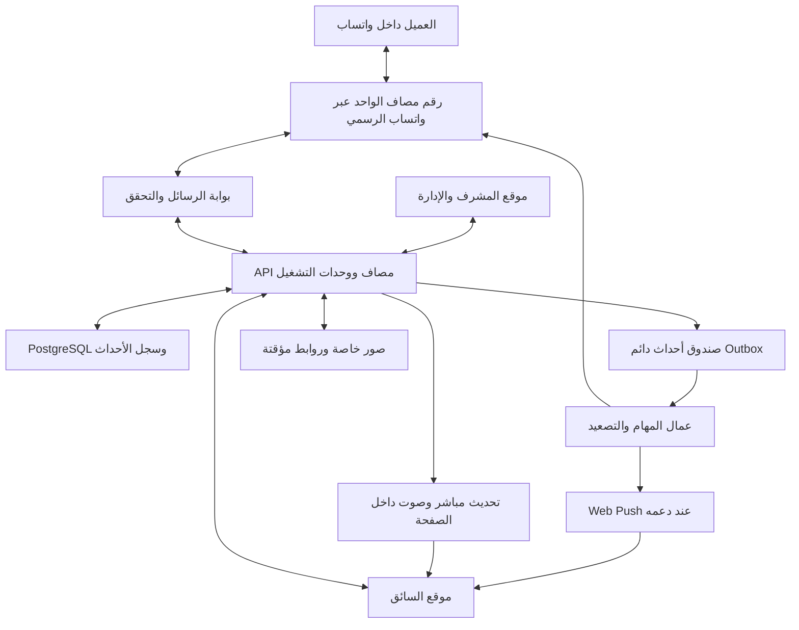
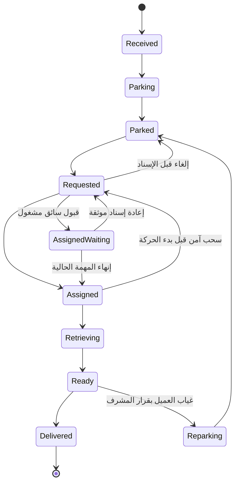

# مصاف — معمارية نظام الفاليت للقاعات

الإصدار 1.2 — 27 أكتوبر 2026 — وثيقة تصميم قابلة للتسليم إلى فريق التطوير.

هذه معمارية مقترحة وليست نظامًا منفذًا أو منشورًا. مرجع UR Valet لم يمكن فحصه بعد شاشة تسجيل الدخول؛ لا تُنسب إليه الخصائص الواردة هنا.

## 1. القرارات الأساسية والنطاق

- القاعات والمواقع التشغيلية فقط؛ لا اشتراكات جامعات في الإصدار الأول.
- السائق نفسه يستقبل المركبة ويسجلها ويصفها، ويمكنه إحضار وتسليم مركبة سجلها أي سائق آخر ضمن نفس الموقع. لا دور أو شاشة استقبال منفصلة.
- حساب دائم مستقل لكل سائق، مع إضافة حسابات جديدة وتعطيلها وتعيينها ونقلها بين القاعات والمواقع دون فقد السجل التاريخي. لا مشاركة لحساب واحد بين عدة سائقين.
- العميل داخل واتساب فقط، بزر واحد اسمه «طلب السيارة». تزال نقطة الاستلام والمساعدة وأزرار الحالة والإلغاء والتقييم من تجربة العميل. تحديثات الحالة ورمز التسليم رسائل تلقائية دون أزرار إضافية.
- المرحلة الأولى موقع واحد متجاوب للجوال، بواجهات بحسب الصلاحية للسائق والمشرف والإدارة. لا تطبيق أصلي أو نشر في المتاجر. يمكن إضافة الموقع للشاشة الرئيسية كـPWA لتحسين الاستخدام والإشعارات حيث تُدعم.
- رقم واتساب مركزي واحد باسم مصاف لجميع العملاء والقاعات؛ لا رقم لكل سائق أو لكل قاعة، ولا قروبات للعملاء. كل عميل يستقبل محادثة خاصة على رقمه من رقم مصاف نفسه.
- الأولوية لأقدم طلب إحضار، والإحالة بحسب تفرغ السائق؛ هوية السائق الذي سجل المركبة لا تمنحه أولوية لاسترجاعها.
- إذا كان الجميع مشغولين يُبث الطلب لجميع سائقي الوردية في نفس الموقع. أول قبول يؤكده الخادم يحجز المهمة ويسحبها من باقي السائقين. السائق المشغول يستطيع حجز مهمة تالية واحدة، لكنه لا يبدأ حركة ثانية قبل إنهاء الأولى.
- WhatsApp Business Platform الرسمي عبر Cloud API أو مزود معتمد؛ قاعدة البيانات المركزية مصدر الحقيقة، لا الإشعارات أو حالة الشاشة.
- المدفوعات الأولية: تسجيل خدمة مشمولة أو تحصيل السائق نقدًا/بنقاط بيع عند التسليم إذا لزم؛ لا معالجة بيانات بطاقات.
- خلفية برمجية واحدة مقسمة لوحدات مع عامل مهام منفصل. هذه نسخة معمارية محدثة وليست تنفيذًا برمجيًا منشورًا.

## 2. المخطط العام

الأسهم تبيّن مسارات الاتصال المنطقية. يتلقى الخادم إشعارات واتساب، يتحقق منها ويحفظها قبل المعالجة. يكتب تغيير الطلب والحدث الصادر في معاملة قاعدة بيانات واحدة؛ يرسل العامل الرسائل لاحقًا مع إعادة المحاولة. اتصال WebSocket يحسن التحديث الفوري، ويعود العميل البرمجي إلى جلب الحالة عند الانقطاع أو فتح الموقع.

## 3. المستخدمون والصلاحيات

| الدور | الصلاحيات | الحدود |
|---|---|---|
| العميل | «طلب السيارة» وتلقي تحديثات ورمز تسليم | زر مربوط بالمرسل والتذكرة؛ لا صفحة أو حساب عميل |
| السائق | تسجيل مركبة وصورها وجوال العميل، ربط واتساب، الصف، قبول الإحضار، التحقق والتسليم والتحصيل | موقعه وورديته الحالية؛ لا إدارة حسابات أو رؤية رمز التسليم المخزن |
| المشرف | تعيين ونقل السائقين المخولين، توزيع المهام، معالجة التأخير والعهدة، إغلاق الحفل | المواقع المسندة إليه؛ نقل بين نطاقين يحتاج مديرًا مخولًا لكليهما |
| الإدارة | إنشاء وزيادة وتعطيل حسابات السائقين، القاعات والمواقع، الصلاحيات، التقارير | سجل تدقيق ومصادقة متعددة العوامل للحسابات الإدارية |

يُسمح للسائق بعرض الحد الأدنى من بيانات المركبات المسجلة في موقعه للبحث والتشغيل؛ لا يلزم أن يكون منشئ التذكرة. تفاصيل المفتاح والصور الكاملة تظهر للمكلف بالمهمة أو لمشرف الموقع. جوال العميل يُدخل عند التسجيل ويُعرض مقنّعًا بعده إلا لصلاحية مبررة. صلاحية تغيير الحالة تحتاج مهمة مقبولة أو أمرًا مخولًا، وليست متاحة لأي من شاهد المركبة.

كل API وصورة وتصدير وغرفة اتصال فوري يتحقق من المؤسسة والموقع والوردية والدور والتكليف الحالي. لا يكتفى بإخفاء الأزرار في الواجهة.

## 4. تجربة التشغيل من البداية للنهاية

### أ. حسابات السائقين وتعيين المواقع

يُنشأ ملف دائم للسائق: معرف ثابت، اسم، وسيلة دخول، حالة الحساب، صلاحياته وأجهزته. إضافة مستخدمين جدد متاحة للإدارة من الشاشة دون تعديل برمجي أو عدد حسابات ثابت في التصميم؛ السعة تتبع البنية التحتية. لكل سائق تعيينات مؤرخة، وموقع تشغيل نشط واحد في اللحظة نفسها. يسجل حسابه مرة ثم يُعاد استخدامه بكل قاعة ينتقل إليها.

النقل: يختار المشرف السائق والموقع الجديد وموعد النقل. لا يُفعّل النقل وهو يحمل مركبة أو مفتاحًا أو لديه مهمة جارية. ينهي العهدة أو يسلمها رسميًا، وتُلغى عروضه وتُعاد مهمته التالية المحجوزة لقائمة الموقع القديم، ثم يُغلق تعيينه السابق ويُفتح الجديد. تبطل صلاحيات الموقع السابق على الخادم وتُفصل غرف الاتصال وتُمسح البيانات المؤقتة الخاصة به. الإشعارات القديمة لا تسمح بقبول مهمة من الموقع السابق. السجلات القديمة تحتفظ بالموقع والسائق الأصليين؛ لا تعاد كتابتها حسب موقع السائق الحالي.

يمكن جمع أكثر من حفل في مجموعة توزيع واحدة داخل الموقع بتعيين صريح. الافتراضي توزيع الطلبات بين جميع سائقي الموقع المناوبين، مع حفظ الحفل لكل تذكرة. لا يُرسل طلب قاعة إلى سائقي موقع آخر إلا بعد إجراء نقل/تعيين مخول.

### ب. فتح الوردية

يجهز المشرف الموقع والحفل والمواقف وخانات المفاتيح والتسعير. يدخل السائق بحسابه إلى تعيينه المعتمد، يختبر الصوت، ثم يبدأ الوردية. التوفر يُحسب من المهام الفعلية: متاح، يسجل/يصف، يحضر/يسلم، مشغول ولديه مهمة تالية، استراحة، خارج الوردية. الاتصال مؤشر مستقل وليس ضمانًا على التوفر؛ لا نفترض بقاء WebSocket مفتوحًا بالخلفية.

### ج. استقبال المركبة بواسطة السائق

من موقع السائق على جواله يضغط «استلام مركبة»، فيصبح مشغولًا بالتسجيل، ويُدخل اللوحة والنوع واللون والجوال وصور الحالة ورقم علاقة المفتاح. الوقت والموقع والحفل واسم السائق تلقائية. تُنشأ التذكرة ومهمة الصف باسمه معًا دون انتظار عرض لنفسه. بداية التسجيل تتنافس ذريًا مع قبول مهام الإحضار؛ لا يُسمح له ببدء تسجيل ثانٍ وهو ينفذ حركة أو لديه مهمة تالية واجبة البدء.

رقم التذكرة فريد داخل الحفل، والمعرف الداخلي UUID، وتخصيص مفتاح مشغول لتذكرة أخرى ممنوع. إن فشل رفع الصور يظهر «الفحص غير مكتمل» ويعتمد المشرف الاستثناء. إن ترك التسجيل مسودة لا تعني انتهاء العهدة؛ يتحقق المشرف قبل تحرير التوفر.

### د. ربط واتساب والصف

بعد موافقة العميل وتأكيد رقمه ترسل تذكرة بقالب معتمد وزر «طلب السيارة». بديل الربط: QR يفتح واتساب برسالة ورمز ربط عشوائي قصير الصلاحية؛ العميل يضغط إرسال، والسائق يؤكد مطابقة المركبة أمامه. مسح QR وحده ليس إرسالًا. لا توجد صفحة عميل.

يركن السائق المركبة ويسجل الموقف وخانة المفتاح ويؤكد إيداعه. يعود متاحًا بعد إكمال الصف والعهدة. يحفظ النظام created_by وparked_by؛ هذان للتوثيق فقط ولا يحددان من سيحضر المركبة. انتقال المركبة أو المفتاح لاحقًا يسجل من وإلى والتوقيت والسبب. عند عدم استخدام العميل واتساب يتعامل مع أحد سائقي الموقع بتذكرة ورقية.

### هـ. طلب السيارة

لكل مركبة رسالة مستقلة فيها رقم التذكرة وبيانات مختصرة وزر «طلب السيارة» مربوط بها. إذا امتلك العميل عدة مركبات يضغط زر الرسالة الخاصة بالمركبة المطلوبة؛ لا تظهر قائمة أزرار إضافية ولا يتم اختيار أحدث مركبة تلقائيًا. يُتحقق من هوية مرسل واتساب والتذكرة وإصدار الإجراء.

الضغط المتكرر يعيد الحالة ولا ينشئ طلبًا جديدًا. إن كانت المركبة تحت الصف يحتفظ النظام بطلب معلق ويُعلم السائق القائم عليها والمشرف؛ لا تنشأ حركتان متزامنتان. رسالة «تم تسجيل طلبك» تصدر بعد حفظه فعليًا.

### و. التوزيع بحسب التفرغ والأولوية

1. ترتيب الطلبات بأقدم requested_at، وعند التساوي يستخدم تسلسل ثابت. أي تجاوز يدوي للأولوية يحتاج مشرفًا وسببًا.
2. عند وجود متاحين يُعرض أقدم طلب على أطولهم تفرغًا في الموقع، دون تفضيل من سجل المركبة. إن انتهت المهلة يُعرض على التالي.
3. إذا كان جميع السائقين المؤهلين مشغولين يُفتح وضع broadcast ويرسل إشعار صوتي لجميع سائقي الموقع داخل الوردية، عدا المستريح وخارج الوردية. يظل الطلب في مقدمة القائمة. السائق ذو مهمة تالية محجوزة يرى التنبيه لكن لا يستطيع قبول ثانية.
4. أول قبول يؤكده الخادم يملك المهمة وحده. إذا كان متاحًا يبدأها، وإذا كان مشغولًا تُحفظ كالمهمة التالية assigned_waiting، ولا يُسمح ببدء الحركة قبل إتمام الحالية. قبول مهمة تالية يتم في وقت آمن وليس أثناء قيادة المركبة.
5. يرسل task.claimed إلى الجميع، فتختفي بطاقة الطلب من قوائمهم وتتوقف تنبيهاته. يبقى تاريخ الحدث للمشرف. الخادم يرفض أي قبول لاحق حتى إذا لم تختف بطاقة جهاز غير متصل بعد.
6. لا يقبل سائق طلبًا أحدث بينما طلب أقدم متاح لنفس مجموعة السائقين؛ تقفل المعاملة على قائمة الموقع وتتحقق من الأولوية. الطلب المحجوز لم يعد متاحًا للبقية، ويمكن توزيع التالي على آخرين. ضمان الأولوية يخص التوزيع؛ انتهاء الإحضار فعليًا قد يختلف حسب بعد المواقف.
7. إذا صار سائق آخر متاحًا والطلب الأقدم محجوز كسابق لم يبدأ، يظهر تنبيه للمشرف لإعادة إسناد آمنة عند الحاجة. لا تُسحب مهمة مقبولة خفية من سائق.

### ز. الإحضار والتسليم بواسطة السائق

السائق المكلف قد يكون مختلفًا تمامًا عن المسجل. يرى الموقف وخانة المفتاح ويؤكد استلام المفتاح ثم «بدء الإحضار». عندها يرسل واتساب «جارٍ إحضار سيارتك». بعد الوصول يضغط «جاهزة»، فتصل «سيارتك جاهزة» ورمز التسليم دون نقطة استلام أو مساعدة.

العميل يخبر السائق بالرمز؛ السائق يدخله للتحقق بالخادم دون أن تعرض الواجهة الرمز مسبقًا. يُستهلك الرمز مرة واحدة وتتحقق حالة التحصيل عند اللزوم، ثم تغلق التذكرة. يسجل retrieved_by وdelivered_by كلٌ على حدة. المهمة الحالية تبقى مشغولة حتى التسليم أو تحويل العهدة رسميًا؛ الضغط على «جاهزة» وحده لا يحرر السائق لقيادة أخرى.

إذا لديه مهمة تالية ينتقل إليها بعد تأكيد إنهاء الحالية مع إشعار صوتي جديد؛ لا تظهره المنظومة متاحًا لتكليف ثالث. فقد التذكرة يعالج بإجراء مشرف موثق؛ رقم اللوحة وحده غير كافٍ.

### ح. نهاية الحفل والموقع

يطابق المشرف المركبات والمفاتيح والطلبات المحجوزة والتحصيل. لا يُغلق حفل كمكتمل وفيه عهدة مفتوحة. نقل السائق أو تعطيله لا يلغي مسؤولياته السابقة ولا يغلق تذاكره؛ يلزم إقفال العهدة أو نقلها رسميًا.

## 5. محادثة واتساب — زر واحد فقط

| الحدث | مثال المحتوى | الزر |
|---|---|---|
| إصدار التذكرة | مصاف — قاعة ريماس — تذكرة 125 — تم استلام مركبتك | طلب السيارة |
| تسجيل الطلب | تم تسجيل طلب سيارتك رقم 125؛ سنبلغك عند جاهزيتها | دون أزرار |
| حجز سائق مشغول | طلبك في الانتظار وتم إسناده؛ سنبلغك عند بدء الإحضار | دون أزرار |
| بدء الإحضار الفعلي | جارٍ إحضار سيارتك رقم 125 | دون أزرار |
| الجاهزية | سيارتك جاهزة. رمز التسليم: مثال 482731 | دون أزرار |
| التسليم | تم تسليم سيارتك. شكرًا لاختيارك مصاف | دون أزرار |

لا نقطة استلام أو مساعدة أو حالة طلب أو إلغاء أو تقييم ضمن أزرار العميل. تظل التحديثات آلية، ويمكنه الضغط على الزر القديم لمعرفة الحالة الحالية دون تكرار الطلب. لا يرسل حجز مهمة تالية رسالة «جارٍ الإحضار» قبل البداية الفعلية. الإلغاء إن طلبه العميل ميدانيًا يتم بواسطة السائق المخول أو المشرف بحسب الحالة.

هذه أمثلة تحتاج اعتماد القوالب عند التنفيذ. تُراعى نافذة الخدمة والقوالب والموافقة كما في مرجع واتساب: بدء محادثة وخارج النافذة يستخدم قالبًا معتمدًا. تُخزن آخر رسالة واردة وحالة القالب، ويظهر فشل الإرسال للسائق والمشرف. لا حاجة لذكاء اصطناعي أو صندوق مساعدة كميزة عميل. الرسالة الحرة تُقابل بتوجيه لاستخدام زر تذكرته أو التواصل مباشرة مع سائق الموقع؛ تُذكر وسيلة تصعيد بشرية مناسبة في تعريف حساب الأعمال دون إعادة زر المساعدة.

### رقم واتساب واحد لجميع المواقع

يحدد إعداد الخادم phone_number_id واحدًا للإنتاج. كل تذكرة تخرج من رقم مصاف نفسه إلى محادثة خاصة بالعميل؛ ليست قائمة بث جماعية ولا مجموعة واتساب. السائق لا يرسل من رقمه الشخصي ولا يختار هوية المرسل.

الرد الوارد يصل إلى Webhook مركزي؛ الخادم يطابق wa_id للعميل ومعرف إجراء الزر مع ticket_id ثم venue_id. لا يستنتج الموقع من آخر محادثة أو من رقم العميل وحده. إذا لدى العميل تذكرتان في موقعين، زر كل رسالة يوجّه إلى مجموعة سائقي موقعها الصحيح. الأرقام الظاهرة للتذاكر تتضمن اسم الموقع والحفل لتقليل الالتباس، والمعرف الداخلي عالمي وفريد.

كل الموقعين يستخدمون نفس طابور إرسال مركزي مع حفظ ترتيب رسائل التذكرة، وعدالة بين المواقع، واحترام حدود المزود وإعادة المحاولة. لا يؤدي ضغط إرسال في موقع إلى استحواذ دائم على الطابور. إذا تعطل الرقم المركزي يظهر تنبيه موحد للإدارة وجميع المواقع المتأثرة؛ لا يتحول النظام تلقائيًا إلى أرقام السائقين. تستمر العمليات الداخلية ويطلب العميل من سائق الموقع ميدانيًا.

## 6. حالات التذكرة والمهمة

معاني الحالات: Received مستلمة، Parking جارٍ الصف، Parked متوقفة، Requested مطلوب إحضارها، Assigned مقبولة من سائق متاح، AssignedWaiting محجوزة تالية لسائق مشغول، Retrieving جارٍ الإحضار، Ready جاهزة، Delivered مسلمة. عرض المهمة قبل قبولها لا ينقل التذكرة إلى Assigned.

حالات المهمة منفصلة: queued، offered، broadcast، assigned_waiting، accepted، in_progress، completed، expired، canceled. حالتا الدفع والإشعار منفصلتان عن حالة المركبة. الملاحظات/الحوادث أعلام مستقلة لا تمحو الحالة التشغيلية. عند إلغاء المهمة بعد القبول وقبل الحركة يحتاج النظام إقرار تحرير العهدة؛ بعد بدء الحركة لا يعيد إسنادها آليًا.

الحالة تنتقل بأوامر محددة فقط. كل أمر يتحقق من الحالة السابقة وإصدار السجل والصلاحية. طلب العميل المبكر يحفظ كـpending_retrieval ويعالَج بعد الصف. إعادة الصف تنشئ دورة جديدة للاسترجاع وتحافظ على سجل الدورة السابقة، فلا تُخلط أزمنتهما في التقارير.

## 7. التنبيه الصوتي والتصعيد وسحب الطلب

| الحالة/الزمن المقترح | التصرف |
|---|---|
| يوجد سائق متاح | عرض فردي بصوت؛ تذكير واحد بعد 15 ثانية دون قبول |
| بعد 30 ثانية دون قبول فردي | إنهاء العرض وعرضه على المتاح التالي؛ إن أصبح الجميع مشغولين ينتقل للبث |
| الجميع مشغولون لحظة الطلب | بث صوتي فوري لجميع سائقي الوردية في الموقع وإظهار أقدم طلب قابل للقبول |
| بث لم يقبله أحد بعد 30 ثانية | تذكير واحد بالمهمة المفتوحة فقط |
| مرور 60 ثانية دون قبول | تصعيد صوتي وبصري للمشرف؛ الطلب لا يسقط من القائمة |
| أول قبول مؤكد | إبطال كل العروض الأخرى، إزالة البطاقة ووقف تذكيرها لدى الآخرين |
| مهمة تالية تنتظر أكثر من حد الموقع | تنبيه المشرف دون إعادة إسناد صامتة |

الأزمنة قيم أولية قابلة للتعديل بعد الاختبار. إذا لا يوجد أي سائق داخل الوردية يرفع للمشرف فورًا؛ لا يرسل إلى مواقع أخرى. البث محاولة إرسال لكل سائق مؤهل، وليس ضمانًا أن هاتف كل سائق أصدر صوتًا.

التنبيه الأساسي في المرحلة الأولى داخل صفحة الموقع المفتوحة: يضغط السائق «تفعيل واختبار الصوت» عند بدء الوردية، ويؤكد سماع النغمة. تصل الأحداث عبر WebSocket وتظهر بطاقة الطلب وتعمل النغمة عند سماح المتصفح. إذا منع المتصفح الصوت تظهر رسالة وإجراء لإعادة تفعيله؛ لا يُفترض أن التشغيل التلقائي مسموح بمجرد تسجيل الدخول.

عند قفل الجوال أو انتقال المتصفح للخلفية قد تتوقف الصفحة والاتصال والصوت. Web Push عبر Service Worker واشتراك المتصفح إضافة مساعدة عند دعم الجهاز وبعد موافقة المستخدم، وليس ضمانًا لصوت بالخلفية. على iPhone/iPad يُجهز مسار إضافة الموقع للشاشة الرئيسية وطلب إذن الإشعارات من تفاعل مباشر وفق دعم النظام. تظل وظائف الموقع الأساسية متاحة من المتصفح دون تثبيت، لكن تجهيز الإشعارات يختلف بحسب الجهاز.

لا يعتمد الموقع على FCM/APNs SDK أصلي، ولا توجد متطلبات حساب متجر تطبيقات. عامل الإشعارات يستخدم Web Push القياسي عند توافر الاشتراك؛ خدمات تسليم المتصفح قد تستخدم مزودي المنصة خلف الكواليس. لا يمكن الوعد بنغمة مخصصة مستمرة في الخلفية أو تجاوز الصامت/التركيز. تفعيل الصوت داخل الصفحة وإذن إشعارات النظام خطوتان منفصلتان.

إزالة الطلب: ينشر الخادم task.claimed بمعرف وإصدار، فتختفي البطاقة من صفحات السائقين المتصلة ويتوقف صوتها. Service Worker يحاول إغلاق إشعار مطابق حيث يمكن، لكن جهازًا غير متصل قد يحتفظ بإشعار قديم. عند فتحه يجلب الموقع الحالة الحالية؛ الخادم يرفض القبول المكرر مهما بقي ظاهرًا.

تشغيل الوردية: يفضل إبقاء صفحة العمل أمام السائق حين لا يقود، مع لوحة مشرف مفتوحة تتابع عدم القبول. يمكن طلب Screen Wake Lock عند دعمه في الصفحة المرئية، دون اعتباره مضمونًا أو وسيلة لتجاوز قفل الجهاز. فقد heartbeat يظهر كمؤشر «الاتصال غير مؤكد» منفصل عن حالة انشغاله؛ لا تُسحب مهمة جارية بسبب اختفاء الصفحة. عند العودة تتم مزامنة كاملة قبل الأوامر، وتظهر آخر مزامنة وحالة الاتصال.

البث الجماعي يضيف الطلب لجميع السائقين المؤهلين ويُحاول تنبيههم عبر القنوات المتاحة؛ لا يفترض سماع الجميع. مؤقتات القبول والتصعيد تعمل على الخادم حتى إذا أغلقت كل الصفحات. تُختبر حالات صفحة أمامية/خلفية وقفل الشاشة ورفض الصوت والإشعارات على Safari وChrome وأجهزة التشغيل قبل الإطلاق. لا بيانات عميل أو رمز تسليم أو موضع مفتاح في إشعار شاشة القفل.

## 8. الوحدات البرمجية

| الوحدة | المسؤولية |
|---|---|
| Identity & Access | حسابات السائقين الدائمة وإضافتها وتعطيلها، التعيينات والنقل بين المواقع، الأدوار والأجهزة |
| Venues & Events | القاعات، الحفلات، الورديات، مناطق الوقوف، مواقع المفاتيح |
| Tickets & Custody | المركبات، الفحص، التذاكر، العهدة، الانتقالات والتسليم |
| Dispatch | قائمة الانتظار، عروض المهام، القبول، التصعيد وإعادة الإسناد |
| WhatsApp Adapter | رقم إرسال مركزي واحد، توقيع Webhook، ربط العميل والتذكرة والموقع، القوالب، تقارير الإرسال |
| Notifications | Outbox، Push، التذكير، انتهاء الرسائل وإعادة المحاولة |
| Incidents | وقائع داخلية للمشرف: المفتاح، الضرر، الغياب والتحقق اليدوي؛ لا ميزة مساعدة للعميل |
| Payments & Reports | سجل التحصيل والتسويات والتقارير دون معالجة بطاقات |
| Audit & Monitoring | سجل الأوامر، قياسات الخدمة، كشف الرسائل والمهام العالقة |

## 9. نموذج البيانات

| الكيان | أهم الحقول والعلاقات |
|---|---|
| organizations / venues | المؤسسة، القاعة أو الموقع، العنوان، مجموعة التوزيع، الإعدادات |
| events / shifts | venue_id، تاريخ الحفل، حالة الفتح، الوردية والموظفون |
| users / role_scopes | معرف سائق ثابت، الاسم، الدور، نطاق الإدارة، حالة الحساب |
| driver_assignments / transfers | السائق، الموقع، بداية ونهاية التعيين، المعتمد، سجل نقل العهدة؛ تعيين نشط واحد |
| driver_sessions / devices | المستخدم، الوردية، التوفر، آخر نشاط، browser_session، last_seen، audio_test_at، notification_permission، web_push_subscription إن وُجد |
| customers / consents | الجوال المطبع، wa_id، الموافقة ومصدرها، اللغة، آخر رسالة واردة |
| tickets | UUID، رقم العرض، event_id، venue_id، customer_id، بيانات المركبة، الحالة، version، created_by، parked_by، retrieved_by، delivered_by |
| parking_locations / key_slots | القاعة والمنطقة والموقف/الخانة، التذكرة الشاغلة |
| vehicle_inspections / media | ticket_id، صور خاصة، ملاحظات، الموظف، الوقت |
| retrieval_cycles | التذكرة، وقت الطلب والإحضار والجاهزية والتسليم/الإلغاء |
| tasks / task_offers / offer_recipients | النوع، التذكرة، الدورة، الموقع، السائق المقبول، النمط فردي/بث، الحالة، version، expiry، مستلمو العرض |
| custody_events | المركبة أو المفتاح، الحائز السابق واللاحق، الوقت والسبب |
| whatsapp_channel | إعداد إنتاج واحد فعال: business_account_id وphone_number_id ومرجع السر والقوالب؛ لا نسخ لكل موقع |
| whatsapp_messages / inbound_events | message_id فريد، channel_id، recipient_wa_id، ticket_id، venue_id، الاتجاه، المرجع، الحالة |
| action_tokens / claim_codes | ربط زر/عميل/تذكرة، انتهاء، نسخة، هاش رمز التسليم، استهلاك |
| notifications / delivery_attempts | قناة الإرسال، event_id، المحاولات، خطأ المزود، وقت الإقرار |
| payments | المبلغ، طريقة التحصيل، المرجع، المحصل، الحالة، عكس تسوية موثق |
| incidents | التذكرة، نوع الواقعة، الحالة، المشرف المسؤول |
| outbox / audit_log | الحدث، الكيان، الفاعل، التوقيت، النسخة، المعالجة |

قيود قاعدة البيانات: رقم تذكرة فريد لكل حفل، message_id وارد فريد، مهمة حركة نشطة واحدة للمركبة والسائق، جولة عرض نشطة واحدة للمهمة مع عدة مستلمين في البث، مهمة تالية محجوزة واحدة لكل سائق، تعيين موقع نشط واحد لكل سائق، تخصيص نشط واحد لخانة المفتاح/الموقف المخصص، طلب استرجاع نشط واحد لكل تذكرة. منع الازدواج يتم بقيود ومعاملات فعلية وليس فحص الواجهة فقط. تستخدم أوقات UTC داخليًا وتعرض بتوقيت Asia/Riyadh.

## 10. معالجة الأوامر والتكرار والسباق

مسار Webhook: التحقق من توقيع المزود على الجسم الأصلي، التحقق من الحساب المستقبِل، حفظ الحدث الوارد بمعرفه الفريد، ثم ACK سريع. إن تعذر الحفظ لا يعاد نجاح كاذب. يعالج العامل الحدث ويطابق مرسل واتساب والزر والتذكرة؛ تسجل الحالة الجديدة مع Outbox في معاملة واحدة.

قبول مهمة: BEGIN → قفل سجل توزيع الموقع ثم المهمة والسائق بترتيب ثابت → التحقق من التعيين والوردية ونسخة العرض وصلاحيته والمستلمين وأولوية الطلب → إذا السائق متاح: accepted، وإذا لديه مهمة جارية ولا مهمة تالية: assigned_waiting → تحديث التكليف وإبطال بقية عروض المهمة وكتابة Audit وOutbox → COMMIT. أول معاملة ناجحة تفوز؛ البقية تحصل على 409 «الطلب تم قبوله». ترتيب الأقفال ثابت في القبول والنقل وإعادة التوزيع لتقليل التعارض. القيود تمنع مهمة حركة ثانية أو مهمة تالية ثانية حتى لو تعددت أجهزة السائق.

إتمام المهمة الحالية يحرر العهدة ويُرقّي المهمة التالية المقبولة إلى جاهزة للبدء في معاملة واحدة، ولا يجعل السائق متاحًا لتكليف آخر بين الخطوتين. نقل السائق أو تعطيله يتعامل مع نفس الأقفال، ويعيد حجزه التالي إلى موقعه الأصلي ثم يبطل نطاق وصوله القديم. عرض قائمة السائق يتبع تكليفه الحالي؛ السجل التاريخي يتبع موقع الحدث وقت وقوعه.

يوضع Idempotency-Key للأوامر المكررة من واجهات الموقع ويرتبط بالمستخدم ونوع العملية وبصمة المدخلات. يرد الخادم بالنتيجة المحفوظة عند إعادة نفس الأمر، ويرفض تغيير محتواه مع نفس المفتاح. لا يوجد ادعاء exactly-once من المزود؛ الرسائل قد تتكرر أو تصل بترتيب مختلف. الأثر التشغيلي يمنع تكراره بالخادم. لا يخفض status متأخر مثل sent الحالة من read إلى sent، ويُراجع إرسال تنبيه قديم قبل تنفيذه.

## 11. واجهات التكامل المقترحة

| الأمر | المسار المقترح | الشرط |
|---|---|---|
| تسجيل مركبة | POST /v1/tickets | سائق ضمن حفل وموقع نشطين + مفتاح تكرار + حجز انشغاله |
| إصدار ربط واتساب | POST /v1/tickets/{id}/whatsapp-link | سائق ضمن الموقع، رمز قصير الصلاحية |
| إتمام الصف | POST /v1/tasks/{id}/complete-parking | السائق المكلف، الموقف والمفتاح |
| طلب نيابة عن العميل | POST /v1/tickets/{id}/retrievals | سبب وموظف مخول؛ الطلب العادي يأتي من Webhook |
| قبول العرض | POST /v1/task-offers/{id}/accept | عرض صالح فردي/بث، مستلم مخول، أولوية، قبول ذري أو حجز تالي |
| بدء الإحضار | POST /v1/tasks/{id}/start-retrieval | قبول مؤكد واستلام المفتاح |
| الجاهزية | POST /v1/tasks/{id}/ready | مهمة جارية في نفس القاعة |
| التسليم | POST /v1/tickets/{id}/handover | تحقق الرمز والدفع والحالة، عملية ذرية |
| إعادة الإسناد | POST /v1/tasks/{id}/reassign | مشرف + سبب + تحقق العهدة |
| ورود واتساب | GET/POST /webhooks/whatsapp | تحقق إعداد Webhook وتوقيع الرسائل |
| إضافة حساب سائق | POST /v1/drivers | إدارة مخولة، حساب دائم مستقل |
| نقل السائق | POST /v1/drivers/{id}/transfers | صلاحية الموقعين + إقفال/نقل العهدة + إبطال العروض القديمة |
| تحديث الجهاز | PUT /v1/me/devices/{id} | جلسة سائق موثقة |
| جلب الحالة | GET /v1/events/{id}/operations | نطاق القاعة + ترقيم صفحات وتصفية |

هذه عقود تصميم أولية تُحوّل إلى OpenAPI عند التنفيذ. الاستجابات تتضمن معرف الأمر ونسخة السجل والخطأ الواضح دون كشف بيانات غير مصرح بها.

## 12. واجهات بسيطة مصممة للجوال أولًا

موقع واحد ورابط دخول واحد؛ الصلاحيات تحدد الواجهة بعد الدخول. العربية من اليمين لليسار، بلا جداول عريضة في شاشة السائق، وبلا تمرير أفقي على عرض 360–430 بكسل. حجم نص أساسي مقترح 16 بكسل، وأهداف لمس لا تقل عن 44 بكسل، وتباين واضح، وحالة مكتوبة بجانب اللون.

### واجهة السائق

شريط علوي مختصر: اسم الموقع، حالة السائق، الاتصال. شريط سفلي بثلاثة أقسام فقط: «الرئيسية»، «المركبات»، «حسابي».

| الشاشة | العناصر الظاهرة |
|---|---|
| الرئيسية | زر بارز «استلام مركبة»، المهمة الحالية، المهمة التالية إن وجدت، طلب الإحضار الأقدم القابل للقبول |
| استلام مركبة | نموذج قصير على خطوتين: اللوحة/النوع/اللون/الجوال، ثم المفتاح/الصور؛ الموقع والحفل والسائق تلقائية |
| بطاقة طلب الإحضار | رقم التذكرة، المركبة، مدة الانتظار، زر كبير «قبول الطلب» أو «حجز كمهمة تالية» |
| المهمة الحالية | الموقف والمفتاح وزر المرحلة التالية فقط: بدء الإحضار، جاهزة، التحقق والتسليم |
| المركبات | بحث باللوحة أو التذكرة، بطاقات مختصرة، وتفاصيل عند الفتح حسب الصلاحية |
| حسابي | الاسم، الموقع، بداية/نهاية الوردية، استراحة، تفعيل واختبار الصوت، إعداد الإشعارات إن كانت مدعومة |

لا تبديل موقع حر من حساب السائق؛ النقل يعتمده المشرف. لا طلب GPS في الإصدار الأول. التصوير من كاميرا الجوال أو اختيار صورة مع توضيح حالة الرفع. عند الخطأ يبقى النموذج ولا تضيع مدخلاته؛ زر الحفظ يمنع التكرار ويعرض نتيجة الخادم. إذا حدث تنبيه أثناء التسجيل لا تُمسح المسودة ولا تتعارض العهدة.

### واجهة المشرف والإدارة

أربع وجهات واضحة: «التشغيل»، «السائقون»، «المواقع والحفلات»، «التقارير». في الجوال تستخدم بطاقات وفلاتر مختصرة، وتتوفر الجداول للشاشات الأكبر. التشغيل يعرض الطلبات المتأخرة والمهام والعهدة والرسائل الفاشلة؛ السائقون يعرضون إضافة الحساب والتوفر والنقل؛ المواقع تعرض التعيينات والحفلات.

### واتساب العميل

رقم مصاف المركزي يرسل تذكرة فيها اسم الموقع ورقمها وزر «طلب السيارة» فقط؛ التحديثات ورمز التسليم رسائل تلقائية. لا واجهة ويب للعميل، ولا أرقام سائقين ظاهرة له.

## 13. التقنية والنشر المقترحان

اختيار تنفيذي أولي: React/TypeScript لموقع متجاوب واحد للسائق والمشرف والإدارة، مع Manifest وService Worker لدعم PWA وWeb Push اختياريًا، NestJS/TypeScript للخادم والعامل، PostgreSQL للبيانات والـOutbox وجدولة المهام الدائمة، تخزين كائنات خاص للصور. Redis اختياري للحضور والاتصال الفوري وليس مصدر العهدة أو الطلبات. إصدارات المكتبات المدعومة تُثبت وقت التنفيذ بعد مراجعة وثائقها.

بيئات منفصلة للتطوير والاختبار والإنتاج، ومحاكاة رسائل/بيئة اختبار واتساب معزولة لا تراسل العملاء. رقم إنتاج مركزي واحد فقط لجميع المواقع، ويمكن استخدام موارد الاختبار التي يتيحها المزود دون إضافة أرقام إنتاج. أسرار المزود في مدير أسرار لا في كود المتصفح. HTTPS، نسخ احتياطي مشفر مع استعادة زمنية إن دعم المزود، واختبار استعادة قبل التشغيل. اختيار منطقة استضافة مناسبة في السعودية قرار نشر، ولا يعني أن بيانات واتساب وPush لا تمر عبر مزوديها؛ توثق مسارات البيانات فعليًا قبل أي ادعاء بإقامة كاملة للبيانات.

تطبيق API والعامل يمكن تشغيلهما من نفس مستودع الكود بعمليتين منفصلتين. عند التوسع تضاف نسخ API وعمال؛ القيود في PostgreSQL تحمي من الازدواج، ويستأجر العامل المهمة لمدة محددة كي يستأنفها عامل آخر عند سقوطه. تُفصل Dispatch أو Messaging كخدمة مستقلة فقط عند ظهور حاجة مقاسة.

## 14. الحماية والتشغيل عند الأعطال

- صور المركبات خاصة، مع روابط مؤقتة وصلاحية محدودة؛ لا صور أو أكواد في السجلات العامة.
- لا يخزن رقم العميل في Push؛ يتلقى الجهاز معرفًا ثم يجلب التفاصيل بعد المصادقة.
- رمز تسليم مبدئي 6 أرقام، انتهاء مقترح 30 دقيقة من الجاهزية، حد مقترح 5 محاولات ثم المشرف؛ تُضبط القيم بعد الاختبار. الرمز لا يستخدم لتخمين التذاكر أو كشف بياناتها.
- تعديل الجوال/الربط يبطل الإجراءات السابقة ويتطلب تحقق موظف وسجل تغيير.
- لا حذف صامت للتذكرة أو التحصيل؛ إلغاء/تصحيح/عكس مع السبب والسجل. مدد الاحتفاظ للصور والرسائل والتذاكر تُعتمد تشغيليًا قبل الإطلاق وتطبق بمهمة دورية، مع حجز الوقائع المفتوحة من الحذف عند الحاجة.
- إذا تعطل واتساب يستمر الموظفون في النظام وتظهر الرسائل المتأخرة؛ الطلب مباشرة من سائق الموقع، وإعادة إرسال الحالات الحالية فقط بعد عودة الخدمة.
- إذا انقطع اتصال السائق، لا تظهر «تم القبول» دون تأكيد الخادم. تعرض البيانات المخزنة كقديمة، ويُوقف القبول والتسليم غير المتحقق؛ يتدخل المشرف عبر الإجراء التشغيلي.
- إذا تعطل الخادم/الإنترنت كليًا، يستخدم سجل ورقي مرقم للعهدة والتحريك والتسليم. بعد الاستعادة تتم المطابقة بأرقام الحفل والتذاكر دون تشغيل الأوامر المؤجلة تلقائيًا أو إرسال تنبيهات قديمة.
- الإشعار الفاشل يعاد بمحاولات محدودة مع تباعد، ثم قائمة فشل للمشرف؛ لا حلقة إعادة إرسال بلا نهاية.
- انتهاء مهلة العرض لا يعيد إسناد مركبة يتحرك بها سائق؛ المهمة المقبولة أو الجارية تحتاج تحققًا بشريًا من العهدة عند فقد الاتصال.

## 15. القياسات والأهداف الأولية

أهداف تصميم للاختبار وليست نتائج مقاسة: تأكيد حفظ الطلب داخل الخادم p95 أقل من ثانيتين في الحمل المتفق عليه، ونشر حدث الإسناد p95 أقل من 3 ثوانٍ بعد الحفظ. زمن مزود واتساب وPush والشبكة والسائق يقاس منفصلًا. لا نعد بزمن وصول إشعار أو إحضار مركبة ثابت.

التقارير: زمن قبول السائق، زمن بدء الإحضار، الطلب إلى الجاهزية، الجاهزية إلى التسليم، عدد دورات إعادة الصف، الرسائل الفاشلة، العروض المنتهية، التذاكر المفتوحة عند نهاية الحفل، المبالغ حسب وسيلة التحصيل، والوقائع. تُستبعد الدورات الملغاة من متوسط التسليم وتظهر منفصلة.

تنبيهات النظام: ارتفاع عمر Outbox، توقف Webhooks، نسبة أخطاء الإرسال، غياب السائقين المؤهلين، مهام معلقة، فقد الاتصال، تجاوز زمن الانتظار المضبوط، فشل النسخ الاحتياطي. مؤشر قبول المهمة أهم من مؤشر إرسال التنبيه.

## 16. معايير القبول قبل تشغيل قاعة فعلية

1. رسالة واتساب واحدة معادة 10 مرات تنتج طلبًا واحدًا؛ تكرار الضغط يعيد الحالة الحالية.
2. لا يمكن لرقم مختلف استعمال زر محول إليه لطلب مركبة ليست له.
3. وجود تذكرتين لنفس الرقم لا يؤدي لطلب المركبة الخطأ.
4. قبول متزامن أو ضغط قديم على عرض منتهي لا يخلق سائقين للمهمة.
5. زر طلب أثناء الصف ينشئ طلبًا معلقًا ولا يخلق حركة متعارضة.
6. سقوط العامل بعد الحفظ وقبل الإرسال لا يضيع الطلب؛ وبعد الإرسال قبل التأكيد لا يكرر أثر المهمة.
7. انتهاء نافذة واتساب يختار قالبًا معتمدًا أو يرفع خطأ واضحًا للسائق والمشرف.
8. اختبار صوت الموقع بعد تفاعل المستخدم، منع التشغيل التلقائي، الخلفية وقفل الشاشة، وWeb Push مدعوم/غير مدعوم ورفض الإذن وإضافة الشاشة الرئيسية. توثيق السلوك على الأجهزة الفعلية والتحقق من التصعيد دون الاعتماد على الصوت.
9. لا تسليم دون تحقق أو استثناء مشرف موثق، ولا إعادة استخدام للرمز، ولا تسريب له إلى السائق.
10. سائق ريماس لا يصل لطلبات ليلتي؛ بعد نقله ينقطع وصوله الحي للموقع القديم مع بقاء سجله التاريخي لدى الإدارة.
11. إلغاء بعد بدء الحركة لا يعيد السائق متاحًا تلقائيًا ولا يمحو العهدة.
12. تجربة حفل كامل بسائقين مختلفين من إنشاء الوردية إلى مطابقة المفاتيح وإغلاق الحفل، ثم تجربة استعادة نسخة احتياطية ومطابقة سجل احتياطي.
13. اختبار حمل اصطناعي أولي مقترح: 5 قاعات، 50 سائقًا، 100 طلب إحضار خلال دقيقة؛ يعدّل حسب حجم التشغيل المتوقع، ولا يمثل سعة مثبتة.

14. جميع السائقين مشغولون: يصل البث للمجموعة الصحيحة؛ أول قبول يحجز الطلب، وتختفي بطاقته لدى المتصلين ويرفض الخادم أي قبول لاحق.
15. السائق المشغول يستطيع حجز مهمة تالية واحدة فقط، ولا يبدأها قبل تحرير العهدة الحالية؛ لا تُرسل للعميل رسالة الإحضار قبل البدء الفعلي.
16. إضافة حساب ونقل سائق يحافظان على المعرف والتاريخ؛ النقل يرفض العهدة الجارية ويعيد المهمة التالية ويمنع قبول إشعار قديم.
17. أقدم طلب هو القابل للتوزيع أولًا؛ محاولات قبول طلب أحدث متزامنة لا تتجاوز الأقدم دون استثناء مشرف موثق.
18. تحقق واجهة العميل والقوالب من وجود زر «طلب السيارة» وحده، بلا نقطة استلام أو مساعدة أو حالة أو إلغاء أو تقييم.
19. سائق يسجل المركبة، سائق آخر يقبل طلبها ويحضرها ويسلمها، وكل فعل يحتفظ بفاعله الصحيح.

20. رسائل قاعتين تخرج من نفس phone_number_id، وأزرارها تصل إلى موقع التذكرة الصحيح حتى إذا كان العميل نفسه في الموقعين.
21. واجهات 360 و390 و430 بكسل بلا تمرير أفقي، والأزرار مريحة للمس، والنموذج يحتفظ بمدخلاته بعد فشل الشبكة.
22. رفض إذن الإشعارات لا يمنع الوظائف الأساسية؛ يظهر وضع التنبيه المتاح بوضوح وتستمر مراقبة القبول بالخادم.

## 17. خطة البناء

| المرحلة | التسليم | بوابة الاكتمال |
|---|---|---|
| الأساس | قاعدة البيانات، الأدوار، القاعات والحفلات، التذاكر، الصور والعهدة | سائق يسجل ويصف، وآخر يحضر ويسلم نفس المركبة |
| واتساب | رقم أعمال وقوالب، الربط، زر طلب السيارة وحده، تقارير التسليم | عميل يطلب ويستلم دون فتح صفحة |
| موقع السائق والتوزيع | واجهات جوال، مهام، صوت داخل الصفحة، Web Push عند دعمه، انتهاء العروض والتصعيد | نجاح اختبارات السباق والأجهزة |
| الإقفال والتقارير | رمز تسليم، تحصيل، الوقائع، التقرير والإغلاق | مطابقة الحفل والعهدة والمبالغ |
| التشغيل التجريبي | حفل محدود مع موظف متابعة وإجراء احتياطي | معالجة العيوب وقياس الانتظار قبل التوسع |

متطلبات الإطلاق الخارجية: رقم واتساب وأصول Meta المملوكة للشركة، اعتماد القوالب، شهادات HTTPS وإعداد اشتراكات Web Push عند دعمه، الاستضافة والنطاق، أجهزة فعلية، بيانات القاعات والورديات، واعتماد إجراءات التحقق والتحصيل والاحتفاظ. هذه الوثيقة لا تفترض أن أي حساب متصل أو قالب معتمد بالفعل.

## 18. مراجع تحقق تقنية

تم الرجوع في 27 أكتوبر 2026 إلى المصادر الرسمية التالية. تفاصيل التنفيذ وحدود الأزرار والقوالب والصوت تُراجع من وثائق الإصدار المختار عند البرمجة.

- سياسة واتساب الرسمية: https://business.whatsapp.com/policy
- رقم مصاف الواحد عبر واتساب الرسمي: https://business.whatsapp.com/products/business-platform
- قيود تشغيل الصوت في المتصفح: https://developer.mozilla.org/en-US/docs/Web/Media/Guides/Autoplay
- Web Push لمواقع الشاشة الرئيسية على iOS/iPadOS: https://webkit.org/blog/13878/web-push-for-web-apps-on-ios-and-ipados/

النتيجة المعمارية: واتساب واجهة العميل الوحيدة، موقع السائق واجهة التنفيذ، موقع المشرف مركز التحكم، والخادم هو الحكم النهائي لحالة المركبة والعهدة والقبول والتسليم.
