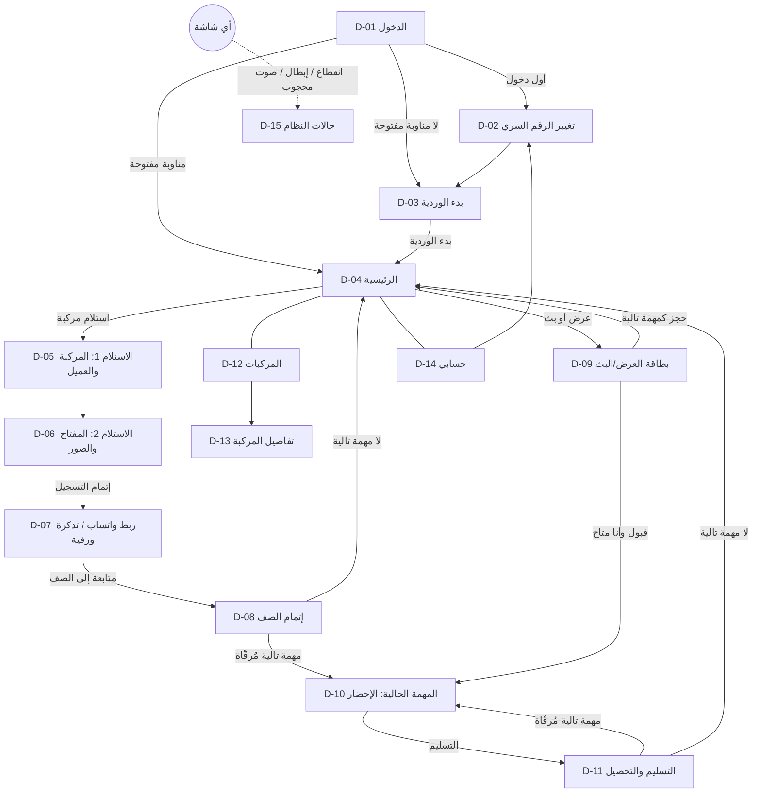
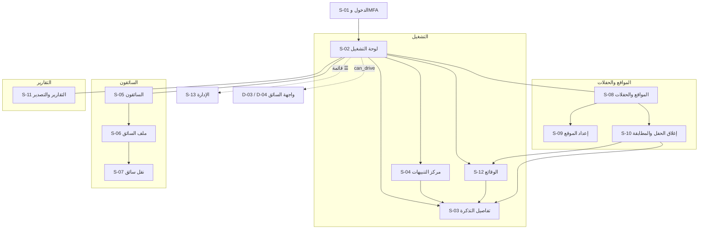

# 02 — مواصفات الشاشات (Wireframes Spec)

الإصدار 1.0 — 27 أكتوبر 2026 — واجهات نظام «بوينت · POINT» للموظفين، ورسائل «مصاف» للعميل على واتساب.

المراجع الملزمة: `00_Source_Architecture_v1.2_AR.md` (§4 التدفقات، §5 واتساب، §7 الصوت، §12 الواجهات)، `00_Glossary_Canon.md` (كل المعرّفات)، `DECISIONS.md`. المكونات والألوان في `03_Design_System.md`، النص النهائي لقوالب واتساب في `14_Notification_Matrix_Templates.md`، شكل الطلبات والردود في `07_API_Contract.md`، والنص الرسمي للأخطاء في `08_Error_Codes_Guide.md` (عند اختلاف نص خطأ بين هذا الملف و08 يُعتمد 08؛ والقرار DEC-80: الواجهة تعرض `message_ar` القادم من الخادم وهو نص 08، فنصوص الشاشات هنا لرموز الخادم لا تُعرض لردود الخادم).

---

## 0. كيف تُقرأ هذه الوثيقة

- كل شاشة لها معرّف من القاموس: `D-xx` للسائق، `S-xx` للمشرف والإدارة، `W-xx` لرسائل العميل.
- الإطارات النصية مرسومة لعرض جوال 390px. كل سطر صفّ في الشاشة من الأعلى للأسفل. داخل السطر تُكتب العناصر بالترتيب المنطقي **من اليمين إلى اليسار** كما يراها المستخدم، ويفصل بينها «│». الوسم بين قوسين مربعين في بداية السطر مثل `[TopBar]` اسم المكوّن وليس نصًا ظاهرًا.
- الرموز داخل الإطارات: `●` محدد/مفعّل، `○` غير محدد، `◐` حالة وسطية، `✓` مكتمل، `✗` يمنع المتابعة، `▾` قائمة منسدلة، `‹` رجوع، `□` خانة إدخال رقم واحد.
- «النصوص» هي النص العربي الحرفي الظاهر. ما بين `{ }` متغير يُملأ من البيانات.
- كل أمر يغيّر بيانات يُرسل بترويسة `Idempotency-Key` وفق §1.8، ويتحقق الخادم من الصلاحية والحالة. إخفاء الزر تجربة استخدام فقط وليس حماية.
- لا تُعتبر أي شاشة منجزة دون حالاتها الست: التحميل، الفراغ، الخطأ، انقطاع الاتصال أو البيانات القديمة، عدم الصلاحية، انتهاء الجلسة.
- أي معرّف احتاجته الواجهة وليس في القاموس مذكور في §9 «إضافات مقترحة للقاموس» ولا يُستخدم قبل اعتماده.
- معرّفات القرارات في `DECISIONS.md` بالصيغة `DEC-##` (كانت `D-##` في المسودات وتختلط بشاشات السائق)؛ لذلك أي `D-xx` في هذا الملف يعني شاشة سائق، والإشارة لقرار تُكتب «القرار DEC-xx».

---

## 1. قواعد التخطيط العامة

### 1.1 تطبيق واحد وأغلفة حسب الدور

- رابط واحد للموقع ورابط دخول واحد. بعد الدخول يُستدعى `GET /v1/me` ويُحدد الغلاف:
  - `driver` ← غلاف السائق (`D-xx`).
  - `supervisor` · `admin` · `owner` ← غلاف التشغيل (`S-xx`). تظهر أقسام `S-13` حسب الصلاحيات الراجعة.
  - المشرف الذي `can_drive = true` يرى في قائمة ☰ عنصر «التبديل إلى واجهة السائق» (يفتح D-03 إن لم تكن له مناوبة وإلا D-04)، ويرى في D-14 رابط «العودة إلى لوحة التشغيل» (القرار DEC-22).
- الواجهة تبني الأزرار من الصلاحيات والحالة في اللقطة، لكن الحماية على الخادم؛ أي رفض يُعالج كما في §1.9.

### 1.2 الاتجاه والمقاسات والأرقام

- `<html lang="ar" dir="rtl">` وخصائص CSS المنطقية فقط (`margin-inline-start` بدل `margin-left`).
- مقاسات الاختبار الإلزامية: 360 و390 و430 بكسل عرضًا، دون أي تمرير أفقي في شاشات السائق. لا جداول عريضة في واجهة السائق.
- النص الأساسي 16px، الثانوي 14px كحد أدنى، العناوين 20 إلى 24px.
- أهداف اللمس لا تقل عن 44×44px. أزرار الأفعال التشغيلية («استلام مركبة»، «قبول الطلب»، «حجز كمهمة تالية»، «بدء الإحضار»، «وصلت — جاهزة»، «تأكيد التسليم»، «تم الصف») بارتفاع 56px وعرض كامل.
- هامش أمان سفلي `env(safe-area-inset-bottom)` للشريط السفلي.
- الأرقام لاتينية 0–9 دائمًا (القرار DEC-17) مع `font-variant-numeric: tabular-nums` للعدادات والأوقات وأرقام التذاكر.
- الوقت بتوقيت الرياض والتقويم الميلادي صراحةً: `Intl.DateTimeFormat('ar-SA-u-ca-gregory-nu-latn', { timeZone: 'Asia/Riyadh', hour: 'numeric', minute: '2-digit' })` يعطي «7:42 م». السبب: `ar-SA` بلا امتداد يستخدم التقويم الهجري والأرقام العربية الهندية.
- المدد: «منذ 3 د»، والعدادات بصيغة دقائق:ثوانٍ «2:10».
- المبالغ: «25.00 ر.س» (من `*_halalas` ÷ 100).
- الجوال يُعرض مقنّعًا `05•••••123` في كل مكان بعد التسجيل، ما عدا الكشف المبرر للمشرف.
- أرقام اللوحات والجوالات والرموز داخل نص عربي تُعزل اتجاهيًا بعنصر `<bdi>` أو `unicode-bidi: isolate` حتى لا تنقلب.

### 1.3 الشريط العلوي `TopBar`

السائق:

```
[TopBar]  قاعة ريماس │ «متاح» │ ● متصل · آخر مزامنة 7:42 م
```

- اسم الموقع من التعيين النشط ولا يمكن تغييره من حساب السائق.
- `StatusChip` لحالة السائق `driver_state` بنص دائمًا بجانب اللون: «متاح» `available` · «يسجل/يصف» `intake_parking` · «يحضر/يسلّم» `retrieving` · «مشغول + مهمة تالية» `busy_with_next` · «استراحة» `on_break` · «خارج الوردية» `off_duty`.
- مؤشر الاتصال من `connection_state` المحلي والخادم: «● متصل» `online` · «◐ الاتصال غير مؤكد» `uncertain` · «○ غير متصل» `offline`، ومعه «آخر مزامنة {وقت}». الضغط عليه يفتح `Sheet` فيها: آخر مزامنة، حالة الصوت، حالة إشعارات الجهاز، زر «مزامنة الآن».

المشرف والإدارة:

```
[TopBar]  ☰ │ قاعة ريماس ▾ │ حفل آل فلان ▾ │ التنبيهات (3) │ ● متصل
```

- محدد الموقع يعرض مواقع نطاقه فقط (المالك والإدارة: كل المواقع). محدد الحفل يعرض الحفلات `open` و`closing` مع خيار «كل الحفلات المفتوحة».
- الاختيار في الذاكرة فقط: الافتراضي أول موقع في النطاق، والحفل المفتوح الوحيد أو «كل الحفلات المفتوحة» عند التعدد؛ يبقى عبر التنقل لا عبر إعادة التحميل (القرار DEC-320).
- شارة «التنبيهات» تعرض عدد التنبيهات `open` وتفتح S-04.

### 1.4 التنقل

- السائق `BottomNav` بثلاثة أقسام فقط: «الرئيسية» (D-04) · «المركبات» (D-12) · «حسابي» (D-14). شارة رقمية على «الرئيسية» عند وجود طلب قابل للقبول. لا قسم رابع.
- المشرف والإدارة أربع وجهات: «التشغيل» (S-02 ومنها S-03 وS-04 وS-12) · «السائقون» (S-05، S-06، S-07) · «المواقع والحفلات» (S-08، S-09، S-10) · «التقارير» (S-11). منطقة «الإدارة» (S-13) من قائمة ☰ لمن يملك صلاحياتها.
- على الجوال (أقل من 1024px): `BottomNav` بالوجهات الأربع، والمحتوى بطاقات و`FilterChips`.
- على الشاشات 1024px فأكثر: شريط تنقل جانبي في جهة البداية (اليمين)، والقوائم جداول `DataTable` برؤوس ثابتة وفرز.

### 1.5 الوضع الداكن (القرار DEC-19)

- السائق: يتبع `prefers-color-scheme` افتراضيًا، مع مفتاح في D-14 «تلقائي / فاتح / داكن» يُحفظ محليًا على الجهاز.
- المشرف: فاتح افتراضيًا، والمفتاح نفسه في قائمة ☰.
- كل لون حالة له نسختان فاتحة وداكنة في 03، والنص يرافق اللون في الحالتين.

### 1.6 أنماط الحالات العامة

| الحالة | النمط الموحد |
|---|---|
| التحميل الأول | `Skeleton` بشكل البطاقات نفسها؛ لا مؤشر دوّار يغطي الشاشة |
| إعادة المزامنة | البطاقات تبقى ظاهرة بشفافية مع شريط رفيع «جارٍ المزامنة…»؛ الأوامر معطلة حتى تكتمل |
| الفراغ | `EmptyState`: عنوان + سطر توضيحي + إجراء إن وُجد |
| الخطأ | `Banner` أعلى المحتوى بنص الخطأ وزر «إعادة المحاولة» وسطر صغير «رمز المتابعة: {request_id}» |
| بيانات قديمة أو بلا اتصال | `Banner` ثابت (D-15 الحالة أ)؛ القبول والتسليم وكل أمر يحتاج تأكيد الخادم معطل |
| عدم الصلاحية | عنوان الصفحة (`h1`) ثم `EmptyState` «لا تملك صلاحية عرض هذه الصفحة.» + زر «العودة» (القرار DEC-334) |
| انتهاء أو إبطال الجلسة | السائق إلى D-15 الحالة ج (`AUTH_SESSION_EXPIRED`، `AUTH_SESSION_REVOKED`)، وإلى D-01 إن لم تكن له جلسة أصلًا (`AUTH_UNAUTHENTICATED`)؛ المشرف إلى S-01 مع سطر السبب (القرار DEC-88) |
| نجاح أمر | `Toast` قصير 3 ثوانٍ بعد تأكيد الخادم فقط |

### 1.7 المزامنة والاتصال الفوري

- لقطة السائق من `GET /v1/me/home`، ولقطة المشرف من `GET /v1/events/{eventId}/operations`.
- الاتصال الفوري عبر Socket.IO على `/ws`. الخادم يضم الجهاز للغرف المسموحة؛ الواجهة لا تطلب غرفًا.
- أحداث مستقبلة تتعامل معها الواجهة: `task.offered` · `task.broadcast` · `task.claimed` · `task.updated` · `offer.reminder` · `offer.closed` · `ticket.updated` · `driver.state_changed` · `alert.raised` · `alert.updated` · `incident.updated` (للمشرف) · `channel.status` · `sync.required` · `session.revoked`.
- يرسل الجهاز `client.heartbeat` كل `heartbeat.interval_s` (15 ث) بالحقول (Canon §7.3): `visible` (الصفحة ظاهرة أم لا)، `audio_unlocked` (الصوت مفعّل أم لا)، `last_event_id`، `app_version`. إذا تعطل WebSocket يُستخدم `POST /v1/me/heartbeat` بالفاصل والحقول نفسها مع `ws_connected`. إذن الإشعارات يُحدَّث عبر `PUT /v1/me/devices/{deviceId}` لا في النبضة.
- مزامنة كاملة **قبل** تمكين أي أمر في هذه الحالات: فتح التطبيق، العودة من الخلفية (`visibilitychange`)، إعادة الاتصال، استلام `sync.required`.
- العدادات التنازلية تُحسب من أوقات الخادم لا ساعة الجهاز: `offset = server_time − Date.now()` من آخر استجابة، والمتبقي = `expires_at − (Date.now() + offset)`.
- عند `offer.closed` أو `task.claimed` تُزال البطاقة فورًا ويتوقف صوتها. يُرسل `client.offer_seen` عند ظهور بطاقة عرض على الشاشة فعليًا.
- حتى يكتمل الاتصال الفوري في واجهة المشرف تُعاد الشاشات الحية (اللوحة، التنبيهات، التذكرة وخطها الزمني، الوقائع، المطابقة والتسوية) كل 15 ث (15 §11.1)، وحفلات الموقع كل 60 ث، والتصدير كل 2 ث أثناء التجهيز (القرار DEC-313).

### 1.8 الأوامر ومنع التكرار

1. عند ضغط زر أمر يُولَّد `Idempotency-Key` (UUID v4) ويُحفظ مع محتوى الطلب في الذاكرة (وفي IndexedDB لأوامر الاستلام).
2. الزر يتحول لحالة تحميل ويتعطل حتى رد الخادم. لا يظهر «تم» أو أي تغيير حالة قبل التأكيد.
3. إذا لم يصل رد (انقطاع أو مهلة 10 ث): تُعاد المحاولة تلقائيًا حتى 3 مرات بعد 1 ثم 3 ثم 7 ثوانٍ **بالمفتاح والمحتوى نفسيهما** (08 §3 و§8.2، القرار DEC-86)، ثم يدويًا بزر «إعادة المحاولة»، مع النص: «تعذر الوصول للخادم. سنعيد إرسال الطلب نفسه دون تكرار.» `IDEMPOTENCY_IN_PROGRESS` ينتظر `Retry-After` أو 2 ث، و`INTERNAL_ERROR` يُعاد مرة واحدة، ولا يُعاد تلقائيًا `RATE_LIMITED` ولا أخطاء الأعمال.
4. أي تعديل في المدخلات بعد الفشل يولّد مفتاحًا جديدًا.
5. أوامر التذكرة والمهمة ترسل `expected_version` من آخر لقطة، وهو إلزامي في كل `PATCH`.
6. إذا طال الانقطاع أكثر من 60 ث لا يُعاد إرسال الأمر المعلق تلقائيًا بعد عودة الاتصال؛ تُجرى المزامنة ثم يُعرض الأمر على المستخدم للتأكيد إن كان ما زال ممكنًا.

### 1.9 معالجة الأخطاء المشتركة

هذه المعالجة تنطبق على كل الشاشات، وكل شاشة تضيف أخطاءها الخاصة.

| الرمز | المعالجة | النص |
|---|---|---|
| `AUTH_UNAUTHENTICATED` | حفظ المسودات المحلية ثم شاشة الدخول: D-01 للسائق وS-01 للمشرف (القرار DEC-88) | «انتهت الجلسة. سجّل الدخول للمتابعة.» |
| `AUTH_SESSION_EXPIRED` · `AUTH_SESSION_REVOKED` | حفظ المسودات المحلية ومسح البيانات المؤقتة، ثم D-15 الحالة ج بنص السبب (السائق) أو S-01 مع سطر السبب (المشرف)؛ القرار DEC-88 | نص السبب من D-15 الحالة ج (للانتهاء «انتهت مدة الجلسة. سجّل الدخول من جديد.»)، وإلا «أُنهيت جلستك.» |
| `PERMISSION_DENIED` | `Toast` + إخفاء الإجراء + مزامنة | «لا تملك صلاحية هذا الإجراء.» |
| `SCOPE_VENUE_DENIED` | `EmptyState` أو `Toast` | «هذا العنصر خارج نطاق موقعك.» |
| `RESOURCE_NOT_FOUND` · `TICKET_NOT_FOUND` · `OFFER_NOT_FOUND` | `EmptyState` + «العودة» | «لم نجد هذا العنصر. ربما أُغلق أو تغيّر.» |
| `VALIDATION_FAILED` | رسالة تحت كل حقل من `details.fields` والتمرير لأول حقل | «راجع الحقول المظللة.» |
| `VERSION_CONFLICT` | إعادة الجلب، الإبقاء على مدخلات المستخدم غير المحفوظة، عدم تكرار الأمر تلقائيًا | «تغيّرت بيانات هذا السجل. حدّثنا الشاشة؛ راجعها ثم أعد المحاولة.» |
| `INVALID_STATE_TRANSITION` | مزامنة وعرض الحالة الجديدة | «لا يمكن تنفيذ هذا الإجراء في الحالة الحالية.» |
| `IDEMPOTENCY_IN_PROGRESS` | انتظار 2 ث ثم إعادة بالمفتاح نفسه | «جارٍ تنفيذ طلبك السابق…» |
| `IDEMPOTENCY_KEY_REUSED` · `IDEMPOTENCY_KEY_REQUIRED` | خطأ برمجي: مفتاح جديد عند المحاولة التالية + تسجيل عبر `POST /v1/telemetry` | «حدث تعارض في الطلب. أعد المحاولة.» |
| `RATE_LIMITED` | تعطيل الزر حتى انقضاء `Retry-After` | «طلبات كثيرة. انتظر قليلًا ثم حاول.» |
| `INTERNAL_ERROR` | `Banner` مع رمز المتابعة | «حدث خطأ غير متوقع. رمز المتابعة: {request_id}» |
| `SERVICE_UNAVAILABLE` · `DEPENDENCY_TIMEOUT` | `Banner` + «إعادة المحاولة» | «الخدمة غير متاحة مؤقتًا. حاول بعد قليل.» |
| `DUTY_REQUIRED` | توجيه إلى D-03 | «ابدأ ورديتك أولًا.» |
| `ASSIGNMENT_REQUIRED` | `EmptyState` | «لا يوجد تعيين نشط لك على هذا الموقع. تواصل مع مشرفك.» |
| `REASON_REQUIRED` | إبراز حقل السبب | «اكتب سبب هذا الإجراء.» |
| `PAGINATION_CURSOR_INVALID` | إعادة تحميل القائمة من البداية | — |
| لا رد شبكي | §1.8 البند 3 | «تعذر الوصول للخادم. سنعيد إرسال الطلب نفسه دون تكرار.» |

جداول أخطاء الشاشات في هذا الملف تحدد **المعالجة**؛ ونص رد الخادم المعروض هو `message_ar` (نص 08) لا نص الجدول (القراران DEC-80 وDEC-351)، وتبقى نصوص الحالات التي ليست ردود أخطاء (مثل سطر D-03 «لا توجد وردية مفتوحة في {الموقع} الآن…» مع «تحديث»).

### 1.10 الأصوات والاهتزاز وإضاءة الشاشة

- الأصوات من القاموس §13: `offer` · `broadcast` · `reminder` · `next_due` · `escalation` · `test`. تُحمّل وتُفك مرة واحدة إلى `AudioBuffer` بعد فتح `AudioContext` بضغطة مستخدم في D-03 أو D-14 (أو زر «تفعيل صوت التنبيهات» للمشرف في S-02: يشغّل `test` ويفتح كل عناصر الصوت مكتومة في الإيماءة نفسها، في الذاكرة فقط؛ وصوت المشرف في وجهة «التشغيل» وحدها: S-02 وS-03 وS-04 وS-12، ورفض التشغيل يعيد الشريط، القرار DEC-312). تكرار صوت التصعيد بافتراضيات Canon §12 (`alerts.escalation_repeat_s` 60، `alerts.escalation_max_repeats` 3) حتى تصل الواجهة من `GET /v1/me` (القرار DEC-311).
- لا يُفترض أن الصوت مسموح بمجرد الدخول. إذا كانت حالة `AudioContext` غير `running` عند وصول تنبيه يظهر D-15 الحالة د.
- `task.claimed` يوقف صوت البطاقة فورًا ولا يصدر صوتًا.
- `next_due` يُستخدم لأي تكليف مباشر يصل السائق: ترقية مهمته التالية أو تكليفه بإعادة صف.
- الاهتزاز عبر `navigator.vibrate` حيث يدعمه الجهاز (لا يدعمه iPhone) مع `offer` و`broadcast` و`next_due` فقط (14 §7): العرض الفردي `[200,100,200]`، البث `[300,100,300,100,300]`، المهمة التالية `[100,60,100,60,200]`. لا اهتزاز للتذكير ولا للتصعيد ولا للاختبار.
- إبقاء الشاشة مضاءة: `navigator.wakeLock.request('screen')` في D-04 أثناء المناوبة إذا كان الإعداد مفعّلًا في D-14 والميزة مدعومة، مع إعادة الطلب عند عودة الصفحة للظهور. فشل الطلب لا يظهر إلا في `Sheet` حالة الاتصال.
- إشعار Web Push (القرار DEC-23): العنوان «بوينت — طلب إحضار»، النص «تذكرة {رقم} — افتح التطبيق للقبول»، دون لوحة أو جوال أو موضع مفتاح أو رمز. عند حجز الطلب من غيره أو انتهاء العرض أو سحب المهمة أو إلغائها أو إعادة إسنادها يُستبدل بإشعار هادئ من نوع `closed` بالوسم نفسه (الأنواع والنصوص في 14 §6.3). النقر على الإشعار يفتح `/d` ثم مزامنة كاملة.

### 1.11 قواعد إظهار البيانات

| البيانات | من يراها في الواجهة |
|---|---|
| رقم التذكرة، اللوحة، الشركة واللون، الحالة، الحفل، مدة الانتظار | كل سائقي الموقع ضمن قائمة المركبات المفتوحة (`ticket.read_minimal`) |
| الموقف وخانة المفتاح والصور الكاملة والملاحظات | السائق المكلّف بمهمة مفتوحة على التذكرة، أو منشئها أثناء التسجيل، والمشرف (`ticket.read_full`، `ticket.read_photos`) |
| جوال العميل | يُدخله السائق أثناء التسجيل، ثم يظهر مقنّعًا `05•••••123` للجميع؛ الكشف الكامل للمشرف بسبب وتدقيق (`ticket.reveal_phone`) |
| رمز التسليم | لا يظهر لأحد في أي شاشة؛ يُدخله السائق من العميل ويتحقق منه الخادم |
| رسائل العميل | معاينة نصها للمشرف في S-03 مع إخفاء الرمز «••••••» |
| بيانات موقع سابق بعد نقل السائق | لا تظهر إطلاقًا؛ تُمسح من التخزين المحلي عند الإبطال |

لا تُخزّن الصور ولا الروابط الموقعة في ذاكرة التخزين الدائمة للجهاز، ولا تظهر في إشعارات شاشة القفل.

---

## 2. خرائط التنقل

### 2.1 السائق



ملاحظة: بطاقة البث قد تظهر أثناء D-05 وD-06 وD-08 وD-10 على شكل `Banner` يفتح D-09 في `Sheet` دون مغادرة الشاشة أو مسح أي مدخلات.

أي الشاشتين D-03 أو D-04 تظهر يقرره `GET /v1/me` (`duty_session`) لا لقطة الرئيسية، فلا تتأرجح لقطة قديمة بينهما؛ وD-04 تعيد قراءة `/v1/me` حين تُظهر الرئيسية بلا مناوبة (القرار DEC-357).

### 2.2 المشرف والإدارة



| الشاشة | المشرف | الإدارة | المالك |
|---|---|---|---|
| S-01 إلى S-08، S-10 إلى S-12 | ضمن مواقع نطاقه | كل المواقع | كل المواقع |
| S-09 | عرض فقط | عرض وتعديل | عرض وتعديل |
| S-13 الموظفون | — | المشرفون فقط | الكل |
| S-13 قناة واتساب | — | عرض | عرض وتعديل |
| S-13 القوالب وصندوق الأحداث وسجل التدقيق | — | ✓ | ✓ |
| S-13 سياسة الاحتفاظ | — | عرض | تعديل |
| S-13 إعدادات المؤسسة | — | — | عرض وتعديل |

---

## 3. شاشات السائق (بوينت)

### D-01 — الدخول

- **الغرض:** دخول السائق برقم جواله ورقمه السري.
- **الدخول/الخروج:** الصفحة الافتراضية لغير المسجلين. بعد النجاح: D-02 إذا `must_change_secret`، وإلا D-04 إن كانت له مناوبة مفتوحة، وإلا D-03. الحسابات غير السائقة تُوجَّه لغلاف التشغيل؛ وإن عاد رد الدخول (200) بـ`mfa_required = true` تُفتح خطوة الرمز في S-01 بـ`mfa_token`.

```
D-01 الدخول
════════════════════════════════════════
[Logo]        شعار بوينت الرأسي في الوسط
[Title]       تسجيل الدخول
[PhoneInput]  رقم الجوال │ +966 │ 5X XXX XXXX
[TextField]   الرقم السري │ ● ● ● ● ● ● │ إظهار
[Button 56]   دخول
[Link]        دخول المشرفين والإدارة
[Footer]      نسيت الرقم السري؟ تواصل مع مشرفك.
```

- **المكونات:** `PhoneInput` (بادئة ثابتة +966، `dir="ltr"`، `inputmode="tel"`)، `TextField` للرقم السري (`inputmode="numeric"`، `autocomplete="current-password"`، دون `maxLength`: السر 6 أرقام للسائق لكن الحساب غير السائق قد يكتب كلمة مروره هنا، والطول قاعدة الخادم؛ وتُطبَّع الأرقام العربية الهندية إلى 0–9، القرار DEC-93)، `Button`، رابط إلى S-01.
- **النصوص:**

| العنصر | النص |
|---|---|
| العنوان | تسجيل الدخول |
| حقل الجوال | رقم الجوال |
| حقل السر | الرقم السري |
| الزر | دخول |
| مساعد | نسيت الرقم السري؟ تواصل مع مشرفك. |

- **الإجراءات:** `POST /v1/auth/login` بالجوال المطبّع E.164 والرقم السري. بعد النجاح: `GET /v1/me`، ثم تسجيل الجهاز مرة واحدة لكل متصفح `POST /v1/me/devices` وحفظ `deviceId` محليًا.
- **الأخطاء:**

| الرمز | المعالجة والنص |
|---|---|
| `AUTH_INVALID_CREDENTIALS` | مسح حقل السر: «رقم الجوال أو الرقم السري غير صحيح.» |
| `AUTH_ACCOUNT_LOCKED` | تعطيل الزر: «تم إيقاف الدخول مؤقتًا لكثرة المحاولات. حاول بعد قليل أو تواصل مع مشرفك.» |
| `AUTH_ACCOUNT_DISABLED` | «حسابك معطّل. تواصل مع الإدارة.» |
| `AUTH_SECRET_CHANGE_REQUIRED` | الانتقال إلى D-02 |
| `PHONE_INVALID` | تحت الحقل: «أدخل رقم جوال سعودي صحيح يبدأ بـ 5.» |
| `RATE_LIMITED` | §1.9 |

- **النص المعروض (القرار DEC-80):** لرد الخادم يُعرض `message_ar` (نص 08) مع المعالجة أعلاه، لا نصوص الجدول؛ ويبقى نص `PHONE_INVALID` لفحص الواجهة المحلي قبل الإرسال.
- **الحالات:** زر بحالة تحميل؛ بلا اتصال: `Banner` «لا يوجد اتصال بالإنترنت.» والزر معطل.

### D-02 — تغيير الرقم السري

- **الغرض:** فرض تغيير الرقم السري المؤقت عند أول دخول، ومتاح لاحقًا من D-14.
- **الدخول/الخروج:** من D-01 عند `AUTH_SECRET_CHANGE_REQUIRED` أو من D-14. بعد النجاح إلى D-03 (أول دخول) أو العودة إلى D-14.

```
D-02 تغيير الرقم السري
════════════════════════════════════════
[Header]      ‹ رجوع │ تغيير الرقم السري
[Text]        اختر رقمًا سريًا من 6 أرقام لا يعرفه غيرك.
[TextField]   الرقم السري الحالي │ ● ● ● ● ● ●
[TextField]   الرقم السري الجديد │ ● ● ● ● ● ●
[TextField]   تأكيد الرقم الجديد │ ● ● ● ● ● ●
[Hint]        لا تستخدم أرقامًا متكررة أو متسلسلة مثل 111111 أو 123456.
[Button 56]   حفظ والمتابعة
```

- **الإجراءات:** `POST /v1/auth/secret/change`. عدم تطابق التأكيد يُكتشف محليًا: «الرقمان غير متطابقين.»
- **الأخطاء:** `AUTH_INVALID_CREDENTIALS` «الرقم السري الحالي غير صحيح.» · `VALIDATION_FAILED` «اختر رقمًا سريًا أقوى.» — لرد الخادم يُعرض `message_ar` (نص 08)، والنصان هنا لفحص الواجهة المحلي قبل الإرسال (حقل حالي فارغ، رقم ضعيف)، والرقم الجديد الذي ليس 6 أرقام يُظهر جملة المقدمة (القرار DEC-80، DEC-89).
- **الحالات:** في أول دخول لا يظهر زر الرجوع.

### D-03 — بدء الوردية واختبار الصوت

- **الغرض:** تجهيز الجهاز (الصوت، الإشعارات، إضاءة الشاشة) ثم بدء مناوبة السائق داخل وردية الموقع المفتوحة.
- **الدخول/الخروج:** بعد الدخول إن لم تكن له مناوبة، أو بعد إنهاء الوردية. بعد «بدء الوردية» إلى D-04.

```
D-03 بدء الوردية
════════════════════════════════════════
[TopBar]      قاعة ريماس │ «خارج الوردية» │ ● متصل
[Card]        تعيينك: قاعة ريماس
              الوردية: مفتوحة منذ 6:30 م
              الحفلات المفتوحة: حفل آل فلان
[Checklist]   1 │ الصوت │ «لم يُختبر» │ [تفعيل واختبار الصوت]
              2 │ إشعارات الجهاز │ «غير مفعّلة» │ [تفعيل الإشعارات]
              3 │ إبقاء الشاشة مضاءة │ «مدعوم»
[Banner info] إشعارات الجهاز مساعدة فقط. أبقِ بوينت مفتوحًا أثناء الوردية لتسمع الطلبات.
[Button 56]   بدء الوردية
[Link]        تسجيل الخروج
```

- **المكونات:** `Card`، قائمة تحقق من `ListItem` مع `StatusChip`، `Button`، `Banner`، `Dialog`، `Sheet` لدليل الإضافة للشاشة الرئيسية (مشترك مع D-14).
- **تدفق اختبار الصوت:** الضغط على «تفعيل واختبار الصوت» ينشئ أو يستأنف `AudioContext` داخل حدث الضغط نفسه ويشغل `test`، ثم `Dialog` «هل سمعت النغمة؟» بزرين «نعم، سمعتها» و«لا». النتيجة تُرسل `POST /v1/me/audio-test` بالقيمة `heard` أو `not_heard`، وإذا فشل الاستئناف تُرسل `blocked`. عند «لا»: «ارفع صوت الجهاز وأوقف الوضع الصامت ثم أعد الاختبار.»
- **تدفق الإشعارات:** إذا كان iPhone والصفحة ليست مضافة للشاشة الرئيسية (`display-mode` ليس `standalone`): الحالة «تتطلب الإضافة للشاشة الرئيسية» وزر «كيف؟» يفتح دليل الإضافة. وإلا الزر يستدعي `Notification.requestPermission()` من الضغطة نفسها، ثم الاشتراك في Web Push، ثم `PUT /v1/me/devices/{deviceId}` بالإذن والاشتراك ووضع العرض. عند الرفض: الحالة «مرفوضة» والنص «يمكنك تفعيلها لاحقًا من إعدادات المتصفح. الوظائف الأساسية تعمل دونها.»
- **حالات قائمة التحقق:** الصوت «لم يُختبر» · «يعمل» · «لم يُسمع» · «محجوب». الإشعارات «غير مفعّلة» · «مفعّلة» · «مرفوضة» · «غير مدعومة على هذا المتصفح» · «تتطلب الإضافة للشاشة الرئيسية». إضاءة الشاشة «مدعوم» · «غير مدعوم».
- **بدء الوردية:** `POST /v1/me/duty/start`. إذا لم يكن الصوت «يعمل»: `Dialog` «لم تختبر الصوت بعد، وقد لا تسمع طلبات الإحضار. هل تريد البدء الآن؟» بزرين «اختبار الصوت الآن» و«البدء دون اختبار»؛ والنافذة تجيب سؤالها فزر التأكيد «البدء دون اختبار» والآخر «اختبار الصوت الآن»، وفي «هل سمعت النغمة؟» التأكيد «نعم، سمعتها» والإلغاء «لا»؛ وEscape يغلق أيًّا منهما بلا إجابة (لا تسجيل ولا بدء) (القرار DEC-354).
- **الجهاز والوردية:** نتيجة اختبار الصوت وإذن الإشعارات تُسجَّل على جهاز الجلسة بـ`device_id` من `GET /v1/me` حين يرسله الخادم (`Me.session.device_id`)، وإلا تبقى الفحوص على الجهاز (القرار DEC-345)؛ وسطر الوردية «مفتوحة منذ {وقت}» حين يرسل الخادم `shift.opened_at`، وإلا «الوردية: مفتوحة» (القرار DEC-347).
- **الأخطاء:**

| الرمز | المعالجة والنص |
|---|---|
| `ASSIGNMENT_REQUIRED` | `EmptyState` بدل البطاقة: «لا يوجد تعيين نشط لك على أي موقع. تواصل مع مشرفك لتعيينك.» |
| `SHIFT_NOT_OPEN` | «لا توجد وردية مفتوحة في {الموقع} الآن. اطلب من المشرف فتح الوردية.» + «تحديث» |
| `DUTY_ALREADY_STARTED` | انتقال صامت إلى D-04 |
| `DRIVER_DISABLED` · `AUTH_ACCOUNT_DISABLED` | «حسابك معطّل. تواصل مع الإدارة.» |

- **الحالات:** التحميل `Skeleton` للبطاقة؛ بلا اتصال الزر معطل.

### D-04 — الرئيسية

- **الغرض:** مركز عمل السائق: زر الاستلام، مهمته الحالية، مهمته التالية، و**طلب الإحضار الأقدم القابل للقبول فقط**.
- **الدخول/الخروج:** القسم الأول في `BottomNav`. يفتح D-05 وD-08 وD-10 وD-11 حسب المهمة، وD-09 عند العروض.

```
D-04 الرئيسية
════════════════════════════════════════
[TopBar]      قاعة ريماس │ «متاح» │ ● متصل · آخر مزامنة 7:42 م
[Banner]      (عند الحاجة: استراحة / بلا اتصال / صوت محجوب / واتساب متوقف)
────────────────────────────────────────
[Button XL]   + استلام مركبة
[Hint]        (عند التعطيل) أكمل مهمتك الحالية أولًا
────────────────────────────────────────
[Section]     المهمة الحالية
[TaskCard]    إحضار · #125 │ «يحضر/يسلّم»
              1234 ب ح د │ تويوتا كامري · أبيض
              الخطوة التالية: استلم المفتاح من الخانة 12
              [متابعة]
[Section]     المهمة التالية          (تظهر عند وجودها فقط)
[TaskCard]    إحضار · #131 │ «محجوزة لك»
              تبدأ بعد إنهاء مهمتك الحالية. لا تبدأ الحركة قبل ذلك.
[Section]     طلب الإحضار
[OfferCard]   (بطاقة واحدة فقط: الأقدم القابل للقبول — انظر D-09)
     أو
[EmptyState]  لا توجد طلبات إحضار الآن
              ستسمع تنبيهًا عند وصول طلب.
════════════════════════════════════════
[BottomNav]   الرئيسية ● │ المركبات │ حسابي
```

- **المكونات:** `TopBar`، `Banner`، `Button` حجم كبير، `TaskCard` (عادية ومخففة للمهمة التالية)، `OfferCard`، `EmptyState`، `BottomNav`، `Skeleton`.
- **زر «استلام مركبة»:** مفعّل فقط عندما `driver_state = available`. **اختيار الحفل قبل إنشاء التذكرة (DEC-37):** إذا كان في الموقع حفل مفتوح واحد يُنشأ الطلب مباشرة بحفله؛ وإن وُجد أكثر من حفل تظهر `Sheet` «لأي حفل هذه المركبة؟» بقائمة الحفلات المفتوحة (الافتراضي آخر حفل اختاره السائق) ثم يُرسل `POST /v1/tickets` بـ`event_id`. لا يتغير حفل التذكرة ولا رقمها بعد الإنشاء. سطر سبب التعطيل: `intake_parking` «أكمل تسجيل أو صف المركبة الحالية أولًا» · `retrieving` و`busy_with_next` «لديك مهمة إحضار جارية» · `on_break` «أنت في استراحة» · `off_duty` يحول إلى D-03.
- **محتوى `TaskCard` حسب المهمة:**

| المهمة والحالة | العنوان | السطر | الزر | الوجهة |
|---|---|---|---|---|
| `park` + التذكرة `received` | تسجيل مركبة · #{رقم} | أكمل بيانات الاستلام | متابعة التسجيل | D-05 أو D-06 (آخر خطوة) |
| `park` + `parking` | صف · #{رقم} | اركن المركبة ثم سجّل الموقف وخانة المفتاح | إتمام الصف | D-08 |
| `repark` + `reparking` | إعادة صف · #{رقم} | أعد المركبة إلى موقف وسجّل الموقف وخانة المفتاح | إتمام إعادة الصف | D-08 |
| `retrieve` `accepted` قبل استلام المفتاح | إحضار · #{رقم} | استلم المفتاح من الخانة {خانة} | متابعة | D-10 |
| `retrieve` `accepted` بعد استلام المفتاح | إحضار · #{رقم} | ابدأ الإحضار من الموقف {موقف} | متابعة | D-10 |
| `retrieve` `in_progress` + `retrieving` | جارٍ الإحضار · #{رقم} | عند الوصول اضغط «جاهزة» | متابعة | D-10 |
| `retrieve` `in_progress` + `ready` | بانتظار العميل · #{رقم} | منذ {مدة} (من `ready_at` حين يرسله الخادم، وإلا `claim_code.issued_at` لواتساب أو `requested_at` للورق؛ القرار DEC-348) | التسليم | D-11 |

- **المهمة التالية:** `TaskCard` مخففة بحالة «محجوزة لك» (خاصية `badge`؛ القرار DEC-353) ومدة انتظار الطلب، بلا زر بدء. عند ترقيتها (`task.updated` إلى `accepted`) يُشغَّل `next_due` ويظهر `Dialog` «بدأت مهمتك التالية: #{رقم}» بزر «الانتقال» إلى D-10.
- **طلب الإحضار:** تُعرض بطاقة واحدة فقط هي الأقدم `requested_at` بين ما يحق للسائق التصرف فيه: عرض فردي له، أو بث يستطيع قبوله أو حجزه. السائق `busy_with_next` يرى بطاقة البث الأقدم معطلة. القرار النهائي للخادم (`OLDER_REQUEST_PENDING`).
- **الاستراحة:** `Banner` «أنت في استراحة ولن تصلك الطلبات.» بزر «إنهاء الاستراحة» ← `POST /v1/me/duty/break` بقيمة إيقاف الاستراحة.
- **إعدادات الموقع للسائق:** D-06 (`inspection.required_photos`، `inspection.max_extra_photos`) وD-08 (`parking.mode`، `keys.require_slot`) وحلقة D-09 (`dispatch.single_offer_ttl_s`) من لقطة `settings` في `GET /v1/me/home` حين يرسلها الخادم، وإلا افتراضيات Canon §12 (القرار DEC-346).
- **الإجراءات:**

| الإجراء | المسار | ملاحظات |
|---|---|---|
| تحميل ومزامنة | `GET /v1/me/home` | عند الفتح والعودة وإعادة الاتصال و`sync.required` |
| استلام مركبة | `POST /v1/tickets` | `Idempotency-Key`؛ الجسم `event_id` (إلزامي عند تعدد الحفلات المفتوحة)؛ يُنشئ تذكرة `received` ومهمة `park` باسمه ذريًا، ثم D-05 برقم التذكرة |
| إنهاء الاستراحة | `POST /v1/me/duty/break` | `Idempotency-Key` |

- **الأخطاء الخاصة:**

| الرمز | المعالجة والنص |
|---|---|
| `DRIVER_NOT_AVAILABLE` · `MOVEMENT_IN_PROGRESS` | مزامنة: «لديك مهمة جارية. أنهِها أولًا.» |
| `DRIVER_ON_BREAK` | «أنهِ الاستراحة أولًا.» |
| `EVENT_NOT_OPEN` | «لا يوجد حفل مفتوح في الموقع الآن. تواصل مع المشرف.» |
| `SHIFT_NOT_OPEN` | «أُغلقت وردية الموقع. تواصل مع المشرف.» ثم D-03 |
| `NEXT_TASK_ALREADY_RESERVED` | مزامنة فقط |

- **الحالات:** التحميل `Skeleton` لثلاث بطاقات؛ بلا اتصال: البطاقات من آخر لقطة بشفافية مع D-15 الحالة أ، والزر الكبير وأزرار القبول معطلة.
- **الأصوات:** وصول عرض فردي `offer`، بث `broadcast`، تذكير `reminder`، ترقية مهمة تالية `next_due`.

### D-05 — استلام مركبة (1): المركبة والعميل

- **الغرض:** الخطوة الأولى من التسجيل: اللوحة، الشركة، الطراز، اللون، وقناة العميل (الحفل محدد مسبقًا من D-04).
- **الدخول/الخروج:** بعد نجاح `POST /v1/tickets` من D-04، أو استئناف تذكرة `received`. «التالي» إلى D-06.

```
D-05 استلام مركبة (1 من 2)
════════════════════════════════════════
[TopBar]      قاعة ريماس │ «يسجل/يصف» │ ● متصل
[Header]      ‹ │ استلام مركبة · #125 │ إلغاء
[Stepper]     1 المركبة والعميل ● │ 2 المفتاح والصور ○
[Banner]      (عند بث أثناء التسجيل) طلب إحضار مفتوح — يمكنك حجزه كمهمة تالية │ [عرض]
[Text]        الحفل: حفل آل فلان          (للعرض فقط؛ اختير في D-04)
[PlateInput]  اللوحة │ الأحرف: [ب] [ح] [د] │ الأرقام: [1234]
              B J D · 1234                 (المقابل اللاتيني يظهر تلقائيًا)
              [ ] لوحة غير سعودية
[Select]      الشركة المصنعة │ تويوتا ▾
[TextField]   الطراز (اختياري) │ كامري
[ColorChips]  اللون │ أبيض ● │ أسود │ فضي │ رمادي │ أحمر │ أزرق │ … │ أخرى
[Segmented]   تذكرة العميل │ واتساب ● │ تذكرة ورقية
  — عند «واتساب» —
[Radio]       طريقة الربط │ (●) رقم جوال العميل │ ( ) رمز QR يمسحه العميل
[PhoneInput]  جوال العميل │ +966 │ 5X XXX XXXX
[Checkbox]    [ ] وافق العميل على استلام رسائل «مصاف» على واتساب لهذه التذكرة
[Hint]        اسأل العميل: «هل توافق أن تصلك تذكرة السيارة وتحديثاتها من مصاف على واتساب؟»
  — عند «تذكرة ورقية» —
[TextField]   رقم التذكرة الورقية │ 004521
[Hint]        انسخ الرقم المطبوع على الكعب كما هو.
────────────────────────────────────────
[Button 56]   التالي
```

- **المكونات:** `Header`، `Stepper`، `Banner`، `Select`، `PlateInput` مع لوحة الأحرف، `TextField`، `ColorChips`، `SegmentedControl`، `Radio`، `PhoneInput`، `Checkbox`، `Button`، `Dialog`، `Sheet`.
- **رقم التذكرة:** يظهر من الرد في العنوان «#125» منذ البداية.
- **الحفل:** نص ثابت للعرض فقط (DEC-37). إن اكتشف السائق أن الحفل خاطئ: «تجاهل المسودة» إن كانت فارغة، وإلا يطلب من المشرف إلغاءها ثم يبدأ استلامًا جديدًا بالحفل الصحيح.
- **`PlateInput` (لوحة سعودية):**
  - الأحرف عبر لوحة أحرف مخصصة في `Sheet` تحتوي الأحرف السبعة عشر المعتمدة فقط مع مقابلها اللاتيني: ا A · ب B · ح J · د D · ر R · س S · ص X · ط T · ع E · ق G · ك K · ل L · م Z · ن N · هـ H · و U · ى V. لوحة مخصصة تمنع إدخال أشكال خاطئة مثل «ة» أو «أ».
  - يقبل الحقل أيضًا كتابة الحرف اللاتيني ويحوّله تلقائيًا للعربي.
  - الأرقام بلوحة أرقام `inputmode="numeric"`، من 1 إلى 4 أرقام.
  - التخزين: `plate_letters_ar` مثل «ب ح د» و`plate_letters_en` مثل «B J D» بالترتيب نفسه، و`plate_digits` مثل «1234». ترتيب عرض الحروف اللاتينية في `PlateBadge` يُطابق اللوحة الفعلية ويُتحقق منه ميدانيًا قبل الإطلاق.
  - «لوحة غير سعودية» تخفي الحقلين وتُظهر حقلًا نصيًا واحدًا `plate_raw` (حتى 12 خانة)، ويُرسل `country = XX` (رمز ISO المخصص للمستخدم) مع `raw` لأن الدولة لا تُسأل (القرار DEC-349).
  - لوحة الأحرف تعرض «هـ» والسلك يحمل «ه» (07 §1.8)، والواجهة تحوّل في الاتجاهين (القرار DEC-349).
  - التحقق المحلي: 3 أحرف و1–4 أرقام للوحة السعودية، وإلا «أكمل أحرف اللوحة الثلاثة وأرقامها.»
- **الشركة المصنعة:** قائمة بالشركات الشائعة مع بحث وخيار «أخرى» يفتح حقلًا نصيًا (القائمة في §8.4).
- **اللون:** `ColorChips` بقائمة §8.4، وخيار «أخرى» يفتح حقلًا نصيًا قصيرًا.
- **على السلك:** الشركة واللون بمفاتيح §8.4 (`toyota`، `white`)، و«أخرى» بالنص المكتوب (القرار DEC-350).
- **الحقول الإلزامية محليًا:** اللوحة والشركة واللون ورقم الكعب هنا، وملصق المفتاح في D-06، والطراز اختياري (كقائمة `INTAKE_INCOMPLETE` في 08)؛ و`details.missing` من الخادم ترسل السائق إلى خطوة أول حقل ناقص (القرار DEC-356).
- **قناة العميل:**
  - «واتساب + رقم جوال العميل»: الجوال وخانة الموافقة إلزاميان. الموافقة تُسجّل كموافقة شفهية يؤكدها الموظف.
  - «واتساب + رمز QR»: لا يُطلب الجوال؛ الموافقة تأتي من إرسال العميل نفسه، ويظهر D-07 بلوحة QR بعد إتمام التسجيل.
  - «تذكرة ورقية»: رقم الكعب إلزامي (القرار DEC-14).
  - «طريقة الربط» اختيار محلي في الواجهة ولا يُرسل في `PATCH /v1/tickets/{ticketId}/intake` (لا حقل له في العقد)؛ الطريقة تُشتق من البيانات: جوال + موافقة ← ربط مباشر يرسل فيه الخادم W-01 عند «إتمام التسجيل»؛ وإلا (QR) تصدر الواجهة الرمز عند الضغط على «إتمام التسجيل» قبل الإرسال مباشرة عبر `POST /v1/tickets/{ticketId}/whatsapp-link` بـ`method = qr` (التذكرة ما زالت `received`)، لأن `submit-intake` يقبل قناة واتساب بلا جوال فقط إذا وُجد رمز QR صادر أو مؤكد، ثم يعرض D-07 اللوحة بالرمز نفسه. التحويل من «رقم جوال العميل» إلى «رمز QR يمسحه العميل» يفرغ الجوال والموافقة في المسودة (`customer_phone` و`consent` بقيمة `null`).
- **الحفظ وعدم فقد المدخلات:**
  - كل تعديل يُحفظ في IndexedDB بعد 300ms تحت مفتاح خاص بالتذكرة، ويُستعاد عند إعادة فتح التطبيق أو العودة من الخلفية.
  - «التالي» يرسل `PATCH /v1/tickets/{ticketId}/intake` مع `expected_version` و`Idempotency-Key`. عند فشل الشبكة تبقى المدخلات وينتقل السائق إلى D-06 بإشعار «لم تُحفظ الخطوة الأولى على الخادم بعد؛ سنعيد المحاولة تلقائيًا.» ولا يُسمح بـ«إتمام التسجيل» في D-06 قبل نجاح الحفظ.
  - تنبيه البث أثناء التسجيل لا يمسح المسودة ولا يغيّر الشاشة؛ يظهر `Banner` بزر «عرض» يفتح D-09 في `Sheet` فوق النموذج، ويصدر صوت `broadcast`.
- **الإلغاء:** «إلغاء» في الرأس يفتح `Dialog` «إلغاء الاستلام؟» بزرين «إلغاء الاستلام» و«متابعة التسجيل». التأكيد يرسل `POST /v1/tickets/{ticketId}/discard-draft`:
  - النجاح (مسودة فارغة): `Toast` «أُلغي الاستلام» ثم D-04.
  - `DRAFT_HAS_DATA`: `Dialog` «لا يمكن تجاهل استلام فيه بيانات. إن أعدت المركبة والمفتاح للعميل، سيعتمد المشرف الإلغاء بعد التحقق، وستبقى مشغولًا بهذه التذكرة حتى ذلك.» بزر «فهمت» (القرار DEC-20). تبقى المسودة في D-04 كمهمة حالية.
- **الأخطاء:**

| الرمز | المعالجة والنص |
|---|---|
| `PLATE_INVALID` | تحت اللوحة: «رقم اللوحة غير صالح. راجع الأحرف والأرقام.» |
| `PHONE_INVALID` | تحت الجوال: «أدخل رقم جوال سعودي صحيح يبدأ بـ 5.» |
| `CONSENT_REQUIRED` | إبراز خانة الموافقة: «لا نرسل واتساب دون موافقة العميل.» |
| `WA_CUSTOMER_OPTED_OUT` | «هذا الرقم أوقف رسائل مصاف. استخدم تذكرة ورقية، أو اربط عبر QR من جوال العميل.» |
| `PAPER_SERIAL_IN_USE` | «رقم التذكرة الورقية مستخدم في هذا الحفل. تحقق من الكعب.» |
| `EVENT_NOT_OPEN` | «الحفل لم يعد مفتوحًا. تواصل مع المشرف.» (الحفل لا يُغيَّر من هنا) |
| `VERSION_CONFLICT` | §1.9 مع الإبقاء على قيم النموذج المحلية |
| `NOT_TASK_ASSIGNEE` · `PERMISSION_DENIED` | «هذه المسودة لم تعد لك.» ثم D-04 |

- **الحالات:** بلا اتصال: الحقول قابلة للتعبئة، الحفظ المحلي مستمر، و«التالي» ينقل محليًا مع الإشعار أعلاه.
- **الأصوات:** `broadcast` و`reminder` عند البث فقط.

### D-06 — استلام مركبة (2): المفتاح والصور

- **الغرض:** رقم علاقة المفتاح وصور الحالة والملاحظات، ثم إتمام التسجيل.
- **الدخول/الخروج:** من D-05. «إتمام التسجيل» إلى D-07.

```
D-06 استلام مركبة (2 من 2)
════════════════════════════════════════
[Header]      ‹ │ استلام مركبة · #125 │ إلغاء
[Stepper]     1 المركبة والعميل ✓ │ 2 المفتاح والصور ●
[PlateBadge]  1234 ب ح د │ تويوتا كامري · أبيض
[TextField]   رقم علاقة المفتاح │ 57
[Section]     صور الحالة (2 من 4)
[PhotoTile]   الأمام ✓ │ الخلف ✓
[PhotoTile]   الجانب الأيمن ◐ 60% │ الجانب الأيسر +
[PhotoTile]   + صورة إضافية │ + صورة ضرر
[TextArea]    ملاحظات الأضرار (اختياري) │ خدش في الباب الخلفي الأيسر
[Banner warn] (عند النقص) الفحص غير مكتمل: 2 من 4 صور.
────────────────────────────────────────
[Button 56]   إتمام التسجيل
```

- **المكونات:** `PlateBadge`، `TextField`، `PhotoTile` × (الإلزامية + الإضافية)، `TextArea`، `Banner`، `Button`، `Dialog`.
- **رقم علاقة المفتاح:** إلزامي، `inputmode="numeric"` مع السماح بالأحرف إن كانت العلاقات مرقمة بحروف.
- **الصور:** الأنواع الإلزامية من إعداد `inspection.required_photos` (افتراضيًا الأمام والخلف والجانبان)، والإضافية حتى `inspection.max_extra_photos`. أسماء البلاطات: الأمام `photo_front` · الخلف `photo_rear` · الجانب الأيمن `photo_right` · الجانب الأيسر `photo_left` · إضافية `photo_extra` · ضرر `photo_damage`.
- **تدفق رفع الصورة:**
  1. الضغط يفتح الكاميرا الخلفية `<input type="file" accept="image/*" capture="environment">`.
  2. ضغط الصورة على الجهاز: الضلع الأطول 1600px، JPEG بجودة 0.8، **مع حذف بيانات EXIF بما فيها الموقع الجغرافي**.
  3. `POST /v1/tickets/{ticketId}/media` بالنوع ونوع المحتوى والحجم، فيعود رابط رفع موقّع.
  4. رفع الملف مباشرة إلى رابط التخزين.
  5. `POST /v1/media/{mediaId}/complete`، فتتحول البلاطة إلى ✓ مع صورة مصغرة.
  - حالات البلاطة: فارغة «+» · رفع «◐ {نسبة}%» · مكتمل «✓» · فشل «تعذر الرفع — اضغط لإعادة المحاولة».
  - الملفات المعلقة تُحفظ في IndexedDB وتُستأنف تلقائيًا؛ إعادة التصوير تستبدل صورة النوع نفسه.
- **إتمام التسجيل:** يُحفظ رقم العلاقة والملاحظات أولًا بـ`PATCH /v1/tickets/{ticketId}/intake` (`key_tag`، `notes`)، ثم في وضع QR فقط `POST /v1/tickets/{ticketId}/whatsapp-link` بـ`method = qr`، ثم `POST /v1/tickets/{ticketId}/submit-intake` بجسم فيه `expected_version` فقط (ومعه `acknowledge_incomplete_inspection` عند الإقرار بالفحص الناقص) و`Idempotency-Key`.
  - إذا كانت صور قيد الرفع: الزر يعرض «إتمام التسجيل (بانتظار رفع {n} صورة)» معطلًا، ومعه رابط «المتابعة دون انتظار».
  - `INSPECTION_INCOMPLETE`: `Dialog` «الفحص غير مكتمل ({n} من {المطلوب} صور). المتابعة ستُبلغ المشرف لاعتماد استثناء.» بزرين «إكمال الصور» و«متابعة وإبلاغ المشرف». الثاني يعيد الإرسال بإقرار الفحص الناقص (انظر §9.3). إذا اكتمل لاحقًا رفع كل الصور الإلزامية الناقصة (التُقطت أثناء التسجيل وتأخر رفعها) تتحول حالة الفحص آليًا إلى «مكتمل» ويُحل التنبيه (`ticket.inspection_completed`)؛ وإلا تبقى «غير مكتمل» حتى يعتمد المشرف الاستثناء.
  - بعد النجاح تصبح التذكرة `parking`، وإذا كانت القناة واتساب برقم الجوال يُرسل الخادم W-01. الانتقال إلى D-07.
- **الأخطاء:**

| الرمز | المعالجة والنص |
|---|---|
| `KEY_TAG_IN_USE` | تحت الحقل: «رقم علاقة المفتاح {رقم} مستخدم لتذكرة مفتوحة أخرى. تحقق من العلاقة.» |
| `INTAKE_INCOMPLETE` | إبراز الحقول في `details.missing` والانتقال للخطوة التي تحتويها: «أكمل الحقول الناقصة.» |
| `MEDIA_TOO_LARGE` | ضغط أقوى تلقائيًا (1280px، جودة 0.7) ثم إعادة المحاولة؛ إن تكرر: «الصورة كبيرة. أعد التصوير.» |
| `MEDIA_TYPE_UNSUPPORTED` | «نوع الملف غير مدعوم. التقط الصورة بالكاميرا.» |
| `MEDIA_UPLOAD_INCOMPLETE` | إعادة رفع الملف ثم تأكيده |
| `CONSENT_REQUIRED` · `PHONE_INVALID` · `PLATE_INVALID` · `WA_CUSTOMER_OPTED_OUT` | العودة إلى D-05 مع إبراز الحقل ونص الخطأ كما في D-05 (للعميل الموقف للرسائل: QR أو تذكرة ورقية) |
| `EVENT_NOT_OPEN` | «الحفل لم يعد مفتوحًا. تواصل مع المشرف.» |

- **الحالات:** بلا اتصال: التصوير والحفظ المحلي متاحان، و«إتمام التسجيل» معطل مع «يلزم الاتصال لإتمام التسجيل».

### D-07 — ربط واتساب (لوحة العميل بعلامة «مصاف») أو تأكيد التذكرة الورقية

- **الغرض:** إظهار حالة إرسال تذكرة «مصاف» للعميل، أو لوحة QR يمسحها العميل، أو تأكيد تسليم الكعب الورقي. هذه الشاشة الوحيدة في تطبيق الموظفين الموجهة للعميل، ولذلك تحمل علامة «مصاف» في لوحة QR.
- **الدخول/الخروج:** بعد «إتمام التسجيل» في D-06، أو من D-13 لإعادة الربط. «متابعة إلى الصف» إلى D-08. الشاشة لا تمنع المتابعة إلى الصف أبدًا.

**الوضع أ — إرسال مباشر لرقم العميل:**

```
D-07 ربط واتساب — إرسال مباشر
════════════════════════════════════════
[Header]      ربط واتساب · #125
[StatusChip]  «جارٍ الإرسال…»  ←  «أُرسلت»  ←  «تعذر الإرسال»
[Text]        أُرسلت تذكرة «مصاف» إلى الرقم المنتهي بـ 123.
[Hint]        يستطيع العميل طلب سيارته من زر «طلب السيارة» في الرسالة.
[Button 56]   متابعة إلى الصف
[Link]        العميل لم تصله الرسالة؟
  — عند «تعذر الإرسال» —
[Banner err]  تعذر إرسال التذكرة. قد لا يكون الرقم على واتساب.
[Button]      إعادة الإرسال │ الربط عبر QR │ تذكرة ورقية
```

- الحالة تأتي من `wa_link_status` في `ticket.updated`: `pending_send` «جارٍ الإرسال…» · `linked` «أُرسلت» · `failed` «تعذر الإرسال».
- «إعادة الإرسال» ← `POST /v1/tickets/{ticketId}/whatsapp-link` بطريقة الإرسال المباشر. «الربط عبر QR» ← المسار نفسه بطريقة QR فيتحول للوضع ب. «تذكرة ورقية» ← `Sheet` لإدخال رقم الكعب ثم `PATCH /v1/tickets/{ticketId}/intake` بـ`channel = paper` و`paper_serial` (DEC-40؛ متاح أثناء `parking` ما دامت غير مربوطة) فيتحول للوضع ج.
- «العميل لم تصله الرسالة؟» يفتح `Sheet` بالخيارات الثلاثة نفسها ونص «تأكد مع العميل من الرقم، أو اطلب منه مسح رمز QR.»

**الوضع ب — لوحة QR (موجهة للعميل، علامة «مصاف»):**

```
D-07 ربط واتساب — لوحة العميل
════════════════════════════════════════
[BrandHeader] شعار مصاف
[Title]       اربط تذكرة سيارتك على واتساب
[QR]          ██████ رمز QR كبير لا يقل عن 240px ██████
[Steps]       1 امسح الرمز بكاميرا جوالك
              2 اضغط «إرسال» في واتساب
[Meta]        قاعة ريماس · تذكرة 125 · صالح لمدة 9:41
[Status]      بانتظار رسالتك…
──────────────── منطقة السائق ────────────────
[Button]      رمز جديد │ تغيير الطريقة │ ملء الشاشة
```

- الرمز يُولّد من الرد (`POST /v1/tickets/{ticketId}/whatsapp-link` بطريقة QR) ويُرسم على الجهاز. العداد من `expires_at` وفق إعداد `link.qr_ttl_min`.
- الجزء العلوي لا يعرض أي بيانات موظف ولا لوحة ولا جوال؛ فقط اسم الموقع ورقم التذكرة.
- «ملء الشاشة» يخفي منطقة السائق ويرفع السطوع إن أمكن؛ الضغط المطوّل أو زر «إغلاق» صغير في الزاوية يعيدها.
- مسح الرمز وحده ليس إرسالًا؛ الحالة تبقى «بانتظار رسالتك…» حتى يصل الخادم رسالة العميل.
- عند وصول الرسالة (`wa_link_status = pending_confirmation`) تظهر للسائق نافذة تأكيد:

```
[Dialog]      وصلت رسالة الربط من رقم ينتهي بـ 123.
              هل هو جوال العميل الذي أمامك؟
[Button 56]   نعم، اربط التذكرة
[Button]      لا، ليس هو
```

- «نعم» ← `POST /v1/tickets/{ticketId}/whatsapp-link/confirm` بالمطابقة، فتُرسل W-01 ويتحول النص إلى «تم الربط — وصلت التذكرة للعميل.» «لا» ← المسار نفسه بعدم المطابقة، ثم «رمز جديد».
- عند انتهاء المدة: «انتهت صلاحية الرمز.» بزر «رمز جديد».

**الوضع ج — تذكرة ورقية:**

```
D-07 تذكرة ورقية
════════════════════════════════════════
[Header]      تذكرة ورقية · #125
[Text]        سلّم العميل الكعب رقم 004521، وعلّق الجزء الآخر على المفتاح.
[Checkbox]    [ ] سلّمت الكعب للعميل
[Button 56]   متابعة إلى الصف
```

- خانة «سلّمت الكعب» تذكير محلي فقط ولا تُرسل للخادم.
- **الأخطاء:**

| الرمز | المعالجة والنص |
|---|---|
| `WA_CONSENT_MISSING` | «لا توجد موافقة مسجلة من العميل. استخدم QR أو تذكرة ورقية.» |
| `WA_CUSTOMER_OPTED_OUT` | «هذا الرقم أوقف رسائل مصاف. استخدم QR من جوال العميل أو تذكرة ورقية.» |
| `WA_CHANNEL_UNAVAILABLE` | «واتساب متوقف مؤقتًا. سلّم العميل تذكرة ورقية.» |
| `WA_TEMPLATE_NOT_APPROVED` | «تعذر الإرسال بسبب إعدادات الرسائل. سلّم العميل تذكرة ورقية وأبلغ المشرف.» |
| `WA_LINK_CODE_EXPIRED` | «انتهت صلاحية الرمز.» + «رمز جديد» |
| `WA_NOT_LINKED` | «التذكرة غير مربوطة بعد.» + الخيارات الثلاثة |
| `WA_SEND_FAILED` | «تعذر الإرسال لدى مزود واتساب.» + «إعادة الإرسال» |

- **بعد المغادرة:** إذا فشل إرسال W-01 بعد خروج السائق من الشاشة يظهر `Toast` دائم حتى يُغلق: «تعذر إرسال تذكرة #125 للعميل.» بزر «فتح» إلى D-13، ويُرفع للمشرف تنبيه `wa_send_failed` من الخادم.

### D-08 — إتمام الصف (وإعادة الصف)

- **الغرض:** تسجيل مكان المركبة وخانة المفتاح وتأكيد الإيداع، فتصبح التذكرة `parked` ويعود السائق متاحًا أو تُرقّى مهمته التالية.
- **الدخول/الخروج:** من D-07 أو من بطاقة «صف» في D-04، ومن تكليف `repark` بعنوان «إعادة الصف». بعد النجاح إلى D-04 أو D-10 للمهمة التالية.

```
D-08 إتمام الصف · #125
════════════════════════════════════════
[PlateBadge]  1234 ب ح د │ تويوتا كامري · أبيض
[Banner warn] (عند طلب مبكر) العميل طلب السيارة أثناء الصف. سيُنشأ طلب الإحضار فور إتمام الصف.
[FilterChips] المنطقة │ A ● │ B │ C │ الساحة الخلفية
[Grid]        الموقف │ A-01 │ A-02 «مشغول» │ A-03 ● │ A-04 │ …
[Toggle]      بدون موقف محدد
[TextField]   وصف المكان │ بجانب البوابة 3     (عند تفعيل «بدون موقف محدد»)
[Select]      لوحة المفاتيح │ اللوحة الرئيسية ▾
[Grid]        الخانة │ 11 │ 12 ● │ 13 «مشغولة» │ …
[Checkbox]    [ ] أودعت المفتاح في الخانة المختارة
────────────────────────────────────────
[Button 56]   تم الصف
```

- **المكونات:** `PlateBadge`، `Banner`، `FilterChips`، شبكة اختيار، `Toggle`، `TextField`، `Select`، `Checkbox`، `Button`.
- **قواعد الإعداد:** `parking.mode = assigned_spots` الشبكة إلزامية · `free_text` حقل الوصف فقط · `mixed` الشبكة أو «بدون موقف محدد». `keys.require_slot = true` الخانة إلزامية.
- **العناصر المشغولة** تظهر معطلة بنص «مشغول/مشغولة» لا باللون وحده، وتتحدث عند فتح الشاشة وعند كل خطأ إشغال.
- **الإجراء:** `POST /v1/tasks/{taskId}/complete-parking` بالموقف (`parking_spot_id`) أو الوصف (`spot_note`) وخانة المفتاح (`key_slot_id`) و`expected_version` و`Idempotency-Key`. خانة «أودعت المفتاح في الخانة المختارة» تحقق محلي يفعّل زر «تم الصف» ولا تُرسل للخادم.
- **بعد النجاح:** `Toast` «تم صف #125». إذا كانت لديه مهمة تالية تُرقّى في المعاملة نفسها: صوت `next_due` و`Dialog` «بدأت مهمتك التالية: #131» ← D-10. وإلا ← D-04.
- **الأخطاء:**

| الرمز | المعالجة والنص |
|---|---|
| `PARKING_SPOT_OCCUPIED` | تحديث الشبكة: «الموقف {رقم} أصبح مشغولًا. اختر موقفًا آخر.» |
| `KEY_SLOT_OCCUPIED` | تحديث الشبكة: «الخانة {رقم} أصبحت مشغولة. اختر خانة أخرى.» |
| `NOT_TASK_ASSIGNEE` | «هذه المهمة لم تعد مسندة إليك.» ثم D-04 |
| `VALIDATION_FAILED` | «اختر الموقف وخانة المفتاح.» |

- **الحالات:** قائمة المواقف `Skeleton`؛ بلا اتصال الزر معطل «يلزم الاتصال لتسجيل الصف».

### D-09 — بطاقة العرض والبث

- **الغرض:** عرض طلب إحضار للسائق والقبول الذري، أو حجزه كمهمة تالية.
- **الدخول/الخروج:** تظهر داخل D-04 في قسم «طلب الإحضار»، أو في `Sheet` فوق الشاشات الأخرى عند وصول `task.offered` أو `task.broadcast`. تختفي عند `offer.closed` أو `task.claimed` أو القبول.

**العرض الفردي:**

```
[OfferCard]   طلب إحضار — لك
              #125 │ 1234 ب ح د │ تويوتا كامري · أبيض
              حفل آل فلان · ينتظر منذ 1:12
              [CountdownRing 0:18]
[Button 56]   قبول الطلب
```

**البث — سائق متاح:**

```
[OfferCard]   طلب إحضار — لكل السائقين
              #125 │ 1234 ب ح د │ تويوتا كامري · أبيض
              ينتظر منذ 1:12
[Button 56]   قبول الطلب
```

**البث — سائق مشغول بلا مهمة تالية:**

```
[OfferCard]   طلب إحضار — لكل السائقين
              #125 │ 1234 ب ح د │ تويوتا كامري · أبيض
[Note]        احجزه فقط وأنت متوقف. لا تستخدم الجوال أثناء القيادة.
[Button 56]   حجز كمهمة تالية
```

**البث — سائق لديه مهمة تالية:**

```
[OfferCard]   طلب إحضار — لكل السائقين · #125      (مخففة)
[Note]        لديك مهمة تالية محجوزة؛ لا يمكنك حجز أخرى.
```

- **المكونات:** `OfferCard` بأنماط فردي/بث/مخفف، `CountdownRing`، `Button`، `Toast`.
- **العداد:** للعرض الفردي فقط، من `expires_at` بحسب `dispatch.single_offer_ttl_s` (30 ث). عند `offer.reminder` (بعد `dispatch.single_offer_reminder_s` = 15 ث): صوت `reminder` (بلا اهتزاز) وتلوين الحلقة بلون التحذير. عند الصفر: «انتهى العرض» لثانية ثم تختفي البطاقة مع `offer.closed`. البث بلا عداد؛ يعرض مدة الانتظار، وتذكير واحد بعد `dispatch.broadcast_reminder_s` بصوت `reminder`.
- **نوع الزر** يُحدد من حالة السائق في اللقطة: `available` «قبول الطلب» · مهمة حركة نشطة دون مهمة تالية «حجز كمهمة تالية» · `busy_with_next` بلا زر.
- **الإجراء:** `POST /v1/task-offers/{offerId}/accept` مع `Idempotency-Key`. لا يظهر «قُبل» قبل تأكيد الخادم.
  - النتيجة قبول مباشر: `Toast` «قبلت الطلب #125» ← D-10.
  - النتيجة حجز تالية: `Toast` «حُجز الطلب #125 كمهمة تالية. لا تبدأ قبل إنهاء مهمتك الحالية.» ويبقى السائق في شاشته وتظهر بطاقة المهمة التالية في D-04.
- **حجز الطلب من سائق آخر:** عند `task.claimed` تختفي البطاقة فورًا ويتوقف الصوت، ويظهر `Toast` «قبل الطلب سائق آخر» فقط إذا كانت البطاقة ظاهرة للسائق.
- **الأخطاء:**

| الرمز | المعالجة والنص |
|---|---|
| `TASK_ALREADY_CLAIMED` | إزالة البطاقة: «قبل الطلب سائق آخر.» |
| `OFFER_EXPIRED` | إزالة البطاقة: «انتهى العرض.» |
| `OFFER_REVOKED` | إزالة البطاقة: «سُحب هذا العرض.» |
| `OLDER_REQUEST_PENDING` | مزامنة وإظهار الطلب الأقدم: «يوجد طلب أقدم يجب قبوله أولًا.» |
| `NEXT_TASK_ALREADY_RESERVED` | «لديك مهمة تالية محجوزة بالفعل.» |
| `MOVEMENT_IN_PROGRESS` | «لا يمكن بدء حركة ثانية قبل إنهاء الحالية.» |
| `NOT_OFFER_RECIPIENT` | إزالة البطاقة: «هذا العرض ليس لك.» |
| `DRIVER_ON_BREAK` | «أنهِ الاستراحة لقبول الطلبات.» |
| `DRIVER_NOT_AVAILABLE` | مزامنة ثم إعادة عرض البطاقة بالنمط الصحيح |

- **الحالات:** بلا اتصال: الزر معطل والنص «لا يمكن القبول دون اتصال».
- **الأصوات:** فردي `offer` · بث `broadcast` · تذكير `reminder` · الحجز من غيره بلا صوت ويوقف الجاري.

### D-10 — المهمة الحالية (الإحضار)

- **الغرض:** قيادة السائق المكلّف عبر خطوات الإحضار. قد يكون مختلفًا تمامًا عمن سجّل المركبة.
- **الدخول/الخروج:** بعد القبول المباشر، أو ترقية المهمة التالية، أو من D-04. الخطوة الأخيرة تفتح D-11.

```
D-10 المهمة الحالية · إحضار #125
════════════════════════════════════════
[Header]      إحضار · #125 │ ينتظر العميل منذ 2:40
[PlateBadge]  1234 ب ح د │ تويوتا كامري · أبيض
[Stepper]     1 المفتاح ● │ 2 الإحضار ○ │ 3 جاهزة ○ │ 4 التسليم ○
[Card]        خانة المفتاح: اللوحة الرئيسية · 12
              الموقف: A-03 (المنطقة A)
              ملاحظات الأضرار: خدش في الباب الخلفي الأيسر │ [الصور]
────────────────────────────────────────
[Button 56]   استلمت المفتاح
[Link]        إبلاغ عن مشكلة
```

- **المكونات:** `PlateBadge`، `Stepper`، `Card`، `Button`، `Sheet`، `Dialog`، `Banner`.
- **الخطوات:**

| الخطوة | ما يظهر | الزر | المسار | الأثر |
|---|---|---|---|---|
| 1 المفتاح | لوحة المفاتيح والخانة | استلمت المفتاح | `POST /v1/tasks/{taskId}/key-pickup` | العهدة: المفتاح من الخانة إلى السائق |
| 2 الإحضار | الموقف والمنطقة | بدء الإحضار | `POST /v1/tasks/{taskId}/start-retrieval` | التذكرة `retrieving`؛ يصل العميل W-04 |
| 3 جاهزة | «توقف عند نقطة التسليم» | وصلت — جاهزة | `POST /v1/tasks/{taskId}/ready` | التذكرة `ready`؛ يصل العميل W-05 برمز التسليم |
| 4 التسليم | — | التسليم | — | فتح D-11 |

- **النصوص المساعدة:** الخطوة 2 «عند البدء يصل العميل إشعار «جارٍ إحضار سيارتك».» الخطوة 3 «عند الضغط يصل العميل رمز التسليم. لا تطلب الرمز قبل هذه الخطوة.»
- الصور تُعرض عبر `GET /v1/media/{mediaId}/url` بروابط قصيرة العمر (المكلّف فقط).
- **«إبلاغ عن مشكلة»:** `Sheet` بأنواع: «المفتاح غير موجود في الخانة» `key_missing` · «ضرر لم يُسجّل» `vehicle_damage` · «المركبة ليست في الموقف / مركبة خاطئة» `wrong_vehicle` · «أخرى» `other`، مع وصف إلزامي، ثم `POST /v1/incidents` بالتذكرة. النجاح: «أُبلغ المشرف.»
- **سحب المهمة من المشرف:** عند `task.updated` بإلغاء أو سحب يظهر `Dialog` «سحب المشرف هذه المهمة: {السبب}.» إذا كان المفتاح بعهدة السائق: «أعد المفتاح إلى الخانة {خانة} ثم أكّد.» بزر «أعدت المفتاح» ← `POST /v1/tasks/{taskId}/release-custody` ثم D-04.
- **إلغاء المشرف بعد بدء الحركة (DEC-30):** في D-10 أو D-11 لا تُسحب المركبة من السائق؛ تصله مهمة `repark` باسمه بصوت `next_due` ولافتة «أعد سيارة تذكرة 125 إلى الموقف وسجّل الموقف والمفتاح» ← D-08 بعنوان «إعادة الصف»، ويبقى مشغولًا حتى «تم الصف».
- **فشل رسالة العميل:** إذا فشلت W-04 أو W-05 يظهر `Banner` «تعذر إرسال الرسالة للعميل. أُبلغ المشرف.» ولا يتوقف العمل؛ لفشل W-05 يقترح D-11 إعادة إرسال الرمز.
- **الأخطاء:**

| الرمز | المعالجة والنص |
|---|---|
| `KEY_NOT_PICKED_UP` | «أكّد استلام المفتاح أولًا.» |
| `CUSTODY_HOLDER_MISMATCH` | «المفتاح ليس بعهدتك حسب النظام. تواصل مع المشرف.» — مزامنة ثم `Dialog` عنوانه نص الخادم بزر «فهمت»، وتبقى الخطوة متاحة (القرار DEC-352) |
| `NOT_TASK_ASSIGNEE` | «هذه المهمة لم تعد مسندة إليك.» ثم D-04 |
| `TASK_NOT_STARTABLE` | «لا يمكن بدء هذه المهمة الآن.» + مزامنة |
| `MOVEMENT_IN_PROGRESS` | «أنهِ مهمتك الحالية أولًا.» |

- **الحالات:** بلا اتصال: كل الأزرار معطلة مع «يلزم الاتصال لتأكيد كل خطوة».

### D-11 — التسليم والتحصيل

- **الغرض:** التحقق من رمز التسليم على الخادم (أو كعب التذكرة الورقية)، وتسجيل التحصيل عند استحقاقه، ثم إغلاق التذكرة ذريًا.
- **الدخول/الخروج:** من الخطوة 4 في D-10 أو بطاقة «بانتظار العميل» في D-04. بعد النجاح إلى D-10 للمهمة التالية أو D-04.

```
D-11 التسليم · #125
════════════════════════════════════════
[PlateBadge]  1234 ب ح د │ تويوتا كامري · أبيض
[Title]       اطلب من العميل رمز التسليم
[Hint]        الرمز من 6 أرقام ووصل العميل في رسالة «مصاف».
[CodeInput]   □ □ □ □ □ □
[Meta]        المحاولات المتبقية: 5 · صالح حتى 8:12 م
[Link]        العميل لم يصله الرمز؟ │ إعادة الإرسال (متبقٍ 3)
────────────────────────────────────────
[Section]     التحصيل                    (عند payment_status = due فقط)
[Text]        المبلغ المستحق: 25.00 ر.س
[Segmented]   طريقة التحصيل │ نقدًا │ شبكة (نقاط بيع)
[TextField]   رقم إيصال الشبكة (اختياري) │ 000123
[Hint]        رقم الإيصال فقط — لا تُدخل رقم البطاقة.
[Checkbox]    [ ] استلمت المبلغ
────────────────────────────────────────
[Button 56]   تأكيد التسليم
```

- **المكونات:** `PlateBadge`، `CodeInput`، `SegmentedControl`، `TextField`، `Checkbox`، `Button`، `Sheet`، `Dialog`.
- **`CodeInput`:** ست خانات رقمية `inputmode="numeric"` مع `autocomplete="off"`. لا يُملأ مسبقًا أبدًا، ولا يُعرض الرمز في أي مكان، ويُمسح بعد كل محاولة فاشلة.
- **القناة الورقية:** بدل `CodeInput` يظهر «اطلب من العميل كعب التذكرة الورقية» وحقل «رقم الكعب» (يقارنه الخادم برقم `paper_serial`).
- **التحصيل:** يظهر فقط إذا كانت التذكرة `due`. الوسائل من `allowed_payment_methods` للحفل. المبلغ للعرض فقط ويُرسل كما هو من اللقطة.
- **الإجراء:** `POST /v1/tickets/{ticketId}/handover` بالرمز أو رقم الكعب، وبيانات التحصيل عند الاستحقاق، و`expected_version` و`Idempotency-Key`. التحقق والتحصيل والإغلاق عملية واحدة على الخادم.
- **إعادة إرسال الرمز:** `POST /v1/tickets/{ticketId}/handover-code/resend` ← `Toast` «أُرسل رمز جديد للعميل. الرمز السابق لم يعد صالحًا.» ويتحدث «متبقٍ {n}»، مع تعطيل الرابط 30 ث بعد كل إرسال.
- **«العميل لم يصله الرمز؟»:** `Sheet` بخيارين: «إعادة إرسال الرمز» و«طلب المشرف (تحقق يدوي)» الذي ينشئ واقعة `manual_verification` عبر `POST /v1/incidents` بوصف إلزامي، ويتم التسليم الاستثنائي من المشرف في S-03.
- **النجاح:**

```
[Success]     ✓ تم تسليم #125
[Text]        وصل العميل تأكيد التسليم.
```

  بعد ثانيتين: إذا رُقّيت مهمة تالية: صوت `next_due` و`Dialog` «مهمتك التالية بدأت الآن: #131» بزر «الانتقال» ← D-10. وإلا ← D-04.
- **الأخطاء:**

| الرمز | المعالجة والنص |
|---|---|
| `HANDOVER_CODE_INVALID` | مسح الخانات: «الرمز غير صحيح. المحاولات المتبقية: {attempts_left}.» |
| `HANDOVER_CODE_EXPIRED` | «انتهت صلاحية الرمز. أرسل رمزًا جديدًا للعميل.» + زر «إرسال رمز جديد» |
| `HANDOVER_CODE_LOCKED` | تعطيل الإدخال: «تجاوزت عدد المحاولات. أُبلغ المشرف لإتمام التسليم.» — وفي القناة الورقية نص الخادم تحت حقل الكعب مع تعطيل الحقل والزر، ويجوز أن تتبعه نافذة مسار استثناء المشرف (القرار DEC-363) |
| `HANDOVER_CODE_CONSUMED` | مزامنة: «استُخدم هذا الرمز سابقًا.» |
| `HANDOVER_NOT_READY` | «المركبة ليست في حالة جاهزة.» ثم D-10 |
| `PAPER_STUB_MISMATCH` | «رقم الكعب لا يطابق تذكرة هذه المركبة.» |
| `PAYMENT_PENDING` | إبراز قسم التحصيل: «سجّل التحصيل قبل التسليم.» |
| `PAYMENT_AMOUNT_MISMATCH` | مزامنة: «المبلغ لا يطابق رسوم الحفل ({المبلغ}).» |
| `PAYMENT_METHOD_NOT_ALLOWED` | «هذه الوسيلة غير مسموحة في هذا الحفل.» |
| `PAYMENT_ALREADY_RECORDED` | مزامنة صامتة ثم إعادة المحاولة دون بيانات التحصيل |
| `RESEND_LIMIT_REACHED` | «تجاوزت حد إعادة الإرسال. اطلب المشرف.» |
| `WA_CHANNEL_UNAVAILABLE` | «واتساب متوقف. اطلب المشرف لإتمام التسليم.» |
| `NOT_TASK_ASSIGNEE` | «هذه المهمة لم تعد مسندة إليك.» ثم D-04 |

- **الحالات:** بلا اتصال: «لا يمكن التسليم دون اتصال. انتظر عودة الاتصال أو اطلب المشرف.» والزر معطل؛ لا تسليم دون تحقق الخادم.

### D-12 — المركبات

- **الغرض:** البحث في مركبات الحفلات المفتوحة في موقع السائق بالحد الأدنى من البيانات.
- **الدخول/الخروج:** القسم الثاني في `BottomNav`. الضغط على عنصر يفتح D-13.

```
D-12 المركبات
════════════════════════════════════════
[TopBar]      قاعة ريماس │ «متاح» │ ● متصل
[SearchField] ابحث برقم اللوحة أو رقم التذكرة
[FilterChips] الكل ● │ متوقفة │ مطلوبة │ جارٍ الإحضار │ جاهزة │ قيد التسجيل والصف
[ListItem]    #125 │ 1234 ب ح د │ كامري · أبيض │ «متوقفة»
[ListItem]    #126 │ 5521 ر س ط │ يوكن · أسود │ «مطلوبة» · منذ 1:40
[ListItem]    #127 │ 880 ع ق ك │ سوناتا · فضي │ «جاهزة» · منذ 4:05
…
════════════════════════════════════════
[BottomNav]   الرئيسية │ المركبات ● │ حسابي
```

- **المكونات:** `SearchField`، `FilterChips`، `ListItem` مع `PlateBadge` مصغرة و`StatusChip`، `EmptyState`، `Skeleton`.
- **البحث:** `GET /v1/tickets` بالحفل والنص والحالة مع ترقيم بالمؤشر (50 عنصرًا وتحميل لا نهائي). إدخال أرقام فقط يبحث في أرقام اللوحة (بادئة) ورقم التذكرة (تطابق تام). تأخير 300ms بعد الكتابة.
- **ربط الفلاتر بالحالات:** «متوقفة» `parked` · «مطلوبة» `requested`, `assigned`, `assigned_waiting` · «جارٍ الإحضار» `retrieving` · «جاهزة» `ready` · «قيد التسجيل والصف» `received`, `parking`, `reparking`.
- **الحالات:** فراغ أولي «لا توجد مركبات مسجلة في الحفلات المفتوحة.» · فراغ بحث «لا توجد مركبات مطابقة.» · بلا اتصال: آخر نتائج بشفافية مع D-15 الحالة أ.

### D-13 — تفاصيل المركبة

- **الغرض:** عرض بيانات مركبة واحدة حسب الصلاحية، وإجراءات السائق المسموحة: الطلب نيابة عن العميل، إلغاء طلب لم يُسند، تغيير الجوال، الإبلاغ.
- **الدخول/الخروج:** من D-12 أو من إشعار فشل إرسال. الرجوع إلى المصدر.

```
D-13 تفاصيل المركبة · #125
════════════════════════════════════════
[Header]      ‹ │ #125
[PlateBadge]  1234 ب ح د │ تويوتا كامري · أبيض
[StatusChip]  «متوقفة» · حفل آل فلان
[Rows]        سجّلها: أحمد · 7:05 م
              قناة العميل: واتساب «مربوطة» │ الجوال: 05•••••123
              (للمكلّف والمشرف) الموقف A-03 │ خانة المفتاح 12 │ [الصور]
────────────────────────────────────────
[Button 56]   طلب الإحضار نيابة عن العميل        (عند «متوقفة»)
[Button]      إلغاء طلب الإحضار                  (عند «مطلوبة» قبل الإسناد)
[Link]        تغيير رقم الجوال │ إعادة الربط بواتساب │ إبلاغ عن واقعة
```

- **البيانات:** `GET /v1/tickets/{ticketId}` والخادم يعيد الحقول المسموحة فقط. الموقف والخانة والصور للمكلّف ومنشئ المسودة فقط.
- **الطلب نيابة عن العميل:** `Sheet` بسبب إلزامي من قائمة: «العميل حضر بتذكرة ورقية» · «العميل لا يستخدم واتساب» · «واتساب متوقف» · «طلب شفهي من العميل» · «أخرى» (نص إلزامي)، ثم `POST /v1/tickets/{ticketId}/retrievals`. النجاح: «سُجّل طلب الإحضار #125.»
- **إلغاء طلب الإحضار:** متاح للسائق قبل الإسناد فقط. `Dialog` «إلغاء طلب الإحضار #125؟ سيُبلغ العميل بالإلغاء.» مع سبب إلزامي ← `POST /v1/retrieval-cycles/{cycleId}/cancel`.
- **تغيير الجوال:** متاح لمنشئ التذكرة أو المكلّف. `Sheet`: الرقم الجديد، خانة «تحققت من صاحب المركبة أمامي»، خانة موافقة العميل، وسبب ← `PATCH /v1/tickets/{ticketId}/customer-phone` مع `expected_version`. نص التأكيد: «ستُرسل تذكرة جديدة للرقم الجديد، وتتوقف أزرار الرسائل السابقة.»
- **إعادة الربط بواتساب:** يظهر عند `wa_link_status` بقيمة `none` أو `failed`، ويفتح D-07.
- **إبلاغ عن واقعة:** `Sheet` كما في D-10 ← `POST /v1/incidents`.
- **الأخطاء:**

| الرمز | المعالجة والنص |
|---|---|
| `RETRIEVAL_ALREADY_ACTIVE` | «يوجد طلب إحضار نشط لهذه المركبة.» |
| `TICKET_NOT_PARKED` | «المركبة ليست متوقفة الآن.» |
| `TICKET_CLOSED` | «هذه التذكرة مغلقة.» |
| `INVALID_STATE_TRANSITION` (عند الإلغاء) | «لا يمكن الإلغاء بعد إسناد الطلب. تواصل مع المشرف.» |
| `PHONE_INVALID` · `CONSENT_REQUIRED` · `WA_CUSTOMER_OPTED_OUT` | كما في D-05 |

### D-14 — حسابي

- **الغرض:** حالة المناوبة والاستراحة، إعداد الصوت والإشعارات وإضاءة الشاشة، المظهر، الرقم السري، الخروج.
- **الدخول/الخروج:** القسم الثالث في `BottomNav`.

```
D-14 حسابي
════════════════════════════════════════
[Card]        أحمد علي · D-0042
              الموقع: قاعة ريماس · بدأت الوردية 6:42 م
[Row]         نقد بعهدتك: 120.00 ر.س          (عند وجود مبلغ فقط)
[Toggle]      استراحة │ ○
[Section]     التنبيهات
[Row]         الصوت │ «يعمل» · آخر اختبار 6:41 م │ [تفعيل واختبار الصوت]
[Row]         إشعارات الجهاز │ «مفعّلة» │ [إعداد]
[Row]         إبقاء الشاشة مضاءة أثناء الوردية │ ●
[Link]        كيف أضيف بوينت إلى الشاشة الرئيسية؟
[Section]     المظهر │ تلقائي ● │ فاتح │ داكن
[Row]         تغيير الرقم السري ›
────────────────────────────────────────
[Button]      إنهاء الوردية
[Button text] تسجيل الخروج
[Footer]      الإصدار 1.0.0 · الجهاز {أول 8 خانات من deviceId}
════════════════════════════════════════
[BottomNav]   الرئيسية │ المركبات │ حسابي ●
```

- **نقد بعهدتك:** سطر للقراءة فقط من الحقل `cash_outstanding_halalas` في `GET /v1/me/home`، يظهر فقط عندما يكون أكبر من صفر: «نقد بعهدتك: {المبلغ}» (الملف 13 §9)؛ يُسلَّم للمشرف في S-10.
- **الاستراحة:** `POST /v1/me/duty/break` لتفعيلها أو إيقافها. `DRIVER_NOT_AVAILABLE`: «لا يمكن بدء الاستراحة ولديك مهمة جارية.» · `CUSTODY_OPEN` (عهدة دون مهمة): «توجد عهدة مفتوحة يجب إقفالها أو نقلها أولًا.»
- **الصوت والإشعارات:** التدفق نفسه في D-03.
- **دليل الإضافة للشاشة الرئيسية (`Sheet`):**
  - iPhone: «1. افتح بوينت في Safari. 2. اضغط زر المشاركة. 3. اختر «إضافة إلى الشاشة الرئيسية». 4. افتح بوينت من الأيقونة الجديدة. 5. من «حسابي» اضغط «تفعيل الإشعارات».» وسطر: «إشعارات الويب على iPhone تتطلب إضافة الموقع للشاشة الرئيسية وإصدارًا حديثًا من iOS.»
  - Android: «من قائمة المتصفح اختر «تثبيت التطبيق» أو «إضافة إلى الشاشة الرئيسية».»
  - للجميع: «الإشعارات مساعدة فقط؛ لا تضمن صوتًا والجهاز مقفل أو صامت. أبقِ بوينت مفتوحًا أثناء الوردية.»
- **إنهاء الوردية:** `Dialog` «إنهاء الوردية؟ لن تصلك طلبات بعد الآن.» ← `POST /v1/me/duty/end`. عند `DUTY_END_BLOCKED_CUSTODY`: `Dialog` يعرض `details.items`: «لا يمكن إنهاء الوردية وبعهدتك: مفتاح #125 · مهمة تالية #131. أنهِها أو سلّمها للمشرف.»
- **تسجيل الخروج:** أثناء المناوبة يظهر `Dialog` «أنهِ ورديتك قبل تسجيل الخروج حتى لا تُحسب متاحًا.» بزرين «إنهاء الوردية والخروج» و«إلغاء». خارج المناوبة: `POST /v1/auth/logout` ← D-01 ومسح البيانات المحلية.
- **المشرف الذي يقود:** سطر إضافي «العودة إلى لوحة التشغيل».

### D-15 — حالات النظام

- **الغرض:** حالات عامة تظهر فوق أي شاشة سائق. كل حالة لها نمط ونص ثابت.

**أ. بلا اتصال / بيانات قديمة (`Banner` ثابت أعلى المحتوى):**

```
[Banner]      لا يوجد اتصال. البيانات المعروضة من 7:42 م وقد تكون قديمة.
              القبول والتسليم متوقفان حتى عودة الاتصال. │ [إعادة المحاولة]
```

- البطاقات تُعرض بشفافية 60%، وكل أمر يحتاج الخادم معطل. لا يظهر «تم القبول» دون تأكيد الخادم.
- عند العودة: «جارٍ المزامنة…» ثم اختفاء الشريط.

**ب. الاتصال غير مؤكد:** مؤشر «◐ الاتصال غير مؤكد» في `TopBar` عند تأخر النبضات أكثر من `heartbeat.uncertain_after_s`. لا يغيّر المهام ولا التوفر. الضغط يفتح `Sheet` الحالة مع «مزامنة الآن».

**ج. انتهاء الجلسة أو إبطالها (شاشة كاملة):**

```
D-15 انتهت الجلسة
════════════════════════════════════════
[Icon]        قفل
[Title]       انتهت جلستك
[Text]        تم نقلك إلى قاعة ليلتي. سجّل الدخول لمتابعة العمل في موقعك الجديد.
[Button 56]   تسجيل الدخول
```

| السبب | النص |
|---|---|
| نقل | «تم نقلك إلى {الموقع}. سجّل الدخول لمتابعة العمل في موقعك الجديد.» |
| تعطيل | «تم تعطيل حسابك. تواصل مع الإدارة.» |
| إنهاء من الإدارة | «أُنهيت جلستك من الإدارة. سجّل الدخول من جديد.» |
| انتهاء المدة | «انتهت مدة الجلسة. سجّل الدخول من جديد.» |

- عند الإبطال: قطع الاتصال الفوري، مسح لقطات الموقع والقوائم المخزنة محليًا، إغلاق أي إشعار نظامي قديم ممكن.

**د. الصوت محجوب (`Banner`):** «الصوت متوقف — اضغط هنا لتفعيله.» الضغط يستأنف `AudioContext` ويشغل `test`.

**هـ. إشعارات الجهاز مرفوضة:** سطر معلوماتي في D-14 فقط (لا يحجب العمل): «الإشعارات مرفوضة؛ أبقِ بوينت مفتوحًا لتسمع الطلبات.»

**و. تحديث متوفر (`Banner`):** «يتوفر تحديث لبوينت.» بزر «تحديث الآن». لا تحديث تلقائي أثناء مهمة جارية أو نموذج غير محفوظ.

**ز. واتساب متوقف (`Banner` من `channel.status`):** «رسائل واتساب للعملاء متوقفة مؤقتًا. استقبل الطلبات من العملاء مباشرة واستخدم التذكرة الورقية.»

**ح. الخدمة غير متاحة (`SERVICE_UNAVAILABLE`):** شاشة كاملة «النظام غير متاح مؤقتًا. اتبع الإجراء الورقي حتى عودة الخدمة.» بزر «إعادة المحاولة».

---

## 4. شاشات المشرف والإدارة (بوينت)

### S-01 — الدخول والتحقق الثنائي

- **الغرض:** دخول المشرف والإدارة والمالك بكلمة مرور، ثم TOTP (إلزامي للإدارة والمالك، وللمشرف حسب `security.supervisor_mfa_required`).
- **الخطوات والنصوص:**

| الخطوة | العناصر | النصوص |
|---|---|---|
| 1 الدخول | `PhoneInput`، كلمة المرور، زر | «دخول المشرفين والإدارة» · «رقم الجوال» · «كلمة المرور» · «دخول» |
| 2 الرمز | `CodeInput` بست خانات، زر | «أدخل رمز التحقق من تطبيق المصادقة» · «تحقق» |
| 3 تغيير كلمة المرور (أول مرة) | ثلاثة حقول، زر | «كلمة المرور الحالية» · «كلمة المرور الجديدة» · «تأكيدها» · «استخدم كلمة مرور طويلة يصعب تخمينها.» |
| 4 الإعداد (أول مرة) | رمز QR للتطبيق، `CodeInput`، زر | «إعداد التحقق الثنائي» · «امسح الرمز بتطبيق المصادقة على جوالك ثم أدخل الرمز الظاهر.» · «تأكيد» |

- **الإجراءات:** `POST /v1/auth/login`؛ إن رد 200 بـ`mfa_required = true` (دون كوكي) ← الخطوة 2 `POST /v1/auth/mfa/verify` بـ`mfa_token` (صالح 5 دقائق، استخدام واحد). الجلسة المقيدة أول مرة: تغيير كلمة المرور `POST /v1/auth/secret/change` أولًا ثم الإعداد `POST /v1/auth/mfa/setup` و`POST /v1/auth/mfa/confirm`.
- **الأخطاء:** `AUTH_INVALID_CREDENTIALS` «رقم الجوال أو كلمة المرور غير صحيحة.» · `AUTH_MFA_REQUIRED` (من التحقق: `mfa_token` منتهٍ أو مستخدم) العودة للخطوة 1 · `AUTH_MFA_INVALID` «رمز التحقق غير صحيح.» · `AUTH_SECRET_CHANGE_REQUIRED` الخطوة 3 · `AUTH_MFA_SETUP_REQUIRED` الخطوة 4 · `AUTH_ACCOUNT_LOCKED` · `AUTH_ACCOUNT_DISABLED` كما في D-01. لرد الخادم يُعرض `message_ar` (نص 08) لا النصوص هنا (القرار DEC-80).
- **بعد النجاح:** S-02 للموقع الأول في النطاق، مع زر «تفعيل صوت التنبيهات» أعلى S-02 حتى يُفعّل.

### S-02 — لوحة التشغيل

- **الغرض:** مركز التحكم الحي للموقع/الحفل: المؤشرات، الطابور الأقدم أولًا، المهام الجارية، المهام التالية، التنبيهات، الرسائل الفاشلة، العهدة.
- **الدخول/الخروج:** الوجهة الأولى «التشغيل». تفتح S-03 وS-04 وS-12.

```
S-02 لوحة التشغيل (جوال)
════════════════════════════════════════
[TopBar]      ☰ │ قاعة ريماس ▾ │ حفل آل فلان ▾ │ التنبيهات (2) │ ● متصل
[Banner crit] لا يوجد سائقون في الوردية!          (عند no_drivers_on_duty)
[KpiStrip]    طلبات مفتوحة 6 │ أقدم انتظار 3:12 │ متوسط القبول 0:24
              متاح 3 · مشغول 7 · استراحة 1 │ رسائل فاشلة 1 │ تنبيهات حرجة 1
[SearchField] ابحث برقم اللوحة أو التذكرة
[Tabs]        الطابور ● │ الجارية │ التالية │ التنبيهات │ الرسائل الفاشلة │ العهدة
── الطابور (الأقدم أولًا) ──
[QueueItem]   #118 │ 7731 ك ل م │ منذ 3:12 │ «بث» │ «متأخر»
              [فتح] [إعادة إسناد] [إلغاء]
[QueueItem]   #125 │ 1234 ب ح د │ منذ 1:12 │ «معروض على خالد» 0:18
[QueueItem]   #127 │ 880 ع ق ك │ منذ 5:20 │ «محجوز تالٍ لسعد» │ «انتظار طويل»
── الجارية ──
[TaskRow]     #110 │ فهد │ «جارٍ الإحضار» منذ 2:05
[TaskRow]     #111 │ ماجد │ «جاهزة» منذ 9:40 │ «لم تُستلم»
════════════════════════════════════════
[BottomNav]   التشغيل ● │ السائقون │ المواقع والحفلات │ التقارير
```

- **الشاشات الكبيرة (1024px فأكثر):** المؤشرات أعلى الصفحة، ثم ثلاثة أعمدة من اليمين لليسار: الطابور · الجارية والتالية · التنبيهات والرسائل الفاشلة والعهدة.
- **المؤشرات:** «طلبات مفتوحة» (تذاكر `requested` و`assigned` و`assigned_waiting` و`retrieving`) · «أقدم انتظار» (أطول مدة منذ `requested_at` لطلب لم يُقبل) · «متوسط القبول» (آخر 30 دقيقة) · عدّاد حالات السائقين · «رسائل فاشلة» · «تنبيهات حرجة» (تنبيهات اللوحة الحرجة المفتوحة، القرار DEC-318).
- **حالة عنصر الطابور:** `queued` «في الطابور» · `offered` «معروض على {سائق}» مع عداد (السائق من `offer.recipient`، ودونه «معروض» مع العداد؛ القرار DEC-316) · `broadcast` «بث» · `assigned_waiting` «محجوز تالٍ لـ{سائق}» · `accepted` «مقبول — {سائق}» · `in_progress` «جارٍ الإحضار — {سائق}».
- **شارات التصعيد:** «متأخر» بعد `dispatch.unaccepted_escalation_s` دون قبول · «انتظار طويل» لمهمة تالية تجاوزت `dispatch.next_task_wait_alert_s` · «لم تُستلم» لجاهزة تجاوزت `ready.uncollected_alert_min`. المرجع `badges` في `QueueItem` و`TaskCard` (DEC-241)، وتعرض الواجهة «متأخر» أيضًا من `escalated_at` أو تنبيه `request_unaccepted` مفتوح أو عدادها المحلي بين لقطتين (القرار DEC-315).
- **عهدة السائق في `DriverRow`:** عددها مشتق من اللوحة (مهمة متحركة ← مركبة ومفتاح، مقبولة بعد استلام المفتاح ← مفتاح، وعناصر `custody_issues` التي يحوزها) حتى يرسل الخادم عددًا (القرار DEC-317).
- **إجراءات سريعة على العنصر:** «فتح» ← S-03 · «إعادة إسناد» (للمعروض أو المبثوث إلى سائق محدد، وللمحجوز التالي أو المقبول قبل الحركة) ← `Sheet` إعادة الإسناد في S-03 · «إلغاء» ← `Dialog` الإلغاء في S-03؛ والطلب الذي بدأت حركته (`retrieving` أو `ready`) يُلغى من S-03 بتأكيد إعادة الصف (DEC-30).
- **تنبيه «سائق متاح والطلب الأقدم محجوز تالٍ»:** بطاقة في تبويب التنبيهات بزر «إعادة إسناد» إلى المتاح، ولا يحدث أي سحب صامت.
- **تبويب العهدة:** التذاكر التي بعهدة سائق مع انقطاع اتصاله، أو المسودات المتروكة، أو المفاتيح خارج الخانات لمدة طويلة.
- **البيانات:** `GET /v1/events/{eventId}/operations` (أو لكل حفل مفتوح عند «كل الحفلات المفتوحة»: القوائم متصلة بلا تكرار، والطابور يُعاد فرزه، وعدادات السائقين من السائقين بعد إزالة التكرار، وأقدم انتظار = الأكبر، ومتوسط القبول = متوسط الحفلات التي لها قيمة؛ القرار DEC-314)، والتحديث الحي من غرفة المشرفين. المؤقتات المعروضة محلية من أوقات الخادم.
- **الأصوات (حسب الشدة، الملف 14 §7 و§8):** `escalation` عند `alert.raised` بشدة `critical` (مثل `request_unaccepted` · `no_drivers_on_duty` · `handover_code_locked` · `wa_channel_down`)، و`reminder` بشدة `warning` (مثل `driver_connection_lost_with_custody`)، وبلا صوت لشدة `info`. يتطلب تفعيل الصوت بضغطة: «تفعيل صوت التنبيهات».
- **الحالات:** لا حفل مفتوح: `EmptyState` «لا يوجد حفل مفتوح في هذا الموقع.» بزر «فتح حفل» ← S-08. بلا اتصال: `Banner` «بيانات قديمة — آخر مزامنة {وقت}» وتعطيل الأوامر.

### S-03 — تفاصيل التذكرة وسجلها

- **الغرض:** كل ما حدث للتذكرة، وكل إجراءات المشرف عليها.
- **الدخول/الخروج:** من S-02 أو S-04 أو S-10 أو S-12 أو البحث.

```
S-03 تفاصيل التذكرة · #125
════════════════════════════════════════
[Header]      ‹ │ #125 │ 1234 ب ح د │ «جاهزة» │ ⋯ الإجراءات
[Rows]        حفل آل فلان · قاعة ريماس
              سجّلها: أحمد 7:05 م │ صفّها: أحمد 7:09 م
              أحضرها: خالد │ سلّمها: —
              الجوال: 05•••••123 │ [إظهار الرقم]
              قناة العميل: واتساب «مربوطة» │ الفحص: «مكتمل»
              التحصيل: «مستحق» 25.00 ر.س
              الموقف: A-03 │ المفتاح: بعهدة خالد
[Tabs]        الخط الزمني ● │ العهدة │ الرسائل │ الصور │ التحصيل │ الوقائع
── الخط الزمني ──
[Timeline]    9:21 م │ جاهزة — خالد │ W-05 «وصلت»
              9:18 م │ بدء الإحضار — خالد │ W-04 «قُرئت»
              9:17 م │ استلام المفتاح من الخانة 12 — خالد
              9:16 م │ قبول الطلب (عرض فردي) — خالد
              9:15 م │ طلب السيارة — العميل عبر واتساب │ W-02 «وصلت»
              7:09 م │ صف في A-03 وإيداع المفتاح في 12 — أحمد
              7:06 م │ إصدار التذكرة │ W-01 «قُرئت»
              7:05 م │ استلام من العميل — أحمد
```

- **التبويبات والمصادر:** الخط الزمني `GET /v1/tickets/{ticketId}/timeline` · العهدة: سلسلة «من ← إلى» مع السبب والوقت والفاعل · الرسائل: الاتجاه، الغرض (W-xx)، الحالة، الوقت، سبب الفشل إن وُجد، ومعاينة النص كما وصل العميل بعلامة «مصاف» مع إخفاء الرمز «••••••» (والواجهة تخفي أيضًا كل سلسلة مستقلة من 6 أرقام، القرار DEC-324) · الصور عبر `GET /v1/media/{mediaId}/url` · التحصيل: السجلات والعكس والإعفاء · الوقائع المرتبطة.
- **قائمة الإجراءات حسب الحالة:**

| الإجراء | يظهر عندما | المسار | المدخلات الإلزامية |
|---|---|---|---|
| إعادة الإسناد | المهمة `offered` أو `broadcast` (إلى سائق محدد فقط)، أو `assigned_waiting`، أو `accepted` قبل بدء الحركة | `POST /v1/tasks/{taskId}/reassign` | الوجهة (الطابور أو سائق محدد) + السبب؛ وإسناد طلب أحدث بينما أقدم متاح يتطلب `override_priority` |
| إقرار إعادة المفتاح | مهمة مقبولة والمفتاح بعهدة السائق | `POST /v1/tasks/{taskId}/release-custody` | تأكيد الخانة |
| إلغاء طلب الإحضار | `requested` · `assigned` · `assigned_waiting`، وبعد بدء الحركة `retrieving` · `ready` (DEC-30) | `POST /v1/retrieval-cycles/{cycleId}/cancel` | السبب |
| إعادة الصف لغياب العميل | `ready` | `POST /v1/tickets/{ticketId}/repark` | السبب |
| تسليم استثنائي دون رمز | `ready` | `POST /v1/tickets/{ticketId}/handover-exception` | طرق التحقق + السبب + التحصيل عند الاستحقاق |
| إعادة إرسال رمز التسليم | `ready` | `POST /v1/tickets/{ticketId}/handover-code/resend` | — |
| نقل عهدة رسمي | أي تذكرة مفتوحة | `POST /v1/tickets/{ticketId}/custody-transfers` | العنصر + الحائز الجديد + السبب |
| إظهار الجوال | للتذكرة عميل | `POST /v1/tickets/{ticketId}/reveal-phone` | السبب |
| تغيير الجوال | تذكرة مفتوحة | `PATCH /v1/tickets/{ticketId}/customer-phone` | الرقم + السبب |
| إعادة الربط بواتساب | `wa_link_status` = `none` أو `failed` | `POST /v1/tickets/{ticketId}/whatsapp-link` | الطريقة |
| طلب نيابة عن العميل | `parked` | `POST /v1/tickets/{ticketId}/retrievals` | السبب |
| إلغاء التذكرة | `received` (مسودة) أو `parking` (DEC-45) | `POST /v1/tickets/{ticketId}/void` | السبب + إقرار العهدة |
| اعتماد استثناء الفحص | `inspection_status = incomplete` | `POST /v1/tickets/{ticketId}/inspection-exception` | السبب |
| مطابقة يدوية بعد انقطاع | تذكرة مفتوحة | `POST /v1/tickets/{ticketId}/manual-reconcile` | الحالة الفعلية + الدليل + السبب |
| إعفاء من الرسوم | `payment_status = due` | `POST /v1/tickets/{ticketId}/payment-waiver` | السبب |
| عكس تحصيل | تحصيل `recorded` | `POST /v1/payments/{paymentId}/reverse` | السبب |
| فتح واقعة | دائمًا | `POST /v1/incidents` | النوع + الوصف |

- **إعادة الإسناد (`Sheet`):** «إعادة إسناد #125» بخيارين: «إعادته للطابور (يُوزع حسب الأولوية)» و«إسناده لسائق متاح» مع قائمة المتاحين في المجموعة. إذا كان المفتاح بعهدة السائق الحالي يظهر سطر «المفتاح بعهدة خالد — أقرّ بإعادته للخانة أولًا» وزر «إقرار إعادة المفتاح» قبل التأكيد. السبب إلزامي. زر «تأكيد إعادة الإسناد». المتاحون من `GET /v1/drivers?venue_id&driver_state=available` عدا المكلّف؛ وبعد `OLDER_REQUEST_PENDING` يظهر «تجاوز أولوية الطلب الأقدم» فيرسل `override_priority: true` (مدقق) (القرار DEC-327).
- **إلغاء طلب الإحضار (`Dialog`):** سبب إلزامي. قبل بدء الحركة تعود التذكرة «متوقفة» (وإن كان المفتاح بعهدة السائق يلزم «إقرار إعادة المفتاح» أولًا). بعد بدء الحركة (`retrieving` أو `ready`) يظهر تحذير: «بدأ خالد إحضار #125. الإلغاء يعيد المركبة لإعادة الصف مع خالد نفسه، ويبقى مشغولًا بها حتى إتمام الصف، ويُبطل رمز التسليم. يصل العميل رسالة الإلغاء (W-07) فقط.» بزر «تأكيد الإلغاء» (DEC-30).
- **التسليم الاستثنائي (`Sheet`):** «تسليم دون رمز (استثناء)» مع طريقتي تحقق على الأقل: «مطابقة آخر 4 أرقام من جوال العميل» · «مطابقة استمارة المركبة أو الهوية» · «وصف محتويات المركبة»، وسبب إلزامي، وقسم التحصيل عند الاستحقاق، وزر «تأكيد التسليم الاستثنائي». رقم اللوحة وحده لا يكفي. الربط بعقد 07: «آخر 4 أرقام» ← `phone_last4`، و«استمارة المركبة أو الهوية» ← `document_note` (ما شوهد)، و«وصف محتويات المركبة» ← `vehicle_description_confirmed`، والواجهة تشترط اثنين من الثلاثة؛ والمحصِّل افتراضيًا سائق المهمة وإلا المشرف، والوسائل `cash` و`pos` حتى يرسل `TicketDetail` الوسائل المسموحة (القرار DEC-326).
- **إظهار الجوال (`Dialog`):** سبب من قائمة («التواصل مع العميل لعدم الحضور» · «تصحيح رقم» · «واقعة» · «أخرى») مع نص «يُسجّل هذا الإجراء في سجل التدقيق.» يظهر الرقم كاملًا 60 ثانية مع رابط اتصال ثم يعود مقنّعًا. يُرسل نص الخيار `reason` و«أخرى» النص المكتوب، والرقم في حالة المكوّن وحدها (عدّ من وقت الخادم) بلا توست ولا تخزين، و`RATE_LIMITED` و`PERMISSION_DENIED` بنص الخادم (القرار DEC-325).
- **نقل عهدة رسمي (`Sheet`):** المفتاح إلى سائق مناوب أو المشرف نفسه أو خانة شاغرة نشطة، والمركبة إلى سائق أو المشرف نفسه أو موقف شاغر؛ ولا تُعرض «العميل» ولا «غير معروف» (للتسليم والمطابقة) (القرار DEC-328).
- **إلغاء التذكرة:** خانة إلزامية «تحققت أن المركبة والمفتاح عادا للعميل أو لم يُستلما» + السبب. متاح في `received` أو `parking` فقط؛ بعد `parked` لا يظهر الإجراء، والتصحيح بـ«مطابقة يدوية بعد انقطاع».
- **الأخطاء:**

| الرمز | المعالجة والنص |
|---|---|
| `REASSIGN_BLOCKED_MOVEMENT` | «بدأ السائق الحركة؛ لا يمكن إعادة الإسناد. استخدم نقل العهدة الرسمي عند الحاجة.» |
| `CUSTODY_RELEASE_REQUIRED` | «أقرّ بإعادة المفتاح إلى الخانة قبل السحب.» |
| `HANDOVER_NOT_READY` | «التذكرة ليست جاهزة للتسليم.» |
| `PAYMENT_ALREADY_REVERSED` | «هذا التحصيل معكوس مسبقًا.» |
| `TICKET_CLOSED` | «التذكرة مغلقة.» |
| `REASON_REQUIRED` | إبراز حقل السبب |

### S-04 — مركز التنبيهات

- **الغرض:** كل التنبيهات الآلية مع الإقرار والحل.
- **العناصر:** `FilterChips` للحالة («مفتوحة» · «مستلمة» · «محلولة») والشدة والنوع؛ كل تنبيه: النوع بالعربية، الوقت، رابط التذكرة أو السائق، زرا «إقرار» و«حل» (القرار DEC-309): «حل» يفتح نافذة ملاحظتها إلزامية في الواجهة (3 محارف فأكثر)، و«إقرار» بلا ملاحظة (القرار DEC-308)؛ وبلا `alert.manage` أو للتنبيه المحلول يظهر للقراءة فقط بلا زرين (القرار DEC-310).
- **الصوت:** الحرج `escalation` فورًا ثم كل 60 ث بحد 3 تكرارات حتى الإقرار أو الحل أو الزوال؛ والتحذير الجديد `reminder` مرة واحدة (لا للتحذيرات الموجودة عند أول تحميل)؛ والمعلومة صامتة؛ وصوت واحد في اللحظة والتصعيد أولًا (القرار DEC-311).
- **الإجراءات:** `GET /v1/alerts` · `POST /v1/alerts/{alertId}/acknowledge` · `POST /v1/alerts/{alertId}/resolve`.
- **أسماء الأنواع:** في §8.2.
- **الحالات:** فراغ «لا توجد تنبيهات مفتوحة.»

### S-05 — السائقون

- **الغرض:** الحالة الحية لسائقي مواقع النطاق، والإضافة للإدارة.

```
S-05 السائقون
════════════════════════════════════════
[TopBar]      ☰ │ قاعة ريماس ▾ │ التنبيهات (2) │ ● متصل
[SearchField] ابحث بالاسم أو الرقم الوظيفي أو الجوال
[FilterChips] الكل ● │ متاح │ مشغول │ استراحة │ خارج الوردية │ معطّل
[DriverRow]   خالد سعيد · D-0017 │ «يحضر/يسلّم» #125 │ ● متصل
[DriverRow]   سعد · D-0021 │ «مشغول + مهمة تالية» #131 │ ◐ غير مؤكد
[DriverRow]   فهد · D-0030 │ «متاح» منذ 4:10 │ ● متصل
[DriverRow]   ماجد · D-0033 │ «خارج الوردية»
────────────────────────────────────────
[Button]      + إضافة سائق                (للإدارة فقط)
════════════════════════════════════════
[BottomNav]   التشغيل │ السائقون ● │ المواقع والحفلات │ التقارير
```

- **البيانات:** `GET /v1/drivers` بالموقع والحالة، والتحديث الحي عبر `driver.state_changed`.
- **«مشغول»** في الفلتر يجمع `intake_parking` و`retrieving` و`busy_with_next`.
- **إضافة سائق (الإدارة):** `Sheet` بالحقول: «الاسم الكامل» · «رقم الجوال» · «الرقم الوظيفي» · «الموقع الأولي (اختياري)» ← `POST /v1/drivers` بـ`initial_venue_id` عند اختيار موقع (أمر واحد ذري بمفتاح واحد، القرار DEC-341). بعد النجاح `Dialog`: «الرقم السري المؤقت: {رقم}. أعطه للسائق؛ سيُطلب منه تغييره عند أول دخول. لن يظهر مرة أخرى.»
- **الأخطاء:** `PHONE_INVALID` · `VALIDATION_FAILED` (رقم أو رمز وظيفي مكرر) · `PERMISSION_DENIED`.
- **على الشاشات الكبيرة:** جدول بأعمدة: الاسم، الرقم الوظيفي، الحالة، المهمة، الاتصال، بداية المناوبة، الجهاز (الصوت والإشعارات).
- **قبل S-05 الحية (PNT-084):** `GET /v1/drivers` يقبل `driver_state` واحدًا و«مشغول» ثلاث حالات، فالتصفية والبحث على قائمة الموقع كاملة (تُقرأ صفحات المؤشر حتى النهاية)؛ و`Select` للموقع حتى يأتي محدد الموقع في `TopBar` (القرار DEC-342).

### S-06 — ملف السائق

- **الغرض:** بيانات السائق الدائمة وتاريخ تعييناته وإجراءات إدارته.
- **العناصر:** البطاقة (الاسم، الرقم الوظيفي، الجوال، الحالة)؛ المناوبة الحالية (البداية، الحالة، الاتصال، نتيجة اختبار الصوت، إذن الإشعارات)؛ «سجل التعيينات» من `GET /v1/drivers/{driverId}/assignments` (الموقع، من، إلى، السبب، المعتمد) ويبقى كاملًا بعد النقل.
- **الإجراءات:**

| الإجراء | المسار | ملاحظات |
|---|---|---|
| نقل إلى موقع آخر | S-07 | |
| تعيين على موقع | `POST /v1/drivers/{driverId}/assignments` | عند عدم وجود تعيين نشط |
| تعديل البيانات | `PATCH /v1/drivers/{driverId}` | الإدارة |
| تعطيل الحساب | `POST /v1/drivers/{driverId}/disable` | سبب إلزامي |
| تفعيل الحساب | `POST /v1/drivers/{driverId}/enable` | |
| إعادة تعيين الرقم السري | `POST /v1/drivers/{driverId}/reset-secret` | بعد `Dialog` تأكيد لأنها تبطل جلسات السائق (القرار DEC-344)؛ يظهر الرقم المؤقت مرة واحدة |
| إنهاء المناوبة قسرًا | `POST /v1/duty-sessions/{sessionId}/force-end` | سبب إلزامي |

- **تأكيد التعطيل وإنهاء المناوبة قسرًا (`Dialog`، DEC-32):** يعرض من اللقطة ما يمنع الإجراء: مركبة أو مفتاح بعهدته، مهمة `in_progress`، مهمة صف/إعادة صف، مع «فتح» لكل عنصر لنقله رسميًا أولًا (لا تجاوز)؛ ويبين ما سيحدث تلقائيًا: «المهمة التالية المحجوزة #131 ومهمة الإحضار المقبولة قبل استلام المفتاح ستعودان للطابور بأولويتهما، وتُسحب عروضه الفردية.» السبب إلزامي، والحكم النهائي للخادم.
- **الأخطاء:** `CUSTODY_OPEN` (التعطيل) «لا يمكن تنفيذ الإجراء وبعهدة السائق: {العناصر}.» · `DUTY_END_BLOCKED_CUSTODY` (إنهاء المناوبة قسرًا) بالقائمة نفسها من `details.items` · `ASSIGNMENT_CONFLICT` «للسائق تعيين نشط آخر.» · `DRIVER_DISABLED` «الحساب معطّل.»

### S-07 — نقل سائق

- **الغرض:** نقل السائق بين المواقع مع منع النقل وبعهدته مركبة أو مفتاح أو لديه مهمة `in_progress` أو مهمة صف/إعادة صف (DEC-32)، وإعادة مهمته التالية ومهمة الإحضار المقبولة قبل استلام المفتاح لطابور الموقع القديم.

```
S-07 نقل سائق · خالد سعيد (D-0017)
════════════════════════════════════════
[Stepper]     1 الوجهة ● │ 2 الموعد ○ │ 3 التحقق والتأكيد ○
[Field]       من: قاعة ريماس (الحالي)
[Select]      إلى: قاعة ليلتي ▾             (مواقع نطاقك فقط)
[Segmented]   الموعد │ الآن ● │ في وقت محدد │ [7:30 م ▾]
── التحقق من العهدة ──
[Checklist]   مركبات بعهدته: 0 │ ✓
              مفاتيح بعهدته: 1 │ ✗ #125 — يجب إعادته أو نقله رسميًا │ [فتح]
              مهمة جارية أو صف/إعادة صف: لا │ ✓
              إحضار مقبول قبل استلام المفتاح: لا │ (يُعاد للطابور إن وُجد)
              مهمة تالية محجوزة: #131 │ ستُعاد لطابور قاعة ريماس
              عروض فردية حية: 1 │ ستُسحب
[Text]        بعد النقل: تُنهى جلسته الحالية، وتنقطع صلاحياته في قاعة ريماس،
              ويحتفظ السجل التاريخي بموقعه الأصلي.
[TextArea]    سبب النقل (إلزامي)
────────────────────────────────────────
[Button 56]   تأكيد النقل        (معطل مع وجود ✗ عند اختيار «الآن»)
```

- **قائمة التحقق** من حالة السائق الحالية (اللقطة)، والحكم النهائي للخادم: حالته الحية ولوحات حفلات الموقع القديم المفتوحة، والصف أو إعادة الصف الظاهر من `driver_state = intake_parking` وحده يُعد حركة، ورد `TRANSFER_BLOCKED_CUSTODY` يستبدل القوائم بـ`details.items`؛ والموعد المجدول يُكتب بتوقيت الرياض ويُرسل UTC (`+03:00`) (القرار DEC-329).
- **النقل المجدول** مسموح مع وجود عهدة الآن، ويُتحقق عند موعده؛ إن تعثر يصبح `blocked` ويُرفع تنبيه `transfer_blocked` ويُعاد تقييمه آليًا. **النقل الفوري** الممنوع يرجع خطأ دون إنشاء سجل نقل ودون تنبيه.
- **الإجراء:** `POST /v1/drivers/{driverId}/transfers` بالوجهة والموعد والسبب. إلغاء نقل مجدول: `POST /v1/transfers/{transferId}/cancel`.
- **النجاح:** «تم نقل خالد إلى قاعة ليلتي. أُنهيت جلسته في قاعة ريماس.» أو «جُدول نقل خالد إلى قاعة ليلتي الساعة 7:30 م.»
- **الأخطاء:**

| الرمز | المعالجة والنص |
|---|---|
| `TRANSFER_BLOCKED_CUSTODY` | تحديث القائمة من `details.items`: «لا يمكن النقل وبعهدة السائق عناصر مفتوحة.» (لم يُنشأ سجل نقل) |
| `TRANSFER_SCOPE_DENIED` | «النقل يتطلب صلاحية على قاعة ريماس وقاعة ليلتي. اطلب من الإدارة.» |
| `TRANSFER_ALREADY_PENDING` | إظهار النقل المجدول مع زر «إلغاء النقل المجدول» |
| `ASSIGNMENT_CONFLICT` | «للسائق تعيين نشط متعارض. حدّث الصفحة.» |
| `DRIVER_DISABLED` | «لا يمكن نقل حساب معطّل.» |
| `REASON_REQUIRED` | إبراز السبب |

### S-08 — المواقع والحفلات

- **الغرض:** إدارة الحفلات والورديات في مواقع النطاق، وإنشاء المواقع للإدارة.
- **العناصر:** قائمة المواقع (بطاقات: الاسم، الرمز، عدد الحفلات المفتوحة، حالة الوردية). صفحة الموقع: «الحفلات» (اليوم · القادمة · المغلقة) و«الورديات» — المسار `/venues/:venueId` والورديات `?tab=shifts`؛ اليوم = حفل غير منتهٍ و`event_date` ≤ اليوم بتوقيت الرياض، القادمة = تواريخ لاحقة، المغلقة = `closed` أو `canceled` (القرار DEC-336).
- **الأوقات:** النماذج تأخذ تاريخ الرياض ووقتها (UTC+03:00 بلا توقيت صيفي)، والنهاية عند البداية أو قبلها في اليوم التالي؛ والحفل الجديد يبدأ من افتراضيات `pricing.*` للموقع؛ والتعديل يرسل الحقول المتغيرة وحدها، والتسعير قابل للتعديل في `draft` و`open` (القراران DEC-343 وDEC-109).
- **نموذج «حفل جديد»:** «اسم الحفل» · «المضيف (اختياري)» · «التاريخ» · «البداية والنهاية» · «التسعير: مشمول / رسوم لكل مركبة» · «المبلغ» (عند الرسوم) · «وسائل التحصيل».
- **الإجراءات:**

| الإجراء | المسار |
|---|---|
| قائمة المواقع / موقع جديد | `GET /v1/venues` / `POST /v1/venues` |
| قائمة الحفلات / حفل جديد | `GET /v1/venues/{venueId}/events` / `POST /v1/venues/{venueId}/events` |
| تعديل حفل | `PATCH /v1/events/{eventId}` |
| فتح حفل | `POST /v1/events/{eventId}/open` |
| بدء الإغلاق | S-10 |
| إلغاء حفل `draft` أو `open` لا تذاكر فيه غير ملغاة (بسبب) | `POST /v1/events/{eventId}/cancel` |
| الورديات / وردية جديدة | `GET /v1/venues/{venueId}/shifts` / `POST /v1/venues/{venueId}/shifts` |
| فتح / إغلاق وردية | `POST /v1/shifts/{shiftId}/open` / `POST /v1/shifts/{shiftId}/close` |

- **إغلاق الوردية:** مناوبات السائقين الذين لا عهدة لديهم ولا مهام مفتوحة تُنهى آليًا (`shift_closed`)؛ يمنع الإغلاق فقط سائق بعهدته عناصر أو لديه مهمة مفتوحة.
- **الأخطاء:** `SHIFT_CLOSE_BLOCKED` «لا يمكن إغلاق الوردية: سائقون بعهدتهم عناصر أو لديهم مهام مفتوحة.» مع القائمة من `details.blocking_drivers` · `EVENT_CLOSE_BLOCKED` (إلغاء حفل فيه تذاكر غير ملغاة) · `EVENT_ALREADY_CLOSED` · `VALIDATION_FAILED` · `SCOPE_VENUE_DENIED`.
- **حالات الحفل:** «مسودة» · «مفتوح» · «قيد الإغلاق» · «مغلق» · «ملغى». حالات الوردية: «مجدولة» · «مفتوحة» · «مغلقة».

### S-09 — إعداد الموقع

- **الغرض:** إعداد ما يحتاجه التشغيل: المواقف، المفاتيح، مجموعات التوزيع، المؤقتات، التسليم والتحصيل، الفحص. المشرف يرى فقط، والإدارة تعدّل.
- **التبويبات:**

| التبويب | المحتوى | المسارات |
|---|---|---|
| المناطق والمواقف | المناطق، إنشاء مواقف جماعي بنمط «A-01 إلى A-40»، تعطيل موقف | `POST /v1/venues/{venueId}/parking-zones` · `PATCH /v1/parking-zones/{zoneId}` · `POST /v1/venues/{venueId}/parking-spots` · `PATCH /v1/parking-spots/{spotId}` |
| لوحات المفاتيح | اللوحات، إنشاء خانات جماعي «1 إلى 120»، تعطيل خانة | `POST /v1/venues/{venueId}/key-boards` · `POST /v1/key-boards/{boardId}/slots` · `PATCH /v1/key-slots/{slotId}` |
| مجموعات التوزيع | المجموعة الافتراضية وأي مجموعة إضافية | `POST /v1/venues/{venueId}/dispatch-pools` · `PATCH /v1/dispatch-pools/{poolId}` |
| المؤقتات | مفاتيح `dispatch.*` بقيمها الافتراضية ووحداتها، و`intake.draft_abandoned_alert_min` (القرار DEC-340) | `PUT /v1/venues/{venueId}/settings` |
| التسليم والتحصيل | `handover.*` · `ready.uncollected_alert_min` · `pricing.*` | `PUT /v1/venues/{venueId}/settings` |
| الفحص والصف | `inspection.*` · `link.qr_ttl_min` · `parking.mode` · `keys.require_slot` | `PUT /v1/venues/{venueId}/settings` |

- **نصوص مساعدة:** مجموعات التوزيع: «الافتراضي مجموعة واحدة لكل موقع. لا تُنشئ مجموعة إضافية إلا عند فصل التوزيع بين حفلات متزامنة.» المؤقتات: «القيم أولية قابلة للتعديل بعد الاختبار.»
- **تحقق محلي:** مهلة العرض الفردي أكبر من تذكيره، وكل القيم أعداد موجبة. وبالتفصيل: كل قيمة ضمن مدى OpenAPI، و`single_offer_reminder_s ≤ single_offer_ttl_s − 5` (DEC-65)، وزوج افتراض التسعير (`included` ← 0، `per_vehicle` ← أكبر من 0) (القرار DEC-340).
- **التسميات:** عمود «المعنى» في Canon §12 والوحدة تلميحًا؛ `dispatch.accept_grace_ms` بصيغة «بعد انتهاء العرض»، و`parking.mode` «نمط الصف» (القرار DEC-340).
- **عرض التبويبات:** قائمة أقسام `ListItem` بأعدادها تفتح القسم (`?section=` بالقيم `parking` و`keys` و`pools` و`timers` و`handover` و`inspection`، و`Header` يعود للقائمة)، ويجوز أن يحل `Tabs` محلها (القراران DEC-337 وDEC-319).
- **الأخطاء:** `PARKING_SPOT_OCCUPIED` · `KEY_SLOT_OCCUPIED` عند تعطيل عنصر مشغول: «لا يمكن تعطيله الآن؛ مشغول بتذكرة مفتوحة.»

### S-10 — إغلاق الحفل والمطابقة

- **الغرض:** مطابقة المركبات والمفاتيح والطلبات والتحصيل قبل إغلاق الحفل. لا يُغلق حفل كمكتمل وفيه عهدة مفتوحة.

```
S-10 إغلاق الحفل · آل فلان
════════════════════════════════════════
[Stepper]     1 بدء الإغلاق ✓ │ 2 المطابقة ● │ 3 الإغلاق ○
[Summary]     تذاكر مفتوحة: 3 ✗ │ طلبات معلقة: 0 ✓
              عهدة لدى سائقين: 1 ✗
              تحصيل غير مسلّم: 50.00 ر.س ✗
── التذاكر المفتوحة ──
[Row]         #140 │ «متوقفة» │ A-12 │ خانة 33 │ [فتح]
[Row]         #141 │ «جاهزة» منذ 22:10 │ [فتح]
── العهدة لدى السائقين ──
[Row]         خالد │ مفتاح #141 │ [نقل عهدة] [فتح]
── التحصيل حسب السائق ──
[Row]         خالد │ مسجّل 150.00 │ مُسلّم 100.00 │ بعهدته 50.00 │ الفرق 0.00 │ [استلام نقد]
[Row]         فهد │ مسجّل 75.00 │ مُسلّم 75.00 │ بعهدته 0.00 │ الفرق 0.00 │ ✓
── الفروقات ──
[Row]         فرق تحصيل خالد −50.00 │ [فتح واقعة]
────────────────────────────────────────
[Button 56]   إغلاق الحفل          (معطل حتى تُحل البنود ✗)
```

- **الخطوة 1:** `Dialog` «بدء الإغلاق يمنع تسجيل مركبات جديدة في هذا الحفل، وتستمر الطلبات الحالية.» ← `POST /v1/events/{eventId}/start-closing`.
- **الخطوة 2:** `GET /v1/events/{eventId}/reconciliation` و`GET /v1/events/{eventId}/settlement`. كل بند يفتح S-03 أو إجراءه. «استلام نقد» ← `Sheet`: السائق، المبلغ المتوقع (للعرض)، المبلغ المستلم، ملاحظة ← `POST /v1/cash-handovers`. «فتح واقعة» ← `POST /v1/incidents` بنوع `payment_discrepancy` أو `custody_mismatch` أو `key_missing`.
- **التفاصيل (القرار DEC-330):** المطابقة بلا عدد «مفاتيح في الخانات»، فالملخص يعرض «عهدة لدى سائقين» من `keys_not_in_slots`؛ وأسطر نقد السائق «مسجّل / مُسلّم / بعهدته / الفرق» من التسوية (`difference_adjusted_halalas`)؛ و«استلام نقد» مخفي لسطر المشرف نفسه (لا تسليم للنفس، DEC-275)؛ والبنود المانعة تُبرز متى كان الإغلاق ممنوعًا.
- **الخطوة 3:** `POST /v1/events/{eventId}/close`. النجاح: «أُغلق الحفل. التقرير متاح.» بزر «عرض التقرير» ← S-11.
- **الأخطاء:** `EVENT_CLOSE_BLOCKED` يحدّث القوائم من التفاصيل ويبرز البنود: «لا يمكن الإغلاق قبل حل البنود المظللة.» · `EVENT_ALREADY_CLOSED` · `EVENT_NOT_OPEN`.
- **تحديث حي:** القوائم تتحدث مع `ticket.updated` حتى يكتمل الإغلاق.

### S-11 — التقارير والتصدير

- **الغرض:** قياسات الأداء والتحصيل والرسائل، والتصدير المدقق.
- **العناصر:** فلاتر (الموقع، الحفل أو الفترة)، وبطاقات:

| البطاقة | المحتوى | المسار |
|---|---|---|
| ملخص الحفل | عدد المركبات، المسلّمة، الدورات الملغاة (منفصلة)، إعادات الصف، الأزمنة (الوسيط p50 وتحته p90، القرار DEC-331): زمن القبول، زمن بدء الإحضار، الطلب حتى الجاهزية، الجاهزية حتى التسليم، تذاكر مفتوحة عند الإغلاق | `GET /v1/reports/events/{eventId}/summary` |
| أداء السائقين | لكل سائق: الاستلامات، الإحضارات، متوسط القبول، متوسط الإحضار (حين يرسله الخادم، القرار DEC-331)، العروض المنتهية | `GET /v1/reports/drivers` |
| التحصيل | المبالغ حسب الوسيلة لكل حفل، العكس، الإعفاءات، وتسليمات النقد حين يرسلها الخادم (القراران DEC-288 وDEC-331) | `GET /v1/reports/payments` |
| الرسائل | المرسلة والواصلة والمقروءة والفاشلة حسب السبب | `GET /v1/reports/messages` |

- **التصدير:** «تصدير CSV» ← `Dialog` «يُسجّل التصدير في سجل التدقيق.» ← `POST /v1/exports`، ثم متابعة `GET /v1/exports/{exportId}` حتى الجاهزية ورابط تنزيل مؤقت. الحالة: «جارٍ التجهيز…» · «جاهز للتنزيل» · «تعذر التصدير».
- **ملاحظة عرض:** الدورات الملغاة لا تدخل متوسط التسليم وتظهر منفصلة. الفترات أيام تقويم الرياض تُرسل UTC بنصف فترة مفتوحة `[from, to+1)` (القرار DEC-331).

### S-12 — الوقائع

- **الغرض:** متابعة الوقائع الداخلية حتى الحل.
- **العناصر:** قائمة بفلاتر الحالة والنوع والشدة؛ تفاصيل: النوع، الشدة، التذكرة، الوصف، المسؤول، سجل التحديثات، الحل.
- **الإجراءات:** `GET /v1/incidents` · `POST /v1/incidents` · `GET /v1/incidents/{incidentId}` · `PATCH /v1/incidents/{incidentId}` (الحالة «مفتوحة» ← «قيد المراجعة» ← «محلولة» ← «مغلقة»، وتعيين المسؤول، والحل الإلزامي عند «محلولة»).
- **التفاصيل (القرار DEC-332):** الشدة تُصفّى في الواجهة (لا معامل شدة في `GET /v1/incidents`)؛ و«المسؤول» يعرض «تعييني مسؤولًا» و«بلا مسؤول»؛ و«سجل التحديثات» أوقات الإنشاء والتحديث والحل والإغلاق حتى يرسل الخادم سجلًا.
- **الأخطاء:** `VALIDATION_FAILED` «اكتب الحل قبل إغلاق الواقعة.» · `VERSION_CONFLICT`.

### S-13 — الإدارة

- **الغرض:** إدارة الموظفين وقناة واتساب والقوالب وصندوق الأحداث وسجل التدقيق وسياسة الاحتفاظ وإعدادات المؤسسة.

| القسم | المحتوى | المسارات | من يعدّل |
|---|---|---|---|
| الموظفون | قائمة المشرفين والإدارة، إضافة (الاسم، الجوال، الدور، يسمح بالقيادة، النطاقات)، كلمة مرور مؤقتة تظهر مرة واحدة | `GET /v1/staff` · `POST /v1/staff` · `PATCH /v1/staff/{userId}` · `POST /v1/staff/{userId}/scopes` | الإدارة للمشرفين، المالك للجميع |
| قناة واتساب | اسم العرض «مصاف»، الرقم، الحالة (سليمة/متدهورة/متوقفة)، تقييم الجودة، آخر Webhook (يُعرض «آخر تغيّر للحالة» من `health_changed_at` حتى يرسل الخادم `last_webhook_at`، القرار DEC-333)، الوضع (حي/محاكي)؛ لا أسرار ظاهرة، والحفظ يتطلب كل مراجع الأسرار من جديد | `GET /v1/admin/whatsapp/channel` · `PUT /v1/admin/whatsapp/channel` | المالك |
| القوالب | W-01 إلى W-08 بحالة الاعتماد وآخر مزامنة، ومعاينة بفقاعة «مصاف» | `GET /v1/admin/whatsapp/templates` · `POST /v1/admin/whatsapp/templates/sync` | الإدارة والمالك |
| صندوق الأحداث | الأحداث العالقة والفاشلة: النوع، المحاولات، آخر خطأ، العمر، «إعادة المحاولة»؛ إعادة مهمة قديمة أو مكررة تغلقها `canceled` بالسبب دون تشغيلها ويظهر ذلك في الصف ونتيجة الرد (DEC-150) | `GET /v1/admin/outbox` · `POST /v1/admin/outbox/{outboxId}/retry` | الإدارة والمالك |
| سجل التدقيق | بحث بالفاعل والإجراء والكيان والموقع والفترة؛ للقراءة فقط مع قبل/بعد | `GET /v1/admin/audit-log` | — |
| سياسة الاحتفاظ | مدد الصور والرسائل والتذاكر والتدقيق | `GET /v1/admin/retention-policy` · `PUT /v1/admin/retention-policy` | المالك |
| إعدادات المؤسسة | الأمان: إلزام التحقق الثنائي للمشرفين، مدة جلسة السائق ومدة جلسة الطاقم بالساعات، عدد محاولات الدخول قبل القفل، دقائق خمول الإدارة، حد كشف الجوال في الساعة. النبض: الفاصل بالثواني، وحد «غير مؤكد» وحد «منقطع». طول الرقم السري ثابت (6) ولا يظهر للتعديل | `GET /v1/admin/org-settings` · `PUT /v1/admin/org-settings` | المالك فقط (DEC-39) |

- الاحتفاظ يُقرأ بـ`audit.read` ويُعدَّل بـ`retention.manage`، وإعدادات المؤسسة بـ`org.settings_manage`؛ وحقول `VALIDATION_FAILED` تطابق بالمسار المنقّط (`security.max_login_attempts`، `heartbeat.uncertain_after_s`)، والتعديل يمسح خطأ الخادم للحقل (القرار DEC-333).
- نص تحذير الاحتفاظ: «تُطبّق المدد بمهمة دورية، وتُستثنى التذاكر المرتبطة بوقائع مفتوحة.»
- نص تنبيه إعدادات المؤسسة: «تغيير إعدادات الأمان يسري على الجلسات الجديدة، وإعدادات النبض تصل للأجهزة فورًا.»

---

## 5. محادثة العميل على واتساب (علامة «مصاف»)

قواعد عامة: المرسل دائمًا حساب «مصاف» الموحد. الزر الوحيد في المحادثة كلها «طلب السيارة» في W-01. لا صفحة ويب ولا أرقام سائقين. النصوص أدناه منسوخة حرفيًا من `14_Notification_Matrix_Templates.md` §4 بمثال التذكرة 125، و14 هو المرجع النهائي عند أي اختلاف.

**W-01 — إصدار التذكرة (قالب `masaf_ticket_issued_v1`):**

```
مصاف
┌──────────────────────────────────────┐
  مصاف — قاعة ريماس — تذكرة 125
  تم استلام مركبتك: تويوتا كامري بيضاء — لوحة 1234.
  عند رغبتك بالخروج اضغط «طلب السيارة».
  ──────────────────────────
  [ طلب السيارة ]
└──────────────────────────────────────┘
```

- وصف المركبة: الشركة + الطراز + اللون + « — لوحة » + أرقام اللوحة فقط؛ لا أحرف اللوحة ولا أي بيانات أخرى (14 §4).
- العميل بأكثر من مركبة يستلم رسالة W-01 مستقلة لكل مركبة، وزر كل رسالة مربوط بمركبتها. لا قائمة اختيار ولا اختيار تلقائي لأحدث مركبة.

**W-02 — تسجيل الطلب:** «تم تسجيل طلب سيارتك رقم 125؛ سنبلغك عند جاهزيتها.» (يصل أيضًا عند الطلب المبكر أثناء الصف.)

**W-03 — حجز سائق مشغول:** «طلبك لسيارتك رقم 125 في الانتظار وتم إسناده؛ سنبلغك عند بدء الإحضار.»

**W-04 — بدء الإحضار الفعلي:** «جارٍ إحضار سيارتك رقم 125 الآن.» (لا تُرسل عند الحجز، فقط عند «بدء الإحضار».)

**W-05 — الجاهزية والرمز:**

```
مصاف
┌──────────────────────────────────────┐
  سيارتك رقم 125 جاهزة عند نقطة التسليم.
  رمز التسليم: 482731
  أعطِ الرمز للسائق عند الاستلام ولا تشاركه مع غيره.
└──────────────────────────────────────┘
```

**W-06 — التسليم:** «تم تسليم سيارتك رقم 125. شكرًا لاختيارك مصاف.»

**W-07 — إلغاء الطلب ميدانيًا:** «تم إلغاء طلب إحضار سيارتك رقم 125، وتبقى سيارتك محفوظة لدينا. متى رغبت اضغط «طلب السيارة» في رسالة التذكرة.» (صالحة قبل بدء الحركة وبعده؛ إلغاء المشرف بعد الحركة يرسل W-07 وحدها، DEC-42.)

**W-08 — إعادة الصف لغياب العميل:** «لم يتم استلام سيارتك رقم 125، لذلك تُعاد الآن إلى الموقف. متى كنت جاهزًا اضغط «طلب السيارة» في رسالة التذكرة.» (فقط عند قرار إعادة الصف لغياب العميل `POST /v1/tickets/{ticketId}/repark`؛ إتمام إعادة الصف لا يرسل شيئًا، DEC-42.)

**W-09 — ضغط مكرر على الزر (رد جلسة):** لا يُنشئ طلبًا جديدًا ويرد بالحالة الحالية؛ والزر القديم أو المُبطل أو لتذكرة ملغاة يرد بصيغة «غير نشطة»:

| حالة التذكرة | الرد |
|---|---|
| طلب معلق أثناء التسجيل/الصف/إعادة الصف | «طلبك لسيارتك رقم 125 مسجل، وسننفذه فور انتهاء صفها.» |
| `requested` | «طلبك لسيارتك رقم 125 مسجل وننتظر أول سائق متاح، ولا حاجة لإعادة الضغط.» |
| `assigned` | «طلبك لسيارتك رقم 125 مقبول، وسيبدأ الإحضار قريبًا.» |
| `assigned_waiting` | «طلبك لسيارتك رقم 125 في الانتظار وتم إسناده؛ سنبلغك عند بدء الإحضار.» |
| `retrieving` | «جارٍ إحضار سيارتك رقم 125 الآن.» |
| `ready` | «سيارتك رقم 125 جاهزة عند نقطة التسليم. استخدم رمز التسليم المرسل في رسالة الجاهزية.» |
| `delivered` | «تم تسليم سيارتك رقم 125. شكرًا لاختيارك مصاف.» |
| `voided` أو تذكرة غير نشطة | «هذه التذكرة غير نشطة. للمساعدة تواصل مع سائق الفاليت في الموقع.» |

**W-10 — رسالة حرة من العميل (رد جلسة):** «مرحبًا بك في مصاف. لطلب سيارتك اضغط زر «طلب السيارة» في رسالة تذكرتك، أو اطلبها مباشرة من سائق الفاليت في الموقع. لإيقاف رسائل مصاف أرسل كلمة: إيقاف»

**W-11 — ربط QR:**

```
العميل ← مصاف:   ربط تذكرة مصاف K7Q29F        (نص معبأ مسبقًا من رمز QR؛ يضغط العميل «إرسال»)
مصاف ← العميل:   استلمنا رمز الربط. سيتحقق السائق من مركبتك الآن، ثم تصلك رسالة التذكرة.
(بعد تأكيد السائق في D-07)
مصاف ← العميل:   W-01 بتذكرة المركبة وزر «طلب السيارة»
(رمز مستخدم أو منتهٍ)
مصاف ← العميل:   رمز الربط غير صالح أو انتهت صلاحيته. اطلب من سائق الفاليت رمزًا جديدًا.
```

**W-12 — إيقاف الرسائل:** عند إرسال العميل «إيقاف»: «تم إيقاف رسائل مصاف لهذا الرقم. اطلب سيارتك مباشرة من سائق الفاليت في الموقع.»

---

## 6. التذكرة الورقية (بديل واتساب، علامة «مصاف»)

ملاحظات تخطيط لدفاتر التذاكر المطبوعة مسبقًا (القرار DEC-14)؛ ملف الطباعة المبدئي في `brand/print/`.

- جزآن يفصلهما خط تخريم، بالرقم التسلسلي المطبوع نفسه على الجزأين (6 خانات، مثل 004521):
  1. **كعب العميل:** شعار «مصاف» أعلاه، الرقم التسلسلي كبيرًا وواضحًا، سطر «احتفظ بهذا الكعب وقدّمه للسائق عند طلب سيارتك.»، فراغان للكتابة: «الموقع» و«التاريخ»، وسطر شروط مختصر يعتمده المالك.
  2. **بطاقة المفتاح:** ثقب لحلقة المفتاح، الرقم التسلسلي، فراغات للكتابة: «اللوحة» · «اللون» · «الموقف» · «خانة المفتاح».
- لا يظهر اسم «بوينت» على أي جزء.
- ألوان الطباعة من هوية مصاف، والرقم التسلسلي بخط واضح أحادي المسافة.
- السائق ينسخ الرقم التسلسلي في D-05 كما هو، ويُطابق عند التسليم في D-11.

---

## 7. قائمة تحقق الوصولية والاتجاه للتنفيذ

1. `lang="ar"` و`dir="rtl"` على الجذر، والخصائص المنطقية فقط في CSS.
2. أيقونات الاتجاه (الرجوع، الأسهم، الأسهم الصغيرة) معكوسة في RTL؛ أيقونات الساعة والتشغيل والعلامات لا تُعكس.
3. الأرقام والجوالات واللوحات والرموز معزولة اتجاهيًا (`<bdi>` أو `unicode-bidi: isolate`)، وحقول الجوال والرموز `dir="ltr"`.
4. لا معنى باللون وحده: كل حالة لها نص، وكل عنصر مشغول مكتوب «مشغول».
5. تباين النص 4.5:1 على الأقل في الوضعين، و3:1 للعناصر الكبيرة والحدود التفاعلية.
6. أهداف لمس لا تقل عن 44×44px وتباعد 8px بينها.
7. تكبير الخط حتى 200% دون تمرير أفقي أو قص نص في شاشات السائق.
8. تسميات صريحة لكل حقل (`<label>`)، وأخطاء الحقول مربوطة بـ`aria-describedby`.
9. `aria-live="polite"` للبطاقات الجديدة والـ`Toast`، و`assertive` لانتهاء الجلسة والانقطاع. العداد التنازلي لا يُعلن كل ثانية؛ يُعلن عند التذكير وعند الانتهاء.
10. إدارة التركيز: فتح `Dialog` أو `Sheet` ينقل التركيز إليه ويحبسه، والإغلاق يعيده للعنصر الذي فتحه.
11. احترام `prefers-reduced-motion`: لا حركة للحلقة سوى تغير القيمة واللون.
12. لوحة المفاتيح على الحاسب: كل الإجراءات متاحة بـ Tab وEnter، والجداول قابلة للتنقل.
13. أزرار الأوامر تعلن حالة التحميل (`aria-busy`) ولا تقبل ضغطًا ثانيًا.
14. لا محتوى حساس في عنوان الصفحة أو الإشعارات أو سجل التصفح.
15. اختبار فعلي على Safari في iPhone (متصفح ومضاف للشاشة الرئيسية) وChrome في Android على 360 و390 و430 بكسل، بالوضعين الفاتح والداكن.
16. قارئ الشاشة يقرأ `PlateBadge` كاملة: «لوحة: ب ح د، 1234».

---

## 8. قاموس النصوص المشتركة (لملف `apps/web/src/i18n/ar.ts`)

### 8.1 الحالات

| المعرّف | النص |
|---|---|
| `tickets.status` | `received` مستلمة · `parking` جارٍ الصف · `parked` متوقفة · `requested` مطلوبة · `assigned` مُسندة · `assigned_waiting` محجوزة تالية · `retrieving` جارٍ الإحضار · `ready` جاهزة · `delivered` مُسلّمة · `reparking` جارٍ إعادة الصف · `voided` ملغاة |
| `driver_state` | `available` متاح · `intake_parking` يسجل/يصف · `retrieving` يحضر/يسلّم · `busy_with_next` مشغول + مهمة تالية · `on_break` استراحة · `off_duty` خارج الوردية |
| `connection_state` | `online` متصل · `uncertain` الاتصال غير مؤكد · `offline` غير متصل |
| `tasks.status` | `queued` في الطابور · `offered` معروض · `broadcast` بث · `assigned_waiting` محجوز تالٍ · `accepted` مقبول · `in_progress` جارٍ التنفيذ · `completed` مكتمل · `canceled` ملغى |
| `tasks.type` | `park` صف · `retrieve` إحضار · `repark` إعادة صف |
| `wa_link_status` | `none` غير مربوطة · `pending_send` جارٍ الإرسال · `pending_confirmation` بانتظار تأكيد السائق · `linked` مربوطة · `failed` تعذر الإرسال · `opted_out` أوقف العميل الرسائل |
| `inspection_status` | `pending` لم يكتمل بعد · `complete` مكتمل · `incomplete` غير مكتمل · `exception_approved` استثناء معتمد |
| `payment_status` | `not_required` غير مطلوب · `due` مستحق · `collected` محصّل · `waived` معفى |
| `payments.method` | `cash` نقدًا · `pos` شبكة (نقاط بيع) |
| `whatsapp_messages.status` | `queued` في الطابور · `sent` أُرسلت · `delivered` وصلت · `read` قُرئت · `failed` فشلت · `skipped` تُجووزت · `received` واردة |
| `events.status` | `draft` مسودة · `open` مفتوح · `closing` قيد الإغلاق · `closed` مغلق · `canceled` ملغى |
| `shifts.status` | `scheduled` مجدولة · `open` مفتوحة · `closed` مغلقة |
| `driver_transfers.status` | `pending` مجدول · `blocked` متعثر · `completed` تم · `canceled` ملغى |
| `users.status` | `active` نشط · `disabled` معطّل |
| `incidents.status` | `open` مفتوحة · `in_review` قيد المراجعة · `resolved` محلولة · `closed` مغلقة |
| `incidents.severity` · `alerts.severity` | `low` منخفضة · `medium` متوسطة · `high` عالية — `info` معلومة · `warning` تحذير · `critical` حرج |
| `alerts.status` | `open` مفتوح · `acknowledged` مستلم · `resolved` محلول |

### 8.2 أنواع التنبيهات والوقائع والعهدة

| المعرّف | النص |
|---|---|
| `alerts.type` | `no_drivers_on_duty` لا يوجد سائقون في الوردية · `request_unaccepted` طلب لم يُقبل في الوقت المحدد · `next_task_waiting_long` مهمة تالية تنتظر طويلًا · `idle_driver_while_next_waiting` سائق متاح والطلب الأقدم محجوز تالٍ · `ready_not_collected` مركبة جاهزة لم تُستلم · `wa_send_failed` فشل إرسال رسالة واتساب · `wa_channel_down` قناة واتساب متوقفة · `driver_connection_lost_with_custody` انقطع اتصال سائق بعهدته عناصر · `handover_code_locked` رمز تسليم مقفل · `inspection_incomplete` فحص غير مكتمل · `draft_abandoned` مسودة استلام متروكة · `transfer_blocked` نقل سائق متعثر · `outbox_lag` تأخر معالجة الأحداث · `push_failed_repeatedly` فشل متكرر لإشعارات جهاز · `task_stuck` مهمة متوقفة · `wa_webhook_silent` لا تصل أحداث واتساب |
| `incidents.type` | `key_missing` مفتاح مفقود · `vehicle_damage` ضرر في المركبة · `customer_absent` غياب العميل · `manual_verification` تحقق يدوي · `lost_ticket` فقد التذكرة · `payment_discrepancy` فرق تحصيل · `inspection_incomplete` فحص غير مكتمل · `wrong_vehicle` مركبة خاطئة · `custody_mismatch` عدم تطابق العهدة · `other` أخرى |
| `custody_events.reason` | `intake` استلام من العميل · `parked` صف · `key_deposited` إيداع المفتاح · `key_pickup` استلام المفتاح · `retrieval_start` بدء الإحضار · `handover` تسليم للعميل · `repark` إعادة صف · `official_transfer` نقل عهدة رسمي · `withdrawal_release` تحرير عند السحب · `manual_reconcile` مطابقة يدوية · `correction` تصحيح |
| الحائز | `customer` العميل · `driver` السائق {الاسم} · `spot` الموقف {رقم} · `key_slot` الخانة {رقم} · `supervisor` المشرف {الاسم} · `unknown` غير معروف |
| `media_assets.kind` | `photo_front` الأمام · `photo_rear` الخلف · `photo_right` الجانب الأيمن · `photo_left` الجانب الأيسر · `photo_extra` إضافية · `photo_damage` ضرر |

### 8.3 أزرار متكررة

«متابعة» · «إلغاء» · «حفظ» · «تأكيد» · «إعادة المحاولة» · «العودة» · «فتح» · «إغلاق» · «تحديث» · «مزامنة الآن» · «فهمت».

### 8.4 قوائم الاختيار في الاستلام

- **الألوان (المفتاح ← النص):** `white` أبيض · `black` أسود · `silver` فضي · `gray` رمادي · `red` أحمر · `blue` أزرق · `navy` كحلي · `green` أخضر · `beige` بيج · `brown` بني · `gold` ذهبي · `yellow` أصفر · `orange` برتقالي · `other` أخرى (نص حر).
- **الشركات الشائعة (المفتاح ← النص):** `toyota` تويوتا · `hyundai` هيونداي · `nissan` نيسان · `kia` كيا · `lexus` لكزس · `ford` فورد · `chevrolet` شيفروليه · `gmc` جي إم سي · `mercedes` مرسيدس · `bmw` بي إم دبليو · `honda` هوندا · `mazda` مازدا · `mitsubishi` ميتسوبيشي · `land_rover` لاند روفر · `audi` أودي · `geely` جيلي · `changan` شانجان · `mg` إم جي · `other` أخرى (نص حر).
- **أسباب الطلب نيابة عن العميل:** `paper_ticket` العميل حضر بتذكرة ورقية · `no_whatsapp` العميل لا يستخدم واتساب · `wa_down` واتساب متوقف · `verbal` طلب شفهي من العميل · `other` أخرى.

### 8.5 نصوص الواجهة العامة وشاشات الدخول (القرار DEC-89)

| المعرّف في `ar.ts` | النص | الموضع |
|---|---|---|
| `ui.placeholderTitle` · `ui.placeholderBody` | «قيد الإنشاء» · «تُبنى هذه الشاشة في مرحلة لاحقة من الخطة.» | شاشة مؤقتة لمسار لم تُبنَ شاشته بعد |
| `ui.notFoundPage` | «الصفحة غير موجودة.» | مسار غير معروف |
| `nav.menu` | «القائمة» | تسمية زر ☰ وعنوان قائمته |
| `components.banner.enableAudio` | «تفعيل الصوت» | إجراء `Banner` الصوت المحجوب (نظام التصميم) |
| `d01.hide` | «إخفاء» | مفتاح كشف السر بعد «إظهار» في كل حقل سر |
| `d01.lockedUntil` | «يمكنك المحاولة بعد {time}» | العدّاد التنازلي مع `AUTH_ACCOUNT_LOCKED` (08 §4.1) في D-01 وS-01 |
| `s01.driverLink` | «دخول السائقين» | رابط S-01 إلى D-01 |
| `s01.changeTitle` | «تغيير كلمة المرور» | عنوان الخطوة 3 في S-01 |
| `s01.passwordMismatch` | «كلمتا المرور غير متطابقتين.» | عدم تطابق التأكيد في الخطوة 3 (فحص محلي) |
| `s01.mfaCodeLabel` | «رمز التحقق» | تسمية حقل TOTP في الخطوتين 2 و4 |
| `s01.setupManual` | «أو أدخل هذا المفتاح يدويًا في التطبيق:» | تحت رمز QR في الخطوة 4 |

فحصان محليان قبل الإرسال بنصوص موجودة: الرقم السري الجديد الذي ليس 6 أرقام في D-02 يُظهر جملة مقدمتها «اختر رقمًا سريًا من 6 أرقام لا يعرفه غيرك.»، وكلمة المرور القصيرة في الخطوة 3 من S-01 تُظهر تلميحها «استخدم كلمة مرور طويلة يصعب تخمينها.».

### 8.6 نصوص شاشات المشرف والإدارة والإعداد (القرارات DEC-323 وDEC-339 وDEC-355)

نصوص احتاجتها الواجهة وليست في جداول الشاشات (§3، §4)، تُعتمد كما هي في `apps/web/src/i18n/ar.ts` بمفاتيحها (توسيع DEC-89): عناوين التبويبات والأقسام، وحالات الفراغ، وأسطر التحقق، وأسطر الخط الزمني لكل `ticket_events.type`، وتسميات حقول S-08 وS-09 وS-13. و`{n}` وأمثالها عناصر نائبة. تسميات إعدادات S-09 هي عمود «المعنى» في Canon §12 (إلا المعدّلة هنا)، ونصوص الحالات والأنواع في §8.1–§8.2 والنصوص المقتبسة في §3–§4 لا تتكرر هنا. فحص «الحقل الإلزامي» المحلي في شاشات الإعداد يعيد «راجع الحقول المظللة.» (§1.9).

| المعرّف في `ar.ts` | النص |
|---|---|
| `ui.loading` | «جارٍ…» |
| `ui.loadingPage` | «جارٍ التحميل» |
| `ui.saved` | «تم الحفظ.» |
| `s05.empty` | «لا يوجد سائقون مطابقون.» |
| `s05.none` | «بلا تعيين» |
| `s06.assignReason` | «السبب (اختياري)» |
| `s06.noDuty` | «لا توجد مناوبة مفتوحة.» |
| `s06.noHistory` | «لا توجد تعيينات.» |
| `s06.current` | «التعيين الحالي» |
| `s08.closeShiftBody` | «مناوبات السائقين الذين لا عهدة لديهم ولا مهام مفتوحة تُنهى آليًا؛ يمنع الإغلاق فقط سائق بعهدته عناصر أو لديه مهمة مفتوحة.» |
| `s08.editVenue` | «تعديل الموقع» |
| `s08.venueCode` | «رمز الموقع» |
| `s08.venueNameEn` | «الاسم بالإنجليزية (اختياري)» |
| `s08.city` | «المدينة (اختياري)» |
| `s08.address` | «العنوان (اختياري)» |
| `s08.pool` | «مجموعة التوزيع» |
| `s08.shiftName` | «اسم الوردية (اختياري)» |
| `s08.shiftEnd` | «النهاية (اختياري)» |
| `s08.cancelEvent` | «إلغاء الحفل» |
| `s08.emptyVenues` | «لا توجد مواقع.» |
| `s08.emptyEvents` | «لا توجد حفلات في هذا القسم.» |
| `s08.emptyShifts` | «لا توجد ورديات.» |
| `s09.newZone` | «منطقة جديدة» |
| `s09.zoneName` | «اسم المنطقة» |
| `s09.addSpots` | «إضافة مواقف» |
| `s09.newBoard` | «لوحة جديدة» |
| `s09.boardName` | «اسم اللوحة» |
| `s09.addSlots` | «إضافة خانات» |
| `s09.newPool` | «مجموعة جديدة» |
| `s09.poolName` | «اسم المجموعة» |
| `s09.prefix` | «البادئة» |
| `s09.zonesCount` | «المناطق: {n}» |
| `s09.spotsCount` | «المواقف: {n}» |
| `s09.boardsCount` | «اللوحات: {n}» |
| `s09.slotsCount` | «الخانات: {n}» |
| `s09.poolsCount` | «المجموعات: {n}» |
| `s09.emptyZones` | «لا توجد مناطق بعد.» |
| `s09.emptyBoards` | «لا توجد لوحات مفاتيح بعد.» |
| `s09.outOfRange` | «القيمة خارج الحدود المسموحة ({min}–{max}).» |
| `s09.units.ms` | «مللي ثانية» |
| `s09.parkingModes.assigned_spots` | «مواقف مرقمة» |
| `s09.parkingModes.mixed` | «مختلط» |
| `s09.settings.dispatch.accept_grace_ms` | «سماحية وصول القبول بعد انتهاء العرض بسبب تأخر الشبكة» |
| `d05.makeOther` | «اسم الشركة» |
| `d05.colorOther` | «وصف اللون» |
| `staff.done` | «تم تنفيذ الإجراء.» |
| `staff.allTypes` | «كل الأنواع» |
| `staff.method` | «وسيلة التحصيل» |
| `staff.loadError` | «تعذر تحميل البيانات.» |
| `staff.noResults` | «لا توجد نتائج.» |
| `staff.maxValue` | «الحد الأعلى {n}» |
| `staff.wholeNumber` | «أدخل عددًا صحيحًا.» |
| `staff.required` | «هذا الحقل مطلوب.» |
| `waTemplateStatus.pending` | «بانتظار الاعتماد» |
| `waTemplateStatus.paused` | «موقوف مؤقتًا» |
| `outboxStatus.pending` | «معلّق» |
| `outboxStatus.processing` | «قيد المعالجة» |
| `outboxStatus.dead` | «متوقف نهائيًا» |
| `ticketEventText.ticket.created` | «بدء الاستلام» |
| `ticketEventText.ticket.retrieval_requested_early` | «طلب مبكر أثناء الصف» |
| `ticketEventText.ticket.customer_phone_changed` | «تغيير جوال العميل» |
| `ticketEventText.ticket.wa_link_changed` | «ربط واتساب: {status}» |
| `ticketEventText.ticket.inspection_completed` | «اكتمل الفحص» |
| `ticketEventText.ticket.photo_uploaded` | «رفع صورة {kind}» |
| `s02.tabsLabel` | «أقسام لوحة التشغيل» |
| `s02.emptyQueue` | «لا توجد طلبات الآن» |
| `s02.emptyActive` | «لا توجد مهام جارية.» |
| `s02.emptyNext` | «لا توجد مهام تالية.» |
| `s02.emptyFailed` | «لا توجد رسائل فاشلة.» |
| `s02.emptyCustody` | «لا توجد مشكلات عهدة.» |
| `s02.searchResults` | «نتائج البحث» |
| `s03.tabsLabel` | «أقسام التذكرة» |
| `s03.messageDirection.outbound` | «إلى العميل» |
| `s03.emptyCustody` | «لا توجد حركات عهدة.» |
| `s03.emptyMessages` | «لا توجد رسائل.» |
| `s03.emptyPhotos` | «لا توجد صور.» |
| `s03.emptyPayments` | «لا يوجد تحصيل مسجّل.» |
| `s03.emptyIncidents` | «لا توجد وقائع مرتبطة.» |
| `s03.noActions` | «لا توجد إجراءات متاحة لهذه التذكرة الآن.» |
| `s03.reassign.noAvailable` | «لا يوجد سائق متاح الآن.» |
| `s03.reassign.overridePriority` | «تجاوز أولوية الطلب الأقدم (يُسجّل في التدقيق)» |
| `s03.exception.documentNote` | «ملاحظة التحقق» |
| `s03.exception.documentHint` | «مثل: اطّلعت على الهوية الوطنية» |
| `s03.exception.minTwo` | «اختر طريقتي تحقق على الأقل؛ رقم اللوحة وحده لا يكفي.» |
| `s03.exception.collectedBy` | «المحصّل» |
| `s03.exception.posReference` | «مرجع جهاز نقاط البيع» |
| `s03.exception.posHint` | «رمز الموافقة أو رقم الإيصال القصير — لا تكتب رقم البطاقة» |
| `s03.reveal.reasonLegend` | «سبب الإظهار» |
| `s03.reveal.otherReason` | «اكتب السبب» |
| `s03.reveal.remaining` | «يعود الرقم مقنّعًا خلال {s} ث» |
| `s03.reverse.warning` | «العكس بلا بديل يعيد التذكرة مستحقة؛ لتصحيح الوسيلة استخدم البديل» |
| `s03.reverse.withReplacement` | «تسجيل تحصيل بديل» |
| `s03.onBehalf.legend` | «سبب الطلب» |
| `s03.transfer.holderType.supervisor` | «أنا (المشرف)» |
| `s03.transfer.holderType.key_slot` | «خانة مفتاح» |
| `s04.resolveNote` | «ملاحظة الحل» |
| `s04.resolveNoteRequired` | «اكتب ملاحظة الحل.» |
| `s07.after` | «بعد النقل: تُنهى جلسته الحالية، وتنقطع صلاحياته في {venue}، ويحتفظ السجل التاريخي بموقعه الأصلي.» |
| `s07.pending` | «نقل {status} إلى {venue} — {time}» |
| `s07.noAssignment` | «لا يوجد تعيين نشط لهذا السائق.» |
| `s07.timeRequired` | «اختر موعد النقل.» |
| `s10.openTasks` | «مهام مفتوحة: {n}» |
| `s10.unsettled` | «تحصيل مستحق: {n}» |
| `s10.integrity` | «خلل في سلامة التحصيل: {n}» |
| `s10.requestsHeading` | «الطلبات والمهام المفتوحة» |
| `s10.unsettledHeading` | «التحصيل المستحق» |
| `s10.warnings` | «تحذيرات لا تمنع الإغلاق» |
| `s10.openIncidents` | «وقائع مفتوحة: {n}» |
| `s10.failedMessages` | «رسائل فاشلة: {n}» |
| `s10.differencePreview` | «الفرق: {amount}» |
| `s10.allClear` | «لا توجد بنود مانعة.» |
| `s11.periodInvalid` | «اختر فترة صحيحة: «من» لا يتجاوز «إلى».» |
| `s11.chooseEvent` | «اختر حفلًا لعرض ملخصه.» |
| `s11.summary.p90` | «p90 {v}» |
| `s11.exportKind` | «نوع التصدير» |
| `s11.exportStatus.expired` | «انتهت صلاحية رابط التنزيل» |
| `s12.descriptionRequired` | «اكتب وصف الواقعة.» |
| `s12.empty` | «لا توجد وقائع.» |
| `s12.opened` | «فُتحت {time} — {name}» |
| `s12.updated` | «آخر تحديث {time}» |
| `s12.resolvedAt` | «حُلّت {time} — {name}» |
| `s12.moveTo` | «نقل الحالة إلى» |
| `s13.channel.secretConfigured.true` | «مضبوط» |
| `s13.channel.secretConfigured.false` | «غير مضبوط» |
| `s13.channel.secretNames.access_token` | «رمز الوصول» |
| `s13.channel.secretNames.app_secret` | «سر التطبيق» |
| `s13.channel.businessAccountId` | «معرّف حساب الأعمال» |
| `s13.channel.phoneNumberId` | «معرّف الرقم» |
| `s13.channel.phoneDisplay` | «الرقم الظاهر» |
| `s13.channel.apiVersion` | «إصدار الواجهة» |
| `s13.channel.accessTokenRef` | «مرجع رمز الوصول» |
| `s13.channel.appSecretRef` | «مرجع سر التطبيق» |
| `s13.channel.verifyTokenRef` | «مرجع رمز التحقق» |
| `s13.channel.refsHint` | «مراجع لمدير الأسرار فقط؛ لا تُكتب الأسرار هنا.» |
| `s13.channel.empty` | «لم تُضبط القناة بعد.» |
| `s13.templates.sync` | «مزامنة من Meta» |
| `s13.templates.empty` | «لا توجد قوالب.» |
| `s13.outbox.olderThan` | «أقدم من (ثانية)» |
| `s13.outbox.empty` | «لا توجد أحداث عالقة أو فاشلة.» |
| `s13.audit.entityId` | «معرّف الكيان» |
| `s13.audit.empty` | «لا توجد سجلات مطابقة.» |
| `s13.retention.photos_days` | «الصور (أيام)» |
| `s13.retention.wa_messages_days` | «رسائل واتساب (أيام)» |
| `s13.retention.tickets_months` | «التذاكر (أشهر)» |
| `s13.retention.audit_months` | «سجل التدقيق (أشهر)» |
| `s13.retention.wa_raw_days` | «أجسام Webhook الخام (أيام)» |
| `s13.retention.analytics_months` | «القياسات (أشهر)» |
| `s13.retention.approved` | «معتمدة من المالك» |
| `s13.retention.proposed` | «قيم مقترحة بانتظار اعتماد المالك» |
| `s13.org.driver_session_hours` | «مدة جلسة السائق بالساعات» |
| `s13.org.uncertain_after_s` | «حد «غير مؤكد» بالثواني» |
| `s13.org.offline_after_s` | «حد «منقطع» بالثواني» |
| `s13.org.heartbeatRule` | «الفاصل أقل من حد «غير مؤكد»، وحد «غير مؤكد» أقل من حد «منقطع».» |
| `s13.notBuilt` | «يُبنى هذا القسم في تذكرة لاحقة.» |

---

## 9. إضافات مقترحة للقاموس (الحالة)

هذه معرّفات وافتراضات احتاجتها الواجهة. بعد المراجعة: المسارات (§9.1) معتمدة كمرجع لموجّه الواجهة، والمكونات (§9.2) معرّفة في `03_Design_System.md`، وافتراضات الـAPI (§9.3) حُسمت في `07_API_Contract.md` كما هو مبيّن لكل بند. عند أي اختلاف فالمرجع 07 و`07_openapi.yaml`.

### 9.1 مسارات الواجهة (Frontend routes)

| الشاشة | المسار |
|---|---|
| D-01 | `/login` |
| D-02 | `/account/secret` |
| D-03 | `/d/start` |
| D-04 | `/d` |
| D-05 / D-06 | `/d/intake/:ticketId/vehicle` · `/d/intake/:ticketId/key-photos` |
| D-07 | `/d/intake/:ticketId/link` |
| D-08 | `/d/tasks/:taskId/park` |
| D-09 | طبقة فوق المسار الحالي (بلا مسار) |
| D-10 | `/d/tasks/:taskId` |
| D-11 | `/d/tickets/:ticketId/handover` |
| D-12 / D-13 | `/d/vehicles` · `/d/vehicles/:ticketId` |
| D-14 | `/d/account` |
| D-15 | طبقات عامة؛ الجلسة المنتهية `/session-ended` |
| S-01 | `/staff/login` |
| S-02 / S-03 / S-04 | `/ops` · `/ops/tickets/:ticketId` (و`?action=<id>` لإجراءات S-02 السريعة، القرار DEC-322) · `/ops/alerts` |
| S-05 / S-06 / S-07 | `/drivers` · `/drivers/:driverId` · `/drivers/:driverId/transfer` |
| S-08 / S-09 / S-10 | `/venues` · `/venues/:venueId` (صفحة الموقع، `?tab=shifts`؛ القرار DEC-336) · `/venues/:venueId/setup` (`?section=`، القرار DEC-337) · `/events/:eventId/close` |
| S-11 / S-12 / S-13 | `/reports` · `/incidents` · `/incidents/:incidentId` · `/admin` · `/admin/:section` (`channel`، `templates`، `outbox`، `audit`، `retention`، `org`؛ القرار DEC-322) |

### 9.2 مكونات إضافية لنظام التصميم (03)

`CodeInput` (ست خانات رقمية) · `SegmentedControl` · `TextField` · `TextArea` · `Select` · `Checkbox` · `Radio` · `Toggle` · `SearchField` · `FilterChips` · `ListItem` · `KpiStrip` / `KpiTile` · `Timeline` · `DataTable` · `CountdownRing` (جزء من `OfferCard`) · `LetterPad` (أحرف اللوحات السعودية السبعة عشر، جزء من `PlateInput`) · `QrPanel` (لوحة D-07 بعلامة مصاف) · `ConnectionIndicator` (جزء من `TopBar`) · `Header` · `Card` · `Grid` اختيار المواقف والخانات · `QueueItem` و`TaskRow` و`DriverRow` (للمشرف) · `Tabs` (القرار DEC-319).

### 9.3 افتراضات على عقد الـAPI (حُسمت في 07)

1. **(اعتُمد في 07)** `POST /v1/tickets` يقبل `event_id` (إلزامي عند تعدد الحفلات المفتوحة، DEC-37) ويعيد التذكرة والمهمة و`driver_state`؛ الحفلات المفتوحة تأتي من `GET /v1/me/home` (`open_events`).
2. **(اعتُمد في 07 دون `event_id` ودون طريقة الربط، والحقول بكائنَي `plate` و`vehicle`)** `PATCH /v1/tickets/{ticketId}/intake` يقبل: `plate`، `vehicle`، `channel`، `customer_phone`، `consent`، `paper_serial`، `key_tag`، `notes`، `damage_marks`، و`expected_version`. طريقة الربط تُشتق: جوال + موافقة ← مباشر عند `submit-intake`؛ وإلا QR عبر `POST /v1/tickets/{ticketId}/whatsapp-link` بعد الإتمام.
3. **(اعتُمد: DEC-31، الحقل `acknowledge_incomplete_inspection`)** `POST /v1/tickets/{ticketId}/submit-intake` يقبل حقل إقرار الفحص الناقص (مقترح: `acknowledge_incomplete_inspection: true`)؛ دونه يعيد `INSPECTION_INCOMPLETE`، ومعه تتقدم التذكرة بحالة فحص `incomplete` ويُرفع تنبيه `inspection_incomplete`.
4. **(اعتُمد: DEC-20)** `POST /v1/tickets/{ticketId}/discard-draft` عند `DRAFT_HAS_DATA` يرفع تنبيه `draft_abandoned` للمشرف.
5. **(اعتُمد في 07)** `POST /v1/tickets/{ticketId}/whatsapp-link` يقبل `method` بقيمة `direct` أو `qr`؛ ويعيد في QR: معرّف رمز الربط، رابط `wa.me` بالنص المعبأ، و`expires_at`. و`.../confirm` يقبل معرّف رمز الربط وقيمة المطابقة.
6. **(اعتُمد: DEC-40)** تحويل القناة إلى ورقية بعد إتمام التسجيل (من D-07): منشئ التذكرة يرسل `PATCH /v1/tickets/{ticketId}/intake` بحقلي `channel` و`paper_serial` أثناء `parking` فقط وما دامت غير مربوطة.
7. **(اعتُمد: `DriverHome` في 07 — `offer` من نوع `OfferCard` بحقلي `can_accept` و`can_reserve_next`)** `GET /v1/me/home` يعيد: `driver_state`، المناوبة (المعرّف، الحالة، البداية، الموقع، المجموعة)، المهمة الحالية والتالية بملخص التذكرة والمرحلة، **طلب الإحضار الأقدم القابل للتصرف** مع `offer_id` و`mode` و`requested_at` و`expires_at` والفعل المسموح للسائق (مقترح: `can_accept_as` بقيم `accept` · `reserve_next` · `none`)، حالة قناة واتساب، الحفلات المفتوحة، و`server_time`.
8. **(اعتُمد: DEC-33، الصلاحية `venue.layout_read`)** **بيانات D-08 للسائق:** يحتاج السائق قائمة المناطق والمواقف ولوحات وخانات المفاتيح مع الإشغال في موقعه. صلاحية `venue.read` في القاموس للمشرف والإدارة فقط؛ المقترح إما منح السائق المكلّف قراءة `GET /v1/venues/{venueId}/parking-spots` و`GET /v1/venues/{venueId}/key-boards` لموقع تعيينه أثناء المناوبة، أو تضمين الخيارات في رد مهمة الصف.
9. **(اعتُمد بصيغة `target_driver_id`؛ `null` = الطابور)** `POST /v1/tasks/{taskId}/reassign` يقبل الوجهة (مقترح: `target` بقيمة `queue` أو `driver` مع `driver_id`) والسبب.
10. **(اعتُمد في 07)** `POST /v1/tickets/{ticketId}/handover` يقبل `verification` (`method` = `code` مع `code`، أو `paper_stub` مع `paper_serial`)، و`payment` اختياريًا (`method`، `amount_halalas`، `pos_reference`)، و`expected_version`؛ ويعيد إن رُقّيت مهمة تالية للسائق.
11. **(اعتُمد: يعيد `ClaimCodeState`)** `POST /v1/tickets/{ticketId}/handover-code/resend` يعيد عدد مرات الإعادة المتبقية.
12. **(اعتُمد مع `venue_id` و`open_only`)** `GET /v1/tickets` يقبل `event_id` و`q` و`status` (متعدد) و`limit` و`cursor`.
13. **(اعتُمد في 08)** تفاصيل الأخطاء المستخدمة في الواجهة: `attempts_left` · `older_task_id` · `missing` · `items` · `fields` · `retry_after`.
14. **(اعتُمد: السبب من `auth_sessions.revoked_reason` في Canon §5.7)** حمولة `session.revoked` تتضمن السبب (مقترح: `transfer` · `disabled` · `admin` · `expired`) واسم الموقع الجديد عند النقل.
15. **(اعتُمد لكل حفل؛ «كل الحفلات المفتوحة» تدمجها الواجهة من ردود الحفلات)** `GET /v1/events/{eventId}/operations` لكل حفل؛ ولخيار «كل الحفلات المفتوحة» يُقترح مسار على مستوى الموقع أو دمج الردود في الواجهة.
16. **(اعتُمد)** مفاتيح قوائم الاستلام في §8.4 (الألوان والشركات وأسباب الطلب نيابة) تُخزن كمفاتيح إنجليزية وتُترجم في الواجهة.
