# 04 — المعمارية والتدفقات (Architecture Flow)

الإصدار 1.0 — 27 أكتوبر 2026 — الحالة: مرجع ملزم للتنفيذ.

مبني على `00_Source_Architecture_v1.2_AR.md` (خصوصًا §2 المخطط العام، §8 الوحدات، §10 الأوامر والتكرار والسباق، §13 التقنية والنشر، §14 الأعطال)، وملتزم بالأسماء في `00_Glossary_Canon.md`، وبالقرارات DEC-04 حتى DEC-09 وDEC-24 وDEC-27 وDEC-30 وDEC-32 وDEC-41 وDEC-42 وDEC-46 وDEC-47 في `DECISIONS.md`.

الملفات المرتبطة:

| الملف | العلاقة |
|---|---|
| `05_Tech_Stack_Environment.md` | المكتبات، هيكل المستودع، البيئات، النشر، الأمان التشغيلي |
| `06_ERD_Database_Schema.md` + `06_schema.sql` | الجداول والقيود التي تفرض الثوابت المذكورة هنا |
| `07_API_Contract.md` | عقود كل مسار مذكور في المخططات |
| `10_Dispatch_Engine_Spec.md` | خوارزمية تمريرة التوزيع والعروض والبث والمؤقتات بالتفصيل |
| `11_State_Machines_Domain_Events.md` | انتقالات الحالة وحمولات الأحداث |
| `12_WhatsApp_Integration_Spec.md` | تفاصيل Graph API والقوالب والـWebhook |
| `14_Notification_Matrix_Templates.md` | من يُبلَّغ بماذا وعلى أي قناة |

> هذه وثيقة تصميم للتنفيذ وليست وصفًا لنظام منشور. ما يرد عن سلوك Meta والمتصفحات يُراجع وقت البرمجة من وثائق الإصدار المختار (المعمارية الأصلية §18).

---

## 1. المبادئ المعمارية

1. **مونوليث معياري (Modular monolith):** خلفية واحدة بـTypeScript وNestJS مقسمة لوحدات ذات حدود واضحة، تعمل بعمليتين من الكود نفسه: `api` (HTTP وWebSocket وWebhook) و`worker` (Outbox والمؤقتات والمرسلات). لا خدمات مصغرة في الإصدار الأول (DEC-05). تُفصل Dispatch أو Messaging كخدمة مستقلة فقط عند حاجة مقاسة (§10).
2. **قاعدة البيانات هي الحكم:** PostgreSQL مصدر الحقيقة للحالة والعهدة والقبول والتسليم. الثوابت مفروضة بقيود وفهارس جزئية فريدة في `06_schema.sql` (DEC-06). الإشعار وحالة الشاشة وحالة الاتصال ليست مصدر حقيقة.
3. **معاملة واحدة لكل أمر:** تغيير الحالة + `ticket_events` + `custody_events` + `audit_log` + `outbox_events` + نتيجة مفتاح التكرار تُكتب في معاملة واحدة. أي أثر خارجي (واتساب، Web Push) يحدث بعد الالتزام عبر العامل. البث الفوري يُطلق بـ`pg_notify` داخل المعاملة فلا يُسلَّم إلا بعد الالتزام.
4. **أقفال بترتيب ثابت:** كل معاملة تقفل الصفوف بالترتيب المرجعي في §5.3. قفل صف `dispatch_pools` هو مُسلسِل كل تغيير يمس التوزيع داخل المجموعة، و«تمريرة التوزيع» تعمل داخل المعاملة نفسها وهي تحمله (DEC-08).
5. **التكرار آمن في كل طبقة:** كل أمر تشغيلي يحمل `Idempotency-Key`؛ كل معالج في العامل idempotent؛ كل مؤقت يعيد التحقق من `version` أو الحالة قبل أي أثر.
6. **رقم واتساب واحد ومدخل واحد:** كل رسائل العميل تخرج من `phone_number_id` واحد باسم «مصاف»، وكل الردود تدخل `/webhooks/whatsapp` واحدًا. التذكرة والموقع يُستنتجان من رمز الإجراء `action_token` لا من آخر محادثة ولا من رقم العميل وحده.
7. **لا واجهة ويب للعميل:** واجهة العميل الوحيدة واتساب بزر «طلب السيارة». الموظفون يستخدمون موقع «بوينت» واحدًا بواجهات حسب الدور.
8. **الواجهة لا تُؤتمن:** الصلاحية والنطاق يُتحققان على الخادم في HTTP وغرف WebSocket وروابط الصور والتصدير. إخفاء زر ليس حماية.
9. **الاتصال الفوري تحسين لا ضمان:** WebSocket وWeb Push يسرّعان التنبيه، لكن المؤقتات والتصعيد تعمل على الخادم حتى لو أُغلقت كل الصفحات، والعميل البرمجي يعيد المزامنة الكاملة عند العودة.
10. **أقل بيانات شخصية خارج قاعدة البيانات:** لا بيانات عميل ولا رمز تسليم ولا موضع مفتاح في Push؛ لا رموز ولا أرقام كاملة في السجلات؛ نصوص الرسائل المخزنة مقنّعة (§11).

---

## 2. مخطط السياق (System context)

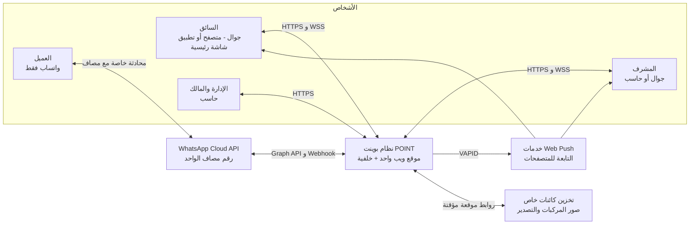

| الطرف | ما يراه | العلامة |
|---|---|---|
| السائق والمشرف والإدارة | موقع ويب واحد متجاوب (PWA اختياري) بعد الدخول بحساب دائم شخصي | بوينت · POINT |
| العميل | محادثة واتساب خاصة من رقم واحد، بزر واحد «طلب السيارة» ورسائل تلقائية | مصاف |
| Meta | تستلم رسائلنا الصادرة وتسلمنا الواردة والحالات عبر Webhook موقّع | — |
| خدمات Push | تنقل إشعارًا مختصرًا بلا بيانات شخصية إلى متصفح الموظف | — |

---

## 3. مخطط الحاويات (Containers)

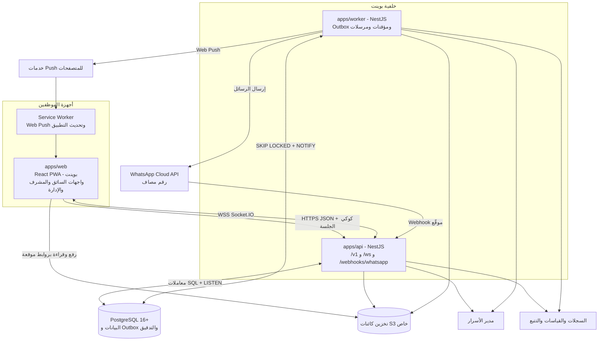

| الحاوية | التشغيل | المسؤولية | الحالة | وحدة التوسع |
|---|---|---|---|---|
| `apps/web` | ملفات ثابتة على CDN/استضافة ثابتة + Service Worker | واجهات السائق `D-01…D-15` والمشرف والإدارة `S-01…S-13`، محرك الصوت داخل الصفحة، اشتراك Push، مزامنة الحالة | لا حالة على الخادم؛ ذاكرة مؤقتة للعرض فقط تُعلَّم «قديمة» عند الانقطاع | نسخ CDN |
| `apps/api` | Node.js 24 LTS، NestJS HTTP + Socket.IO | REST `/v1`، Webhook واتساب، WebSocket `/ws`، `/health`، `/metrics` | بلا حالة (الجلسات في `auth_sessions`)؛ اتصالات WebSocket محلية لكل نسخة | نسخ أفقية خلف موازن حمل |
| `apps/worker` | Node.js 24 LTS، NestJS standalone | توزيع Outbox، المؤقتات، إرسال واتساب وPush، معالجة الوارد، المسح الدوري، الاحتفاظ، التصدير | بلا حالة (الإيجارات في `outbox_events`) | نسخ أفقية آمنة بـ`SKIP LOCKED` |
| PostgreSQL 16+ | خدمة مُدارة مع نسخ احتياطي واستعادة زمنية إن توفرت | كل الجداول الـ47، Outbox، مفاتيح التكرار، التدقيق، التحليلات | مصدر الحقيقة | ترقية رأسية ثم نسخ قراءة للتقارير عند الحاجة |
| تخزين الكائنات | S3 أو متوافق (MinIO محليًا) — دلاء خاصة | صور الفحص `media_assets`، ملفات `exports` | خاص؛ لا وصول عام؛ روابط موقعة 5 دقائق | مُدار |
| WhatsApp Cloud API | Meta (أو مزود معتمد) | رقم «مصاف» الواحد؛ إرسال القوالب؛ Webhook الوارد والحالات | خارجي | — |
| خدمات Push | تابعة للمتصفحات | تسليم إشعارات Web Push | خارجي | — |
| مدير الأسرار | خدمة سحابية | رمز Meta، سر التطبيق، مفاتيح VAPID، مفاتيح التشفير والـpepper | — | — |

---

## 4. خريطة الوحدات (NestJS module map)

### 4.1 الطبقات

| الطبقة | المسار | المحتوى |
|---|---|---|
| المنصة `core` | `packages/server/src/core` | اتصال القاعدة، `withTransaction`، مساعدات الأقفال بالترتيب المرجعي، مفاتيح التكرار، كاتب Outbox، كاتب التدقيق، كاتب `ticket_events`، `AppError` وتحويل قيود PostgreSQL إلى رموز Canon §8، الساعة القابلة للحقن في الاختبارات، سياق الفاعل، محلل الإعدادات (القيم الافتراضية من Canon §12 عبر zod)، محلل الأسرار، ناشر الاتصال الفوري (`pg_notify`) |
| الوحدات النطاقية التسع | `packages/server/src/modules/*` | المنطق والمستودعات والاستعلامات لكل مجال (§4.2) |
| حالات الاستخدام `use-cases` | `packages/server/src/use-cases` | سير العمل العابر للوحدات؛ **تملك المعاملة** وتستدعي الوحدات بترتيب الأقفال |
| مداخل التشغيل | `apps/api` و`apps/worker` | `api`: Controllers وGateway وWebhook. `worker`: معالجات `job.*` والمُسقطات (projectors) |

قاعدة: الـController لا يكتب في القاعدة مباشرة؛ يستدعي حالة استخدام (أمر) أو خدمة استعلام (قراءة). حالة الاستخدام تفتح المعاملة وتستدعي خدمات الوحدات وتكتب الأثر في Outbox.

### 4.2 الوحدات

**1) Identity & Access — `identity-access`**

- المسؤولية: الحسابات الدائمة لكل الأدوار وإضافتها وتعطيلها، الدخول والرقم السري وكلمة المرور وMFA، الجلسات، الأجهزة واشتراكات Push واختبار الصوت، نطاقات المشرف والإدارة، تعيينات السائق ونقله، بناء سياق الفاعل وفحص الصلاحيات.
- الجداول المملوكة: `users`, `role_scopes`, `devices`, `auth_sessions`, `driver_assignments`, `driver_transfers`.
- الواجهة العامة: `AuthService.login / verifyMfa / logout / changeSecret`، `ActorContextService.load(sessionToken)`، `PermissionService.assert(actor, permission, resourceScope)`، `DriverAdminService.create / disable / enable / resetSecret`، `AssignmentService.assign / requestTransfer / cancelTransfer`، `DeviceService.register / update`.
- يُصدر: `driver.transfer_requested`, `driver.transfer_blocked`, `driver.transferred`, `driver.disabled`, `driver.enabled`.
- معالجات العامل: `job.transfer_activate` (ينفّذ عبر حالة الاستخدام `ActivateTransfer`).

**2) Venues & Events — `venues-events`**

- المسؤولية: القاعات، مجموعات التوزيع، الحفلات وحالاتها وتسعيرها، الورديات، مناطق الوقوف والمواقف، لوحات وخانات المفاتيح، إعدادات الموقع والمؤسسة.
- الجداول: `organizations`, `venues`, `dispatch_pools`, `events`, `shifts`, `parking_zones`, `parking_spots`, `key_boards`, `key_slots`.
- الواجهة: `VenueService`، `EventService.open / startClosing / cancel`، `ShiftService.open / close`، `TicketNumberAllocator.next(tx, eventId)` (يقفل صف الحفل L2 ويزيد `next_display_number`)، `SettingsService.forVenue(venueId)`.
- يُصدر: `event.opened`, `event.closing_started`, `event.closed`, `shift.opened`, `shift.closed`.

**3) Tickets & Custody — `tickets-custody`**

- المسؤولية: التذكرة ومراحل الاستلام، الخط الزمني، دورات الاسترجاع، الفحص والصور، تخصيص المواقف وخانات المفاتيح، سلسلة العهدة، رموز التسليم.
- الجداول: `tickets`, `ticket_events`, `retrieval_cycles`, `vehicle_inspections`, `media_assets`, `spot_allocations`, `key_slot_allocations`, `custody_events`, `claim_codes`.
- الواجهة: `TicketLifecycle.transition(tx, ticket, to, ctx)` (يتحقق من آلة الحالة في الملف 11)، `IntakeService`، `CycleService.open / close`، `CustodyService.move(tx, subject, from, to, reason)`، `AllocationService.allocateSpot / allocateKeySlot / release`، `ClaimCodeService.issue / verify / resend / revoke`، `MediaService.presignUpload / complete / presignRead`.
- يُصدر: كل `ticket.*`، `custody.changed`، كل `handover.*`.
- معالجات العامل: `job.ready_uncollected_check`, `job.claim_code_expire`.

**4) Dispatch — `dispatch`**

- المسؤولية: مناوبات السائقين والتوفر المشتق `driver_state`، المهام، جولات العرض، البث، القبول الذري، المهمة التالية وترقيتها، المؤقتات والتصعيد، إعادة الإسناد.
- الجداول: `duty_sessions`, `tasks`, `task_offers`, `offer_recipients`.
- الواجهة: `DutyService.start / setBreak / end / forceEnd / heartbeat`، `DispatchService.runPass(tx, poolId)`، `OfferService.accept(tx, offerId, actor)`، `TaskService.createPark / createRetrieve / createRepark / keyPickup / start / ready / complete / cancel / withdraw`، `DriverStateQuery`.
- يُصدر: كل `task.*` و`offer.*`، `driver.duty_started`, `driver.break_started`, `driver.break_ended`, `driver.duty_ended`, `driver.availability_changed`, `driver.connection_changed`.
- معالجات العامل: `job.dispatch_pass`, `job.dispatch_sweep`, `job.offer_remind`, `job.offer_expire`, `job.broadcast_remind`, `job.escalate_unaccepted`, `job.next_task_wait_check`, `job.heartbeat_sweep`.

**5) WhatsApp Adapter — `whatsapp`**

- المسؤولية: قناة الإرسال الوحيدة، التحقق من توقيع Webhook وحفظ الخام، معالجة الوارد، ربط العميل بالتذكرة والموقع، الموافقات، رموز الإجراء ورموز الربط، القوالب، إرسال الرسائل، حالات التسليم، صحة القناة.
- الجداول: `whatsapp_channel`, `whatsapp_templates`, `whatsapp_messages`, `whatsapp_inbound_events`, `customers`, `customer_consents`, `action_tokens`, `link_codes`.
- الواجهة: `WebhookController` (جسم خام)، `InboundProcessor`، `WaSender` (Graph API أو المحاكي حسب `whatsapp_channel.mode`)، `TemplateRenderer`، `ActionTokenService.issue / resolve`، `LinkService.issueQr / confirm`، `ConsentService`، `ChannelHealth`.
- يُصدر: `wa.inbound_received`, `wa.button_pressed`, `wa.message_status_changed`, `wa.channel_health_changed`, `wa.customer_opted_out`, `ticket.wa_link_changed`.
- معالجات العامل: `job.wa_process_inbound`, `job.wa_send`, `job.link_code_expire`.

**6) Notifications — `notifications`**

- المسؤولية: تعريف Outbox وحلقة توزيعه، تخطيط الإشعارات (من الحدث إلى قنوات ومستلمين وفق الملف 14)، إرسال Web Push، النشر الفوري، سجل المحاولات.
- الجداول: `outbox_events`, `notifications`, `notification_attempts`.
- الواجهة: `OutboxWriter.append(tx, row)`، `NotificationPlanner.plan(event) → rows` (دالة نقية بلا شبكة تُستدعى داخل المعاملة)، `OutboxDispatcher` (حلقة العامل)، `PushSender`، `RealtimePublisher.publish(tx, room, event)`.
- معالجات العامل: `job.push_send`, `job.ws_publish`.

**7) Incidents — `incidents`**

- المسؤولية: الوقائع الداخلية للمشرف وتنبيهات المشرف الآلية وإغلاقها التلقائي عند زوال السبب.
- الجداول: `incidents`, `alerts`.
- الواجهة: `AlertService.acknowledge / resolve` ومسارات `/v1/alerts`، `IncidentService.open / update / resolve`. الرفع والحل الآلي (`raiseAlert`، `raiseAlertForAffectedVenues`، `autoResolveAlerts`) في `core/alerts` لتستعمله كل الوحدات دون استيراد `incidents` (DEC-79).
- يُصدر: `alert.raised`, `alert.acknowledged`, `alert.resolved`, `incident.opened`, `incident.updated`, `incident.resolved`.

**8) Payments & Reports — `payments-reports`**

- المسؤولية: التحصيل والعكس والإعفاء، تسليم النقد، تسوية الحفل، التقارير، التصدير المؤقت.
- الجداول: `payments`, `cash_handovers`, `exports`.
- الواجهة: `PaymentService.record / reverse / waive`، `CashHandoverService.confirm`، `SettlementQuery.forEvent(eventId)`، `ReportQuery`، `ExportService.request`.
- يُصدر: `payment.recorded`, `payment.reversed`, `payment.waived`.
- معالجات العامل: `job.export_generate`.

**9) Audit & Monitoring — `audit-monitoring`**

- المسؤولية: قراءة سجل التدقيق، إسقاط الأحداث إلى `analytics_events`، استقبال قياسات العميل، فحوص الصحة، مقاييس Prometheus، كشف الرسائل والمهام العالقة، سياسة الاحتفاظ.
- الجداول: `audit_log` (الكتابة عبر كاتب `core`)، `analytics_events`. جدول `idempotency_keys` مملوك لـ`core`.
- الواجهة: `AuditQuery`، `AnalyticsProjector`، `TelemetryIngest`، `HealthService`، `MetricsRegistry`، `StuckDetector`.
- معالجات العامل: `job.retention_purge`، والمُسقِط الذي يستهلك صفوف أحداث النطاق.

### 4.3 اتجاهات الاعتماد المسموحة

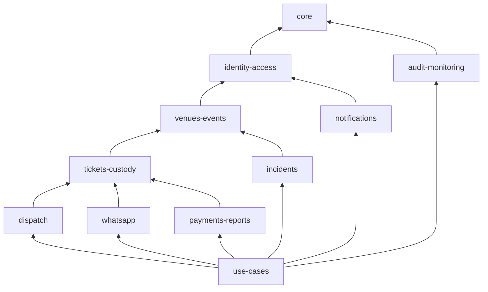

السهم يعني «يستورد من». القواعد:

1. الوحدة تستورد `core` والوحدات الواقعة تحتها في سلسلتها فقط (انتقاليًا). مثال: `dispatch` يستورد `tickets-custody` و`venues-events` و`identity-access`.
2. `tickets-custody` لا يستورد `dispatch` أبدًا. ما يحتاج الطرفين معًا (بدء الاستلام ينشئ تذكرة ومهمة `park`، الطلب ينشئ دورة ومهمة) يُكتب كحالة استخدام في `use-cases`.
3. `whatsapp` لا يستدعي `dispatch`. ضغطة الزر تمر عبر حالة الاستخدام `RequestRetrieval` التي تركّب `tickets-custody` و`dispatch`.
4. `notifications` لا يعرف منطق المجالات؛ يعرف فقط أسماء الأحداث والقوالب والأصوات من `packages/shared`.
5. أي أثر جانبي عابر للوحدات يمر إما عبر حالة استخدام داخل المعاملة نفسها أو عبر صف Outbox يعالجه العامل.
6. تُفرض هذه القواعد آليًا في CI (قواعد `dependency-cruiser` أو `eslint-plugin-boundaries`) — راجع الملف 05.

### 4.4 حالات الاستخدام العابرة للوحدات

| حالة الاستخدام | المسار المُطلِق | الوحدات المركّبة | تحمل L1 |
|---|---|---|---|
| `StartIntake` | `POST /v1/tickets` | venues-events (رقم التذكرة) + tickets-custody + dispatch (مهمة `park`) | نعم |
| `UpdateIntake` | `PATCH /v1/tickets/{ticketId}/intake` | tickets-custody | لا |
| `SubmitIntake` | `POST /v1/tickets/{ticketId}/submit-intake` | tickets-custody + whatsapp (موافقة ورمز إجراء) + notifications (W-01) | لا |
| `CompleteParking` | `POST /v1/tasks/{taskId}/complete-parking` | tickets-custody + dispatch (+ تحويل الطلب المبكر DEC-13) | نعم |
| `RequestRetrieval` | ضغطة الزر عبر `job.wa_process_inbound` أو `POST /v1/tickets/{ticketId}/retrievals` | tickets-custody + dispatch + notifications (W-02) | نعم |
| `AcceptOffer` | `POST /v1/task-offers/{offerId}/accept` | dispatch + tickets-custody + notifications (W-03 عند الحجز التالي) | نعم |
| `KeyPickup` / `StartRetrieval` / `MarkReady` | `/v1/tasks/{taskId}/...` | dispatch + tickets-custody + notifications (W-04، W-05) | لا |
| `Handover` | `POST /v1/tickets/{ticketId}/handover` | tickets-custody + payments-reports + dispatch (تحرير أو ترقية) + notifications (W-06) | نعم |
| `CancelRetrieval` | `POST /v1/retrieval-cycles/{cycleId}/cancel` | tickets-custody + dispatch + notifications (W-07) | نعم |
| `ReassignTask` | `POST /v1/tasks/{taskId}/reassign` | dispatch + tickets-custody + incidents | نعم |
| `Repark` | `POST /v1/tickets/{ticketId}/repark` | tickets-custody + dispatch + notifications (W-08) | نعم |
| `ActivateTransfer` | `job.transfer_activate` | identity-access + dispatch + incidents | نعم (مجموعتا الموقعين) |
| `CloseEvent` | `POST /v1/events/{eventId}/close` | venues-events + tickets-custody + payments-reports + incidents | لا (L2) |
| `ProcessInbound` | `job.wa_process_inbound` | whatsapp + (`RequestRetrieval` أو `LinkConfirm` أو الردود) | حسب الفرع |
| `ManualReconcile` | `POST /v1/tickets/{ticketId}/manual-reconcile` | tickets-custody + dispatch + incidents | نعم |

---

## 5. خط معالجة الأوامر (Command pipeline)

### 5.1 المراحل

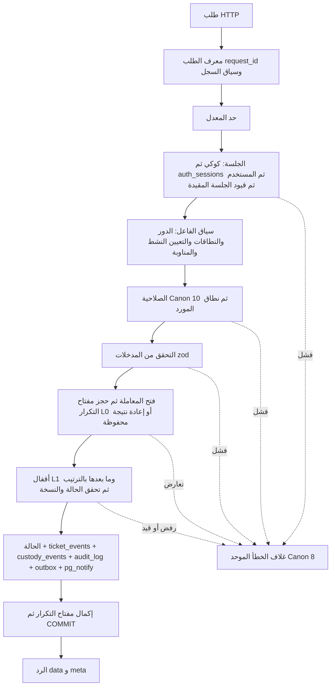

| المرحلة | ما يحدث | أخطاء نموذجية |
|---|---|---|
| معرف الطلب | يُقبل `X-Request-Id` إن كان صالحًا وإلا يُولّد `req_<ulid>`؛ يُضاف لكل سطر سجل ولكل رد | — |
| حد المعدل | لكل IP على `/v1/auth/*`، ولكل مستخدم على الأوامر، ولكل مصدر على Webhook | `RATE_LIMITED` |
| الجلسة | كوكي `__Host-point_sid` → `sha256` → صف `auth_sessions` غير منتهٍ وغير مُبطل → `users.status = active` → الجلسة المقيدة (`must_change_secret` أو إعداد MFA معلّق) تصل لكل مسارات `auth.self` فقط، وغيرها يُرفض بتغيير السر أولًا ثم إعداد MFA. لا كوكي قبل اجتياز `POST /v1/auth/mfa/verify` حين تلزم MFA (`AUTH_MFA_REQUIRED` يرده ذلك المسار وحده) | `AUTH_UNAUTHENTICATED`, `AUTH_SESSION_EXPIRED`, `AUTH_SESSION_REVOKED`, `AUTH_ACCOUNT_DISABLED`, `AUTH_SECRET_CHANGE_REQUIRED`, `AUTH_MFA_SETUP_REQUIRED` |
| سياق الفاعل | يُحمَّل في استعلام واحد: الدور، `can_drive`، نطاقات `role_scopes` السارية، التعيين النشط `driver_assignments.status = active`، المناوبة المفتوحة وحالة `v_driver_state` | — |
| الصلاحية والنطاق | فحص الصلاحية من مصفوفة Canon §10 ثم تحميل `venue_id` للمورد الهدف ومطابقته بنطاق الفاعل؛ للسائق: الموقع = موقع التعيين النشط، والمناوبة شرط للأوامر التشغيلية. مورد مُشار إليه بمعرّفه (في المسار أو الجسم) خارج النطاق ← 404 برمز عدم وجوده دون إفصاح؛ و`SCOPE_VENUE_DENIED` فقط حين يسمّي المستدعي موقعًا صراحة (`{venueId}` أو `venue_id`) | `PERMISSION_DENIED`, `TICKET_NOT_FOUND`, `OFFER_NOT_FOUND`, `RESOURCE_NOT_FOUND`, `SCOPE_VENUE_DENIED`, `ASSIGNMENT_REQUIRED`, `DUTY_REQUIRED`, `NOT_TASK_ASSIGNEE`, `NOT_OFFER_RECIPIENT` |
| التحقق | مخططات zod من `packages/shared` لنفس شكل السلك (snake_case) | `VALIDATION_FAILED`, `PHONE_INVALID`, `PLATE_INVALID`, `REASON_REQUIRED` |
| مفتاح التكرار | §5.2 | `IDEMPOTENCY_KEY_REQUIRED`, `IDEMPOTENCY_KEY_REUSED`, `IDEMPOTENCY_IN_PROGRESS` |
| المعاملة | §5.3 و§5.4 | `INVALID_STATE_TRANSITION`, `VERSION_CONFLICT`، ورموز المجال (`TASK_ALREADY_CLAIMED` وغيرها) |
| الرد | `{ "data": ..., "meta": { "request_id", "server_time" } }` مع `version` الجديد للكيان | — |

### 5.2 مفاتيح التكرار (Idempotency)

1. كل مسار معلَّم ✓ في Canon §9 يرفض الطلب بلا ترويسة `Idempotency-Key` (UUID يولده العميل لكل نقرة مستخدم) بالرمز `IDEMPOTENCY_KEY_REQUIRED`.
2. `request_hash = sha256(method + المسار بعد تعويض المعاملات + JSON المدخلات بصيغة مرتبة)`.
3. أول جملة في معاملة الأمر نفسها (L0، Canon §14ب): `INSERT INTO idempotency_keys(user_id, key, operation, request_hash) ... ON CONFLICT DO NOTHING` ثم قراءة الصف.
   - إن وُجد صف `completed` بنفس `request_hash` → يُعاد `response_status` و`response_body` المحفوظان دون تنفيذ.
   - إن وُجد بنفس المفتاح و`request_hash` مختلف → `IDEMPOTENCY_KEY_REUSED`.
   - الطلب المكرر المتزامن ينتظر على صف المفتاح حتى تلتزم المعاملة الأولى ثم يعيد ردها المحفوظ (أو ينفذ إن تراجعت). لا يُرد `IDEMPOTENCY_IN_PROGRESS` (قابل لإعادة المحاولة) إلا إن تجاوز هذا الانتظار `lock_timeout` عند L0. لا صفوف مهجورة يُستولى عليها: سقوط العملية يُرجع المعاملة كلها فلا يبقى الصف.
4. معاملة الأمر نفسها تحدّث الصف إلى `completed` مع الرد **قبل** `COMMIT`، فلا يمكن أن يلتزم الأثر دون نتيجته المحفوظة.
5. تُحفظ الردود 2xx وكل خطأ 4xx حتمي (منها 403/404/409/410/422/423). لا تُحفظ 401/429/5xx؛ يُحذف الصف (تتراجع المعاملة) ليُسمح بإعادة المحاولة.
6. تنتهي المفاتيح بعد 24 ساعة (`expires_at`) وتُمسح بـ`job.retention_purge`.

### 5.3 ترتيب الأقفال المرجعي

هذا الجدول نسخة من Canon §14ب (DEC-27) وهو الملزم؛ نمط القفل `FOR NO KEY UPDATE` (لا يحجب فحوص المفاتيح الأجنبية للإدراجات المتزامنة)، و`FOR SHARE` حيث يكفي منع التغيير، و`FOR UPDATE SKIP LOCKED` لتأجير `outbox_events` فقط.

| المستوى | الجدول | متى يُقفل |
|---|---|---|
| L0 | حجز `idempotency_keys` | أول جملة في أي أمر معلّم ✓ |
| L1 | `dispatch_pools` | أي أمر يُنشئ أو يُنهي أو يُسند مهمة، أو يمس عرضًا أو دورة إحضار، أو يغيّر توفر سائق داخل المجموعة. أكثر من مجموعة: تصاعديًا بالمعرف |
| L2 | `events` | زيادة عداد `next_display_number`، فتح الحفل وإغلاقه (`FOR NO KEY UPDATE`)؛ التحصيل وتسليم النقد (`FOR SHARE`) |
| L3 | `driver_transfers` ← `driver_assignments` ← `users` | تفعيل النقل وإلغاؤه والتعيين والتعطيل |
| L4 | `tasks` | تصاعديًا بالمعرف |
| L5 | `tickets` | تصاعديًا بالمعرف عند تعدد التذاكر |
| L6 | `retrieval_cycles` | فتح دورة وإغلاقها |
| L7 | `task_offers` (ومستلموها) | تصاعديًا بالمعرف |
| L8 | `duty_sessions` | تصاعديًا بالمعرف |
| L9 | التابعة: `spot_allocations` · `key_slot_allocations` · `claim_codes` · `link_codes` · `action_tokens` · `payments` · `cash_handovers` · `alerts` · `notifications` | تحرسها القيود الفريدة غالبًا دون قفل صريح |
| L10 | الإلحاقيات: `custody_events` · `ticket_events` · `outbox_events` · `audit_log` · `analytics_events` | آخر المعاملة، ثم إكمال `idempotency_keys` |

قواعد التطبيق:

1. اقرأ المعرّفات المطلوبة **بلا أقفال** أولًا (مثلًا من العرض إلى المهمة إلى التذكرة إلى المجموعة)، ثم اقفل بالترتيب، ثم **أعد التحقق** من الحالة والنسخة بعد القفل.
2. لا تعد إلى مستوى رقمه أصغر بعد مستوى رقمه أكبر في المعاملة نفسها (مثلًا L4 بعد L5 ممنوع). المعاملات التي لا تحمل L1 (تعديل مسودة الاستلام، رفع الصور، رموز الربط، تغيير الجوال، إرسال المسودة) تبدأ من L5، وأوامر تقدم الحركة (`key-pickup`، `start-retrieval`، `ready`) تبدأ من L4؛ ولا تطلب أي منها مستوى أصغر بعد ذلك. **الاستثناء الوحيد (Canon §14ب):** معاملة تحمل L1 يجوز لها، بعد أن أخذت أقفال أمرها، أن تقفل صفوفًا إضافية من L4–L8 لنفس المجموعة لتمريرة التوزيع ولتسوية السائق بعد مهمته (`settleDriverAfterTask`).
3. لكل معاملة: `SET LOCAL lock_timeout = '3s'` و`SET LOCAL statement_timeout = '5s'`.
4. عند `40P01` (deadlock) أو `40001` تُعاد المعاملة كاملة حتى 3 مرات بتأخير عشوائي 20–80 مللي ثانية، ثم `SERVICE_UNAVAILABLE` بقيمة `retryable: true`. تجاوز `lock_timeout` (`55P03`) لا يُعاد على الخادم: يرد `IDEMPOTENCY_IN_PROGRESS` إن حدث عند L0 (صف مفتاح التكرار) وإلا `SERVICE_UNAVAILABLE` (`retryable: true`).
5. لا أي اتصال شبكي داخل المعاملة (لا Graph API ولا Push ولا S3). التوقيع المسبق لروابط S3 حساب محلي ويُسمح به.
6. القيود الفريدة خط الدفاع الأخير: انتهاكها يتحول لرمز المجال المقابل (`uq_tasks_next_per_driver` → `NEXT_TASK_ALREADY_RESERVED`، `uq_key_alloc_slot_active` → `KEY_SLOT_OCCUPIED`، `uq_tickets_key_tag_open` → `KEY_TAG_IN_USE`، `uq_driver_assignments_active` → `ASSIGNMENT_CONFLICT`، `uq_retrieval_cycles_open` → `RETRIEVAL_ALREADY_ACTIVE`). الجدول الكامل في الملف 08.

الأقفال حسب الأمر (التفصيل الكامل في الملف 10):

| الأمر | L1 | L2 | L3 | L4 | L5 | L6 | L7 | L8 | تمريرة توزيع |
|---|---|---|---|---|---|---|---|---|---|
| بدء/استراحة/إنهاء المناوبة | ✓ | | | ✓ (إعادة مهمة عرضه الحي للطابور) | | | ✓ (سحب عرضه الفردي الحي) | ✓ | ✓ |
| `StartIntake` | ✓ | ✓ | | ✓ إدراج (+ سحب عرضه الحي) | ✓ إدراج | | ✓ (سحب عرضه الحي) | ✓ | ✓ |
| `UpdateIntake` / `SubmitIntake` | | | | | ✓ | | | | — |
| `CompleteParking` | ✓ | | | ✓ | ✓ | ✓ | | ✓ | ✓ |
| `RequestRetrieval` | ✓ | | | ✓ إدراج | ✓ | ✓ إدراج | | | ✓ |
| `AcceptOffer` | ✓ | | | ✓ | ✓ | ✓ | ✓ | ✓ | ✓ |
| `KeyPickup` / `StartRetrieval` / `MarkReady` | | | | ✓ | ✓ | ✓ | | | — |
| `Handover` | ✓ | ✓ `FOR SHARE` (عند التحصيل المضمّن) | | ✓ | ✓ | ✓ | | ✓ | ✓ |
| `CancelRetrieval` / `ReassignTask` / `Repark` | ✓ | | | ✓ | ✓ | ✓ | ✓ | ✓ | ✓ |
| مؤقتات العرض والبث (`job.offer_expire` ...) | ✓ | | | ✓ | | | ✓ | ✓ | ✓ |
| `ActivateTransfer` | ✓ (مجموعتان) | | ✓ | ✓ | ✓ | | ✓ | ✓ | ✓ |
| `CloseEvent` | | ✓ | | | ✓ (قراءة مقفلة) | | | | — |

### 5.4 ما يُكتب داخل المعاملة وبأي ترتيب

1. تحديثات الحالة مع `version = version + 1` وشرط `version = expected`.
2. `ticket_events` (سطر لكل حدث يخص تذكرة، مع `ticket_version`).
3. `custody_events` لكل انتقال عهدة، وتحديث حقول الحائز الحالي في `tickets`.
4. `audit_log` (الفاعل، الأمر، الكيان، السبب، فرق مختصر بلا أسرار ولا أرقام كاملة).
5. `outbox_events`:
   - **أحداث النطاق** (Canon §7.1) — بلا `ordering_key`؛ يستهلكها العامل بالمُسقطات غير الحرجة زمنيًا وغير المعتمدة على الترتيب (تتحقق من `aggregate_version`): `AnalyticsProjector` (يكتب `analytics_events` في العامل لا في معاملة الأمر) و`AlertAutoResolver`.
   - **المهام** (Canon §7.2) — يولّدها داخل المعاملة `NotificationPlanner` (من أحداث نطاق المعاملة نفسها حسب مصفوفة الملف 14 §3.1، DEC-41) والمجدولون: `job.wa_send` (مع `ordering_key = wa:<ticket_id>` و`dedupe_key`)، `job.push_send` (بـ`dedupe_key` فقط بلا `ordering_key`)، والمؤقتات بـ`available_at` مستقبلي.
6. `pg_notify('point_realtime', <غلاف مختصر>)` لكل حدث فوري؛ يُسلَّم فقط بعد الالتزام ولا يُسلَّم إذا تراجعت المعاملة.
7. تحديث `idempotency_keys` إلى `completed`.
8. `COMMIT`.

### 5.5 الرد ومعالجة الأخطاء

- كل خطأ يخرج بالغلاف الموحد في Canon §8 مع `request_id` و`retryable`.
- استثناءات قاعدة البيانات تُحوّل باسم القيد إلى رمز المجال؛ ما لا يُعرف يصبح `INTERNAL_ERROR` دون كشف تفاصيل داخلية.
- `VERSION_CONFLICT` يعني أن الشاشة قديمة: العميل البرمجي يجلب الحالة الحالية قبل أي محاولة جديدة.
- لا يُعرض «تم القبول» أو «تم التسليم» في الواجهة إلا بعد رد 2xx من الخادم.

---

## 6. خط معالجة العامل (Worker pipeline)

### 6.1 الحلقة والاستئجار

يعمل `OutboxDispatcher` بعدد عمال متزامنين `WORKER_CONCURRENCY` ويستأجر الدفعات هكذا:

```sql
WITH due AS (
  SELECT o.id
  FROM outbox_events o
  WHERE o.status = 'pending'
    AND o.available_at <= now()
    AND (o.ordering_key IS NULL OR NOT EXISTS (
          SELECT 1 FROM outbox_events p
          WHERE p.ordering_key = o.ordering_key
            AND p.status IN ('pending','processing')
            AND p.seq < o.seq))
  ORDER BY o.available_at, o.seq
  FOR UPDATE SKIP LOCKED
  LIMIT $batch
)
UPDATE outbox_events e
SET status = 'processing', locked_by = $worker_id,
    locked_until = now() + make_interval(secs => $lease_seconds),
    attempts = e.attempts + 1
FROM due WHERE e.id = due.id
RETURNING e.*;
```

- الإيجار الافتراضي 30 ثانية. المعالج الطويل يجدد الإيجار.
- صفوف `processing` التي انتهى إيجارها (`locked_until < now()`) يعيدها `job.dispatch_sweep`/مسح الصيانة إلى `pending` دون زيادة المحاولات مرتين.
- بعد النجاح: `status = 'done'`, `processed_at = now()`. لا تحمل صفوف Outbox أي سر؛ رمز التسليم يُقرأ من `claim_codes.code_ciphertext` لحظة الإرسال (DEC-38).

### 6.2 الإيقاظ

- كل معاملة تكتب Outbox تنفّذ `pg_notify('point_outbox', <venue_id أو فارغ>)`؛ العامل يستمع ويوقظ الحلقة فورًا.
- احتياطًا يستطلع العامل كل `WORKER_POLL_INTERVAL_MS` (الافتراضي 500 مللي ثانية) لالتقاط المؤقتات المستحقة والإشعارات الضائعة.
- المهام الدورية (`job.dispatch_sweep` كل 5 ثوانٍ لكل مجموعة نشطة، `job.heartbeat_sweep` كل 15 ثانية، `job.retention_purge` يوميًا 02:00 UTC أي 05:00 بتوقيت الرياض) تُحفظ صفًا واحدًا معلقًا لكل مهمة بفضل `dedupe_key`، ويعيد معالجها جدولة نفسه بعد التنفيذ.

### 6.3 التسلسل حسب `ordering_key`

- رسائل واتساب لكل تذكرة تحمل `ordering_key = wa:<ticket_id>` فلا تُرسل رسالة قبل التي سبقتها لنفس التذكرة (مثلًا W-04 لا يسبق W-02).
- المؤقتات وأحداث النطاق و`job.push_send` لا تحمل `ordering_key` حتى لا تتعطل خلف رسالة متأخرة. فحوص لحظة الإرسال (التجاوز، الإيقاف، `link_version`، تعطل القناة) يجريها العامل قبل كل `job.wa_send` (DEC-41، الملف 12).
- العدالة بين المواقع: يرتب المرسل الدفعة بتناوب على `venue_id` ويحترم حد معدل الرقم الواحد وحد الإرسال لنفس المستلم (الملف 12)، فلا يستحوذ ضغط موقع واحد على الطابور.

### 6.4 إعادة المحاولة والرسائل الميتة

| المحاولة | التأخير قبل التالية (مع تذبذب ±20%) |
|---|---|
| 1 | 2 ثانية |
| 2 | 5 ثوانٍ |
| 3 | 15 ثانية |
| 4 | 30 ثانية |
| 5 | 60 ثانية |
| 6 | 120 ثانية |
| 7 | 300 ثانية |
| 8 | لا محاولة: `dead` |

- **خطأ قابل لإعادة المحاولة** (انقطاع شبكة، 5xx، حد معدل من المزود): `status = 'pending'`, `available_at = now() + backoff`, `last_error`.
- **خطأ نهائي** (رقم غير قابل للتسليم، قالب غير معتمد، معاملات غير صالحة): `status = 'failed'`، الإشعار `notifications.status = 'failed'`، تنبيه `wa_send_failed` للمشرف، وتظهر للسائق في بطاقة التذكرة.
- **استنفاد المحاولات:** `status = 'dead'` + تنبيه `outbox_lag` (صف لكل موقع متأثر فيه حفل مفتوح أو قيد الإغلاق، يصل مشرفيه والإدارة — DEC-46)، وإعادة يدوية عبر `POST /v1/admin/outbox/{outboxId}/retry` فقط بعد مراجعة.
- لا حلقة إعادة إرسال بلا نهاية (المعمارية §14).

### 6.5 المؤقتات وإعادة التحقق

كل مؤقت صف Outbox بنوع `job.*` و`available_at` مستقبلي و`aggregate_version` وقت الجدولة. عند التنفيذ:

1. يُقفل ما يلزم بالترتيب المرجعي (§5.3).
2. يُقارن الحالة/النسخة الحالية بما جُدول عليه المؤقت. أي اختلاف = إنهاء المؤقت `done` دون أثر.
3. يطبق الأثر في المعاملة نفسها (انتهاء عرض، تذكير، تصعيد، تنبيه).

| المؤقت | يُجدول عند | التوقيت الافتراضي (Canon §12) | الأثر |
|---|---|---|---|
| `job.offer_remind` | إنشاء عرض فردي | +15 ثانية | `offer.reminder` + صوت `reminder` إن بقي العرض نشطًا |
| `job.offer_expire` | إنشاء عرض فردي | `expires_at` (+30 ثانية) + `dispatch.accept_grace_ms` (1500 مللي ثانية) — DEC-47 | `expired` ثم تمريرة: المتاح التالي أو البث |
| `job.broadcast_remind` | فتح جولة بث | +30 ثانية | تذكير واحد للمهمة المفتوحة فقط |
| `job.escalate_unaccepted` | دخول المهمة الطابور `queued_at` | +60 ثانية | تنبيه `request_unaccepted` حرج + `tasks.escalated_at`؛ الطلب لا يسقط |
| `job.next_task_wait_check` | حجز مهمة تالية | +300 ثانية | تنبيه `next_task_waiting_long` دون إعادة إسناد صامتة |
| `job.ready_uncollected_check` | الجاهزية | +10 دقائق | تنبيه `ready_not_collected` |
| `job.claim_code_expire` | إصدار رمز التسليم | +30 دقيقة | انتهاء الرمز ومسح النسخة المشفرة |
| `job.link_code_expire` | إصدار رمز ربط QR | +10 دقائق | `expired` |
| `job.transfer_activate` | طلب نقل مجدول، أو انتهاء مهمة سائق نقله `blocked` | `scheduled_at` أو الآن | تنفيذ النقل أو `blocked` + تنبيه `transfer_blocked` (إعادة تقييم آلية) |
| `job.heartbeat_sweep` | دوري | كل 15 ثانية | `connection_state` إلى `uncertain` بعد 45 ثانية و`offline` بعد 120 |

### 6.6 جدول المعالجات

| `type` | الوحدة | مفتاح عدم التكرار |
|---|---|---|
| `job.dispatch_pass` | dispatch | `dispatch_pass:<pool_id>` (يُجمع المكرر المعلّق) |
| `job.dispatch_sweep` | dispatch | `dispatch_sweep` |
| `job.offer_remind` / `job.offer_expire` | dispatch | `offer_remind:<offer_id>` / `offer_expire:<offer_id>` |
| `job.broadcast_remind` | dispatch | `broadcast_remind:<offer_id>` |
| `job.escalate_unaccepted` | dispatch → incidents | `escalate_unaccepted:<task_id>:<queued_at>` |
| `job.next_task_wait_check` | dispatch → incidents | `next_task_wait:<task_id>:<assigned_waiting_at>` |
| `job.ready_uncollected_check` | tickets-custody → incidents | `ready_uncollected:<cycle_id>` |
| `job.claim_code_expire` | tickets-custody | `claim_code_expire:<claim_code_id>` |
| `job.link_code_expire` | whatsapp | `link_expire:<link_code_id>` |
| `job.transfer_activate` | identity-access (`ActivateTransfer`) | `transfer_activate:<transfer_id>` |
| `job.wa_process_inbound` | whatsapp (`ProcessInbound`) | `inbound:<whatsapp_inbound_events.id>` |
| `job.wa_send` | whatsapp | `notifications.dedupe_key` بصيغة الملف 12 §5.2 (مثلًا `wa:W-03:{cycle_id}`، `wa:W-05:{claim_code_id}`) |
| `job.push_send` | notifications | `notifications.dedupe_key` بصيغة الملف 14 §6.1 |
| `job.ws_publish` | notifications | `ws:<event_id>` |
| `job.heartbeat_sweep` | dispatch | `heartbeat_sweep` |
| `job.retention_purge` | audit-monitoring | `retention:<date>` |
| `job.export_generate` | payments-reports | `export:<export_id>` |

كل معالج idempotent: يعتمد على القيود الفريدة (`wa_message_id`، `dedupe_key`)، وعلى فحص الحالة قبل الأثر، ولا يفترض أن الصف لم يُعالج جزئيًا من قبل.

### 6.7 صحة Outbox

- مقاييس: عدد `pending` المستحق، عمر أقدم صف مستحق (p50/p95/max)، معدل `failed` و`dead` حسب `type`.
- تنبيه `outbox_lag` (حرج، الملف 14 هو المرجع) عندما يتجاوز عمر أقدم صف مستحق 30 ثانية (`ops.outbox_lag_alert_s`)، أو عند تحول أي صف إلى `dead`.
- `StuckDetector` يرفع التنبيه `task_stuck` (تحذير، مفتاح `task_stuck:{task_id}`، لمشرفي الموقع) للمهام المعلقة (مهمة `accepted` بلا بدء أكثر من 10 دقائق، `retrieving` أكثر من 20 دقيقة) — قيم أولية تُعدل بعد التشغيل التجريبي.

---

## 7. الاتصال الفوري (Realtime)

### 7.1 الاتصال والغرف

- Socket.IO على `apps/api` بالمسار `/ws`، النقل المفضل WebSocket، والمصادقة بكوكي الجلسة نفسه أثناء المصافحة (نفس فحوص §5.1).
- **الخادم وحده يقرر الغرف** بعد بناء سياق الفاعل:

| الغرفة | من ينضم | الغرض |
|---|---|---|
| `user:{userId}` | كل مستخدم متصل | العروض الشخصية، تحديث مهمته، `session.revoked` |
| `pool:{poolId}:drivers` | سائق (أو مشرف `can_drive`) لديه مناوبة مفتوحة في المجموعة | البث `task.broadcast`، `task.claimed`، تحديثات الطابور |
| `venue:{venueId}:supervisors` | مشرف بنطاق الموقع | لوحة التشغيل، التنبيهات، صحة القناة |
| `org:{orgId}:admins` | الإدارة والمالك | التنبيهات التي تمس أكثر من موقع (`wa_channel_down`، `outbox_lag`، `wa_webhook_silent`، `transfer_blocked`) إضافة إلى غرف مشرفي المواقع المتأثرة (DEC-46) |

- عند النقل أو التعطيل أو إنهاء المناوبة: يُخرج الخادم المقابس من الغرف القديمة فورًا، ويُرسل `session.revoked` عند إبطال الجلسة أو `sync.required` عند تغير النطاق. تُعاد مطابقة عضوية الغرف لكل مقبس كل 60 ثانية من القاعدة كضمان إضافي.

### 7.2 النشر عبر `LISTEN/NOTIFY`

- أي معاملة (في `api` أو `worker`) تنشر حدثًا فوريًا بـ`pg_notify('point_realtime', json)` حيث الحمولة `{ "room": "...", "event": <غلاف مختصر> }` أقل من 8000 بايت (معرّفات ونسخ وحقول عرض دنيا).
- كل نسخة `api` تستمع للقناة وتبث للمقابس المتصلة بها محليًا؛ لأن كل النسخ تستقبل الإشعار نفسه، يصل الحدث للجميع **دون Redis** حتى مع عدة نسخ.
- `job.ws_publish` يُستخدم فقط حين يتعذر النشر داخل معاملة (حمولة كبيرة أو نشر مؤجل)، ويحمل معرف الحدث ليجلب الـapi التفاصيل؛ الحدث الواحد لا يُنشر بالطريقين (DEC-48).
- Redis adapter لـSocket.IO يُضاف فقط إذا قيس أن `NOTIFY` صار عنق زجاجة أو احتجنا بثًا من خارج المعاملات.
- النشر الفوري «مرة على الأكثر» وغير دائم: الدوام في حالة القاعدة، والتعافي بالمزامنة (§7.3).

### 7.3 قواعد العميل البرمجي

1. كل حدث يحمل `id` و`aggregate.version`؛ يتجاهل العميل أي حدث نسخته أقدم مما لديه.
2. عند الاتصال أو إعادة الاتصال أو العودة من الخلفية أو استلام `sync.required`: `GET /v1/me/home` (أو استعلام اللوحة للمشرف) **قبل** تفعيل أزرار الأوامر، مع عرض وقت آخر مزامنة.
3. `client.heartbeat` كل 15 ثانية يحدّث `duty_sessions.last_heartbeat_at`. فقد النبضة يغير مؤشر الاتصال فقط ولا يغير التوفر ولا يسحب المهام (المعمارية §7).
4. البطاقة تختفي عند `task.claimed` أو `offer.closed` ويتوقف صوتها فورًا.
5. لا طابور أوامر دون اتصال: الأمر يُرسل فقط مع اتصال قائم، والنموذج يحتفظ بمدخلاته عند الفشل.

### 7.4 الصوت وPush (ملخص)

- الصوت داخل الصفحة عبر Web Audio بعد نقرة «تفعيل واختبار الصوت» (D-03/D-14)؛ لا تشغيل تلقائي مفترض.
- Web Push مساعد عند دعمه وإذن المستخدم؛ أنواعه `offer` و`broadcast` و`reminder` و`next_due` و`escalation` و`closed` فقط (Canon §5.7)، والحمولة نوع الإشعار ووسمه `tag` ورقم التذكرة فقط (DEC-23)، والنقر يفتح `/d` للسائق ثم مزامنة كاملة. عند الحجز أو الانتهاء أو السحب أو الإلغاء أو إعادة الإسناد يُرسل إشعار `closed` هادئ بنفس الوسم يستبدل القديم.
- التفاصيل في الملفين 05 (§PWA) و14.

---

## 8. مخططات التسلسل

اصطلاحات: «api» و«worker» عمليتان من الخلفية؛ «Meta» = WhatsApp Cloud API؛ أسهم الويب تمر عبر HTTPS أو WSS.

### 8.1 الاستلام وإصدار التذكرة (W-01) بربط مباشر

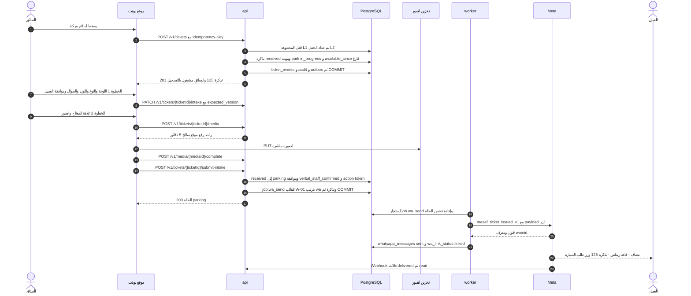

ملاحظات:

- إذا رُفض الرقم نهائيًا (ليس على واتساب مثلًا) تصبح `wa_link_status = failed` ويظهر للسائق خيار QR أو التذكرة الورقية (`channel = paper` مع `paper_serial`).
- إذا فشل رفع صورة تبقى `inspection_status = incomplete` ويُرفع تنبيه `inspection_incomplete` للمشرف؛ الاستثناء عبر `POST /v1/tickets/{ticketId}/inspection-exception`.

### 8.2 الربط عبر QR بمبادرة العميل

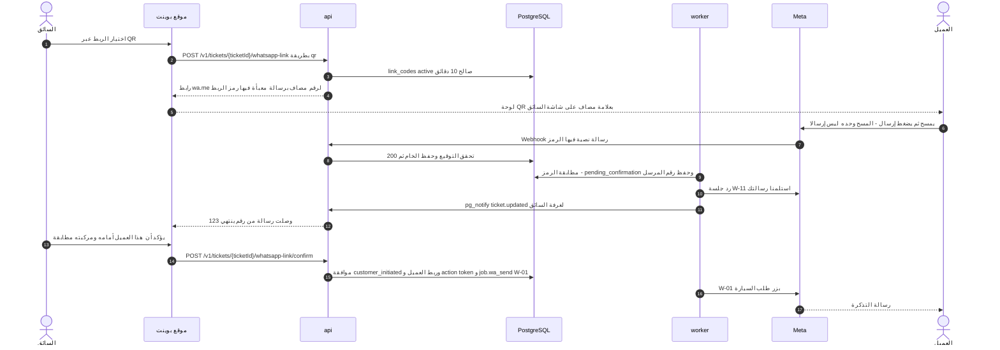

### 8.3 الطلب ثم العرض الفردي ثم الإحضار والتسليم

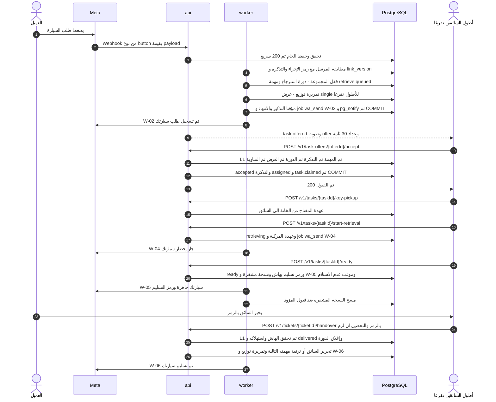

نقاط ملزمة:

- رسالة W-02 لا تُكتب إلا بعد حفظ الطلب فعليًا في المعاملة.
- الضغط المتكرر على الزر لا ينشئ دورة ثانية (`uq_retrieval_cycles_open`)؛ يرد العامل برسالة جلسة W-09 بالحالة الحالية.
- الواجهة لا تعرض الرمز أبدًا؛ التحقق بمقارنة HMAC على الخادم، والرمز يُستهلك مرة واحدة، و5 محاولات خاطئة تقفله (`HANDOVER_CODE_LOCKED`).
- الضغط على «جاهزة» لا يحرر السائق؛ التحرير عند التسليم أو تحويل العهدة رسميًا فقط.

### 8.4 الجميع مشغولون: البث ثم حجز مهمة تالية ثم ترقيتها

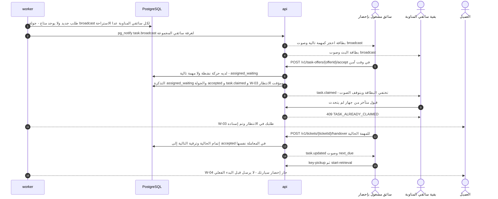

نقاط ملزمة:

- السائق الذي لديه مهمة تالية يرى البث عرضًا فقط (`eligible_as = view_only`) ولا يستطيع حجز ثانية (`uq_tasks_next_per_driver` → `NEXT_TASK_ALREADY_RESERVED`).
- لا يُسمح ببدء حركة ثانية قبل إتمام الحالية (`uq_tasks_active_movement_driver` → `MOVEMENT_IN_PROGRESS`).
- لا يظهر السائق «متاحًا» بين إتمام الحالية وترقية التالية لأنهما في معاملة واحدة.
- إذا صار سائق آخر متاحًا والأقدم محجوز تالٍ لم يبدأ: تنبيه `idle_driver_while_next_waiting` للمشرف فقط؛ لا سحب صامت.

### 8.5 انتهاء العرض ثم التالي ثم البث ثم التصعيد

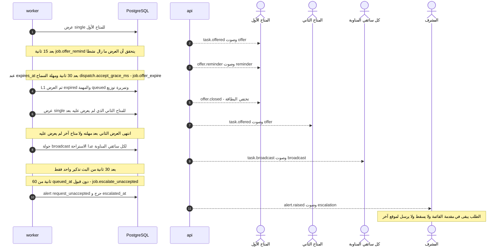

إذا لم يكن في المناوبة أي سائق إطلاقًا يرفع التنبيه `no_drivers_on_duty` فورًا ولا يُرسل الطلب لمواقع أخرى (المعمارية §7).

### 8.6 إعادة إسناد المشرف

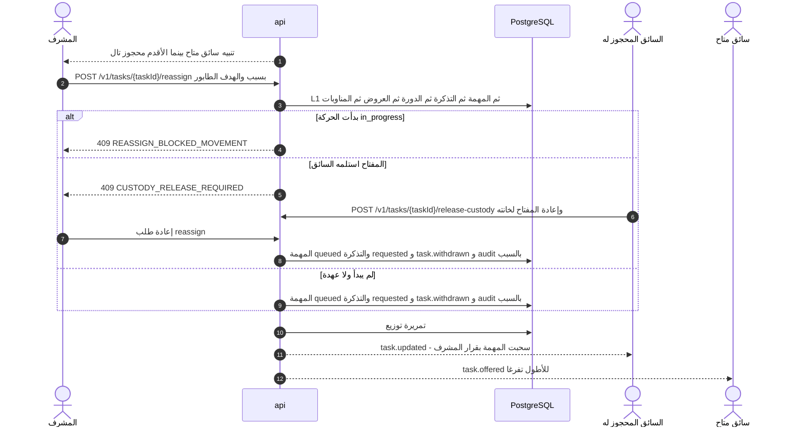

### 8.7 إعادة الصف عند غياب العميل (W-08)

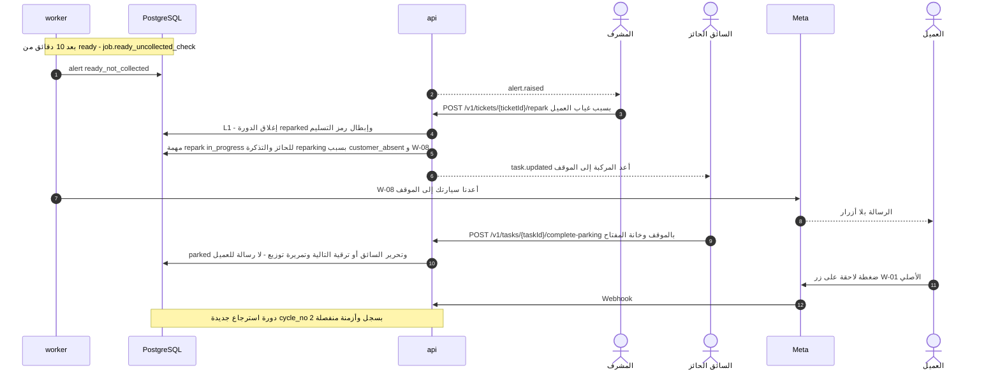

إلغاء المشرف للطلب بعد بدء الحركة (`retrieving` أو `ready`، DEC-30) يسلك المسار نفسه حتى `reparking` (مهمة `repark` للحائز نفسه، و`ticket.reparking` بـ`cause = supervisor_cancel`) لكن الدورة تُغلق `canceled` ويصل العميل W-07 فقط لا W-08 (DEC-42). W-08 يُرسل فقط عند إغلاق الدورة `reparked` بأمر `POST /v1/tickets/{ticketId}/repark`، وإتمام إعادة الصف لا يرسل شيئًا.

### 8.8 نقل سائق بين موقعين

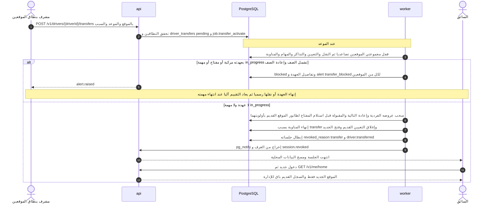

نقاط ملزمة:

- قاعدة DEC-32 الموحدة: يمنع النقل عهدة مركبة أو مفتاح أو مهمة `in_progress` (ومنها الصف وإعادة الصف) ولا تجاوز. المخطط أعلاه للنقل المجدول (`blocked` + تنبيه `transfer_blocked` ثم إعادة تقييم آلية)؛ أما النقل الفوري (موعد فارغ أو ماضٍ) فيُنفذ في معاملة الأمر نفسها، وإن مُنع يرد `409 TRANSFER_BLOCKED_CUSTODY` دون إنشاء سجل نقل ولا تنبيه.
- الإشعارات القديمة لا تسمح بالقبول: بالجلسة القديمة `AUTH_SESSION_REVOKED`؛ وبعد الدخول في الموقع الجديد يكون عرض الموقع القديم خارج النطاق فيرد `404 OFFER_NOT_FOUND` دون إفصاح، أما `NOT_OFFER_RECIPIENT` فلعرض في موقعه نفسه لم يُرسل إليه.
- السجلات التاريخية تحتفظ بالموقع والسائق الأصليين ولا يُعاد كتابتها.

### 8.9 معالجة الوارد عبر Webhook

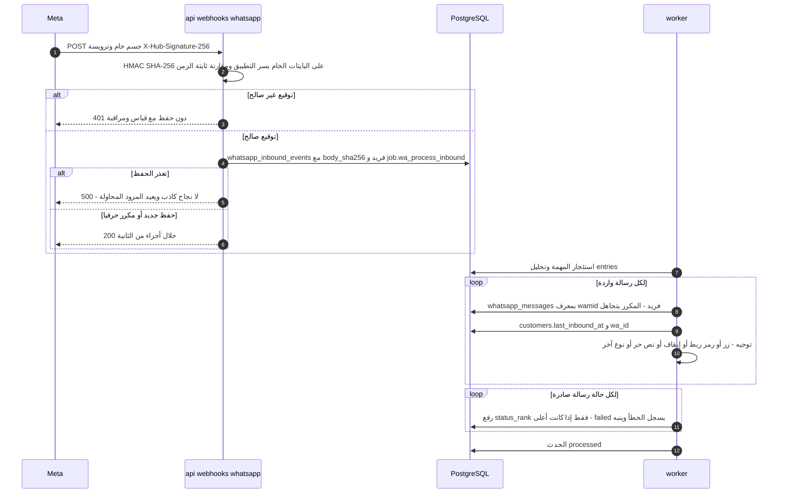

قواعد التوجيه (التفاصيل في الملف 12):

| الوارد | الإجراء |
|---|---|
| زر بقيمة `payload` | `sha256(payload)` → `action_tokens`؛ يجب أن يطابق مرسل `wa_id` عميل الرمز، وأن يكون الرمز ساريًا (`wa.action_token_ttl_h` = 72 ساعة من إنشائه)، وأن تكون التذكرة مفتوحة، و`link_version` مساويًا للحالي؛ ثم `RequestRetrieval` أو W-09 بالحالة. رمز مُبطل أو منتهٍ، أو `link_version` قديم، أو تذكرة ملغاة ← W-09 بصيغة «غير نشط» دون إنشاء طلب |
| نص يطابق نمط رمز الربط | `link_codes` النشط → `pending_confirmation` + W-11 |
| كلمة إيقاف | إبطال الموافقة `wa.customer_opted_out` + W-12 |
| أي نص آخر أو وسائط | W-10 توجيه لاستخدام زر التذكرة أو سائق الموقع |
| زر برمز غير معروف أو من رقم آخر | لا أثر تشغيلي؛ W-10، وتسجيل محاولة للمراقبة (AC-02) |

### 8.10 تعطل قناة واتساب

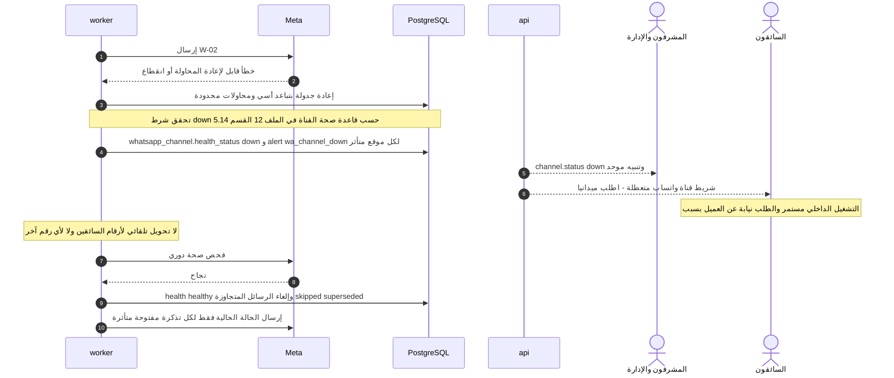

### 8.11 انقطاع السائق ثم المزامنة

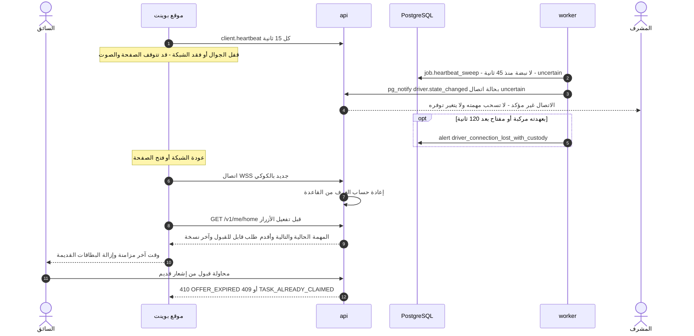

### 8.12 إغلاق الحفل والمطابقة

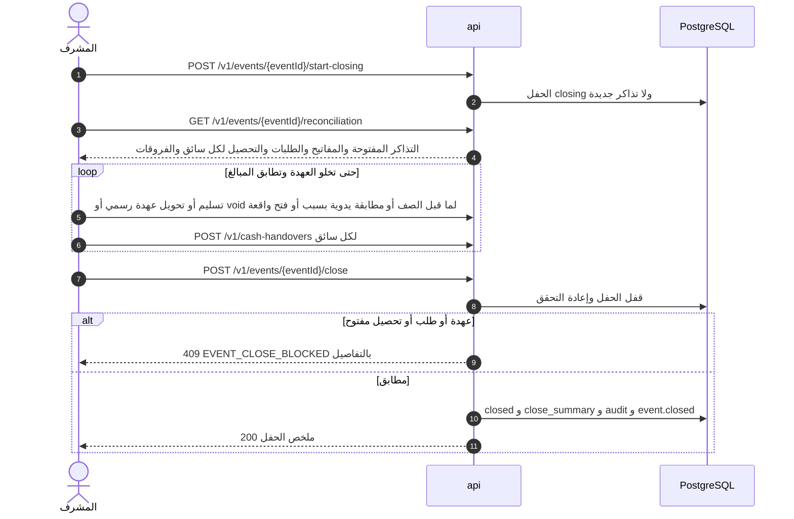

نقل السائق أو تعطيله لا يغلق تذاكره ولا يلغي مسؤولياته السابقة؛ الإغلاق يتطلب إقفال العهدة أو نقلها رسميًا (المعمارية §4ح).

### 8.13 التعطل الكلي: السجل الورقي ثم المطابقة دون إعادة تشغيل الأوامر

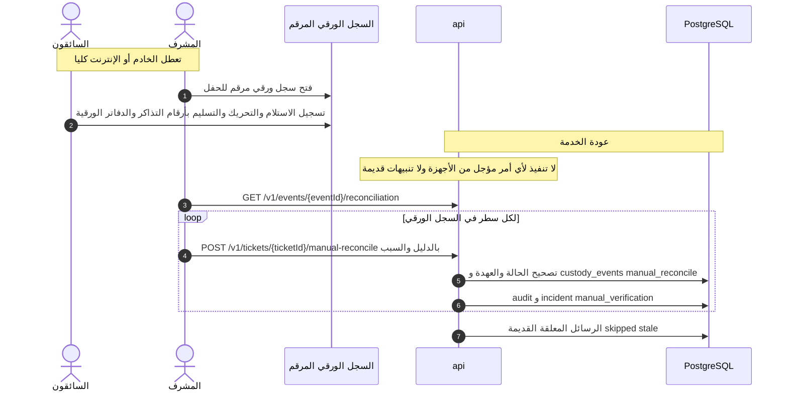

---

## 9. أنماط الفشل

| المكوّن | الفشل | الكشف | السلوك | التعافي |
|---|---|---|---|---|
| نسخة `api` | سقوط العملية | فحص الصحة لدى الموازن | الطلبات الجارية تفشل؛ ما التزم محفوظ؛ ما لم يلتزم لا أثر له | العميل يعيد بنفس `Idempotency-Key` فيحصل على النتيجة المحفوظة أو ينفذ لأول مرة |
| `worker` | سقوط بعد الالتزام وقبل الإرسال | انتهاء الإيجار | الصف يعود `pending` | عامل آخر يرسل؛ الطلب لم يضع (AC-06) |
| `worker` | سقوط بعد الإرسال وقبل `done` | انتهاء الإيجار | قد يُعاد الإرسال | `notifications.dedupe_key` وفحص `wa_message_id` المرتبط يمنعان تكرار الأثر التشغيلي؛ تكرار رسالة نصية للعميل محتمل ومقبول نادرًا (AC-06) |
| PostgreSQL | غير متاح أو فشل تبديل | أخطاء الاتصال، `/health/ready` | الأوامر ترد `SERVICE_UNAVAILABLE` قابلًا لإعادة المحاولة؛ الواجهة تُظهر «البيانات قديمة» وتوقف القبول والتسليم | الإجراء الورقي (§8.13) إن طال الانقطاع |
| أقفال | انتظار أو deadlock | `55P03` / `40P01` / `40001` | `40P01`/`40001`: إعادة المعاملة حتى 3 مرات (20–80 مللي ثانية)؛ `55P03` لا يُعاد على الخادم | `SERVICE_UNAVAILABLE` قابل لإعادة المحاولة (أو `IDEMPOTENCY_IN_PROGRESS` إن كان الانتظار عند L0)؛ مقياس انتظار الأقفال |
| تخزين الصور | غير متاح | فشل التوقيع أو الرفع | الاستلام يستمر و`inspection_status = incomplete` | استثناء المشرف أو إعادة الرفع لاحقًا |
| Meta | 5xx أو انقطاع أو حد معدل | رموز الخطأ | إعادة محاولة بتباعد؛ قناة `degraded/down` | إرسال الحالة الحالية فقط بعد العودة (§8.10) |
| Meta | رمز وصول منتهٍ أو سر خاطئ | أخطاء مصادقة | توقف الإرسال وتنبيه حرج للإدارة | تدوير السر من مدير الأسرار |
| Meta | قالب موقوف أو مرفوض | خطأ القالب | `WA_TEMPLATE_NOT_APPROVED` للإدارة؛ الإشعار `failed` | اعتماد نسخة `_v2` |
| Webhook | لا يصل (مزود أو نقطتنا) | عدم ورود أحداث مع وجود إرسال؛ عمر آخر حدث | تنبيه `wa_webhook_silent` (حرج، صف لكل موقع متأثر يصل المشرفين والإدارة، DEC-46)؛ الطلب الميداني نيابة عن العميل | إصلاح النقطة؛ المزود يعيد الإرسال لفترة |
| Webhook | تكرار أو ترتيب مختلف | `wa_message_id` فريد، `status_rank` | تجاهل المكرر؛ لا تخفيض حالة من `read` إلى `sent` | — (AC-01) |
| Push | اشتراك منتهٍ 404/410 | رد الخدمة | حذف الاشتراك من `devices` وزيادة `push_failed_count` | إعادة الاشتراك من D-14؛ تنبيه `push_failed_repeatedly` |
| الصوت | المتصفح منع التشغيل | فشل `AudioContext.resume` | شريط «الصوت متوقف» وزر إعادة التفعيل | نقرة المستخدم؛ التصعيد للمشرف مستمر |
| WebSocket | انقطاع | حدث `disconnect`، النبضة | مؤشر الاتصال؛ البطاقات تبقى معلّمة قديمة | إعادة اتصال ثم `GET /v1/me/home` |
| `LISTEN` | انقطاع مستمع الـapi | فقد اتصال المستمع | لا بث فوري مؤقتًا | إعادة الاستماع ثم `sync.required` لكل المقابس |
| ساعة الجهاز | انحراف | `server_time` في كل رد | العدادات تُحسب من `expires_at` و`server_time` لا من ساعة الجهاز | — |
| Outbox | تراكم | عمر أقدم صف | تنبيه `outbox_lag` | زيادة العمال؛ فحص الأخطاء |
| الشبكة في القاعة | ضعف تغطية في المواقف | نبضات متقطعة | لا سحب مهام؛ القبول يتطلب رد الخادم | Wi-Fi للموظفين في نقطة التسليم إن أمكن؛ الإجراء الورقي |
| الأسرار | تسريب أو تدوير | — | إبطال وتدوير | انظر سياسة التدوير في الملف 05 |

---

## 10. مسار التوسع

| المرحلة | الإعداد | متى ننتقل |
|---|---|---|
| الإطلاق التجريبي | نسخة `api` واحدة + نسخة `worker` واحدة + PostgreSQL مُدار | — |
| التشغيل الأولي | نسختا `api` خلف موازن (تثبيت الجلسة إذا فُعّل نقل polling في Socket.IO؛ لا حاجة له مع WebSocket فقط) + نسختا `worker` | لتوفر أعلى أو عند تجاوز 60% من المعالج |
| النمو | نسخ إضافية؛ نسخة قراءة للتقارير والتصدير | عندما تبطئ التقارير مسار الأوامر |
| فصل Messaging | خدمة مستقلة لإرسال واتساب ومعالجة الوارد | عند حاجة مقاسة: حجم إرسال يتطلب عزلًا، أو أعطال المزود تؤثر على بقية العمل |
| فصل Dispatch | خدمة مستقلة للتوزيع | فقط إذا تجاوز p95 لزمن قبول المهمة على الخادم 300 مللي ثانية بسبب تنافس أقفال المجموعات في الحمل المتفق عليه |

الضمانات لا تتغير مع التوسع: القيود في PostgreSQL تمنع الازدواج مهما تعددت النسخ، و`SKIP LOCKED` مع الإيجار يجعل تعدد العمال آمنًا، وقفل المجموعة يسلسل التوزيع داخلها فقط فلا تتأثر المجموعات ببعضها.

اختبار الحمل الأولي المقترح (المعمارية §16 البند 13، Q-08): 5 قاعات، 50 سائقًا، 100 طلب إحضار خلال دقيقة، مع قياس p95 لحفظ الطلب (< 2 ثانية) ونشر حدث الإسناد (< 3 ثوانٍ بعد الحفظ) — أهداف تصميم للاختبار لا نتائج مقاسة.

---

## 11. خريطة البيانات الشخصية وتدفقها

| البيان | يُخزن في | يمر عبر طرف خارجي؟ | العرض والإخفاء | الاحتفاظ |
|---|---|---|---|---|
| جوال العميل E.164 و`wa_id` | `customers` | نعم: Meta (عنوان الإرسال والاستقبال) | مقنّع `05•••••123` بعد التسجيل؛ الكشف الكامل بـ`ticket.reveal_phone` مع سبب وتدقيق | `retention.tickets_months` |
| محتوى رسائل العميل | `whatsapp_messages.body_redacted` | نعم: Meta (نص القوالب: اسم الموقع، رقم التذكرة، وصف المركبة المختصر، رمز التسليم) | الرمز مقنّع في النسخة المخزنة | `retention.wa_messages_days` |
| رمز التسليم | `claim_codes.code_hash` + `code_ciphertext` مؤقتًا | نعم: Meta داخل W-05 فقط | لا يظهر لأي موظف ولا في السجلات؛ تُمسح النسخة المشفرة بعد الإرسال أو الانتهاء | الهاش مع التذكرة |
| رمز الإجراء (payload الزر) | `action_tokens.token_hash` فقط | نعم: Meta (داخل الزر) | الرمز نفسه لا يُخزن ولا يُسجل | حتى إغلاق التذكرة + مهلة |
| رمز الربط QR | `link_codes.code` | نعم: Meta (رسالة العميل) | قصير الصلاحية 10 دقائق | مع التذكرة |
| لوحة المركبة ووصفها | `tickets` | وصف مختصر داخل W-01 فقط | للسائق حقول دنيا لموقعه | `retention.tickets_months` |
| صور الفحص | تخزين الكائنات الخاص + `media_assets` | لا | روابط موقعة 5 دقائق للمكلّف والمشرف فقط | `retention.photos_days` مع حجز الوقائع المفتوحة |
| بيانات الموظفين | `users` | لا | — | طوال الحساب + السجل |
| إشعار Push | لا يُخزن المحتوى | نعم: خدمة Push للمتصفح | نوع الإشعار ووسمه ورقم التذكرة فقط (DEC-23)؛ لا لوحة ولا جوال ولا موضع مفتاح ولا رمز | — |
| السجلات التقنية | منصة السجلات | حسب المزود المختار | تنقيح آلي للأرقام والرموز والكوكيز والأسرار | 30–90 يومًا |
| التحليلات | `analytics_events` | لا | بلا جوالات ولا لوحات ولا رموز ولا مواضع مفاتيح | حسب الملف 15 |
| التدقيق | `audit_log` | لا | فروق مختصرة بلا أسرار؛ الجوال مقنّع | `retention.audit_months` |

ملاحظة الإقامة: اختيار منطقة استضافة سعودية قرار نشر (Q-02)، لكنه لا يعني أن بيانات واتساب وPush لا تمر عبر مزوديها. تُوثّق مسارات البيانات أعلاه فعليًا قبل أي ادعاء بإقامة كاملة للبيانات (المعمارية §13).

---

## 12. قائمة تحقق التنفيذ

1. كل مسار في Canon §9 يمر بخط الأوامر كاملًا؛ لا مسار يكتب خارج حالة استخدام.
2. كل معاملة تستخدم مساعد الأقفال بترتيب Canon §14ب (L0…L10) ولا تجري اتصالًا شبكيًا.
3. كل أثر خارجي يخرج من Outbox فقط؛ وكل بث فوري بـ`pg_notify` داخل المعاملة.
4. كل معالج في العامل idempotent ومغطى باختبار «سقوط قبل/بعد الإرسال».
5. قواعد اتجاهات الاعتماد مفروضة في CI.
6. الغرف تُدار من الخادم فقط، وتُعاد مطابقتها دوريًا، وتُفرغ عند النقل والتعطيل.
7. لا بيانات شخصية في Push ولا في السجلات ولا في التحليلات.
8. المخططات في §8 مغطاة باختبارات تكامل في الملف 17.
