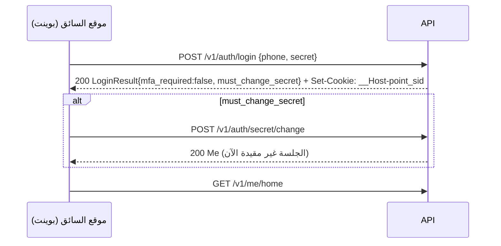
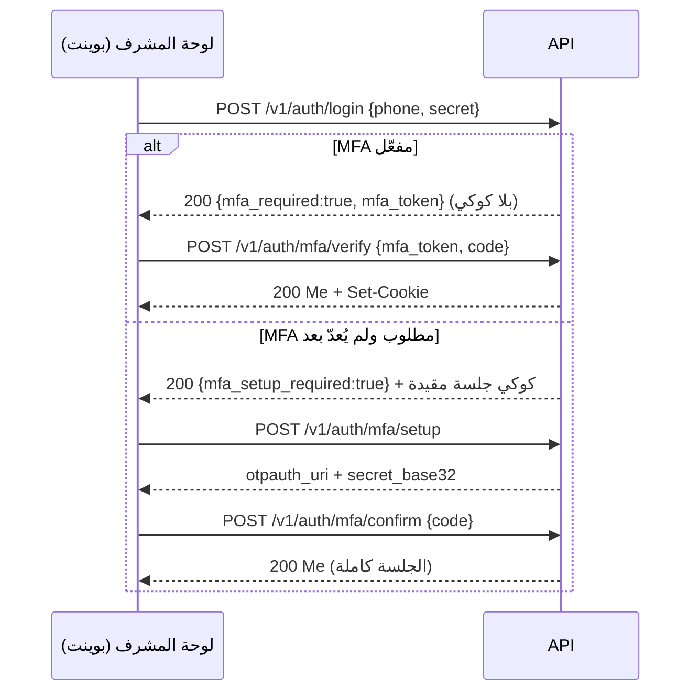

# 07 — عقد الـAPI (API Contract)

الإصدار 1.0 — 27 أكتوبر 2026 — الحالة: معتمد للتنفيذ.

| الملف | الدور |
|---|---|
| `07_openapi.yaml` | المصدر الآلي الملزم لأشكال الطلبات والردود (OpenAPI 3.1، مُتحقق منه بأداة openapi-spec-validator) |
| هذا الملف | الاصطلاحات والسلوك والآثار الجانبية والأمثلة وعقد WebSocket وWebhook |
| `00_Glossary_Canon.md` | الأسماء الملزمة: §8 رموز الأخطاء، §9 المسارات، §10 الصلاحيات، §7 الأحداث، §11 رسائل واتساب |
| `06_schema.sql` | أسماء الحقول وأنواعها والثوابت التي تفرضها قاعدة البيانات |
| `10_Dispatch_Engine_Spec.md` · `11_State_Machines_Domain_Events.md` · `12_WhatsApp_Integration_Spec.md` | تفاصيل التوزيع والحالات والقناة |

قاعدة التعارض: الأسماء من الـCanon، والأشكال من `07_openapi.yaml`، والسلوك من هذا الملف. أي مسار جديد يُضاف إلى Canon §9 أولًا.

كل مسار في `07_openapi.yaml` يحمل امتدادات آلية: `x-permission` (الصلاحية)، `x-idempotency` (required/optional/none)، `x-error-codes` (رموز الأخطاء الخاصة)، `x-domain-events` (أحداث Outbox في نفس المعاملة)، `x-ws-events` (أحداث الاتصال الفوري بعد الالتزام)، `x-whatsapp` (رسائل مصاف للعميل)، `x-rate-limit-class`. استخدمها لتوليد الحراس والاختبارات تلقائيًا.

---

## 1. الاصطلاحات العامة

### 1.1 العنوان والإصدار

- الأساس: `{API_BASE_URL}/v1` (مثال الإنتاج `https://app.<domain>/v1` على أصل التطبيق نفسه، DEC-29 — النطاق يحسمه المالك Q-01). الـWebhook والصحة خارج `/v1`: `/webhooks/whatsapp`، `/health/*`، `/metrics`.
- التغيير المتوافق داخل `v1`: إضافة حقول اختيارية أو مسارات جديدة (بعد إضافتها للـCanon). العميل يتجاهل الحقول غير المعروفة.
- التغيير الكاسر (حذف حقل، تغيير معنى، تغيير رمز خطأ) يتطلب `/v2` وسجل قرار في `DECISIONS.md`.
- قيم الـenum ثابتة بالـCanon §5؛ إضافة قيمة تعدّ تغييرًا يُعلن في الـCanon أولًا، والعميل يعرض القيمة الخام إذا لم يعرفها بدل الانهيار.

### 1.2 الجلسات والدخول

- الجلسة كوكي `__Host-point_sid`: رمز معتم 256-bit، `httpOnly; Secure; SameSite=Lax; Path=/`. الخادم يخزن `sha256` فقط في `auth_sessions.token_hash`. لا JWT ولا تخزين في `localStorage`.
- مدة الجلسة من إعدادات المؤسسة: السائق `security.driver_session_hours` (14)، الموظفون `security.staff_session_hours` (12). يُحدَّث `last_seen_at` بحد أقصى مرة كل دقيقة.
- الإبطال فوري لأن الجلسة على الخادم: `logout`، `transfer` (نقل السائق)، `disabled`، `secret_reset`، `admin`. بعد الإبطال يعيد أي طلب `401 AUTH_SESSION_REVOKED` ويصل حدث `session.revoked` عبر WebSocket.
- الجلسة المقيدة: إذا `must_change_secret=true` أو الحساب يحتاج إعداد MFA، تُنشأ جلسة لا تصل إلا لمسارات `auth.self`؛ غيرها يعيد `403 AUTH_SECRET_CHANGE_REQUIRED` أو `403 AUTH_MFA_SETUP_REQUIRED`. ويصف `Me` القيد في `session.restricted` و`session.pending`: مصفوفة من `secret_change` و`mfa_setup` بترتيب تنفيذهما (`secret_change` أولًا)، فارغة حين لا قيد (DEC-82).
- القفل: 5 محاولات فاشلة (`security.max_login_attempts`) ثم `423 AUTH_ACCOUNT_LOCKED` لمدة 15 دقيقة مع `details.locked_until`. محاولات الدخول تُحسب لكل حساب ولكل عنوان IP.

تدفق السائق (رقم سري 6 أرقام):



تدفق المشرف/الإدارة/المالك (كلمة مرور + TOTP): الإدارة والمالك إلزاميًا، والمشرف حسب `security.supervisor_mfa_required` (مفعّل افتراضيًا).



`mfa_token` صالح 5 دقائق ولاستخدام واحد؛ انتهاؤه أو استخدامه مرة ثانية يعيد `401 AUTH_MFA_REQUIRED` (DEC-64).

### 1.3 الحماية من CSRF وCORS

- كل `POST/PUT/PATCH` (عدا `/webhooks/whatsapp`) يتطلب الترويسة `X-Requested-With: point-web`، ويُرفض إذا ترويسة `Origin` لا تطابق `APP_BASE_URL`. غيابها يعيد `403 PERMISSION_DENIED`.
- CORS: `Access-Control-Allow-Origin` = `APP_BASE_URL` فقط، مع `Allow-Credentials: true`. لا نجمة.
- مسار الدخول نفسه يتطلب ترويسة CSRF لمنع login CSRF.

### 1.4 مفتاح التكرار (Idempotency-Key)

إلزامي على كل مسار عليه ✓ في Canon §9 (78 مسارًا، `x-idempotency: required`) واختياري على بقية الأوامر.

- القيمة 8–128 حرفًا (UUIDv4 مفضل). العميل يولّد مفتاحًا جديدًا **لكل نية مستخدم** (كل ضغطة زر) ويعيد **نفس المفتاح** عند إعادة المحاولة الشبكية لنفس النية.
- النطاق: لكل مستخدم `idempotency_keys (user_id, key)`، ويُخزن معه `operation` (الطريقة + قالب المسار) و`request_hash` = `sha256` لتمثيل JSON مرتب للجسم + معاملات المسار. الاحتفاظ 24 ساعة ثم حذف دوري.

| الحالة | الرد |
|---|---|
| مسار ✓ بلا مفتاح | `428 IDEMPOTENCY_KEY_REQUIRED` |
| أول طلب | ينفذ الأمر؛ يُحفظ الرد |
| نفس المفتاح + نفس المحتوى، والأول اكتمل | يُعاد الرد المحفوظ حرفيًا (نفس رمز HTTP) مع `meta.replayed=true` والترويسة `Idempotent-Replayed: true`، دون تنفيذ ثانٍ |
| نفس المفتاح + نفس المحتوى، والأول ما زال يعمل | `409 IDEMPOTENCY_IN_PROGRESS` (`retryable=true`؛ أعد بعد ثانية) |
| نفس المفتاح + محتوى مختلف أو مسار مختلف | `422 IDEMPOTENCY_KEY_REUSED` |

ما يُحفظ: كل رد 2xx، وكل خطأ أعمال حتمي 4xx (مثل `409 TASK_ALREADY_CLAIMED`) حتى تعطي الإعادة نفس الجواب. أخطاء 5xx لا تُحفظ ويُحذف السجل `in_progress` فتجوز الإعادة.

ذرية الحفظ (مطابقة لترتيب الأقفال في Canon §14ب):

1. L0: أول جملة في معاملة الأمر نفسها `INSERT INTO idempotency_keys … ON CONFLICT DO NOTHING` ثم قراءة الصف. الطلب المكرر المتزامن ينتظر على المفتاح الفريد حتى تلتزم المعاملة الأولى أو تتراجع؛ إن تجاوز الانتظار `lock_timeout` (3 ثوانٍ مقترحة) يُعاد `409 IDEMPOTENCY_IN_PROGRESS`.
2. بعد الحجز `SAVEPOINT`، ثم منطق الأمر بأقفاله L1…L9.
3. نجاح: يُكمَل صف المفتاح بالرد في آخر المعاملة (L10) ويلتزم كل شيء معًا.
4. خطأ أعمال حتمي (4xx): `ROLLBACK TO SAVEPOINT` ثم يُكمَل صف المفتاح برد الخطأ ويلتزم.
5. خطأ غير متوقع (5xx): تراجع كامل؛ لا يبقى صف للمفتاح فتجوز الإعادة.

حالة خاصة — محاولة رمز تسليم خاطئة: لا تراجع إلى نقطة الحفظ؛ زيادة `claim_codes.attempts` (وربما القفل والتنبيه) تلتزم مع حفظ رد `422 HANDOVER_CODE_INVALID` في المعاملة نفسها، فإعادة نفس الطلب بنفس المفتاح تعيد نفس الخطأ ولا تستهلك محاولة ثانية. محاولة جديدة برمز آخر = نية جديدة = مفتاح جديد.

### 1.5 التزامن المتفائل (`expected_version`)

- كل تذكرة ومهمة وحفل ووردية ومستخدم وواقعة وإعدادات موقع تحمل `version`. أرسل `expected_version` من آخر قراءة.
- إلزامي في كل `PATCH` على كيان ذي `version` وفي `PUT /v1/venues/{venueId}/settings`، واختياري (موصى به) في أوامر التذكرة والمهمة. كيانات التخطيط (مجموعات التوزيع، المناطق، المواقف، الخانات) بلا `version` فلا يُرسل لها.
- عدم التطابق يعيد `409 VERSION_CONFLICT` مع `details: {entity, id, current_version}`. على الواجهة إعادة الجلب ثم عرض البيانات الحديثة؛ لا إعادة إرسال آلية للأوامر التشغيلية.
- حتى بدون `expected_version`، الخادم يتحقق دائمًا من الحالة السابقة والتكليف والصلاحية؛ الضغط على شاشة قديمة يعيد `INVALID_STATE_TRANSITION` أو `NOT_TASK_ASSIGNEE` لا أثرًا خاطئًا.
- قبول العروض لا يحتاج إصدارًا: معرّف جولة العرض `offerId` فريد ويكفي.

### 1.6 غلاف الرد والخطأ

نجاح:

```json
{ "data": { "...": "..." }, "meta": { "request_id": "req_01JBX4T1Q8", "server_time": "2026-10-29T18:42:10.120Z" } }
```

قوائم: `meta.next_cursor` إضافة. ردود `204` بلا جسم. كل رد يحمل الترويسة `X-Request-Id` نفسها الموجودة في `meta.request_id` و`error.request_id`؛ العميل يرسل `X-Request-Id` اختياريًا لتتبع الطلب طرفيًا.

خطأ (الرموز من Canon §8 فقط):

```json
{
  "error": {
    "code": "OLDER_REQUEST_PENDING",
    "message": "An older request must be accepted first",
    "message_ar": "يوجد طلب أقدم يجب قبوله أولًا",
    "request_id": "req_01JBX4V2C3",
    "retryable": false,
    "details": { "older_task_id": "f1e2d3c4-b5a6-4978-8c9d-0e1f2a3b4c5d", "older_offer_id": "2b3c4d5e-6f70-4a81-9b2c-3d4e5f6a7b8c" }
  }
}
```

- `message_ar` جاهز للعرض للسائق والمشرف؛ النص الكامل والإجراء المطلوب لكل رمز في `08_Error_Codes_Guide.md`.
- `retryable=true` فقط حين تجوز إعادة **نفس** الطلب بنفس المفتاح: `IDEMPOTENCY_IN_PROGRESS`، `RATE_LIMITED`، `SERVICE_UNAVAILABLE`، `DEPENDENCY_TIMEOUT`، `INTERNAL_ERROR`، `WA_CHANNEL_UNAVAILABLE`.
- الحقول الشائعة في `details`: `fields` (قائمة `FieldError`) مع `VALIDATION_FAILED`، `missing` مع `INTAKE_INCOMPLETE`/`INSPECTION_INCOMPLETE`، `attempts_left` مع `HANDOVER_CODE_INVALID`، `current_status` و`allowed_from` (شكل 11 §1.5 كاملًا، DEC-106) مع `INVALID_STATE_TRANSITION`، `current_version` مع `VERSION_CONFLICT`، `items` مع `CUSTODY_OPEN`/`TRANSFER_BLOCKED_CUSTODY`/`DUTY_END_BLOCKED_CUSTODY`، `blockers` مع `EVENT_CLOSE_BLOCKED`، `cycle_id` مع `RETRIEVAL_ALREADY_ACTIVE`.
- الأخطاء لا تكشف بيانات غير مصرح بها: مورد يُطلب بمعرّفه (تذكرة، مهمة، عرض، دورة، دفعة...) ويقع في موقع خارج نطاق المستدعي يعيد رمز «غير موجود» الخاص به (`404 TICKET_NOT_FOUND` أو `OFFER_NOT_FOUND` أو `RESOURCE_NOT_FOUND`) كما لو لم يوجد؛ و`403 SCOPE_VENUE_DENIED` فقط حين يختار المستدعي الموقع بنفسه (`{venueId}` في المسار أو `venue_id` في الاستعلام أو الجسم). التفاصيل في الملف 08.

### 1.7 الترقيم

- `?limit=` (افتراضي 50، أقصى 200) و`?cursor=` معتم من `meta.next_cursor` (`null` عند النهاية).
- الترتيب ثابت لكل قائمة ومذكور في وصف المسار (التذاكر: الأحدث إنشاءً؛ الطابور: الأقدم `priority_at` ثم `seq`؛ التنبيهات: الأحدث `raised_at` ثم `id`؛ الوقائع: الأحدث `created_at` ثم `id`، DEC-235).
- معاملات المصفوفة في الاستعلام بصيغة OpenAPI الافتراضية (`form` مع `explode`: `?status=open&status=acknowledged`)، وقائمتا التنبيهات والوقائع تقبلان أيضًا القيم مفصولة بفواصل (DEC-235)؛ و`status` في `GET /v1/tickets` قائمة بفواصل كما في وصفه (DEC-321).
- مؤشر تالف أو من مسار آخر يعيد `400 PAGINATION_CURSOR_INVALID`؛ فالمؤشر موقّع HMAC بمفتاح مشتق من `SESSION_SECRET` ومربوط بقائمته ومرشحاتها (DEC-124، DEC-168).

### 1.8 صيغ البيانات

- الأوقات ISO‑8601 بتوقيت UTC وبلاحقة `Z` (`2026-10-29T18:42:10.120Z`). العرض في الواجهة بتوقيت `Asia/Riyadh`. `event_date` تاريخ محلي `YYYY-MM-DD`. المدد بالثواني صحيحة.
- المبالغ أعداد صحيحة بالهللة `*_halalas` والعملة `SAR` (2000 = 20.00 ريال).
- الجوال يُقبل بأي صيغة سعودية (`0551234567`، `551234567`، `+966551234567`، `966551234567`) أو E.164 دولي، ويُطبّع إلى E.164. الرد يعرض `phone_masked` بصيغة `05•••••123`؛ الرقم الكامل فقط عبر `POST /v1/tickets/{ticketId}/reveal-phone` المدقق أو لصاحب الحساب. صيغة خاطئة: `422 PHONE_INVALID`.
- اللوحة السعودية: `digits` حتى 4 أرقام + `letters_ar` ثلاثة أحرف من المجموعة المستخدمة في اللوحات، ويُشتق `letters_en` آليًا بالمقابل الشائع: ا=A، ب=B، ح=J، د=D، ر=R، س=S، ص=X، ط=T، ع=E، ق=G، ك=K، ل=L، م=Z، ن=N، ه=H، و=U، ى=V (تُراجع القائمة عند التنفيذ). اللوحات الأخرى في `raw` مع `country`؛ واللوحة غير السعودية التي لا تُعرف دولتها (D-05 «لوحة غير سعودية») تُرسل `country = XX` (رمز ISO المخصص للمستخدم) مع `raw`، وواجهة اللوحة تعرض «هـ» وتحمل «ه» على السلك (DEC-349). الشركة واللون بمفاتيح 02 §8.4 (`toyota`، `white`)، و«أخرى» بالنص المكتوب (DEC-350). الخطأ `422 PLATE_INVALID`. البحث `q` يطابق الأرقام فقط أو الرقم الظاهر للتذكرة.
- الأرقام لاتينية `0-9` في كل الحقول والنصوص (DEC-17). المعرّفات `uuid`.
- رمز التسليم لا يظهر في أي رد أو سجل أو حدث WebSocket؛ فقط `ClaimCodeState` (المحاولات، الصلاحية، حالة الإرسال) بحقوله في `07_openapi.yaml` بالضبط: `sent_status` = حالة رسالة W-05 وإلا حالة إشعارها (`failed` أو `skipped` أو `queued`)، و`TicketDetail.claim_code` = أحدث رمز للدورة النشطة و`null` دونه (DEC-208).

### 1.9 حدود المعدل

| الفئة (`x-rate-limit-class`) | الحد الافتراضي | ملاحظات |
|---|---|---|
| `auth` | 10 طلبات/دقيقة لكل IP، و5 فشل لكل حساب | ثم `AUTH_ACCOUNT_LOCKED` |
| `command` | 60/دقيقة لكل مستخدم، و20 خلال 10 ثوانٍ لقبول العروض | يحمي من الضغط المتكرر؛ مفتاح التكرار يمنع الأثر المزدوج أصلًا |
| `write` | 30/دقيقة لكل مستخدم | |
| `read` | 300/دقيقة لكل مستخدم | |
| `device` | 60/دقيقة لكل جهاز | النبضة كل 15 ثانية |
| `export` | 5/ساعة لكل مستخدم | |
| `webhook` | صمام لكل عنوان مصدر (`RATE_LIMIT_WEBHOOK_PER_MIN`، 6000 في الدقيقة افتراضيًا؛ Meta تعيد بعد 429)؛ جسم خام ≤ 3 MB (وبقية أجسام JSON ≤ 1 MB، DEC-130) | الرد السريع أهم من الحد (DEC-293) |
| `health` | شبكة داخلية | |

التجاوز يعيد `429 RATE_LIMITED` مع `Retry-After` بالثواني و`details.retry_after_s`، وترويسات `RateLimit-Limit` و`RateLimit-Remaining` و`RateLimit-Reset` على كل رد. `RESEND_LIMIT_REACHED` حد أعمال منفصل (`handover.max_resends`).

التنفيذ (DEC-293، DEC-294، DEC-295): دلو رموز داخل كل عملية `api` (N نسخ ← N × الحد) تقوده فئة المسار (`x-rate-limit-class`)، ومتغير بيئة لكل فئة (05 §8، 0 = بلا حد)؛ الموضوع قبل الدخول عنوان العميل (IPv6 بـ/64؛ فئتا `auth` و`webhook` وكل طلب بلا كوكي جلسة، أول الحراس)، وبعده المستخدم، والجهاز (الجلسة) لفئة `device` بعد حارسي الجلسة والصلاحية؛ والطلب بكوكي يتبين بطلانه لا يُحد بالعنوان (الحماية الحجمية للحافة)؛ والحمايات عبر النسخ في PostgreSQL (قفل الحساب، حد كشف الجوال).

### 1.10 تقييم الصلاحية والنطاق

ترتيب الفحص لكل طلب (حارس عام في NestJS، لا يُعتمد على إخفاء الأزرار):

1. الجلسة صالحة وغير مبطلة → وإلا `401`.
2. الجلسة غير مقيدة (عدا مسارات `auth.self`) → وإلا `403 AUTH_SECRET_CHANGE_REQUIRED`/`AUTH_MFA_SETUP_REQUIRED`.
3. الدور يملك صلاحية المسار `x-permission` (Canon §10) → وإلا `403 PERMISSION_DENIED`.
4. النطاق: المورد في موقع ضمن نطاق المشرف، أو موقع التعيين النشط للسائق → وإلا: للمورد المطلوب بمعرّفه `404` برمز «غير موجود» الخاص به، وللموقع المختار صراحة `403 SCOPE_VENUE_DENIED` (أو `ASSIGNMENT_REQUIRED` إن لم يوجد تعيين).
5. شروط المناوبة: مسارات التشغيل للسائق تتطلب مناوبة `on_duty` → `409 DUTY_REQUIRED`/`DRIVER_ON_BREAK`.
6. حراس المورد: المكلّف بالمهمة (`NOT_TASK_ASSIGNEE`)، مستلم العرض (`NOT_OFFER_RECIPIENT`)، الحالة (`INVALID_STATE_TRANSITION`)، الإصدار (`VERSION_CONFLICT`).

الإسقاط على مستوى الحقل: `TicketSummary` لكل من يملك `ticket.read_minimal` في الموقع. `TicketDetail` يحمل `projection: full` فقط للمكلّف بمهمة مفتوحة على التذكرة، أو منشئها أثناء التسجيل، أو المشرف/الإدارة؛ وإلا `projection: minimal` وتُحذف الحقول المقيدة (الموقف، خانة المفتاح، الصور، الجوال المقنّع، العهدة). الصور عبر روابط موقّعة صالحة 5 دقائق من `GET /v1/media/{mediaId}/url`.

### 1.11 الآثار الجانبية والمعاملة الواحدة

- كل أمر يغيّر الحالة يكتب في **نفس معاملة PostgreSQL**: التغيير + `ticket_events` + `audit_log` + أحداث `outbox_events` المذكورة في `x-domain-events` + سجل مفتاح التكرار.
- بعد الالتزام: ينشر العامل أحداث WebSocket (`x-ws-events`) ويرسل رسائل واتساب (`x-whatsapp`) عبر `job.wa_send` مع إعادة محاولة محدودة. الرد على العميل لا ينتظر الإرسال؛ رسالة «تم تسجيل طلبك» (W-02) تخرج فقط بعد الحفظ الفعلي.
- قبل إرسال أي رسالة عميل يعاد فحص حالة التذكرة: رسالة تجاوزتها الحالة تُسجل `skipped` (`stale`/`superseded`) ولا تُرسل، عدا W-05 طالما التذكرة `ready` والرمز حي.
- ترتيب الأقفال ونمطها ملزم من Canon §14ب: `FOR NO KEY UPDATE` بالترتيب L0 مفتاح التكرار ← L1 `dispatch_pools` ← L2 `events` ← L3 النقل/التعيين/المستخدم ← L4 `tasks` ← L5 `tickets` ← L6 `retrieval_cycles` ← L7 `task_offers` ← L8 `duty_sessions` ← L9 التخصيصات والرموز ← L10 الإلحاقيات. مسارات التوزيع (بدء الاستلام، قبول، طلب، إتمام، إلغاء، نقل، إعادة إسناد) تبدأ من L1 وتشغّل تمريرة التوزيع داخل المعاملة نفسها (DEC-08). المسارات التي لا تمس الطابور (تعديل المسودة، الصور، رموز الربط، تغيير الجوال) تبدأ من L5. لا اتصال شبكي داخل أي معاملة. التفاصيل في `10_Dispatch_Engine_Spec.md`.

### 1.12 ما لا يوجد في الـAPI عمدًا

لا صفحة عميل ولا حساب عميل ولا مسارات عامة للتذاكر؛ العميل يتعامل عبر واتساب فقط. لا GPS. لا أرقام سائقين للعملاء. لا بيانات بطاقات. لا زر رفض للعروض (DEC-12). لا مسار يعيد رمز التسليم.

---

## 2. مرجع المسارات

مرتبة كما في Canon §9. «تكرار» = `Idempotency-Key`. «أخطاء خاصة» تضاف إلى الأخطاء العامة: `401` (`AUTH_UNAUTHENTICATED`، `AUTH_SESSION_EXPIRED`، `AUTH_SESSION_REVOKED`)، `403` (`PERMISSION_DENIED` وقيود الجلسة)، `422 VALIDATION_FAILED` للجسم، `413 PAYLOAD_TOO_LARGE` لجسم فوق 1 MB (Webhook فوق 3 MB) بتفصيل `max_bytes` (DEC-130)، رموز التكرار، `429 RATE_LIMITED`، `500 INTERNAL_ERROR`، `503 SERVICE_UNAVAILABLE`. القائمة الكاملة لكل مسار في `x-error-codes` ووصف الاستجابات في الـYAML.

### 2.1 الدخول والجلسة والجهاز والمناوبة (Canon §9.1)

#### `POST /v1/auth/login` — تسجيل الدخول

السائق: الجوال + رقم سري 6 أرقام. المشرف/الإدارة/المالك: الجوال + كلمة مرور ثم TOTP. يضبط الكوكي __Host-point_sid عند نجاح الدخول دون MFA معلّق.

- الصلاحية: `public` · مفتاح التكرار: — · نجاح: `200`
- الشروط: 5 محاولات فاشلة ثم قفل 15 دقيقة (security.max_login_attempts)
- الأثر: ينشئ auth_sessions ويضبط Set-Cookie: __Host-point_sid (إلا إذا mfa_required)
- أخطاء خاصة: `AUTH_ACCOUNT_DISABLED`, `AUTH_ACCOUNT_LOCKED`, `AUTH_INVALID_CREDENTIALS`

#### `POST /v1/auth/mfa/verify` — التحقق الثنائي بعد كلمة المرور

mfa_token غير معروف أو منتهٍ (5 دقائق) أو مستخدم ← 401 AUTH_MFA_REQUIRED: أعد إدخال كلمة المرور.

- الصلاحية: `public` · مفتاح التكرار: — · نجاح: `200`
- الأثر: ينشئ الجلسة mfa_verified=true ويضبط الكوكي
- أخطاء خاصة: `AUTH_ACCOUNT_LOCKED`, `AUTH_MFA_INVALID`, `AUTH_MFA_REQUIRED`

#### `POST /v1/auth/mfa/setup` — بدء إعداد TOTP

- الصلاحية: `auth.self` · مفتاح التكرار: — · نجاح: `200`
- الأثر: يحفظ سرًا مؤقتًا مشفرًا حتى التأكيد
- أخطاء خاصة: `INVALID_STATE_TRANSITION`

#### `POST /v1/auth/mfa/confirm` — تأكيد TOTP وتفعيله

- الصلاحية: `auth.self` · مفتاح التكرار: — · نجاح: `200`
- الأثر: users.mfa_enabled=true؛ الجلسة الحالية mfa_verified=true
- أخطاء خاصة: `AUTH_MFA_INVALID`, `INVALID_STATE_TRANSITION`

#### `POST /v1/auth/secret/change` — تغيير الرقم السري/كلمة المرور

- الصلاحية: `auth.self` · مفتاح التكرار: — · نجاح: `200`
- الشروط: PIN للسائق 6 أرقام بالضبط (DEC-09) · كلمة المرور للموظفين 12 حرفًا على الأقل وليست من قائمة الكلمات الشائعة (الملف 09 §9)
- الأثر: must_change_secret=false؛ تُبطل جلسات المستخدم الأخرى (secret_reset)
- أخطاء خاصة: `AUTH_INVALID_CREDENTIALS`

#### `POST /v1/auth/logout` — تسجيل الخروج

- الصلاحية: `auth.self` · مفتاح التكرار: — · نجاح: `204`
- الأثر: revoked_reason=logout؛ يمسح الكوكي

#### `GET /v1/me` — بيانات المستخدم الحالي وصلاحياته

- الصلاحية: `auth.self` · مفتاح التكرار: — · نجاح: `200`

#### `GET /v1/me/home` — الشاشة الرئيسية للسائق ومصدر المزامنة الكاملة

تعيد المهمة الحالية والتالية وبطاقة العرض الوحيدة (أقدم طلب قابل للقبول) وحالة السائق. تُستدعى عند الفتح وبعد إعادة الاتصال وعند sync.required.

- الصلاحية: `duty.self` · مفتاح التكرار: — · نجاح: `200`
- الشروط: دور driver أو supervisor مع can_drive
- أخطاء خاصة: `ASSIGNMENT_REQUIRED`

#### `POST /v1/me/devices` — تسجيل جهاز المستخدم

- الصلاحية: `auth.self` · مفتاح التكرار: اختياري · نجاح: `201`

#### `PUT /v1/me/devices/{deviceId}` — تحديث الجهاز واشتراك Web Push

- الصلاحية: `auth.self` · مفتاح التكرار: اختياري · نجاح: `200`
- الشروط: الجهاز يخص المستخدم

#### `POST /v1/me/audio-test` — تسجيل نتيجة «تفعيل واختبار الصوت»

- الصلاحية: `auth.self` · مفتاح التكرار: اختياري · نجاح: `200`

#### `POST /v1/me/duty/start` — بدء ورديتي

- الصلاحية: `duty.self` · مفتاح التكرار: إلزامي · نجاح: `201`
- الشروط: تعيين نشط (السائق) أو نطاق الموقع (مشرف can_drive) · وردية open لمجموعة التوزيع · لا مناوبة مفتوحة · المشرف بعدة مواقع في نطاقه يرسل venue_id (وإلا VALIDATION_FAILED على venue_id بـrequired_multiple_venues، وبلا موقع في نطاقه no_venue_scope)، وموقع خارج نطاقه ← SCOPE_VENUE_DENIED (DEC-182)
- الأثر: duty_sessions(on_duty, available_since=now) + الانضمام لغرفة pool:{poolId}:drivers + تمريرة توزيع
- أحداث: `driver.duty_started`, `driver.availability_changed` · WS: `driver.state_changed`
- أخطاء خاصة: `ASSIGNMENT_REQUIRED`, `DRIVER_DISABLED`, `DUTY_ALREADY_STARTED`, `SCOPE_VENUE_DENIED`, `SHIFT_NOT_OPEN`

#### `POST /v1/me/duty/break` — بدء/إنهاء الاستراحة

- الصلاحية: `duty.self` · مفتاح التكرار: إلزامي · نجاح: `200`
- الشروط: البدء: driver_state=available وبلا عهدة (مهمة نشطة أو تالية ← DRIVER_NOT_AVAILABLE؛ عهدة دون مهمة ← CUSTODY_OPEN) · الإنهاء: الحالة on_break
- الأثر: on_break: available_since=null وتُسحب عروضه الفردية (recipient_unavailable)؛ الإنهاء: available_since=now + تمريرة توزيع
- أحداث: `driver.break_started`, `driver.break_ended`, `driver.availability_changed` · WS: `driver.state_changed`
- أخطاء خاصة: `CUSTODY_OPEN`, `DRIVER_NOT_AVAILABLE`, `DUTY_REQUIRED`, `INVALID_STATE_TRANSITION`

#### `POST /v1/me/duty/end` — إنهاء ورديتي

- الصلاحية: `duty.self` · مفتاح التكرار: إلزامي · نجاح: `200`
- الشروط: لا مهمة مفتوحة ولا مهمة تالية ولا عهدة مركبة/مفتاح
- الأثر: status=ended (end_reason=self)، مغادرة غرفة المجموعة، إغلاق مستلَمات البث الخاصة به
- أحداث: `driver.duty_ended`, `driver.availability_changed` · WS: `driver.state_changed`
- أخطاء خاصة: `DUTY_END_BLOCKED_CUSTODY`, `DUTY_REQUIRED`

#### `POST /v1/me/heartbeat` — نبضة اتصال بديلة عن WebSocket

- الصلاحية: `auth.self` · مفتاح التكرار: — · نجاح: `200`
- الأثر: يحدّث last_heartbeat_at؛ لا يغيّر التوفر ولا يسحب مهامًا
- أحداث: `driver.connection_changed`

### 2.2 الاستلام والتذاكر (Canon §9.2)

#### `POST /v1/tickets` — استلام مركبة: بدء التسجيل

يضغط السائق «استلام مركبة» فيُنشأ في معاملة واحدة: تذكرة received برقم ظاهر من events.next_display_number + مهمة park بحالة in_progress باسمه + عهدة المركبة والمفتاح للسائق. يتنافس ذريًا مع قبول العروض (قفل مجموعة التوزيع).

- الصلاحية: `ticket.intake` · مفتاح التكرار: إلزامي · نجاح: `201`
- الشروط: مناوبة on_duty (وإلا DUTY_REQUIRED) · ليس في استراحة (DRIVER_ON_BREAK) · لا مهمة حركة نشطة accepted/in_progress بما فيها مهمة تالية رُقّيت (MOVEMENT_IN_PROGRESS) · حفل open في الموقع؛ event_id إلزامي إذا أكثر من حفل مفتوح (DEC-37)
- الأثر: tickets(received) + لقطة الرسوم: fee_halalas من الحفل وpayment_status=due لـper_vehicle وإلا not_required (DEC-43) + tasks(park,in_progress) + custody_events(intake ×2) + ticket_events + audit_log
- أحداث: `ticket.created`, `task.created`, `custody.changed`, `driver.availability_changed` · WS: `driver.state_changed`, `ticket.updated`
- أخطاء خاصة: `DRIVER_ON_BREAK`, `DUTY_REQUIRED`, `EVENT_NOT_OPEN`, `MOVEMENT_IN_PROGRESS`

#### `PATCH /v1/tickets/{ticketId}/intake` — تعبئة بيانات الاستلام (مسودة)

تحديث جزئي لا يفقد المدخلات؛ يمكن استدعاؤه عدة مرات. expected_version إلزامي. الحفل ورقم التذكرة يُحددان عند البدء ولا يتغيران؛ الحفل الخاطئ يُعالج بتجاهل المسودة أو إلغائها ثم البدء من جديد. استثناء DEC-40: أثناء parking يقبل فقط {channel: paper, paper_serial} لتحويل تذكرة واتساب غير مربوطة إلى ورقية (wa_link_status=none، link_version+1، إبطال رمز الربط الحي بسبب channel_paper).

- الصلاحية: `ticket.intake` · مفتاح التكرار: إلزامي · نجاح: `200`
- الشروط: status=received (كل الحقول)، أو status=parking مع channel=paper وpaper_serial فقط وwa_link_status≠linked (DEC-40)؛ غير ذلك INVALID_STATE_TRANSITION · المستدعي منشئ التذكرة وأثناء مناوبته
- الأثر: يحدّث حقول المسودة؛ لا رسائل للعميل. تحويل الورقي (DEC-40): channel=paper + wa_link_status=none + link_version+1 + ticket.wa_link_changed
- أحداث: `ticket.wa_link_changed` · WS: `ticket.updated` لتحويل DEC-40 وحده؛ تعديل المسودة لا يصدر حدثًا نطاقيًا ولا `ticket.updated`، وتتابع S-02 المسودات بـ`ticket.created` و`ticket.intake_submitted` (DEC-274)
- أخطاء خاصة: `DUTY_REQUIRED`, `INVALID_STATE_TRANSITION`, `KEY_TAG_IN_USE`, `PAPER_SERIAL_IN_USE`, `PHONE_INVALID`, `PLATE_INVALID`, `TICKET_NOT_FOUND`, `VERSION_CONFLICT`

#### `POST /v1/tickets/{ticketId}/media` — طلب رابط رفع صورة فحص

- الصلاحية: `ticket.intake` · مفتاح التكرار: إلزامي · نجاح: `201`
- الشروط: status=received (أو parking لإكمال صور ناقصة قبل الاعتماد) · ضمن inspection.max_extra_photos
- الأثر: media_assets(pending) + رابط PUT موقّع للتخزين الخاص
- أخطاء خاصة: `INVALID_STATE_TRANSITION`, `MEDIA_TOO_LARGE`, `MEDIA_TYPE_UNSUPPORTED`, `TICKET_NOT_FOUND`

#### `POST /v1/media/{mediaId}/complete` — تأكيد اكتمال رفع الصورة

يتحقق الخادم من وجود الكائن وأن حجمه وهاشه يطابقان المُعلن، ثم يزيل بيانات EXIF والموقع (DEC-36) ويحفظ النسخة المنقّاة بحجمها وهاشها الجديدين.

- الصلاحية: `ticket.intake` · مفتاح التكرار: إلزامي · نجاح: `200`
- الأثر: upload_status=uploaded بعد التنقية؛ الكائن الأصلي غير المنقّى لا يبقى؛ ticket_events(ticket.photo_uploaded) دون زيادة إصدار التذكرة (DEC-95)
- WS: `ticket.updated` عند الإكمال المتأخر للفحص فقط (`ticket.inspection_completed`)؛ الصورة العادية بلا حدث نطاقي ولا نشر فوري (DEC-95)
- أخطاء خاصة: `DEPENDENCY_TIMEOUT`, `MEDIA_TOO_LARGE`, `MEDIA_TYPE_UNSUPPORTED`, `MEDIA_UPLOAD_INCOMPLETE`

#### `GET /v1/media/{mediaId}/url` — رابط عرض صورة مؤقت

- الصلاحية: `ticket.read_photos` · مفتاح التكرار: — · نجاح: `200`
- الشروط: المكلّف بمهمة مفتوحة على التذكرة أو منشئها أثناء التسجيل أو المشرف/الإدارة
- أخطاء خاصة: `MEDIA_UPLOAD_INCOMPLETE` (DEC-105)

#### `POST /v1/tickets/{ticketId}/submit-intake` — إنهاء التسجيل والانتقال للصف

يتحقق من الحقول الإلزامية. واتساب: (جوال + موافقة) للربط المباشر، أو رمز QR صادر لهذه التذكرة (active أو pending_confirmation) أو مؤكد — في وضع QR تستدعي الواجهة POST /whatsapp-link {method: qr} قبل الإرسال مباشرة ثم تعرض اللوحة في D-07. عميل أوقف الرسائل مع الربط المباشر ← WA_CUSTOMER_OPTED_OUT. ورقي: paper_serial. الصور الناقصة تعيد INSPECTION_INCOMPLETE ما لم يُرسل acknowledge_incomplete_inspection=true فتستمر التذكرة بحالة فحص incomplete ويُرفع تنبيه للمشرف.

- الصلاحية: `ticket.intake` · مفتاح التكرار: إلزامي · نجاح: `200`
- الشروط: status=received · منشئ التذكرة
- الأثر: status=parking (لقطة الرسوم أُخذت عند الإنشاء، DEC-43)؛ واتساب مباشر: wa_link_status=pending_send + action token + job.wa_send(W-01)؛ alert inspection_incomplete عند الحاجة
- أحداث: `ticket.intake_submitted`, `ticket.wa_link_changed`, `alert.raised` · WS: `ticket.updated` · واتساب: W-01
- `INTAKE_INCOMPLETE.missing`: `plate`، `vehicle.make`، `vehicle.color`، `key_tag`، ومعها `paper_serial` (ورقية) أو `customer_phone` (واتساب بلا عميل ولا رمز QR حي أو مستهلك ولا ربط) (DEC-172)
- أخطاء خاصة: `CONSENT_REQUIRED`, `INSPECTION_INCOMPLETE`, `INTAKE_INCOMPLETE`, `INVALID_STATE_TRANSITION`, `TICKET_NOT_FOUND`, `VERSION_CONFLICT`, `WA_CUSTOMER_OPTED_OUT`, `WA_TEMPLATE_NOT_APPROVED`

#### `POST /v1/tickets/{ticketId}/discard-draft` — تجاهل مسودة فارغة

مسموح فقط إذا لم تُدخل أي بيانات مركبة أو جوال أو مفتاح أو صور (DEC-20). غير ذلك يُلغى بمشرف عبر /void.

- الصلاحية: `ticket.discard_empty_draft` · مفتاح التكرار: إلزامي · نجاح: `200`
- الشروط: status=received · منشئ التذكرة
- الأثر: voided (void_reason=empty_draft) + إلغاء مهمة park + السائق متاح
- أحداث: `ticket.voided`, `task.canceled`, `custody.changed`, `driver.availability_changed` · WS: `driver.state_changed`, `ticket.updated`
- أخطاء خاصة: `DRAFT_HAS_DATA`, `INVALID_STATE_TRANSITION`, `TICKET_NOT_FOUND`, `VERSION_CONFLICT`

#### `POST /v1/tickets/{ticketId}/void` — إلغاء تذكرة بمشرف

للمسودات المهجورة أو الخاطئة قبل إتمام الصف. يقرّ المشرف بعودة المركبة والمفتاح للعميل قبل تحرير السائق. لتذاكر متوقفة خاطئة استخدم /manual-reconcile.

- الصلاحية: `ticket.void` · مفتاح التكرار: إلزامي · نجاح: `200`
- الشروط: status ∈ {received, parking} (تذكرة نهائية ← INVALID_STATE_TRANSITION بـallowed_from [received, parking] لا TICKET_CLOSED) · لا دورة استرجاع مفتوحة · custody_returned_to_customer=true، وإلا CUSTODY_OPEN بالعناصر التي لم تعد للعميل (DEC-175)
- الأثر: voided + عهدة → customer (correction) + حل تنبيه draft_abandoned
- أحداث: `ticket.voided`, `task.canceled`, `custody.changed`, `driver.availability_changed`, `alert.resolved` · WS: `ticket.updated`, `driver.state_changed`
- أخطاء خاصة: `CUSTODY_OPEN`, `INVALID_STATE_TRANSITION`, `REASON_REQUIRED`, `TICKET_NOT_FOUND`, `VERSION_CONFLICT`

#### `POST /v1/tickets/{ticketId}/inspection-exception` — اعتماد استثناء الفحص الناقص

- الصلاحية: `ticket.inspection_exception` · مفتاح التكرار: إلزامي · نجاح: `200`
- الشروط: inspection_status=incomplete (وإلا INVALID_STATE_TRANSITION بـreason=inspection_not_incomplete) · التذكرة النهائية ← INVALID_STATE_TRANSITION (reason=ticket_closed، لا TICKET_CLOSED) (DEC-249)
- الأثر: inspection_status=exception_approved؛ حل inspection_incomplete آليًا؛ الحمولة مع missing_photos_count؛ التدقيق missing_photos وself_approved (DEC-249)
- أحداث: `ticket.inspection_exception_approved`, `alert.resolved` · WS: `ticket.updated`, `alert.updated`
- أخطاء خاصة: `INVALID_STATE_TRANSITION`, `REASON_REQUIRED`, `TICKET_NOT_FOUND`

#### `POST /v1/tickets/{ticketId}/whatsapp-link` — ربط واتساب: إرسال مباشر أو إصدار QR

direct: يرسل W-01 من رقم مصاف إلى جوال التذكرة (يتطلب موافقة سارية)؛ يُستخدم آليًا عند submit-intake ويدويًا لإعادة المحاولة. qr: يصدر link_code صالح link.qr_ttl_min ويعيد رابط wa.me برسالة معبأة؛ العميل يضغط إرسال ثم يؤكد السائق المطابقة.

- الصلاحية: `wa.link` · مفتاح التكرار: إلزامي · نجاح: `200`
- الشروط: تذكرة مفتوحة في موقع السائق (ومناوبته فيه، `DUTY_REQUIRED`) · الورقية ← INVALID_STATE_TRANSITION (reason=paper_channel) · قناة فعالة غير down، وإلا WA_CHANNEL_UNAVAILABLE (DEC-195) · direct (إعادة المحاولة من D-07، DEC-193): wa_link_status ∈ {none, failed, pending_send}؛ received ← INVALID_STATE_TRANSITION (submit_intake_links_directly، فالإرسال يربط مباشرة)، linked (already_linked)، رسالة QR بانتظار التأكيد (qr_pending_confirmation)؛ بلا جوال ← PHONE_INVALID {field: customer_phone, issue: missing} (DEC-194) · qr: status ∈ {received, parking, parked} وwa_link_status ∈ {none, failed, opted_out, pending_send} (linked وpending_confirmation يرفضان رمزًا جديدًا)؛ بلا رقم عرض مضبوط ← WA_CHANNEL_UNAVAILABLE (reason=display_phone_not_configured) (DEC-196)
- الأثر: direct: wa_link_status=pending_send ثم linked عند قبول المزود أو failed؛ link_version+1 إن وُجد إشعار W-01 للإصدار الحالي فتصير الأزرار السابقة غير نشطة (DEC-193). qr: link_codes(active) + job.link_code_expire، ولا يتغير شيء في التذكرة ولا إصدارها ولا يصدر حدث نطاقي؛ رسالة العميل لاحقًا ترفع إصدار التذكرة (DEC-196)
- أحداث: `ticket.wa_link_changed` (direct) · WS: `ticket.updated` · واتساب: W-01
- أخطاء خاصة: `DUTY_REQUIRED`, `INVALID_STATE_TRANSITION`, `PHONE_INVALID`, `TICKET_CLOSED`, `TICKET_NOT_FOUND`, `WA_CHANNEL_UNAVAILABLE`, `WA_CONSENT_MISSING`, `WA_CUSTOMER_OPTED_OUT`, `WA_TEMPLATE_NOT_APPROVED`

#### `POST /v1/tickets/{ticketId}/whatsapp-link/confirm` — تأكيد مطابقة مرسل QR للمركبة

بعد وصول رسالة الربط يرى السائق الرقم المقنّع ويسأل «هل هذا العميل أمامك؟». matches=false يرفض الربط ويُبطل الرمز.

- الصلاحية: `wa.link` · مفتاح التكرار: إلزامي · نجاح: `200`
- الشروط: link_codes.status=pending_confirmation لنفس التذكرة (وإلا INVALID_STATE_TRANSITION؛ رمز ليس للتذكرة ← RESOURCE_NOT_FOUND بـresource=link_code؛ المنتهي ← WA_LINK_CODE_EXPIRED بـexpired_at) · السائق منشئ الرمز (وإلا PERMISSION_DENIED بـreason=not_link_code_creator)، ويجوز لمشرفي الموقع؛ لا فحص مناوبة (DEC-198)
- الأثر: matches=true: موافقة customer_initiated (captured_by = المؤكِّد) + ticket.customer_id + linked + W-01؛ مرسل غير عميل التذكرة الحالي: تُبطل موافقات السابق للتذكرة ورموز الإجراء ويزيد link_version (DEC-199). false: revoked (driver_rejected_match) وwa_link_status=none (DEC-200)
- أحداث: `ticket.wa_link_changed` · WS: `ticket.updated` · واتساب: W-01
- أخطاء خاصة: `INVALID_STATE_TRANSITION`, `PERMISSION_DENIED`, `RESOURCE_NOT_FOUND`, `TICKET_NOT_FOUND`, `WA_LINK_CODE_EXPIRED`

#### `PATCH /v1/tickets/{ticketId}/customer-phone` — تعديل جوال العميل

يبطل كل رموز الإجراء السابقة (link_version+1) ويتطلب تحققًا ميدانيًا وسببًا وموافقة جديدة، ثم يرسل W-01 للرقم الجديد.

- الصلاحية: `ticket.change_phone` · مفتاح التكرار: إلزامي · نجاح: `200`
- الشروط (DEC-211): تذكرة مفتوحة ليست في received (INVALID_STATE_TRANSITION بـreason=draft_use_intake؛ المسودة تُعدَّل بـPATCH /intake) وليست ورقية (paper_channel) · السائق: مناوبة في الموقع (DUTY_REQUIRED) ومنشئ التذكرة أو المكلّف بمهمة مفتوحة عليها (وإلا PERMISSION_DENIED بـreason=not_creator_or_assignee)؛ المشرف والإدارة بلا قيد المنشئ · الرقم نفسه ← VALIDATION_FAILED (customer_phone، unchanged) · لا فحص لقالب W-01 (يظهر الفشل في D-07)
- الأثر: customer جديد/موجود + link_version+1 + action tokens قديمة revoked + رموز الربط الحية revoked (linked_direct، DEC-201) + سجل تدقيق
- أحداث: `ticket.customer_phone_changed`, `ticket.wa_link_changed` · WS: `ticket.updated` · واتساب: W-01
- أخطاء خاصة: `CONSENT_REQUIRED`, `DUTY_REQUIRED`, `INVALID_STATE_TRANSITION`, `PERMISSION_DENIED`, `PHONE_INVALID`, `REASON_REQUIRED`, `TICKET_CLOSED`, `TICKET_NOT_FOUND`, `VERSION_CONFLICT`, `WA_CUSTOMER_OPTED_OUT`

#### `POST /v1/tickets/{ticketId}/reveal-phone` — كشف جوال العميل كاملًا

- الصلاحية: `ticket.reveal_phone` · مفتاح التكرار: إلزامي · نجاح: `200`
- الشروط (DEC-248): أي حالة للتذكرة · تذكرة بلا جوال (ورقية أو عميل بمعرّف BSUID فقط) ← RESOURCE_NOT_FOUND (resource=customer) · security.reveal_phone_per_hour يعد صفوف تدقيق ticket.reveal_phone للمستخدم في ساعة متحركة (قفل استشاري لكل مستخدم) ← RATE_LIMITED (retry_after_s) مع Retry-After حتى يخرج أقدم كشف من النافذة، ولا يُحفظ 429 مع المفتاح
- الأثر: audit_log(action=ticket.reveal_phone, reason) فقط؛ الرد بـ`Cache-Control: private, no-store`، والرد المحفوظ مع مفتاح التكرار يُعاد كتابته مقنّعًا قبل الالتزام فالإعادة ترد الرقم مقنّعًا
- أخطاء خاصة: `REASON_REQUIRED`, `RESOURCE_NOT_FOUND`, `TICKET_NOT_FOUND`

#### `GET /v1/tickets` — قائمة/بحث المركبات

السائق: تذاكر موقعه المفتوحة فقط وبالإسقاط الأدنى. البحث q يطابق أرقام اللوحة أو الرقم الظاهر. الترتيب: الأحدث إنشاءً أولًا. المرشحات تُقاطع مع نطاق المستدعي: event_id خارج النطاق يعيد قائمة فارغة (لا كشف)، وvenue_id خارج النطاق يعيد SCOPE_VENUE_DENIED.

- الصلاحية: `ticket.read_minimal` · مفتاح التكرار: — · نجاح: `200`
- أخطاء خاصة: `SCOPE_VENUE_DENIED`

#### `GET /v1/tickets/{ticketId}` — تفاصيل التذكرة

projection=full لمن يملك ticket.read_full على هذه التذكرة، وإلا minimal.

- الصلاحية: `ticket.read_minimal` · مفتاح التكرار: — · نجاح: `200`
- أخطاء خاصة: `TICKET_NOT_FOUND`

#### `GET /v1/tickets/{ticketId}/timeline` — السجل الزمني الكامل للتذكرة (S-03)

الأقسام `events` و`custody` و`cycles` و`tasks` و`messages` و`payments` و`incidents` و`media` (صور بروابط عرض ≤ 300 ث توقّعها وحدة الوسائط، DEC-245)، كلها الأقدم أولًا. الموظفون في النطاق يرون كله؛ والسائق فقط مكلّفًا بالمهمة المفتوحة أو منشئًا أثناء الاستلام (وإلا TICKET_NOT_FOUND)، ثم خطواته وحدها بلا `wa.*` ولا وقائع، وحالة W-01 وW-05 بلا نص (DEC-246). النص الوارد يُخفى فيه كل 6 أرقام فأكثر وكل ما يشبه رمز الربط (DEC-247).

- الصلاحية: `ticket.read_full` · مفتاح التكرار: — · نجاح: `200`
- أخطاء خاصة: `TICKET_NOT_FOUND`

### 2.3 الصف والاسترجاع والتسليم (Canon §9.3)

#### `POST /v1/tasks/{taskId}/complete-parking` — إتمام الصف (park أو repark)

يُدخل الموقف (أو ملاحظة نصية حسب parking.mode) وخانة المفتاح (إلزامية إذا keys.require_slot). إن وُجد طلب مبكر pending_retrieval_at تُنشأ دورة استرجاع بوقت الطلب الأصلي (DEC-13).

- الصلاحية: `task.execute` · مفتاح التكرار: إلزامي · نجاح: `200`
- الشروط: task.type ∈ {park, repark} وstatus=in_progress · المكلّف بالمهمة · ticket.status ∈ {parking, reparking} · الموقف ومنطقته والخانة ولوحتها نشطة (تُقرأ FOR SHARE بعد أقفال Canon)، وإلا VALIDATION_FAILED بالمشكلة inactive أو zone_inactive أو board_inactive على parking_spot_id أو key_slot_id (DEC-190)
- الأثر: parked + spot/key allocations + عهدة → spot/key_slot + ترقية المهمة التالية أو available_since=now + تمريرة توزيع
- أحداث: `ticket.parked`, `task.completed`, `custody.changed`, `driver.availability_changed`, `task.promoted`, `ticket.retrieval_requested`, `task.created` · WS: `task.updated`, `ticket.updated`, `driver.state_changed`
- أخطاء خاصة: `CUSTODY_HOLDER_MISMATCH`, `INVALID_STATE_TRANSITION`, `KEY_SLOT_OCCUPIED`, `NOT_TASK_ASSIGNEE`, `PARKING_SPOT_OCCUPIED`, `VERSION_CONFLICT`

#### `POST /v1/tickets/{ticketId}/retrievals` — طلب السيارة نيابة عن العميل

للعميل الورقي أو عند تعطل واتساب أو بطلب العميل ميدانيًا. الطلب العادي يأتي من زر واتساب عبر Webhook. يتطلب parked (DEC-25): في received/parking/reparking يعود TICKET_NOT_PARKED؛ الطلب المبكر المعلّق يأتي من زر واتساب فقط.

- الصلاحية: `retrieval.request_on_behalf` · مفتاح التكرار: إلزامي · نجاح: `201`
- الشروط: تذكرة في موقع السائق/المشرف · ticket.status=parked (DEC-25) · لا دورة مفتوحة
- الأثر: retrieval_cycles(request_source=staff) + tasks(retrieve, queued) + تمريرة توزيع فورية
- أحداث: `ticket.retrieval_requested`, `task.created`, `task.offered`, `task.broadcast_opened` · WS: `task.offered`, `task.broadcast`, `ticket.updated` · واتساب: W-02
- أخطاء خاصة: `DRIVER_ON_BREAK`, `DUTY_REQUIRED`, `REASON_REQUIRED`, `RETRIEVAL_ALREADY_ACTIVE`, `TICKET_CLOSED`, `TICKET_NOT_FOUND`, `TICKET_NOT_PARKED`

#### `POST /v1/retrieval-cycles/{cycleId}/cancel` — إلغاء طلب الإحضار ميدانيًا

السائق: قبل الإسناد فقط (requested)؛ بعده INVALID_STATE_TRANSITION (reason=driver_cancel_after_assignment). المشرف: في requested/assigned/assigned_waiting، وإذا استُلم المفتاح يلزم /release-custody أولًا. بعد بدء الحركة (retrieving/ready) للمشرف فقط (DEC-30): مهمة الإحضار canceled (cancel_reason=supervisor_cancel) ومهمة repark بحالة in_progress لنفس السائق الحائز والتذكرة reparking، فلا يتحرر السائق ولا تُمحى العهدة حتى /complete-parking (AC-11).

- الصلاحية: `retrieval.cancel` · مفتاح التكرار: إلزامي · نجاح: `200`
- الأثر: قبل الحركة: cycle outcome=canceled + task canceled (customer_field_cancel أو supervisor_cancel) + العروض revoked + ticket=parked. بعد الحركة: يشترط المركبة والمفتاح مع سائق المهمة الجارية وإلا CUSTODY_HOLDER_MISMATCH {subject, current_holder_type} دون أثر (DEC-226)؛ cycle outcome=canceled + رمز التسليم revoked (canceled) + مهمة repark in_progress للحائز + ticket=reparking + حل ready_not_collected وhandover_code_locked للدورة
- أحداث: `ticket.retrieval_canceled`, `ticket.reparking`, `task.canceled`, `task.created`, `offer.revoked`, `driver.availability_changed` · WS: `offer.closed`, `task.updated`, `ticket.updated`, `driver.state_changed` · واتساب: W-07
- أخطاء خاصة: `CUSTODY_HOLDER_MISMATCH`, `CUSTODY_RELEASE_REQUIRED`, `DUTY_REQUIRED`, `INVALID_STATE_TRANSITION`, `PERMISSION_DENIED`, `REASON_REQUIRED`

#### `POST /v1/task-offers/{offerId}/accept` — قبول الطلب أو حجزه كمهمة تالية

معاملة ذرية بترتيب أقفال Canon §14ب: المجموعة L1 ← المهمة L4 ← التذكرة L5 ← الدورة L6 ← الجولة L7 ← مناوبة القابل L8 (الملف 10 §5.2، وترتيب الفحوص فيه ملزم). أول قبول يؤكده الخادم يفوز. السائق المتاح → accepted؛ المشغول بلا مهمة تالية → assigned_waiting. لا يُقبل طلب أحدث بينما أقدم متاح لنفس المجموعة. يُقبل طلب وصل قبل expires_at + dispatch.accept_grace_ms (إعداد الموقع، الافتراضي 1500) ما دامت الجولة لم تُغلق لصالح غيره. إن كان للقابل عرض فردي حي آخر يُسحب (recipient_unavailable) وتعود مهمته للطابور قبل التمريرة. عرض في موقع خارج نطاق المستدعي ← 404 OFFER_NOT_FOUND.

- الصلاحية: `offer.accept` · مفتاح التكرار: إلزامي · نجاح: `200`
- الشروط: العرض active والمستدعي من مستلميه · مناوبة on_duty · أقدم طلب متاح · مهمة تالية واحدة كحد أقصى
- الأثر: accepted: ticket=assigned؛ assigned_waiting: ticket=assigned_waiting + W-03؛ إبطال بقية جولات/مستلمي العرض
- أحداث: `task.claimed`, `ticket.assigned`, `ticket.assigned_waiting`, `driver.availability_changed`, `offer.revoked` · WS: `task.claimed`, `task.updated`, `ticket.updated`, `driver.state_changed` · واتساب: W-03
- أخطاء خاصة: `ASSIGNMENT_REQUIRED`, `DRIVER_NOT_AVAILABLE`, `DRIVER_ON_BREAK`, `DUTY_REQUIRED`, `NEXT_TASK_ALREADY_RESERVED`, `NOT_OFFER_RECIPIENT`, `OFFER_EXPIRED`, `OFFER_NOT_FOUND`, `OFFER_REVOKED`, `OLDER_REQUEST_PENDING`, `TASK_ALREADY_CLAIMED`

#### `POST /v1/tasks/{taskId}/key-pickup` — تأكيد استلام المفتاح من خانته

- الصلاحية: `task.execute` · مفتاح التكرار: إلزامي · نجاح: `200`
- الشروط: task.type=retrieve وstatus=accepted · المكلّف · key_slot_id يطابق الخانة المخصصة حاليًا
- الأثر: عهدة المفتاح key_slot → driver (key_pickup) + تحرير تخصيص الخانة + key_picked_up_at
- أحداث: `task.key_picked_up`, `custody.changed` · WS: `task.updated`
- أخطاء خاصة: `CUSTODY_HOLDER_MISMATCH`, `INVALID_STATE_TRANSITION`, `NOT_TASK_ASSIGNEE`, `TASK_NOT_STARTABLE`, `VERSION_CONFLICT`

#### `POST /v1/tasks/{taskId}/start-retrieval` — بدء الإحضار

- الصلاحية: `task.execute` · مفتاح التكرار: إلزامي · نجاح: `200`
- الشروط: task.status=accepted · المفتاح لدى المكلّف · المهمة التالية لا تبدأ قبل ترقيتها
- الأثر: task in_progress + ticket retrieving + عهدة المركبة spot → driver + تحرير الموقف + W-04 «جارٍ إحضار سيارتك»
- أحداث: `task.started`, `ticket.retrieving`, `custody.changed` · WS: `task.updated`, `ticket.updated` · واتساب: W-04
- أخطاء خاصة: `INVALID_STATE_TRANSITION`, `KEY_NOT_PICKED_UP`, `NOT_TASK_ASSIGNEE`, `TASK_NOT_STARTABLE`, `VERSION_CONFLICT`

#### `POST /v1/tasks/{taskId}/ready` — المركبة جاهزة عند نقطة التسليم

- الصلاحية: `task.execute` · مفتاح التكرار: إلزامي · نجاح: `200`
- الشروط: task.status=in_progress وticket=retrieving · المكلّف
- الأثر: ticket ready + claim_codes (هاش + نسخة مشفرة مؤقتة) + job.wa_send(W-05) + job.claim_code_expire + job.ready_uncollected_check. السائق يبقى مشغولًا حتى التسليم
- أحداث: `ticket.ready`, `handover.code_issued` · WS: `task.updated`, `ticket.updated` · واتساب: W-05
- أخطاء خاصة: `INVALID_STATE_TRANSITION`, `NOT_TASK_ASSIGNEE`, `VERSION_CONFLICT`

#### `POST /v1/tickets/{ticketId}/handover` — التحقق والتسليم

عملية ذرية: تحقق الرمز (أو كعب التذكرة الورقية) + التحصيل عند اللزوم + إغلاق الدورة والتذكرة + ترقية المهمة التالية. المحاولة الخاطئة تُحفظ وتُعاد كخطأ (يُحفظ ردها مع مفتاح التكرار).

- الصلاحية: `handover.verify` · مفتاح التكرار: إلزامي · نجاح: `200`
- الشروط: ticket.status=ready · المكلّف بمهمة الإحضار
- ترتيب الفحص (DEC-177): مغلقة (TICKET_CLOSED) ← غير جاهزة (HANDOVER_NOT_READY) ← المكلّف (NOT_TASK_ASSIGNEE) ← الإصدار (VERSION_CONFLICT) ← العهدة (CUSTODY_HOLDER_MISMATCH) ← بوابة الدفع (PAYMENT_PENDING وأخطاء التحصيل المضمّن) ← التحقق بالرمز أو الكعب؛ فالبوابة ترفض قبل احتساب أي محاولة خاطئة
- الأثر: delivered + الدورة outcome=delivered + عهدة → customer + الرمز consumed + W-06 + ترقية التالية أو available
- أحداث: `handover.completed`, `ticket.delivered`, `task.completed`, `custody.changed`, `payment.recorded`, `handover.code_attempt_failed`, `handover.code_locked`, `task.promoted`, `driver.availability_changed` · WS: `task.updated`, `ticket.updated`, `driver.state_changed`, `alert.raised` · واتساب: W-06
- بوابة الدفع (DEC-277، DEC-278): خطاف التحصيل المضمّن يفحص بلا أثر قبل الرمز أو الكعب: due بلا payment ← PAYMENT_PENDING؛ due مع payment ← قواعد 13 §5.2 (حقول payment.*)؛ collected مع payment ← PAYMENT_ALREADY_RECORDED {payment_id, method, collected_by}؛ not_required أو waived مع payment ← VALIDATION_FAILED (payment، not_applicable)؛ ويُقفل الحفل FOR SHARE بعد المجموعة فقط حين تكون التذكرة due أو يُرسل payment
- أخطاء خاصة: `CUSTODY_HOLDER_MISMATCH`, `HANDOVER_CODE_CONSUMED`, `HANDOVER_CODE_EXPIRED`, `HANDOVER_CODE_INVALID`, `HANDOVER_CODE_LOCKED`, `HANDOVER_NOT_READY`, `NOT_TASK_ASSIGNEE`, `PAPER_STUB_MISMATCH`, `PAYMENT_ALREADY_RECORDED`, `PAYMENT_AMOUNT_MISMATCH`, `PAYMENT_METHOD_NOT_ALLOWED`, `PAYMENT_PENDING`, `TICKET_CLOSED`, `TICKET_NOT_FOUND`, `VERSION_CONFLICT`

#### `POST /v1/tickets/{ticketId}/handover-code/resend` — إعادة إرسال رمز التسليم

يولّد رمزًا جديدًا ويبطل السابق (revoke_reason=resend) ضمن handover.max_resends. الرمز المقفل يعيد إصداره المشرف فقط.

- الصلاحية: `handover.resend_code` · مفتاح التكرار: إلزامي · نجاح: `200`
- الشروط (DEC-207): ticket.status=ready مع مهمة إحضار (وإلا HANDOVER_NOT_READY) · المكلّف (سائق غيره ← NOT_TASK_ASSIGNEE) أو المشرف · الفحص بالترتيب: WA_CUSTOMER_OPTED_OUT ثم WA_NOT_LINKED ثم WA_CHANNEL_UNAVAILABLE (لا قناة فعالة أو down) · W-05 غير معتمد يُرفض (WA_TEMPLATE_NOT_APPROVED) فقط ونافذة الخدمة 24 ساعة مغلقة (12 §8.4) · الرمز المقفل يبقى مقفلًا للمكلّف ولو بعد تنظيف انتهائه (HANDOVER_CODE_LOCKED) · RESEND_LIMIT_REACHED بـmax_resends
- الأثر: الرمز الحي revoked (resend) ورمز جديد بـresend_no+1 ومحاولات جديدة؛ دورة بلا رمز تأخذ أول رمز لها (resend_no=0)؛ إعادة المشرف لرمز مقفل تحل تنبيه handover_code_locked
- أحداث: `handover.code_issued` · WS: `ticket.updated` · واتساب: W-05
- أخطاء خاصة: `HANDOVER_CODE_LOCKED`, `HANDOVER_NOT_READY`, `NOT_TASK_ASSIGNEE`, `RESEND_LIMIT_REACHED`, `TICKET_NOT_FOUND`, `WA_CHANNEL_UNAVAILABLE`, `WA_CUSTOMER_OPTED_OUT`, `WA_NOT_LINKED`, `WA_TEMPLATE_NOT_APPROVED`

#### `POST /v1/tickets/{ticketId}/handover-exception` — تسليم استثنائي باعتماد المشرف

للرمز المفقود/المقفل أو التذكرة الضائعة. يلزم تحقق هوية موثق بفحصين مستقلين على الأقل؛ رقم اللوحة وحده غير كافٍ. delivered_by يبقى السائق المكلّف والاعتماد للمشرف.

- الصلاحية: `handover.exception` · مفتاح التكرار: إلزامي · نجاح: `200`
- الشروط: ticket.status=ready (التذكرة النهائية ← TICKET_CLOSED، DEC-210) · فحصان على الأقل من phone_last4 (يُحسب إن طابق الرقم المخزن؛ عدم التطابق أو تذكرة بلا جوال ← VALIDATION_FAILED على identity_checks.phone_last4 بـmismatch أو no_customer_phone)، plate_confirmed، vehicle_description_confirmed، document_note غير فارغ؛ اللوحة لا تكفي وحدها (identity_checks: insufficient_checks) (DEC-209) · بوابة الدفع بوابة التسليم بعد فحص الهوية وقبل إبطال الرمز، بلا أثر (DEC-210، DEC-277، DEC-278): due بلا payment ← PAYMENT_PENDING؛ due مع payment ← قواعد 13 §5.2 (حقول payment.*)؛ collected مع payment ← PAYMENT_ALREADY_RECORDED {payment_id, method, collected_by}؛ not_required أو waived مع payment ← VALIDATION_FAILED (payment، not_applicable)؛ payment.collected_by هو مكلّف الإحضار أو المشرف المعتمد نفسه (13 §8.4؛ غيرهما ← VALIDATION_FAILED على payment.collected_by بـnot_eligible)؛ ويُقفل الحفل FOR SHARE بعد المجموعة حين تكون التذكرة due أو يُرسل payment
- الأثر: كالتسليم + claim code revoked (exception_handover، ولو مقفلًا) + واقعة `manual_verification` (أو `lost_ticket` للورقية) تُنشأ دائمًا بحالة resolved وحلها `handover_exception: <methods>` (incident.opened وincident.resolved بـauto_created: true) + العهدة من حائزيها الحاليين (سائق أو مشرف) إلى العميل + حل handover_code_locked وready_not_collected (DEC-210) + التحصيل المضمّن: payments(recorded) بـcollected_by من الجسم وpayment.recorded بـsource=exception، فيبقى النقد بعهدة المحصّل حتى تسليمه (13 §9، PAY-TC-22)
- أحداث: `handover.exception_approved`, `handover.completed`, `ticket.delivered`, `task.completed`, `custody.changed`, `incident.opened`, `incident.resolved`, `payment.recorded`, `driver.availability_changed`, `task.promoted` · WS: `ticket.updated`, `task.updated`, `driver.state_changed` · واتساب: W-06
- أخطاء خاصة: `HANDOVER_NOT_READY`, `PAYMENT_ALREADY_RECORDED`, `PAYMENT_AMOUNT_MISMATCH`, `PAYMENT_METHOD_NOT_ALLOWED`, `PAYMENT_PENDING`, `REASON_REQUIRED`, `TICKET_CLOSED`, `TICKET_NOT_FOUND`, `VERSION_CONFLICT`

#### `POST /v1/tasks/{taskId}/reassign` — إعادة إسناد آمنة قبل بدء الحركة

target_driver_id=null يعيد المهمة للطابور بأولويتها الأصلية؛ وإلا تُسند لسائق مؤهل في نفس المجموعة (accepted إن كان متاحًا، assigned_waiting إن كان مشغولًا بلا مهمة تالية). لا سحب خفي ولا إعادة إسناد بعد بدء الحركة.

- الصلاحية: `task.reassign` · مفتاح التكرار: إلزامي · نجاح: `200`
- الشروط: task.status ∈ {queued, offered, broadcast, accepted, assigned_waiting} (الملف 10 §9.1)؛ in_progress ← REASSIGN_BLOCKED_MOVEMENT · queued/offered/broadcast: target_driver_id إلزامي وتُسحب الجولة الحية (close_reason=reassigned)؛ null لمهمة في الطابور ← INVALID_STATE_TRANSITION (reason=already_in_queue)، والمكلّف نفسه ← (reason=same_assignee) (DEC-214) · إذا استُلم المفتاح: /release-custody أولًا أو نقل عهدة رسمي للسائق الجديد
- الأثر: للطابور: task=queued + ticket=requested + تمريرة توزيع تستثني السائق السابق (DEC-216)؛ لسائق: كقبول ذري باسمه (accepted، أو assigned_waiting مع W-03 إن لم تُرسل في هذه الدورة)، بـtask.reassigned (trigger=reassign، target=driver، from_status، result_status) وticket.assigned(_waiting) بـvia=supervisor، دون task.claimed (DEC-215)
- أحداث: `task.withdrawn`, `task.reassigned`, `ticket.assigned`, `ticket.assigned_waiting`, `offer.revoked`, `task.offered`, `task.broadcast_opened`, `driver.availability_changed` · WS: `task.updated`, `ticket.updated`, `driver.state_changed`, `offer.closed`, `task.offered`, `task.broadcast` · واتساب: W-03
- أخطاء خاصة: `CUSTODY_RELEASE_REQUIRED`, `DRIVER_NOT_AVAILABLE`, `DUTY_REQUIRED`, `INVALID_STATE_TRANSITION`, `NEXT_TASK_ALREADY_RESERVED`, `OLDER_REQUEST_PENDING`, `REASON_REQUIRED`, `REASSIGN_BLOCKED_MOVEMENT`, `VERSION_CONFLICT`

#### `POST /v1/tasks/{taskId}/release-custody` — إعادة المفتاح لخانته قبل السحب

- الصلاحية: `task.release_custody` · مفتاح التكرار: إلزامي · نجاح: `200`
- الشروط: task.status=accepted وkey_picked_up_at غير فارغ (الاستدعاء الثاني ← INVALID_STATE_TRANSITION بـreason=key_not_picked_up) · لم تبدأ الحركة · المكلّف أو المشرف · الخانة المطلوبة شاغرة (KEY_SLOT_OCCUPIED) ونشطة هي ولوحتها (DEC-230)
- الأثر: عهدة المفتاح driver → key_slot (withdrawal_release) + تخصيص جديد + key_picked_up_at=null؛ المهمة تبقى accepted لمكلّفها ولا يُسوّى (DEC-230)
- أحداث: `custody.changed` · WS: `task.updated`
- أخطاء خاصة: `CUSTODY_HOLDER_MISMATCH`, `INVALID_STATE_TRANSITION`, `KEY_SLOT_OCCUPIED`, `REASON_REQUIRED`

#### `POST /v1/tickets/{ticketId}/repark` — إعادة الصف لغياب العميل

- الصلاحية: `ticket.repark` · مفتاح التكرار: إلزامي · نجاح: `200`
- الشروط: ticket.status=ready ومهمة الإحضار in_progress · المركبة والمفتاح مع سائق المهمة الجارية، وإلا CUSTODY_HOLDER_MISMATCH {subject, current_holder_type} دون أثر (DEC-226)
- الأثر: الدورة outcome=reparked + رمز التسليم revoked + مهمة retrieve canceled + مهمة repark in_progress لحائز المركبة (يبقى مشغولًا) + واقعة customer_absent محلولة (DEC-222) + حل ready_not_collected وhandover_code_locked + W-08
- أحداث: `ticket.reparking`, `task.canceled`, `task.created`, `incident.opened`, `incident.resolved` · WS: `task.updated`, `ticket.updated` · واتساب: W-08
- أخطاء خاصة: `CUSTODY_HOLDER_MISMATCH`, `INVALID_STATE_TRANSITION`, `REASON_REQUIRED`, `TICKET_NOT_FOUND`, `VERSION_CONFLICT`

#### `POST /v1/tickets/{ticketId}/custody-transfers` — نقل عهدة رسمي

توثيق تسليم مركبة أو مفتاح من حائزه الحالي (يستنتجه الخادم من التذكرة) إلى حائز جديد. إن كانت للتذكرة مهمة accepted أو in_progress وانتقلت العهدة لسائق آخر: المهمة تنتقل إليه بنفس حالتها (task.reassigned، trigger=custody_transfer، مع from_status وtarget=driver) بشرط ألا تكون لديه حركة نشطة (MOVEMENT_IN_PROGRESS)، فيغادر التوفر وتُسحب عروضه الفردية الحية، ويُسوّى السائق السابق (ترقية مهمته التالية أو يصبح متاحًا) مع تمريرة توزيع تحت قفل المجموعة (الملف 11 §2.4، DEC-251). وصول المفتاح إلى مكلّف مهمة إحضار accepted — مكلّفها الحالي، أو السائق الذي ينقل إليه النقلُ نفسه المهمة — يضبط key_picked_up_at مع task.key_picked_up بـkey_slot_id=null (ما لم يكن الاستلام مضبوطًا قبل النقل، فيبقى وقته بلا حدث جديد)، وخروجه من المكلّف قبل البدء يعيده null بلا حدث، فلا يرد start-retrieval بـKEY_NOT_PICKED_UP بعد مفتاح حائزه unknown وصل بهذا النقل (DEC-187، DEC-251).

- الصلاحية: `ticket.custody_transfer` · مفتاح التكرار: إلزامي · نجاح: `201`
- الشروط (DEC-250): الحائز الجديد ليس customer (التسليم TT-18/TT-19: VALIDATION_FAILED بـuse_handover)؛ المركبة إلى driver أو spot أو supervisor أو unknown، والمفتاح إلى driver أو key_slot أو supervisor أو unknown (not_allowed_for_subject)؛ المركبة parked إلى spot أو unknown فقط (parked_vehicle_spot_or_unknown)؛ الحائز السائق سائق نشط (أو مشرف can_drive) في مناوبة on_duty بمجموعة التذكرة (driver_not_on_duty، not_a_driver)، والحائز المشرف موظف نشط بنطاق الموقع؛ السبب يُحفظ note لحدث العهدة؛ وقفل المجموعة يؤخذ دائمًا
- الأثر: custody_events(official_transfer) + حقول الحائز الحالي (+ نقل المهمة وتسوية السائق السابق عند الحاجة)
- أحداث: `custody.changed`, `task.reassigned`, `task.key_picked_up`, `driver.availability_changed`, `task.promoted`, `offer.revoked` · WS: `ticket.updated`, `task.updated`, `driver.state_changed`
- أخطاء خاصة: `CUSTODY_HOLDER_MISMATCH`, `KEY_SLOT_OCCUPIED`, `MOVEMENT_IN_PROGRESS`, `PARKING_SPOT_OCCUPIED`, `REASON_REQUIRED`, `RESOURCE_NOT_FOUND` (`to_holder_id` غير معروف: `user` أو `parking_spot` أو `key_slot`), `TICKET_CLOSED`, `TICKET_NOT_FOUND`

#### `POST /v1/tickets/{ticketId}/manual-reconcile` — مطابقة يدوية بعد انقطاع

بعد عودة النظام من تعطل كلي: يضبط الحالة النهائية من السجل الورقي المرقّم. لا تُشغّل أوامر مؤجلة ولا تُرسل رسائل عميل قديمة.

- الصلاحية: `ticket.manual_reconcile` · مفتاح التكرار: إلزامي · نجاح: `200`
- الشروط (DEC-253): أي حالة مفتوحة ومنها `parked` ← `parked` للتصحيح · النهائية ← INVALID_STATE_TRANSITION (reason=ticket_closed) · الموقف والملاحظة والخانة لـparked فقط · الورقية بلا كعب إلى voided فقط · incident_id من موقع التذكرة وليس لتذكرة أخرى · الدفع (DEC-252): delivered لتذكرة due يتطلب payment بـcollected_by أو إعفاءً سابقًا وإلا PAYMENT_PENDING؛ payment لـdelivered ولـdue فقط (not_applicable) مع PAYMENT_ALREADY_RECORDED وقواعد 13 §5؛ التحصيل المسجل يمنع voided (reason=payment_recorded)
- الأثر: حالة نهائية + custody_events(manual_reconcile، الملاحظة = paper_log_ref) + ticket_events(data.manual=true) + كبت رسائل واتساب (المعلّقة بلا محاولة جارية ← skipped superseded) + رموز التسليم الحية canceled ومسح نسختها، ورموز الربط والإجراء لـvoided فقط + delivered_by = مكلّف الإحضار وإلا retrieved_by/accepted_by وإلا الفاعل، parked_by = مكلّف الصف المفتوح + تسوية سائق الحركة الملغاة + إسقاط الطلب المبكر المعلّق دون إعادة + حل تنبيهات الحالة السابقة (عدا inspection_incomplete لـparked) (DEC-253)؛ payment.recorded بـsource=reconcile مع تدقيق payment.record (DEC-252)
- أحداث: `ticket.manually_reconciled`, `custody.changed`, `task.canceled`, `payment.recorded` · WS: `ticket.updated`
- أخطاء خاصة: `INVALID_STATE_TRANSITION`, `KEY_SLOT_OCCUPIED`, `PARKING_SPOT_OCCUPIED`, `PAYMENT_ALREADY_RECORDED`, `PAYMENT_AMOUNT_MISMATCH`, `PAYMENT_METHOD_NOT_ALLOWED`, `PAYMENT_PENDING`, `REASON_REQUIRED`, `RESOURCE_NOT_FOUND` (`incident` أو `user` لـ`payment.collected_by` أو `parking_spot` أو `key_slot`), `TICKET_NOT_FOUND`, `VERSION_CONFLICT`

### 2.4 التحصيل (Canon §9.4)

#### `POST /v1/tickets/{ticketId}/payments` — تسجيل التحصيل

عادةً يُرسل ضمن /handover؛ هذا المسار للتحصيل قبل التسليم مباشرة. لا بيانات بطاقات.

- الصلاحية: `payment.record` · مفتاح التكرار: إلزامي · نجاح: `201`
- الشروط: payment_status=due (not_required أو waived ← INVALID_STATE_TRANSITION بـcurrent_status = payment_status وallowed_from [due] وreason payment_not_required أو payment_waived، DEC-282) · ticket.status=ready · المكلّف بمهمة الإحضار · pos_reference يُطبّع ويُفحص في الجسم (13 §5.6، DEC-280) · الحفل المغلق ← EVENT_ALREADY_CLOSED (دفاعي)
- الأثر: payments(recorded) + payment_status=collected
- أحداث: `payment.recorded` · WS: `ticket.updated`
- أخطاء خاصة: `EVENT_ALREADY_CLOSED`, `INVALID_STATE_TRANSITION`, `NOT_TASK_ASSIGNEE`, `PAYMENT_ALREADY_RECORDED`, `PAYMENT_AMOUNT_MISMATCH`, `PAYMENT_METHOD_NOT_ALLOWED`, `TICKET_NOT_FOUND`

#### `POST /v1/payments/{paymentId}/reverse` — عكس تحصيل

replacement اختياري لتصحيح الوسيلة أو المرجع: يُعكس الأصل ويُدرج تحصيل جديد recorded بقيم البديل مع نسخ collected_by وcollected_at من الأصل، فتبقى payment_status=collected (الملف 13).

- الصلاحية: `payment.reverse` · مفتاح التكرار: إلزامي · نجاح: `200`
- الشروط (DEC-276، DEC-281، DEC-282): التحصيل خارج النطاق ← RESOURCE_NOT_FOUND (payment) · الحفل المغلق ← EVENT_ALREADY_CLOSED · تذكرة ليست collected ← INVALID_STATE_TRANSITION (reason=payment_integrity) · بديل بالوسيلة والمرجع المطبّع نفسيهما ← VALIDATION_FAILED (replacement، no_change)، وحقوله بالبادئة replacement.
- الأثر: دون بديل: payments.status=reversed + payment_status=due؛ إذا التذكرة مسلّمة تُفتح واقعة payment_discrepancy (incident.opened بـauto_created: true، DEC-284). مع بديل: عكس + تحصيل جديد يُدرج بعد العكس وتبقى collected
- أحداث: `payment.reversed`, `payment.recorded`, `incident.opened` · WS: `ticket.updated`
- أخطاء خاصة: `EVENT_ALREADY_CLOSED`, `INVALID_STATE_TRANSITION`, `PAYMENT_ALREADY_REVERSED`, `PAYMENT_AMOUNT_MISMATCH`, `PAYMENT_METHOD_NOT_ALLOWED`, `REASON_REQUIRED`, `RESOURCE_NOT_FOUND`

#### `POST /v1/tickets/{ticketId}/payment-waiver` — إعفاء من الرسوم

- الصلاحية: `payment.waive` · مفتاح التكرار: إلزامي · نجاح: `200`
- الشروط: payment_status=due (collected ← PAYMENT_ALREADY_RECORDED، وnot_required أو waived ← INVALID_STATE_TRANSITION بـallowed_from [due]، DEC-282) · التذكرة ليست voided (TICKET_CLOSED) · الحفل ليس مغلقًا (EVENT_ALREADY_CLOSED) (13 §6، DEC-276)
- الأثر: payment_status=waived + payment_waived_*
- أحداث: `payment.waived` · WS: `ticket.updated`
- أخطاء خاصة: `EVENT_ALREADY_CLOSED`, `INVALID_STATE_TRANSITION`, `PAYMENT_ALREADY_RECORDED`, `REASON_REQUIRED`, `TICKET_CLOSED`, `TICKET_NOT_FOUND`

#### `POST /v1/cash-handovers` — استلام نقد السائق

المشرف المستلم يسجل المبلغ؛ يحسب الخادم المتوقع من تحصيلات السائق النقدية غير المعكوسة وغير المسلّمة في الحفل ويربطها.

- الصلاحية: `cash.handover_confirm` · مفتاح التكرار: إلزامي · نجاح: `201`
- الشروط (DEC-275، DEC-276، DEC-283): السائق هو المستلم ← PERMISSION_DENIED (reason=self_handover) قبل أي قفل · حفل خارج النطاق ← RESOURCE_NOT_FOUND (event)، وسائق من مؤسسة أخرى ← (driver) · حفل draft ← INVALID_STATE_TRANSITION (allowed_from [open, closing])، وclosed أو canceled ← EVENT_ALREADY_CLOSED · المتوقع 0 والمبلغ 0 ← VALIDATION_FAILED (amount_halalas، nothing_to_hand_over) · أي سائق في المؤسسة يسلّم نقدًا حصّله في هذا الحفل
- الأثر: cash_handovers + payments.cash_handover_id؛ فرق ≠ 0 يفتح واقعة payment_discrepancy تعود incident_id ويُعثر عليها من صف التدقيق (metadata.incident_id، DEC-284)
- أحداث: `cash.handover_recorded`, `incident.opened`
- أخطاء خاصة: `EVENT_ALREADY_CLOSED`, `INVALID_STATE_TRANSITION`, `PERMISSION_DENIED`, `RESOURCE_NOT_FOUND`

#### `GET /v1/events/{eventId}/settlement` — تسوية الحفل

تسوية الحفل (الملف 13 §11) في لقطة REPEATABLE READ واحدة للقراءة فقط؛ `discrepancies[].type`: `cash_difference` و`delivered_due` و`reversed_without_replacement` (DEC-291).

- الصلاحية: `report.read` · مفتاح التكرار: — · نجاح: `200`
- أخطاء خاصة: `RESOURCE_NOT_FOUND`

### 2.5 المواقع والحفلات والورديات (Canon §9.5)

| المسار | الغرض والشروط | الصلاحية | تكرار | الأثر والأحداث | أخطاء خاصة |
|---|---|---|---|---|---|
| `GET /v1/venues` | قائمة المواقع — المشرف: مواقع نطاقه فقط. | `venue.read` | — | — | — |
| `POST /v1/venues` | إنشاء موقع | `venue.manage` | إلزامي | venue + dispatch_pool افتراضية (is_default=true) + إعدادات افتراضية | `VALIDATION_FAILED` |
| `GET /v1/venues/{venueId}` | تفاصيل موقع | `venue.read` | — | — | `SCOPE_VENUE_DENIED` |
| `PATCH /v1/venues/{venueId}` | تعديل موقع | `venue.manage` | إلزامي | — | `VERSION_CONFLICT` |
| `GET /v1/venues/{venueId}/settings` | إعدادات الموقع الفعالة | `venue.read` | — | — | `SCOPE_VENUE_DENIED` |
| `PUT /v1/venues/{venueId}/settings` | استبدال إعدادات الموقع — يُتحقق بـzod ويُكمَّل الناقص بالافتراضي؛ التغيير يسري على العروض والمؤقتات الجديدة فقط. | `venue.manage` | إلزامي | — | `VERSION_CONFLICT` |
| `GET /v1/venues/{venueId}/dispatch-pools` | مجموعات التوزيع | `venue.read` | — | — | — |
| `POST /v1/venues/{venueId}/dispatch-pools` | إنشاء مجموعة توزيع إضافية | `venue.manage` | إلزامي | — | — |
| `PATCH /v1/dispatch-pools/{poolId}` | تعديل مجموعة توزيع — الشروط: لا تعطيل لمجموعة عليها مهام مفتوحة أو وردية مفتوحة | `venue.manage` | إلزامي | — | `INVALID_STATE_TRANSITION` |
| `GET /v1/venues/{venueId}/parking-zones` | مناطق الوقوف — السائق: موقع تعيينه النشط فقط (لإتمام الصف D-08). | `venue.layout_read` | — | — | `SCOPE_VENUE_DENIED` |
| `POST /v1/venues/{venueId}/parking-zones` | إنشاء منطقة وقوف | `venue.manage` | إلزامي | — | — |
| `PATCH /v1/parking-zones/{zoneId}` | تعديل منطقة وقوف | `venue.manage` | إلزامي | — | — |
| `GET /v1/venues/{venueId}/parking-spots` | المواقف مع حالة الإشغال — السائق: موقع تعيينه النشط فقط، مع occupied دون كشف التذكرة الشاغلة. | `venue.layout_read` | — | — | `SCOPE_VENUE_DENIED` |
| `POST /v1/venues/{venueId}/parking-spots` | إنشاء مواقف (جماعي) | `venue.manage` | إلزامي | — | — |
| `PATCH /v1/parking-spots/{spotId}` | تعديل موقف — الشروط: لا تعطيل لموقف عليه تخصيص نشط | `venue.manage` | إلزامي | — | `PARKING_SPOT_OCCUPIED` |
| `GET /v1/venues/{venueId}/key-boards` | لوحات المفاتيح وخاناتها مع الإشغال — السائق: موقع تعيينه النشط فقط (D-08). | `venue.layout_read` | — | — | `SCOPE_VENUE_DENIED` |
| `POST /v1/venues/{venueId}/key-boards` | إنشاء لوحة مفاتيح | `venue.manage` | إلزامي | — | — |
| `POST /v1/key-boards/{boardId}/slots` | إنشاء خانات مفاتيح (جماعي) | `venue.manage` | إلزامي | — | — |
| `PATCH /v1/key-slots/{slotId}` | تعديل خانة مفتاح — الشروط: لا تعطيل لخانة عليها تخصيص نشط | `venue.manage` | إلزامي | — | `KEY_SLOT_OCCUPIED` |
| `GET /v1/venues/{venueId}/events` | حفلات الموقع | `event.manage` | — | — | `SCOPE_VENUE_DENIED` |
| `POST /v1/venues/{venueId}/events` | إنشاء حفل — الشروط: included ⇒ fee_halalas=0؛ per_vehicle ⇒ fee_halalas>0؛ dispatch_pool_id افتراضيًا مجموعة الموقع الافتراضية؛ pricing_mode إلزامي، وfee_halalas وallowed_payment_methods افتراضيًا من إعدادات الموقع (DEC-119) | `event.manage` | إلزامي | events(draft) | `SCOPE_VENUE_DENIED` |
| `GET /v1/events/{eventId}` | تفاصيل حفل | `event.manage` | — | — | `RESOURCE_NOT_FOUND` |
| `PATCH /v1/events/{eventId}` | تعديل حفل — الشروط: status ∈ {draft, open}؛ التسعير يُعدَّل ولو بعد أول تذكرة ويسري على التذاكر الجديدة فقط (DEC-109)؛ dispatch_pool_id في draft فقط (DEC-118) | `event.manage` | إلزامي | — | `EVENT_ALREADY_CLOSED`, `INVALID_STATE_TRANSITION`, `VERSION_CONFLICT` |
| `POST /v1/events/{eventId}/open` | فتح الحفل أو إعادة فتحه — الشروط: status ∈ {draft, closing}؛ مجموعة التوزيع نشطة (DEC-117) | `event.manage` | إلزامي | status=open؛ يسمح بالاستلام · `event.opened` (`reopened: true` عند إعادة الفتح) | `EVENT_ALREADY_CLOSED`, `INVALID_STATE_TRANSITION`, `VERSION_CONFLICT` |
| `POST /v1/events/{eventId}/start-closing` | بدء إقفال الحفل — الشروط: status=open | `event.manage` | إلزامي | status=closing؛ يمنع استلامات جديدة ويستمر الإحضار والتسليم · `event.closing_started` | `EVENT_ALREADY_CLOSED`, `INVALID_STATE_TRANSITION`, `VERSION_CONFLICT` |
| `GET /v1/events/{eventId}/reconciliation` | موانع إغلاق الحفل (S-10) وتحذيراته في لقطة REPEATABLE READ واحدة: open_tickets غير delivered ولا voided؛ keys_not_in_slots حائز مفتاحها ليس خانة (أو مفتاح مسودة مع العميل)؛ open_requests مهام إحضار queued/offered/broadcast بجولتها الحية؛ open_tasks كل مهمة مفتوحة أخرى؛ warnings.failed_messages أحدث 200 مقنّعة (DEC-286) | `event.manage` | — | — | `RESOURCE_NOT_FOUND` |
| `POST /v1/events/{eventId}/close` | إغلاق الحفل كمكتمل — يرفض الإغلاق ما دامت أي قائمة في Reconciliation.blockers غير فارغة (عهدة، طلب، مهمة، تحصيل مستحق، نقد غير مسلّم، خلل سلامة مالية)؛ details.blockers بالبنية نفسها. الوقائع المفتوحة والرسائل الفاشلة تحذيرات لا تمنع. الشروط: status=closing (open ← INVALID_STATE_TRANSITION بـallowed_from [closing])؛ يقفل الحفل FOR NO KEY UPDATE ويعيد قراءة الموانع داخل المعاملة؛ حالة استخدام تجمع الوحدات (DEC-290) | `event.manage` | إلزامي | status=closed + close_summary = {closed_at, closed_by, note, tickets, finance, warnings}، والملاحظة (حتى 500 محرف) سبب التدقيق (DEC-287) · `event.closed` | `EVENT_ALREADY_CLOSED`, `EVENT_CLOSE_BLOCKED`, `INVALID_STATE_TRANSITION`, `VERSION_CONFLICT` |
| `POST /v1/events/{eventId}/cancel` | إلغاء حفل — الشروط: status ∈ {draft, open} ولا تذاكر غير ملغاة (وإلا EVENT_CLOSE_BLOCKED بـreason=non_voided_tickets، DEC-120) | `event.manage` | إلزامي | status=canceled؛ تدقيق فقط بلا حدث نطاقي (DEC-120) | `EVENT_ALREADY_CLOSED`, `EVENT_CLOSE_BLOCKED`, `INVALID_STATE_TRANSITION`, `REASON_REQUIRED`, `VERSION_CONFLICT` |
| `GET /v1/events/{eventId}/operations` | لوحة التشغيل الحية (S-02) — لقطة كاملة لمزامنة لوحة المشرف (REPEATABLE READ ولحظة واحدة)؛ التحديثات بعدها عبر غرفة venue:{venueId}:supervisors. الطابور ما لا يحركه أحد بعد مع الشارات ومستلم الجولة الفردية، ومؤشرات KPI-01 والسائقين، والتنبيهات والرسائل الفاشلة والعهدة كما في `OperationsBoard` (DEC-241…DEC-244). | `alert.read` | — | — | `RESOURCE_NOT_FOUND` |
| `GET /v1/venues/{venueId}/shifts` | ورديات الموقع | `shift.manage` | — | — | `SCOPE_VENUE_DENIED` |
| `POST /v1/venues/{venueId}/shifts` | إنشاء وردية — الشروط: starts_at إلزامي وends_at لا يسبقه؛ المجموعة الافتراضية للموقع ما لم تُحدَّد (DEC-127) | `shift.manage` | إلزامي | — | `SCOPE_VENUE_DENIED` |
| `POST /v1/shifts/{shiftId}/open` | فتح الوردية — الشروط: status=scheduled؛ لا وردية مفتوحة أخرى لنفس المجموعة؛ مجموعة التوزيع نشطة (DEC-117)؛ لا يقيده وقت starts_at (DEC-127) | `shift.manage` | إلزامي | `shift.opened` | `INVALID_STATE_TRANSITION`, `SHIFT_ALREADY_OPEN`, `VERSION_CONFLICT` |
| `POST /v1/shifts/{shiftId}/close` | إغلاق الوردية — الشروط: المناوبات المفتوحة التي لا عهدة لأصحابها ولا مهام مفتوحة لهم تُنهى آليًا (end_reason=shift_closed)؛ وجود سائق بعهدة أو بمهمة مفتوحة ← SHIFT_CLOSE_BLOCKED مع details.blocking_drivers (الترتيب والعناصر في 11 §6.5، DEC-122) | `shift.manage` | إلزامي | `shift.closed`, `driver.duty_ended`, `driver.availability_changed` (DEC-123) · WS `driver.state_changed` | `INVALID_STATE_TRANSITION`, `SHIFT_CLOSE_BLOCKED`, `VERSION_CONFLICT` |

قواعد مشتركة لمسارات هذا القسم:

- **`{venueId}` والنطاق (DEC-112):** لصاحب نطاق المؤسسة (المالك والإدارة) الموقع غير الموجود أو المعرّف غير الصالح ← `404 RESOURCE_NOT_FOUND` (`resource: venue`)؛ ولصاحب نطاق الموقع (المشرف والسائق) ← `403 SCOPE_VENUE_DENIED` دون فحص الوجود؛ والسائق بلا تعيين نشط ← `ASSIGNMENT_REQUIRED`. المورد المعنون بمعرّفه (حفل، وردية، مجموعة، منطقة، موقف، لوحة، خانة) خارج النطاق أو في مؤسسة أخرى ← 404 باسم المورد.
- **قوائم الاختيار (DEC-113):** `active_only=true` على `GET …/parking-zones` و`…/parking-spots` و`…/key-boards` يقصرها على النشط (المواقف النشطة في مناطق نشطة، والخانات النشطة في لوحات نشطة)، و`available_only` يتضمنه ويستبعد المشغول؛ ويُفرض `active_only` للسائق دائمًا، والمشغول يظهر بـ`occupied` دون كشف التذكرة.
- **الإنشاء الجماعي للمواقف والخانات (DEC-114):** `labels` أو `range` (واحد بالضبط، وإلا `VALIDATION_FAILED` بالمشكلة `labels_or_range`)، 500 تسمية حدًا أقصى، والتسمية تُقص وحدها 20 حرفًا؛ `range.prefix` (حتى 10 أحرف) يُقص، ومع بادئة غير فارغة يُكمَّل الرقم بأصفار إلى عدد خانات `to` (`A-01…A-30`) ودونها أرقام مجردة (`1…60`)؛ التكرار داخل الطلب أو مع الموجود يرفض الطلب كله في `VALIDATION_FAILED` واحد بحقول `labels.<i>` أو `range` مع `index` و`label` (و`duplicate_of` للتكرار داخل الطلب).
- **إعدادات الموقع (DEC-115):** تُخزَّن عند إنشاء الموقع كاملة بافتراضيات Canon §12؛ `GET` يعيد `{ settings, version }` مكتملًا، و`PUT` استبدال كامل (الناقص يأخذ الافتراضي لا القيمة السابقة، DEC-65)؛ و`version` هو `venues.version` المشترك مع `PATCH /v1/venues/{venueId}`، فتعديل أحدهما يجعل `expected_version` الآخر قديمًا (`VERSION_CONFLICT`).
- **مجموعات التوزيع (DEC-116):** إنشاء الموقع ينشئ مجموعة افتراضية واحدة «الافتراضية»؛ `POST …/dispatch-pools` ينشئ غير افتراضية دائمًا؛ `PATCH` بـ`is_default: true` ينقل الافتراضية تحت L1 لكل مجموعات الموقع، و`is_default: false` على الافتراضية ← `VALIDATION_FAILED` (`is_default: default_required`)؛ والتعطيل مع مهام أو وردية مفتوحة ← `INVALID_STATE_TRANSITION` (`reason = open_tasks` أو `open_shift`).
- **الترقيم والترتيب (DEC-124):** المؤشر مفتاحي موقّع HMAC ومربوط بالقائمة ومرشحاتها، وأي تغيير أو تلاعب ← `PAGINATION_CURSOR_INVALID`. الترتيب: المواقع بالرمز؛ المجموعات الافتراضية أولًا ثم بالاسم؛ المناطق `sort_order` ثم الاسم؛ المواقف بترتيب المنطقة ثم الترتيب الطبيعي للتسمية (A-2 قبل A-10)؛ اللوحات بالاسم وخاناتها طبيعيًا؛ الحفلات `event_date` تنازليًا؛ الورديات `starts_at` تنازليًا.
- **`expected_version` (DEC-127):** اختياري في فتح الوردية وإغلاقها وفي فتح الحفل وإلغائه، وإلزامي في كل `PATCH` (§1.5).

### 2.6 السائقون والموظفون (Canon §9.6)

| المسار | الغرض والشروط | الصلاحية | تكرار | الأثر والأحداث | أخطاء خاصة |
|---|---|---|---|---|---|
| `GET /v1/drivers` | السائقون وحالتهم الحية — المشرف: سائقو مواقع نطاقه. | `driver.read` | — | — | — |
| `POST /v1/drivers` | إضافة حساب سائق دائم — لا حد ثابت لعدد الحسابات. يعيد رقمًا سريًا مؤقتًا يُعرض مرة واحدة (must_change_secret=true). | `driver.manage` | إلزامي | users(role=driver, pin) + تعيين أولي اختياري | `PHONE_INVALID` |
| `GET /v1/drivers/{driverId}` | ملف السائق | `driver.read` | — | — | `RESOURCE_NOT_FOUND` |
| `PATCH /v1/drivers/{driverId}` | تعديل بيانات السائق | `driver.manage` | إلزامي | — | `PHONE_INVALID`, `VERSION_CONFLICT` |
| `POST /v1/drivers/{driverId}/disable` | تعطيل حساب سائق — يحتفظ بالسجل والمعرف. يُرفض بـCUSTODY_OPEN إذا كان بعهدته مركبة أو مفتاح أو لديه مهمة in_progress أو مهمة صف/إعادة صف نشطة (DEC-32)، ولا تجاوز لذلك. المهمة التالية المحجوزة ومهمة الإحضار المقبولة قبل استلام المفتاح تعودان للطابور بأولويتهما (task.withdrawn)، وتُسحب عروضه الفردية الحية. | `driver.manage` | إلزامي | status=disabled + إبطال الجلسات (disabled) + إنهاء المناوبة + سحب العروض · `driver.disabled`, `driver.duty_ended`, `task.withdrawn`, `offer.revoked` · WS `session.revoked`, `driver.state_changed` | `CUSTODY_OPEN`, `INVALID_STATE_TRANSITION`, `REASON_REQUIRED` |
| `POST /v1/drivers/{driverId}/enable` | إعادة تفعيل حساب سائق | `driver.manage` | إلزامي | `driver.enabled` | `INVALID_STATE_TRANSITION` |
| `POST /v1/drivers/{driverId}/reset-secret` | إعادة تعيين الرقم السري | `driver.manage` | إلزامي | must_change_secret=true + إبطال الجلسات (secret_reset) · WS `session.revoked` | `DRIVER_DISABLED` |
| `GET /v1/drivers/{driverId}/assignments` | سجل تعيينات السائق | `driver.read` | — | — | `RESOURCE_NOT_FOUND` |
| `POST /v1/drivers/{driverId}/assignments` | تعيين أولي لموقع — لسائق بلا تعيين نشط. للنقل بين موقعين استخدم /transfers. | `driver.assign` | إلزامي | — | `ASSIGNMENT_CONFLICT`, `DRIVER_DISABLED`, `SCOPE_VENUE_DENIED` |
| `POST /v1/drivers/{driverId}/transfers` | نقل سائق بين موقعين — فوري (scheduled_at فارغ أو ماضٍ) أو مجدول. الهدف هو الموقع الحالي ← VALIDATION_FAILED (to_venue_id، same_as_current)؛ تغيّر التعيين المتزامن ← ASSIGNMENT_CONFLICT (reason=assignment_changed)؛ سائق عُطّل قبل التفعيل ← النقل canceled؛ الأقفال L1 لكل مجموعات الموقعين تصاعديًا ثم L3 (DEC-224، DEC-225). يُمنع مع مركبة أو مفتاح بعهدته أو مهمة in_progress أو مهمة صف/إعادة صف نشطة (DEC-32): الفوري يعيد TRANSFER_BLOCKED_CUSTODY دون إنشاء سجل نقل، والمجدول يصبح عند تفعيله blocked مع تنبيه transfer_blocked ويُعاد تقييمه آليًا. المهمة التالية المحجوزة ومهمة الإحضار المقبولة قبل استلام المفتاح تعودان لطابور الموقع القديم بأولويتهما. عند الإتمام: إبطال العروض، إعادة المهمة التالية لطابور الموقع القديم، إنهاء المناوبة والتعيين القديم وفتح الجديد، إبطال الجلسات ومغادرة الغرف. السجلات القديمة لا تُعاد كتابتها. الشروط: المشرف يملك نطاق الموقعين؛ لا نقل مفتوح آخر | `driver.transfer` | إلزامي | `driver.transfer_requested`, `driver.transferred`, `driver.transfer_blocked`, `task.withdrawn`, `offer.revoked`, `driver.duty_ended` · WS `session.revoked`, `driver.state_changed` | `ASSIGNMENT_CONFLICT`, `DRIVER_DISABLED`, `REASON_REQUIRED`, `TRANSFER_ALREADY_PENDING`, `TRANSFER_BLOCKED_CUSTODY`, `TRANSFER_SCOPE_DENIED` |
| `POST /v1/transfers/{transferId}/cancel` | إلغاء نقل مجدول/محجوب — الشروط: status ∈ {pending, blocked}؛ نطاق الموقعين كالإنشاء (DEC-224) | `driver.transfer` | إلزامي | `alert.resolved` | `INVALID_STATE_TRANSITION`, `REASON_REQUIRED`, `TRANSFER_SCOPE_DENIED` |
| `POST /v1/duty-sessions/{sessionId}/force-end` | إنهاء مناوبة سائق بالمشرف — الشروط: يُمنع بـDUTY_END_BLOCKED_CUSTODY إذا كان بعهدته مركبة أو مفتاح أو لديه مهمة in_progress أو مهمة صف/إعادة صف نشطة (انقلها رسميًا أولًا؛ العناصر {type, ticket_id, display_number, task_id?} من صفوف blockingCustody كعناصر منع النقل، DEC-229)؛ معرّف المسار duty_session_id من DriverLive (DEC-217)؛ المهمة التالية المحجوزة ومهمة الإحضار المقبولة قبل استلام المفتاح تعودان للطابور بأولويتهما (DEC-32) | `duty.force_end` | إلزامي | end_reason=forced · `driver.duty_ended`, `driver.availability_changed`, `task.withdrawn`, `offer.revoked` · WS `driver.state_changed`, `sync.required` | `DUTY_END_BLOCKED_CUSTODY`, `INVALID_STATE_TRANSITION`, `REASON_REQUIRED` |
| `GET /v1/staff` | المشرفون والإدارة | `staff.manage` | — | — | — |
| `POST /v1/staff` | إضافة مشرف أو إدارة — الإدارة تضيف مشرفين فقط؛ المالك يضيف إدارة. كلمة مرور مؤقتة تُعرض مرة واحدة؛ MFA حسب السياسة. | `staff.manage` | إلزامي | — | `PHONE_INVALID` |
| `PATCH /v1/staff/{userId}` | تعديل/تعطيل موظف | `staff.manage` | إلزامي | WS `session.revoked` | `CUSTODY_OPEN`, `PHONE_INVALID`, `REASON_REQUIRED`, `VERSION_CONFLICT` |
| `POST /v1/staff/{userId}/scopes` | منح/سحب نطاقات المواقع | `staff.manage` | إلزامي | role_scopes؛ سحب نطاق يفصل غرف venue:{venueId}:supervisors فورًا · WS `sync.required` | — |
| `POST /v1/staff/{userId}/reset-mfa` | إعادة ضبط التحقق الثنائي لموظف — استعادة MFA عند فقد الجهاز (الملف 09 §9.1): المالك فقط، لحسابات الإدارة والمشرفين. يمسح السر، ويبطل الجلسات، ويفرض الإعداد عند الدخول التالي. استعادة المالك نفسه إجراء طوارئ خارج النظام. الشروط: المستدعي owner؛ الهدف admin أو supervisor | `staff.manage` | إلزامي | mfa_enabled=false + mfa_secret_enc=NULL + إبطال الجلسات (admin) + audit_log · WS `session.revoked` | `INVALID_STATE_TRANSITION`, `PERMISSION_DENIED`, `REASON_REQUIRED` |

### 2.7 التنبيهات والوقائع والتقارير والإدارة (Canon §9.7)

| المسار | الغرض والشروط | الصلاحية | تكرار | الأثر والأحداث | أخطاء خاصة |
|---|---|---|---|---|---|
| `GET /v1/alerts` | تنبيهات المشرف — الأحدث أولًا؛ دون `venue_id` كل مواقع النطاق (DEC-235) | `alert.read` | — | — | `SCOPE_VENUE_DENIED` |
| `POST /v1/alerts/{alertId}/acknowledge` | إقرار تنبيه — `open` ← `acknowledged`؛ الملاحظة في صف التدقيق (`metadata.note`) لأن `alerts` بلا عمود لها (DEC-234) | `alert.manage` | إلزامي | يوقف تكرار صوت التصعيد لهذا التنبيه · `alert.acknowledged` · WS `alert.updated` | `INVALID_STATE_TRANSITION` |
| `POST /v1/alerts/{alertId}/resolve` | حل تنبيه — `open` أو `acknowledged` ← `resolved`؛ الملاحظة `resolution_note` (DEC-234) | `alert.manage` | إلزامي | `alert.resolved` · WS `alert.updated` | `INVALID_STATE_TRANSITION` |
| `GET /v1/incidents` | الوقائع — الأحدث أولًا؛ مرشحات `venue_id`، `event_id`، `ticket_id`، `status[]`، `type` (DEC-235) | `incident.read` | — | — | `SCOPE_VENUE_DENIED` |
| `POST /v1/incidents` | فتح واقعة — الشروط: السائق: لتذاكر موقعه فقط وبـ`ticket_id` إلزامي لتذكرة مفتوحة؛ تذكرة أو حفل من موقع آخر ← `VALIDATION_FAILED` (`venue_mismatch`، `ticket_event_mismatch`)؛ حفل خارج النطاق ← `RESOURCE_NOT_FOUND`؛ `event_id` افتراضيًا حفل التذكرة (DEC-237) | `incident.create` | إلزامي | `incident.opened` · WS `incident.updated` (و`ticket.updated` للمرتبطة) من مخطِّط الاتصال الفوري (DEC-238) | `RESOURCE_NOT_FOUND`, `SCOPE_VENUE_DENIED`, `TICKET_NOT_FOUND` |
| `GET /v1/incidents/{incidentId}` | تفاصيل واقعة | `incident.read` | — | — | — |
| `PATCH /v1/incidents/{incidentId}` | تحديث/حل واقعة — الشروط: resolved/closed يتطلب resolution؛ `closed` نهائية (`incident_closed`)؛ إعادة الفتح تمسح الحل؛ `owner_id` موظف نشط بنطاق الموقع؛ بلا تغيير ← `noop` دون حدث (DEC-239) | `incident.manage` | إلزامي | حدث واحد لكل تغيير: `incident.updated` أو `incident.resolved` · WS `incident.updated` | `INVALID_STATE_TRANSITION`, `RESOURCE_NOT_FOUND`, `VERSION_CONFLICT` |
| `GET /v1/reports/events/{eventId}/summary` | تقرير الحفل — `tickets_total` يشمل الملغاة (وتُعد في `voided`)؛ الأزمنة KPI-01 وKPI-02 وKPI-03 (المسلّمة والمعاد صفها) وKPI-04؛ الدورات الملغاة في `canceled_requests` وحدها؛ حفل خارج النطاق ← 404 (DEC-276، DEC-288) | `report.read` | — | — | `RESOURCE_NOT_FOUND` |
| `GET /v1/reports/drivers` | أداء السائقين — صف لكل (سائق، موقع) (FR-RPT-06)؛ الأعداد بزمن الإتمام في `[from, to)` وساعات المناوبة مقصوصة على الفترة؛ مؤشر keyset `(employee_code, user_id, venue_id)` موقّع مع المرشحات؛ `from` بعد `to` ← `VALIDATION_FAILED` (`after_to`) (DEC-288) | `report.read` | — | — | `PAGINATION_CURSOR_INVALID`, `SCOPE_VENUE_DENIED` |
| `GET /v1/reports/payments` | تقرير التحصيل — صف لكل حفل أُقيم في الفترة (يوم `event_date` بتوقيت الرياض `[00:00، 00:00 التالي)` يتقاطع مع `[from, to)` نصف المفتوحة كبقية التقارير، فيوم الرياض المرسل `[from, to+1)` لا يجلب حفلات اليوم التالي) بإجمالياته، والعكس والإعفاء منفصلان؛ لا قائمة تحصيلات (هي تصدير `payments`) (DEC-288) | `report.read` | — | — | `SCOPE_VENUE_DENIED` |
| `GET /v1/reports/messages` | صحة رسائل واتساب — إجماليات بالحالة الحالية لرسائل أُنشئت في `[from, to)`، و`status` يضيّق الإجماليات والقائمة (افتراضيًا الفاشلة)؛ الرسائل بلا موقع لنطاق المؤسسة دون `venue_id` فقط؛ بلا معرّف مستلم أو مرسل ولا جوال كامل (DEC-288) | `report.read` | — | — | `SCOPE_VENUE_DENIED` |
| `POST /v1/exports` | طلب ملف تصدير CSV — يرد 202 بالتصدير `pending`؛ المرشحات تُجمع بـAND (`drivers` مع `event_id` = موقع الحفل في الفترة؛ بلا `to` = حتى وقت التوليد)؛ المهمة تعيد حساب نطاق الطالب (`requester_inactive`، `scope_revoked`)، وتقرأ في لقطة واحدة، وترفع خارج أي معاملة، وتفشل `too_many_rows` فوق 50 000 صف، والملف 24 ساعة؛ حد المعدل فئة `export` (DEC-289، DEC-292) | `export.create` | إلزامي | exports(pending) + job.export_generate + audit_log إلزامي؛ audit يتطلب audit.read (`PERMISSION_DENIED` بـ`audit_read_required`) | `PERMISSION_DENIED`, `RESOURCE_NOT_FOUND`, `SCOPE_VENUE_DENIED` (لـ`filters.venue_id` خارج النطاق، DEC-191) |
| `GET /v1/exports/{exportId}` | حالة التصدير ورابط التنزيل — الشروط: طالب التصدير فقط (غيره ← 404)؛ الرابط موقّع لمدة `min(EXPORT_URL_TTL_S, المتبقي)` مع `private, no-store`، وكل رابط يُدقَّق (`metadata.download_link_issued`) (DEC-289) | `export.create` | — | — | `RESOURCE_NOT_FOUND` |
| `GET /v1/admin/whatsapp/channel` | قناة واتساب (مصاف) — بلا قناة بعد: RESOURCE_NOT_FOUND (DEC-142) | `wa.channel_read` | — | — | `RESOURCE_NOT_FOUND` |
| `PUT /v1/admin/whatsapp/channel` | ضبط القناة الوحيدة — قناة فعالة واحدة فقط لكل بيئة (phone_number_id واحد). المراجع تشير لمدير الأسرار ولا تحمل الأسرار نفسها. | `wa.channel_manage` | إلزامي | استبدال كامل للصف الفعال الوحيد (أو إنشاؤه أول مرة)؛ audit_log؛ لا يُنشئ قناة ثانية فعالة | `INVALID_STATE_TRANSITION` |
| `GET /v1/admin/whatsapp/templates` | القوالب وحالة اعتمادها | `wa.channel_read` | — | — | — |
| `POST /v1/admin/whatsapp/templates/sync` | مزامنة حالة القوالب من Meta — يستدعي Graph في حارس بعد الجلسة والصلاحية وقبل معاملة الأمر، ويتخطاه إن كان مفتاح التكرار مكتملًا؛ المهلة ← DEPENDENCY_TIMEOUT، والتعطل أو 5xx أو خطأ القناة ← WA_CHANNEL_UNAVAILABLE (503 مع Retry-After)، وغير ذلك ← WA_SEND_FAILED (DEC-142) | `wa.templates_manage` | إلزامي | ينشئ الناقص من تعريفات WA_TEMPLATE_DEFINITIONS ويحدّث الحالات (DEC-139)؛ ويقرأ `GET /{phone_number_id}?fields=quality_rating,health_status,whatsapp_business_manager_messaging_limit` في المرحلة نفسها فيحفظ `quality_rating` و`messaging_limit_tier` للقناة (12 §3.1، حد تنبيه الحصة في 12 §13) دون أن يفشل الأمر بفشل هذه القراءة | `DEPENDENCY_TIMEOUT`, `WA_CHANNEL_UNAVAILABLE`, `WA_SEND_FAILED` |
| `GET /v1/admin/outbox` | أحداث Outbox العالقة/الفاشلة | `outbox.manage` | — | — | — |
| `POST /v1/admin/outbox/{outboxId}/retry` | إعادة جدولة حدث فاشل — يعيد failed/dead إلى pending. رسائل العميل القديمة تمر بفحص الحداثة قبل الإرسال وقد تُتخطى (skipped=stale). صف job.* تغيّر إصدار كيانه أو زال كيانه، أو له توأم معلّق بمفتاح التكرار نفسه، يُغلق canceled بالسبب في last_error ويرد 200 دون إعادة (canceled_stale أو canceled_superseded في التدقيق)؛ وأحداث النطاق تُعاد دائمًا (DEC-150). | `outbox.manage` | إلزامي | audit_log (outbox.manage) بالنتيجة | `INVALID_STATE_TRANSITION` |
| `GET /v1/admin/audit-log` | سجل التدقيق | `audit.read` | — | — | — |
| `GET /v1/admin/retention-policy` | سياسة الاحتفاظ | `audit.read` | — | — | — |
| `PUT /v1/admin/retention-policy` | اعتماد سياسة الاحتفاظ — المفاتيح الستة كلها، أعداد صحيحة موجبة حتى 36,500 يوم أو 1,200 شهر؛ الحفظ يضبط approved_by_owner=true، وupdated_at وقت آخر تدقيق retention.manage (DEC-154) | `retention.manage` | إلزامي | يطبقها job.retention_purge مع استثناء الوقائع المفتوحة | — |
| `GET /v1/admin/org-settings` | إعدادات المؤسسة | `org.settings_manage` | — | — | — |
| `PUT /v1/admin/org-settings` | تعديل إعدادات المؤسسة — للمالك فقط (DEC-39). تغيير security.* يسري على الجلسات الجديدة؛ heartbeat.* يُدفع للأجهزة عبر sync.required. | `org.settings_manage` | إلزامي | organizations.settings + audit_log | — |
| `POST /v1/telemetry` | دفعة قياسات العميل — ليست أمرًا: بلا Idempotency-Key ولا صف تدقيق، 202 بلا جسم في معاملتها الخاصة (DEC-149)؛ ترد مشكلات الدفعة وحدها، والحدث غير الصالح يُسقط ويُعد (DEC-148، 15 §9) | `telemetry.write` | — | analytics_events(source=client) | — |

### 2.8 Webhooks والصحة (Canon §9.8)

#### `GET /webhooks/whatsapp` — تحقق إعداد Webhook من Meta

يقارن hub.verify_token بالسر (مقارنة زمن ثابت) ويعيد hub.challenge نصًا.

- الصلاحية: `public` · مفتاح التكرار: — · نجاح: `200`
- أخطاء خاصة: `WA_WEBHOOK_VERIFY_FAILED`

#### `POST /webhooks/whatsapp` — استقبال رسائل وحالات واتساب

يُقرأ الجسم الخام قبل التحليل ويُتحقق من X-Hub-Signature-256 = sha256=HMAC(app_secret, raw_body) بمقارنة زمن ثابت. يُحفظ في whatsapp_inbound_events (body_sha256 فريد) مع job.wa_process_inbound في نفس المعاملة ثم 200 سريع. إن تعذر الحفظ يُعاد 5xx ليعيد المزود المحاولة. المعالجة لاحقًا بالعامل.

- الصلاحية: `public` · مفتاح التكرار: — · نجاح: `200`
- الأثر: whatsapp_inbound_events(pending) + outbox job.wa_process_inbound
- أحداث: `wa.inbound_received`
- أخطاء خاصة: `WA_WEBHOOK_SIGNATURE_INVALID`

#### `GET /health/live` — الحياة

- الصلاحية: `public` · مفتاح التكرار: — · نجاح: `200`

#### `GET /health/ready` — الجاهزية

503 إذا تعذر الوصول لقاعدة البيانات. لا يكشف بيانات.

- الصلاحية: `public` · مفتاح التكرار: — · نجاح: `200`

#### `GET /metrics` — مقاييس Prometheus (شبكة داخلية فقط)

- الصلاحية: `public` · مفتاح التكرار: — · نجاح: `200`

---

## 3. أمثلة كاملة

الترويسات المشتركة في كل الأمثلة (لا تُكرر):

```http
Cookie: __Host-point_sid=<opaque>
X-Requested-With: point-web
Content-Type: application/json
Idempotency-Key: <uuid جديد لكل ضغطة>
```

الأمثلة مختصرة (حُذفت حقول لا تخدم الفكرة). المعرّفات والأوقات وهمية؛ «قاعة ريماس» رمزها `RMS`، والسائقان: سعد الحربي `D-0042` وفهد العتيبي `D-0051`، والمشرف ماجد السالم.

### 3.1 الاستلام: بدء ← تعبئة ← صور ← إنهاء

بدء التسجيل (السائق متاح وحفل واحد مفتوح):

```http
POST /v1/tickets
{ "channel": "whatsapp" }
```

```json
{
  "data": {
    "ticket": { "id": "3f6c1a52-6a7e-4f0e-9d58-0a5b2b9c7e11", "display_number": 125, "status": "received", "channel": "whatsapp",
                "venue_name_ar": "قاعة ريماس", "event_name_ar": "حفل زواج آل فلان", "projection": "full", "version": 1,
                "wa_link_status": "none", "payment_status": "due", "inspection_status": "pending",
                "vehicle_holder": { "type": "driver", "id": "9b8a7c6d-5e4f-4a3b-8c2d-1e0f9a8b7c6d", "label": "سعد الحربي" } },
    "task": { "id": "7d2e9b14-0c3a-4e8f-a1b2-c3d4e5f60718", "type": "park", "status": "in_progress", "version": 1 },
    "driver_state": "intake_parking"
  },
  "meta": { "request_id": "req_01JBX4R7M1", "server_time": "2026-10-29T18:31:02.410Z" }
}
```

لقطة الرسوم تُؤخذ هنا عند الإنشاء (DEC-43): الحفل بتسعير `per_vehicle` فالحالة `due`. لو كانت لديه مهمة حركة نشطة (ومنها مهمة تالية رُقّيت): `409 MOVEMENT_IN_PROGRESS`؛ في استراحة: `409 DRIVER_ON_BREAK`. لو أكثر من حفل مفتوح ولم يُرسل `event_id`: `422 VALIDATION_FAILED` مع `details.fields=[{"field":"event_id","issue":"required_multiple_open_events"}]`.

الخطوة 1 (المركبة والعميل):

```http
PATCH /v1/tickets/3f6c1a52-6a7e-4f0e-9d58-0a5b2b9c7e11/intake
{
  "expected_version": 1,
  "plate": { "country": "SA", "digits": "1234", "letters_ar": "ب ح د" },
  "vehicle": { "make": "toyota", "model": "كامري", "color": "white", "type": "sedan" },
  "customer_phone": "0551234567",
  "consent": { "method": "verbal_staff_confirmed", "confirmed": true }
}
```

الرد `200` بـ`TicketDetail` (`version: 2`، `plate.display: "1234 ب ح د"`، `customer.phone_masked: "05•••••567"`). الخطوة 2 بنفس المسار: `{ "expected_version": 2, "key_tag": "K-73" }`؛ رقم علاقة مستخدم لتذكرة مفتوحة يعيد `409 KEY_TAG_IN_USE`.

صورة فحص:

```http
POST /v1/tickets/3f6c1a52-6a7e-4f0e-9d58-0a5b2b9c7e11/media
{ "kind": "photo_front", "content_type": "image/jpeg", "byte_size": 412880, "captured_at": "2026-10-29T18:32:40.000Z" }
```

```json
{
  "data": {
    "media": { "id": "6a7b8c9d-0e1f-4a2b-8c3d-4e5f6a7b8c9d", "kind": "photo_front", "upload_status": "pending", "content_type": "image/jpeg" },
    "upload": { "method": "PUT", "url": "https://storage.internal/point-media/…signed…", "headers": { "Content-Type": "image/jpeg" },
                "expires_at": "2026-10-29T18:37:40.000Z" }
  },
  "meta": { "request_id": "req_01JBX4S0P2", "server_time": "2026-10-29T18:32:41.002Z" }
}
```

يرفع الجهاز الملف مباشرة إلى `upload.url` ثم `POST /v1/media/{mediaId}/complete`. فشل الرفع لا يُفقد النموذج؛ تُعاد المحاولة لاحقًا.

إنهاء التسجيل:

```http
POST /v1/tickets/3f6c1a52-6a7e-4f0e-9d58-0a5b2b9c7e11/submit-intake
{ "expected_version": 3 }
```

صورة ناقصة:

```json
{ "error": { "code": "INSPECTION_INCOMPLETE", "message": "Required inspection photos missing", "message_ar": "الفحص غير مكتمل؛ يلزم اعتماد مشرف",
             "request_id": "req_01JBX4S9K0", "retryable": false, "details": { "missing": ["photo_rear"] } } }
```

الواجهة تعرض «إكمال الصور» أو «المتابعة بفحص غير مكتمل»؛ الثاني يعيد الطلب بنية جديدة (مفتاح جديد) مع `"acknowledge_incomplete_inspection": true`، فتنتقل التذكرة إلى `parking` بفحص `incomplete` ويُرفع تنبيه `inspection_incomplete` للمشرف. النجاح:

```json
{
  "data": { "id": "3f6c1a52-6a7e-4f0e-9d58-0a5b2b9c7e11", "display_number": 125, "status": "parking", "wa_link_status": "pending_send",
            "inspection_status": "incomplete", "payment_status": "due", "version": 4, "projection": "full" },
  "meta": { "request_id": "req_01JBX4T1Q8", "server_time": "2026-10-29T18:33:20.950Z" }
}
```

في نفس المعاملة: `ticket.intake_submitted` + `ticket.wa_link_changed` + رمز إجراء جديد + `job.wa_send` للرسالة W-01 («مصاف — قاعة ريماس — تذكرة 125» مع زر «طلب السيارة»). عند قبول المزود تصير `wa_link_status: linked`، وعند الفشل الدائم `failed` مع تنبيه `wa_send_failed` وتظهر للسائق خيارات QR أو التذكرة الورقية.

### 3.2 ربط واتساب عبر QR

```http
POST /v1/tickets/3f6c1a52-6a7e-4f0e-9d58-0a5b2b9c7e11/whatsapp-link
{ "method": "qr" }
```

```json
{
  "data": {
    "method": "qr", "wa_link_status": "none", "channel_health": "healthy",
    "qr": { "link_code_id": "b1c2d3e4-f5a6-4b7c-8d9e-0f1a2b3c4d5e", "code": "K7Q29F", "status": "active",
            "expires_at": "2026-10-29T18:43:00.000Z",
            "wa_me_url": "https://wa.me/9665XXXXXXXX?text=%D8%B1%D8%A8%D8%B7%20%D8%AA%D8%B0%D9%83%D8%B1%D8%A9%20%D9%85%D8%B5%D8%A7%D9%81%20K7Q29F",
            "prefilled_text": "ربط تذكرة مصاف K7Q29F", "qr_text": "https://wa.me/9665XXXXXXXX?text=…" }
  },
  "meta": { "request_id": "req_01JBX4U3H1", "server_time": "2026-10-29T18:33:00.000Z" }
}
```

يعرض السائق لوحة D-07 (بعلامة مصاف). مسح الرمز وحده لا يربط؛ عندما يضغط العميل «إرسال» تصل الرسالة إلى الـWebhook، فيصير `link_codes.status = pending_confirmation` و`wa_link_status = pending_confirmation`، ويصل للسائق `ticket.updated` وفيه `wa_link_pending.inbound_phone_masked = "05•••••789"`. يسأل السائق «هل هذا العميل أمامك؟»:

```http
POST /v1/tickets/3f6c1a52-6a7e-4f0e-9d58-0a5b2b9c7e11/whatsapp-link/confirm
{ "link_code_id": "b1c2d3e4-f5a6-4b7c-8d9e-0f1a2b3c4d5e", "matches": true }
```

الرد `200 TicketDetail` (`wa_link_status: linked`، `customer.consent.method: customer_initiated`) ويُرسل W-01. رمز منتهٍ: `410 WA_LINK_CODE_EXPIRED`. `matches:false` يبطل الرمز ويعيد `wa_link_status: none` دون ربط.

الإرسال المباشر (إعادة المحاولة بعد فشل): `{ "method": "direct" }` يعيد `wa_link_status: pending_send`؛ دون موافقة سارية: `409 WA_CONSENT_MISSING`؛ عميل أوقف الرسائل: `409 WA_CUSTOMER_OPTED_OUT`.

### 3.3 قبول العرض

مثال 1 — سائق متاح يقبل عرضًا فرديًا:

```http
POST /v1/task-offers/8c9d0e1f-2a3b-4c4d-9e5f-6a7b8c9d0e1f/accept
```

```json
{
  "data": {
    "result": "accepted",
    "task": { "id": "6f7a8b9c-0d1e-4f2a-8b3c-4d5e6f7a8b9c", "type": "retrieve", "status": "accepted", "version": 3,
              "assignee": { "id": "2a3b4c5d-6e7f-4a8b-9c0d-1e2f3a4b5c6d", "full_name": "فهد العتيبي", "employee_code": "D-0051" },
              "priority_at": "2026-10-29T21:05:11.000Z", "claimed_at": "2026-10-29T21:05:19.300Z" },
    "ticket": { "id": "3f6c1a52-6a7e-4f0e-9d58-0a5b2b9c7e11", "display_number": 125, "status": "assigned", "version": 9 },
    "driver_state": "retrieving"
  },
  "meta": { "request_id": "req_01JBX6A0Z1", "server_time": "2026-10-29T21:05:19.310Z" }
}
```

مثال 2 — بث لأن الجميع مشغولون، وسعد (يصف مركبة أخرى) يحجزه كمهمة تالية:

```json
{
  "data": { "result": "assigned_waiting",
            "task": { "id": "6f7a8b9c-0d1e-4f2a-8b3c-4d5e6f7a8b9c", "status": "assigned_waiting", "version": 4 },
            "ticket": { "display_number": 125, "status": "assigned_waiting", "version": 10 },
            "driver_state": "busy_with_next" },
  "meta": { "request_id": "req_01JBX6B7Q4", "server_time": "2026-10-29T21:06:02.004Z" }
}
```

يخرج للعميل W-03 («طلبك في الانتظار وتم إسناده؛ سنبلغك عند بدء الإحضار»)، ولا تخرج W-04 إلا عند البدء الفعلي بعد إنهاء سعد لمهمته الحالية.

أخطاء القبول الشائعة:

| الحالة | الرد | ما تفعله الواجهة |
|---|---|---|
| سبقه سائق آخر بأجزاء من الثانية | `409 TASK_ALREADY_CLAIMED` | تزيل البطاقة وتوقف الصوت وتعرض «قبل الطلب سائق آخر» |
| العرض الفردي انتهت مهلته (30 ث + سماحية `dispatch.accept_grace_ms`، 1500 ms افتراضيًا، DEC-47) | `410 OFFER_EXPIRED` | تزيل البطاقة |
| سُحب العرض (بدء استراحة، نقل، تحويل لبث، إلغاء) | `410 OFFER_REVOKED` | تزيل البطاقة وتجلب `GET /v1/me/home` |
| يحاول قبول طلب أحدث وأقدم منه متاح لنفس المجموعة | `409 OLDER_REQUEST_PENDING` + `details.older_task_id` | تجلب الرئيسية لتظهر البطاقة الأقدم |
| مشغول ولديه مهمة تالية محجوزة | `409 NEXT_TASK_ALREADY_RESERVED` | البطاقة تبقى للعرض فقط (`eligible_as: view_only`) |
| ليس من مستلمي الجولة في موقعه | `403 NOT_OFFER_RECIPIENT` | تجلب الرئيسية |
| عرض في موقع خارج نطاقه (إشعار قديم بعد نقله) | `404 OFFER_NOT_FOUND` | تزيل البطاقة وتجلب الرئيسية |

```json
{ "error": { "code": "TASK_ALREADY_CLAIMED", "message": "Task already claimed", "message_ar": "تم قبول الطلب من سائق آخر",
             "request_id": "req_01JBX6A0Z9", "retryable": false, "details": { "task_id": "6f7a8b9c-0d1e-4f2a-8b3c-4d5e6f7a8b9c" } } }
```

### 3.4 استلام المفتاح ← بدء الإحضار ← جاهزة

```http
POST /v1/tasks/6f7a8b9c-0d1e-4f2a-8b3c-4d5e6f7a8b9c/key-pickup
{ "key_slot_id": "1b2c3d4e-5f60-4718-8a9b-0c1d2e3f4a5b" }
```

الرد `200 TaskCard` مع `task.key_picked_up_at`. خانة لا تطابق موضع المفتاح الحالي: `409 CUSTODY_HOLDER_MISMATCH`.

```http
POST /v1/tasks/6f7a8b9c-0d1e-4f2a-8b3c-4d5e6f7a8b9c/start-retrieval
{ "expected_version": 4 }
```

الرد `200 TaskCard` (`task.status: in_progress`، `ticket.status: retrieving`) ويخرج W-04 «جارٍ إحضار سيارتك رقم 125». دون استلام المفتاح: `409 KEY_NOT_PICKED_UP`. مهمة تالية لم تُرقَّ بعد: `409 TASK_NOT_STARTABLE`.

```http
POST /v1/tasks/6f7a8b9c-0d1e-4f2a-8b3c-4d5e6f7a8b9c/ready
{ "expected_version": 5 }
```

```json
{
  "data": {
    "task": { "id": "6f7a8b9c-0d1e-4f2a-8b3c-4d5e6f7a8b9c", "status": "in_progress", "version": 6 },
    "ticket": { "id": "3f6c1a52-6a7e-4f0e-9d58-0a5b2b9c7e11", "display_number": 125, "status": "ready", "version": 13 },
    "claim_code": { "issued_at": "2026-10-29T21:09:40.000Z", "expires_at": "2026-10-29T21:39:40.000Z", "attempts": 0,
                    "max_attempts": 5, "attempts_left": 5, "resend_no": 0, "resends_left": 3, "sent_status": "queued" },
    "payment_due": null
  },
  "meta": { "request_id": "req_01JBX6F2T7", "server_time": "2026-10-29T21:09:40.120Z" }
}
```

الرمز نفسه لا يظهر هنا؛ يصل العميل في W-05. المهمة تبقى `in_progress` والسائق مشغولًا حتى التسليم.

### 3.5 التسليم

نجاح (حفل برسوم 20 ريال نقدًا):

```http
POST /v1/tickets/3f6c1a52-6a7e-4f0e-9d58-0a5b2b9c7e11/handover
{ "verification": { "method": "code", "code": "482731" }, "payment": { "method": "cash", "amount_halalas": 2000 } }
```

```json
{
  "data": {
    "ticket": { "id": "3f6c1a52-6a7e-4f0e-9d58-0a5b2b9c7e11", "display_number": 125, "status": "delivered", "payment_status": "collected",
                "delivered_by": { "id": "2a3b4c5d-6e7f-4a8b-9c0d-1e2f3a4b5c6d", "full_name": "فهد العتيبي" }, "version": 14 },
    "cycle": { "id": "0e1f2a3b-4c5d-4e6f-9a7b-8c9d0e1f2a3b", "cycle_no": 1, "outcome": "delivered", "closed_at": "2026-10-29T21:11:05.000Z",
               "retrieved_by": "2a3b4c5d-6e7f-4a8b-9c0d-1e2f3a4b5c6d", "delivered_by": "2a3b4c5d-6e7f-4a8b-9c0d-1e2f3a4b5c6d" },
    "payment": { "id": "d4e5f6a7-b8c9-4d0e-9f1a-2b3c4d5e6f70", "method": "cash", "amount_halalas": 2000, "currency": "SAR", "status": "recorded" },
    "driver": { "driver_state": "available", "promoted_next_task": null }
  },
  "meta": { "request_id": "req_01JBX6H9N3", "server_time": "2026-10-29T21:11:05.090Z" }
}
```

إذا كان للسائق مهمة تالية: `driver.driver_state = retrieving` و`promoted_next_task` بطاقة المهمة المرقّاة (تصل أيضًا عبر `task.updated` مع صوت `next_due`).

رمز خاطئ (تُستهلك محاولة وتُحفظ):

```json
{ "error": { "code": "HANDOVER_CODE_INVALID", "message": "Invalid handover code", "message_ar": "رمز التسليم غير صحيح",
             "request_id": "req_01JBX6H2A0", "retryable": false, "details": { "attempts_left": 3 } } }
```

المحاولة الخامسة الخاطئة تقفل الرمز (`423 HANDOVER_CODE_LOCKED`) وترفع تنبيه `handover_code_locked`؛ بعدها يتطلب الأمر المشرف: إعادة إصدار عبر `/handover-code/resend` أو `/handover-exception` بتحقق هوية موثق.

```json
{ "error": { "code": "HANDOVER_CODE_LOCKED", "message": "Too many attempts", "message_ar": "تجاوزت المحاولات؛ يلزم المشرف",
             "request_id": "req_01JBX6H4C2", "retryable": false, "details": { "locked_at": "2026-10-29T21:12:30.000Z", "alert_id": "5f6a7b8c-9d0e-4f1a-8b2c-3d4e5f6a7b8c" } } }
```

رسوم مستحقة لم تُرسل:

```json
{ "error": { "code": "PAYMENT_PENDING", "message": "Payment must be recorded first", "message_ar": "سجّل التحصيل قبل التسليم",
             "request_id": "req_01JBX6H5D3", "retryable": false, "details": { "amount_halalas": 2000, "allowed_methods": ["cash", "pos"] } } }
```

مبلغ مختلف عن رسوم الحفل: `422 PAYMENT_AMOUNT_MISMATCH`. تذكرة ورقية: `{"verification": {"method": "paper_stub", "paper_serial": "A-0457"}}`، وعدم التطابق `422 PAPER_STUB_MISMATCH`. الرمز منتهي الصلاحية (30 دقيقة من الجاهزية): `410 HANDOVER_CODE_EXPIRED` ثم إعادة إرسال.

### 3.6 إعادة الإسناد بالمشرف

الحالة: سعد حجز تذكرة 125 كمهمة تالية قبل 5 دقائق، وفهد صار متاحًا؛ وصل المشرف تنبيه `idle_driver_while_next_waiting`.

```http
POST /v1/tasks/6f7a8b9c-0d1e-4f2a-8b3c-4d5e6f7a8b9c/reassign
{ "reason": "سائق متاح الآن ومهمة سعد الحالية ستتأخر", "target_driver_id": "2a3b4c5d-6e7f-4a8b-9c0d-1e2f3a4b5c6d", "expected_version": 4 }
```

```json
{
  "data": { "task": { "id": "6f7a8b9c-0d1e-4f2a-8b3c-4d5e6f7a8b9c", "status": "accepted", "version": 5,
                      "assignee": { "id": "2a3b4c5d-6e7f-4a8b-9c0d-1e2f3a4b5c6d", "full_name": "فهد العتيبي" } },
            "ticket": { "display_number": 125, "status": "assigned", "version": 11 } },
  "meta": { "request_id": "req_01JBX6C1W8", "server_time": "2026-10-29T21:11:30.000Z" }
}
```

يصل سعد `task.updated` (سُحبت مهمته التالية مع السبب) ويصل فهد `task.updated` مع صوت. أولوية الطلب الأصلية (`priority_at`) لا تتغير. بعد `start-retrieval`: `409 REASSIGN_BLOCKED_MOVEMENT`. إذا استلم المكلّف المفتاح: `409 CUSTODY_RELEASE_REQUIRED` حتى `/release-custody`. `target_driver_id: null` يعيد المهمة للطابور وتعمل تمريرة التوزيع فورًا.

### 3.7 إعادة الصف لغياب العميل

```http
POST /v1/tickets/3f6c1a52-6a7e-4f0e-9d58-0a5b2b9c7e11/repark
{ "reason": "العميل لم يحضر بعد 12 دقيقة من الجاهزية" }
```

```json
{
  "data": { "ticket": { "display_number": 125, "status": "reparking", "version": 15 },
            "task": { "id": "0b1c2d3e-4f5a-4b6c-8d7e-9f0a1b2c3d4e", "type": "repark", "status": "in_progress",
                      "assignee": { "id": "2a3b4c5d-6e7f-4a8b-9c0d-1e2f3a4b5c6d", "full_name": "فهد العتيبي" } } },
  "meta": { "request_id": "req_01JBX6K0B5", "server_time": "2026-10-29T21:22:00.000Z" }
}
```

الدورة تُغلق بنتيجة `reparked` ورمز التسليم يُبطل، ويخرج W-08. السائق يبقى مشغولًا حتى `complete-parking` للمهمة الجديدة؛ الطلب التالي ينشئ دورة جديدة لا تختلط أزمنتها بالسابقة.

### 3.8 نقل سائق

فوري ناجح:

```http
POST /v1/drivers/9b8a7c6d-5e4f-4a3b-8c2d-1e0f9a8b7c6d/transfers
{ "to_venue_id": "c2b0b8d4-3f7a-4e21-8c55-1d2e3f4a5b6c", "reason": "تغطية حفل قاعة ليلتي" }
```

```json
{
  "data": { "id": "e5f6a7b8-c9d0-4e1f-8a2b-3c4d5e6f7a8b", "driver_id": "9b8a7c6d-5e4f-4a3b-8c2d-1e0f9a8b7c6d",
            "from_venue_id": "0a1b2c3d-4e5f-4a6b-8c7d-9e0f1a2b3c4d", "to_venue_id": "c2b0b8d4-3f7a-4e21-8c55-1d2e3f4a5b6c",
            "scheduled_at": "2026-10-29T22:40:00.000Z", "status": "completed", "completed_at": "2026-10-29T22:40:00.200Z", "version": 2 },
  "meta": { "request_id": "req_01JBX5Z0A1", "server_time": "2026-10-29T22:40:00.210Z" }
}
```

في نفس المعاملة: إبطال عروضه الفردية الحية، إعادة مهمته التالية ومهمة الإحضار المقبولة قبل استلام المفتاح (إن وجدتا) لطابور ريماس بأولويتهما (DEC-32)، إنهاء مناوبته (`end_reason: transfer`)، إنهاء تعيين ريماس وفتح تعيين ليلتي، إبطال جلساته (`transfer`) ونشر `session.revoked`؛ يعيد الدخول فيرى ليلتي فقط. سجلات ريماس تبقى باسمه وموقعها الأصلي.

محجوب بالعهدة (النقل الفوري يرد 409 دون إنشاء سجل نقل ودون تنبيه):

```json
{ "error": { "code": "TRANSFER_BLOCKED_CUSTODY", "message": "Driver holds custody or an active task", "message_ar": "لا يُنقل السائق وبعهدته مركبة أو مفتاح أو مهمة جارية",
             "request_id": "req_01JBX5Z0B2", "retryable": false,
             "details": { "items": [ { "type": "task", "task_id": "f1e2d3c4-b5a6-4978-8c9d-0e1f2a3b4c5d", "status": "in_progress", "display_number": 118 },
                                     { "type": "key", "ticket_id": "a7b8c9d0-e1f2-4a3b-8c4d-5e6f7a8b9c0d", "display_number": 118 } ] } } }
```

بديل: نقل مجدول (`scheduled_at` لاحق) يُنشأ `pending`، وعند موعده إن وُجدت عهدة يصير `blocked` مع تنبيه `transfer_blocked` ويُعاد التحقق حتى تُقفل العهدة أو يُلغى النقل. صلاحية على موقع واحد فقط: `403 TRANSFER_SCOPE_DENIED`.

### 3.9 إغلاق حفل محجوب

```http
POST /v1/events/5e1f2a3b-4c5d-4e6f-8a9b-0c1d2e3f4a5b/close
{ "expected_version": 7 }
```

```json
{
  "error": {
    "code": "EVENT_CLOSE_BLOCKED", "message": "Event has open custody, requests or payments", "message_ar": "لا يُغلق الحفل وفيه عهدة/طلبات/تحصيل مفتوح",
    "request_id": "req_01JBX7Q2M4", "retryable": false,
    "details": { "blockers": {
      "open_tickets": [ { "id": "a7b8c9d0-e1f2-4a3b-8c4d-5e6f7a8b9c0d", "display_number": 118, "status": "parked" } ],
      "keys_not_in_slots": [], "open_requests": [], "open_tasks": [],
      "unsettled_payments": [ { "id": "3f6c1a52-6a7e-4f0e-9d58-0a5b2b9c7e11", "display_number": 125, "payment_status": "due" } ],
      "cash_outstanding": [ { "driver": { "id": "2a3b4c5d-6e7f-4a8b-9c0d-1e2f3a4b5c6d", "full_name": "فهد العتيبي" }, "amount_halalas": 6000 } ],
      "payment_integrity": [] } }
  }
}
```

الواجهة S-10 تعرض الموانع نفسها من `GET /v1/events/{eventId}/reconciliation` وتوجه لكل إجراء (تسليم/إعادة/استلام نقد)، ومعها `warnings` (الوقائع المفتوحة، الرسائل الفاشلة، فروق تسليم النقد) التي لا تمنع الإغلاق.

### 3.10 Webhook: ضغط زر «طلب السيارة»

```http
POST /webhooks/whatsapp
X-Hub-Signature-256: sha256=5d2c…(HMAC-SHA256 للجسم الخام بسر التطبيق)
Content-Type: application/json

{"object":"whatsapp_business_account","entry":[{"id":"WABA_ID","changes":[{"field":"messages","value":{"messaging_product":"whatsapp",
"metadata":{"display_phone_number":"9665XXXXXXXX","phone_number_id":"PHONE_NUMBER_ID"},
"contacts":[{"wa_id":"966551234567","profile":{"name":"عبدالله"}}],
"messages":[{"from":"966551234567","id":"wamid.HBgM…","timestamp":"1793124000","type":"button",
"context":{"from":"9665XXXXXXXX","id":"wamid.TEMPLATE…"},"button":{"payload":"rq_9mF2kQ…","text":"طلب السيارة"}}]}}]}]}
```

الرد `200` فور حفظ الجسم الخام. ثم يعالج العامل:

1. يطابق `metadata.phone_number_id` مع القناة الفعالة (وإلا `ignored`) ويُدرج الرسالة بـ`wa_message_id` فريد (التكرار يُتجاهل).
2. يحسب `sha256(payload)` ويجد `action_tokens`؛ يتحقق أن `from` يساوي `wa_id` العميل صاحب الرمز، وأن التذكرة مفتوحة، وأن `link_version` الحالي يطابق.
3. لا دورة مفتوحة والتذكرة `parked`: ينشئ `retrieval_cycles` (`request_source: whatsapp`) + مهمة `retrieve` + تمريرة توزيع، ثم W-02 بعد الحفظ.
4. دورة مفتوحة أو حالة متقدمة: لا طلب جديد؛ يرد W-09 بالحالة الحالية. التذكرة `received`/`parking`/`reparking`: يحفظ `pending_retrieval_at` (طلب مبكر، DEC-13) ويُعلم السائق القائم والمشرف ثم W-02؛ الضغط المتكرر بعده يرد W-09. مسلّمة: W-09 «تم تسليم هذه السيارة».
5. رقم مختلف أو رمز مبطل: لا أثر تشغيلي؛ رد W-10 إرشادي فقط.

حالة رسالة صادرة (مقتطف `value`):

```json
{ "statuses": [ { "id": "wamid.TEMPLATE…", "status": "delivered", "timestamp": "1793124009", "recipient_id": "966551234567" } ] }
```

تُحدَّث `whatsapp_messages.status_rank` فقط إذا الرتبة الجديدة أعلى (`read` لا ترجع إلى `delivered`). `failed` يحمل `errors[].code` ويُرفع `wa_send_failed` حسب جدول الأخطاء في `12_WhatsApp_Integration_Spec.md`.

توقيع خاطئ:

```json
{ "error": { "code": "WA_WEBHOOK_SIGNATURE_INVALID", "message": "Invalid signature", "message_ar": "توقيع Webhook غير صالح",
             "request_id": "req_01JBX8W0S1", "retryable": false, "details": {} } }
```

---

## 4. عقد WebSocket

### 4.1 الاتصال والمصادقة

- خادم Socket.IO على أصل الـAPI بالمسار `/ws` (نقل websocket مع السماح بالرجوع لـpolling).
- المصادقة بكوكي `__Host-point_sid` المرسل مع المصافحة، ويُرفض الاتصال إذا ترويسة `Origin` لا تطابق `APP_BASE_URL`. الجلسة المبطلة أو المقيدة تُرفض بـ`connect_error` ورسالة `{ "code": "AUTH_SESSION_REVOKED" }` أو ما يناسب من Canon §8.
- لا يرسل العميل اشتراكات؛ **الخادم** يقرر الغرف بعد التحقق ويعيد حسابها عند بدء/إنهاء المناوبة، والنقل، وتغيير النطاق، والتعطيل:

| الغرفة | من ينضم |
|---|---|
| `user:{userId}` | كل مستخدم متصل |
| `pool:{poolId}:drivers` | السائق (أو المشرف `can_drive`) أثناء مناوبة مفتوحة في هذه المجموعة فقط |
| `venue:{venueId}:supervisors` | المشرف لكل موقع في نطاقه، والإدارة/المالك عند فتح لوحة الموقع |
| `org:{orgId}:admins` | الإدارة والمالك |

عند النقل أو التعطيل أو سحب النطاق يُخرج الخادم الاتصال من الغرف القديمة فورًا، ثم يرسل `session.revoked` عند إبطال الجلسة.

### 4.2 الغلاف

كل حدث من الخادم بنفس غلاف Canon §7 مع `type` = اسم حدث الاتصال الفوري، و`payload.cause` = حدث النطاق (§7.1) المسبب إن وجد:

```json
{
  "id": "0c1d2e3f-4a5b-4c6d-8e7f-9a0b1c2d3e4f",
  "type": "task.claimed",
  "occurred_at": "2026-10-29T21:05:19.300Z",
  "org_id": "…", "venue_id": "0a1b2c3d-4e5f-4a6b-8c7d-9e0f1a2b3c4d", "dispatch_pool_id": "1c2d3e4f-5a6b-4c7d-8e9f-0a1b2c3d4e5f", "event_id": "5e1f2a3b-4c5d-4e6f-8a9b-0c1d2e3f4a5b",
  "aggregate": { "type": "task", "id": "6f7a8b9c-0d1e-4f2a-8b3c-4d5e6f7a8b9c", "version": 3 },
  "actor": { "type": "user", "id": "2a3b4c5d-6e7f-4a8b-9c0d-1e2f3a4b5c6d" },
  "payload": { "cause": "task.claimed", "task_id": "6f7a8b9c-0d1e-4f2a-8b3c-4d5e6f7a8b9c",
               "offer_ids": ["8c9d0e1f-2a3b-4c4d-9e5f-6a7b8c9d0e1f"], "result": "accepted",
               "claimed_by": { "id": "2a3b4c5d-6e7f-4a8b-9c0d-1e2f3a4b5c6d", "full_name": "فهد العتيبي" } }
}
```

### 4.3 الأحداث من الخادم

| الحدث | الغرفة | الحمولة (`payload`) | سلوك العميل |
|---|---|---|---|
| `task.offered` | `user:{recipientId}` | `OfferCard` (mode=single) | تعرض البطاقة، صوت `offer`، عداد من `expires_at` مقابل `server_time` |
| `task.broadcast` | `user:{recipientId}` لكل مستلم | `OfferCard` (mode=broadcast، `eligible_as` خاص بكل سائق) | تعرض البطاقة إن كانت أقدم طلب قابل للقبول، صوت `broadcast` |
| `task.claimed` | `pool:{poolId}:drivers` + `venue:{venueId}:supervisors` | `{task_id, offer_ids, result, claimed_by: {id, full_name}}` — `offer_ids` الجولة المقبولة؛ يسبقه `task.updated` للفائز بإصدار المهمة نفسه فيتجاهل جهازه الحجز (DEC-220) | تزيل البطاقة وتوقف أي صوت فورًا؛ لا صوت |
| `offer.reminder` | `user:{recipientId}` | `{offer_id, task_id}` بلا `aggregate` (وصفي، DEC-220) | صوت `reminder` مرة واحدة إن كانت البطاقة ظاهرة |
| `offer.closed` | `user:{recipientId}` | `{offer_id, task_id, close_reason}` | تزيل البطاقة وتوقف الصوت |
| `task.updated` | `user:{assigneeId}` + المشرفون | للمكلّف `TaskCard`، للمشرف `Task` (بلا موقف ولا خانة مفتاح أبدًا، DEC-220)؛ `cause` مثل `task.promoted` | تحدّث المهمة الحالية/التالية؛ `task.promoted` يشغّل `next_due` |
| `ticket.updated` | المشرفون + السائقون المعنيون: المنشئ أثناء الاستلام أو لأحداث المنشئ، ومكلّف المهمة المفتوحة، وحائزو العهدة قبل الحدث وبعده، وسائق الصف عند الطلب المبكر، وحائز إعادة الصف، والمحصّل؛ والناتج عن واقعة للمشرفين وحدهم (DEC-266) | `TicketSummary` + `cause` (+ `wa_link_pending` للمشرفين وللمنشئ والمكلّف في ربط QR، + `message` `{id, purpose, status, status_rank}` لرسالة واتساب تغيّرت حالتها: للمشرفين كلها، وللمنشئ والمكلّف W-01 وW-05 وحدهما، 09 §5.1)؛ بقية السائقين المعنيين الملخص وحده. رسالة واحدة لكل تذكرة وجمهور في المعاملة تُبنى قبل الالتزام من الحالة النهائية، و`cause` أول حدث `ticket.*` فيها (DEC-265) | تحدّث البطاقات والقوائم |
| `driver.state_changed` | `user:{driverId}` + المشرفون؛ ومن `driver.connection_changed` المشرفون وحدهم (الجهاز يعرض اتصاله بنفسه) | `DriverLive` بـ`aggregate {type: user, id, version: null}` لأن حقوله تخلط الوصفي بالحالة (DEC-220) | تحدّث شريط الحالة ولوحة السائقين |
| `alert.raised` | `venue:{venueId}:supervisors` (و`org:{orgId}:admins` لتنبيهات النظام مثل `outbox_lag`) | `Alert` | يظهر في S-04؛ `critical` يشغّل `escalation` حتى الإقرار |
| `alert.updated` | نفس الغرف | `Alert` | يوقف صوت التصعيد عند الإقرار أو الحل |
| `incident.updated` | `venue:{venueId}:supervisors` | `Incident` + `cause` (`incident.opened` أو `incident.updated` أو `incident.resolved`) بقراءة طازجة؛ ينشره مخطِّط الإشعارات لا وحدة الوقائع (DEC-272) | تحدّث S-12 وبطاقة التذكرة المرتبطة إن وجدت |
| `channel.status` | كل غرف الموظفين في المؤسسة: `org:{orgId}:admins` ومشرفو كل موقع وسائقو كل مجموعة | `{whatsapp: WaHealthStatus, changed_at}` + `cause` (`wa.channel_health_changed`) بـ`aggregate {type: whatsapp_channel, id, version: null}`؛ ناشر واحد هو مخطِّط الإشعارات (DEC-268) | شريط «واتساب متعطل — اطلب السيارة ميدانيًا» |
| `sync.required` | حسب `reason` (DEC-267): `duty_force_ended` أو `duty_ended` (`scope: home`) لغرفة السائق عند إنهاء مناوبته قسرًا أو ذاتيًا (لأجهزته الأخرى)، أما النقل والتعطيل فيكتفيان بـ`session.revoked` (DEC-221)؛ `shift_status_changed` (`scope: home`، `shift_id`، `dispatch_pool_id`) لمشرفي الموقع وغرفة المجموعة، ومعها عند الفتح غرف `user:` للسائقين ذوي التعيين النشط في الموقع وعند الإغلاق غرف المناوبات المنتهية؛ `event_status_changed` (`scope: events`، `event_id`، `dispatch_pool_id`) لمشرفي الموقع وغرفة مجموعة الحفل؛ `settings_changed` (`scope: me`) لكل مستخدم نشط عند تغيير `heartbeat.*`؛ `scope_changed` لغرفة المستخدم عند تغيير نطاقه؛ `publish_overflow` (`cause: job.ws_publish`) لغرف رسالة تعذر نشرها (DEC-269) | `{reason}` (+ `scope` و`cause` والمعرّفات أعلاه حين تنطبق) | تجلب `GET /v1/me/home` (السائق؛ و`scope: events` يحدّث `open_events` فيها، و`scope: me` يجلب `GET /v1/me`) أو `GET /v1/events/{eventId}/operations` (المشرف) |
| `session.revoked` | `user:{userId}` | `{reason: SessionRevokedReason}` | تمسح البيانات المحلية وتعود لشاشة الدخول |

تنبيه أمني: لا يحمل أي حدث رمز التسليم ولا الجوال الكامل؛ موضع المفتاح والموقف يصلان فقط في `TaskCard` للمكلّف.

### 4.4 من العميل إلى الخادم

| الحدث | الحمولة | الرد (ack) |
|---|---|---|
| `client.heartbeat` | `{visible: boolean, audio_unlocked: boolean, last_event_id, app_version}` كل `heartbeat.interval_s` (15 ث)؛ الجهاز معروف من الجلسة (`auth_sessions.device_id`) | `{server_time, connection_state, sync_required}` |
| `client.offer_seen` | `{offer_id, receive_latency_ms?}` عند ظهور البطاقة فعليًا على الشاشة | `{ok: true}` — يملأ `offer_recipients.seen_at` مرة واحدة ويكتب `offer_card_seen` (`via: ws`) في المعاملة نفسها (DEC-166، 15 §9.4) |

### 4.5 دلالات التسليم والمزامنة

- التسليم «مرة واحدة على الأكثر» دون إعادة تشغيل للأحداث الفائتة. الترتيب داخل الغرفة أفضل جهد.
- العميل يتجاهل حدثًا مكرر `id`، وأي تحديث `aggregate.version` فيه ≤ آخر إصدار يعرفه.
- عند (إعادة) الاتصال، أو العودة من الخلفية، أو `sync.required`، أو فجوة نبضات: مزامنة كاملة قبل السماح بالأوامر — السائق `GET /v1/me/home`، المشرف `GET /v1/events/{eventId}/operations`. تظهر «آخر مزامنة» في الشريط العلوي.
- رسالة أكبر من حد NOTIFY تُستبدل بـ`sync.required` (`reason: publish_overflow`) لغرفها عبر `job.ws_publish`، لأن صفه يحمل المعرّفات وحدها؛ وكل مخطِّط يقسم غرفه 60 لكل NOTIFY فيبقى ذلك استثناءً (DEC-269، يكمل DEC-48).
- حالة الاتصال تُحسب على الخادم من آخر نبضة (WebSocket أو `POST /v1/me/heartbeat`): `online` حتى 45 ث، `uncertain` حتى 120 ث، ثم `offline` (إعدادات `heartbeat.*`). الاتصال مؤشر منفصل: لا يغيّر التوفر ولا يسحب مهمة جارية، ولا يُفترض بقاء الاتصال في الخلفية.
- بلا اتصال مؤكد لا تعرض الواجهة «تم القبول»؛ تنتظر رد HTTP. البيانات المخزنة تُعلَّم «قديمة» ويُعطّل القبول والتسليم حتى المزامنة.
- الصوت داخل الصفحة يعمل فقط بعد «تفعيل واختبار الصوت» وأثناء ظهور الصفحة؛ في الخلفية يحاول Web Push (حيث يُدعم) بإشعار لا يحمل إلا رقم التذكرة (DEC-23). المؤقتات والتصعيد تعمل على الخادم حتى لو أُغلقت كل الصفحات.

---

## 5. Webhooks واتساب

### 5.1 التحقق من الإعداد

`GET /webhooks/whatsapp?hub.mode=subscribe&hub.verify_token=…&hub.challenge=…` — يقارن `hub.verify_token` مع السر بمقارنة زمن ثابت؛ التطابق يعيد `200` نصًا خامًا بقيمة `hub.challenge`، وغيره `403 WA_WEBHOOK_VERIFY_FAILED`.

### 5.2 الاستقبال

1. اقرأ **الجسم الخام** (bytes) قبل أي تحليل JSON حتى 3 MB؛ عطّل محلل الجسم العام لهذا المسار (بقية أجسام JSON حتى 1 MB؛ الأكبر ← `413 PAYLOAD_TOO_LARGE` دون حفظ، DEC-130).
2. احسب `HMAC-SHA256(app_secret, raw_body)` وقارنه مع `X-Hub-Signature-256` (`sha256=<hex>`) بمقارنة زمن ثابت. الفشل: `401 WA_WEBHOOK_SIGNATURE_INVALID` دون حفظ (مقياس فقط).
3. في معاملة واحدة: أدرج `whatsapp_inbound_events` (`body_sha256` فريد؛ التكرار الحرفي يُعتبر نجاحًا) + `outbox_events(type=job.wa_process_inbound)`.
4. بعد الالتزام أعد `200` بلا جسم (DEC-130) خلال أقل من ثانية. تعذر الحفظ ⇒ `500` ليعيد المزود المحاولة؛ لا نجاح كاذب.
5. المعالجة لاحقًا بالعامل: التحقق من `phone_number_id`، إدراج الرسائل بـ`wa_message_id` فريد، تحديث `customers.last_inbound_at` و`wa_id`، ثم توجيه الرسالة (زر/نص/ربط QR/إيقاف/أخرى) والحالات (رتبة لا تنخفض). التفاصيل والرسائل W-09…W-12 في `12_WhatsApp_Integration_Spec.md`.

الرقم المركزي واحد: الموقع يُستنتج دائمًا من `action_token → ticket_id → venue_id`، لا من آخر محادثة ولا من رقم العميل. عميل لديه تذكرتان في موقعين يضغط زر رسالة كل تذكرة فيصل كل طلب لمجموعة سائقي موقعها.

---

## 6. ملاحظات التنفيذ (NestJS + React)

- الحراس والمعترضات العامة بالترتيب: `RequestIdMiddleware` → `SessionGuard` → `CsrfGuard` (للطرق غير الآمنة) → `PermissionGuard` (يقرأ `@Permission('offer.accept')` المطابق لـ`x-permission`) → `ScopeGuard` → `IdempotencyInterceptor` (للمسارات `required`/`optional`) → التحقق بـzod من `packages/shared` → المعالج → `ErrorFilter` يحوّل الاستثناءات إلى غلاف الخطأ.
- توليد الأنواع: `openapi-typescript` من `07_openapi.yaml` لأنواع الواجهة، ومخططات zod المشتركة هي مصدر التحقق في الخادم؛ اختبار عقد في CI يقارن ردود الخادم مع الـYAML.
- تحويل قيود قاعدة البيانات إلى رموز (التفصيل الكامل في `08_Error_Codes_Guide.md`): `uq_tasks_next_per_driver` → `NEXT_TASK_ALREADY_RESERVED`، `uq_tasks_active_movement_driver` → `MOVEMENT_IN_PROGRESS`، `uq_retrieval_cycles_open` → `RETRIEVAL_ALREADY_ACTIVE`، `uq_key_alloc_slot_active` → `KEY_SLOT_OCCUPIED`، `uq_spot_alloc_spot_active` → `PARKING_SPOT_OCCUPIED`، `uq_tickets_key_tag_open` → `KEY_TAG_IN_USE`، `uq_tickets_paper_serial` → `PAPER_SERIAL_IN_USE`، `uq_driver_assignments_active` → `ASSIGNMENT_CONFLICT`، `uq_driver_transfers_open` → `TRANSFER_ALREADY_PENDING`، `uq_duty_sessions_open` → `DUTY_ALREADY_STARTED`، `uq_payments_ticket_recorded` → `PAYMENT_ALREADY_RECORDED`. `uq_shifts_open_per_pool` → `SHIFT_ALREADY_OPEN`، `uq_claim_codes_live` و`uq_link_codes_live_ticket` → `VERSION_CONFLICT` (أمران متزامنان)، `uq_whatsapp_channel_active` → `INVALID_STATE_TRANSITION`. القيود الداخلية (`uq_task_offers_active`، `uq_outbox_dedupe_pending`، `uq_alerts_live_dedupe` (تحديث التنبيه القائم)، `uq_whatsapp_messages_wamid`) تعني تكرارًا يُتجاهل أو خللًا يُسجل، لا خطأ للمستخدم.
- اختبار لكل رمز في `x-error-codes` لكل مسار تشغيلي (انظر `17_Test_Acceptance_Plan.md`)، واختبار تزامن لكل مسار يقفل مجموعة التوزيع.
- الواجهة: زر الأمر يتعطل فور الضغط حتى الرد، ويحتفظ بمفتاح التكرار نفسه لإعادة المحاولة التلقائية عند انقطاع الشبكة (حتى 3 مرات بتباعد)، ولا يولّد مفتاحًا جديدًا إلا لضغطة جديدة.

## 7. التوافق والإصدارات

- هذا العقد `v1`. أي تعديل يمر بالترتيب: Canon → `07_openapi.yaml` → هذا الملف → الاختبارات.
- الحقول المهملة تُعلَّم `deprecated: true` في الـYAML لدورة إصدار واحدة على الأقل قبل الإزالة في `v2`.
- `07_openapi.yaml` يُتحقق منه في CI بأداة `openapi-spec-validator`، ويُفحص أن كل مسار في Canon §9 موجود فيه وبنفس علامة التكرار والصلاحية.
