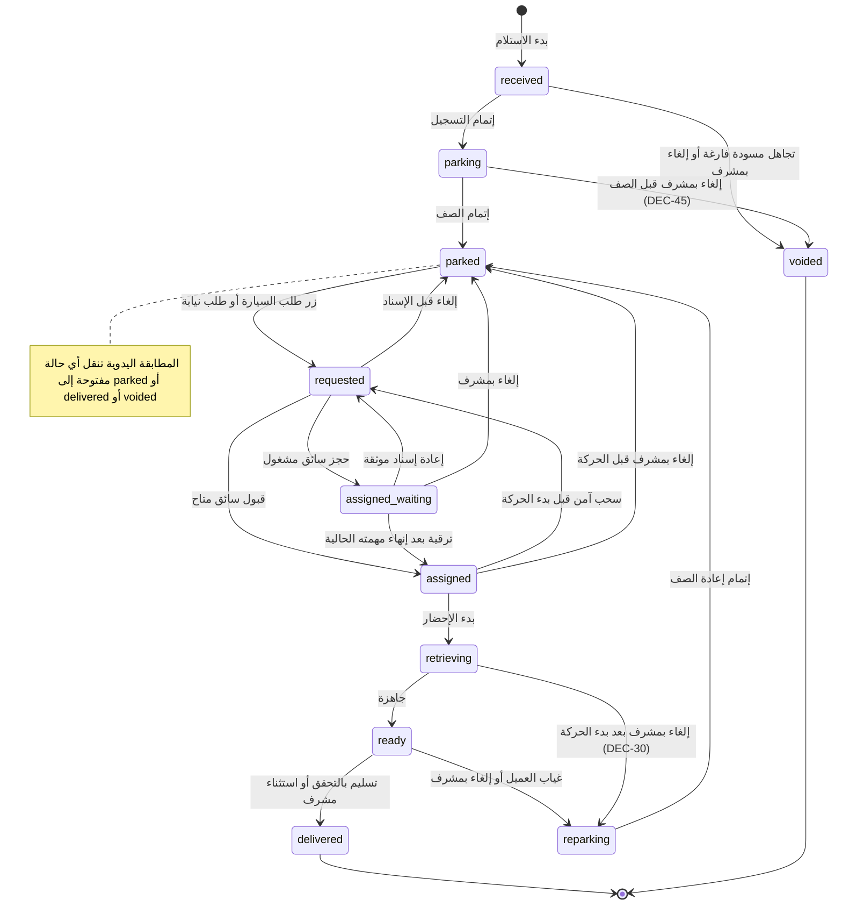
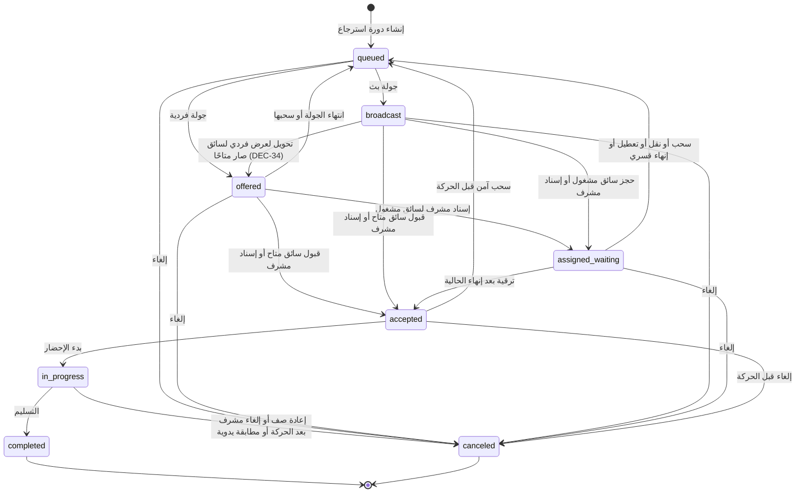
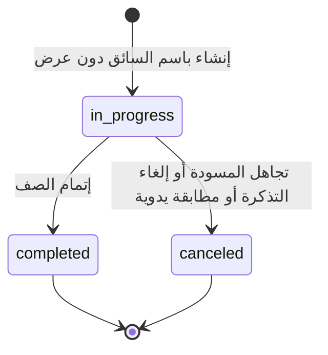
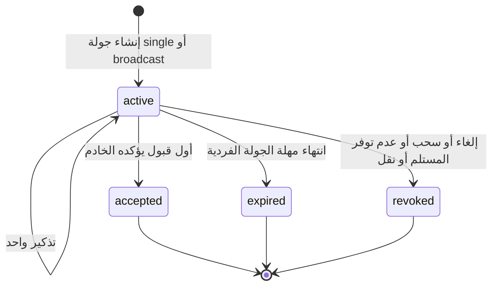
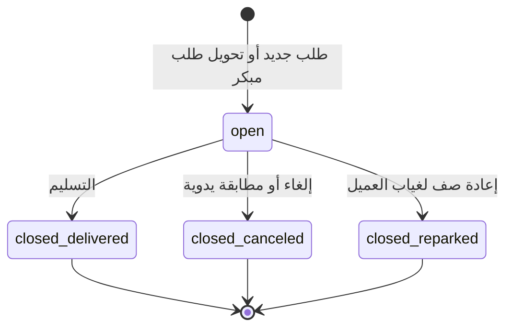
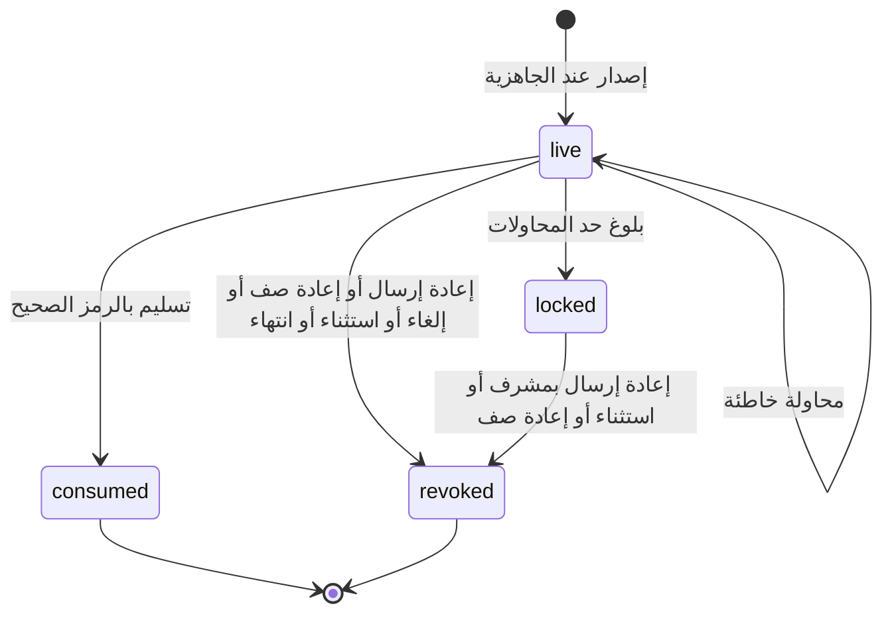
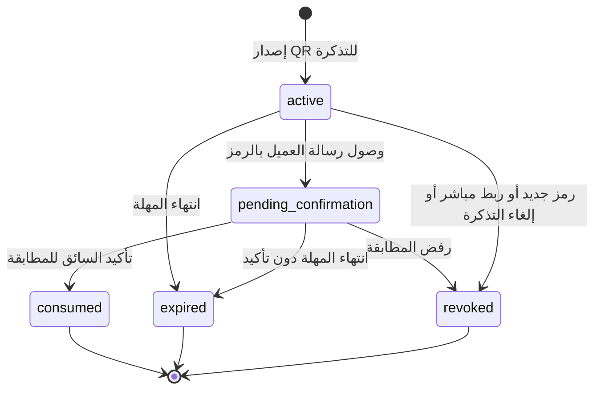
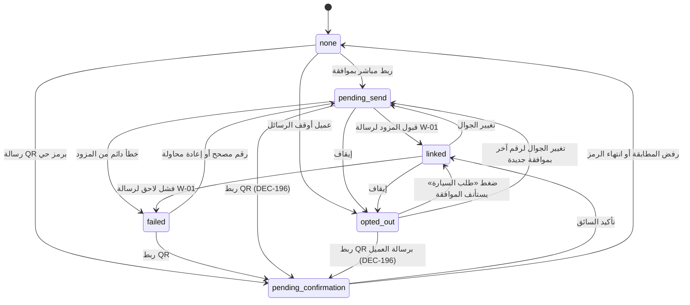
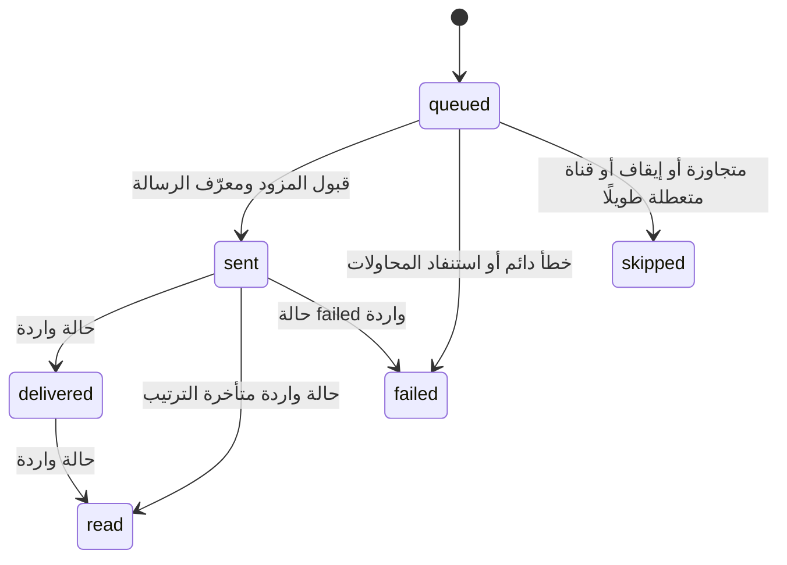
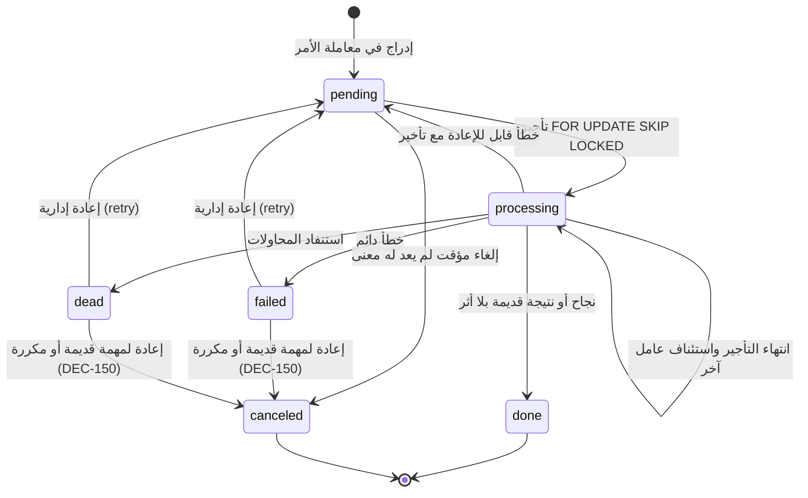

# 11 — آلات الحالة والأحداث النطاقية (State Machines & Domain Events)

| البند | القيمة |
|---|---|
| الإصدار | 1.0 — 27 أكتوبر 2026 |
| الحالة | مرجع ملزم للتنفيذ |
| يحل محل | خانة «AI Output Schema» في الحزمة القياسية (DEC-02) |
| المراجع الملزمة | `00_Glossary_Canon.md` (الأسماء) · `06_schema.sql` (الأعمدة والقيود) · `00_Source_Architecture_v1.2_AR.md` (§4، §5، §6، §10، §14) · `DECISIONS.md` |
| ملفات مرتبطة | `07_API_Contract.md` · `08_Error_Codes_Guide.md` · `10_Dispatch_Engine_Spec.md` · `12_WhatsApp_Integration_Spec.md` · `14_Notification_Matrix_Templates.md` · `15_Event_Tracking_Plan.md` |

---

## 0. نطاق الملف وحدود المسؤولية

في نظام لا يستخدم الذكاء الاصطناعي، «المخرجات المنظّمة» هي حالات الكيانات والأحداث التي يصدرها الخادم. هذا الملف يحدد:

- كل حالة مسموحة لكل كيان، وكل انتقال بين حالتين: الأمر المسبب، ومن يملك تنفيذه، والحراس، والآثار الجانبية، والأحداث، والرسائل.
- كتالوج كل حدث نطاقي (canon §7.1) وكل مهمة مؤجلة (canon §7.2) بحمولته ومستهلكيه.
- رسائل الاتصال الفوري (canon §7.3) وبروتوكول المزامنة عند العودة.

ما ليس هنا: خوارزمية اختيار المهمة والسائق داخل تمريرة التوزيع (10)، نصوص رسائل العميل (14)، أشكال الطلب والرد (07)، ترجمة قيود قاعدة البيانات إلى رموز أخطاء (08).

قاعدة الحسم: عند تعارض في **اسم** يحكم القاموس؛ في **سلوك حالة وآثار انتقال** يحكم هذا الملف؛ في **اختيار المرشح وتوقيت العروض** يحكم 10.

---

## 1. المبادئ

### 1.1 الأوامر فقط

1. لا يكتب أي كود حقل `status` لأي كيان مباشرة. كل تغيير حالة يتم عبر **أمر** معرّف: مسار API من canon §9، أو مهمة مؤجلة `job.*` من canon §7.2، أو معالجة حدث وارد من واتساب (`job.wa_process_inbound`).
2. كل أمر له معالج واحد في طبقة النطاق (Command handler). الواجهة لا تحسب الحالة التالية ولا تفترضها؛ تعرض فقط ما يرده الخادم.
3. الانتقال حتمي: (الحالة الحالية، الأمر، نتيجة الحراس) ← حالة تالية واحدة أو خطأ واحد.
4. قيمة `audit_log.action` = اسم الصلاحية المستخدمة من canon §10 (مثل `task.reassign`)، وللأوامر الآلية اسم نوع المهمة (`job.offer_expire`) مع `actor_type = system`.
5. أي انتقال غير مذكور في هذا الملف ممنوع ويعيد `INVALID_STATE_TRANSITION`.

### 1.2 ترتيب الحراس وأسبقية الأخطاء

يُفحص كل أمر بهذا الترتيب، وأول فشل يحدد الخطأ المعاد:

1. المصادقة: `AUTH_UNAUTHENTICATED`، `AUTH_SESSION_EXPIRED`، `AUTH_SESSION_REVOKED`؛ ثم الجلسة المقيدة (عدا كل مسارات `auth.self`): `AUTH_SECRET_CHANGE_REQUIRED` أولًا ثم `AUTH_MFA_SETUP_REQUIRED`. (`AUTH_MFA_REQUIRED` يرده `POST /v1/auth/mfa/verify` وحده.)
2. مفتاح التكرار: `IDEMPOTENCY_KEY_REQUIRED`؛ إن كان المفتاح معروفًا: إعادة الرد المحفوظ، أو `IDEMPOTENCY_KEY_REUSED` (محتوى مختلف)؛ الطلب المكرر المتزامن ينتظر الأول ثم يعيد رده، و`IDEMPOTENCY_IN_PROGRESS` فقط عند تجاوز `lock_timeout` في L0 (§1.4).
3. الصلاحية والنطاق: `PERMISSION_DENIED` ← النطاق: المورد المطلوب بمعرّفه (في المسار أو الجسم) خارج نطاق المستدعي يعيد رمز «غير موجود» الخاص به (البند 4) كأنه غير موجود، و`SCOPE_VENUE_DENIED` فقط حين يحدد المستدعي الموقع صراحةً (`{venueId}` أو `venue_id`) ← `ASSIGNMENT_REQUIRED` ← `DUTY_REQUIRED` / `DRIVER_ON_BREAK`.
4. وجود المورد: `TICKET_NOT_FOUND`، `OFFER_NOT_FOUND`، `RESOURCE_NOT_FOUND`.
5. التكليف: `NOT_TASK_ASSIGNEE`، `NOT_OFFER_RECIPIENT`.
6. الإصدار: إن أُرسل `expected_version` ولم يطابق `version` الحالي ← `VERSION_CONFLICT`.
7. الحالة: إن لم تكن الحالة الحالية ضمن «مسموح من» ← `INVALID_STATE_TRANSITION`، إلا إذا ذكر الجدول رمزًا أدق (`TICKET_CLOSED`، `HANDOVER_NOT_READY`، `TASK_NOT_STARTABLE`، `REASSIGN_BLOCKED_MOVEMENT`...).
8. حراس الانتقال الخاصة (مثل `KEY_NOT_PICKED_UP`، `PAYMENT_PENDING`، `OLDER_REQUEST_PENDING`).
9. قيود قاعدة البيانات أثناء التنفيذ: انتهاك فهرس فريد جزئي متوقع يُترجم إلى رمزه (الجدول في 08 §5)، ولا يصل `INTERNAL_ERROR` للمستخدم بسبب قيد متوقع.

استثناء ملزم: حراس قبول العرض تُفحص بترتيب الملف 10 §5.2 (انظر TT-09)، وحراس التسليم بترتيب DEC-177 (07، TT-18).

### 1.3 قالب المعاملة

```text
BEGIN  -- READ COMMITTED؛ SET LOCAL lock_timeout = '3s' و statement_timeout = '5s'
  0) L0: حجز Idempotency-Key كأول جملة (INSERT … ON CONFLICT DO NOTHING ثم قراءة الصف) للأوامر المعلّمة ✓ (§1.4)
  1) الأقفال بترتيب canon §14ب فقط (DEC-27)، بنمط FOR NO KEY UPDATE (و FOR SHARE حيث يكفي منع التغيير):
       L1 dispatch_pools       -- لكل أمر يمس طابور المجموعة أو توفر سائقيها (انظر 10 لتفاصيل التمريرة)
       -> L2 events -> L3 driver_transfers -> driver_assignments -> users
       -> L4 tasks -> L5 tickets -> L6 retrieval_cycles -> L7 task_offers (ومستلموها) -> L8 duty_sessions
       -> L9 spot_allocations / key_slot_allocations / claim_codes / link_codes / action_tokens
             / payments / cash_handovers / alerts / notifications
       -- داخل المستوى الواحد تصاعديًا بالمعرّف؛ لا قفل لمستوى أعلى بعد مستوى أدنى
  2) تحميل الصفوف المقفلة وفحص الحراس (§1.2)
  3) التحديث: UPDATE ... SET status = $next, version = version + 1
              WHERE id = $id AND version = $read_version
  4) إن تغيّر العرض أو الطلب في المجموعة: تسوية السائق (settleDriverAfterTask) وتمريرة التوزيع داخل المعاملة
     نفسها وهي تحمل L1 (DEC-08). الاستثناء الوحيد (canon §14ب): بعد أقفال الأمر يجوز لهما قفل صفوف إضافية
     من L4–L8 لنفس المجموعة
  5) L9: NotificationPlanner يحوّل أحداث هذه المعاملة إلى صفوف notifications لرسائل العميل حسب 14 §3.1 (DEC-41)
  6) L10: INSERT ticket_events (لكل تغيير يخص تذكرة) + custody_events (لكل انتقال عهدة) + audit_log
          + outbox_events: الأحداث النطاقية (§8، ordering_key = NULL) + المهام المؤجلة والمؤقتات (§8.11)
            + job.wa_send لكل إشعار مخطط (ordering_key = 'wa:<ticket_id>')
  7) إكمال صف مفتاح التكرار بالرد
COMMIT
-- بعد COMMIT فقط: pg_notify لإيقاظ العامل وجسر WebSocket. لا أثر خارجي قبل الالتزام.
```

قواعد ملزمة:

- الأوامر التي تلمس مجموعتي توزيع (اكتمال نقل سائق) تقفل صفوف `dispatch_pools` بترتيب تصاعدي للمعرّف.
- الأوامر التي لا تمس طابور المجموعة (تعديل مسودة الاستلام وإرسالها، رفع الصور، رموز الربط، تغيير الجوال) تبدأ من L5 ولا تطلب مستوى أصغر بعدها؛ مثلًا `PATCH /v1/tickets/{ticketId}/intake` يقفل التذكرة (L5) ثم `link_codes` (L9) عند تحويل القناة إلى ورقية (DEC-40). أوامر تقدم الحركة (`key-pickup`، `start-retrieval`، `ready`) تبدأ من L4.
- الفهارس الفريدة الجزئية في PostgreSQL **غير قابلة للتأجيل**؛ لذلك ترتيب الجمل إلزامي داخل المعاملة: أغلق المهمة الحالية (`completed` أو `canceled`) **قبل** ترقية المهمة التالية أو إنشاء مهمة جديدة على نفس السائق أو التذكرة، وأطلق التخصيص القديم **قبل** إدراج الجديد، وأبطل الرمز الحي **قبل** إصدار بديله.
- فشل شرط `version` في `UPDATE` لا يحدث مع الأقفال الصحيحة؛ إن حدث يُلغى كل شيء ويعاد `VERSION_CONFLICT`.
- إعادة المحاولة (canon §14ب): المعاملة كلها تُعاد حتى 3 محاولات عند `40001`/`40P01` بتأخير عشوائي 20–80 ms؛ تجاوز `lock_timeout` (`55P03`) لا يُعاد على الخادم ويرد `IDEMPOTENCY_IN_PROGRESS` إن حدث عند L0 وإلا `SERVICE_UNAVAILABLE` (`retryable: true`).

### 1.4 منع التكرار

- كل أمر عليه ✓ في canon §9 يتطلب `Idempotency-Key`، ويُحجز المفتاح كأول جملة في معاملة الأمر (L0). يُحفظ الرد النهائي (2xx وكل خطأ 4xx حتمي، ومنه 403 و404 و409 و410 و422 و423) في `idempotency_keys` داخل المعاملة نفسها؛ ردود 401 و429 و5xx لا تُحفظ (يُحذف الصف) ويجوز إعادة المحاولة بنفس المفتاح. المفاتيح تنتهي بعد 24 ساعة.
- منع التكرار النطاقي مستقل عن المفتاح:
  - تكرار ضغط «طلب السيارة» لا ينشئ دورة ثانية (فهرس `uq_retrieval_cycles_open`) ويرد بالحالة الحالية (W-09).
  - قبول مكرر من **الفائز نفسه** بمفتاح مختلف يعيد 200 بالحالة الحالية للمهمة، لا `TASK_ALREADY_CLAIMED`.
  - تسليم ثانٍ بعد نجاح التسليم: بنفس `Idempotency-Key` يُعاد رد 200 المحفوظ؛ وأي طلب آخر (ولو من المكلّف نفسه بمفتاح جديد) ← `TICKET_CLOSED`.
- أحداث واتساب الواردة تُزال ازدواجيتها بـ`whatsapp_inbound_events.body_sha256` ثم `whatsapp_messages.wa_message_id`.

### 1.5 شكل خطأ الانتقال غير المسموح

```json
{
  "error": {
    "code": "INVALID_STATE_TRANSITION",
    "message": "Command not allowed in the current state",
    "message_ar": "الإجراء غير مسموح في الحالة الحالية",
    "request_id": "req_01JD3Q...",
    "retryable": false,
    "details": {
      "entity_type": "ticket",
      "entity_id": "0193...",
      "current_status": "retrieving",
      "current_version": 9,
      "command": "POST /v1/tickets/{ticketId}/repark",
      "allowed_from": ["ready"]
    }
  }
}
```

`entity_type` ∈ `ticket`، `task`، `task_offer`، `retrieval_cycle`، `event`، `shift`، `duty_session`، `driver_transfer`، `claim_code`، `link_code`، `incident`، `alert`، `dispatch_pool`، `user`. الشكل ملزم في كل الوحدات (DEC-106، DEC-111): `current_version` حين يكون للكيان إصدار، و`reason` حين لا تكفي الحالة لتفسير الرفض (`dispatch_pool_inactive`، `dispatch_pool_fixed_after_open`، `open_shift`، `open_tasks`، `max_extra_photos`). الواجهة تعرض `message_ar` ثم تعيد جلب الشاشة.

### 1.6 الحمولة الدنيا والقراءة الطازجة

- حمولة الحدث تحمل معرّفات وإصدارات وأعلامًا فقط. كل مستهلك (مرسل واتساب، Push، جسر WS) يقرأ الحالة الطازجة من قاعدة البيانات وقت المعالجة ويعيد التحقق قبل أي أثر خارجي (مثال: لا تُرسل W-03 إن صارت التذكرة `retrieving`).
- ممنوع في أي حمولة حدث أو مهمة: رقم الجوال، اسم العميل، رمز التسليم، رمز الربط الخام، رمز الإجراء الخام، موضع المفتاح، صور. لا استثناء: مهمة W-05 تحمل `notification_id` فقط، والمرسل يقرأ الرمز من `claim_codes.code_ciphertext` الذي يُمسح بعد قبول المزود أو انتهاء الرمز (DEC-15، DEC-38).
- `ticket_events.type` يقبل أي نوع حدث نطاقي يخص التذكرة: `ticket.*`، وأحداث `task.*` لمهامها، و`custody.changed`، و`handover.*`، و`payment.*`، و`wa.message_status_changed` لرسائلها. `ticket_events.ticket_version` = إصدار التذكرة بعد التغيير. ويُضاف نوع الخط الزمني `ticket.photo_uploaded` عند اكتمال رفع صورة (`data`: `media_id`، `kind`، `content_type`، `byte_size`؛ و`ticket_version` = الإصدار الحالي لأن الصورة لا تغيّره)، وهو ليس حدثًا نطاقيًا: لا صف في `outbox_events` ولا نشر فوري (DEC-95).

### 1.7 ثوابت الاتساق بين التذكرة ومهامها

| حالة التذكرة | المهمة المفتوحة الوحيدة (`uq_tasks_open_per_ticket`) | دورة مفتوحة | ملاحظات |
|---|---|---|---|
| `received` | `park` بحالة `in_progress` | لا | `pending_retrieval_at` قد يكون مضبوطًا |
| `parking` | `park` بحالة `in_progress` | لا | كذلك |
| `parked` | لا مهمة مفتوحة | لا | `pending_retrieval_at = NULL` |
| `requested` | `retrieve` بحالة `queued` أو `offered` أو `broadcast` | نعم | |
| `assigned` | `retrieve` بحالة `accepted` | نعم | |
| `assigned_waiting` | `retrieve` بحالة `assigned_waiting` | نعم | |
| `retrieving` | `retrieve` بحالة `in_progress` | نعم، `ready_at = NULL` | |
| `ready` | `retrieve` بحالة `in_progress` | نعم، `ready_at` مضبوط | رمز حي إن كانت القناة واتساب مربوطة |
| `reparking` | `repark` بحالة `in_progress` | لا | `pending_retrieval_at` قد يكون مضبوطًا (طلب أثناء إعادة الصف) |
| `delivered` | لا مهمة مفتوحة | لا | نهائية |
| `voided` | لا مهمة مفتوحة | لا | نهائية |

استعلام فحص (يُشغّل في الاختبارات وفي فحص دوري للمراقبة):

```sql
SELECT t.id, t.status, k.type AS open_task_type, k.status AS open_task_status
FROM tickets t
LEFT JOIN tasks k ON k.ticket_id = t.id AND k.status NOT IN ('completed','canceled')
WHERE NOT (
     (t.status IN ('received','parking') AND k.type = 'park'     AND k.status = 'in_progress')
  OR (t.status = 'requested'        AND k.type = 'retrieve' AND k.status IN ('queued','offered','broadcast'))
  OR (t.status = 'assigned'         AND k.type = 'retrieve' AND k.status = 'accepted')
  OR (t.status = 'assigned_waiting' AND k.type = 'retrieve' AND k.status = 'assigned_waiting')
  OR (t.status IN ('retrieving','ready') AND k.type = 'retrieve' AND k.status = 'in_progress')
  OR (t.status = 'reparking'        AND k.type = 'repark'   AND k.status = 'in_progress')
  OR (t.status IN ('parked','delivered','voided') AND k.id IS NULL)
);   -- يجب أن يعيد صفرًا
```

---

## 2. آلة حالة التذكرة

### 2.1 المخطط



الطلب المبكر أثناء `received` أو `parking` أو `reparking` لا يغيّر الحالة؛ يُحفظ في `pending_retrieval_at` ويتحول إلى `requested` لحظة الوصول إلى `parked` (DEC-13، TT-07 وTT-08).

### 2.2 جدول الانتقالات (ملخص)

| المعرّف | من ← إلى | الأمر | الفاعل والصلاحية | رسالة العميل |
|---|---|---|---|---|
| TT-01 | بداية ← `received` | `POST /v1/tickets` | سائق (D*) — `ticket.intake` | — |
| TT-03 | `received` ← `parking` | `POST /v1/tickets/{ticketId}/submit-intake` | منشئ المسودة — `ticket.intake` | W-01 عند الربط المباشر |
| TT-04 | `received` أو `parking` ← `voided` | `POST /v1/tickets/{ticketId}/discard-draft` (`received` فقط) أو `POST /v1/tickets/{ticketId}/void` (`received` أو `parking`، DEC-45) | السائق (مسودة فارغة) — `ticket.discard_empty_draft` / المشرف أو الإدارة — `ticket.void` | — |
| TT-05 | `parking` ← `parked` | `POST /v1/tasks/{taskId}/complete-parking` | مكلّف `park` — `task.execute` | — |
| TT-06 | `parked` ← `requested` | زر «طلب السيارة» (`job.wa_process_inbound`) أو `POST /v1/tickets/{ticketId}/retrievals` | العميل / سائق أو مشرف — `retrieval.request_on_behalf` | W-02 |
| TT-07 | بلا تغيير (طلب مبكر) | زر «طلب السيارة» فقط أثناء `received` أو `parking` أو `reparking` (النيابة ← `TICKET_NOT_PARKED`، DEC-25) | العميل | W-02 |
| TT-08 | `parked` ← `requested` (تلقائي) | داخل TT-05 أو TT-21 | النظام | — |
| TT-09 | `requested` ← `assigned` | `POST /v1/task-offers/{offerId}/accept` أو `POST /v1/tasks/{taskId}/reassign` | سائق متاح — `offer.accept` / مشرف — `task.reassign` | — |
| TT-10 | `requested` ← `assigned_waiting` | كـTT-09 لسائق مشغول | سائق مشغول بلا مهمة تالية — `offer.accept` / مشرف | W-03 |
| TT-11 | `assigned_waiting` ← `assigned` | ترقية نظامية داخل أمر أنهى مهمة السائق الحالية | النظام | — |
| TT-12 | `assigned_waiting` ← `requested` | `POST /v1/tasks/{taskId}/reassign` أو اكتمال نقل/تعطيل الحاجز أو إنهاء مناوبته قسريًا | مشرف — `task.reassign` / النظام | — |
| TT-13 | `assigned` ← `requested` | `POST /v1/tasks/{taskId}/reassign`، أو نظاميًا قبل استلام المفتاح عند تعطيل المكلّف أو نقله أو إنهاء مناوبته قسريًا (DEC-32) | مشرف — `task.reassign` / النظام | — |
| TT-14 | `requested` ← `parked` | `POST /v1/retrieval-cycles/{cycleId}/cancel` | سائق أو مشرف — `retrieval.cancel` | W-07 |
| TT-15 | `assigned` أو `assigned_waiting` ← `parked` | `POST /v1/retrieval-cycles/{cycleId}/cancel` | مشرف — `retrieval.cancel` | W-07 |
| TT-16 | `assigned` ← `retrieving` | `POST /v1/tasks/{taskId}/start-retrieval` | المكلّف — `task.execute` | W-04 |
| TT-17 | `retrieving` ← `ready` | `POST /v1/tasks/{taskId}/ready` | المكلّف — `task.execute` | W-05 |
| TT-18 | `ready` ← `delivered` | `POST /v1/tickets/{ticketId}/handover` | المكلّف — `handover.verify` | W-06 |
| TT-19 | `ready` ← `delivered` | `POST /v1/tickets/{ticketId}/handover-exception` | مشرف — `handover.exception` | W-06 |
| TT-20 | `ready` ← `reparking` | `POST /v1/tickets/{ticketId}/repark` | مشرف — `ticket.repark` | W-08 |
| TT-20b | `retrieving` أو `ready` ← `reparking` | `POST /v1/retrieval-cycles/{cycleId}/cancel` | مشرف — `retrieval.cancel` (DEC-30) | W-07 |
| TT-21 | `reparking` ← `parked` | `POST /v1/tasks/{taskId}/complete-parking` | مكلّف `repark` — `task.execute` | — |
| TT-22 | أي حالة مفتوحة ← `parked` أو `delivered` أو `voided` | `POST /v1/tickets/{ticketId}/manual-reconcile` | مشرف أو إدارة — `ticket.manual_reconcile` | لا رسائل |

(لا يوجد TT-02 كانتقال؛ تحديثات المسودة في §2.4.)

### 2.3 تفاصيل الانتقالات

**TT-01 · بداية ← `received` — `POST /v1/tickets`**
- الحراس: مناوبة `on_duty` في مجموعة الحفل (`DUTY_REQUIRED`، `DRIVER_ON_BREAK`)؛ الحفل `open` في موقع التعيين (`EVENT_NOT_OPEN`)؛ `driver_state = available`، فأي مهمة حركة نشطة (`accepted`/`in_progress` من أي نوع، ومنها مهمة تالية رُقّيت) ← `MOVEMENT_IN_PROGRESS`. يأخذ الأمر قفل المجموعة، فيتنافس ذريًا مع أي قبول للسائق نفسه.
- الآثار: قفل صف `events` وزيادة `next_display_number` (القيمة السابقة تصبح `display_number`)؛ إدراج التذكرة بحالة `received` مع `vehicle_holder_type = driver` و`key_holder_type = driver` ومعرّف السائق، ولقطة التسعير (DEC-43): `fee_halalas` من الحفل، و`payment_status = due` إن كان `pricing_mode = per_vehicle` وإلا `not_required`؛ إنشاء مهمة `park` بحالة `in_progress` (`assignee_id`، `accepted_at = started_at = priority_at = now()`)؛ `duty_sessions.available_since = NULL`؛ `custody_events` مرتين (`vehicle` و`key`) من `customer` إلى `driver` بسبب `intake`؛ إن كانت للسائق جولة `single` نشطة تُسحب بسبب `recipient_unavailable` وتُشغّل تمريرة توزيع.
- الأحداث: `ticket.created`، `task.created`، `custody.changed` ×2، `driver.availability_changed`، و`offer.revoked` عند الحاجة.
- WS: `ticket.updated` ← `venue:{venueId}:supervisors`؛ `driver.state_changed` ← `user:{userId}` والمشرفين.
- رقم العرض لا يُعاد استخدامه حتى لو أُلغيت المسودة.

**TT-03 · `received` ← `parking` — `POST /v1/tickets/{ticketId}/submit-intake`**
- الحراس: المسودة لمكلّف مهمة `park` نفسه؛ الحفل `open` أو `closing` (المركبة استُلمت قبل بدء الإغلاق)؛ الحقول الإلزامية وإلا `INTAKE_INCOMPLETE` مع `details.missing` بالأسماء `plate` (`plate_digits` + `plate_letters_ar` أو `plate_raw`)، `vehicle.make`، `vehicle.color`، `key_tag`، ومعها `paper_serial` (ورقية) أو `customer_phone` (واتساب بلا عميل ولا رمز QR حي أو مستهلك ولا ربط) (DEC-172). قناة `whatsapp` بالربط المباشر تتطلب جوالًا صالحًا (`PHONE_INVALID`) وموافقة (`CONSENT_REQUIRED`) وعميلًا لم يوقف الرسائل (`customers.wa_opted_out_at` مضبوط ← `WA_CUSTOMER_OPTED_OUT`؛ البديل ربط QR، فرسالة العميل نفسه تستعيد الموافقة، أو الورق)، أو ربط QR مكتملًا أو جاريًا؛ قناة `paper` تتطلب `paper_serial` غير مستخدم (`PAPER_SERIAL_IN_USE`)؛ `key_tag` غير مستخدم لتذكرة مفتوحة (`KEY_TAG_IN_USE`)؛ صور `inspection.required_photos` بحالة `uploaded`، وإلا `INSPECTION_INCOMPLETE` ما لم يرسل السائق تأكيدًا صريحًا بالمتابعة بفحص ناقص (اسم الحقل في 07).
- الآثار: `status = parking`، `submitted_at`؛ `vehicle_inspections` (`kind = intake`)؛ `inspection_status = complete` أو `incomplete` مع تنبيه `inspection_incomplete`؛ التسعير لا يتغير (لقطته في TT-01، DEC-43)؛ القناة واتساب مباشر: `wa_link_status = pending_send` مع إشعار W-01. العميل وموافقته كُتبا في المسودة (`PATCH .../intake`: upsert `customers` بالجوال المطبّع، و`customer_consents` بطريقة `verbal_staff_confirmed` لكل تذكرة؛ تغيير الجوال أو مسحه يبطل موافقة التذكرة بـ`revoke_source = staff`)، والإرسال يفحص الموافقة والإيقاف فقط (DEC-170).
- الأحداث: `ticket.intake_submitted`، `ticket.wa_link_changed` (إن تغيّر)، `alert.raised` (فحص ناقص).
- العميل: W-01 عند الربط المباشر (الربط عبر QR يرسل W-01 عند تأكيد السائق، §2.4).

**TT-04 · `received` أو `parking` ← `voided`**
- (أ) `POST /v1/tickets/{ticketId}/discard-draft` — السائق، مسودته فقط (`received`)، بشرط ألا تحتوي أي بيانات مُدخلة. وإلا `DRAFT_HAS_DATA` مع `fields_present` ∈ `plate`، `vehicle`، `customer_phone`، `key_tag`، `paper_serial`، `notes`، `damage_marks`، `photos` (DEC-173)، ويُرفع تنبيه `draft_abandoned` للمشرف (DEC-20).
- (ب) `POST /v1/tickets/{ticketId}/void` — المشرف أو الإدارة، سبب إلزامي (`REASON_REQUIRED`)، والتذكرة `received` أو `parking` فقط (DEC-45؛ بعد `parked` يُصحح بالمطابقة اليدوية TT-22)، بعد تحقق ميداني من إعادة المركبة والمفتاح للعميل.
- الآثار: مهمة `park` ← `canceled`؛ التذكرة `voided` مع `voided_at` و`voided_by` و`void_reason` (للحالة أ نص ثابت يصف التجاهل)؛ `custody_events` للمركبة والمفتاح من `driver` إلى `customer` بسبب `correction`؛ لقطة التسعير لا تتغير (DEC-43؛ التذكرة `voided` تُستبعد من التسوية في 13)؛ إبطال `link_codes` الحية و`action_tokens` (`revoked_at`)؛ تحرير السائق: ترقية مهمته التالية (TT-11) إن وُجدت وإلا `available_since = now()` وتمريرة توزيع؛ حل تنبيه `draft_abandoned`.
- الأحداث: `ticket.voided` (`via = discard_draft` أو `void`)، `task.canceled`، `custody.changed` ×2، ثم `task.promoted` أو `driver.availability_changed`، و`alert.resolved`.

**TT-05 · `parking` ← `parked` — `POST /v1/tasks/{taskId}/complete-parking` (مهمة `park`)**
- الحراس: المكلّف؛ المهمة `in_progress` والتذكرة `parking`؛ الموقف حسب `parking.mode` (`assigned_spots`: معرّف موقف إلزامي، `free_text`: ملاحظة إلزامية، `mixed`: أحدهما)؛ خانة مفتاح إلزامية إن `keys.require_slot = true` (`VALIDATION_FAILED`)؛ الموقف والخانة شاغران (`PARKING_SPOT_OCCUPIED`، `KEY_SLOT_OCCUPIED`).
- الآثار: إدراج `spot_allocations` (إن وُجد موقف محدد) و`key_slot_allocations`؛ التذكرة: `parked`، `current_spot_id` أو `current_spot_note`، `current_key_slot_id`، `vehicle_holder_type = spot`، `key_holder_type = key_slot`، `parked_by`، `parked_at`؛ عهدة: المركبة من `driver` إلى `spot` بسبب `parked`، والمفتاح من `driver` إلى `key_slot` بسبب `key_deposited` (وبلا خانة، `keys.require_slot = false`، يصير حائز المفتاح `unknown`، DEC-187)؛ المهمة ← `completed`؛ تحرير السائق (ترقية التالية أو `available_since = now()`)؛ إن كان `pending_retrieval_at` مضبوطًا ← TT-08 في المعاملة نفسها؛ تمريرة توزيع.
- الأحداث: `ticket.parked`، `task.completed`، `custody.changed` ×2، ثم (`task.promoted` + `ticket.assigned` للتذكرة الأخرى) أو `driver.availability_changed`.

**TT-06 · `parked` ← `requested`**
- (أ) ضغط زر W-01 «طلب السيارة»: يُعالج داخل `job.wa_process_inbound`، الفاعل `customer`. الحراس: رمز الإجراء صالح (§5.3)؛ الحفل `open` أو `closing`.
- (ب) `POST /v1/tickets/{ticketId}/retrievals` بسبب إلزامي: سائق في مناوبته بموقع التذكرة أو مشرف.
- إن وُجدت دورة مفتوحة: (أ) رد W-09 بالحالة الحالية دون طلب جديد، (ب) `RETRIEVAL_ALREADY_ACTIVE` مع `details.cycle_id`. إن كانت التذكرة مغلقة: (أ) W-09 حسب §2.5، (ب) `TICKET_CLOSED`.
- الآثار: `retrieval_cycles` (`cycle_no` = السابق + 1، `requested_at = now()`، `request_source`، `requested_by_customer_id` أو `requested_by_user_id` + `request_reason`)؛ مهمة `retrieve` بحالة `queued` (`priority_at = requested_at`، `queued_at = now()`)؛ التذكرة: `requested`، `active_cycle_id`، `last_requested_at`؛ مؤقت `job.escalate_unaccepted` عند `queued_at + dispatch.unaccepted_escalation_s`؛ إن لم يوجد في المجموعة أي سائق بحالة `on_duty` غير مستريح ← تنبيه `no_drivers_on_duty` فورًا (لا يُرسل لمجموعة أخرى)؛ تمريرة توزيع.
- الأحداث: `ticket.retrieval_requested`، `task.created`، و`wa.button_pressed` في (أ)، ثم أحداث التمريرة (`task.offered` أو `task.broadcast_opened`).
- العميل: W-02 بعد الالتزام فقط، ما لم تكن القناة `paper` أو العميل أوقف الرسائل. الطلب بالنيابة لتذكرة مربوطة يرسل W-02 أيضًا.

**TT-07 · طلب مبكر — بلا تغيير حالة (`received` أو `parking` أو `reparking`)**
- (أ) الزر مقبول في الحالات الثلاث (يحدث إذا وصلت W-01 أثناء التسجيل). (ب) الطلب بالنيابة **غير مقبول** في هذه الحالات ويعاد `TICKET_NOT_PARKED` (DEC-25): الموظف أمام العميل والمركبة لم تُصف بعد، فينتظر حتى `parked`.
- الآثار: إن كان `pending_retrieval_at` فارغًا: `pending_retrieval_at = now()` و`pending_retrieval_source = 'whatsapp'`؛ وإن كان مضبوطًا: لا تغيير (رد W-09).
- الأحداث: `ticket.retrieval_requested_early`؛ WS `ticket.updated` لمكلّف مهمة الصف مع لافتة «العميل طلب سيارته» وصوت `reminder`، وللمشرفين.
- العميل: W-02 مرة واحدة.
- عند التحويل في TT-08 تُنشأ الدورة بـ`request_source = 'whatsapp'` و`requested_by_customer_id` = عميل التذكرة و`requested_early = true`.

**TT-08 · `parked` ← `requested` تلقائيًا (داخل TT-05 أو TT-21)**
- الشرط: `pending_retrieval_at` مضبوط لحظة الوصول إلى `parked`.
- الآثار: كـTT-06 مع `requested_at = pending_retrieval_at` (الأولوية بوقت الطلب الأصلي، DEC-13)، `requested_early = true`، `request_source = pending_retrieval_source`، وتصفير `pending_retrieval_*`. ترتيب الجمل: إغلاق مهمة الصف ← ترقية تالية السائق إن وجدت ← إنشاء الدورة والمهمة ← تمريرة التوزيع. لا أفضلية لسائق الصف في التوزيع.
- العميل: لا W-02 جديدة (أُرسلت في TT-07).

**TT-09 · `requested` ← `assigned`**
- (أ) `POST /v1/task-offers/{offerId}/accept` من سائق `driver_state = available` على جولة `single` أو `broadcast`. (ب) `POST /v1/tasks/{taskId}/reassign` بهدف سائق متاح (سبب إلزامي؛ إسناد طلب أحدث والأقدم قابل للتصرف للهدف يتطلب `override_priority = true` ويُدقَّق بالفعل `dispatch.priority_override`، وإلا `OLDER_REQUEST_PENDING`).
- حراس القبول بالترتيب الملزم في الملف 10 §5.2، تحت أقفال L1 المجموعة ← L4 المهمة ← L5 التذكرة ← L6 الدورة ← L7 الجولة ← L8 مناوبة القابل: تحميل العرض ضمن نطاق المستدعي، وإلا `OFFER_NOT_FOUND` (ومنه عرض في موقع خارج نطاقه) ← مناوبة `on_duty` في المجموعة نفسها لا استراحة وتعيين نشط (`DUTY_REQUIRED`، `DRIVER_ON_BREAK`، `ASSIGNMENT_REQUIRED`) ← مستلم الجولة (`NOT_OFFER_RECIPIENT`) ← المهمة محجوزة: للقابل نفسه 200 بالنتيجة الحالية، ولغيره `TASK_ALREADY_CLAIMED` ← الجولة مسحوبة أو المهمة ملغاة (`OFFER_REVOKED`) ← الجولة منتهية، أو فردية و`now() >= expires_at + dispatch.accept_grace_ms` (`OFFER_EXPIRED`، DEC-47) ← السعة: `busy_with_next` ← `NEXT_TASK_ALREADY_RESERVED`، وجولة `single` تتطلب سائقًا متاحًا (`DRIVER_NOT_AVAILABLE`) ← الأولوية: لا مهمة أقدم قابلة للتصرف للسائق نفسه في المجموعة (`OLDER_REQUEST_PENDING` مع `details.older_task_id`؛ التعريف الدقيق في 10).
- الآثار: المهمة `accepted` (`assignee_id`، `claimed_at`، `accepted_at`)؛ الجولة `accepted` (`accepted_by`، `close_reason = accepted`)؛ `offer_recipients.response = accepted` للفائز؛ الدورة `assigned_at` و`accepted_by`؛ التذكرة `assigned`؛ `available_since = NULL`؛ إن كان للقابل عرض فردي حي آخر يُسحب (`revoked` بسبب `recipient_unavailable`) وتعود مهمته `queued` في النوبة نفسها؛ حل تنبيه `request_unaccepted` إن وُجد؛ ثم تمريرة توزيع للطلب التالي.
- الأحداث: `task.claimed`، `ticket.assigned`، `driver.availability_changed`، و`offer.revoked` لعرضه الآخر إن وُجد، و`task.reassigned` في (ب) مع سحب الجولة النشطة بسبب `reassigned`.
- WS: `task.claimed` ← `pool:{poolId}:drivers` والمشرفين؛ `task.updated` ← `user:{assigneeId}` بتفاصيل الموقف وخانة المفتاح.
- العميل: لا رسالة؛ الرسالة التالية W-04 عند البدء الفعلي.

**TT-10 · `requested` ← `assigned_waiting`**
- (أ) قبول على جولة `broadcast` من سائق لديه مهمة حركة نشطة (`accepted` أو `in_progress`) وليس لديه مهمة تالية. (ب) `reassign` بهدف سائق مشغول.
- الحراس: كـTT-09، مع: لدى السائق مهمة تالية ← `NEXT_TASK_ALREADY_RESERVED`؛ قبول مشغول على جولة `single` ← `DRIVER_NOT_AVAILABLE`.
- الآثار: المهمة `assigned_waiting` (`assignee_id`، `claimed_at`، `assigned_waiting_at`)؛ الجولة `accepted`؛ الدورة `assigned_waiting_at` و`accepted_by`؛ التذكرة `assigned_waiting`؛ سحب أي عرض فردي حي آخر للقابل قبل التمريرة كما في TT-09؛ مؤقت `job.next_task_wait_check`؛ إن وُجد سائق متاح الآن في المجموعة و`dispatch.idle_driver_alert = true` ← تنبيه `idle_driver_while_next_waiting` (لا إعادة إسناد صامتة).
- الأحداث: `task.claimed`، `ticket.assigned_waiting`.
- العميل: W-03 مرة واحدة لكل دورة (لا تتكرر إن سُحبت المهمة وحُجزت ثانية).

**TT-11 · `assigned_waiting` ← `assigned` (ترقية)**
- الأمر: نظامي داخل معاملة الأمر الذي أنهى أو حرر مهمة السائق الحالية: التسليم (TT-18، TT-19)، إتمام الصف (TT-05، TT-21)، إلغاء مهمته الحالية (TT-15)، سحبها (TT-13)، تجاهل مسودته أو إلغاء تذكرته قبل الصف (TT-04)، مطابقة يدوية لتذكرته الحالية (TT-22)، أو نقل عهدة رسمي أخرج المهمة منه (§2.4).
- الترتيب الإلزامي: إغلاق الحالية أولًا ثم الترقية (§1.3). السائق لا يمر بحالة «متاح» بين الخطوتين ولا يُعرض عليه شيء.
- الآثار: المهمة `accepted` (`accepted_at = now()`)؛ الدورة `assigned_at`؛ التذكرة `assigned`؛ حل تنبيهي `next_task_waiting_long` و`idle_driver_while_next_waiting`.
- الأحداث: `task.promoted`، `ticket.assigned`؛ WS `task.updated` ← `user:{assigneeId}` مع صوت `next_due`.
- العميل: لا رسالة (W-04 عند البدء).

**TT-12 · `assigned_waiting` ← `requested`**
- (أ) `POST /v1/tasks/{taskId}/reassign` بهدف الطابور، سبب إلزامي. (ب) نظامي: اكتمال نقل السائق الحاجز أو تعطيله أو إنهاء مناوبته قسريًا (DEC-32؛ المعمارية §10: يعاد حجزه التالي لقائمة موقعه الأصلي).
- الآثار: المهمة `queued` مع `assignee_id = NULL`، `queued_at = now()`، `escalated_at = NULL`، ومؤقت تصعيد جديد؛ التذكرة `requested`؛ لا أثر على العهدة؛ تمريرة توزيع.
- الأحداث: `task.withdrawn` (`trigger = supervisor` أو `transfer` أو `disabled`).
- العميل: لا رسالة.

**TT-13 · `assigned` ← `requested` (سحب آمن قبل الحركة)**
- الأمر: `POST /v1/tasks/{taskId}/reassign` بهدف الطابور أو سائق آخر؛ أو نظاميًا إلى الطابور بأولويتها عند تعطيل المكلّف أو نقله أو إنهاء مناوبته قسريًا ما دام لم يستلم المفتاح (DEC-32). لا سحب خفي غير ذلك.
- الحراس: المهمة `accepted` (`in_progress` ← `REASSIGN_BLOCKED_MOVEMENT`)؛ `key_picked_up_at` فارغ، وإلا `CUSTODY_RELEASE_REQUIRED` (يسبقه `POST /v1/tasks/{taskId}/release-custody`).
- الآثار: المهمة `queued` (أو مباشرة `accepted`/`assigned_waiting` للسائق الهدف — انتقال مركّب: سحب ثم TT-09 أو TT-10)؛ تحرير السائق السابق (ترقية تالية أو متاح)؛ مؤقت تصعيد جديد إن عادت للطابور؛ تمريرة توزيع.
- الأحداث: `task.withdrawn` (`trigger = supervisor` أو `transfer` أو `disabled`)، و`task.reassigned` عند الهدف سائقًا. WS `task.updated` للسائق السابق (إزالة المهمة) وللهدف.

**TT-14 · `requested` ← `parked` (إلغاء قبل الإسناد)**
- `POST /v1/retrieval-cycles/{cycleId}/cancel` بسبب: سائق في مناوبته بالموقع أو مشرف.
- الآثار: الجولة النشطة ← `revoked` (`task_canceled`)؛ المهمة ← `canceled`؛ الدورة مغلقة `outcome = canceled` (`canceled_at`، `canceled_by`، `cancel_reason`)؛ التذكرة `parked` و`active_cycle_id = NULL`؛ حل `request_unaccepted`؛ المؤقتات المعلّقة تفشل في إعادة التحقق.
- الأحداث: `ticket.retrieval_canceled`، `task.canceled`، `offer.revoked`؛ WS `offer.closed` للمستلمين.
- العميل: W-07.

**TT-15 · `assigned` أو `assigned_waiting` ← `parked` (إلغاء بمشرف)**
- الأمر نفسه؛ بعد الإسناد يملكه المشرف فقط (السائق يحصل على `INVALID_STATE_TRANSITION` بسبب `driver_cancel_after_assignment`، الملف 08 والملف 09).
- الحراس: من `assigned` مع `key_picked_up_at` مضبوط ← `CUSTODY_RELEASE_REQUIRED`.
- الآثار: كـTT-14؛ إن كانت المهمة الملغاة هي الحالية للمكلّف يتحرر (ترقية تالية أو متاح)؛ وإن كانت تاليته فلا يتغير شيء في حالته سوى زوال التالية.
- العميل: W-07.

**TT-16 · `assigned` ← `retrieving` — `POST /v1/tasks/{taskId}/start-retrieval`**
- الحراس: المكلّف (`NOT_TASK_ASSIGNEE`)؛ المهمة `accepted` (وهي `assigned_waiting` ← `TASK_NOT_STARTABLE`)؛ `key_picked_up_at` مضبوط (`KEY_NOT_PICKED_UP`). مفتاح صُف بلا خانة (حائزه `unknown`) لا يُستلم بـ`key-pickup` (`CUSTODY_HOLDER_MISMATCH`) بل يصل السائق بنقل عهدة رسمي `POST /v1/tickets/{ticketId}/custody-transfers` (DEC-187)، وهذا النقل يضبط `key_picked_up_at` لمهمة الإحضار المفتوحة حين يصل المفتاح إلى مكلّفها — الحالي، أو السائق الذي ينقل إليه النقلُ المهمة — مع `task.key_picked_up` بـ`key_slot_id: null` (ما لم يكن الاستلام مضبوطًا قبله)، ويعيده `NULL` بلا حدث حين يغادر المكلّف قبل البدء، فلا يرد هذا الأمر بعده `KEY_NOT_PICKED_UP` (DEC-251).
- الآثار: المهمة `in_progress` و`started_at`؛ الدورة `started_at` و`retrieved_by`؛ التذكرة `retrieving` و`retrieved_by` و`current_spot_id = NULL` و`current_spot_note = NULL`؛ تحرير `spot_allocations` بسبب `retrieval_start`؛ عهدة المركبة من `spot` إلى `driver` بسبب `retrieval_start`.
- الأحداث: `task.started`، `ticket.retrieving`، `custody.changed`.
- العميل: W-04. لا تُرسل W-04 قبل هذا الأمر أبدًا، ولو كانت المهمة محجوزة تالية.

**TT-17 · `retrieving` ← `ready` — `POST /v1/tasks/{taskId}/ready`**
- الحراس: المكلّف؛ المهمة `in_progress` والتذكرة `retrieving`.
- الآثار: الدورة `ready_at`؛ التذكرة `ready`؛ إن كانت القناة `whatsapp` و`wa_link_status = linked`: إصدار رمز تسليم (§5.1) بنسخته المشفرة الوحيدة في `claim_codes.code_ciphertext` لإرسال W-05 (DEC-38) ومؤقت `job.claim_code_expire`؛ وإلا لا رمز (التحقق بكعب الورق أو استثناء مشرف)؛ مؤقت `job.ready_uncollected_check` عند `ready_at + ready.uncollected_alert_min`.
- المهمة تبقى `in_progress`: «جاهزة» لا تحرر السائق.
- الأحداث: `ticket.ready`، و`handover.code_issued` عند الإصدار.
- العميل: W-05.

**TT-18 · `ready` ← `delivered` — `POST /v1/tickets/{ticketId}/handover`**
- الحراس: المكلّف بمهمة الإحضار؛ التذكرة `ready` (وإلا `HANDOVER_NOT_READY`، أو `TICKET_CLOSED` إن كانت نهائية؛ فالتسليم الثاني بعد النجاح لا يعيد 200 إلا بنفس المفتاح، §1.4)؛ طريقة التحقق: رمز ← الرمز الحي (§5.1: `HANDOVER_CODE_INVALID` مع `attempts_left`، `HANDOVER_CODE_EXPIRED`، `HANDOVER_CODE_LOCKED`، `HANDOVER_CODE_CONSUMED`)؛ ورق ← مطابقة كعب `paper_serial` (`PAPER_STUB_MISMATCH`)؛ الدفع: `payment_status` ∈ (`collected`، `waived`، `not_required`) أو تحصيل مضمّن في الطلب نفسه، وإلا `PAYMENT_PENDING` (ومع التحصيل المضمّن: `PAYMENT_AMOUNT_MISMATCH`، `PAYMENT_METHOD_NOT_ALLOWED`). ترتيب الفحص ملزم (DEC-177): مغلقة ← غير جاهزة ← المكلّف ← الإصدار ← العهدة (`CUSTODY_HOLDER_MISMATCH`) ← الدفع ← التحقق، فلا تُحتسب محاولة خاطئة قبل بوابة الدفع.
- المحاولة الخاطئة تُحتسب في معاملة الأمر نفسها **وتلتزم** رغم رفض الطلب (لا تراجع إلى نقطة الحفظ، ورد الخطأ يُحفظ مع مفتاح التكرار فلا تستهلك إعادة الطلب نفسه محاولة ثانية): `attempts + 1`، وعند `attempts = max_attempts` ضبط `locked_at` وتنبيه `handover_code_locked`. ولتذكرة الورق (بلا صف `claim_codes`) تُعد المحاولات من صفوف `ticket_events` من النوع `handover.code_attempt_failed` بـ`data.cycle_id` مقابل `handover.max_attempts`، والقفل يرفع `handover_code_locked:<cycle_id>` (DEC-176).
- الآثار: `claim_codes.consumed_at` و`consumed_by`؛ إدراج `payments` عند التحصيل المضمّن و`payment_status = collected`؛ المهمة `completed`؛ الدورة مغلقة `outcome = delivered` (`delivered_at`، `delivered_by`، `retrieved_by`)؛ التذكرة `delivered` و`delivered_at` و`delivered_by` و`active_cycle_id = NULL`؛ عهدة المركبة والمفتاح من `driver` إلى `customer` بسبب `handover`؛ تحرير السائق (TT-11 أو متاح)؛ تمريرة توزيع؛ حل `ready_not_collected`.
- الأحداث: `handover.completed`، `ticket.delivered`، `task.completed`، `custody.changed` ×2، و`payment.recorded` عند التحصيل.
- العميل: W-06 (مرتبطة بـ`ticket.delivered` فقط لتفادي التكرار).

**TT-19 · `ready` ← `delivered` — `POST /v1/tickets/{ticketId}/handover-exception`**
- الحراس: التذكرة `ready`؛ سبب وأدلة تحقق هوية موثقة (الحقول في 07)؛ رقم اللوحة وحده لا يكفي (المعمارية §4ز)؛ بوابة الدفع بوابة TT-18 بعد فحص الهوية وقبل إبطال الرمز، بلا أثر (DEC-210): `due` بلا `payment` ← `PAYMENT_PENDING`، ومع `payment` قواعد 13 §5.2 على `payment.*` (`PAYMENT_AMOUNT_MISMATCH`، `PAYMENT_METHOD_NOT_ALLOWED`)؛ `collected` مع `payment` ← `PAYMENT_ALREADY_RECORDED`؛ `not_required` أو `waived` مع `payment` ← `VALIDATION_FAILED` (`not_applicable`)؛ و`payment.collected_by` مكلّف الإحضار أو المشرف المعتمد نفسه (13 §8.4، وإلا `VALIDATION_FAILED` بـ`not_eligible`)؛ ويُقفل الحفل `FOR SHARE` (L2) بين المجموعة والمهمة حين تكون التذكرة `due` أو يُرسل `payment`؛ والبوابة `check` خطاف التحصيل لكل حالة مالية، وبوابة S2 لخطاف بلا `check` (DEC-365).
- الآثار: كـTT-18 مع: الرمز الحي (إن وُجد، ولو مقفلًا) ← `revoked` بسبب `exception_handover`؛ `delivered_by` = المكلّف الذي سلّم فعليًا، والمشرف يظهر كمعتمد في الحدث والتدقيق؛ واقعة `manual_verification` (أو `lost_ticket` عند فقد الكعب الورقي) تُنشأ موثقة بحالة `resolved` (`auto_created: true`؛ و`incident.opened` يذكر `open` ثم يتبعه `incident.resolved`، DEC-411)؛ والتحصيل المضمّن يُسجَّل بـ`collected_by` من الجسم و`source = exception` فيبقى النقد بعهدة المحصّل حتى تسليمه (13 §9، PAY-TC-22)؛ وصفا التدقيق `handover.exception` ثم `payment.record` بمعرّف طلب واحد (13 §8.4، DEC-365).
- الأحداث: `handover.exception_approved`، `handover.completed`، `ticket.delivered`، `task.completed`، `custody.changed` ×2، `incident.opened`، `incident.resolved`، و`payment.recorded` عند التحصيل.
- العميل: W-06.

**TT-20 · `ready` ← `reparking` — `POST /v1/tickets/{ticketId}/repark`**
- الحراس: التذكرة `ready` ومهمة الإحضار `in_progress`؛ سبب إلزامي؛ المركبة والمفتاح مع سائق المهمة الجارية (نقل العهدة الرسمي ينقل المهمة معهما)، وإلا `CUSTODY_HOLDER_MISMATCH` (`subject`، `current_holder_type`) دون أثر (DEC-226).
- الآثار بالترتيب: مهمة `retrieve` ← `canceled` (`cancel_reason = repark_customer_absent`)؛ الدورة مغلقة `outcome = reparked` (`reparked_at`) بأزمنتها؛ الرمز الحي ← `revoked` بسبب `reparked`؛ إنشاء مهمة `repark` بحالة `in_progress` لحائز المركبة؛ التذكرة `reparking` و`active_cycle_id = NULL`؛ واقعة `customer_absent` محلولة فورًا بشدة `low` (`incident.opened` ثم `incident.resolved` بـ`auto_created: true`) عبر الخطاف `IncidentRecorder` (DEC-222)، و`incident.opened` هنا يحمل الحالة المخزنة `resolved` (DEC-411)؛ حل `ready_not_collected` و`handover_code_locked` للدورة. السائق يبقى مشغولًا، وتاليته (إن وُجدت) تبقى محجوزة.
- الأحداث: `ticket.reparking` (`cause = customer_absent`)، `task.canceled`، `task.created`، `incident.opened`، `incident.resolved`.
- العميل: W-08 (DEC-42: يُرسل هنا فقط، حيث تُغلق الدورة `reparked`).
- إلغاء الطلب بعد بدء الحركة يمر عبر TT-20b لا عبر هذا الأمر.

**TT-20b · `retrieving` أو `ready` ← `reparking` — `POST /v1/retrieval-cycles/{cycleId}/cancel` (المشرف، DEC-30)**
- الحراس: مشرف بنطاق الموقع؛ سبب إلزامي؛ الدورة مفتوحة؛ المركبة والمفتاح مع سائق المهمة الجارية، وإلا `CUSTODY_HOLDER_MISMATCH` دون أثر (DEC-226).
- الآثار: مهمة `retrieve` ← `canceled` (`cancel_reason = supervisor_cancel`)؛ الدورة مغلقة `outcome = canceled` (`canceled_at`، `canceled_by`، `cancel_reason`)؛ الرمز الحي (إن وُجد) ← `revoked` بسبب `canceled` مع مسح نسخته المشفرة؛ إنشاء مهمة `repark` بحالة `in_progress` للسائق نفسه؛ التذكرة `reparking` و`active_cycle_id = NULL`؛ لا حدث عهدة و`available_since` يبقى `NULL`؛ حل `ready_not_collected` و`handover_code_locked` للدورة إن وُجدا. السائق لا يعود متاحًا ولا تُمحى العهدة حتى «إتمام الصف» (TT-21)، فيتحقق AC-11.
- الأحداث: `ticket.retrieval_canceled`، `ticket.reparking` (`cause = supervisor_cancel`)، `task.canceled`، `task.created`.
- العميل: W-07 فقط (لا W-08، DEC-42).

**TT-21 · `reparking` ← `parked` — `POST /v1/tasks/{taskId}/complete-parking` (مهمة `repark`)**
- كـTT-05 تمامًا، مع سبب عهدة المركبة `repark` (والمفتاح `key_deposited`)، ثم TT-08 إن ضغط العميل الزر أثناء إعادة الصف. لا رسالة للعميل عند إتمام إعادة الصف (DEC-42).

**TT-22 · أي حالة مفتوحة ← `parked` أو `delivered` أو `voided` — `POST /v1/tickets/{ticketId}/manual-reconcile`**
- الاستخدام: بعد انقطاع كلي (سجل ورقي مرقّم) أو لتصحيح تسجيل مكرر. سبب ودليل إلزاميان (رقم السجل الورقي أو التذكرة المكررة؛ `paper_log_ref` بصيغة النموذج المطبوع `P03-R12` و`note` بكل أسطر المركبة، DEC-403). والمركبة التي استُلمت أثناء الانقطاع بلا تذكرة تُدخل أولًا مسودة ورقية (`POST /v1/tickets` ثم `PATCH …/intake` بالقناة `paper`، والحفل `open`) ثم تُطابق من `received` إلى حالتها الفعلية دون `submit-intake` ولا `complete-parking` (لا حالات وسيطة لم تحدث في وقتها)، وقيد العهدة `intake` بوقت إعادة الإدخال وباسم من يعيده والوقت الفعلي في `note` (DEC-404).
- الآثار: إغلاق المهام المفتوحة `canceled` (`cancel_reason` يذكر المطابقة اليدوية)، إغلاق الدورة المفتوحة (`delivered` أو `canceled`)، سحب الجولات (`task_canceled`)، إبطال الرموز، ضبط التخصيصات والعهدة حسب الهدف (`custody_events` بسبب `manual_reconcile`؛ إن جُهل الحائز يُستخدم `unknown`)، وتحرير السائقين المعنيين (TT-11 أو متاح).
- الأحداث: `ticket.manually_reconciled` (البيانات: `target_status`، `paper_log_ref`، `manual: true`) بدل أحداث الحالة العادية (لا `ticket.parked` ولا `ticket.delivered` ولا `ticket.voided`)، و`custody.changed`، و`task.canceled` للمهام المغلقة، و`payment.recorded` عند تسجيل تحصيل موثق. **لا مستهلك لواتساب أو Push لهذا الحدث** ولا رسالة للعميل: لا تُعاد الأوامر المؤجلة ولا تُرسل حالات قديمة (المعمارية §14).
- الدفع لا يُختلق (DEC-252، 13 §8.5 يتقدم على «تفتح له واقعة»): يُسجّل فقط تحصيل فعلي موثق (الحقل `payment` بـ`collected_by`، أو أمر الدفع أو الإعفاء السابق)؛ المطابقة إلى `delivered` لتذكرة `due` دونه ← `PAYMENT_PENDING`؛ `payment` لـ`delivered` ولتذكرة `due` فقط (`VALIDATION_FAILED` بـ`not_applicable`) مع `PAYMENT_ALREADY_RECORDED` وقواعد 13 §5؛ والتحصيل المسجل يمنع `voided` (`INVALID_STATE_TRANSITION` بـ`reason = payment_recorded`)؛ و`payment.recorded` بـ`source = reconcile` مع صف تدقيق ثانٍ `payment.record`.
- التفاصيل (DEC-253): من أي حالة مفتوحة ومنها `parked` ← `parked` للتصحيح (الموقف والخانة نفساهما يبقيان مخصصين)، والنهائية ← `INVALID_STATE_TRANSITION` (`reason = ticket_closed`)؛ الموقف والملاحظة والخانة لـ`parked` فقط (موقف أو ملاحظة ← حائز `spot`، ودونهما `unknown`؛ خانة ← `key_slot`، وإلا `unknown`)؛ `delivered_by` = مكلّف مهمة الإحضار، وإلا `retrieved_by` أو `accepted_by` للدورة، وإلا الفاعل؛ `parked_by` = مكلّف مهمة الصف أو إعادة الصف المفتوحة؛ سائق الحركة الملغاة يُسوّى (ترقية أو متاح)، والمهمة التالية المحجوزة الملغاة تترك سائقها على حركته (`driver.availability_changed` فقط)؛ الطلب المبكر المعلّق يُسقط ولا يُعاد تشغيله؛ رموز التسليم الحية `canceled` مع مسح نسختها المشفرة، ورموز الربط والإجراء تُبطل لـ`voided` فقط؛ إشعارات واتساب المعلّقة للتذكرة (بلا محاولة جارية) تُتخطى `superseded` مع رسائلها في الطابور؛ تُحل التنبيهات الحية للحالة السابقة (ويبقى `inspection_incomplete` لـ`parked`)؛ التذكرة الورقية بلا رقم كعب إلى `voided` فقط؛ `incident_id` من موقع التذكرة وليس لتذكرة أخرى؛ وملاحظة أحداث العهدة = `paper_log_ref`.

### 2.4 أوامر لا تغيّر حالة التذكرة

| الأمر | الصلاحية | مسموح في | الأثر |
|---|---|---|---|
| `PATCH /v1/tickets/{ticketId}/intake` | `ticket.intake` (منشئ التذكرة) | `received` (كل حقول المسودة)؛ أو `parking` للحقلين `channel = paper` و`paper_serial` فقط ما دامت التذكرة غير مربوطة (DEC-40، §2.6) | تحديث حقول المسودة؛ `expected_version` إلزامي؛ التحويل للورقي: `wa_link_status = none`، `link_version + 1`، إبطال رمز الربط الحي (`channel_paper`)، `ticket.wa_link_changed` |
| `POST /v1/tickets/{ticketId}/media` و`POST /v1/media/{mediaId}/complete` | `ticket.intake` (منشئ التذكرة، والإتمام لرافع الصورة) | الطلب: `received` أو `parking` (في `parking` لإكمال رفع صور التُقطت أثناء الاستلام)؛ الإتمام: أي حالة، فالرفع أُذن به عند إصدار الرابط ومدته تحد النافذة (DEC-104) | `media_assets`، وعند الإتمام سطر `ticket_events` من النوع `ticket.photo_uploaded` بلا حدث نطاقي (DEC-95)؛ قد ينقل `inspection_status` من `incomplete` إلى `complete` مع `ticket.inspection_completed` (§6.3) |
| `POST /v1/tickets/{ticketId}/whatsapp-link` (مباشر) | `wa.link` | إعادة محاولة D-07 (DEC-193): حالة مفتوحة غير `received` (فيها يربط `submit-intake` مباشرة: `INVALID_STATE_TRANSITION` بـ`submit_intake_links_directly`) والربط `none` أو `failed` أو `pending_send`؛ و`linked` ← `already_linked`، وانتظار رسالة QR تأكيدَ السائق ← `qr_pending_confirmation`، والورقية ← `paper_channel`، و`opted_out` ← `WA_CUSTOMER_OPTED_OUT`، وبلا جوال ← `PHONE_INVALID` (DEC-194) | موافقة `verbal_staff_confirmed`، و`link_version + 1` فقط إن وُجد إشعار W-01 للإصدار الحالي (فيأخذ W-01 الجديد مفتاحه وتبطل أزرار السابق)، إبطال رمز ربط حي (`linked_direct`)، `wa_link_status = pending_send`، W-01 |
| `POST /v1/tickets/{ticketId}/whatsapp-link` (QR) | `wa.link` | `received` أو `parking` أو `parked`، والربط `none` أو `failed` أو `opted_out` أو `pending_send` (DEC-196) | إبطال أي رمز ربط حي سابق (`regenerated`) ثم `link_codes` جديد `active`؛ لا تغيير في التذكرة ولا إصدارها |
| `POST /v1/tickets/{ticketId}/whatsapp-link/confirm` | `wa.link` | رمز ربط `pending_confirmation` للتذكرة (غيره ← `INVALID_STATE_TRANSITION`، والمنتهي ← `WA_LINK_CODE_EXPIRED`، ورمز لا يخصها ← `RESOURCE_NOT_FOUND`، وسائق غير منشئ الرمز ← `PERMISSION_DENIED`؛ DEC-198) | تطابق: موافقة `customer_initiated` (المؤكِّد في `captured_by`) + `linked` + `link_version + 1` حين يتغير العميل (تُبطل موافقات السابق ورموز الإجراء، DEC-199) أو يكون لإصداره الحالي إشعار W-01 (إعادة الربط، 12 §7.2) + W-01؛ عدم تطابق: إبطال الرمز وعودة `none` (§6.2، DEC-200) |
| `PATCH /v1/tickets/{ticketId}/customer-phone` | `ticket.change_phone` | أي حالة مفتوحة عدا `received` (تُعدَّل المسودة بـ`PATCH .../intake`)، ولغير الورقية (DEC-211) | `link_version + 1`، إبطال كل `action_tokens` للتذكرة ورموز الربط الحية (`linked_direct`، DEC-201)، `pending_send` + W-01 للرقم الجديد، سبب وتدقيق |
| `POST /v1/tickets/{ticketId}/reveal-phone` | `ticket.reveal_phone` | أي حالة | تدقيق فقط (`audit_log` بالسبب)؛ الحد في الساعة من صفوف التدقيق (DEC-248) |
| `POST /v1/tickets/{ticketId}/inspection-exception` | `ticket.inspection_exception` | مفتوحة و`inspection_status = incomplete` (وإلا `INVALID_STATE_TRANSITION` بـ`inspection_not_incomplete`، والنهائية بـ`ticket_closed`، DEC-249) | `exception_approved`، حل التنبيه آليًا، `missing_photos_count` في الحدث |
| `POST /v1/tasks/{taskId}/key-pickup` | `task.execute` | المهمة `accepted` | تحرير `key_slot_allocations` بسبب `key_pickup`، عهدة المفتاح من `key_slot` إلى `driver`، `key_picked_up_at`، `current_key_slot_id = NULL`؛ خانة لا تطابق موضع المفتاح، أو مفتاح بلا خانة حائزه `unknown`، ← `CUSTODY_HOLDER_MISMATCH` (DEC-187) |
| `POST /v1/tasks/{taskId}/release-custody` | `task.release_custody` | المهمة `accepted` و`key_picked_up_at` مضبوط | عهدة المفتاح من `driver` إلى `key_slot` بسبب `withdrawal_release`، تخصيص خانة (نفسها إن كانت شاغرة)، `key_picked_up_at = NULL`؛ لا يحرر السائق (المهمة تبقى `accepted` له) |
| `POST /v1/tickets/{ticketId}/handover-code/resend` | `handover.resend_code` | `ready` | إبطال الرمز الحي (`resend`) وإصدار بديل + W-05 (§5.1) |
| `POST /v1/tickets/{ticketId}/payments` | `payment.record` | `ready` (أو ضمن TT-18) | `payments` و`payment_status = collected` |
| `POST /v1/tickets/{ticketId}/payment-waiver` | `payment.waive` | `payment_status = due` | `waived` بسبب |
| `POST /v1/payments/{paymentId}/reverse` | `payment.reverse` | تحصيل `recorded` | `reversed` و`payment_status = due` (§6.1) |
| `POST /v1/tickets/{ticketId}/custody-transfers` | `ticket.custody_transfer` | أي حالة مفتوحة؛ الأهداف في DEC-250 (لا `customer`؛ المركبة `parked` إلى `spot` أو `unknown` فقط؛ السائق الحائز في مناوبة `on_duty` بالمجموعة) | عهدة بسبب `official_transfer` (السبب `note` للحدث). إن كانت للتذكرة مهمة `accepted` أو `in_progress` وانتقلت العهدة (مركبة أو مفتاح) لسائق آخر: المهمة تنتقل إليه بنفس حالتها (`task.reassigned`، `trigger = custody_transfer`، مع `from_status` و`target = driver`) بشرط ألا تكون لديه مهمة حركة نشطة (`MOVEMENT_IN_PROGRESS`)، فيغادر التوفر وتُسحب عروضه الفردية الحية، ويُسوّى السابق (TT-11 أو متاح) تحت قفل المجموعة (L1، يؤخذ دائمًا) مع تمريرة توزيع؛ ومهمة صف المسودة تتبع أيضًا ويبقى الاستلام للمنشئ. وصول المفتاح إلى مكلّف إحضار `accepted` (الحالي، أو من تنتقل إليه المهمة بالنقل نفسه) يضبط `key_picked_up_at` مع `task.key_picked_up` بـ`key_slot_id: null` ما لم يكن مضبوطًا قبله، وخروجه من المكلّف قبل البدء يعيده `NULL` بلا حدث (DEC-187، DEC-251)؛ ونقل يغيّر ما تعرضه بطاقة مكلّف باقٍ على مهمته دون حدث مهمة (إعادة `key_picked_up_at` إلى `NULL`، أو المفتاح من/إلى خانة، أو المركبة من/إلى موقف) يرفع `tasks.version` ويعيد `task.updated` (`TaskCard` للمكلّف و`Task` للمشرفين) بـ`cause` = `custody.changed` (07 §4.3)؛ الأحداث `custody.changed` و`task.reassigned` (و`task.key_picked_up` عند الاستلام) ثم `task.promoted` أو `driver.availability_changed` للسابق |

### 2.5 أثر ضغط «طلب السيارة» حسب حالة التذكرة

| حالة التذكرة عند الضغط | النتيجة | رد العميل |
|---|---|---|
| `received`، `parking`، `reparking` | طلب مبكر TT-07 (أول مرة) | W-02؛ المكرر W-09 |
| `parked` | طلب جديد TT-06 | W-02 |
| `requested`، `assigned`، `assigned_waiting`، `retrieving` | لا طلب جديد | W-09 بالحالة الحالية |
| `ready` | لا طلب جديد | W-09 دون الرمز؛ الرمز لا يُعاد إلا بإعادة إرسال يطلبها المكلّف أو المشرف |
| `delivered` | لا شيء | W-09 «تم تسليم هذه السيارة» |
| `voided` | لا شيء | W-09 (صيغة غير نشطة) |
| رمز مبطل أو منتهٍ، أو `link_version` قديم | لا طلب | W-09 (صيغة غير نشطة) |
| رمز غير معروف، أو مرسل مختلف | رفض دون كشف أي بيانات | W-10 |

### 2.6 قناة الورق

- `channel = paper`: لا رسائل W-xx؛ الطلب بالنيابة فقط بسبب «تذكرة ورقية»؛ TT-17 دون رمز؛ التسليم بمطابقة كعب `paper_serial`؛ فقد الكعب ← TT-19 مع واقعة `lost_ticket`.
- التحويل `paper` ← `whatsapp`: عند ربط ناجح (مباشر في أي حالة مفتوحة، أو QR في `received` أو `parking` أو `parked`)؛ يبقى `paper_serial` للتوثيق والكعب صالحًا كبديل تحقق.
- التحويل `whatsapp` ← `paper` (DEC-40): والعميل ما زال أمام السائق فقط — أثناء `received` بتعديل المسودة، أو أثناء `parking` بواسطة منشئ التذكرة عبر `PATCH /v1/tickets/{ticketId}/intake` بالحقلين `channel = paper` و`paper_serial` ما دامت `wa_link_status ≠ linked` (وإلا `INVALID_STATE_TRANSITION`). الأثر: `wa_link_status = none`، `link_version + 1` (تبطل أزرار أي رسالة سابقة)، رمز الربط الحي ← `revoked` بسبب `channel_paper`، حدث `ticket.wa_link_changed`؛ `PAPER_SERIAL_IN_USE` عند التكرار. بعد `parked` لا تحويل: العميل الذي أوقف الرسائل يُخدم بالطلب بالنيابة والتسليم الاستثنائي TT-19.

### 2.7 العهدة والتخصيصات لكل انتقال

| الانتقال | المركبة | المفتاح | التخصيصات |
|---|---|---|---|
| TT-01 | `customer` ← `driver` (`intake`) | `customer` ← `driver` (`intake`) | — |
| TT-05 | `driver` ← `spot` (`parked`) | `driver` ← `key_slot` (`key_deposited`) | إدراج موقف (إن وُجد) وخانة |
| key-pickup | — | `key_slot` ← `driver` (`key_pickup`) | تحرير الخانة (`key_pickup`) |
| release-custody | — | `driver` ← `key_slot` (`withdrawal_release`) | إدراج خانة |
| TT-16 | `spot` ← `driver` (`retrieval_start`) | — | تحرير الموقف (`retrieval_start`) |
| TT-18، TT-19 | `driver` ← `customer` (`handover`) | `driver` ← `customer` (`handover`) | — |
| TT-20، TT-20b | لا تغيير (السائق يحوز الاثنين) | لا تغيير | — |
| TT-21 | `driver` ← `spot` (`repark`) | `driver` ← `key_slot` (`key_deposited`) | إدراج موقف وخانة |
| TT-04 (`received` أو `parking`) | `driver` ← `customer` (`correction`) | `driver` ← `customer` (`correction`) | — |
| custody-transfers | حسب الطلب (`official_transfer`) | حسب الطلب (`official_transfer`) | تحرير الخانة عند نقل مفتاح من خانة (انظر §11 بند 7) |
| TT-22 | حسب الهدف (`manual_reconcile`) | حسب الهدف (`manual_reconcile`) | تحرير/إدراج بسبب `manual_reconcile` |

قراءة السهم في هذا الجدول: «من ← إلى» بترتيب الكتابة من اليمين، أي العمود يذكر الحائز السابق ثم اللاحق.

---

## 3. آلات المهام والعروض

### 3.1 مهمة الإحضار `retrieve`



| المعرّف | من ← إلى | المسبب | ملاحظات |
|---|---|---|---|
| RT-01 | بداية ← `queued` | TT-06 أو TT-08 | `priority_at = requested_at`، `queued_at = now()`، مؤقت تصعيد |
| RT-02 | `queued` ← `offered` | تمريرة التوزيع (جولة `single`) | `first_offered_at` أول مرة |
| RT-03 | `queued` ← `broadcast` | تمريرة التوزيع (جولة `broadcast`) | `broadcast_at` أول مرة |
| RT-03b | `broadcast` ← `offered` | تمريرة التوزيع: صار سائق متاحًا لم يُجرَّب لهذا الطلب في النوبة الحالية (DEC-34) | جولة البث `revoked` (`converted_to_single`) ثم جولة `single` له في المعاملة نفسها؛ لا يُصفَّر `queued_at`؛ إن انتهت دون قبول يعود الطلب للبث (RT-04 ثم RT-03) |
| RT-04 | `offered` ← `queued` | `job.offer_expire` أو سحب الجولة (`recipient_unavailable`، `transfer`) | عادةً تتبعه RT-02 أو RT-03 في المعاملة نفسها؛ لا يُصفَّر `queued_at` (الحلقة نفسها) |
| RT-06 | `offered` ← `accepted` | قبول المستلم المتاح | TT-09 |
| RT-07 | `broadcast` ← `accepted` | قبول مستلم متاح لحظة القبول | TT-09 |
| RT-08 | `broadcast` ← `assigned_waiting` | قبول مستلم مشغول بلا تالية | TT-10 |
| RT-09 | `offered`/`broadcast` ← `accepted`/`assigned_waiting` | `reassign` بهدف سائق محدد (إلزامي في هاتين الحالتين) | الجولة `revoked` (`reassigned`) أولًا |
| RT-10 | `assigned_waiting` ← `accepted` | ترقية | TT-11 |
| RT-11 | `assigned_waiting` ← `queued` | سحب أو نقل أو تعطيل الحاجز أو إنهاء مناوبته قسريًا | TT-12؛ `queued_at = now()`، `escalated_at = NULL` |
| RT-12 | `accepted` ← `queued` | سحب آمن، أو نظامي عند تعطيل المكلّف أو نقله أو إنهاء مناوبته قسريًا (DEC-32) | TT-13؛ يشترط عدم حيازة المفتاح |
| RT-13 | `accepted` ← `in_progress` | `start-retrieval` | TT-16 |
| RT-14 | `in_progress` ← `completed` | التسليم | TT-18، TT-19 |
| RT-15 | `queued`…`accepted` ← `canceled` | إلغاء الدورة أو مطابقة يدوية | TT-14، TT-15، TT-22 |
| RT-16 | `in_progress` ← `canceled` | إعادة صف لغياب العميل، أو إلغاء المشرف بعد بدء الحركة (DEC-30)، أو مطابقة يدوية | TT-20، TT-20b، TT-22؛ في TT-20 وTT-20b تُنشأ في المعاملة نفسها مهمة `repark` للسائق نفسه |

(لا يوجد RT-05: لا انتقال `broadcast` ← `queued`، §3.3.)

العدادات الزمنية في المهمة تعكس **آخر** حلقة (`claimed_at`، `accepted_at`...)، وكل الحلقات السابقة محفوظة في `ticket_events`. تعريفات مؤشرات الأداء في 15.

### 3.2 مهمتا الصف `park` وإعادة الصف `repark`



| المهمة | الإنشاء | الإكمال | الإلغاء | نقل التكليف |
|---|---|---|---|---|
| `park` | TT-01 (`in_progress` فورًا) | TT-05 | TT-04، TT-22 | نقل عهدة رسمي (§2.4) |
| `repark` | TT-20 أو TT-20b لحائز المركبة | TT-21 | TT-22 | نقل عهدة رسمي (§2.4) |

قيد المخطط يمنع أي حالة أخرى لهاتين المهمتين (`CHECK (type = 'retrieve' OR status IN ('in_progress','completed','canceled'))`).

### 3.3 جولة العرض `task_offers`



إنشاء الجولة (داخل تمريرة التوزيع، التفاصيل في 10):

| الحقل | `single` | `broadcast` |
|---|---|---|
| المستلمون | سائق واحد متاح (الأطول تفرغًا) | كل مناوبات المجموعة بحالة `on_duty` (المستريح وخارج الوردية مستبعدون) |
| `expires_at` | `created_at + dispatch.single_offer_ttl_s` (الانتهاء الفعلي عند `expires_at + dispatch.accept_grace_ms`، DEC-47) | `NULL` (التصعيد على مستوى المهمة) |
| `reminder_at` | `created_at + dispatch.single_offer_reminder_s` | `created_at + dispatch.broadcast_reminder_s` |
| `offer_recipients.eligible_as` | `accept` | `accept` للمتاح، `reserve_next` للمشغول بلا تالية، `view_only` للمشغول ذي التالية |
| المؤقتات | `job.offer_remind` + `job.offer_expire` | `job.broadcast_remind` |
| الحدث | `task.offered` | `task.broadcast_opened` |

الانتقالات:

| المعرّف | من ← إلى | المسبب | `close_reason` |
|---|---|---|---|
| OF-01 | بداية ← `active` | تمريرة التوزيع؛ `round_no` يزيد لكل جولة للمهمة | — |
| OF-02 | `active` ← `active` | `job.offer_remind` / `job.broadcast_remind` إن كانت نشطة و`reminded_at` فارغًا | — (يضبط `reminded_at`، تذكير واحد فقط) |
| OF-03 | `active` ← `accepted` | أول قبول صالح | `accepted` |
| OF-04 | `active` ← `expired` | `job.offer_expire` لجولة `single` بلغت `expires_at + dispatch.accept_grace_ms` (DEC-47) | `expired` |
| OF-05 | `active` ← `revoked` | انظر الجدول التالي | كما في الجدول |

معاني `close_reason` عند `revoked`:

| القيمة | متى |
|---|---|
| `task_canceled` | أُلغيت الدورة أو المهمة (TT-14، TT-15، TT-22) |
| `reassigned` | أسند المشرف المهمة لسائق محدد أو سحبها (RT-09) |
| `recipient_unavailable` | مستلم الجولة الفردية لم يعد قادرًا على القبول: بدأ استلامًا، أو قبل طلبًا آخر (TT-09)، أو استراح، أو أنهى مناوبته، أو عُطّل |
| `transfer` | مستلم الجولة الفردية اكتمل نقله لموقع آخر |
| `converted_to_single` | تحويل أقدم جولة بث لم يُجرَّب لها سائق صار متاحًا إلى عرض فردي له (DEC-34، RT-03b، الملف 10 §4.5) |
| `converted_to_broadcast` | توسيع جولة فردية نشطة إلى بث قبل انتهاء مهلتها. **لا يحدث في السياسة الافتراضية للإصدار الأول**؛ قيمة محجوزة |
| `claimed_elsewhere` | إصلاح دفاعي فقط: جولة وُجدت `active` بينما مهمتها لم تعد قابلة للعرض (حالة غير متسقة يكتشفها `job.dispatch_sweep`)؛ تُغلق ويُسجل خطأ مراقبة |

قواعد إضافية:

- **توضيح DEC-11**: `expired` حالة لجولة العرض فقط. المهمة لا تنتهي صلاحيتها؛ بعد انتهاء جولتها تعود `queued` وتُعرض من جديد، والطلب لا يسقط من القائمة.
- **سائق صار متاحًا أثناء البث (DEC-34)**: عند بدء مناوبة أو نهاية استراحة أو إنهاء مهمة دون تالية، تُغلق جولة البث **لأقدم** طلب مبثوث لم يُجرَّب له هذا السائق في النوبة الحالية (الملف 10 R-5؛ `revoked` بسبب `converted_to_single`، وتختفي البطاقة لدى الآخرين) وتُنشأ له جولة فردية بمهلتها المعتادة (RT-03b)؛ إن انتهت دون قبول يعود الطلب للبث. جولات البث الأحدث تُمدَّد لتشمله (`task.broadcast_extended`). إن حجز سائق مشغول الطلب قبل ظهور المتاح يُرفع تنبيه `idle_driver_while_next_waiting` دون سحب صامت (المعمارية §4و بند 7).
- **لا عودة من البث إلى الطابور**: جولة بث لم يبق فيها مستلم مؤهل تبقى بثًا (يُضاف إليها من يبدأ مناوبته، `task.broadcast_extended`) مع تنبيه (`no_drivers_on_duty` إن لم يبق مناوب في المجموعة)، والتصعيد يجري كالمعتاد؛ لا انتقال `broadcast` ← `queued`.
- **الأهلية تُحسب لحظة القبول**: `offer_recipients.eligible_as` سجل تاريخي لما عُرض وقت الإنشاء؛ نتيجة القبول (`accepted` أو `assigned_waiting` أو رفض) تُحسب من حالة السائق الحالية داخل معاملة القبول.
- **المحاولات المتأخرة**: قبول على جولة غير نشطة يُرفض (`TASK_ALREADY_CLAIMED` أو `OFFER_EXPIRED` أو `OFFER_REVOKED`)؛ ويُسجل `offer_recipients.response = rejected_late` للتحليل في حالة `TASK_ALREADY_CLAIMED` فقط.
- **جولة نشطة واحدة لكل مهمة** (`uq_task_offers_active`): لا تُنشأ جولة جديدة قبل إغلاق السابقة في المعاملة نفسها.
- **التصعيد على مستوى المهمة لا الجولة**: `job.escalate_unaccepted` يقيس من `tasks.queued_at` ويضبط `tasks.escalated_at`، ولا يغيّر حالة المهمة أو الجولة.

---

## 4. دورة الاسترجاع `retrieval_cycles`



(الحالات في المخطط وصفية: الدورة مفتوحة طالما `closed_at IS NULL`، ونتيجتها في `outcome`.)

| الحقل | يُضبط في | ملاحظات |
|---|---|---|
| `cycle_no` | الإنشاء | = أكبر رقم سابق للتذكرة + 1 |
| `requested_at` | الإنشاء | لا يتغير أبدًا؛ مفتاح الأولوية |
| `request_source`، `requested_by_*`، `request_reason`، `requested_early` | الإنشاء | قيود المخطط تشترط الطالب والسبب للنيابة |
| `assigned_waiting_at` | TT-10 | آخر حجز |
| `assigned_at`، `accepted_by` | TT-09 أو TT-11 | آخر إسناد؛ التاريخ الكامل في `ticket_events` |
| `started_at`، `retrieved_by` | TT-16 | |
| `ready_at` | TT-17 | |
| `delivered_at`، `delivered_by`، `outcome = delivered`، `closed_at` | TT-18، TT-19 | |
| `canceled_at`، `canceled_by`، `cancel_reason`، `outcome = canceled`، `closed_at` | TT-14، TT-15، TT-20b، TT-22 | |
| `reparked_at`، `outcome = reparked`، `closed_at` | TT-20 | الطلب التالي ينشئ دورة جديدة |

قواعد التقارير (المعمارية §6، §15): متوسطات «الطلب إلى الجاهزية» و«الجاهزية إلى التسليم» تُحسب على الدورات `outcome = delivered` فقط؛ الدورات `canceled` و`reparked` تُعد منفصلة؛ لا تُدمج أزمنة دورتين لنفس التذكرة.

---

## 5. الرموز

### 5.1 رمز التسليم `claim_codes`



الحالات مشتقة من الأعمدة وليست قيمًا مخزنة:

| الحالة المشتقة | الشرط |
|---|---|
| `live` | `consumed_at`، `revoked_at`، `locked_at` فارغة و`expires_at > now()` |
| منتهٍ ينتظر التنظيف | `consumed_at` و`revoked_at` فارغان و`expires_at <= now()` (التحقق يعيد `HANDOVER_CODE_EXPIRED`) |
| `locked` | `locked_at` مضبوط، غير مستهلك ولا مبطل |
| `consumed` | `consumed_at` مضبوط |
| `revoked` | `revoked_at` مضبوط مع `revoke_reason` |

القواعد:

1. الإصدار في TT-17: 6 أرقام عشوائية آمنة؛ `code_hash = HMAC-SHA256(CODE_PEPPER, cycle_id || ':' || code)`؛ `code_ciphertext` بتشفير AES-GCM؛ `expires_at = now() + handover.code_ttl_min`؛ `max_attempts = handover.max_attempts`. رمز حي واحد لكل دورة (`uq_claim_codes_live`).
2. التحقق: مقارنة هاش بزمن ثابت. الخطأ يزيد `attempts` في معاملة الأمر نفسها ويلتزم مع رد الخطأ المحفوظ (TT-18)؛ عند بلوغ `max_attempts` صف الرمز (لحظة الإصدار) `locked_at = now()` وتنبيه `handover_code_locked` وحدث `handover.code_locked`. ترتيب الرفض (DEC-206): المستهلك `HANDOVER_CODE_CONSUMED`، ثم المقفل `HANDOVER_CODE_LOCKED` (ولو بعد تنظيف انتهائه)، ثم المنتهي أو المنظَّف `HANDOVER_CODE_EXPIRED`؛ ودورة بلا رمز ← `VALIDATION_FAILED` (`verification.method`، `not_applicable`).
3. الإرسال: مهمة `job.wa_send` لـW-05 تقرأ `claim_codes.code_ciphertext` وتفك تشفيره في الذاكرة لحظة بناء الطلب وترسل؛ بعد قبول المزود تُمسح النسخة المشفرة، ويحفظ `whatsapp_messages.body_redacted` مع الرمز مقنّعًا. لا يمر الرمز عبر `outbox_events` إطلاقًا (DEC-38).
4. إعادة الإرسال (`POST /v1/tickets/{ticketId}/handover-code/resend`): للمكلّف أو المشرف ما دام `resend_no < handover.max_resends` (وإلا `RESEND_LIMIT_REACHED` بـ`max_resends`)؛ الرمز الحي يُبطل (`resend`) ويصدر بديل بـ`resend_no + 1` ومحاولات جديدة، ودورة بلا رمز تأخذ أول رمز لها (`resend_no = 0`). إن كان الرمز `locked` فإعادة الإرسال للمشرف فقط (المكلّف يحصل على `HANDOVER_CODE_LOCKED` ولو بعد تنظيف الرمز). ترتيب الفحوص (DEC-207): `HANDOVER_NOT_READY` ← `NOT_TASK_ASSIGNEE` ← `WA_CUSTOMER_OPTED_OUT` ← `WA_NOT_LINKED`، وW-05 غير المعتمد يُرفض فقط والنافذة 24 ساعة مغلقة (الملف 12 §8.4).
5. الإبطال: `reparked` (TT-20)، `canceled` (إلغاء المشرف بعد الحركة TT-20b أو مطابقة)، `exception_handover` (TT-19)، `expired_cleanup` (`job.claim_code_expire` بعد `expires_at`، مع مسح النسخة المشفرة؛ ويبطل الرمز المقفل أيضًا ويبقى `locked_at`، DEC-207).
6. الرمز لا يُعرض للسائق في أي رد أو حدث أو سجل، ولا يُعاد ضمن W-09.

### 5.2 رمز الربط `link_codes`



1. الإصدار: `code` من 6 خانات بأبجدية واضحة بلا I وO و0 و1 (`^[A-HJ-NP-Z2-9]{6}$`)، `expires_at = now() + link.qr_ttl_min`، رمز حي واحد للتذكرة وللقيمة.
2. QR يفتح محادثة رقم مصاف برسالة جاهزة تحتوي الرمز؛ **مسح QR وحده ليس إرسالًا**؛ لا شيء يتغير حتى تصل رسالة فعلية.
3. وصول رسالة نصية تحتوي رمزًا حيًا: الرمز `pending_confirmation`، حفظ `inbound_message_id` و`inbound_wa_id` و`inbound_phone_e164`، رد W-11، وWS `ticket.updated` للسائق (D-07: «هل هذا العميل أمامك؟»).
4. التأكيد بالمطابقة: الرمز `consumed`، `confirmed_by`، موافقة `customer_initiated` بدليل الرسالة (`captured_by` = المؤكِّد)، `wa_link_status = linked`، وإرسال W-01؛ والمرسل غير عميل التذكرة الحالي يصير عميلها: تُبطل موافقات السابق لهذه التذكرة (`staff`) ورموز الإجراء ويزيد `link_version` (DEC-199). الرفض: الرمز `revoked` ويعود `wa_link_status` إلى `none` ويمكن إصدار رمز جديد؛ وكذلك انتهاء رمز `pending_confirmation`، ولو كان الربط قبل رسالة QR `failed` أو `opted_out` (DEC-200).
5. رسالة برمز منتهٍ (ولو لم يعلّمه مؤقته بعد) أو غير معروف: لا ربط؛ رد W-11 بصيغة «انتهى الرمز، اطلب رمزًا جديدًا من السائق». ورسالة رمز لتذكرة رُبطت في الأثناء تبطل الرمز (`linked_direct`) وترد W-11 «غير صالح» (DEC-197).

### 5.3 رمز الإجراء `action_tokens`

- يُنشأ مع كل إرسال لـW-01: قيمة عشوائية 128-bit بترميز base64url تُوضع في `payload` لزر الرد السريع، ويُخزن `token_hash = sha256(token)` فقط، مع `link_version` الحالي للتذكرة.
- الصلاحية: `expires_at = created_at + wa.action_token_ttl_h` (72 ساعة من الإنشاء) دون مدة سماح بعد الإغلاق؛ الضغط على زر تذكرة مغلقة يُرد عليه W-09 (§2.5).
- عند الضغط يُقبل فقط إذا تحققت كلها: الهاش موجود؛ `revoked_at` فارغ؛ `expires_at > now()`؛ `wa_id` للمرسل يساوي `customers.wa_id` لعميل الرمز، أو معرّف المستخدم `from_user_id` يساوي `customers.wa_user_id` (BSUID، DEC-35)، (أو رقم المرسل يساوي `customers.phone_e164` إن لم يُعرف `wa_id` بعد، ثم يُحفظ)؛ `link_version` = `tickets.link_version`. الموقع والحفل يُستنتجان من التذكرة فقط، لا من آخر محادثة.
- كل استخدام يحدّث `last_used_at` و`use_count`، ويحفظ `whatsapp_messages.button_payload_hash` دون القيمة الخام.
- الإبطال: تغيير الجوال (`link_version + 1`) أو إلغاء التذكرة. إيقاف العميل للرسائل **لا** يبطل الرموز: ضغط الزر بعده يستأنف الموافقة (الملف 12).

---

## 6. آلات أصغر

### 6.1 حالة الدفع `tickets.payment_status`

| من ← إلى | المسبب | ملاحظات |
|---|---|---|
| بداية ← `not_required` أو `due` | TT-01 (`POST /v1/tickets`) | لقطة التسعير (DEC-43): `due` و`fee_halalas` من الحفل إن كان `pricing_mode = per_vehicle`، وإلا `not_required` و`fee_halalas = 0`؛ تغيير رسوم الحفل لاحقًا لا يمس التذاكر القائمة |
| `due` ← `collected` | `payment.recorded` (منفصل، أو مضمّن في TT-18 أو TT-19 أو TT-22) | تحصيل `recorded` واحد للتذكرة (`uq_payments_ticket_recorded`) |
| `due` ← `waived` | `POST /v1/tickets/{ticketId}/payment-waiver` | سبب إلزامي |
| `collected` ← `due` | `POST /v1/payments/{paymentId}/reverse` | إن كانت التذكرة `delivered` تُفتح واقعة `payment_discrepancy` |

`PAYMENT_ALREADY_RECORDED` لتحصيل ثانٍ، و`PAYMENT_ALREADY_REVERSED` لعكس مكرر. لا عودة من `waived` في الإصدار الأول. لا يغيّر أي أمر آخر اللقطة، ومنه الإلغاء TT-04: التذكرة `voided` تُستبعد من التسوية (13).

### 6.2 حالة الربط `tickets.wa_link_status`



- «قبول المزود» = رد ناجح من واجهة الإرسال بمعرّف رسالة (`whatsapp_messages.status = sent`).
- `failed` يظهر للسائق في D-07 وللمشرف في S-02 مع تنبيه `wa_send_failed`؛ البديل QR أو الورق.
- `opted_out` يسري على كل التذاكر المفتوحة للعميل (`wa.customer_opted_out` ← `ticket.wa_link_changed` لكل تذكرة). ضغط العميل «طلب السيارة» بعد الإيقاف يستأنف الموافقة لهذه التذكرة (`customer_initiated`، ويُمسح `wa_opted_out_at`، وتعود `linked`) ثم يُعالج الطلب ورسائله عادة (الملف 12)؛ وتبقى تذاكره المفتوحة الأخرى `opted_out` حتى يُعاد ربطها (DEC-205)؛ رموز الإجراء لا تُبطل بالإيقاف (§5.3).
- إصدار رمز QR يجوز من `none` أو `failed` أو `opted_out` أو `pending_send`، ولا يغيّر التذكرة ولا إصدارها؛ رسالة العميل بالرمز هي التي تنقلها إلى `pending_confirmation` وترفع إصدارها (DEC-196).

### 6.3 حالة الفحص `tickets.inspection_status`

| من ← إلى | المسبب |
|---|---|
| بداية ← `pending` | TT-01 |
| `pending` ← `complete` | TT-03 والصور الإلزامية مرفوعة |
| `pending` ← `incomplete` | TT-03 بتأكيد صريح من السائق؛ تنبيه `inspection_incomplete` |
| `incomplete` ← `complete` | اكتمال رفع صور ملتقطة أثناء الاستلام (`captured_at <= submitted_at`) عبر إعادة المحاولة في الخلفية، في أي حالة مفتوحة للتذكرة لا في `parking` وحدها (DEC-104)؛ الحدث `ticket.inspection_completed` (لا رسالة للعميل)؛ حل التنبيه |
| `incomplete` ← `exception_approved` | `POST /v1/tickets/{ticketId}/inspection-exception`؛ حل التنبيه |

صور تُلتقط بعد الإرسال لا تكمل فحص الاستلام؛ تُسجّل كفحص `incident` أو `handover` (`vehicle_inspections.kind`).

### 6.4 حالة الحفل `events.status`

| من ← إلى | الأمر | الحراس والآثار |
|---|---|---|
| بداية ← `draft` | `POST /v1/venues/{venueId}/events` | — |
| `draft` ← `open` | `POST /v1/events/{eventId}/open` | مجموعة التوزيع نشطة، وإلا `INVALID_STATE_TRANSITION` (`reason = dispatch_pool_inactive`، DEC-117)؛ `opened_at`، `event.opened` |
| `open` ← `closing` | `POST /v1/events/{eventId}/start-closing` | يمنع استلامًا جديدًا (`EVENT_NOT_OPEN`) ويسمح بالطلبات والتسليم؛ `event.closing_started` |
| `closing` ← `open` | `POST /v1/events/{eventId}/open` | إعادة فتح عند البدء الخاطئ في الإغلاق، بحارس المجموعة النشطة نفسه؛ `event.opened` بـ`reopened: true` |
| `closing` ← `closed` | `POST /v1/events/{eventId}/close` | شروط المطابقة (13): لا تذاكر مفتوحة ولا عهدة ولا دورات ولا تحصيل معلّق غير موثق، وإلا `EVENT_CLOSE_BLOCKED`؛ `close_summary`، `event.closed` |
| `draft` ← `canceled` | `POST /v1/events/{eventId}/cancel` | سبب من 3 أحرف فأكثر بعد القص يُفحص مع المدخلات قبل تحميل الحفل (`REASON_REQUIRED`)؛ تدقيق فقط بلا حدث نطاقي (DEC-120) |
| `open` ← `canceled` | الأمر نفسه | فقط إن لم تكن له تذاكر غير ملغاة (`voided`)، وإلا `EVENT_CLOSE_BLOCKED` (`reason = non_voided_tickets`، DEC-120) ويُغلق بالمسار العادي |

`closed` و`canceled` نهائيتان؛ أي أمر عليهما يعيد `EVENT_ALREADY_CLOSED` بالتفاصيل `event_id` و`current_status`، و`closing` في `PATCH` و`cancel` يعيد `INVALID_STATE_TRANSITION` (DEC-110). `PATCH /v1/events/{eventId}` مسموح في `draft` و`open`، والتسعير يُعدَّل فيه ولو بعد أول تذكرة ويسري على التذاكر الجديدة فقط (DEC-109)، أما `dispatch_pool_id` ففي `draft` وحده (`reason = dispatch_pool_fixed_after_open`، DEC-118).

### 6.5 حالة الوردية `shifts.status`

`scheduled` ← `open` عبر `POST /v1/shifts/{shiftId}/open` (وردية مفتوحة واحدة للمجموعة، `uq_shifts_open_per_pool`؛ ومجموعة التوزيع نشطة كحارس الحفل في §6.4، وإلا `INVALID_STATE_TRANSITION` بـ`reason = dispatch_pool_inactive`، DEC-117؛ ولا يقيد الفتحَ وقتُ `starts_at`، DEC-127) ← `closed` عبر `POST /v1/shifts/{shiftId}/close`. الإغلاق يُرفض بـ`SHIFT_CLOSE_BLOCKED` (`details.blocking_drivers`) فقط إن كان لسائق في مناوبته عهدة أو مهمة مفتوحة؛ وإلا تُنهى المناوبات المفتوحة الباقية آليًا بـ`end_reason = shift_closed` (`driver.duty_ended` لكل منها) ثم `shift.closed`.

تفصيل الإغلاق (DEC-122): الأقفال L1 للمجموعة ← صف الوردية ← L8 لمناوباتها المفتوحة. المانع لكل سائق عهدة مركبة أو مفتاح (`tickets.*_holder_type = 'driver'`) أو أي مهمة ليست `completed`/`canceled`، وعناصره من النوع `vehicle` و`key` و`draft` (مهمة صف لتذكرة `received`) و`task` و`next_task` (`assigned_waiting`) مع `ticket_id` و`display_number` و`task_id` للمهام، والسائقون مرتبون برمز الموظف. بلا مانع: تصير الوردية `closed` أولًا، ثم لكل مناوبة بترتيب معرّفها تصاعديًا `releaseDriverWork` (DEC-32) ثم إنهاؤها (`end_reason = shift_closed`، `available_since = NULL`) مع `driver.duty_ended` و`driver.availability_changed` (`driver_state = off_duty`، DEC-123)، وأخيرًا `shift.closed` بـ`ended_duty_session_ids`.

### 6.6 مناوبة السائق `duty_sessions.status`

| من ← إلى | الأمر | الحراس | `available_since` |
|---|---|---|---|
| بداية ← `on_duty` | `POST /v1/me/duty/start` | تعيين نشط (أو نطاق لمشرف `can_drive`) ووردية مفتوحة (`SHIFT_NOT_OPEN`)؛ لا مناوبة مفتوحة (`DUTY_ALREADY_STARTED`) | `now()` |
| `on_duty` ← `on_break` | `POST /v1/me/duty/break` (بدء) | `driver_state = available` (مهمة نشطة أو تالية ← `DRIVER_NOT_AVAILABLE`) وبلا عهدة (عهدة دون مهمة ← `CUSTODY_OPEN`)؛ تُسحب جولته الفردية (`recipient_unavailable`) | `NULL` |
| `on_break` ← `on_duty` | `POST /v1/me/duty/break` (إنهاء) | — | `now()` + تمريرة توزيع + توسيع البث |
| `on_duty`/`on_break` ← `ended` | `POST /v1/me/duty/end` | بلا عهدة ولا مهمة مفتوحة ولا تالية (`DUTY_END_BLOCKED_CUSTODY`؛ أشد من الإنهاء بالمشرف) | `NULL` |
| `on_duty`/`on_break` ← `ended` | `POST /v1/duty-sessions/{sessionId}/force-end` | مشرف؛ يُرفض بـ`DUTY_END_BLOCKED_CUSTODY` إن حاز السائق مركبة أو مفتاحًا أو كانت له مهمة `in_progress` أو مهمة صف/إعادة صف نشطة، ولا تجاوز (تُنقل العهدة رسميًا أولًا)؛ تعود مهمته التالية ومهمة الإحضار المقبولة قبل استلام المفتاح للطابور بأولويتهما (TT-12، TT-13)، وتُسحب عروضه الفردية الحية (DEC-32) | `NULL` |
| `on_duty`/`on_break` ← `ended` | نظامي: نقل مكتمل، تعطيل، إغلاق وردية | انظر 6.7 و6.5 | `NULL` |

`available_since` يُضبط على `now()` كلما صار السائق متاحًا (بداية المناوبة، نهاية الاستراحة، تحرره دون مهمة تالية)، وكذلك حين ينتهي عرض فردي له دون قبول وهو ما زال متاحًا فينتقل لآخر ترتيب التفرغ (DEC-26)، ويُصفّر كلما انشغل. الأطول تفرغًا = أصغر `available_since`. `connection_state` يحدّثه `job.heartbeat_sweep` فقط ولا يمس التوفر أو المهام.

### 6.7 التعيينات والنقل

`driver_assignments.status`: `scheduled` ← `active` (فوري أو عند `starts_at` أو باكتمال نقل) ← `ended` (`ends_at` إلزامي). تعيين نشط واحد للسائق (`uq_driver_assignments_active`). التعطيل لا ينهي التعيين؛ إعادة التفعيل تستأنفه.

`driver_transfers.status`:

| من ← إلى | المسبب | الحراس والآثار |
|---|---|---|
| بداية ← `pending` | `POST /v1/drivers/{driverId}/transfers` بموعد | صلاحية الموقعين (`TRANSFER_SCOPE_DENIED`)، لا نقل مفتوح (`TRANSFER_ALREADY_PENDING`)، السائق مفعّل (`DRIVER_DISABLED`)؛ `job.transfer_activate` عند `scheduled_at`؛ النقل الفوري الممنوع (عهدة مركبة أو مفتاح، أو مهمة `in_progress`، أو مهمة صف/إعادة صف نشطة) يُرفض 409 `TRANSFER_BLOCKED_CUSTODY` دون إنشاء سجل ودون تنبيه |
| `pending` ← `completed` | `job.transfer_activate` (أو فورًا) | لا عهدة ولا مهمة `in_progress` ولا مهمة صف/إعادة صف نشطة (DEC-32)؛ الآثار أدناه |
| `pending` ← `blocked` | `job.transfer_activate` لنقل مجدول وجد عهدة أو مهمة جارية | `blocked_details`، تنبيه `transfer_blocked`، `driver.transfer_blocked`، إعادة تقييم آلية عند انتهاء مهمة السائق أو تحرير عهدته (تُجدول `job.transfer_activate`، الملف 10 §9.7) |
| `blocked` ← `completed` | إعادة الجدولة وجدت الشروط متحققة | كالسابق |
| `pending`/`blocked` ← `canceled` | `POST /v1/transfers/{transferId}/cancel` | — |

آثار الاكتمال في معاملة واحدة (قفل المجموعتين تصاعديًا): سحب جولته الفردية النشطة (`transfer`) وإزالته من أهلية جولات البث؛ إعادة مهمته التالية ومهمة الإحضار المقبولة قبل استلام المفتاح إلى طابور الموقع القديم بأولويتهما (TT-12، TT-13)؛ إنهاء مناوبته (`end_reason = transfer`)؛ إنهاء التعيين القديم وتفعيل الجديد (`transfer_id`)؛ إبطال جلساته (`auth_sessions.revoked_reason = transfer`) ← WS `session.revoked`؛ تمريرة توزيع في المجموعة القديمة. السجلات التاريخية لا تُعاد كتابتها. الأحداث: `driver.transferred`، `driver.duty_ended`، `task.withdrawn`، `offer.revoked`.

التعطيل (`POST /v1/drivers/{driverId}/disable`): يُرفض بـ`CUSTODY_OPEN` إن حاز السائق مركبة أو مفتاحًا أو كانت له مهمة `in_progress` أو مهمة صف/إعادة صف نشطة، ولا تجاوز لذلك (DEC-32؛ تُنقل العهدة رسميًا أولًا). الآثار: `users.status = disabled`، إبطال الجلسات (`disabled`)، إنهاء المناوبة (`disabled`)، إعادة مهمته التالية ومهمة الإحضار المقبولة قبل استلام المفتاح للطابور بأولويتهما (TT-12، TT-13)، سحب جولته الفردية. الأحداث: `driver.disabled` و`driver.duty_ended`، و`task.withdrawn` و`offer.revoked` عند الحاجة؛ ثم عند الإعادة `driver.enabled`.

### 6.8 رسائل واتساب `whatsapp_messages.status`

الصادرة:



- الرتبة `status_rank`: `queued` 0، `sent` 1، `delivered` 2، `read` 3. التحديث الوارد يُطبَّق فقط إن كانت رتبته أكبر من الحالية؛ `sent` يصل بعد `read` يُتجاهل (المعمارية §10).
- `failed` الوارد يُطبَّق فقط إن كانت الرتبة الحالية أقل من 2؛ بعد `delivered` يُسجّل في `error_details` كحالة شاذة دون تغيير الحالة.
- `failed` و`skipped` نهائيتان. الواردة: `received` فقط ونهائية.
- فشل W-01 ينقل `wa_link_status` إلى `failed`. فشل أي رسالة أخرى يرفع `wa_send_failed` ويظهر للسائق والمشرف.

### 6.9 الإشعارات `notifications.status`

`pending` ← `sent` (قبول المزود) | `failed` (خطأ دائم أو استنفاد المحاولات، مع `failed_at`) | `skipped` (`skipped_reason`: `superseded`، `opted_out`، `no_consent`، `channel_down`، `stale`، `no_subscription`). إعادة المحاولة تبقيها `pending` مع `attempts + 1` و`next_attempt_at` وسجل في `notification_attempts`. قاعدة التجاوز: قبل كل إرسال يُقرأ وضع التذكرة الطازج؛ رسالة لم تعد تعكس الواقع تُعلَّم `skipped` (`superseded`)، ما عدا W-05 ما دامت التذكرة `ready` والرمز حيًا (التفاصيل في 12).

### 6.10 التنبيهات `alerts.status`

`open` ← `acknowledged` (`POST /v1/alerts/{alertId}/acknowledge`) ← `resolved` (`POST /v1/alerts/{alertId}/resolve` أو حل آلي مع `resolved_by = NULL`)؛ و`open` ← `resolved` مباشرة. تنبيه حي واحد لكل (`venue_id`، `dedupe_key`) (`uq_alerts_live_dedupe`، DEC-46) بصيغة `<type>:<entity_id>` (مثل `request_unaccepted:<task_id>`، `no_drivers_on_duty:<pool_id>`)؛ رفعه مجددًا وهو حي لا ينشئ سجلًا جديدًا بل يحدّث `details`. الأنواع التي تمس أكثر من موقع (`wa_channel_down`، `outbox_lag`، `wa_webhook_silent`، `transfer_blocked`) تُنشئ صفًا لكل موقع متأثر فيه حفل مفتوح أو قيد الإغلاق (`transfer_blocked`: الموقعان). شروط الحل الآلي:

| النوع | يُحل آليًا عند |
|---|---|
| `request_unaccepted` | حجز المهمة أو إلغاؤها |
| `no_drivers_on_duty` | بدء مناوبة أو انتهاء استراحة في المجموعة |
| `next_task_waiting_long`، `idle_driver_while_next_waiting` | ترقية المهمة أو سحبها أو إلغاؤها |
| `ready_not_collected` | التسليم أو إعادة الصف أو إلغاء الطلب |
| `inspection_incomplete` | `complete` أو `exception_approved` |
| `draft_abandoned` | خروج المسودة من `received` بالإرسال أو الإلغاء (DEC-174)؛ ويرفعه `SystemMonitor` كل دورة لمسودة أقدم من `intake.draft_abandoned_alert_min` من `tickets.created_at`، مرة واحدة دون استبدال تنبيه حي، بلا نوع مهمة (DEC-254) |
| `handover_code_locked` | التسليم أو الاستثناء (TT-18، TT-19)، أو رمز جديد بإعادة إرسال المشرف، أو إعادة الصف (TT-20)، أو إلغاء الطلب بعد البدء (TT-20b)، أو المطابقة اليدوية (DEC-226، DEC-236، DEC-253) |
| `wa_channel_down` | عودة القناة `healthy` |
| `transfer_blocked` | اكتمال النقل أو إلغاؤه |
| `driver_connection_lost_with_custody` | عودة الاتصال `online` أو زوال العهدة |
| `task_stuck` | تقدم المهمة أو إغلاقها (بدء، جاهزية، تسليم، إتمام صف، إلغاء، سحب) |
| `wa_webhook_silent` | وصول طلب Webhook جديد |
| `wa_send_failed`، `push_failed_repeatedly` | حل يدوي، أو نجاح لاحق للكيان نفسه؛ و`wa_send_failed:{ticket}:*` بإغلاق التذكرة (`ticket.delivered`، `ticket.voided`، `ticket.manually_reconciled` إلى `delivered` أو `voided`، DEC-236) |
| `outbox_lag` | عودة التأخر تحت `ops.outbox_lag_alert_s` لمدة دقيقتين مع عدم وجود صفوف `dead` (الملف 14 §8) |

الحل الآلي يجريه في العامل مُسقِط `AlertAutoResolver` يقرأ أحداث النطاق ويحل التنبيهات المرفوعة قبل الحدث أو معه فقط، ويبقى المنتجون الذين يحلون داخل معاملتهم على ذلك (الحل متكرر الأثر بلا ضرر)؛ و`driver_connection_lost_with_custody` يحله `custody.changed` حين يزول ما بعهدة السائق، وعودة الاتصال يحلها `job.heartbeat_sweep` (DEC-236).

### 6.11 الوقائع `incidents.status`

`open` ← `in_review` ← `resolved` ← `closed`، مع `open` ← `resolved` مباشرة و`resolved` ← `in_review` لإعادة الفتح. `resolved` يشترط `resolution` و`resolved_at` (قيد المخطط). `closed` نهائية. الأوامر: `POST /v1/incidents` و`PATCH /v1/incidents/{incidentId}`، أو إنشاء نظامي موثق (TT-19، TT-20، وفروقات التحصيل: العكس بلا بديل بعد التسليم وفرق تسليم النقد).

- `PATCH` (DEC-239): حدث واحد لكل تغيير (`incident.resolved` حين تصير محلولة، وإلا `incident.updated` بـ`changed`)؛ الحل يتطلب `resolution` (`VALIDATION_FAILED`، وكذلك مسحه عن محلولة)؛ إعادة الفتح تمسح `resolution` و`resolved_by` و`resolved_at` ويحفظها التدقيق؛ أي أمر على `closed` ← `INVALID_STATE_TRANSITION` (`reason = incident_closed`)؛ `owner_id` موظف نشط بنطاق الموقع (غير معروف ← `RESOURCE_NOT_FOUND`، وغير مؤهل ← `VALIDATION_FAILED` بـ`not_eligible`)؛ و`PATCH` بلا تغيير لا يرفع `version` ولا يصدر حدثًا ويُدقَّق `noop`.
- الإنشاء النظامي (DEC-240): الأمر الذي يفتح واقعته يكتبها في معاملته بـ`opened_by` = المستخدم صاحب الأمر و`incident.opened` بـ`auto_created: true` (ومع الحل الفوري `incident.resolved` بعده)؛ وكاتبه الوحيد `openIncident()` في وحدة الوقائع (كاتب `POST /v1/incidents` أيضًا): تستدعيه TT-19 (DEC-210) وTT-20 عبر `IncidentRecorder` الافتراضي (DEC-222) مباشرة، وفروقات التحصيل عبر منفذ النواة `openIncidentViaHook` (DEC-284، فـ04 §4.3 لا يسمح لـ`payments-reports` باستيراد `incidents`)؛ والحالة التي يذكرها `incident.opened` خيار كل مسار: `open` افتراضًا، والحالة المخزنة `resolved` لـTT-20 وحدها (DEC-411).

### 6.12 صندوق الأحداث `outbox_events.status`



- الالتقاط: `status = pending AND available_at <= now()` بترتيب `available_at` ثم `id` (UUIDv7 متصاعد)؛ مع `ordering_key` لا يُلتقط حدث قبل انتهاء أقدم حدث معلق بنفس المفتاح. `ordering_key` مضبوط لمهام `job.wa_send` فقط (`'wa:<ticket_id>'`)، و`NULL` للأحداث النطاقية (DEC-41).
- التأجير: `status = processing`، `locked_by`، `locked_until = now() + مدة`، `attempts + 1`. انتهاء `locked_until` دون إنهاء يجعله قابلًا للالتقاط من عامل آخر.
- الإعادة: `available_at = now() + تأخير أسي محدود`؛ عند `attempts >= max_attempts` ← `dead` مع تنبيه للإدارة. `failed` للخطأ الدائم (مثل قالب غير معتمد). `canceled` لمؤقت أُلغي صراحةً (مثل `offer_expire:<offer_id>` بعد القبول) — إلغاء اختياري لأن إعادة التحقق تضمن الأمان.
- `dedupe_key` فريد ما دام الحدث `pending` أو `processing`.
- `failed` و`dead` ليستا نهائيتين: `POST /v1/admin/outbox/{outboxId}/retry` يعيد `failed` أو `dead` إلى `pending` بقرار إداري مُدقّق؛ عدا صف `job.*` تغيّر إصدار كيانه أو زال كيانه، أو له توأم معلّق بمفتاح التكرار نفسه، فيُغلق `canceled` بالسبب في `last_error` دون إعادة تشغيل (DEC-150).

---

## 7. حالة السائق المشتقة

### 7.1 جدول الحقيقة (canon §5.6، المرجع التنفيذي `v_driver_state`)

| `driver_state` | المناوبة | مهمة حركة نشطة (`accepted`/`in_progress`) | مهمة تالية (`assigned_waiting`) |
|---|---|---|---|
| `off_duty` | لا مناوبة مفتوحة | — | — |
| `on_break` | `on_break` | لا (بحكم الحراس) | لا |
| `available` | `on_duty` | لا | لا |
| `intake_parking` | `on_duty` | `park` أو `repark` بحالة `in_progress` | لا |
| `retrieving` | `on_duty` | `retrieve` بحالة `accepted` أو `in_progress` | لا |
| `busy_with_next` | `on_duty` | أي مهمة حركة نشطة | نعم (واحدة فقط) |

الاتصال (`online`/`uncertain`/`offline`) مؤشر مستقل يُعرض بجانب الحالة ولا يدخل في الاشتقاق.

### 7.2 الأوامر المسموحة لكل حالة

| الأمر | `off_duty` | `on_break` | `available` | `intake_parking` | `retrieving` | `busy_with_next` |
|---|---|---|---|---|---|---|
| بدء المناوبة | ✓ | `DUTY_ALREADY_STARTED` | `DUTY_ALREADY_STARTED` | `DUTY_ALREADY_STARTED` | `DUTY_ALREADY_STARTED` | `DUTY_ALREADY_STARTED` |
| بدء استلام (TT-01) | `DUTY_REQUIRED` | `DRIVER_ON_BREAK` | ✓ | `MOVEMENT_IN_PROGRESS` | `MOVEMENT_IN_PROGRESS` | `MOVEMENT_IN_PROGRESS` |
| قبول جولة `single` | `DUTY_REQUIRED` | `DRIVER_ON_BREAK` | ✓ ← `accepted` | لا تُعرض عليه؛ `DRIVER_NOT_AVAILABLE` | كذلك | `NEXT_TASK_ALREADY_RESERVED` |
| قبول جولة `broadcast` | `DUTY_REQUIRED` | `DRIVER_ON_BREAK` | ✓ ← `accepted` | ✓ ← `assigned_waiting` | ✓ ← `assigned_waiting` | `NEXT_TASK_ALREADY_RESERVED` |
| تنفيذ مهمته الحالية | — | — | — | ✓ (إتمام الصف) | ✓ (المفتاح، البدء، جاهزة، التسليم) | ✓ للحالية فقط |
| بدء المهمة التالية | — | — | — | — | — | `TASK_NOT_STARTABLE` حتى الترقية |
| بدء استراحة | `DUTY_REQUIRED` | — | ✓ إن لم يحز عهدة (وإلا `CUSTODY_OPEN`) | `DRIVER_NOT_AVAILABLE` | `DRIVER_NOT_AVAILABLE` | `DRIVER_NOT_AVAILABLE` |
| إنهاء المناوبة ذاتيًا | — | ✓ | ✓ إن لم يحز عهدة | `DUTY_END_BLOCKED_CUSTODY` | `DUTY_END_BLOCKED_CUSTODY` | `DUTY_END_BLOCKED_CUSTODY` |
| اكتمال نقله | ✓ | ✓ | ✓ إن لم يحز عهدة | `TRANSFER_BLOCKED_CUSTODY` | `TRANSFER_BLOCKED_CUSTODY` إن حاز المفتاح أو بدأت الحركة؛ وإلا ✓ وتعود المهمة للطابور | حسب مهمته الحالية؛ التالية تعود للطابور دائمًا |

ملاحظات: «تحت العهدة» يُفحص صراحةً من `tickets.vehicle_holder_*` و`tickets.key_holder_*` (قد يحوز سائق متاح مفتاحًا بنقل رسمي). قبول المهمة التالية يجب أن يتم في وقت آمن لا أثناء القيادة؛ الواجهة تذكّر بذلك (D-09، المعمارية §4و) ولا يمكن للخادم فرضه.

---

## 8. كتالوج الأحداث النطاقية

### 8.1 الغلاف والأنواع المشتركة

```ts
type UUID = string;          // UUIDv7 يولّده التطبيق (مرتب زمنيًا)
type ISODateTime = string;   // UTC ISO-8601
type Halalas = number;       // عدد صحيح

type TicketStatus = 'received' | 'parking' | 'parked' | 'requested' | 'assigned' | 'assigned_waiting'
  | 'retrieving' | 'ready' | 'delivered' | 'reparking' | 'voided';
type TaskType = 'park' | 'retrieve' | 'repark';
type TaskStatus = 'queued' | 'offered' | 'broadcast' | 'assigned_waiting' | 'accepted' | 'in_progress' | 'completed' | 'canceled';
type OfferMode = 'single' | 'broadcast';
type OfferCloseReason = 'accepted' | 'expired' | 'claimed_elsewhere' | 'task_canceled' | 'reassigned'
  | 'recipient_unavailable' | 'converted_to_broadcast' | 'converted_to_single' | 'transfer';
type EligibleAs = 'accept' | 'reserve_next' | 'view_only';
type DriverState = 'off_duty' | 'on_break' | 'available' | 'intake_parking' | 'retrieving' | 'busy_with_next';
type ConnectionState = 'online' | 'uncertain' | 'offline';
type HolderType = 'customer' | 'driver' | 'spot' | 'key_slot' | 'supervisor' | 'unknown';
type CustodyReason = 'intake' | 'parked' | 'key_deposited' | 'key_pickup' | 'retrieval_start' | 'handover'
  | 'repark' | 'official_transfer' | 'withdrawal_release' | 'manual_reconcile' | 'correction';
type WaLinkStatus = 'none' | 'pending_send' | 'pending_confirmation' | 'linked' | 'failed' | 'opted_out';
type PaymentStatus = 'not_required' | 'due' | 'collected' | 'waived';
type HandoverMethod = 'code' | 'paper_stub' | 'supervisor_exception';   // انظر §11 بند 5
type AlertType = 'no_drivers_on_duty' | 'request_unaccepted' | 'next_task_waiting_long' | 'idle_driver_while_next_waiting'
  | 'ready_not_collected' | 'wa_send_failed' | 'wa_channel_down' | 'driver_connection_lost_with_custody'
  | 'handover_code_locked' | 'inspection_incomplete' | 'draft_abandoned' | 'transfer_blocked' | 'outbox_lag'
  | 'push_failed_repeatedly' | 'task_stuck' | 'wa_webhook_silent';
type IncidentType = 'key_missing' | 'vehicle_damage' | 'customer_absent' | 'manual_verification' | 'lost_ticket'
  | 'payment_discrepancy' | 'inspection_incomplete' | 'wrong_vehicle' | 'custody_mismatch' | 'other';
type AggregateType = 'ticket' | 'task' | 'task_offer' | 'duty_session' | 'user' | 'driver_transfer' | 'payment'
  | 'alert' | 'incident' | 'event' | 'shift' | 'whatsapp_message' | 'whatsapp_channel' | 'customer' | 'claim_code';

interface DomainEventEnvelope<TType extends string, TPayload> {
  id: UUID;                         // = outbox_events.id
  type: TType;                      // canon §7.1
  occurred_at: ISODateTime;
  org_id: UUID;
  venue_id: UUID | null;
  dispatch_pool_id: UUID | null;
  event_id: UUID | null;            // الحفل
  aggregate: { type: AggregateType; id: UUID; version: number };
  actor: { type: 'user' | 'customer' | 'system'; id: string | null };
  payload: TPayload;
}

interface TicketRef { ticket_id: UUID; display_number: number; ticket_version: number }
```

اصطلاحات أعمدة الكتالوج: «WS» = الغرفة ← حدث WS (§9)؛ «واتساب» = الرسالة التي يطلقها الحدث (بعد إعادة التحقق)؛ «Push» = نوع الإشعار ويساوي معرّف الصوت من canon §13 (انظر §11 بند 8)؛ «تنبيه» = نوع التنبيه المرفوع أو المحلول. رسائل العميل يخطّطها `NotificationPlanner` داخل معاملة الأمر نفسها من أحداثها (مصفوفة 14 §3.1، DEC-41): صفوف `notifications` ومهام `job.wa_send` بمفتاح الترتيب `'wa:<ticket_id>'`، والعامل يعيد الفحص لحظة الإرسال (التجاوز، الإيقاف، `link_version`، تعطل القناة). الأحداث النطاقية نفسها تُكتب بـ`ordering_key = NULL`: مستهلكوها لا يعتمدون الترتيب ويتحققون من `aggregate_version`. كل الأحداث تُسجّل في `analytics_events` حسب 15، يكتبها `AnalyticsProjector` في العامل من أحداث Outbox لا داخل معاملة الأمر. الخط الزمني: أحداث `ticket.*` و`task.*` و`custody.changed` تُكتب أيضًا في `ticket_events`، وأحداث `offer.*` في Outbox وحده؛ والترقية تصدر `task.promoted` و`ticket.assigned` (`via = promotion`) دون `driver.availability_changed` لأن السائق لا يمر بحالة متاح بينهما (DEC-186).

### 8.2 أحداث التذكرة

| الحدث | المنتج | WS | واتساب | Push | تنبيه |
|---|---|---|---|---|---|
| `ticket.created` | TT-01 | المشرفون ← `ticket.updated` | — | — | — |
| `ticket.intake_submitted` | TT-03 | المشرفون، المنشئ ← `ticket.updated` | — | — | يرفع `inspection_incomplete` عند النقص |
| `ticket.parked` | TT-05، TT-21 | المشرفون ← `ticket.updated` | — | — | — |
| `ticket.retrieval_requested` | TT-06، TT-08 | المشرفون ← `ticket.updated` | W-02 (عدا المحوَّل من مبكر) | — | قد يرفع `no_drivers_on_duty` |
| `ticket.retrieval_requested_early` | TT-07 | مكلّف الصف (صوت `reminder`)، المشرفون ← `ticket.updated` | W-02 | — | — |
| `ticket.assigned` | TT-09، TT-11 | المشرفون ← `ticket.updated` | — | — | يحل `request_unaccepted` |
| `ticket.assigned_waiting` | TT-10 | المشرفون ← `ticket.updated` | W-03 (مرة لكل دورة) | — | قد يرفع `idle_driver_while_next_waiting` |
| `ticket.retrieving` | TT-16 | المشرفون ← `ticket.updated` | W-04 | — | — |
| `ticket.ready` | TT-17 | المشرفون ← `ticket.updated` | — (W-05 مرتبطة بـ`handover.code_issued`) | — | — |
| `ticket.delivered` | TT-18، TT-19 | المشرفون ← `ticket.updated` | W-06 | — | يحل `ready_not_collected` |
| `ticket.reparking` | TT-20 (`cause = customer_absent`)، TT-20b (`cause = supervisor_cancel`) | المشرفون ← `ticket.updated`؛ حائز المركبة ← `task.updated` (مهمة `repark`، صوت `next_due`) | W-08 عند `cause = customer_absent` فقط؛ لا شيء عند `supervisor_cancel` (W-07 عبر `ticket.retrieval_canceled`) | `next_due` للحائز (يُدفع دائمًا، وهادئ إن كانت صفحته ظاهرة يقرره Service Worker، DEC-257) | يحل `ready_not_collected` و`handover_code_locked` للدورة (DEC-226) |
| `ticket.retrieval_canceled` | TT-14، TT-15، TT-20b | المشرفون ← `ticket.updated` | W-07 | — (`closed` للمكلّف يصدر مرة واحدة من `task.canceled` المرافق) | يحل `request_unaccepted` |
| `ticket.voided` | TT-04 | المشرفون ← `ticket.updated` | — | — | يحل `draft_abandoned` |
| `ticket.customer_phone_changed` | تغيير الجوال | المشرفون ← `ticket.updated` | — (W-01 عبر `ticket.wa_link_changed`) | — | — |
| `ticket.wa_link_changed` | TT-03، أوامر الربط، فشل W-01، الإيقاف، التحويل إلى ورقية (DEC-40) | المنشئ، المكلّف، المشرفون ← `ticket.updated` | W-01 عند `to = pending_send`، أو `to = linked` عبر QR | — | — |
| `ticket.inspection_completed` | اكتمال رفع صور الفحص المتأخرة (`incomplete` ← `complete`، §6.3) | المشرفون، المنشئ ← `ticket.updated` | — (لا رسالة للعميل) | — | يحل `inspection_incomplete` |
| `ticket.inspection_exception_approved` | استثناء الفحص | المشرفون ← `ticket.updated` | — | — | يحل `inspection_incomplete` |
| `ticket.manually_reconciled` | TT-22 | المشرفون ← `ticket.updated` | — (لا رسالة للعميل) | — | — |

سطر الخط الزمني `ticket.photo_uploaded` ليس حدثًا نطاقيًا فلا يرد في هذا الجدول: الصورة العادية بلا Outbox ولا `ticket.updated`، والنشر الفوري لإتمام الصورة يأتي فقط مع `ticket.inspection_completed` (§1.6، DEC-95).

```ts
interface TicketCreated { ticket: TicketRef; created_by: UUID; park_task_id: UUID }
interface TicketIntakeSubmitted {
  ticket: TicketRef; channel: 'whatsapp' | 'paper';
  inspection_status: 'complete' | 'incomplete'; payment_status: 'not_required' | 'due';
  wa_link_status: WaLinkStatus;
}
interface TicketParked {
  ticket: TicketRef; task_id: UUID; task_type: 'park' | 'repark';
  parking_spot_id: UUID | null; has_spot_note: boolean; key_slot_id: UUID | null;
  parked_by: UUID;
}
interface TicketRetrievalRequested {
  ticket: TicketRef; cycle_id: UUID; cycle_no: number; task_id: UUID;
  requested_at: ISODateTime; request_source: 'whatsapp' | 'staff'; requested_early: boolean;
  ingest_latency_ms?: number;   // ضغطة واتساب فتحت الدورة فقط: من whatsapp_inbound_events.received_at حتى كتابة الدورة (DEC-367)
}
interface TicketRetrievalRequestedEarly {   // من زر واتساب فقط (DEC-25)؛ لا حقول موظف
  ticket: TicketRef; pending_retrieval_at: ISODateTime; request_source: 'whatsapp';
  requested_by_customer_id: UUID | null;
  parking_task_assignee_id: UUID | null;            // مكلّف مهمة الصف أو إعادة الصف المفتوحة (DEC-204)
  status_at_request: 'received' | 'parking' | 'reparking';   // DEC-227؛ الضغطة المكررة (already_pending) لا تصدره
}
interface TicketAssigned {
  ticket: TicketRef; cycle_id: UUID; task_id: UUID; assignee_id: UUID;
  via: 'single' | 'broadcast' | 'promotion' | 'supervisor' | 'custody_transfer';
}
interface TicketAssignedWaiting { ticket: TicketRef; cycle_id: UUID; task_id: UUID; assignee_id: UUID; via: 'broadcast' | 'supervisor' }
interface TicketRetrieving { ticket: TicketRef; cycle_id: UUID; task_id: UUID; retrieved_by: UUID }
interface TicketReady {
  ticket: TicketRef; cycle_id: UUID; task_id: UUID;
  expected_method: HandoverMethod; claim_code_id: UUID | null; code_expires_at: ISODateTime | null;
}
interface TicketDelivered {
  ticket: TicketRef; cycle_id: UUID; delivered_by: UUID;
  method: HandoverMethod; payment_status: PaymentStatus;
}
interface TicketReparking {
  ticket: TicketRef; closed_cycle_id: UUID; repark_task_id: UUID; assignee_id: UUID;
  cause: 'customer_absent' | 'supervisor_cancel';   // W-08 عند customer_absent فقط (DEC-42)
  reason: string;
}
interface TicketRetrievalCanceled {
  ticket: TicketRef; cycle_id: UUID; previous_status: 'requested' | 'assigned' | 'assigned_waiting' | 'retrieving' | 'ready';
  canceled_by: UUID; reason: string;
}
interface TicketVoided { ticket: TicketRef; voided_by: UUID; reason: string; via: 'discard_draft' | 'void' }
interface TicketCustomerPhoneChanged { ticket: TicketRef; changed_by: UUID; reason: string; link_version: number }
interface TicketWaLinkChanged {
  ticket: TicketRef; from: WaLinkStatus; to: WaLinkStatus;
  method: 'direct' | 'qr' | 'phone_change' | 'opt_out' | 'button_resume' | 'provider_error' | 'provider_accepted' | 'qr_rejected' | 'channel_paper';   // button_resume: ضغط «طلب السيارة» بعد الإيقاف يستأنف الموافقة (الملف 12 §7.6)؛ انتهاء رمز QR معلّق يُبلَّغ بـqr (DEC-200)
  link_version: number; notification_id: UUID | null;
}
interface TicketInspectionCompleted { ticket: TicketRef; media_id: UUID }   // آخر صورة إلزامية اكتمل رفعها
interface TicketInspectionExceptionApproved { ticket: TicketRef; approved_by: UUID; reason: string; missing_photos_count: number }   // DEC-249
interface TicketManuallyReconciled {
  ticket: TicketRef; previous_status: TicketStatus; target_status: 'parked' | 'delivered' | 'voided';
  reconciled_by: UUID; reason: string; paper_log_ref: string;
  manual: true;                     // سطره في الخط الزمني data.manual = true (DEC-253)
}
```

### 8.3 أحداث المهمة

| الحدث | المنتج | WS | واتساب | Push | تنبيه |
|---|---|---|---|---|---|
| `task.created` | TT-01، TT-06، TT-08، TT-20، TT-20b | المشرفون ← `task.updated` | — | — | — |
| `task.offered` | تمريرة التوزيع | المستلم ← `task.offered` | — | `offer` للمستلم | — |
| `task.broadcast_opened` | تمريرة التوزيع | كل مستلم ← `task.broadcast` | — | `broadcast` للمستلمين | — |
| `task.broadcast_extended` | بداية مناوبة/نهاية استراحة | المضافون ← `task.broadcast` | — | `broadcast` للمضافين | — |
| `task.claimed` | القبول (TT-09، TT-10) | المجموعة والمشرفون ← `task.claimed`؛ الفائز ← `task.updated` | — | `closed` إشعار هادئ بديل بنفس الوسم للأجهزة التي دُفع إليها طلب الجولة نفسها فقط، بعد أن يصير `sent` (DEC-23، DEC-258) | يحل `request_unaccepted` |
| `task.promoted` | TT-11 | المكلّف ← `task.updated` (صوت `next_due`) | — | `next_due` | يحل `next_task_waiting_long` |
| `task.key_picked_up` | key-pickup، ونقل عهدة رسمي أوصل المفتاح إلى مكلّف إحضار `accepted` (DEC-187، DEC-251) | المكلّف، المشرفون ← `task.updated` | — | — | — |
| `task.started` | TT-16 | المكلّف، المشرفون ← `task.updated` | — (W-04 عبر `ticket.retrieving`) | — | — |
| `task.completed` | TT-05، TT-18، TT-19، TT-21 | المكلّف، المشرفون ← `task.updated` | — | — | — |
| `task.canceled` | الإلغاءات، TT-20، TT-22 | المكلّف (إن وُجد)، المشرفون ← `task.updated` | — | `closed` «أُلغي طلب تذكرة N» لمكلّف مهمة `retrieve` ألغيت بـ`customer_field_cancel` أو `supervisor_cancel` وحدها، يصل أجهزته دائمًا (DEC-258)؛ ولا Push لإلغاء المهمة بـ`ticket_voided` أو `manual_reconcile` أو `repark_customer_absent` (DEC-264) | — |
| `task.withdrawn` | TT-12، TT-13 | السائق السابق ← `task.updated` (صوت `reminder`)، المشرفون | — | `closed` للسائق السابق، إعلامي يصل أجهزته دائمًا (DEC-258) | — |
| `task.reassigned` | RT-09 (`trigger = reassign`)، ونقل عهدة رسمي (`trigger = custody_transfer`؛ يتبعه للسائق السابق `task.promoted` أو `driver.availability_changed`، §2.4) | السابق والجديد ← `task.updated`، المشرفون | — | `next_due` للجديد إن صارت حالية، و`closed` للسابق | — |
| `task.escalated` | `job.escalate_unaccepted` | المشرفون ← `alert.raised` (صوت `escalation`) | — | `escalation` للمشرفين | يرفع `request_unaccepted` |

```ts
interface Recipient { user_id: UUID; eligible_as: EligibleAs }

interface TaskCreated { task_id: UUID; ticket_id: UUID; type: TaskType; status: TaskStatus; cycle_id: UUID | null; assignee_id: UUID | null; priority_at: ISODateTime }
interface TaskOffered { task_id: UUID; ticket_id: UUID; offer_id: UUID; round_no: number; recipient_id: UUID; expires_at: ISODateTime; reminder_at: ISODateTime }
interface TaskBroadcastOpened { task_id: UUID; ticket_id: UUID; offer_id: UUID; round_no: number; recipients: Recipient[]; reminder_at: ISODateTime }
interface TaskBroadcastExtended { task_id: UUID; offer_id: UUID; added: Recipient[] }
interface TaskClaimed {
  task_id: UUID; ticket_id: UUID; offer_id: UUID; mode: OfferMode;
  claimed_by: UUID; result: 'accepted' | 'assigned_waiting'; claimed_at: ISODateTime;
  other_recipient_ids: UUID[];       // لإزالة البطاقة واستبدال إشعار Push لديهم
}
interface TaskPromoted { task_id: UUID; ticket_id: UUID; assignee_id: UUID; after_task_id: UUID }
interface TaskKeyPickedUp { task_id: UUID; ticket_id: UUID; assignee_id: UUID; key_slot_id: UUID | null }
interface TaskStarted { task_id: UUID; ticket_id: UUID; type: TaskType; assignee_id: UUID; started_at: ISODateTime }
interface TaskCompleted { task_id: UUID; ticket_id: UUID; type: TaskType; assignee_id: UUID; completed_at: ISODateTime }
interface TaskCanceled {
  task_id: UUID; ticket_id: UUID; type: TaskType; previous_status: TaskStatus;
  assignee_id: UUID | null; cancel_reason: string; canceled_by: UUID | null;
}
interface TaskWithdrawn {
  task_id: UUID; ticket_id: UUID; from_assignee_id: UUID; previous_status: 'accepted' | 'assigned_waiting';
  reason: string; trigger: 'supervisor' | 'transfer' | 'disabled';
}
interface TaskReassigned {
  task_id: UUID; ticket_id: UUID; from_assignee_id: UUID | null; to_assignee_id: UUID;
  from_status: TaskStatus; target: 'driver';                  // للتحليل (DEC-215)
  result_status: 'accepted' | 'assigned_waiting' | 'in_progress';
  reason: string; priority_override: boolean; trigger: 'reassign' | 'custody_transfer';
}   // الإسناد لسائق يصدر معه ticket.assigned أو ticket.assigned_waiting بـvia = supervisor، ولا task.claimed (DEC-215)
interface TaskEscalated { task_id: UUID; ticket_id: UUID; queued_at: ISODateTime; waited_s: number; on_duty_count: number }
```

### 8.4 أحداث العرض

| الحدث | المنتج | WS | Push |
|---|---|---|---|
| `offer.reminded` | `job.offer_remind`، `job.broadcast_remind` | المستلمون ذوو `accept` أو `reserve_next` ← `offer.reminder` (صوت `reminder`) | `reminder` لمن لم يرَ البطاقة (لا `client.offer_seen` منه) |
| `offer.expired` | `job.offer_expire` | المستلم ← `offer.closed` | إشعار هادئ بديل بنفس الوسم لما عُرض على الجهاز فقط (DEC-258) |
| `offer.revoked` | الإلغاء، السحب، عدم التوفر، النقل، التحويل إلى فردي | المستلمون ← `offer.closed` | إشعار هادئ بديل لما عُرض على الجهاز فقط (DEC-258) |

```ts
interface OfferReminded { offer_id: UUID; task_id: UUID; mode: OfferMode; recipient_ids: UUID[] }
interface OfferExpired { offer_id: UUID; task_id: UUID; recipient_id: UUID }
interface OfferRevoked { offer_id: UUID; task_id: UUID; mode: OfferMode; close_reason: Exclude<OfferCloseReason, 'accepted' | 'expired'>; recipient_ids: UUID[] }
```

### 8.5 أحداث السائق

| الحدث | المنتج | WS | تنبيه |
|---|---|---|---|
| `driver.duty_started` | `POST /v1/me/duty/start` | المشرفون، السائق ← `driver.state_changed` | يحل `no_drivers_on_duty` |
| `driver.break_started` | بدء الاستراحة | كذلك | قد يرفع `no_drivers_on_duty` إن وُجد طلب مفتوح |
| `driver.break_ended` | نهاية الاستراحة | كذلك | يحل `no_drivers_on_duty` |
| `driver.duty_ended` | إنهاء ذاتي أو قسري أو نظامي | كذلك | قد يرفع `no_drivers_on_duty` |
| `driver.availability_changed` | أي أمر غيّر `driver_state`، عدا الترقية (TT-11) التي يكفيها `task.promoted` (DEC-186) | كذلك | قد يرفع `idle_driver_while_next_waiting` |
| `driver.connection_changed` | `job.heartbeat_sweep` | المشرفون ← `driver.state_changed` | يرفع/يحل `driver_connection_lost_with_custody` |
| `driver.transfer_requested` | إنشاء نقل | مشرفو الموقعين ← `driver.state_changed` | — |
| `driver.transfer_blocked` | `job.transfer_activate` | مشرفو الموقعين | يرفع `transfer_blocked` |
| `driver.transferred` | اكتمال النقل | السائق ← `session.revoked`؛ مشرفو الموقعين ← `driver.state_changed` | يحل `transfer_blocked` |
| `driver.disabled` | التعطيل | السائق ← `session.revoked`؛ المشرفون | — |
| `driver.enabled` | إعادة التفعيل | المشرفون | — |

```ts
interface DriverDutyStarted { user_id: UUID; duty_session_id: UUID; shift_id: UUID; dispatch_pool_id: UUID }
interface DriverBreakChanged { user_id: UUID; duty_session_id: UUID }   // driver.break_started و driver.break_ended
interface DriverDutyEnded {
  user_id: UUID; duty_session_id: UUID;
  end_reason: 'self' | 'forced' | 'transfer' | 'disabled' | 'shift_closed'; ended_by: UUID | null;
}
interface DriverAvailabilityChanged {
  user_id: UUID; duty_session_id: UUID; driver_state: DriverState;
  available_since: ISODateTime | null; active_task_id: UUID | null; next_task_id: UUID | null;
}
interface DriverConnectionChanged {
  user_id: UUID; duty_session_id: UUID; connection_state: ConnectionState;
  last_heartbeat_at: ISODateTime | null; holds_custody: boolean;
}
interface DriverTransferRequested { transfer_id: UUID; driver_id: UUID; from_venue_id: UUID | null; to_venue_id: UUID; scheduled_at: ISODateTime; requested_by: UUID }
interface DriverTransferBlocked { transfer_id: UUID; driver_id: UUID; items: Array<{ type: 'vehicle' | 'key' | 'task'; ticket_id: UUID; task_id?: UUID }> }
interface DriverTransferred {
  transfer_id: UUID; driver_id: UUID; from_venue_id: UUID | null; to_venue_id: UUID;
  ended_assignment_id: UUID | null; new_assignment_id: UUID;
  returned_task_ids: UUID[];   // التالية والمقبولة قبل استلام المفتاح التي أعيدت للطابور (DEC-32)
}
interface DriverDisabled { user_id: UUID; disabled_by: UUID; reason: string; returned_task_ids: UUID[] }   // كما في النقل (DEC-32)
interface DriverEnabled { user_id: UUID; enabled_by: UUID }
```

### 8.6 أحداث العهدة والتسليم

| الحدث | المنتج | WS | واتساب | تنبيه |
|---|---|---|---|---|
| `custody.changed` | كل صف في `custody_events` | المشرفون ← `ticket.updated`؛ ونقل رسمي (`official_transfer`) للمفتاح من/إلى سائق أو خانة، أو للمركبة من/إلى موقف، والمهمة باقية لمكلّفها: المكلّف ← `task.updated` (`TaskCard` بإصدار أحدث)، المشرفون ← `task.updated` (`Task`) | — | يحل `driver_connection_lost_with_custody` عند زوال العهدة |
| `handover.code_issued` | TT-17، إعادة الإرسال | المكلّف ← `task.updated` (دون الرمز) | W-05 (الرمز من `claim_codes.code_ciphertext`) | — |
| `handover.code_attempt_failed` | محاولة خاطئة | المكلّف ← `task.updated`؛ المشرفون إن تبقّت محاولتان أو أقل | — | — |
| `handover.code_locked` | بلوغ الحد | المكلّف ← `task.updated`؛ المشرفون ← `alert.raised` | — | يرفع `handover_code_locked` |
| `handover.completed` | TT-18، TT-19 | المشرفون ← `ticket.updated` | — (W-06 عبر `ticket.delivered`) | يحل `handover_code_locked` |
| `handover.exception_approved` | TT-19 | المشرفون | — | — |

```ts
interface CustodyChanged {
  ticket_id: UUID; custody_event_id: UUID; subject: 'vehicle' | 'key';
  from: { type: HolderType; id: UUID | null }; to: { type: HolderType; id: UUID | null };
  reason: CustodyReason; task_id: UUID | null;
}
interface HandoverCodeIssued { ticket_id: UUID; cycle_id: UUID; claim_code_id: UUID; expires_at: ISODateTime; resend_no: number }
interface HandoverCodeAttemptFailed {   // للرمز ولكعب الورق (DEC-176، DEC-206)
  ticket_id: UUID; cycle_id: UUID; method: 'code' | 'paper_stub'; claim_code_id: UUID | null;
  attempts: number; attempts_left: number;
}
interface HandoverCodeLocked { ticket_id: UUID; cycle_id: UUID; method: 'code' | 'paper_stub'; claim_code_id: UUID | null }
interface HandoverCompleted { ticket_id: UUID; cycle_id: UUID; method: HandoverMethod; delivered_by: UUID; approved_by: UUID | null }
interface HandoverExceptionApproved { ticket_id: UUID; cycle_id: UUID; approved_by: UUID; reason: string; incident_id: UUID }
```

### 8.7 أحداث الدفع

| الحدث | المنتج | WS | أثر إضافي |
|---|---|---|---|
| `payment.recorded` | `POST /v1/tickets/{ticketId}/payments`، أو تحصيل مضمّن في TT-18 أو TT-19 أو TT-22 | المشرفون ← `ticket.updated` | — |
| `payment.reversed` | `POST /v1/payments/{paymentId}/reverse` | المشرفون؛ وبلا بديل مع مهمة مفتوحة مسندة: المكلّف ← `task.updated` (`TaskCard` بـ`payment_due`، إصدار أحدث) والمشرفون ← `task.updated` (`Task`) (13 §7.1) | واقعة `payment_discrepancy` إن كانت التذكرة مُسلّمة |
| `payment.waived` | `POST /v1/tickets/{ticketId}/payment-waiver` | المشرفون؛ ومع مهمة مفتوحة مسندة: المكلّف ← `task.updated` (`TaskCard` بـ`payment_due: null`، إصدار أحدث) والمشرفون ← `task.updated` (`Task`) (13 §6) | — |
| `cash.handover_recorded` | `POST /v1/cash-handovers` | — | واقعة `payment_discrepancy` للحفل إن كان الفرق غير صفري (DEC-284) |

```ts
// DEC-285: الحمولات كما يصدرها الخادم (13 §14)
interface PaymentRecorded {
  ticket_id: UUID; payment_id: UUID; cycle_id: UUID | null; method: 'cash' | 'pos'; amount_halalas: Halalas;
  collected_by: UUID; source: 'separate' | 'handover' | 'exception' | 'reconcile' | 'replacement';
  replaces_payment_id?: UUID;                          // للبديل وحده
}
interface PaymentReversed {
  payment_id: UUID; ticket_id: UUID; method: 'cash' | 'pos'; amount_halalas: Halalas; reversed_by: UUID; reason: string;
  with_replacement: boolean; replacement_payment_id: UUID | null; after_cash_handover: boolean;
  ticket_delivered: boolean; incident_id: UUID | null;
}
interface PaymentWaived { ticket_id: UUID; amount_halalas: Halalas; waived_by: UUID; reason: string }
interface CashHandoverRecorded {
  cash_handover_id: UUID; event_id: UUID; driver_id: UUID; received_by: UUID; amount_halalas: Halalas;
  expected_halalas: Halalas; difference_halalas: number; linked_payments_count: number; incident_id: UUID | null;
}
```

صف التدقيق `payment.record` يكتب `after.ticket_payment_status` (13 §5.5)؛ والواقعة التلقائية تصدر `incident.opened` بـ`auto_created: true` (DEC-284).

### 8.8 التنبيهات والوقائع

| الحدث | المنتج | WS | Push |
|---|---|---|---|
| `alert.raised` | أي رفع تنبيه (§6.10) | `venue:{venueId}:supervisors` ← `alert.raised` (صوت `escalation` للحرجة)؛ وللأنواع التي تمس أكثر من موقع (`wa_channel_down`، `outbox_lag`، `wa_webhook_silent`، `transfer_blocked`؛ صف لكل موقع متأثر، DEC-46) `org:{orgId}:admins` أيضًا | `escalation` للحرجة |
| `alert.acknowledged` | الإقرار | المشرفون ← `alert.updated` | — |
| `alert.resolved` | الحل اليدوي أو الآلي | المشرفون ← `alert.updated` | — |
| `incident.opened` | `POST /v1/incidents` أو إنشاء نظامي | المشرفون ← `incident.updated` (ينشره مخطِّط الإشعارات بقراءة طازجة مع `cause`، DEC-272)، و`ticket.updated` للمشرفين وحدهم إن ارتبطت بتذكرة (DEC-266) | — |
| `incident.updated` | `PATCH /v1/incidents/{incidentId}` | كذلك | — |
| `incident.resolved` | الحل | كذلك | — |

```ts
interface AlertRaised {
  alert_id: UUID; type: AlertType; severity: 'info' | 'warning' | 'critical'; dedupe_key: string | null;
  ticket_id: UUID | null; task_id: UUID | null; user_id: UUID | null;
}
interface AlertStatusChanged { alert_id: UUID; type: AlertType; status: 'acknowledged' | 'resolved'; by: UUID | null; auto: boolean }
interface IncidentChanged {
  incident_id: UUID; type: IncidentType; status: 'open' | 'in_review' | 'resolved' | 'closed';
  severity: 'low' | 'medium' | 'high'; ticket_id: UUID | null;
}   // incident.opened و incident.updated و incident.resolved
```

توضيح: أحداث الوقائع الثلاثة تصل المشرفين عبر حدث WS `incident.updated` (canon §7.3، الحمولة `Incident` + `cause` في 07) فتتحدث S-12؛ والمرتبطة بتذكرة تطلق أيضًا `ticket.updated` للمشرفين وحدهم لتحديث سجلها في S-03. وحدة الوقائع تصدر الأحداث ولا تنشر شيئًا؛ ينشر الرسالتين مخطِّط الاتصال الفوري للإشعارات (DEC-238، DEC-272).

### 8.9 الحفل والوردية

| الحدث | المنتج | WS |
|---|---|---|
| `event.opened` | فتح أو إعادة فتح | مشرفو الموقع + `pool:{poolId}:drivers` لمجموعة الحفل ← `sync.required` (`reason = event_status_changed`، `scope = events`، `event_id`، `dispatch_pool_id`) |
| `event.closing_started` | بدء الإغلاق | كذلك |
| `event.closed` | الإغلاق | كذلك |
| `shift.opened` | فتح الوردية | مشرفو الموقع + `pool:{poolId}:drivers` + غرف `user:` للسائقين ذوي التعيين النشط في الموقع (غرفة المجموعة فارغة عند الفتح؛ D-03 ينتظر الوردية) ← `sync.required` (`reason = shift_status_changed`، `scope = home`، `shift_id`، `dispatch_pool_id`) (DEC-267) |
| `shift.closed` | إغلاق الوردية | مشرفو الموقع + `pool:{poolId}:drivers` + غرف `user:` للمناوبات المنتهية (تغادر مقابسهم غرفة المجموعة فورًا) ← `sync.required` كذلك + `driver.state_changed` للمناوبات المنتهية |

```ts
interface VenueEventStatusChanged { event_id: UUID; status: 'open' | 'closing' | 'closed'; by: UUID; reopened?: boolean }
interface ShiftStatusChanged { shift_id: UUID; dispatch_pool_id: UUID; status: 'open' | 'closed'; by: UUID; ended_duty_session_ids?: UUID[] }
```

### 8.10 واتساب

| الحدث | المنتج | المستهلكون |
|---|---|---|
| `wa.inbound_received` | `job.wa_process_inbound` لكل رسالة واردة جديدة | تحديث `customers.last_inbound_at` و`wa_id`؛ التحليل |
| `wa.button_pressed` | نفسه لرسالة زر | تنفيذ TT-06/TT-07 أو رد W-09/W-10 |
| `wa.message_status_changed` | `job.wa_process_inbound` لتحديث حالة، أو `job.wa_send` | WS `ticket.updated` (سجل الرسائل في S-03)؛ `wa_send_failed` عند الفشل؛ `ticket.wa_link_changed` لـW-01 |
| `wa.channel_health_changed` | مراقبة القناة في العامل | WS `channel.status` لكل الموظفين (ينشره مخطِّط الإشعارات وحده، DEC-268)؛ رفع/حل `wa_channel_down` |
| `wa.customer_opted_out` | رسالة إيقاف من العميل | `ticket.wa_link_changed` لكل تذكرة مفتوحة؛ W-12 |

```ts
interface WaInboundReceived {
  whatsapp_message_id: UUID; kind: 'inbound_text' | 'inbound_button' | 'inbound_interactive' | 'inbound_other';
  customer_id: UUID | null; ticket_id: UUID | null;    // لا نص ولا رقم في الحمولة
  message_type: string;                                // نوع رسالة Meta (text، button، image…)، DEC-141
  matched: 'action_token' | 'link_code' | 'opt_out' | 'none'; link_result: 'received' | 'invalid' | null;   // DEC-141
}
interface WaButtonPressed {
  whatsapp_message_id: UUID; ticket_id: UUID | null;   // null عند sender_mismatch؛ صف التدقيق يحفظ action_token_id وticket_id (DEC-202)
  customer_id: UUID | null;
  outcome: 'request_created' | 'early_request' | 'status_reply' | 'rejected';
  reject_reason?: 'unknown_token' | 'sender_mismatch' | 'stale_link_version' | 'expired' | 'revoked';   // revoked أيضًا لتذكرة voided ولرسالة W-01 مقتبسة لتذكرة أخرى (دليل إيجابي فقط، DEC-202)
}
interface WaMessageStatusChanged {
  whatsapp_message_id: UUID; notification_id: UUID | null; ticket_id: UUID | null; purpose: string | null;
  status: 'sent' | 'delivered' | 'read' | 'failed'; status_rank: number; error_code: string | null;
}
interface WaChannelHealthChanged { channel_id: UUID; from: 'healthy' | 'degraded' | 'down'; to: 'healthy' | 'degraded' | 'down' }
interface WaCustomerOptedOut {
  customer_id: UUID; affected_ticket_ids: UUID[];
  opted_out_at: ISODateTime; inbound_message_id: UUID;   // مفتاح W-12 وسياق الرد (DEC-141)
}
```

`wa.message_status_changed` يصدر عند تغير فعلي للحالة فقط، لا للنسخ المكررة أو المتأخرة (DEC-141).

### 8.11 المهام المؤجلة `job.*`

قاعدة إعادة التحقق: كل مهمة تحمل `aggregate_version` أو **علامة حلقة** (`queued_at`، `assigned_waiting_at`، `ready_at`)، ومؤقتات الجولات تحمل `offer_id` (DEC-228)؛ عند التنفيذ يأخذ المعالج الأقفال اللازمة ويعيد فحص الشرط؛ إن تغيّر الكيان أو قدمت العلامة تنتهي المهمة `done` بلا أثر وتُحسب في مقياس «مهام قديمة».

| النوع | يُجدول | الحمولة | الشرط عند التنفيذ | الأثر |
|---|---|---|---|---|
| `job.dispatch_pass` | عند تغيّر عرض/طلب خارج معاملة تحمل القفل؛ `dedupe_key = dispatch_pass:<pool_id>` | `{ dispatch_pool_id, reason }` | المجموعة نشطة | تمريرة توزيع (10) |
| `job.dispatch_sweep` | دوري كل 5 ثوانٍ (DEC-08)؛ `dedupe_key = dispatch_sweep`؛ سلسلة عامة واحدة تجدول تاليتها، ويبذرها عند الحاجة كل أمر ينشئ طلبًا أو جولة (DEC-179) | `{}` | — | تمريرة لكل مجموعة لديها طلب مفتوح أو جولة حية أو متجاوزة لمهلتها أو مهمة تالية، كل مجموعة في معاملتها الخاصة؛ إصلاح `claimed_elsewhere` |
| `job.offer_remind` | `reminder_at` لجولة `single`؛ `dedupe_key = offer_remind:<offer_id>` | `{ offer_id, task_id, pool_id }` مع `aggregate_version` الجولة على الصف (DEC-228) | الجولة `active` و`single` وبالإصدار نفسه و`reminded_at` فارغ؛ ويصل المستلم ما دام `available` | OF-02، `offer.reminded` |
| `job.offer_expire` | `expires_at + dispatch.accept_grace_ms` (DEC-47)؛ `dedupe_key = offer_expire:<offer_id>` | `{ offer_id, task_id, pool_id }` مع `aggregate_version` الجولة (DEC-228) | الجولة `active` وبالإصدار نفسه و`expires_at + dispatch.accept_grace_ms <= now()`؛ المؤقت المبكر يعيد جدولة نفسه | OF-04، RT-04، تدوير المستلم (`available_since = now()` إن بقي متاحًا، DEC-26)، تمريرة توزيع |
| `job.broadcast_remind` | `reminder_at` لجولة `broadcast`؛ `dedupe_key = broadcast_remind:<offer_id>` | `{ offer_id, task_id, pool_id }` (DEC-228) | الجولة `active` و`broadcast` و`reminded_at` فارغ | تذكير واحد للمستلمين المناوبين القادرين على التصرف الآن فقط |
| `job.escalate_unaccepted` | `queued_at + dispatch.unaccepted_escalation_s` | `{ task_id, cycle_id, queued_at }` | المهمة `queued`/`offered`/`broadcast` و`queued_at` مطابق و`escalated_at` فارغ | `escalated_at`، `task.escalated`، تنبيه `request_unaccepted`؛ الطلب لا يسقط |
| `job.next_task_wait_check` | `assigned_waiting_at + dispatch.next_task_wait_alert_s` | `{ task_id, assigned_waiting_at }` | ما زالت `assigned_waiting` بنفس العلامة | تنبيه `next_task_waiting_long` دون إعادة إسناد |
| `job.ready_uncollected_check` | `ready_at + ready.uncollected_alert_min`؛ `dedupe_key = ready_uncollected:{cycle_id}`، والكيان `retrieval_cycle` (DEC-255) | `{ ticket_id, cycle_id, ready_at }` | التذكرة `ready` بنفس الدورة والعلامة؛ الانطلاق المبكر (انحراف ساعة أو عتبة رُفعت) يعيد الجدولة | تنبيه `ready_not_collected`؛ صف تدقيق بفاعل النظام |
| `job.claim_code_expire` | `expires_at` للرمز | `{ claim_code_id }` | الرمز غير مستهلك ولا مبطل | `revoked_at` (`expired_cleanup`)، مسح النسخة المشفرة |
| `job.link_code_expire` | `expires_at` لرمز الربط | `{ link_code_id }` | `active` أو `pending_confirmation` | ← `expired`؛ `wa_link_status` يعود `none` إن كان `pending_confirmation` |
| `job.transfer_activate` | `scheduled_at`، ثم عند الحجب: لحظة انتهاء مهمة السائق أو تحرير عهدته | `{ transfer_id, aggregate_version }` | النقل `pending` أو `blocked` | §6.7 |
| `job.wa_send` | يخطّطه `NotificationPlanner` داخل معاملة الأمر من أحداثها (DEC-41)؛ `ordering_key = 'wa:<ticket_id>'` | `{ notification_id }` ومعه حسب الغرض `cycle_id`، `claim_code_id`، `link_version`، `variant` (`status`/`inactive` لـW-09، `received`/`invalid` لـW-11)، `inbound_message_id`، `early` — معرّفات وأعلام فقط (`WaSendJobPayloadSchema`، DEC-133)؛ W-05 يقرأ الرمز من `claim_codes` | الإشعار `pending`؛ قاعدة التجاوز §6.9؛ موافقة سارية والعميل لم يوقف الرسائل؛ `link_version` مطابق؛ القناة غير `down` | إرسال، `whatsapp_messages`، `notification_attempts` |
| `job.wa_process_inbound` | بعد حفظ الطلب الخام وإرسال 200 | `{ inbound_event_id }` | `whatsapp_inbound_events.status = pending` | تحليل الرسائل والحالات، أحداث §8.10 |
| `job.push_send` | يخطّطه مخطِّط Push للموظفين داخل معاملة الحدث (14 §3، §6.1)؛ بلا `ordering_key` (منع التكرار فقط)؛ حتى 20 محاولة للصف (يشمل الانتظار) | `{ notification_id }` | الإشعار `pending`؛ الجهاز ما زال قابلًا للدفع بجلسة حية (وإلا `skipped` بـ`no_subscription`، DEC-256)؛ `offer` جولته الفردية نشطة غير منتهية، و`broadcast`/`reminder` جولة نشطة، و`reminder` بلا `seen_at` (وإلا `superseded`)، و`next_due` المهمة ما زالت حالية للسائق، و`escalation` التنبيه ما زال `open`، و`closed` الاستبدالي طلب جولته `sent` ولا جولة أحدث للجهاز (DEC-258)؛ الموعد النهائي لم يفت (DEC-261)؛ وإلا `skipped` بـ`stale` أو `superseded` | معاملة قصيرة تكتب المحاولة، ثم الإرسال خارج أي معاملة، ثم معاملة النتيجة (14 §6.6): 2xx ← `sent` وتصفير `push_failed_count` و`notified_push_at` (L7 قبل L9، DEC-273)؛ 404/410 ← `failed` ومسح حقول Push من الجهاز؛ 429/5xx/فشل نقل ← إعادة عند +2 و+5 و+15 ث بحد 4 محاولات (DEC-261)؛ الإخفاقات المتتالية ← `push_failed_repeatedly` (DEC-260) |
| `job.ws_publish` | احتياطي فقط (DEC-48): حين يتعذر النشر داخل المعاملة (حمولة أكبر من حد NOTIFY)؛ الأصل `pg_notify` داخل المعاملة نفسها، وكل مخطِّط يقسم غرفه 60 لكل NOTIFY | `{ rooms, event, event_id, aggregate }` (معرّفات فقط) | — | الرسالة لا تُعاد بناؤها: `sync.required` (`reason: publish_overflow`، `cause: job.ws_publish`) للغرف نفسها في دفعات من 60 عبر `pg_notify`، فيعيد العملاء جلب لقطتهم (§9.4، DEC-269)؛ لا إعادة للعميل غير المتصل |
| `job.heartbeat_sweep` | دوري كل `heartbeat.interval_s`؛ سلسلة عامة واحدة (`dedupe_key = heartbeat_sweep`) يبذرها بدء المناوبة (DEC-232) | `{}` | — | لكل مناوبة مفتوحة في معاملتها (L8 وحده، بلا رفع إصدار): `connection_state` من `last_heartbeat_at` (أو `started_at`) حسب `heartbeat.uncertain_after_s` و`heartbeat.offline_after_s`؛ `driver.connection_changed`؛ رفع/حل `driver_connection_lost_with_custody` (DEC-219) |
| `job.retention_purge` | يومي عند `RETENTION_PURGE_CRON_UTC`: صف واحد لكل المؤسسات بمفتاح `retention:<date>`، تُعاد جدولته بعد كل تشغيل فعلي ويُنشئه المراقب إن غاب (DEC-161) | `{ scope: 'all' }` (واختياريًا `org_id`، `dry_run`، `reschedule`) | سياسة `retention.*` لكل مؤسسة | حذف/إخفاء وفق 06؛ لا يمس بيانات واقعة مفتوحة |
| `job.export_generate` | `POST /v1/exports` | `{ export_id }` | التصدير `pending` | ملف مؤقت، `ready` أو `failed` |

---

## 9. الاتصال الفوري (WebSocket)

### 9.1 الغرف والانضمام

| الغرفة | من ينضم | متى يغادر |
|---|---|---|
| `user:{userId}` | كل جلسة موثقة | انتهاء الجلسة أو إبطالها |
| `pool:{poolId}:drivers` | سائق (أو مشرف `can_drive`) لديه مناوبة مفتوحة في المجموعة | إنهاء المناوبة، النقل، التعطيل |
| `venue:{venueId}:supervisors` | مشرف بنطاق الموقع، والإدارة والمالك | سحب النطاق أو إبطال الجلسة |
| `org:{orgId}:admins` | الإدارة والمالك | إبطال الجلسة |

الخادم وحده يقرر الانضمام عند الاتصال وعند كل تغيّر نطاق، ويتحقق من المؤسسة والموقع والوردية والدور والتكليف (المعمارية §3). العميل لا يرسل أسماء غرف.

### 9.2 من الخادم إلى العميل

الغلاف والحمولات **ملزمة كما في `07_API_Contract.md` §4.2–§4.3 ومخططات `07_openapi.yaml`** (`OfferCard`، `TaskCard`/`Task`، `TicketSummary`، `DriverLive`، `Alert`، `Incident`، `WaHealthStatus`)؛ لا يُعرّف هنا شكل موازٍ. الغلاف هو غلاف Canon §7 مع `type` = اسم حدث الاتصال الفوري و`payload.cause` = حدث النطاق المسبب (§8). الجدول التالي منسوخ من 07 §4.3 للرجوع السريع:

| الحدث | الغرفة | الحمولة (`payload`) | سلوك العميل |
|---|---|---|---|
| `task.offered` | `user:{recipientId}` | `OfferCard` (mode=single) | تعرض البطاقة، صوت `offer`، عداد من `expires_at` مقابل `server_time` |
| `task.broadcast` | `user:{recipientId}` لكل مستلم | `OfferCard` (mode=broadcast، `eligible_as` خاص بكل سائق) | تعرض البطاقة إن كانت أقدم طلب قابل للقبول، صوت `broadcast` |
| `task.claimed` | `pool:{poolId}:drivers` + `venue:{venueId}:supervisors` | `{task_id, offer_ids, result, claimed_by: {id, full_name}}` — `offer_ids` الجولة المقبولة؛ يسبقه `task.updated` للفائز بإصدار المهمة نفسه فيتجاهل جهازه الحجز (DEC-220) | تزيل البطاقة وتوقف أي صوت فورًا؛ لا صوت |
| `offer.reminder` | `user:{recipientId}` | `{offer_id, task_id}` بلا `aggregate` (وصفي، DEC-220) | صوت `reminder` مرة واحدة إن كانت البطاقة ظاهرة |
| `offer.closed` | `user:{recipientId}` | `{offer_id, task_id, close_reason}` | تزيل البطاقة وتوقف الصوت |
| `task.updated` | `user:{assigneeId}` + المشرفون | للمكلّف `TaskCard`، للمشرف `Task` (بلا موقف ولا خانة مفتاح أبدًا، DEC-220)؛ `cause` مثل `task.promoted`. وأمر يغيّر ما تعرضه بطاقة المكلّف دون حدث مهمة — نقل عهدة رسمي (`custody.changed`، §2.4) أو إعفاء من الرسوم أو عكس دفعة يعيدها مستحقة (`payment.waived`، `payment.reversed`، §8.7) — يرفع `tasks.version` وتُعاد البطاقة للمكلّف و`Task` للمشرفين بذلك `cause` | تحدّث المهمة الحالية/التالية؛ `task.promoted` يشغّل `next_due` |
| `ticket.updated` | المشرفون + السائقون المعنيون: المنشئ أثناء الاستلام أو لأحداث المنشئ، ومكلّف المهمة المفتوحة، وحائزو العهدة قبل الحدث وبعده، وسائق الصف عند الطلب المبكر، وحائز إعادة الصف، والمحصّل؛ والناتج عن واقعة للمشرفين وحدهم (DEC-266) | `TicketSummary` + `cause` (+ `wa_link_pending` للمشرفين وللمنشئ والمكلّف في ربط QR، + `message` `{id, purpose, status, status_rank}` لرسالة واتساب تغيّرت حالتها: للمشرفين كلها، وللمنشئ والمكلّف W-01 وW-05 وحدهما، 09 §5.1)؛ بقية السائقين المعنيين الملخص وحده. رسالة واحدة لكل تذكرة وجمهور في المعاملة تُبنى قبل الالتزام من الحالة النهائية، و`cause` أول حدث `ticket.*` فيها (DEC-265)، فتقرأ الواجهة ما يعنيها من الحالة لا من `cause` وحده: الطلب المبكر أثناء الصف هو `pending_retrieval_at` في الملخص، يُرسل ما دام قائمًا (DEC-450)؛ والأسباب التي لا تكتب صف التذكرة تحمل الإصدار المطبَّق نفسه (DEC-452) | تحدّث البطاقات والقوائم |
| `driver.state_changed` | `user:{driverId}` + المشرفون؛ ومن `driver.connection_changed` المشرفون وحدهم (الجهاز يعرض اتصاله بنفسه) | `DriverLive` بـ`aggregate {type: user, id, version: null}` لأن حقوله تخلط الوصفي بالحالة (DEC-220) | تحدّث شريط الحالة ولوحة السائقين |
| `alert.raised` | `venue:{venueId}:supervisors` (و`org:{orgId}:admins` لتنبيهات النظام مثل `outbox_lag`) | `Alert` | يظهر في S-04؛ `critical` يشغّل `escalation` حتى الإقرار |
| `alert.updated` | نفس الغرف | `Alert` | يوقف صوت التصعيد عند الإقرار أو الحل |
| `incident.updated` | `venue:{venueId}:supervisors` | `Incident` + `cause` (`incident.opened` أو `incident.updated` أو `incident.resolved`) بقراءة طازجة؛ ينشره مخطِّط الإشعارات لا وحدة الوقائع (DEC-272) | تحدّث S-12 وبطاقة التذكرة المرتبطة إن وجدت |
| `channel.status` | كل غرف الموظفين في المؤسسة: `org:{orgId}:admins` ومشرفو كل موقع وسائقو كل مجموعة | `{whatsapp: WaHealthStatus, changed_at}` + `cause` (`wa.channel_health_changed`) بـ`aggregate {type: whatsapp_channel, id, version: null}`؛ ناشر واحد هو مخطِّط الإشعارات (DEC-268) | شريط «واتساب متعطل — اطلب السيارة ميدانيًا» |
| `sync.required` | حسب `reason` (DEC-267): `duty_force_ended` أو `duty_ended` (`scope: home`) لغرفة السائق عند إنهاء مناوبته قسرًا أو ذاتيًا (لأجهزته الأخرى)، أما النقل والتعطيل فيكتفيان بـ`session.revoked` (DEC-221)؛ `shift_status_changed` (`scope: home`، `shift_id`، `dispatch_pool_id`) لمشرفي الموقع وغرفة المجموعة، ومعها عند الفتح غرف `user:` للسائقين ذوي التعيين النشط في الموقع وعند الإغلاق غرف المناوبات المنتهية؛ `event_status_changed` (`scope: events`، `event_id`، `dispatch_pool_id`) لمشرفي الموقع وغرفة مجموعة الحفل؛ `settings_changed` (`scope: me`) لكل مستخدم نشط عند تغيير `heartbeat.*`؛ `scope_changed` لغرفة المستخدم عند تغيير نطاقه؛ `publish_overflow` (`cause: job.ws_publish`) لغرف رسالة تعذر نشرها (DEC-269) | `{reason}` (+ `scope` و`cause` والمعرّفات أعلاه حين تنطبق) | تجلب `GET /v1/me/home` (السائق؛ و`scope: events` يحدّث `open_events` فيها، و`scope: me` يجلب `GET /v1/me`) أو `GET /v1/events/{eventId}/operations` (المشرف) |
| `session.revoked` | `user:{userId}` | `{reason: SessionRevokedReason}` | تمسح البيانات المحلية وتعود لشاشة الدخول |


قاعدة الإصدار في العميل: لكل كيان يحتفظ العميل بآخر `version` رآه، ويتجاهل أي رسالة بإصدار أقل أو مساوٍ؛ إلا `ticket.updated` فيتجاهله بإصدار أقل فقط ويطبّق المساوي، لأن `message` و`handover.code_issued` (إعادة الإرسال أو الإصدار الجديد) و`handover.code_attempt_failed` و`handover.code_locked` و`incident.*` لا تكتب صف التذكرة فتحمل إصداره نفسه، والمكرر يُسقط بـ`id` الغلاف (07 §4.5، DEC-452). البطاقة تُزال عند `task.claimed` أو `offer.closed` أو `task.updated` بحالة لا تخصه، بغض النظر عن ترتيب الوصول.

### 9.3 من العميل إلى الخادم

```ts
// كل heartbeat.interval_s ثانية؛ وبديله HTTP: POST /v1/me/heartbeat بالحقول نفسها مع ws_connected: boolean
interface ClientHeartbeat {
  visible: boolean;               // الصفحة ظاهرة (document.visibilityState = 'visible')
  audio_unlocked: boolean;        // نتيجة «تفعيل واختبار الصوت» في الجلسة الحالية للصفحة
  last_event_id: UUID | null;     // آخر event_id طبّقه العميل (للتشخيص وقياس التأخر)
  app_version: string;
}
interface ClientOfferSeen { offer_id: UUID }   // يضبط offer_recipients.seen_at
```

الرسائل الواردة من العميل لا تغيّر أي حالة نطاقية؛ الأوامر كلها عبر HTTP مع `Idempotency-Key`.

### 9.4 بروتوكول العودة والمزامنة

1. عند كل اتصال أو إعادة اتصال: الخادم يتحقق من الجلسة ويضم الغرف المستحقة، ثم ينتظر.
2. العميل يطلب لقطة كاملة فورًا: السائق `GET /v1/me/home`، والمشرف `GET /v1/events/{eventId}/operations`. اللقطة تتضمن `server_time` و`last_event_id` وكل ما تحتاجه الشاشة (الحالة، المهمة الحالية والتالية، أقدم عرض قابل للقبول، لافتة القناة).
3. رسائل WS التي تصل أثناء جلب اللقطة تُخزن مؤقتًا وتُطبّق بعدها بقاعدة الإصدار (§9.2).
4. لا تُنفذ أوامر قبل اكتمال المزامنة (المعمارية §7): أزرار القبول والتسليم معطلة حتى وصول اللقطة.
5. `sync.required` يعني: أعد جلب اللقطة للنطاق المحدد (`scope`). يُرسل عند تغيّر حالة الحفل أو الوردية، وعند إنهاء المناوبة، وتغيير إعدادات النبض أو النطاق، وحين تتعذر رسالة أكبر من حد NOTIFY (`publish_overflow`)؛ قيم `reason` وغرفها في 07 §4.3 (DEC-267، DEC-269).
6. `session.revoked` يعني: امسح البيانات المخزنة محليًا لهذا الحساب (اللقطات والقوائم؛ ومسودات الاستلام وصوره المعلقة للسببين `transfer` و`disabled` وحدهما، وتبقى لغيرهما، DEC-396 وDEC-88)، أغلق الاتصال، وارجع إلى D-01 مع رسالة السبب (D-15).
7. انقطاع نبضات القلب لأكثر من `heartbeat.uncertain_after_s` يظهر على الجهاز كـ«الاتصال غير مؤكد» وعند المشرف كذلك؛ البيانات المعروضة تُعلّم كقديمة ولا يُعرض «تم القبول» دون رد الخادم.
8. لا إعادة تشغيل لأحداث فائتة: المصدر الوحيد بعد الانقطاع هو اللقطة. `last_event_id` للتشخيص فقط.

---

## 10. ضمانات التزامن والترتيب

### 10.1 ما نضمنه

1. **أول قبول يؤكده الخادم يفوز**: القبول يأخذ قفل المجموعة، وفهرس الجولة النشطة الواحدة وفهارس الحركة والتالية تمنع مالكين للمهمة حتى مع أجهزة متعددة للسائق نفسه.
2. **لا حركتان متزامنتان**: مهمة مفتوحة واحدة للتذكرة، ومهمة حركة نشطة واحدة للسائق، ومهمة تالية واحدة للسائق — بقيود قاعدة البيانات.
3. **الذرية**: تغيير الحالة وسجل التذكرة والعهدة والتدقيق والأحداث الصادرة تُلتزم معًا أو لا يُلتزم شيء.
4. **عدم ضياع الطلب**: الطلب يُحفظ قبل أي رد للعميل؛ سقوط العامل بعد الحفظ لا يضيعه (Outbox دائم وتأجير قابل للاستئناف)؛ وسقوطه بعد الإرسال وقبل التأكيد لا يكرر الأثر النطاقي (المعمارية §16 بند 6).
5. **ترتيب داخل الكيان**: `version` يزيد بصرامة؛ الأحداث النطاقية بلا `ordering_key` (DEC-41) فلا يُفترض ترتيب معالجتها، وكل مستهلك يتحقق من `aggregate_version` ويتجاهل الأقدم.
6. **ترتيب رسائل التذكرة للعميل**: لا تُرسل رسالة قبل انتهاء سابقتها لنفس `ordering_key` (`'wa:<ticket_id>'`) (قبول المزود أو فشل نهائي أو تجاوز).
7. **المؤقتات على الخادم**: العروض والتصعيد تعمل حتى لو أُغلقت كل الصفحات.
8. **عدم التخفيض**: حالة رسالة واتساب لا تنزل رتبتها.

### 10.2 ما لا نضمنه صراحةً

1. التسليم مرة واحدة بالضبط من مزود واتساب: الأحداث الواردة قد تتكرر أو تصل بترتيب مختلف؛ الحماية بالمعرّفات الفريدة والرتب، لا بافتراض الترتيب.
2. وصول رسالة واتساب للعميل أو زمن وصولها.
3. وصول Web Push أو صوته، خصوصًا مع الجهاز المقفل أو وضع الصامت أو التركيز (المعمارية §7).
4. وصول رسائل WS لصفحة في الخلفية أو جهاز مقفل؛ ولا ترتيبها عبر عمليات API متعددة — العميل يعتمد على `version` واللقطة.
5. سماع كل السائقين لتنبيه البث؛ البث محاولة إرسال لكل مؤهل.
6. تزامن ساعة الجهاز؛ العدادات تُحسب من `server_time` في اللقطة.
7. ترتيب انتهاء الإحضار فعليًا: ضمان الأولوية يخص التوزيع لا زمن الوصول للباب.

---

## 11. إضافات مقترحة للقاموس

البنود التالية ليست مستخدمة كأسماء معتمدة في هذا الملف إلا حيث وُصفت كحل مؤقت؛ تحتاج اعتمادًا في `00_Glossary_Canon.md` و`06_schema.sql`:

1. **(لم يعد لازمًا — DEC-25: النيابة تتطلب `parked`)** **أعمدة الطلب المبكر**: `tickets.pending_retrieval_by_user_id`، `tickets.pending_retrieval_by_customer_id`، `tickets.pending_retrieval_reason`. بدونها لا يستوفي تحويل الطلب المبكر بالنيابة قيد `retrieval_cycles` (`request_source = staff` يشترط الطالب والسبب)؛ الحل المؤقت: النسخ من `ticket_events.data` لحدث `ticket.retrieval_requested_early`.
2. **(اعتُمد)** **حدث نطاقي** `ticket.inspection_completed` لانتقال `incomplete` ← `complete` بعد اكتمال الرفع المتأخر (حاليًا يظهر فقط عبر WS `ticket.updated`).
3. **(اعتُمد واستُخدم في TT-22)** **حدث نطاقي** `ticket.manually_reconciled` بدل إعادة استخدام أحداث الحالة الهدف مع `via = manual_reconcile`، لتجنب أي احتمال إرسال رسالة قديمة.
4. **(اعتُمد في المخطط 1.2)** **قائمة مغلقة لـ`tasks.cancel_reason`**: `customer_field_cancel`، `supervisor_cancel`، `repark_customer_absent`، `manual_reconcile`، `draft_discarded`، `ticket_voided`.
5. **(اعتُمد: `retrieval_cycles.handover_method`)** **طريقة التسليم**: قيم `code`، `paper_stub`، `supervisor_exception` وعمود `retrieval_cycles.handover_method` لتقارير التسليم دون اشتقاق من الأحداث.
6. **(اعتُمد)** **سبب إبطال رمز الربط**: `link_codes.revoke_reason` بالقيم `driver_rejected_match`، `regenerated`، `linked_direct`، `ticket_voided`، و`channel_paper` (DEC-40).
7. **(اعتُمد)** **سبب تحرير الخانة عند النقل الرسمي**: إضافة `official_transfer` إلى `key_slot_allocations.release_reason` (والمثل لـ`spot_allocations` إن لزم).
8. **(اعتُمد في Canon §5.7)** **أنواع Push** = معرّفات الأصوات (`offer`، `broadcast`، `reminder`، `next_due`، `escalation`) + نوع `closed` للإشعار الهادئ البديل عند الحجز أو الانتهاء (DEC-23). الأسماء غير معرّفة في canon حاليًا.
9. **(اعتُمد باسم `intake.draft_abandoned_alert_min`)** **إعداد** `intake.draft_stale_alert_min` لرفع `draft_abandoned` آليًا على المسودات القديمة (حاليًا يُرفع فقط عند رفض التجاهل).
10. **(اعتُمد باسم `wa.action_token_ttl_h` = 72 من الإنشاء)** **إعداد** `wa.action_token_grace_h` (المقترح 24) لصلاحية رمز الإجراء بعد إغلاق التذكرة، وحد أعلى من الإنشاء.
11. **(اعتُمد)** **توضيح canon §5.7**: إعادة فتح الحفل من `closing` إلى `open` بالأمر `POST /v1/events/{eventId}/open`.
12. **(اعتُمد)** **توضيح دلالة** `claimed_elsewhere` و`converted_to_broadcast` في canon §5.5 كما في §3.3 هنا (إصلاح دفاعي، ومحجوزة).
