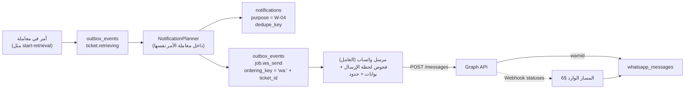
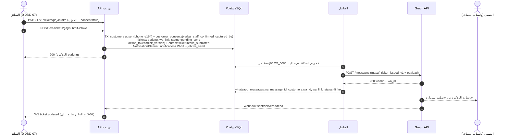
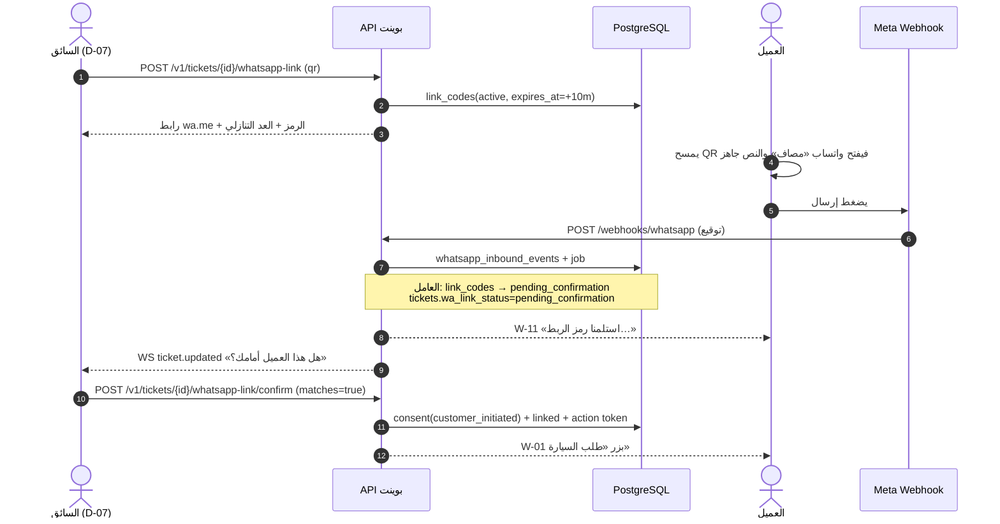

# 12 — مواصفات تكامل واتساب (قناة العميل: «بوينت» منذ الإصدار الثاني، «مصاف» في الإصدار الأول)

الإصدار 1.0 — 27 أكتوبر 2026 — الحالة: جاهزة للتنفيذ
يحلّ هذا الملف محلّ خانة «Prompt Library» في الحزمة القياسية لأن المعمارية تستبعد الذكاء الاصطناعي (DEC-02). العلامة الظاهرة للعميل هنا هي «مصاف» فقط؛ لا يظهر اسم «بوينت» في أي رسالة أو قالب أو ملف تعريفي يراه العميل (DEC-01).

> **الإصدار الثاني (V2-D01، V2-D02؛ DEC-460، DEC-470):** العلامة الظاهرة للعميل صارت علامة العميل المضبوطة `BRAND_CUSTOMER_NAME_AR` وقيمتها الافتراضية «بوينت»، ورقم واتساب واحد لبوينت لكل المشغلين («مصاف» مشغّل يستخدم المنصة). فالجملة السابقة (DEC-01) تبقى للتاريخ وأبطلها DEC-470، وحيث يذكر هذا الملف «مصاف» اسمًا للعرض أو للرقم أو لملف النشاط فاقرأه علامة العميل المضبوطة. نصوص القوالب والردود (§7.2، §8.2، §9) تكتب القيمة الافتراضية «بوينت»، والكود يحملها برمز `{brand}`. وأسماء القوالب `masaf_*_v1` تبقى معرّفات (canon §11). واسم الموقع: W-01 يحمله في `{{1}}`؛ وإضافته إلى W-02…W-08 أو سطر «تشغيل: {المشغل}» (V2-D01) يحتاج متغيرًا جديدًا ونسخًا `_v2` يعتمدها Meta، مؤجّل في DEC-470.

المراجع الملزمة: `00_Glossary_Canon.md` (الأسماء: §5، §7، §8، §11، §12) · `06_schema.sql` (الجداول والأعمدة) · `00_Source_Architecture_v1.2_AR.md` (§1، §4د–§4ز، §5، §7، §14، §16) · `DECISIONS.md` (DEC-01، DEC-10، DEC-13، DEC-15، DEC-16، DEC-23، DEC-41، DEC-42، DEC-46) · `14_Notification_Matrix_Templates.md` (النص النهائي لكل رسالة ومصفوفة القنوات).

---

## 0. الخلاصة التنفيذية

1. رقم واتساب إنتاج واحد باسم العرض «مصاف» (`whatsapp_channel` واحد فعّال) يخدم كل القاعات. كل عميل يستقبل محادثة خاصة 1:1 من هذا الرقم.
2. العميل يملك زرًا واحدًا فقط في المحادثة كلها: «طلب السيارة» داخل رسالة التذكرة W-01. قيمة الزر `payload` رمز إجراء معتم (`action token`) يربط الزر بالعميل والتذكرة؛ الموقع يُستنتج دائمًا من التذكرة وليس من آخر محادثة.
3. كل إشعار للعميل W-01…W-08 يُرسل قالبًا معتمدًا من فئة UTILITY بالعربية (DEC-10). الردود الحرة W-09…W-12 رسائل جلسة تُرسل فقط ردًا على رسالة واردة.
4. الإرسال يمر عبر Outbox: معاملة الأمر نفسها تكتب الحدث النطاقي وسجل `notifications` ومهمة `job.wa_send` (`NotificationPlanner`، DEC-41) ← العامل يرسل إلى Graph API ← سجل `whatsapp_messages` ← حالات Webhook. الترتيب لكل تذكرة مضمون بالخادم، والتكرار محمي بقيود قاعدة البيانات.
5. الوارد: التحقق من توقيع `X-Hub-Signature-256` على الجسم الخام ← حفظ الطلب الخام في `whatsapp_inbound_events` ← رد 200 سريع ← المعالجة في `job.wa_process_inbound`. لا يُعاد نجاح كاذب إن تعذر الحفظ.
6. رمز التسليم في W-05 لا يُخزن نصًا صريحًا؛ نسخته المشفرة تُمسح فور قبول المزود للرسالة أو انتهاء الرمز (DEC-15).
7. ثلاث حقائق حديثة تغيّر الإعداد والتكلفة ويجب الانتباه لها عند الإطلاق (§2): قوالب UTILITY داخل نافذة الخدمة صارت مدفوعة منذ 1 أكتوبر 2026، رسائل الخدمة مجانية حتى 1,000 شهريًا لكل رقم ثم مدفوعة، وحد المراسلة للحساب الجديد 250 عميلًا فريدًا خلال 24 ساعة حتى توثيق النشاط التجاري.

---

## 1. المبادئ الملزمة

| # | المبدأ | مصدره |
|---|---|---|
| P-01 | قاعدة البيانات المركزية مصدر الحقيقة؛ حالة الرسالة لا تغيّر حالة المركبة أبدًا. | المعمارية §1، §2 |
| P-02 | `phone_number_id` إنتاج واحد. لا رقم لكل قاعة أو سائق، ولا قوائم بث جماعية، ولا قروبات، ولا إرسال من أرقام السائقين، ولا تحويل تلقائي لأرقام السائقين عند تعطل الرقم المركزي. | المعمارية §1، §5 |
| P-03 | زر واحد «طلب السيارة» في W-01 فقط. لا نقطة استلام، لا مساعدة، لا حالة، لا إلغاء، لا تقييم كأزرار. | المعمارية §5، AC-18 |
| P-04 | الزر مربوط بالمرسل والتذكرة: رقم آخر يستخدم زرًا محوّلًا إليه لا يطلب مركبة ليست له. | AC-02 |
| P-05 | الضغط المكرر يعيد الحالة ولا ينشئ طلبًا جديدًا؛ الرسالة الواحدة المعادة لا تنتج إلا طلبًا واحدًا. | AC-01 |
| P-06 | لا تُرسل «جارٍ إحضار سيارتك» (W-04) قبل البدء الفعلي؛ الحجز التالي يرسل W-03 فقط. | المعمارية §5، AC-15 |
| P-07 | رسالة «تم تسجيل طلبك» (W-02) تصدر بعد حفظ الطلب فعليًا. | المعمارية §4هـ |
| P-08 | الإرسال للعميل يتطلب موافقة سارية (`customer_consents`) وعدم إيقاف الرسائل (`customers.wa_opted_out_at IS NULL`)؛ الاستثناء الوحيد W-12 تأكيد الإيقاف. | المعمارية §4د، سياسة Meta [R18] |
| P-09 | لا بيانات حساسة في السجلات: لا رمز إجراء خام، لا رمز تسليم، لا جوال كامل، لا جسم Webhook خام في سجلات التطبيق. | المعمارية §14 |
| P-10 | لا ذكاء اصطناعي ولا صندوق مساعدة؛ الرسالة الحرة تُقابل بتوجيه ثابت W-10. | المعمارية §5 |

---

## 2. حقائق المنصة المتحقق منها (تاريخ التحقق: 27 أكتوبر 2026)

كل حقيقة أدناه مأخوذة من مصدر رسمي لدى Meta ما لم يُذكر غير ذلك، والروابط في §16. ما وُسم «يُعاد التحقق عند التنفيذ» لم يُذكر صراحة في المصدر أو قابل للتغيير، ويجب التأكد منه من وثائق الإصدار المثبّت قبل البرمجة.

| # | الحقيقة | الأثر على التصميم | المصدر |
|---|---|---|---|
| F-01 | التسعير لكل رسالة منذ 1 يوليو 2025، والرسوم تُحتسب عند **التسليم** وليس الإرسال. رسائل العميل إلى النشاط مجانية. | تكلفة التذكرة = عدد قوالبها المسلّمة؛ تخطي الرسائل المتجاوزة (§5.5) يقلل التكلفة. | [R1] |
| F-02 | منذ 1 أكتوبر 2026 صارت قوالب UTILITY المرسلة ردًا على المستخدم داخل نافذة الخدمة **مدفوعة** (نوع التسعير تغيّر من `free_customer_service` إلى `regular`). | سبب DEC-10 لم يعد «المجانية داخل النافذة»؛ يبقى القرار لأجل الموثوقية والبساطة (يعمل داخل النافذة وخارجها). يُحدَّث نص DEC-10 في `DECISIONS.md`. | [R1]، [R3] |
| F-03 | رسائل الخدمة (غير القوالب) مجانية حتى 1,000 رسالة شهريًا لكل رقم أعمال، ثم مدفوعة. بدون وسيلة دفع في Billing Hub لا تُسلَّم رسائل الخدمة بعد استهلاك الحصة المجانية. | ردود W-09…W-12 رسائل خدمة: يجب وجود وسيلة دفع قبل الإطلاق، وتراقب الحصة الشهرية (§13). | [R1]، [R3] |
| F-04 | نافذة خدمة العميل 24 ساعة تبدأ وتتجدد مع كل رسالة أو مكالمة من المستخدم. خارجها لا يُرسل إلا قالب معتمد. | `customers.last_inbound_at` مرساة النافذة؛ ردود الجلسة تُرسل فقط داخلها. | [R9] |
| F-05 | ترتيب تسليم الرسائل **غير مضمون** أن يطابق ترتيب طلبات الـAPI؛ لفرض الترتيب يُنتظر Webhook `delivered` قبل إرسال التالية. | بوابة ترتيب لكل تذكرة (§5.6). | [R9] |
| F-06 | السعة الافتراضية 80 رسالة/ثانية لكل رقم، وترقية تلقائية إلى 1,000 بشروط؛ تجاوز السعة يعيد الخطأ `130429`، ومدة الترقية قد تعيد `131057`. | محدد سعة عام أقل من 80 (§5.8). | [R4] |
| F-07 | حد الزوج: رسالة واحدة كل 6 ثوانٍ لنفس المستخدم (≈0.17/ثانية)، مع دفعة حتى 45 رسالة خلال 6 ثوانٍ تُقتطع من الحصة المستقبلية؛ تجاوزه يعيد `131056`، والتوصية إعادة المحاولة بعد 4^X ثانية. | دلو رموز لكل مستلم (§5.7) وجدول إعادة محاولة 1، 4، 16، 64، 256 ثانية. | [R5] |
| F-08 | تحقق Webhook عبر `GET` بالمعاملات `hub.mode=subscribe` و`hub.verify_token` و`hub.challenge` والرد 200 بقيمة `hub.challenge`. حمولات `POST` موقعة في `X-Hub-Signature-256` بصيغة `sha256=<hash>` بخوارزمية HMAC-SHA256 وسرّ التطبيق. التسليم الفاشل يُعاد لمدة تصل إلى 7 أيام، والتكرار ممكن ويجب إزالته، والدفعة قد تصل إلى 1000 تحديث، ولا يوجد API لاسترجاع Webhooks التاريخية. | §6.1–§6.2؛ حفظ الخام قبل الرد؛ إزالة التكرار بـ`body_sha256` و`wa_message_id`. | [R6] |
| F-09 | توصي Meta بأن يعالج خادم Webhook الطلبات المتزامنة بزمن وسيط لا يتجاوز 250ms وأقل من 1% فوق ثانية واحدة. | معالج `POST` يحفظ ويرد فقط؛ المعالجة في العامل. | [R4] |
| F-10 | ضغط زر الرد السريع يصل كرسالة `type: "button"` تحمل `button.payload` و`button.text`، و`context.id` هو معرف الرسالة التي احتوت الزر. قيمة `payload` يحددها المطوّر عند إرسال القالب عبر مكون `button` بنوع فرعي `quick_reply` ومعامل `payload`. الحد الأقصى لطول `payload` غير مذكور — يُعاد التحقق عند التنفيذ (نلتزم بأقل من 128 حرفًا). | رمز الإجراء يوضع في `payload` (§5.11، §6.5). | [R7]، [R13] |
| F-11 | حالات الرسالة: `sent`، `delivered`، `read`، `failed` (و`played` للصوت). `read` تعني التسليم، وقد لا يصل `delivered` إذا قُرئت فورًا. كائن `pricing` يظهر في `sent` أو في `delivered/read` وليس كليهما، و`errors[]` عند الفشل. الحقل `biz_opaque_callback_data` يعود في Webhook الحالة إذا عُيّن عند الإرسال. | رتبة لا تنخفض (§6.8)؛ ربط الحالة بسجلنا عبر `biz_opaque_callback_data`. | [R8] |
| F-12 | حدود القوالب: النص ≤ 1024 حرفًا، التذييل ≤ 60، نص زر الرد السريع ≤ 25، حتى 10 أزرار رد سريع؛ أمثلة المتغيرات إلزامية عند الإنشاء؛ الأسماء بأحرف صغيرة وأرقام وشرطة سفلية. | كتالوج §8. | [R10]، [R12] |
| F-13 | تصنيف القوالب: Meta تعيد تصنيف القوالب المعتمدة دوريًا؛ من UTILITY إلى MARKETING بإشعار يوم عادة، وإلى AUTHENTICATION بإشعار ثم تصبح الحالة `REJECTED` في أول الشهر التالي. «فقط قوالب المصادقة تُستخدم لإرسال رمز لمرة واحدة للتحقق من الهوية». المحتوى المختلط أو الترويجي يُعامل تسويقًا. | خطر على W-05 (رمز تسليم)؛ صياغة غير ترويجية وخطة بديلة (§8.4). | [R11] |
| F-14 | أخطاء رئيسية: `131026` غير قابلة للتسليم (ليس على واتساب/لم يقبل الشروط/إصدار قديم)، `131047` مضى أكثر من 24 ساعة على آخر رد، `131049` حُجبت لحماية التفاعل (تسويق)، `131056` حد الزوج، `130429` السعة، `131000` خطأ غير معروف، `131016` الخدمة غير متاحة مؤقتًا، `131042` مشكلة وسيلة الدفع، `131048` تقييد بسبب البلاغات، `132000`/`132012` معاملات القالب، `132001` القالب غير موجود أو غير معتمد، `132015`/`132016` قالب موقوف/معطّل، `190`/`0` رمز الوصول منتهٍ، `368`/`131031` الحساب مقيد، `133010` الرقم غير مسجل. | جدول التصنيف §5.9. | [R14] |
| F-15 | ملف النشاط: «نبذة» ≤ 139 حرفًا، الوصف ≤ 512، العنوان ≤ 256، البريد ≤ 128، موقعان كحد أقصى كل منهما ≤ 256 ويبدأ بـ`https://`، والقطاع من قائمة تشمل `AUTO` و`EVENT_PLAN` و`OTHER`. | قائمة «مصاف» §10. | [R15] |
| F-16 | اسم العرض: يجب أن يتسق مع العلامة الخارجية للنشاط، بلا رموز تعبيرية أو علامات زائدة، بحد أدنى 3 أحرف، ويتطلب موقعًا موثقًا يظهر العلامة والكيان القانوني. نتيجة المراجعة تصل بـWebhook `phone_number_name_update`، والتغيير بعد الاعتماد محدود. قواعد التنسيق التفصيلية من مصدر ثانوي — يُعاد التحقق عند التنفيذ. | «مصاف» يحتاج موقعًا يحمل الاسم قبل طلب الاعتماد (§10). | [R16]، [R17] |
| F-17 | الموافقة: يجب أن يُذكر للعميل بوضوح أنه يوافق على استقبال رسائل من النشاط مع تسمية النشاط؛ من أمثلة الطرق المقبولة الموافقة الشخصية أو الورقية؛ احترام طلبات الإيقاف. | صيغة سؤال الموافقة في D-05 وتسجيلها (§7.1). | [R18] |
| F-18 | حد المراسلة: عدد المستخدمين الفريدين خارج نافذة الخدمة خلال 24 ساعة متحركة على مستوى محفظة الأعمال: 250 للمحفظة الجديدة، ثم 2,000 بعد توثيق النشاط أو مسار التوسع، ثم 10K و100K وغير محدود تلقائيًا. الحقل القديم `messaging_limit_tier` متقادم ويُقرأ الحد من `whatsapp_business_manager_messaging_limit`. | **مانع إطلاق**: قاعة واحدة قد تتجاوز 250 تذكرة في ليلة؛ التوثيق قبل التشغيل (§3.7). ربط QR يفتح نافذة الخدمة فلا يحتسب ضمن الحد. | [R19] |
| F-19 | رمز التحقق بخطوتين للرقم 6 أرقام، ويجري إيقافه تدريجيًا للأرقام المؤهلة على Cloud API. | يُحفظ في مدير الأسرار إن طُلب. | [R20] |
| F-20 | أحدث إصدار من Graph API هو v26.0 (صدر 29 يوليو 2026)، وv25.0 ينتهي 29 يوليو 2028. | يُثبّت الإصدار وقت البناء في `whatsapp_channel.api_version` ولا يُكتب في الكود. | [R21] |
| F-21 | أسماء المستخدمين والمعرّف المرتبط بالنشاط (BSUID): يظهر في `contacts[].user_id` و`messages[].from_user_id`، وقد يُحذف `from` و`wa_id` لمستخدم اعتمد اسم مستخدم، إلا إذا راسلناه أو راسلنا من رقمه خلال آخر 30 يومًا. الإرسال إلى BSUID عبر الحقل `recipient` مدعوم منذ يوليو 2026. | ربط QR قد يصل بدون رقم جوال؛ يلزم عمود `customers.wa_user_id` وجعل `phone_e164` اختياريًا (§17). | [R26] |
| F-22 | رابط المحادثة المباشرة `https://wa.me/<الرقم>?text=<نص مرمّز>` بالرقم الدولي أرقامًا فقط؛ الرابط يفتح المحادثة والنص في خانة الكتابة ولا يرسل تلقائيًا. | مسح QR وحده ليس إرسالًا (§7.2). | [R22] (مصدر ثانوي — يُعاد التحقق) |

---

## 3. القناة والبيئات والإعداد

### 3.1 الرقم الواحد

- صف واحد فعّال في `whatsapp_channel` لكل بيئة (`uq_whatsapp_channel_active`). الحقول: `display_name = 'مصاف'`، `business_account_id`، `phone_number_id`، `phone_display`، مراجع الأسرار `access_token_secret_ref` و`app_secret_ref` و`verify_token_secret_ref`، `api_version`، `mode`، `health_status`، `quality_rating`، `messaging_limit_tier` (تُقرأ من الحقل الحديث F-18). يكتب `quality_rating` و`messaging_limit_tier` فحصُ رقم المرسل (§5.14) ومزامنةُ القوالب (`POST /v1/admin/whatsapp/templates/sync`، بأفضل جهد في مرحلتها الشبكية) إضافة إلى Webhook `phone_number_quality_update`، ويقارن تنبيه حد المراسلة (§13) بالمستوى المخزن، وبلا مستوى مخزن يُفترض حد البداية 250 (`limit_source: assumed`)؛ فتُشغَّل المزامنة بعد أن ترفع Meta الحد (القرار DEC-414).
- لا يوجد في أي جدول أو إعداد رقم واتساب لقاعة أو سائق. محاولة إنشاء قناة ثانية فعّالة يرفضها القيد.

### 3.2 البيئات

| البيئة | `whatsapp_channel.mode` | الرقم | ملاحظة |
|---|---|---|---|
| تطوير محلي | `simulator` | وهمي في `tools/wa-simulator` | لا اتصال بـMeta إطلاقًا |
| اختبار/Staging | `simulator` أو `live` | رقم اختبار من Meta أو رقم غير إنتاجي في محفظة منفصلة | يراسل أرقام فريق الاختبار المسجلة فقط؛ لا يراسل عملاء حقيقيين |
| إنتاج | `live` | رقم «مصاف» الوحيد | الخادم يرفض الإقلاع إذا كانت بيئة الإنتاج على `simulator` أو إذا وُجد أكثر من صف فعّال |

### 3.3 متغيرات البيئة

| المتغير | الغرض |
|---|---|
| `WA_MODE` | `live` أو `simulator` (يجب أن يطابق `whatsapp_channel.mode`) |
| `WA_GRAPH_BASE_URL` | `https://graph.facebook.com` في الإنتاج، وعنوان المحاكي محليًا |
| `WA_API_VERSION` | الإصدار المثبت مثل `v26.0` (F-20)، ويُنسخ إلى `whatsapp_channel.api_version` |
| `WA_PHONE_NUMBER_ID` · `WA_BUSINESS_ACCOUNT_ID` | معرفات القناة |
| `WA_ACCESS_TOKEN_REF` · `WA_APP_SECRET_REF` · `WA_APP_SECRET_PREVIOUS_REF` · `WA_VERIFY_TOKEN_REF` | مراجع في مدير الأسرار؛ القيم لا تُخزن في قاعدة البيانات ولا في الكود ولا في المتصفح |
| `WA_DISPLAY_PHONE_E164` | رقم «مصاف» بصيغة E.164؛ تُحذف `+` منه لبناء روابط `wa.me` |
| `CODE_PEPPER` · `DATA_ENCRYPTION_KEY` | هاش رمز التسليم وتشفير نسخته المؤقتة (DEC-15) |

رمز الإجراء عشوائي 128 بت، فيكفي تخزين `sha256(token)` دون سرّ إضافي.

`WA_APP_SECRET_PREVIOUS_REF` يُستخدم أثناء تدوير سرّ التطبيق فقط: يُقبل التوقيع بأي من السرّين لمدة 24 ساعة ثم يُحذف المرجع القديم.

### 3.4 رمز الوصول

رمز مستخدم نظام دائم (System User) بصلاحيتي `whatsapp_business_messaging` و`whatsapp_business_management`، محفوظ في مدير الأسرار، ويُقرأ عند الإقلاع وعند التدوير. انتهاء الرمز (`190`) يحول القناة إلى `down` فورًا (§5.14).

### 3.5 تثبيت إصدار الـAPI

كل استدعاء يبني العنوان `{WA_GRAPH_BASE_URL}/{api_version}/...` من `whatsapp_channel.api_version`. ترقية الإصدار تغيير إعداد مع اختبار انحدار على المحاكي وعلى رقم الاختبار، ولا تُترك الطلبات بلا إصدار.

### 3.6 اشتراكات Webhook

يُشترك تطبيق Meta في الحقل `messages` (الرسائل الواردة والحالات) وهو الإلزامي. ويُستحسن الاشتراك أيضًا في حقول تحديث القوالب وجودتها واسم العرض وجودة الرقم (`message_template_status_update`، `message_template_quality_update`، `template_category_update`، `phone_number_name_update`، `phone_number_quality_update`، `account_update`) لتحديث `whatsapp_templates` و`whatsapp_channel.health_status` آليًا. أسماء الحقول الاختيارية يُعاد التحقق منها عند التنفيذ.

### 3.7 متطلبات الإطلاق الخارجية (قائمة تحقق)

| # | المتطلب | لماذا |
|---|---|---|
| L-01 | توثيق النشاط التجاري في Meta Business Manager | رفع حد المراسلة من 250 إلى 2,000 مستخدم فريد/24 ساعة (F-18) — **مانع إطلاق** |
| L-02 | وسيلة دفع في Billing Hub | القوالب مدفوعة دائمًا، ورسائل الخدمة بعد 1,000 شهريًا لا تُسلَّم بدونها (F-02، F-03) |
| L-03 | موقع ويب موثق يحمل علامة «مصاف» والكيان القانوني | شرط اعتماد اسم العرض (F-16) |
| L-04 | تسجيل الرقم وضبط ملف النشاط (§10) | ظهور «مصاف» والصورة للعميل |
| L-05 | اعتماد القوالب W-01…W-08 بحالة `approved` في `whatsapp_templates` | لا إرسال لقالب غير معتمد (`WA_TEMPLATE_NOT_APPROVED`) |
| L-06 | ضبط Webhook والتحقق منه من بيئة الإنتاج عبر HTTPS | استقبال الأزرار والحالات |
| L-07 | تجربة كاملة على رقم الاختبار والمحاكي لكل حالات §15 | معايير القبول |

### 3.8 نموذج التكلفة (بالرسائل لا بالمبالغ)

دورة تذكرة عادية مربوطة بواتساب: W-01 + W-02 + W-04 + W-05 + W-06 = 5 قوالب UTILITY مسلّمة، ويضاف W-03 عند حجز سائق مشغول، وW-07/W-08 عند الإلغاء/الإعادة. ردود الجلسة W-09…W-12 تحتسب من حصة الخدمة الشهرية (F-03). الأسعار تُقرأ من بطاقة أسعار Meta للسوق السعودي وقت التشغيل ولا تُكتب في الكود. التخطي الآمن للرسائل المتجاوزة (§5.5) يقلل الرسائل المدفوعة دون إسقاط أي رسالة حرجة.

---

## 4. خريطة البيانات

| الجدول | الاستخدام في هذا التكامل |
|---|---|
| `customers` | `phone_e164`، `wa_id` (من رد الإرسال أو Webhook)، `last_inbound_at` (مرساة نافذة الخدمة)، `wa_opted_out_at`، `wa_user_id` (BSUID، DEC-35) |
| `customer_consents` | `method = 'verbal_staff_confirmed'` (ربط مباشر، `captured_by` السائق) أو `'customer_initiated'` (ربط QR، `evidence_message_id` الرسالة الواردة)؛ الإبطال `revoked_at` و`revoke_source = 'customer_opt_out'` |
| `tickets` | `channel`، `customer_id`، `wa_link_status`، `link_version`، `display_number`، `venue_id`، `event_id` |
| `action_tokens` | رمز زر W-01: `token_hash = sha256(token)`، `link_version`، `expires_at`، `revoked_at`، `last_used_at`، `use_count` |
| `link_codes` | رمز ربط QR وحالاته `active` → `pending_confirmation` → `consumed`/`revoked`/`expired` |
| `claim_codes` | رمز التسليم: `code_hash`، `code_ciphertext` (مؤقت)، `sent_message_id`، `resend_no` |
| `notifications` | إشعار مقصود واحد لكل (غرض × مستلم): `channel = 'whatsapp'`، `purpose = 'W-xx'`، `dedupe_key`، `status`، `skipped_reason`، `attempts`، `next_attempt_at` |
| `notification_attempts` | كل محاولة إرسال ونتيجتها وخطأ المزود |
| `whatsapp_messages` | الرسالة لدى المزود: `wa_message_id`، `kind`، `template_name`، `purpose`، `body_redacted`، `status` و`status_rank`، أخطاء التسعير، `ordering_key = ticket_id` |
| `whatsapp_inbound_events` | جسم Webhook الخام بعد التحقق، `body_sha256` فريد |
| `whatsapp_templates` | تعريف القوالب وحالة اعتمادها ومزامنتها |
| `outbox_events` | `job.wa_send` (`ordering_key = 'wa:<ticket_id>'`) و`job.wa_process_inbound` و`job.link_code_expire` و`job.claim_code_expire` والأحداث النطاقية `wa.*` (بلا `ordering_key`) |
| `alerts` | `wa_send_failed`، `wa_channel_down`، `wa_webhook_silent` (الشرط والنص في الملف 14 §8) |

قيم `purpose` في `notifications` و`whatsapp_messages` هي معرفات القاموس `W-01` … `W-12` حرفيًا.

---

## 5. مسار الإرسال (Outbound)

### 5.1 نظرة عامة



المخطِّط `NotificationPlanner` (DEC-41) دالة نقية بلا شبكة تُستدعى **داخل معاملة الأمر نفسها** (ولردود الجلسة: معاملة معالجة الرسالة الواردة في `job.wa_process_inbound`): يحوّل أحداث النطاق الصادرة في المعاملة إلى صف `notifications` لكل رسالة مستحقة حسب الجدول §5.2 (المطابق لمصفوفة الملف 14 §3.1)، مع مهمة `job.wa_send` بـ`ordering_key = 'wa:<ticket_id>'` في المعاملة نفسها؛ فلا يُلتزم تغيير دون إشعاره ولا إشعار دون تغييره. أحداث النطاق في `outbox_events` بلا `ordering_key` ولا يستهلكها مسار الإرسال. `dedupe_key` الفريد يمنع إنشاء الإشعار نفسه مرتين. فحوص لحظة الإرسال (التجاوز §5.5، الإيقاف والموافقة §5.4، `link_version`، تعطل القناة §5.14) يجريها العامل في `job.wa_send` (§5.3).

### 5.2 جدول المحفزات

| المحفز (حدث نطاقي) | الغرض | الشرط | `dedupe_key` |
|---|---|---|---|
| `ticket.intake_submitted` | W-01 | `channel = 'whatsapp'` وموافقة سارية و`wa_link_status = 'pending_send'` | `wa:W-01:{ticket_id}:lv{link_version}` |
| `ticket.wa_link_changed` إلى `linked` عبر QR | W-01 | تأكيد السائق للمطابقة؛ إن سبق إنشاء إشعار W-01 للتذكرة (إعادة ربط ولو للعميل نفسه) يُرفع `link_version` أولًا | `wa:W-01:{ticket_id}:lv{link_version}` |
| `ticket.wa_link_changed` إلى `pending_send` بإعادة إرسال/ربط مباشر يدوي (`POST /v1/tickets/{ticketId}/whatsapp-link` بطريقة `direct`) | W-01 | موافقة سارية؛ الأمر يرفع `link_version` قبل التخطيط فيكون المفتاح جديدًا، وتصبح أزرار W-01 السابقة غير نشطة (W-09) | `wa:W-01:{ticket_id}:lv{link_version}` |
| `ticket.customer_phone_changed` | W-01 للرقم الجديد | موافقة جديدة للرقم الجديد | `wa:W-01:{ticket_id}:lv{link_version}` |
| `ticket.retrieval_requested_early` | W-02 | التذكرة مربوطة | `wa:W-02:early:{ticket_id}:{pending_retrieval_at_epoch}` |
| `ticket.retrieval_requested` | W-02 | التذكرة مربوطة **و** `retrieval_cycles.requested_early = false` (الطلب المبكر أُبلغ سابقًا، DEC-13) | `wa:W-02:{cycle_id}` |
| `ticket.assigned_waiting` | W-03 | التذكرة مربوطة | `wa:W-03:{cycle_id}` |
| `ticket.retrieving` | W-04 | التذكرة مربوطة | `wa:W-04:{cycle_id}` |
| `handover.code_issued` | W-05 | التذكرة مربوطة | `wa:W-05:{claim_code_id}` |
| `ticket.delivered` | W-06 | التذكرة مربوطة (الحدث لا يصدر عن المطابقة اليدوية) | `wa:W-06:{ticket_id}:{cycle_id}` |
| `ticket.retrieval_canceled` | W-07 | التذكرة مربوطة وأُبلغ العميل بطلب الدورة (أُنشئ له إشعار W-02 للدورة أو لطلبها المبكر)؛ قبل بدء الحركة وبعده (DEC-30) | `wa:W-07:{cycle_id}` |
| `ticket.reparking` بـ`cause = customer_absent` فقط | W-08 | التذكرة مربوطة؛ الدورة أُغلقت `reparked` بأمر `POST /v1/tickets/{ticketId}/repark` (DEC-42). `cause = supervisor_cancel` لا يولد W-08 (W-07 وحدها عبر `ticket.retrieval_canceled`)، وإتمام إعادة الصف لا يرسل شيئًا | `wa:W-08:{cycle_id}` |
| `ticket.manually_reconciled` | — (لا رسالة) | المطابقة اليدوية لا تصدر `ticket.parked` أو `ticket.delivered` أو `ticket.voided`، فلا W-06 ولا غيرها (لا تُرسل حالات قديمة) | — |
| `ticket.inspection_completed` | — (لا رسالة) | — | — |
| `wa.button_pressed` بنتيجة «طلب قائم/تذكرة مغلقة/زر غير نشط» (رمز مبطل أو منتهٍ، `link_version` قديم، تذكرة ملغاة) | W-09 | خنق: رد واحد كل 20 ثانية لكل تذكرة | `wa:W-09:{inbound_message_id}` |
| `wa.inbound_received` (نص حر أو نوع آخر)، أو `wa.button_pressed` برمز غير معروف أو من مرسل مختلف فقط | W-10 | خنق: رد واحد كل 10 دقائق لكل مرسل | `wa:W-10:{inbound_message_id}` |
| `wa.inbound_received` (رمز ربط) | W-11 | — | `wa:W-11:{inbound_message_id}` |
| `wa.customer_opted_out` | W-12 | يُرسل حتى مع الإيقاف | `wa:W-12:{customer_id}:{opted_out_at_epoch}` |

«مربوطة» = `tickets.wa_link_status = 'linked'` و`customers.wa_opted_out_at IS NULL` وموافقة غير مبطلة. التذاكر الورقية `channel = 'paper'` لا تولد أي إشعار واتساب.

قواعد التخطيط (DEC-143): رسائل التذكرة W-02…W-08 تُخطَّط لتذاكر `pending_send` و`linked` و`opted_out` (فالأخيرة تنتهي `skipped`)، والمرسل يشترط `linked` لحظة الإرسال، وبوابة الترتيب (§5.6) تضمن معالجة W-01 أولًا. W-07 يُخطَّط فقط إن وُجد إشعار W-02 للدورة أو لطلبها المبكر (مفتاحه `wa:W-02:early:{ticket_id}:{pending_retrieval_at_epoch}`، وهو وقت طلب الدورة الأصلي، DEC-13). خنق W-09 لكل تذكرة وW-10 لكل مرسل يُحسب من الرسائل الواردة عبر فهارسها ومن مفاتيح التكرار، لا بمسح `notifications`. وردود الفعل (`reaction`) لا تلقى W-10 (§6.7).

### 5.3 خوارزمية `job.wa_send`

```ts
async function waSend(job: { notificationId: string }) {
  const n = await notifications.lock(job.notificationId);            // SELECT ... FOR NO KEY UPDATE (canon §14ب L9)
  if (n.status !== 'pending') return;                                 // أُنجز أو تُخطّي سابقًا

  const gate = await preSendGates(n);                                 // §5.4 و§5.5 — قبل فحص القناة (DEC-135)
  if (gate.skip) return markSkipped(n, gate.reason);                  // superseded | opted_out | no_consent | stale

  const ch = await channel.active();
  if (ch.health_status === 'down')                                    // §5.14
    return isSessionReply(n) ? markSkipped(n, 'channel_down')         // W-09…W-12 تُتخطى فورًا (DEC-135)
                             : defer(job, 30);                        // لا تُستهلك محاولة (DEC-134)
  if (gate.waitSeconds) return defer(job, gate.waitSeconds);          // بوابة الترتيب أو حد الزوج

  if (!(await throughput.tryTake(1))) return defer(job, 1);           // §5.8

  const msg = await whatsappMessages.insertQueued(n);                 // kind, template_name, purpose, ordering_key
  const attempt = await attempts.start(n);                            // يُسجل قبل الاستدعاء (نافذة الانهيار §5.13)
  const body = await buildRequest(n, msg);                            // §5.11 — يفك تشفير الرمز لـW-05 في الذاكرة فقط

  const res = await graph.postMessage(body, { timeoutMs: 10_000 });
  await recordOutcome(n, msg, attempt, res);                          // §5.12 و§5.9
}
```

قواعد: كل تعديل لحالة `notifications` و`whatsapp_messages` و`notification_attempts` يُكتب في معاملة قصيرة بعد الاستدعاء، وليس داخل معاملة مفتوحة أثناء الاتصال الشبكي.

`defer` (DEC-134): الانتظار (بوابة الترتيب، دلو المستلم، السقف العام، تعطل القناة، نافذة الانهيار) يعيد محاولة صف `outbox_events` فلا يستهلكها؛ محاولات المزود تُعد في `notifications.attempts` مقابل `wa.send_max_attempts`، وأخطاء فئة القناة تُسجل في `notification_attempts` ولا تُعد (يبقى الإشعار `pending`)؛ و`max_attempts` لصف `job.wa_send` = 50 لإيقاف مهمة تتعطل باستمرار فقط.

### 5.4 بوابات ما قبل الإرسال

| البوابة | القاعدة | النتيجة عند الفشل |
|---|---|---|
| القالب | `whatsapp_templates.status = 'approved'` للاسم واللغة `ar` | فشل دائم بالرمز الداخلي `WA_TEMPLATE_NOT_APPROVED` + تنبيه `wa_send_failed` (السبب `template`) — انظر البديل §8.4 لـW-05 |
| الإيقاف | `customers.wa_opted_out_at IS NULL` (عدا W-12) | `skipped`، `skipped_reason = 'opted_out'` |
| الموافقة | موافقة `customer_consents` غير مبطلة للعميل (عدا W-09…W-12 لأنها رد على رسالته) | `skipped`، `skipped_reason = 'no_consent'` |
| الصحة | `whatsapp_channel.health_status <> 'down'` | تأجيل دون استهلاك محاولة؛ ولردود الجلسة W-09…W-12 تخطٍ فوري `skipped_reason = 'channel_down'` (DEC-135) |
| النافذة | لردود الجلسة فقط: `now() - customers.last_inbound_at < 24h` | `skipped`، `skipped_reason = 'stale'` |
| الحداثة | جدول §5.5 | `skipped`، `skipped_reason = 'superseded'` |
| الترتيب | §5.6 | تأجيل قصير |
| الزوج | §5.7 | تأجيل حتى يتوفر رمز |

### 5.5 قواعد التخطي (إعادة فحص الحالة قبل الإرسال)

يُقرأ وضع التذكرة الحالي لحظة الإرسال، وتُرسل الرسالة فقط إن كانت ما تزال صحيحة. هذا يطبق متطلب المعمارية §14: «إعادة إرسال الحالات الحالية فقط بعد عودة الخدمة».

| الغرض | يُرسل إذا | وإلا |
|---|---|---|
| W-01 | التذكرة مفتوحة و`link_version` في الإشعار = `tickets.link_version` | تخطٍ `stale` |
| W-02 | دورة الاسترجاع (أو الطلب المبكر) ما زالت مفتوحة والتذكرة ليست `retrieving` أو `ready` أو `delivered` | تخطٍ `superseded` (W-04/W-05 أحدث) |
| W-03 | مهمة الدورة ما زالت `assigned_waiting` | تخطٍ `superseded` |
| W-04 | التذكرة `retrieving` | تخطٍ `superseded` (W-05 أحدث) أو `stale` |
| **W-05** | التذكرة `ready` ورمز `claim_codes` الخاص بالإشعار حيّ (غير مستهلك ولا مبطل ولا منتهٍ) | **لا تخطي أبدًا ما دامت التذكرة `ready` والرمز حيًا.** إن أُبطل الرمز بإعادة الإرسال يُتخطى هذا الإشعار ويُرسل إشعار الرمز الجديد |
| W-06 | التذكرة `delivered` | — (لا تُتخطى) |
| W-07 | الدورة أُغلقت بـ`outcome = 'canceled'` ولا توجد دورة أحدث للتذكرة | تخطٍ `superseded` |
| W-08 | التذكرة `reparking` أو `parked` ولا توجد دورة أحدث | تخطٍ `superseded` |
| W-09…W-12 | النافذة مفتوحة | تخطٍ `stale` |

### 5.6 بوابة الترتيب لكل تذكرة

لأن Meta لا تضمن ترتيب التسليم (F-05): مهام `job.wa_send` للتذكرة الواحدة تحمل `ordering_key = 'wa:<ticket_id>'` (DEC-41؛ ورسائلها في `whatsapp_messages.ordering_key = ticket_id`)، ولا تُرسل رسالة قبل أن تحقق السابقة لنفس المفتاح أحد الشرطين:
1. وصلت حالتها `delivered` أو `read` أو `failed`، أو تُخطيت؛ أو
2. مضت 8 ثوانٍ على قبول المزود لها (الإعداد `wa.ordering_gate_max_wait_s = 8`).

البوابة تؤخر ولا تُسقط. عدد الرسائل لكل تذكرة صغير وأغلبها متباعد زمنيًا بأفعال ميدانية، فالأثر على الزمن ضئيل؛ والانتظار الأقصى يمنع حجز رسائل التذكرة إذا كان جوال العميل غير متصل.

### 5.7 حد الزوج لكل مستلم

دلو رموز لكل `wa_id` (أو BSUID): سعة 6 رسائل وإعادة تعبئة رسالة كل 6 ثوانٍ (الإعدادان `wa.pair_bucket_capacity = 6`، `wa.pair_refill_s = 6`) بما يتوافق مع F-07. العميل صاحب عدة مركبات يشترك دلوه بين تذاكره. الخطأ `131056` يعيد المحاولة بعد 4^X ثانية (1، 4، 16، 64، 256) مع تطبيق قواعد التخطي عند كل محاولة.

### 5.8 السعة العامة وعدالة القاعات

- محدد عام 60 رسالة/ثانية لكل الرقم (الإعداد `wa.global_mps = 60`)، أقل من الافتراضي 80 (F-06) لترك هامش لردود الجلسة والإعادات.
- العامل يلتقط مهام `job.wa_send` المستحقة بالتناوب بين القاعات (Round-robin على `venue_id`): يجلب أقدم مهمة مستحقة لكل قاعة ثم يكرر، بحد أعلى لكل قاعة في الدورة الواحدة، فلا يستحوذ ضغط قاعة واحدة على الطابور (المعمارية §5).
- السقف العام وعدالة القاعات في ذاكرة العامل (نافذة منزلقة ثانية واحدة لكل قناة)، لأن المخطط لا يملك عمودًا أو جدولًا مشتركًا لأوقات الإرسال دون مسح كامل؛ نسخة عامل واحدة في الإطلاق التجريبي (04 §10)، ومع نسختين يُقسم `wa.global_mps` عليهما حتى يضاف مخزن مشترك. أما دلو المستلم (§5.7) فيُحسب من القاعدة (`ix_whatsapp_messages_customer`) فيصح عبر العمليات (DEC-136).

```sql
-- اختيار دفعة عادلة: أقدم مهمة مستحقة لكل قاعة (المعالجة بـ SKIP LOCKED في العامل)
SELECT DISTINCT ON (venue_id) id
FROM outbox_events
WHERE type = 'job.wa_send' AND status = 'pending' AND available_at <= now()
ORDER BY venue_id, available_at, created_at
LIMIT 50;
```

### 5.9 إعادة المحاولة وتصنيف الأخطاء

جدول المحاولات للأخطاء المؤقتة: بعد 1، 4، 16، 64، 256 ثانية مع تذبذب ±20%، بحد 5 محاولات (الإعداد `wa.send_max_attempts = 5`). كل محاولة تعيد تطبيق §5.4–§5.5.

| رمز Meta / الحالة | الفئة | الإجراء | الرمز الداخلي |
|---|---|---|---|
| `130429` | مؤقت (السعة) | إعادة محاولة؛ خفض معدل المحدد العام 20% لمدة دقيقة | — |
| `131056` | مؤقت (الزوج) | إعادة محاولة 4^X | — |
| `80007`، `4` | مؤقت (حد الحساب/التطبيق) | إعادة محاولة؛ إن تكرر 5 دقائق ← `degraded` | — |
| `131000`، `131016`، `131057`، HTTP 5xx، انتهاء المهلة | مؤقت | إعادة محاولة؛ تتابع الإخفاقات ← قواعد الصحة §5.14 | — |
| `131026` | دائم للمستلم | `failed`؛ لـW-01 تصبح `tickets.wa_link_status = 'failed'` ويُبلّغ السائق المنشئ (D-07) | `WA_SEND_FAILED` |
| `131047` | دائم (خارج النافذة) | لردود الجلسة: تخطٍ `stale` بلا تنبيه. للقوالب لا يُتوقع؛ يسجل خللًا | — |
| `131049`، `131050` | دائم | `failed` وتسجيل؛ لا يُتوقع لقوالب UTILITY | `WA_SEND_FAILED` |
| `131051`، `100`، `131008`، `131009`، `132000`، `132012`، `135000` | دائم (خلل برمجي/معاملات) | `failed` + تنبيه للإدارة + تسجيل خطأ | `WA_SEND_FAILED` |
| `132001`، `132015`، `132016`، `132007` | دائم (القالب) | `failed`؛ تحديث `whatsapp_templates.status`؛ القناة `degraded` | `WA_TEMPLATE_NOT_APPROVED` |
| `190`، `0`، `10`، `3`، `131005` | القناة (الصلاحية/الرمز) | إيقاف الإرسال؛ القناة `down`؛ الإشعار يبقى `pending` | `WA_CHANNEL_UNAVAILABLE` |
| `368`، `131031`، `131042`، `133010`، `131045` | القناة (الحساب/الدفع/التسجيل) | القناة `down` + تنبيه حرج | `WA_CHANNEL_UNAVAILABLE` |
| `131048` | القناة (الجودة) | القناة `degraded` + تنبيه | — |
| `131021` | دائم (الرقم نفسه) | `failed` | `WA_SEND_FAILED` |

استثناء (DEC-373): إذا استُنفدت محاولات قالب مؤقتة وكل محاولات القناة تفشل منذ محاولته الأولى (لا نجاح منذها، وإشعار آخر فشل بعد آخر نجاح؛ و`131056` لا يُحسب) فلا تُعد المحاولة ويُؤجل 30 ثانية كالقناة المتعطلة حتى تعمل القناة أو يتخطاه فحص الحالة (§5.5)، وبحد 15 دقيقة من محاولته الأولى ثم `failed`؛ الرسالة التي تفشل وحدها تبقى بحد 5 محاولات، وردود الجلسة لا يشملها الاستثناء.

الإخفاق الدائم لأي إشعار عميل يرفع تنبيه `wa_send_failed` للمشرف (`dedupe_key = 'wa_send_failed:{ticket_id}:{purpose}'`) ويظهر في قائمة «الرسائل الفاشلة» في S-02 وسجل التذكرة S-03. لا حلقة إعادة إرسال بلا نهاية: بعد استنفاد المحاولات يصبح الإشعار `failed` (والاستثناء أعلاه محدود بـ15 دقيقة).

### 5.10 معالجة سرّ رمز التسليم (W-05)

1. أمر «جاهزة» ينشئ صف `claim_codes` بـ`code_hash = HMAC-SHA256(CODE_PEPPER, cycle_id || ':' || code)` و`code_ciphertext = AES-GCM(DATA_ENCRYPTION_KEY, code)`، ويكتب الحدث `handover.code_issued` وحمولته `claim_code_id` فقط.
2. `NotificationPlanner` ينشئ إشعار W-05 في معاملة أمر «جاهزة» نفسها. المرسل يقرأ `claim_codes.code_ciphertext` ويفك التشفير في الذاكرة لحظة بناء الطلب فقط. مصدر الرمز الوحيد هو `claim_codes.code_ciphertext`؛ لا يحمل `outbox_events` أي نسخة منه (لا عمود أسرار فيه) كي لا تتعدد النسخ (DEC-38).
3. بعد قبول المزود (رد 200 بمعرف `wamid`): في معاملة واحدة `claim_codes.code_ciphertext = NULL` و`claim_codes.sent_message_id = whatsapp_messages.id`.
4. عند الإخفاق الدائم أو انتهاء صلاحية الرمز (`job.claim_code_expire`) أو إبطاله: يُمسح `code_ciphertext` أيضًا.
5. `whatsapp_messages.body_redacted` يخزن النص مع الرمز مقنّعًا `••••••`، و`payload_redacted` يستبدل قيمة المتغير `{{2}}` بالقناع. لا يظهر الرمز في أي سجل تطبيق أو تتبع أو رسالة خطأ.
6. إعادة الإرسال من السائق/المشرف (`POST /v1/tickets/{ticketId}/handover-code/resend`) تبطل الرمز الحالي (`revoke_reason = 'resend'`) وتصدر رمزًا جديدًا وإشعار W-05 جديدًا بمفتاح تكرار جديد، ضمن حد `handover.max_resends`.

### 5.11 أمثلة طلبات Graph API

العنوان: `POST {WA_GRAPH_BASE_URL}/{api_version}/{phone_number_id}/messages` مع `Authorization: Bearer <token>` و`Content-Type: application/json`.

**W-01 — قالب التذكرة بزر «طلب السيارة» وقيمة `payload` = رمز الإجراء:**

```json
{
  "messaging_product": "whatsapp",
  "recipient_type": "individual",
  "to": "+966551234567",
  "type": "template",
  "template": {
    "name": "masaf_ticket_issued_v1",
    "language": { "code": "ar" },
    "components": [
      {
        "type": "body",
        "parameters": [
          { "type": "text", "text": "قاعة ريماس" },
          { "type": "text", "text": "125" },
          { "type": "text", "text": "تويوتا كامري بيضاء — لوحة 4821" }
        ]
      },
      {
        "type": "button",
        "sub_type": "quick_reply",
        "index": "0",
        "parameters": [ { "type": "payload", "payload": "rq1.q8Zt3mVx0bW7nK2pLs9dEw" } ]
      }
    ]
  },
  "biz_opaque_callback_data": "wam:7a1d2c3e-0f4b-4d6a-9c11-5e2f8b7a9d01"
}
```

- الرمز `rq1.` + 16 بايت عشوائية بترميز base64url (26 حرفًا). يُخزن فقط `sha256(token)` في `action_tokens.token_hash`؛ القيمة الخام تعيش في ذاكرة المرسل لحظة البناء ثم تُنسى. لذلك يصدر رمز جديد في معاملة الحجز لكل محاولة إرسال W-01 (لا تُعاد قيمة سابقة)، والرموز السابقة للتذكرة نفسها تبقى صالحة بنفس `link_version` حتى انتهائها (DEC-137).
- `biz_opaque_callback_data` يحمل معرف صف `whatsapp_messages` لربط Webhook الحالة حتى لو وصل قبل حفظ `wamid` (F-11). موضع الحقل وطوله الأقصى يُعاد التحقق منهما عند التنفيذ.
- إن كان العميل معروفًا بـBSUID فقط (ربط QR دون رقم ظاهر) يُستبدل `"to"` بالحقل `"recipient": "<BSUID>"` (F-21).
- `vehicle summary` يُبنى: الشركة + الطراز إن وجد + اللون + « — لوحة » + أرقام اللوحة إن وجدت؛ بحد 60 حرفًا، بلا أحرف اللوحة ولا أي بيانات أخرى. الشركة واللون مخزّنان بمفاتيح 02 §8.4 فيكتبهما الخادم بنصهما العربي هناك (`toyota` ← «تويوتا»، `white` ← «أبيض»)، والنص المكتوب في «أخرى» كما هو (DEC-350)؛ فلا يصل مفتاح إنجليزي إلى العميل.

**W-05 — الجاهزية برمز التسليم:**

```json
{
  "messaging_product": "whatsapp",
  "recipient_type": "individual",
  "to": "+966551234567",
  "type": "template",
  "template": {
    "name": "masaf_vehicle_ready_v1",
    "language": { "code": "ar" },
    "components": [
      {
        "type": "body",
        "parameters": [
          { "type": "text", "text": "125" },
          { "type": "text", "text": "482731" }
        ]
      }
    ]
  },
  "biz_opaque_callback_data": "wam:b3c8e0d4-2a6f-4c3b-8e7d-1f0a9c6b5e44"
}
```

**W-09 — رد جلسة نصي:**

```json
{
  "messaging_product": "whatsapp",
  "recipient_type": "individual",
  "to": "+966551234567",
  "type": "text",
  "context": { "message_id": "wamid.HBgLOTY2NTUxMjM0NTY3FQIAEhgg..." },
  "text": { "preview_url": false, "body": "طلبك لسيارتك رقم 125 مسجل وننتظر أول سائق متاح، ولا حاجة لإعادة الضغط." }
}
```

`context.message_id` (اختياري) يجعل الرد مقتبسًا من ضغطة العميل. `preview_url` دائمًا `false`.

### 5.12 معالجة الرد

- **200**: الرد يحمل `contacts[0].wa_id` و`messages[0].id`. في معاملة واحدة: `whatsapp_messages.wa_message_id = messages[0].id`، `recipient_wa_id = contacts[0].wa_id`، `queued_at`؛ تحديث `customers.wa_id` إن كان فارغًا (Meta تنبه أن `input` و`wa_id` قد لا يتطابقان، فالمعتمد للمطابقة اللاحقة هو `wa_id`)؛ `notifications.status = 'sent'`، `sent_at`؛ نتيجة المحاولة `success`؛ لـW-01 تصبح `tickets.wa_link_status = 'linked'` إن كانت `pending_send`. حالة `whatsapp_messages.status` تبقى `queued` حتى يصل Webhook `sent`.
- **خطأ HTTP**: يُستخرج `error.code` ويُطبق الجدول §5.9. المحاولة تُسجل بـ`retryable_error` أو `permanent_error` مع `http_status` و`provider_error_code` و`provider_error_message` (بعد تنقيته من أي رقم أو رمز).
- **انتهاء المهلة بلا رد**: نتيجة غير معروفة — انظر §5.13.

### 5.13 نوافذ الانهيار ودلالة «مرة واحدة على الأقل»

| النافذة | ما يحدث | الضمان |
|---|---|---|
| بين حفظ التغيير وإنشاء الإشعار | لا نافذة: الإشعار ومهمة `job.wa_send` يُكتبان في معاملة الأمر نفسها (DEC-41)؛ إن تراجعت المعاملة فلا تغيير ولا إشعار | لا يضيع الطلب ولا الرسالة (AC-06) |
| بعد إنشاء الإشعار وقبل الإرسال | المهمة تعود متاحة بانتهاء التأجير `locked_until` | تُرسل لاحقًا بعد إعادة فحص §5.5 |
| بعد قبول Meta وقبل تسجيل `wamid` | محاولة مسجلة بلا نتيجة؛ عند الاستئناف يُنتظر 30 ثانية لوصول Webhook يحمل `biz_opaque_callback_data` المطابق؛ إن وصل يُسجل `sent` دون إعادة، وإلا يُعاد الإرسال | قد تتكرر رسالة نادرًا؛ الأثر التشغيلي لا يتكرر لأن الرسائل لا تغيّر حالة المركبة (AC-06) |

التكرار المحتمل لا يمس رمز التسليم: إعادة إرسال W-05 بعد الانهيار تستخدم نفس `claim_codes` إن كانت نسخته المشفرة لم تُمسح بعد؛ وإن مُسحت (أي سُجل القبول) فلا إعادة.

### 5.14 صحة القناة

| من | إلى | الشرط |
|---|---|---|
| `healthy` | `degraded` | قالب موقوف/معطل، أو جودة الرقم صفراء، أو `131048`، أو نسبة أخطاء مؤقتة > 20% خلال 5 دقائق |
| `healthy`/`degraded` | `down` | أي خطأ من فئة «القناة» في §5.9، أو فشل كل المحاولات المؤقتة لأكثر من دقيقتين متتاليتين |
| `down`/`degraded` | `healthy` | نجاح فحص صحة دوري (كل 60 ثانية) لحالة الرقم + نجاح أول إرسال فعلي؛ ومن `degraded` يُشترط أيضًا جودة غير صفراء ولا حمراء وكل قوالب الكتالوج `approved` بفئة `UTILITY` (DEC-135) |

كل انتقال يحدّث `health_status` و`health_changed_at` ويكتب الحدث `wa.channel_health_changed` ← حدث WebSocket `channel.status` لكل غرف الموظفين (شريط «واتساب متعطل» في D-15 وS-02؛ ينشره مخطِّط الاتصال الفوري للإشعارات من الحدث، لا وحدة واتساب مباشرة، فلا يصل مرتين، DEC-268) ← وعند `down` تنبيه `wa_channel_down` حرج: صف لكل موقع متأثر فيه حفل مفتوح أو قيد الإغلاق (`dedupe_key = 'wa_channel_down:{channel_id}'`، فريد لكل `(venue_id, dedupe_key)` وفق DEC-46) يصل مشرفي الموقع والإدارة عبر غرفتها، ويُحل آليًا عند العودة. أثناء `down` تستمر العمليات الداخلية، والعميل يطلب سيارته من السائق ميدانيًا، ولا يتحول النظام لأرقام السائقين (المعمارية §5).

سلوك المرسل أثناء `down` (DEC-135): القوالب تُؤجل 30 ثانية دون استهلاك محاولة، وفحص `GET /{phone_number_id}?fields=quality_rating,health_status,whatsapp_business_manager_messaging_limit` مرة كل 60 ثانية لكل عملية (الحقول خارج المجموعة الافتراضية للعقدة لا تعود إلا إن سُمّيت في `fields`، [R19]؛ وإن رفض الإصدار المثبت حقلًا منها (#100) تُعاد القراءة دون `fields`)؛ نجاحه يسمح بإرسال فعلي، ونجاح ذلك الإرسال يعيد `healthy`. ردود الجلسة W-09…W-12 تُتخطى فورًا (`skipped_reason = 'channel_down'`) لأن الرد المتأخر يربك العميل والنافذة 24 ساعة. فحص التخطي (§5.5) يسبق فحص القناة، فيُغلق الإشعار المتجاوَز حتى أثناء التعطل.

وقبل أن تصير القناة `down` (أول دقيقتين من فشل كل المحاولات المؤقتة) يُؤجل القالب الذي استُنفدت محاولاته بالطريقة نفسها (استثناء §5.9، DEC-373): لا تُعد المحاولة، و`last_error_code` محفوظ، وقاعدة الدقيقتين تُقيَّم مع كل تأجيل، فيُرسل بعد العودة أو يُتخطى إن تجاوزته حالة أحدث، فلا تضيع رسائل الحالة المخطط لها في أول التعطل (المعمارية §14).

---

## 6. مسار الاستقبال (Inbound)

### 6.1 التحقق من الإعداد — `GET /webhooks/whatsapp`

```ts
if (q['hub.mode'] === 'subscribe' && timingSafeEqual(q['hub.verify_token'], secrets.verifyToken))
  return reply(200, q['hub.challenge']);            // نص عادي
return error(403, 'WA_WEBHOOK_VERIFY_FAILED');
```

### 6.2 الاستقبال — `POST /webhooks/whatsapp`

1. قراءة الجسم **الخام** كبايتات قبل أي تحليل JSON (حد 3 ميغابايت).
2. حساب `HMAC-SHA256(appSecret, rawBody)` ومقارنته بزمن ثابت مع قيمة الترويسة بعد `sha256=`؛ أثناء التدوير يُقبل أي من السرّين (§3.3). عند عدم التطابق أو غياب الترويسة: رد 401 بالرمز `WA_WEBHOOK_SIGNATURE_INVALID` وعدّاد مقياس، **دون حفظ**. وإن تحقق التوقيع لأكثر من قناة نشطة (مشغلو الإصدار الثاني على تطبيق Meta واحد) يُنسب التسليم — بعد التحقق — للقناة التي يسمّي رقمها `value.metadata.phone_number_id`، وإلا حسابها `entry[].id`، وإلا الأقدم، ويُحفظ بـ`org_id` مؤسستها؛ والرقم لقناة نشطة واحدة عبر المؤسسات (DEC-475).
3. معاملة واحدة: `INSERT INTO whatsapp_inbound_events (signature_verified_at, body_sha256, raw_body) ... ON CONFLICT (body_sha256) DO NOTHING` + إدراج `job.wa_process_inbound` في `outbox_events` إن كان الصف جديدًا.
4. بعد الالتزام: رد 200 بلا جسم. إن فشلت المعاملة: رد 500 لتعيد Meta المحاولة — لا نجاح كاذب (المعمارية §10).
5. لا تحليل ولا استعلامات أخرى في هذا المعالج، التزامًا بزمن F-09.
6. لا نافذة زمنية للتوقيع: Meta تعيد التسليم حتى 7 أيام (F-08)، فالتسليم القديم الموقّع صحيحًا يُقر ويُزال تكراره بـ`body_sha256` (يبقى بعد أن يمسح `retention.wa_raw_days` الجسم الخام) ثم `wa_message_id`؛ وضغطة الزر القديمة تحكمها قواعد رمز الإجراء (`wa.action_token_ttl_h`، `link_version`) (DEC-306).

### 6.3 مهمة `job.wa_process_inbound`

```ts
for (const entry of body.entry)
  for (const change of entry.changes) {
    if (change.field !== 'messages') { handleAccountField(change); continue; }   // §6.9
    const v = change.value;
    if (v.metadata.phone_number_id !== channel.phone_number_id) { markIgnored('foreign_number'); continue; }
    for (const m of v.messages ?? []) await handleMessage(m, contactOf(v.contacts, m));   // معاملة لكل رسالة
    for (const s of v.statuses ?? []) await handleStatus(s);
  }
markProcessed();     // whatsapp_inbound_events.status = 'processed'
```

- كل رسالة واردة تُعالج في معاملة مستقلة؛ فشل واحدة لا يعيد معالجة البقية. فشل مؤقت يعيد المهمة (حتى `max_attempts`) ثم `failed` مع تنبيه الإدارة.
- الإزالة الأولى للتكرار: `body_sha256` (نفس الجسم حرفيًا). الثانية: `uq_whatsapp_messages_wamid` على `wa_message_id` (الرسالة نفسها في جسم مختلف).

### 6.4 تحديد هوية المرسل

| الحقل في Webhook | يُخزن في | ملاحظة |
|---|---|---|
| `contacts[].wa_id` | `customers.wa_id`، `whatsapp_messages.sender_wa_id` | قد يغيب عند اعتماد المستخدم اسم مستخدم (F-21) |
| `messages[].from` | `customers.phone_e164 = '+' + from` عند إنشاء عميل جديد | قد يغيب كذلك |
| `contacts[].user_id` / `messages[].from_user_id` | `customers.wa_user_id` | BSUID ثابت لكل محفظة أعمال ومستخدم |
| `contacts[].profile.name` | لا يُخزن؛ يُعرض للسائق مؤقتًا في D-07 فقط | بيانات شخصية لا حاجة لحفظها |

دالة `sameCustomer(customer, message)` تعيد صوابًا إذا تحقق أحد الشروط: `customer.wa_id = contacts.wa_id`، أو `customer.wa_user_id = from_user_id`، أو `customer.phone_e164 = '+' + from`. كل رسالة واردة تحدّث `customers.last_inbound_at = timestamp` (بتوقيت الرسالة، لا وقت المعالجة) للعميل المطابق؛ والمرسل غير المعروف يُنشأ له صف بمعرّفاته فقط (DEC-132).

### 6.5 ضغط الزر (`type = "button"`)

```ts
async function handleButton(m, contact) {
  const inbound = await whatsappMessages.insertInbound(m, {           // ON CONFLICT (wa_message_id) DO NOTHING
    kind: 'inbound_button', status: 'received',
    button_payload_hash: sha256(m.button.payload),                    // القيمة الخام لا تُخزن
  });
  if (!inbound.created) return;                                       // تسليم مكرر للرسالة نفسها (AC-01)

  emit('wa.button_pressed', { inbound_message_id: inbound.id });
  const token = await actionTokens.findByHash(sha256(m.button.payload));
  if (!token) return reply('W-10', inbound);                          // زر غير معروف: توجيه عام، بلا أي تفاصيل
  const customer = await customers.get(token.customer_id);
  if (!sameCustomer(customer, m, contact)) {                          // زر محوّل لرقم آخر (AC-02)
    audit('wa.button_sender_mismatch', { token_id: token.id });
    metric('wa_button_sender_mismatch');
    return reply('W-10', inbound);
  }
  await customers.touchInbound(customer.id, m.timestamp);
  if (token.revoked_at || token.expires_at < now()) return reply('W-09', inbound, { variant: 'inactive' });

  const t = await tickets.get(token.ticket_id);
  if (m.context?.id && (await isW01OfAnotherTicket(m.context.id, t.id))) {  // دفاع إضافي بدليل إيجابي فقط؛ السياق المجهول (§5.13) لا يرفض (DEC-202)
    audit('wa.button_context_mismatch', { token_id: token.id });
    return reply('W-09', inbound, { variant: 'inactive' });          // reject_reason = revoked
  }
  if (token.link_version !== t.link_version) return reply('W-09', inbound, { variant: 'inactive' });
  if (t.status === 'voided') return reply('W-09', inbound, { variant: 'inactive' });   // الإلغاء يبطل الرموز: reject_reason = revoked (DEC-202)
  if (t.status === 'delivered') return reply('W-09', inbound, { variant: t.status });

  if (customer.wa_opted_out_at) await consents.resumeByButton(customer, t, inbound);   // §7.6
  const r = await retrieval.requestFromWhatsApp({                     // أمر موحد — L1 للمجموعة قبل L5 للتذكرة دائمًا (الملف 10 §7.2، DEC-203)
    ticketId: t.id, customerId: customer.id, inboundMessageId: inbound.id,
    requestedAt: min(m.timestamp, now()),                             // طابع الرسالة ما لم يتجاوز الآن (DEC-203)
  });
  await actionTokens.touch(token.id);
  if (r.outcome === 'already_active') return reply('W-09', inbound, { variant: r.ticketStatus });
  // r.outcome = 'created' | 'pending_early': W-02 يُخطَّط في معاملة الطلب نفسها (NotificationPlanner، DEC-41) ويُرسل بعد الالتزام (P-07)
}
```

نتائج الأمر `requestFromWhatsApp` (منطقه التفصيلي في الملف 10):

| حالة التذكرة لحظة الضغط | النتيجة | الرسالة |
|---|---|---|
| `parked` بلا دورة مفتوحة | إنشاء `retrieval_cycles` (`request_source = 'whatsapp'`، `requested_at` = وقت الضغطة) ومهمة `retrieve` | W-02 عبر `ticket.retrieval_requested` |
| `received` أو `parking` أو `reparking` دون طلب معلق | `tickets.pending_retrieval_at` = وقت الضغطة و`pending_retrieval_source = 'whatsapp'` (DEC-13) + إشعار السائق القائم بالصف والمشرف (`ticket.retrieval_requested_early` يحمل `parking_task_assignee_id`، DEC-204) | W-02 عبر `ticket.retrieval_requested_early` |
| أي حالة بها دورة مفتوحة أو طلب معلق | `already_active` دون تغيير | W-09 بالحالة الحالية (مخنوق 20 ثانية) |
| `delivered` / `voided` | لا شيء | W-09 بالمتغير المناسب |

سباق ضغطتين متزامنتين من العميل نفسه تحسمه الفهارس `uq_retrieval_cycles_open` و`uq_tasks_open_per_ticket`: المعاملة الخاسرة تلتقط خرق التفرد وتعيد `already_active`. لا تنشأ حركتان متزامنتان (المعمارية §4هـ). وكل ضغطة تأخذ L1 لمجموعة التذكرة قبل L5 لأن النتيجة المقروءة تحت L5 قد تفتح دورة، فتتسلسل الضغطات المتمايزة على القفلين (DEC-203). عدم تطابق المرسل يصدر `wa.button_pressed` بـ`ticket_id = null`، ويحفظ صف التدقيق `action_token_id` و`ticket_id` (DEC-202).

### 6.6 الرسائل النصية (`type = "text"`)

```ts
async function handleText(m, contact) {
  const inbound = await whatsappMessages.insertInbound(m, { kind: 'inbound_text', status: 'received',
                                                             body_redacted: truncate(m.text.body, 1000) });
  if (!inbound.created) return;
  const customer = await customers.upsertFrom(m, contact);        // صف لكل مرسل وارد بمعرّفاته فقط: ردود W-10…W-12 تشترط recipient_customer_id (ck_notifications_recipient، DEC-132)
  await customers.touchInbound(customer.id, m.timestamp);
  const norm = normalize(m.text.body);
  if (OPT_OUT.has(norm)) return optOut(customer, inbound);         // §7.6
  const code = extractLinkCode(norm);
  if (code) return handleLinkCode(code, m, contact, inbound);      // §7.2
  return reply('W-10', inbound);                                   // مخنوق 10 دقائق لكل مرسل
}
```

- `normalize`: قص الفراغات، NFKC، تحويل الأرقام العربية الهندية إلى 0–9، حذف التطويل، تحويل اللاتيني إلى أحرف كبيرة، دمج الفراغات.
- النص الوارد يُحفظ كما وصل (مقصوصًا إلى 1000 حرف)؛ لذلك تخفي عروض المشرف (S-02، S-03، التقارير) عند القراءة كل سلسلة من 6 أرقام فأكثر (لاتينية أو عربية هندية أو فارسية ولو تخللتها مسافات أو شرطات: جوالات ورموز تسليم) وكل رمز يشبه رمز الربط (6 محارف من أبجديته تخلط الحروف والأرقام) بـ`••••••`؛ أما الصادر فيُحفظ مقنّعًا أصلًا (§5.10، DEC-247).
- `OPT_OUT` تطابق **كامل** للرسالة بعد التطبيع فقط: «إيقاف»، «ايقاف»، «أوقف»، `STOP`، `UNSUBSCRIBE`. كلمة «إلغاء» ليست إيقافًا (غالبًا يقصد إلغاء الطلب) وتلقى W-10 الذي يوجهه للسائق.
- `extractLinkCode`: يبحث عن `[A-HJ-NP-Z2-9]{6}` بعد إزالة الشرطات والفراغات داخل الرمز، بشرط أن تتضمن الرسالة كلمة «ربط» أو أن يكون الرمز هو كل محتوى الرسالة؛ لتقليل الالتقاط الخاطئ من نصوص عشوائية.

### 6.7 الأنواع الأخرى

`interactive` (لا نرسل رسائل تفاعلية حرة في الإصدار الأول؛ إن وصل `button_reply` يُعامل كزر غير معروف)، `image`، `audio`، `video`، `document`، `location`، `contacts`، `sticker`، `reaction`، `unsupported`: تُسجل `kind = 'inbound_other'` (أو `inbound_interactive`) دون تنزيل أي وسائط، وتحدّث نافذة الخدمة، وتلقى W-10 مخنوقًا. ردود الفعل `reaction` لا يُرد عليها.

### 6.8 الحالات (`statuses[]`)

```ts
async function handleStatus(s) {
  const row = await whatsappMessages.findByWamid(s.id)
           ?? await whatsappMessages.findByOpaque(s.biz_opaque_callback_data);   // يغطي سباق الحفظ §5.13
  if (!row) return retryLater('wa_status_orphan');          // حتى 5 محاولات خلال 60 ثانية ثم إسقاط مع مقياس
  const rank = { sent: 1, delivered: 2, read: 3 }[s.status];
  if (s.status === 'failed') {
    const e = s.errors?.[0];
    if (row.status_rank < 2) await markFailed(row, e);      // status='failed', failed_at, error_code/title/details
    else await appendErrorDetails(row, e);                   // لا تُنزل رسالة مسلّمة إلى فاشلة
    return classifyPermanent(row, e);                        // §5.9 — مثل 131026 لـW-01
  }
  const changed = rank && rank > row.status_rank;
  if (changed) await advance(row, s.status, rank, s.timestamp);   // read يملأ delivered_at إن كان فارغًا
  if (s.pricing) await setPricing(row, s.pricing.category, s.pricing.billable);
  if (changed) emit('wa.message_status_changed', { message_id: row.id, status: s.status });   // لا للمكرر أو المتأخر (DEC-141)
}
```

- الرتبة لا تنخفض أبدًا: `sent` متأخر بعد `read` لا يغيّر شيئًا (المعمارية §10).
- الحدث `wa.message_status_changed` يغذي حدث WebSocket `ticket.updated` لإظهار «أُرسلت/وصلت/قُرئت/فشلت» في D-07 وS-03.

### 6.9 حقول Webhook الأخرى

| الحقل | الأثر |
|---|---|
| تحديث حالة القالب/جودته/فئته | تحديث `whatsapp_templates.status` و`rejection_reason`؛ أي خروج لقالب من `approved` أو تغير فئته (هنا أو بالمزامنة أو بخطأ إرسال `132xxx`) يجعل القناة `degraded` (شريط `channel.status`) ويُسجَّل خطأً؛ لا نوع تنبيه له في 14 §8 (DEC-140) |
| تحديث اسم العرض | تسجيل النتيجة في سجل التدقيق وإظهارها في S-13 |
| تحديث جودة الرقم/الحساب | تحديث `quality_rating` وقواعد §5.14 |

---

## 7. ربط التذكرة بمحادثة العميل

### 7.1 الربط المباشر بموافقة شفهية

صيغة سؤال الموافقة التي يقرؤها السائق للعميل في D-05 (تسمي النشاط وتذكر القناة، F-17) نص تلميح 02 D-05: «هل توافق أن تصلك تذكرة السيارة وتحديثاتها من مصاف على واتساب؟»، والاسم فيه من `VITE_BRAND_CUSTOMER_NAME_AR` (استثناء في Canon §1 القاعدة 2، DEC-410). بالموافقة يؤشر السائق خانة الموافقة («وافق العميل على استلام رسائل واتساب لهذه التذكرة»، بلا الاسم، DEC-386)؛ بدونها لا يُرسل شيء (`CONSENT_REQUIRED`).



- رمز الإجراء يُنشأ في معاملة الإرسال نفسها التي تحفظ الموافقة، ولا يُرسل إلا عبر W-01.
- D-07 يعرض حالة W-01 حيًا. إذا وصل `failed` بالخطأ `131026` (الرقم ليس على واتساب) تصبح `wa_link_status = 'failed'` ويعرض D-07: «تعذر إرسال التذكرة على واتساب لهذا الرقم. استخدم رمز QR أو التذكرة الورقية.» التحويل للورقية هنا عبر `PATCH /v1/tickets/{ticketId}/intake` بـ`channel = paper` و`paper_serial` (DEC-40): يرفع `link_version` فتبطل أزرار أي W-01 يصل متأخرًا. السائق لا ينتظر أكثر من 15 ثانية في الشاشة؛ الفشل اللاحق يصله تنبيهًا ويصل المشرف تنبيه `wa_send_failed`.

### 7.2 الربط برمز QR (بمبادرة العميل)

1. السائق يطلب الربط: `POST /v1/tickets/{ticketId}/whatsapp-link` بطريقة `qr` → ينشأ `link_codes` حيّ واحد للتذكرة (`uq_link_codes_live_ticket`)، رمز 6 أحرف من الأبجدية `ABCDEFGHJKLMNPQRSTUVWXYZ23456789` (بلا 0/O/1/I)، صلاحيته `link.qr_ttl_min = 10` دقائق، ومؤقت `job.link_code_expire`.
2. D-07 يعرض لوحة QR بعلامة «مصاف» تشير إلى:
   `https://wa.me/{WA_DISPLAY_PHONE_E164 بلا +}?text=` + ترميز النص «ربط تذكرة بوينت K7Q29F» (علامة العميل من الإعدادات، DEC-470) (القيمة نفسها في `prefilled_text` بعقد الـAPI).
3. مسح الرمز يفتح واتساب والنص في خانة الكتابة فقط؛ **لا ربط حتى يضغط العميل إرسال** (F-22، المعمارية §4د).
4. وصول النص إلى الـWebhook ← `handleLinkCode`:

```ts
async function handleLinkCode(code, m, contact, inbound) {
  const lc = await linkCodes.lockLive(code);                       // status in ('active','pending_confirmation')
  if (!lc || lc.status !== 'active' || lc.expires_at < now())      // المنتهي غير صالح قبل أن يعلّمه مؤقته (DEC-197)
    return reply('W-11', inbound, { variant: 'invalid' });         // رمز مستخدم أو منتهٍ أو مزيف
  if (await tickets.isLinked(lc.ticket_id)) {                      // رُبطت التذكرة مباشرة في الأثناء (DEC-197)
    await linkCodes.revoke(lc.id, 'linked_direct');
    return reply('W-11', inbound, { variant: 'invalid' });
  }
  await linkCodes.update(lc.id, { status: 'pending_confirmation', inbound_message_id: inbound.id,
                                  inbound_wa_id: contact.wa_id ?? null,
                                  inbound_phone_e164: m.from ? '+' + m.from : null });
  await tickets.setLinkStatus(lc.ticket_id, 'pending_confirmation');   // يصدر ticket.wa_link_changed
  return reply('W-11', inbound, { variant: 'received' });
}
```

5. D-07 يستقبل `ticket.updated` ويعرض: «وصلت رسالة من 05•••••123 — هل هذا العميل أمامك؟» (أو اسم الملف الشخصي في واتساب إذا لم يظهر الرقم، F-21). السائق يتأكد بصريًا أن الشخص أمامه هو من أرسل (يرى الرسالة المرسلة على جوال العميل) وأن المركبة له.
6. التأكيد: `POST /v1/tickets/{ticketId}/whatsapp-link/confirm` مع `matches`:
   - `true`: معاملة واحدة: upsert `customers` (`wa_id`/`phone_e164`/BSUID) + `customer_consents` (`customer_initiated`، `evidence_message_id` = الرسالة الواردة، `captured_by` = المؤكِّد؛ ويُمسح `customers.wa_opted_out_at` إن كان قد أوقف الرسائل، فرسالته بنفسه استئناف للموافقة) + `tickets.customer_id` و`wa_link_status = 'linked'` (و`link_version + 1` إن سبق إنشاء إشعار W-01 للتذكرة، أي إعادة ربط ولو للعميل نفسه، فلا يتكرر مفتاح W-01، أو تغيّر عميل التذكرة) + `link_codes.status = 'consumed'`، `confirmed_by`، `confirmed_at` + رمز إجراء جديد + الحدث `ticket.wa_link_changed` ← W-01. المرسل غير عميل التذكرة الحالي يصير عميلها: تُبطل موافقات العميل السابق لهذه التذكرة (`revoke_source = staff`) وكل رموز إجرائها (DEC-199).
   - `false`: `link_codes.status = 'revoked'` (`driver_rejected_match`) و`wa_link_status = 'none'` ولو كانت قبل رسالة QR `failed` أو `opted_out` (DEC-200)؛ يمكن للسائق توليد رمز جديد.
   - أخطاء التأكيد (DEC-198): رمز لا يخص التذكرة ← `RESOURCE_NOT_FOUND` (`resource: link_code`)، رمز ليس `pending_confirmation` ← `INVALID_STATE_TRANSITION`، المنتهي ← `WA_LINK_CODE_EXPIRED`، وسائق غير منشئ الرمز ← `PERMISSION_DENIED` (`not_link_code_creator`)؛ ولمشرفي الموقع التأكيد.
7. انتهاء الصلاحية دون رسالة: `job.link_code_expire` ← `expired` وتحديث D-07 («انتهى الرمز — أنشئ رمزًا جديدًا»)؛ وانتهاء رمز `pending_confirmation` يعيد الربط إلى `none` بحدث `ticket.wa_link_changed` (`method: qr`، DEC-200).
8. الإصدار يجوز من `none` أو `failed` أو `opted_out` أو `pending_send` ولا يغيّر التذكرة ولا إصدارها؛ و`linked` و`pending_confirmation` يرفضان رمزًا جديدًا (DEC-196). رقم العرض في الرابط من `whatsapp_channel.phone_display` وإلا `WA_DISPLAY_PHONE_E164`، وبلا أيهما ← `WA_CHANNEL_UNAVAILABLE` (`display_phone_not_configured`، DEC-195).



ميزة إضافية: محادثة يبدأها العميل تفتح نافذة الخدمة، فلا يُحتسب W-01 هنا ضمن حد المراسلة للمستخدمين خارج النافذة (F-18).

### 7.3 الإخفاقات والبدائل

| الحالة | السلوك |
|---|---|
| الرقم ليس على واتساب (`131026`) | `wa_link_status = 'failed'`؛ D-07 يقترح QR أو التذكرة الورقية؛ تنبيه `wa_send_failed` |
| العميل بلا جوال أو يرفض الموافقة | `channel = 'paper'` و`paper_serial` إلزامي (DEC-14)؛ لا أي رسالة واتساب |
| القناة `down` وقت الاستلام | يُحفظ الإشعار `pending` ويُرسل W-01 عند العودة إن بقيت التذكرة مفتوحة؛ D-07 يعرض «واتساب متعطل — سلّم العميل تذكرة ورقية احتياطًا» |
| رسالة رمز QR من رقم ثانٍ بعد الأول | الرمز لم يعد `active` ← W-11 (غير صالح)؛ لا أثر على الربط |
| العميل أرسل الرمز ثم غادر قبل التأكيد | الرمز يبقى `pending_confirmation` حتى انتهاء صلاحيته ثم `expired`؛ لا ربط دون تأكيد |

### 7.4 تغيير الجوال

`PATCH /v1/tickets/{ticketId}/customer-phone` (بتحقق ميداني وسبب، صلاحية `ticket.change_phone`):
1. معاملة واحدة: upsert العميل الجديد، موافقة جديدة، `tickets.customer_id` جديد، `link_version = link_version + 1`، إبطال كل `action_tokens` للتذكرة (`revoked_at = now()`)، إبطال أي `link_codes` حيّ (`revoke_reason = linked_direct` لأن القيد بلا قيمة `phone_change`، DEC-201)، سجل تدقيق بالسبب، الحدث `ticket.customer_phone_changed`. القواعد والأخطاء في 07 (DEC-211).
2. يُخطَّط W-01 جديد للرقم الجديد في معاملة التغيير نفسها (DEC-41) بمفتاح `lv{link_version}` الجديد.
3. الرقم القديم لا يتلقى أي رسالة جديدة. ضغطه على زر قديم ← `link_version` لا يطابق ← W-09 (غير نشطة). إشعارات معلقة للرقم القديم تُتخطى (`stale`).

### 7.5 عدة مركبات وعدة قاعات

- لكل تذكرة رسالة W-01 مستقلة برمز إجراء خاص بها؛ الضغط على زر رسالة يطلب مركبة تلك الرسالة فقط. لا قائمة اختيار ولا «أحدث مركبة» تلقائيًا (AC-03، المعمارية §4هـ).
- التوجيه دائمًا: `payload` ← `action_tokens.token_hash` ← `ticket_id` ← `tickets.venue_id` و`dispatch_pool_id`. لا يُستنتج الموقع من آخر محادثة ولا من رقم العميل (AC-20، المعمارية §5).
- رسائل كل القاعات تخرج من نفس `phone_number_id`، والنص يحمل اسم القاعة ورقم التذكرة لتقليل الالتباس.
- الرد W-09 يذكر رقم التذكرة المعنية دائمًا.

### 7.6 الإيقاف واستئناف الموافقة

- الإيقاف (`OPT_OUT`): في معاملة واحدة `customers.wa_opted_out_at = now()`، إبطال الموافقات (`revoked_at`، `revoke_source = 'customer_opt_out'`)، `wa_link_status = 'opted_out'` لكل تذاكر العميل المفتوحة، الحدث `wa.customer_opted_out` ← W-12، وحدث `ticket.updated` للسائقين المعنيين («العميل أوقف رسائل واتساب — سلّمه شفهيًا أو بالتذكرة الورقية»). بعدها كل إشعار له يُتخطى `opted_out`.
- إن ضغط العميل «طلب السيارة» بعد الإيقاف: الضغطة نفسها طلب صريح منه للخدمة؛ يُسجل استئناف موافقة لهذه التذكرة (`customer_initiated`، دليلها رسالة الزر)، ويُمسح `wa_opted_out_at`، وتعود `wa_link_status = 'linked'` لهذه التذكرة وحدها (حدث `ticket.wa_link_changed` بالطريقة `button_resume`)، وتبقى تذاكره المفتوحة الأخرى `opted_out` حتى يُعاد ربطها، ثم يُعالج الطلب ورسائله عادة، مع سجل تدقيق (DEC-205).
- خلاف ذلك لا تعود الرسائل إلا بمبادرة العميل نفسه: رسالة ربط QR يرسلها ثم يؤكدها السائق (§7.2)؛ ورد W-11 على رسالته يُتخطى (`opted_out`، فـW-12 الاستثناء الوحيد)، وتأكيد السائق يستأنف الموافقة ثم يتبعه W-01 (DEC-205). الربط المباشر بموافقة شفهية لعميل أوقف الرسائل يُرفض بـ`WA_CUSTOMER_OPTED_OUT`، فيستخدم السائق QR أو التذكرة الورقية.

---

## 8. كتالوج القوالب W-01 … W-08

### 8.1 قواعد عامة

- الفئة `UTILITY`، اللغة `ar`، معاملات موضعية `{{1}}`… مع أمثلة إلزامية.
- النص لا يبدأ ولا ينتهي بمتغير (ممارسة احترازية لتجنب الرفض)، ولا يحوي روابط أو رموزًا تعبيرية أو عبارات ترويجية.
- الزر الوحيد: `QUICK_REPLY` «طلب السيارة» في W-01 فقط (11 حرفًا ≤ 25).
- الأسماء بلاحقة إصدار `_v1`. تعديل نص معتمد = قالب جديد `_v2` يُعتمد أولًا ثم يُبدّل في الإعدادات، ولا يُحرر المعتمد في مكانه.
- لا يظهر اسم «بوينت» في أي قالب. النص المعتمد مطابق حرفيًا لـ`14_Notification_Matrix_Templates.md` §4.
- مصدر التعريفات كود في `packages/shared` (`WA_TEMPLATE_DEFINITIONS`؛ لا صفوف قوالب في البذر، DEC-52، DEC-139)، والمزامنة عبر `POST /v1/admin/whatsapp/templates/sync` (تنشئ عبر `POST /{api_version}/{business_account_id}/message_templates` وتقرأ الحالة)، وتحديثات الحالة عبر Webhook (§6.9).

### 8.2 تعريفات الإنشاء

**W-01 `masaf_ticket_issued_v1`**

```json
{
  "name": "masaf_ticket_issued_v1",
  "language": "ar",
  "category": "UTILITY",
  "components": [
    {
      "type": "BODY",
      "text": "بوينت — {{1}} — تذكرة {{2}}\nتم استلام مركبتك: {{3}}.\nعند رغبتك بالخروج اضغط «طلب السيارة».",
      "example": { "body_text": [["قاعة ريماس", "125", "تويوتا كامري بيضاء — لوحة 4821"]] }
    },
    {
      "type": "BUTTONS",
      "buttons": [ { "type": "QUICK_REPLY", "text": "طلب السيارة" } ]
    }
  ]
}
```

**W-02 `masaf_request_received_v1`**

```json
{
  "name": "masaf_request_received_v1",
  "language": "ar",
  "category": "UTILITY",
  "components": [
    {
      "type": "BODY",
      "text": "تم تسجيل طلب سيارتك رقم {{1}}؛ سنبلغك عند جاهزيتها.",
      "example": { "body_text": [["125"]] }
    }
  ]
}
```

**W-03 `masaf_request_reserved_v1`**

```json
{
  "name": "masaf_request_reserved_v1",
  "language": "ar",
  "category": "UTILITY",
  "components": [
    {
      "type": "BODY",
      "text": "طلبك لسيارتك رقم {{1}} في الانتظار وتم إسناده؛ سنبلغك عند بدء الإحضار.",
      "example": { "body_text": [["125"]] }
    }
  ]
}
```

**W-04 `masaf_retrieval_started_v1`**

```json
{
  "name": "masaf_retrieval_started_v1",
  "language": "ar",
  "category": "UTILITY",
  "components": [
    {
      "type": "BODY",
      "text": "جارٍ إحضار سيارتك رقم {{1}} الآن.",
      "example": { "body_text": [["125"]] }
    }
  ]
}
```

**W-05 `masaf_vehicle_ready_v1`**

```json
{
  "name": "masaf_vehicle_ready_v1",
  "language": "ar",
  "category": "UTILITY",
  "components": [
    {
      "type": "BODY",
      "text": "سيارتك رقم {{1}} جاهزة عند نقطة التسليم.\nرمز التسليم: {{2}}\nأعطِ الرمز للسائق عند الاستلام ولا تشاركه مع غيره.",
      "example": { "body_text": [["125", "482731"]] }
    }
  ]
}
```

**W-06 `masaf_vehicle_delivered_v1`**

```json
{
  "name": "masaf_vehicle_delivered_v1",
  "language": "ar",
  "category": "UTILITY",
  "components": [
    {
      "type": "BODY",
      "text": "تم تسليم سيارتك رقم {{1}}. شكرًا لاختيارك بوينت.",
      "example": { "body_text": [["125"]] }
    }
  ]
}
```

**W-07 `masaf_request_canceled_v1`**

```json
{
  "name": "masaf_request_canceled_v1",
  "language": "ar",
  "category": "UTILITY",
  "components": [
    {
      "type": "BODY",
      "text": "تم إلغاء طلب إحضار سيارتك رقم {{1}}، وتبقى سيارتك محفوظة لدينا. متى رغبت اضغط «طلب السيارة» في رسالة التذكرة.",
      "example": { "body_text": [["125"]] }
    }
  ]
}
```

**W-08 `masaf_returned_to_parking_v1`**

```json
{
  "name": "masaf_returned_to_parking_v1",
  "language": "ar",
  "category": "UTILITY",
  "components": [
    {
      "type": "BODY",
      "text": "لم يتم استلام سيارتك رقم {{1}}، لذلك تُعاد الآن إلى الموقف. متى كنت جاهزًا اضغط «طلب السيارة» في رسالة التذكرة.",
      "example": { "body_text": [["125"]] }
    }
  ]
}
```

### 8.3 فحص آلي للكتالوج (يُشغَّل في CI)

1. قالب واحد فقط (W-01) يحوي مكون `BUTTONS`، وفيه زر واحد `QUICK_REPLY` نصه «طلب السيارة» حرفيًا (AC-18).
2. لا أزرار `URL` أو `PHONE_NUMBER` أو `COPY_CODE` أو `OTP` في أي قالب.
3. لا يظهر اسم علامة الموظفين في أي نص ما لم يكن هو اسم علامة العميل نفسه، ويذكر W-01 علامة العميل؛ والفاحص يقرأ أسماء العلامتين من `BRAND_DEFAULTS` لا من نص صلب (DEC-138). منذ V2-D01 علامة العميل الافتراضية هي «بوينت» نفسها، فلا يبقى اسم موظفين ممنوع بالقيم الافتراضية، والقاعدة قائمة لنشر بعلامة عميل مختلفة؛ ولا يبقى رمز `{brand}` بلا تعبئة (DEC-470). (الإصدار الأول: لا يظهر «بوينت» أو `POINT` في أي نص، ويذكر W-01 «مصاف».)
4. عدد `{{n}}` في كل نص يطابق عدد عناصر `example.body_text` ويطابق المتغيرات المعرفة في القاموس §11.
5. لا يبدأ ولا ينتهي نص بمتغير، والطول ضمن 1024.
6. أسماء القوالب تطابق القاموس حرفيًا.

### 8.4 خطر إعادة تصنيف W-05 وخطته البديلة

W-05 يحمل رمز تسليم. صياغته معاملية (استلام مركبة في طلب قائم) وليست تحققًا من هوية حساب، لكن Meta قد تعيد تصنيفه إلى AUTHENTICATION فيصبح `REJECTED` أول الشهر التالي (F-13). التحوط:
1. مراقبة Webhook تحديث فئة القالب؛ أي إشعار بإعادة التصنيف يجعل القناة `degraded` فورًا ويُسجَّل خطأً (§6.9؛ لا نوع تنبيه له في 14 §8، DEC-140).
2. البديل التشغيلي إذا لم يكن W-05 معتمدًا لحظة الإرسال:
   - إن كانت نافذة الخدمة مفتوحة (العميل ضغط الزر خلال 24 ساعة — الحالة الغالبة) يُرسل المحتوى نفسه رسالة جلسة نصية (`kind = 'session_text'`، `purpose = 'W-05'`) بنفس قواعد السرية §5.10.
   - وإلا (طلب نيابة عن العميل والنافذة مغلقة): خطأ واضح `WA_TEMPLATE_NOT_APPROVED` يظهر للسائق في D-11 وللمشرف كتنبيه `wa_send_failed`، ويتم التسليم بإجراء استثناء المشرف الموثق (`POST /v1/tickets/{ticketId}/handover-exception`) — يحقق AC-07.
3. لا يُستخدم قالب AUTHENTICATION إلا بقرار لاحق موثق في `DECISIONS.md` لأن قيوده (قوالب المكتبة وزر الرمز) تغيّر التجربة.

---

### 8.5 الإصدار الثاني — قالب رمز دخول تطبيق العميل (V2-010، DEC-460، DEC-496)

القناة الوحيدة لرمز دخول تطبيق العميل هي واتساب، بقالب **AUTHENTICATION** على رقم بوينت؛ ليس من W-01…W-12 فلا يغيّر canon §11 ولا قاعدة الزر الواحد (§8.3 يفحص W-01…W-12 كما هي).

| الحقل | القيمة |
|---|---|
| الاسم | `point_customer_otp_v1` بلغتين `ar` و`en` (لغة `locale` في `POST /v1/customer/auth/otp`) |
| الفئة | `AUTHENTICATION` — نصه ثابت لدى Meta: المتن «`{{1}}` هو رمز التحقق الخاص بك» مع سطر الأمان (`add_security_recommendation`)، والتذييل «تنتهي صلاحية هذا الرمز خلال 5 دقائق» (`code_expiration_minutes: 5`)؛ لا نص حر ولا رابط ولا اسم علامة (العلامة اسم الرقم المعروض، §10) |
| الزر | `OTP` / `COPY_CODE` «نسخ الرمز» / «Copy code»؛ الإرسال يضع الرمز في معامل المتن وفي معامل الزر (`sub_type: url`) |
| مدة البقاء | `message_send_ttl_seconds: 300` = صلاحية الرمز |
| المصدر | `waCatalog(brand).customerOtp` و`.authDefinitions` في `packages/shared/src/canon/wa-templates.ts`؛ المحاكي في `tools/wa-simulator/fixtures/templates.json` (`authTemplates`) |
| الإنشاء | `POST /v1/admin/whatsapp/templates/sync` يُنشئه مع W-01…W-08؛ صفه في `whatsapp_templates` بفئة `AUTHENTICATION`، ولا يعدّ تدهورًا إلا إن خرج عن `approved` في فئته |
| الإرسال | `job.customer_otp_send` بعد COMMIT من القناة النشطة للمؤسسة `is_platform_operated` (وإلا الأقدم)، ببوابة الاعتماد (§5.4) و`WA_TEST_RECIPIENT_ALLOWLIST`؛ حالة التسليم على `customer_otp_challenges` لا في `whatsapp_messages`، والرمز لا يُسجَّل ولا يُكتب إلا HMAC ونسخة مشفرة تُمحى بعد الإرسال |

## 9. ردود الجلسة W-09 … W-12

رسائل نصية عادية بلا أزرار، تُرسل فقط ردًا على رسالة واردة وداخل نافذة الخدمة، وتحتسب من حصة الخدمة الشهرية (F-03). النص النهائي:

**W-09 `reply_current_status`** — حسب الحالة الحالية (مخنوق: رد واحد كل 20 ثانية لكل تذكرة؛ الضغطات الإضافية تُسجل بلا رد):

| الحالة | النص |
|---|---|
| طلب معلق أثناء التسجيل/الصف/إعادة الصف | «طلبك لسيارتك رقم 125 مسجل، وسننفذه فور انتهاء صفها.» |
| `requested` | «طلبك لسيارتك رقم 125 مسجل وننتظر أول سائق متاح، ولا حاجة لإعادة الضغط.» |
| `assigned` | «طلبك لسيارتك رقم 125 مقبول، وسيبدأ الإحضار قريبًا.» |
| `assigned_waiting` | «طلبك لسيارتك رقم 125 في الانتظار وتم إسناده؛ سنبلغك عند بدء الإحضار.» |
| `retrieving` | «جارٍ إحضار سيارتك رقم 125 الآن.» |
| `ready` | «سيارتك رقم 125 جاهزة عند نقطة التسليم. استخدم رمز التسليم المرسل في رسالة الجاهزية.» |
| `delivered` | «تم تسليم سيارتك رقم 125. شكرًا لاختيارك بوينت.» |
| `voided` أو تذكرة غير نشطة | «هذه التذكرة غير نشطة. للمساعدة تواصل مع سائق الفاليت في الموقع.» |

الرد W-09 لا يعيد إرسال رمز التسليم أبدًا؛ إعادة الرمز تتم فقط بأمر السائق/المشرف (§5.10).

**W-10 `reply_free_text_guidance`** (مخنوق: مرة كل 10 دقائق لكل مرسل لتجنب حلقات الرد الآلي):
«مرحبًا بك في بوينت. لطلب سيارتك اضغط زر «طلب السيارة» في رسالة تذكرتك، أو اطلبها مباشرة من سائق الفاليت في الموقع. لإيقاف رسائل بوينت أرسل كلمة: إيقاف»

**W-11 `reply_link_received`**:
- مستلم: «استلمنا رمز الربط. سيتحقق السائق من مركبتك الآن، ثم تصلك رسالة التذكرة.»
- غير صالح أو منتهٍ: «رمز الربط غير صالح أو انتهت صلاحيته. اطلب من سائق الفاليت رمزًا جديدًا.»

**W-12 `reply_opted_out`**:
«تم إيقاف رسائل بوينت لهذا الرقم. اطلب سيارتك مباشرة من سائق الفاليت في الموقع.»

---

## 10. ملف النشاط «مصاف» — قائمة الإعداد

> **الإصدار الثاني (DEC-470):** ملف النشاط والرقم لبوينت (V2-D02)، فالقيم المقترحة أدناه تُقرأ بعلامة «بوينت»، وصورة الحساب الخاصة ببوينت (640×640) طلب أصول من المالك لم يُسلَّم بعد؛ وحتى تسليمها لا تُستخدم صورة «مصاف» لرقم بوينت.

| البند | القيمة المقترحة | القيد |
|---|---|---|
| اسم العرض | «مصاف» | متسق مع موقع النشاط الموثق؛ بلا رموز أو علامات؛ ≥ 3 أحرف (F-16) |
| صورة الملف | `brand/whatsapp/masaf-profile-640.png` (640×640، العلامة داخل دائرة آمنة بنسبة 80% لأنها تُعرض دائرية) | متطلبات الحجم والصيغة يُعاد التحقق منها عند التنفيذ |
| نبذة (About) | «خدمة صف السيارات في القاعات. اطلب سيارتك من زر «طلب السيارة» في رسالة تذكرتك.» | ≤ 139 حرفًا |
| الوصف | «مصاف خدمة فاليت لصف السيارات في القاعات والمناسبات. تصلك تذكرة سيارتك هنا عند استلامها، وعند رغبتك بالخروج اضغط «طلب السيارة» وسنبلغك عند جاهزيتها برمز التسليم. لا نطلب منك أي بيانات أخرى عبر هذه المحادثة. لإيقاف الرسائل أرسل: إيقاف» | ≤ 512 حرفًا |
| القطاع `vertical` | `AUTO` (بديل: `EVENT_PLAN`) | من القائمة المعتمدة |
| البريد | بريد دعم الشركة | ≤ 128 |
| المواقع | موقع «مصاف» الموثق (وموقع ثانٍ اختياري) | ≤ 2، كل منها ≤ 256 ويبدأ بـ`https://` |
| العنوان | عنوان الشركة (اختياري؛ لا عنوان قاعة بعينها) | ≤ 256 |
| رمز التحقق بخطوتين | 6 أرقام في مدير الأسرار إن طُلب للرقم | F-19 |
| توثيق النشاط + وسيلة الدفع | L-01، L-02 | قبل الإطلاق |
| اشتراكات Webhook | `messages` + الحقول الاختيارية §3.6 | — |

---

## 11. المحاكي `tools/wa-simulator`

خادم Node/TypeScript صغير يُشغّل في التطوير والاختبار عبر `docker-compose`، ويُستهدف بتعيين `WA_GRAPH_BASE_URL` إليه و`whatsapp_channel.mode = 'simulator'`.

### 11.1 واجهات تحاكي Graph API

| الواجهة | السلوك |
|---|---|
| `POST /{version}/{phone_number_id}/messages` | يتحقق من البنية (اسم قالب موجود في الكتالوج المحلي، عدد المعاملات، `payload` للزر)، ويعيد `{messaging_product, contacts:[{input, wa_id}], messages:[{id: "wamid.SIM.<uuid>"}]}` (بلا `wa_id` لأرقام BSUID المنتهية بـ`2222`، DEC-212)، ثم يجدول Webhooks الحالة `sent` ← `delivered` ← `read` موقعة بسرّ التطبيق المهيأ |
| `POST /{version}/{waba_id}/message_templates` | يقبل التعريف ويعيد `APPROVED` بعد تأخير قابل للضبط، أو `REJECTED` بقاعدة اختبار |
| `GET /{version}/{phone_number_id}` | حالة الرقم لفحص الصحة |

### 11.2 العميل الافتراضي

| الواجهة | الغرض |
|---|---|
| `POST /sim/customers/{wa_id}/tap` `{ "context_wamid": "..." }` | يضغط زر رسالة W-01 المحددة فيرسل Webhook `button` بنفس `payload` المخزن مع `context.id` |
| `POST /sim/customers/{wa_id}/text` `{ "body": "..." }` | يرسل نصًا (رمز ربط، «إيقاف»، نص حر) |
| `GET /sim/conversations/{wa_id}` | المحادثة كما يراها العميل للتحقق في الاختبارات |
| `POST /sim/scenarios/{name}` | يشغل سيناريو جاهزًا |
| واجهة ويب اختيارية `/sim/ui` | محادثات بفقاعات «مصاف» وزر قابل للضغط للاختبار اليدوي |

### 11.3 قواعد أعطال حتمية للاختبار

| الشرط | الاستجابة |
|---|---|
| رقم ينتهي بـ`0000` | `failed` بالخطأ `131026` |
| رقم ينتهي بـ`1111` | `131056` في أول محاولة ثم نجاح |
| ترويسة `X-Sim-Fault: 130429` | خطأ السعة |
| ترويسة `X-Sim-Fault: 190` | رمز منتهٍ (قناة `down`) |
| اسم قالب غير معتمد | `132001` |
| رقم ينتهي بـ`2222` | Webhook بلا `from` و`wa_id` ومع `user_id` فقط (محاكاة BSUID)؛ ورد الإرسال لهذا الرقم بلا `contacts[].wa_id` أيضًا، فلا يعرف المرسل الرقم ويبقى يرسل إلى `recipient` (DEC-212) |

### 11.4 السيناريوهات

| الاسم | الوصف |
|---|---|
| `dup10` | تسليم Webhook الضغطة نفسها 10 مرات (نفس الجسم، ثم نفس `wamid` بأجسام مختلفة) |
| `taps10` | العميل يضغط 10 ضغطات حقيقية (10 `wamid` مختلفة) خلال 5 ثوانٍ |
| `reorder` | `read` قبل `sent`، و`delivered` بعد `read` |
| `forwarded` | ضغطة بنفس `payload` من `wa_id` آخر |
| `two_tickets` | عميل واحد بتذكرتين في قاعة واحدة يضغط رسالة الثانية |
| `two_venues` | عميل واحد بتذكرتين في قاعتين يضغط كلًا منهما |
| `qr_link` و`qr_race` | ربط QR طبيعي، ثم رقمان يرسلان الرمز نفسه |
| `opt_out_then_tap` | «إيقاف» ثم ضغط «طلب السيارة» |
| `channel_down` | خطأ `190` لدقيقتين ثم تعافٍ |
| `crash_after_accept` | المحاكي يقبل الإرسال ويؤخر Webhook الحالة 20 ثانية لاختبار §5.13 |

---

## 12. الأمن والخصوصية والسجلات

1. التحقق من التوقيع إلزامي على كل `POST` بالجسم الخام وبمقارنة ثابتة الزمن؛ لا تعطيل في أي بيئة إنتاجية أو اختبارية مع Meta.
2. أسرار المزود في مدير الأسرار فقط؛ القاعدة تحمل مراجع. لا رمز وصول في المتصفح أو المستودع أو السجلات.
3. رمز الإجراء: 128 بت عشوائية، يُخزن هاشه فقط، صلاحيته 72 ساعة من الإصدار (الإعداد `wa.action_token_ttl_h = 72`)، يُبطل بتغيير الرقم أو إلغاء التذكرة.
4. رمز التسليم: §5.10. السائق لا يرى الرمز في أي واجهة أو API أو حدث (AC-09).
5. السجلات والتتبع: الجوال مقنّع `05•••••123`، `wa_id` مقنّع إلا آخر 3 أرقام، لا محتوى W-05، لا `payload` خام، لا جسم Webhook (يُسجل معرف الصف و`body_sha256` فقط).
6. الاحتفاظ: `whatsapp_inbound_events.raw_body` يُحذف بعد 7 أيام من المعالجة (الإعداد `retention.wa_raw_days` = 7، Canon §12)؛ `whatsapp_messages` حسب `retention.wa_messages_days`؛ النص الوارد الحر مقصوص إلى 1000 حرف.
7. لا تنزيل لأي وسائط يرسلها العميل في الإصدار الأول.
8. لا بيانات عميل أو رمز أو موضع مفتاح في أي إشعار شاشة قفل للموظفين (DEC-23).
9. سجل التدقيق يسجل: إصدار الموافقة وإبطالها واستئنافها، تأكيد/رفض ربط QR، تغيير الجوال، إعادة إرسال الرمز، عدم تطابق مرسل الزر.

---

## 13. المراقبة والقياسات

الأسماء من كتالوج المقاييس الملزم في `05_Tech_Stack_Environment.md` §12.2.

| المقياس | الوصف | عتبة تنبيه مقترحة |
|---|---|---|
| `point_wa_send_duration_seconds` | من إنشاء الإشعار حتى قبول المزود (p50/p95) | p95 > 5 ثوانٍ لمدة 5 دقائق |
| `point_wa_delivery_seconds` | من القبول حتى `delivered` | للمعلومة (يعتمد على جوال العميل) |
| `point_wa_send_total{outcome,error_code}` | الإرسال والإخفاقات حسب الرمز | ارتفاع مفاجئ |
| `point_wa_skipped_total{reason}` | التخطي حسب السبب | — |
| `point_wa_webhook_duration_seconds` | زمن رد معالج `POST` | p50 > 250ms (F-09) |
| `point_wa_inbound_backlog` · `point_wa_inbound_processing_lag_seconds` | صفوف `whatsapp_inbound_events` بحالة `pending` | > 100 أو أقدمها > 30 ثانية |
| `point_wa_button_sender_mismatch_total` | محاولات زر من رقم آخر | أي زيادة غير معتادة |
| `point_wa_status_orphan_total` | حالات بلا رسالة مطابقة | > 1% |
| `point_wa_service_messages_month` | رسائل الخدمة المرسلة هذا الشهر | 800 من 1,000 (F-03) |
| `point_wa_unique_users_24h_outside_window` | مستخدمون فريدون مُراسلون خارج النافذة | 80% من حد المراسلة الحالي (F-18) |
| `point_wa_channel_health` | حالة القناة | أي حالة غير `healthy` |

تعريف عدّادي الحصص: رسائل الخدمة = صادر `session_text` قبله المزود ولم ينته `failed` على القناة النشطة منذ بداية الشهر بتوقيت الرياض؛ والمستخدمون خارج النافذة = عملاء متمايزون أُرسل لهم قالب مقبول خلال 24 ساعة متحركة بلا رسالة واردة منهم في الـ24 ساعة السابقة للإرسال، للمؤسسة كلها (القرار DEC-413). وعتبتاهما تنبيه تطبيق لا للمشغّل وحده: يرفعهما `SystemMonitor` بالنوع `wa_send_failed` (تحذير) صفًا لكل موقع فيه حفل مفتوح أو قيد الإغلاق، بالمفتاحين `wa_send_failed:service_messages_month:{channel_id}:{YYYY-MM}` و`wa_send_failed:unique_users_24h:{channel_id}`، ويُحلان آليًا بعد زوال الشرط دقيقتين، وحل المشرف نافذ لشهره أو 24 ساعة (القرار DEC-412).

---

## 14. دليل الأعطال (Runbook)

| العطل | الكشف | الإجراء الفوري | التعافي |
|---|---|---|---|
| القناة `down` (رمز منتهٍ `190`) | تنبيه `wa_channel_down` | تدوير رمز مستخدم النظام في مدير الأسرار | الفحص الدوري يعيد `healthy`؛ المرسل يرسل الحالات الحالية فقط |
| مشكلة دفع `131042` | تنبيه حرج | تحديث وسيلة الدفع في Billing Hub | كما سبق |
| الحساب مقيد `368`/`131031` | تنبيه حرج | مراجعة جودة الرقم ونهج الرسائل؛ تواصل مع دعم Meta | لا تحويل لأرقام بديلة؛ تشغيل ميداني حتى العودة |
| قالب موقوف/مرفوض | القناة `degraded` وخطأ في السجل (لا نوع تنبيه له، DEC-140)؛ والإرسال الفاشل يرفع `wa_send_failed` | لـW-05: البديل §8.4؛ لغيره: الرسالة `failed` وتظهر للمشرف | إنشاء `_v2` واعتماده ثم التبديل |
| تجاوز حد المراسلة اليومي | مقياس F-18 وتنبيهه `wa_send_failed` عند 80% من الحد (DEC-412) وأخطاء الإرسال | تفضيل ربط QR (لا يُحتسب)، والتذاكر الورقية للفائض | طلب رفع الحد/التوثيق |
| تأخر Webhooks | `point_wa_inbound_backlog` | التحقق من العامل والقاعدة | Meta تعيد التسليم حتى 7 أيام؛ الإزالة تمنع التكرار |
| انقطاع كامل للخادم | — | سجل ورقي مرقم (المعمارية §14) بإعلان المشرف (DEC-402) | بعد العودة تُرسل الحالات الحالية فقط؛ الأوامر المؤجلة لا تُشغّل تلقائيًا؛ الأزرار المضغوطة أثناء الانقطاع تُعالج من الـWebhooks المعادة وتخضع لقواعد التخطي؛ وإن أمكن يعمل الـAPI أولًا والعامل موقوف حتى تنتهي المطابقة، فلا تُعالج الضغطات المحفوظة قبلها (DEC-406) |

أثناء أي عطل: العمليات الداخلية مستمرة، والسائقون والمشرفون يرون شريط الحالة، والعميل يطلب سيارته من سائق الموقع مباشرة.

---

## 15. حالات الاختبار

| المعرف | المعيار | الخطوات | النتيجة المتوقعة |
|---|---|---|---|
| TC-WA-01 | AC-01 | سيناريو `dup10` على تذكرة `parked` | دورة استرجاع واحدة، W-02 واحدة، لا ردود W-09 للتكرارات (نفس `wamid`)، `whatsapp_inbound_events` صف واحد لكل جسم مختلف |
| TC-WA-02 | AC-01 | سيناريو `taps10` | دورة واحدة، W-02 واحدة، ورد W-09 واحد على الأكثر كل 20 ثانية |
| TC-WA-03 | AC-02 | سيناريو `forwarded` | لا دورة استرجاع، سجل تدقيق `wa.button_sender_mismatch`، رد W-10 بلا أي تفاصيل للتذكرة |
| TC-WA-04 | AC-03 | سيناريو `two_tickets` | الطلب للتذكرة الثانية فقط، والأولى تبقى `parked` |
| TC-WA-05 | AC-07 | طلب نيابة عن العميل والنافذة مغلقة | W-02 يُرسل قالبًا بنجاح |
| TC-WA-06 | AC-07 | جعل قالب W-05 غير معتمد ثم «جاهزة»: (أ) النافذة مفتوحة (ب) مغلقة | (أ) رسالة جلسة بالمحتوى نفسه (ب) `WA_TEMPLATE_NOT_APPROVED` ظاهر للسائق وتنبيه `wa_send_failed` للمشرف |
| TC-WA-07 | AC-07 | رد W-09 والنافذة منتهية (محاكاة `131047`) | تخطٍ `stale` بلا تنبيه |
| TC-WA-08 | AC-18 | فحص الكتالوج §8.3 + فحص محادثة المحاكي بعد دورة كاملة | زر واحد «طلب السيارة» في W-01 فقط؛ لا «بوينت» في أي رسالة |
| TC-WA-09 | AC-20 | سيناريو `two_venues` | كل ضغطة تنشئ مهمة في مجموعة توزيع قاعة تذكرتها؛ الرسالتان من نفس `phone_number_id` |
| TC-WA-10 | AC-15 | سائق مشغول يحجز المهمة كتالية ثم ينهي الحالية ثم يبدأ | W-03 عند الحجز، لا W-04 حتى `start-retrieval`، ثم W-04 |
| TC-WA-11 | AC-06 | سيناريو `crash_after_accept` مع قتل العامل بعد قبول المزود | رسالة واحدة غالبًا (أو تكرار واحد موثق)، لا أثر تشغيلي مكرر |
| TC-WA-12 | AC-06 | قتل العامل بعد حفظ الطلب (وإشعاره معه في المعاملة نفسها، DEC-41) وقبل الإرسال | W-02 يُرسل بعد الاستئناف |
| TC-WA-13 | — | توقيع خاطئ / بلا توقيع | 401 بالرمز `WA_WEBHOOK_SIGNATURE_INVALID` ولا صف محفوظ |
| TC-WA-14 | — | تعطيل القاعدة أثناء `POST` | رد 5xx وليس 200 |
| TC-WA-15 | — | سيناريو `reorder` | الحالة النهائية `read`، `delivered_at` مملوء، لا تخفيض رتبة |
| TC-WA-16 | AC-09 | دورة كاملة مع W-05 | `code_ciphertext` فارغ بعد القبول، `body_redacted` مقنّع، لا رمز في السجلات أو أحداث WebSocket أو ردود API للسائق |
| TC-WA-17 | — | سيناريو `qr_link` ثم `qr_race` | ربط بعد التأكيد فقط؛ المرسل الثاني يتلقى W-11 (غير صالح) |
| TC-WA-18 | — | سيناريو `opt_out_then_tap` | W-12، تخطي كل الإشعارات `opted_out`، ثم الضغطة تستأنف الموافقة وتنشئ الطلب وW-02 |
| TC-WA-19 | — | تغيير الجوال ثم ضغط زر الرسالة القديمة | W-09 (غير نشطة)، لا طلب، W-01 جديد للرقم الجديد |
| TC-WA-20 | — | رقم ينتهي بـ`0000` في ربط مباشر | `wa_link_status = 'failed'`، D-07 يعرض بديل QR/الورقية، تنبيه `wa_send_failed` |
| TC-WA-21 | — | رقم ينتهي بـ`1111` (`131056`) أثناء رسالتين متتاليتين | إعادة بعد 1 ثانية ثم نجاح، والترتيب محفوظ |
| TC-WA-22 | — | سيناريو `channel_down` مع تقدم التذكرة من `requested` إلى `ready` أثناء العطل | عند العودة يُرسل W-05 فقط؛ W-02/W-04 تُتخطى `superseded` |
| TC-WA-23 | — | رقم ينتهي بـ`2222` (BSUID فقط) في ربط QR | الربط ينجح، والإرسال اللاحق يستخدم `recipient` |

---

## 16. المراجع (تاريخ الوصول: 27 أكتوبر 2026)

- [R1] Meta — Pricing on the WhatsApp Business Platform: https://developers.facebook.com/documentation/business-messaging/whatsapp/pricing (وصفحة التسعير القديمة https://developers.facebook.com/docs/whatsapp/pricing ما زالت تصف نموذج يوليو 2025 قبل تحديث أكتوبر 2026)
- [R3] respond.io — WhatsApp Pricing Change 2026 (مصدر ثانوي، نُشر 3 سبتمبر 2026): https://respond.io/blog/whatsapp-pricing-change-2026
- [R4] Meta — Throughput: https://developers.facebook.com/documentation/business-messaging/whatsapp/throughput
- [R5] Meta — Cloud API overview (Pair rate limits): https://developers.secure.facebook.com/docs/whatsapp/cloud-api/overview
- [R6] Meta — Create a webhook endpoint: https://developers.facebook.com/documentation/business-messaging/whatsapp/webhooks/create-webhook-endpoint
- [R7] Meta — Webhook reference, button messages: https://developers.facebook.com/documentation/business-messaging/whatsapp/webhooks/reference/messages/button
- [R8] Meta — Webhook reference, status messages: https://developers.facebook.com/documentation/business-messaging/whatsapp/webhooks/reference/messages/status
- [R9] Meta — Send messages (customer service window، ترتيب التسليم): https://developers.facebook.com/documentation/business-messaging/whatsapp/messages/send-messages
- [R10] Meta — Template components: https://developers.facebook.com/documentation/business-messaging/whatsapp/templates/components
- [R11] Meta — Template categorization: https://developers.facebook.com/documentation/business-messaging/whatsapp/templates/template-categorization
- [R12] Meta — Utility templates: https://developers.facebook.com/documentation/business-messaging/whatsapp/templates/utility-templates/utility-templates
- [R13] Meta — Interactive message templates (quick reply payload): https://developers.facebook.com/docs/whatsapp/api/messages/message-templates/interactive-message-templates
- [R14] Meta — Cloud API error codes: https://developers.facebook.com/docs/whatsapp/cloud-api/support/error-codes
- [R15] Meta — WhatsApp Business Profile API reference: https://developers.secure.facebook.com/docs/graph-api/reference/whats-app-business-account-to-number-current-status/whatsapp_business_profile
- [R16] Meta — Display names: https://developers.facebook.com/documentation/business-messaging/whatsapp/display-names (مقال الإرشادات في مركز المساعدة https://www.facebook.com/business/help/338047025165344 تعذر جلبه وقت الكتابة)
- [R17] 360dialog — Display name guidelines (مصدر ثانوي): https://docs.360dialog.com/docs/waba-management/display-name-guidelines
- [R18] Meta — Obtaining user opt-in: https://developers.facebook.com/documentation/business-messaging/whatsapp/getting-opt-in
- [R19] Meta — Messaging limits: https://developers.facebook.com/documentation/business-messaging/whatsapp/messaging-limits
- [R20] Meta — Two-step verification: https://developers.facebook.com/documentation/business-messaging/whatsapp/business-phone-numbers/two-step-verification
- [R21] Meta — Graph API versions: https://developers.facebook.com/docs/graph-api/changelog/versions
- [R22] Bird — WhatsApp click to chat links (مصدر ثانوي): https://bird.com/explained/whatsapp/what-is-a-whatsapp-click-to-chat-link
- [R26] Meta — Business-scoped user IDs: https://developers.facebook.com/documentation/business-messaging/whatsapp/business-scoped-user-ids

---

## 17. إضافات مقترحة للقاموس والمخطط

كل البنود أدناه **اعتُمدت** بعد المراجعة: الأعمدة والقيود في `06_schema.sql` 1.2 (DEC-35)، والإعدادات في Canon §12، وأفعال التدقيق في Canon §15، ونص DEC-10 ومعوقات Q-03 في `DECISIONS.md`. وسم «مقترح» الباقي في متن الملف تاريخي ولا يعني أن البند معلّق.

| البند | النوع | الاقتراح | السبب |
|---|---|---|---|
| `customers.wa_user_id` | عمود | `text`، فهرس فريد `(org_id, wa_user_id) WHERE wa_user_id IS NOT NULL` | BSUID عند غياب الرقم (F-21) |
| `customers.phone_e164` | تعديل قيد | يصبح اختياريًا مع `CHECK (phone_e164 IS NOT NULL OR wa_user_id IS NOT NULL)` | ربط QR من مستخدم أخفى رقمه |
| `link_codes.inbound_user_id` | عمود | `text` | حفظ BSUID المرسل للرمز |
| `whatsapp_messages.sender_user_id` · `recipient_user_id` | أعمدة | `text` | BSUID للوارد والصادر |
| `link_codes.code` | تعديل قيد | `CHECK (code ~ '^[A-HJ-NP-Z2-9]{6}$')` بدل `^[A-Z2-9]{6}$` | القيد الحالي يسمح بـO وI رغم أن التعليق يستبعدهما |
| `wa.ordering_gate_max_wait_s = 8` | إعداد مؤسسة | §5.6 | بوابة الترتيب |
| `wa.pair_bucket_capacity = 6` · `wa.pair_refill_s = 6` | إعداد مؤسسة | §5.7 | حد الزوج |
| `wa.global_mps = 60` | إعداد مؤسسة | §5.8 | السعة العامة |
| `wa.send_max_attempts = 5` | إعداد مؤسسة | §5.9 | الإعادات |
| `wa.status_reply_throttle_s = 20` · `wa.guidance_reply_throttle_min = 10` | إعداد مؤسسة | §5.2، §9 | خنق ردود الجلسة |
| `wa.action_token_ttl_h = 72` | إعداد مؤسسة | §12 | صلاحية رمز الإجراء |
| `retention.wa_raw_days = 7` | إعداد مؤسسة (اعتُمد في Canon §12) | §12 | تفريغ أجسام Webhook الخام |
| `wa.button_sender_mismatch` · `wa.button_context_mismatch` | قيم `audit_log.action` | تُسجل في التدقيق فقط (ليست أحداثًا نطاقية) | §6.5، AC-02 |
| نص DEC-10 | قرار | تحديث السبب: الموثوقية والبساطة، مع ملاحظة أن قوالب UTILITY داخل النافذة مدفوعة منذ 1 أكتوبر 2026 | F-02 |
| L-01، L-02، L-03 | أسئلة مفتوحة | إضافتها إلى Q-03 في `DECISIONS.md`: توثيق النشاط، وسيلة الدفع، موقع «مصاف» لاعتماد اسم العرض | F-03، F-16، F-18 |
