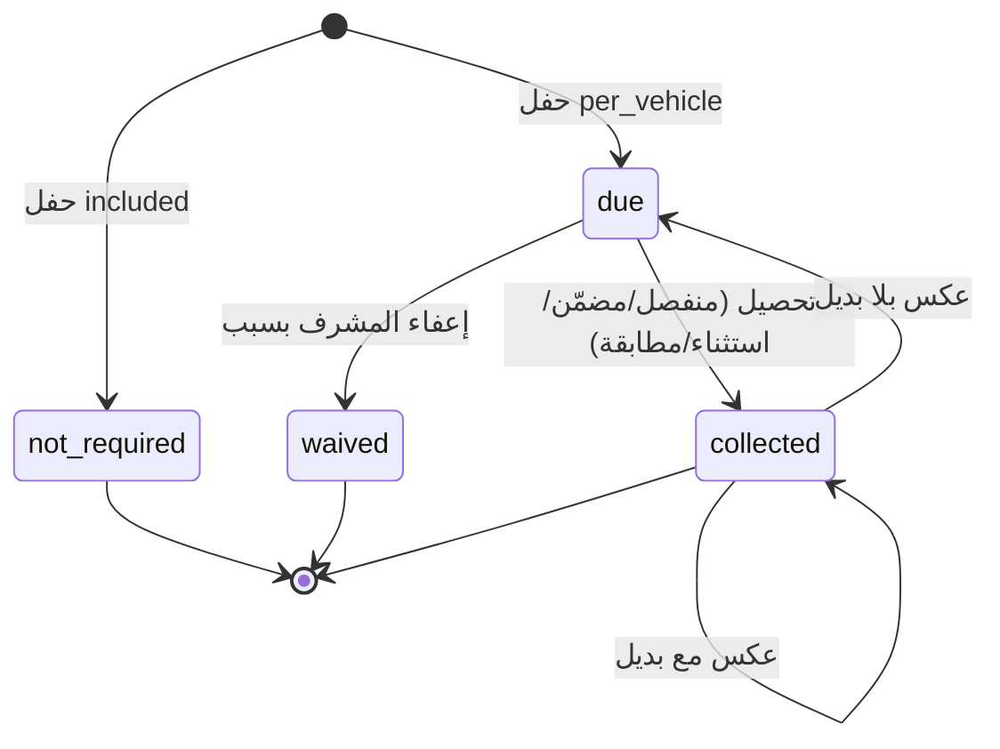

# 13 — مواصفات التحصيل والتسويات (Payments & Settlement)

الإصدار 1.0 — 27 أكتوبر 2026 — الحالة: معتمد للتنفيذ في الإصدار الأول.

يحل هذا الملف محل «Billing & Plans» في الحزمة القياسية (القرار DEC-03): لا اشتراكات ولا باقات في الإصدار الأول، ولا معالجة بيانات بطاقات.

المراجع: `00_Source_Architecture_v1.2_AR.md` (§1، §4ز–§4ح، §8، §14، §15، §16 البند 12) · `00_Glossary_Canon.md` · `06_schema.sql` · `DECISIONS.md` (DEC-03، DEC-24، Q-04، Q-05) · `07_API_Contract.md` (الأجسام الكاملة) · `10_Dispatch_Engine_Spec.md` (ترتيب الأقفال) · `11_State_Machines_Domain_Events.md` (حالات التذكرة والأحداث) · `02_Wireframes_Spec.md` (D-11، D-14، S-03، S-10، S-11) · `15_Event_Tracking_Plan.md`.

---

## 1. الغرض والنطاق

يحدد هذا الملف كيف تُسعَّر الخدمة على مستوى الحفل، وكيف يُسجَّل التحصيل عند التسليم، وكيف تُعالَج الإعفاءات والعكس والتصحيح، وكيف يُتابَع النقد بعهدة السائق حتى تسليمه للمشرف، وكيف يُطابَق الحفل ماليًا قبل إغلاقه.

داخل النطاق في الإصدار الأول:

- حفل «مشمول» `included` لا يُحصَّل فيه شيء من العميل، أو حفل «برسوم لكل مركبة» `per_vehicle` تُحصَّل عند التسليم.
- وسيلتا تحصيل فقط: نقدًا `cash`، أو عبر جهاز نقاط بيع خارجي `pos`.
- إعفاء المشرف بسبب مكتوب، وعكس التحصيل بسبب مع تصحيح اختياري في الأمر نفسه.
- عهدة النقد لدى السائق، وتسليمه للمشرف، وتقرير تسوية الحفل، وموانع الإغلاق المالية، والتصدير.

خارج النطاق في الإصدار الأول:

- الاشتراكات والباقات وفوترة القاعات أو المضيفين (B2B) — تُدار خارج النظام.
- أي بوابة دفع إلكتروني أو روابط دفع أو محافظ رقمية.
- التحصيل عند الاستلام (الدفع المسبق)، والتحصيل الجزئي، والخصم الجزئي، وتسجيل الإكراميات.
- أي رسالة دفع أو إيصال للعميل على واتساب.
- الفوترة الضريبية الإلكترونية — سؤال مفتوح Q-05 (انظر §18).

---

## 2. المبادئ

1. **لا بيانات بطاقات إطلاقًا:** لا رقم بطاقة ولا جزء منه ولا تاريخ انتهاء ولا اسم حامل. جهاز نقاط البيع مستقل ولا يتصل بالنظام؛ السائق يسجل فقط أن التحصيل تم بالشبكة مع رقم مرجعي قصير اختياري.
2. **لا بوابة دفع:** الخادم لا يجري ولا يستقبل أي معاملة مالية؛ هو سجل موثّق لما حدث ميدانيًا.
3. **المبالغ أعداد صحيحة بالهللة** في كل الأعمدة `*_halalas` (`bigint`)، والعملة `SAR` فقط. لا حساب بكسور عشرية في الكود. العرض بصيغة `20.00 ر.س` بأرقام لاتينية.
4. **التحصيل جزء من التسليم:** لا تُسلَّم مركبة حالتها المالية `due`؛ الخادم يرفض بـ`PAYMENT_PENDING`.
5. **الخادم هو الحكم:** المبلغ المطلوب هو `tickets.fee_halalas` المخزن على التذكرة لحظة إنشائها، لا ما تعرضه الشاشة.
6. **لا حذف:** لا يُحذف تحصيل ولا يُعدّل؛ يُعكس بسبب، ويُسجَّل التصحيح كسجل جديد.
7. **كل فعل مالي موثّق:** صف في `audit_log` وحدث نطاق في `outbox_events` وصف في `ticket_events` (عند ارتباطه بتذكرة)، كلها في معاملة التغيير نفسها.
8. **النقد عهدة:** النقد المسجل باسم السائق يبقى «بعهدته» حتى يُسجَّل تسليمه للمشرف، ويمنع إغلاق الحفل حتى ذلك.
9. **لا رسائل مالية للعميل:** رسالة «تم التسليم» (W-06) لا تتضمن مبلغًا ولا وسيلة دفع، ولا يوجد قالب دفع في §11 من القاموس.
10. **مفتاح التكرار إلزامي** في كل أمر مالي (`Idempotency-Key`)، والقيود الفريدة في قاعدة البيانات هي خط الدفاع الأخير ضد التكرار.

---

## 3. التسعير على مستوى الحفل

| الحقل | القيم | القيد في `06_schema.sql` |
|---|---|---|
| `events.pricing_mode` | `included` · `per_vehicle` | CHECK على القيم |
| `events.fee_halalas` | `included` ⇒ 0 · `per_vehicle` ⇒ أكبر من 0 | `CHECK (pricing_mode = 'per_vehicle' OR fee_halalas = 0)` و`CHECK (pricing_mode = 'included' OR fee_halalas > 0)` |
| `events.allowed_payment_methods` | مجموعة جزئية من `cash` و`pos` (الافتراضي الاثنتان) | `CHECK (allowed_payment_methods <@ ARRAY['cash','pos'])` |

القيم الافتراضية للحفل الجديد تأتي من إعدادات الموقع (القاموس §12، DEC-119): `pricing_mode` إلزامي في جسم الإنشاء (07)؛ و`fee_halalas` الافتراضي `pricing.default_fee_halalas` لـ`per_vehicle` و0 لـ`included`؛ و`allowed_payment_methods` الافتراضي `pricing.allowed_methods`؛ أما `pricing.default_mode` فلتعبئة نموذج الواجهة فقط. حفل `per_vehicle` دون `fee_halalas` في موقع رسومه الافتراضية 0 يُرفض بـ`VALIDATION_FAILED` (`fee_halalas: positive_required_when_per_vehicle`).

قواعد التعديل عبر `PATCH /v1/events/{eventId}` (صلاحية `event.manage`):

- يُسمح بتعديل حقول التسعير والحفل في `draft` أو `open`، والتسعير ولو بعد أول تذكرة (DEC-109)، عدا مجموعة التوزيع ففي `draft` وحده (DEC-118). في `closing` يُرفض الطلب بـ`INVALID_STATE_TRANSITION`، وفي `closed` أو `canceled` بـ`EVENT_ALREADY_CLOSED` (DEC-110).
- في `per_vehicle` لا تكون `allowed_payment_methods` فارغة؛ وإلا `VALIDATION_FAILED` بالحقل `allowed_payment_methods`.
- التعديل يسري على **التذاكر الجديدة فقط**؛ التذاكر القائمة تحتفظ بلقطتها (§4).
- تقليص `allowed_payment_methods` أثناء الحفل مسموح (مثال: تعطل الشبكة فيقتصر الحفل على النقد) ويسري فورًا على كل تحصيل لاحق، لأن الوسيلة سياسة تشغيلية تُقرأ وقت التحصيل وليست جزءًا من لقطة التذكرة.
- كل تعديل يُسجل في `audit_log` بالإجراء `event.manage` و`metadata.command` مع before/after للحقول المتغيرة فقط، و`PATCH` الذي لا يغيّر شيئًا لا يرفع `version` ويُسجَّل بـ`metadata.noop = true` (DEC-125).

مثال عرض في الواجهة: «رسوم الخدمة: 20.00 ر.س — نقدًا أو شبكة».

---

## 4. وراثة الرسوم في التذكرة (اللقطة)

عند بدء الاستلام `POST /v1/tickets` تُكتب لقطة التسعير في التذكرة ضمن معاملة الإنشاء نفسها، بعد قراءة صف الحفل:

| تسعير الحفل لحظة إنشاء التذكرة | `tickets.fee_halalas` | `tickets.payment_status` |
|---|---|---|
| `included` | `0` | `not_required` |
| `per_vehicle` | قيمة `events.fee_halalas` | `due` |

- اللقطة لا تتغير بتغيير تسعير الحفل لاحقًا، ولا بإعادة الصف، ولا بدورات الاسترجاع المتعددة: الرسوم **لكل تذكرة** لا لكل دورة.
- `due` تعني «مستحقة قبل التسليم»، وتبقى كذلك طوال بقاء المركبة في الموقف.
- واجهة السائق في D-11 تعرض `tickets.fee_halalas` كما يعيدها الخادم، لا قيمة الحفل الحالية.
- تذكرة ورقية (`channel = paper`) تخضع للقواعد نفسها.

---

## 5. التحصيل عند التسليم

### 5.1 متى يُطلب التحصيل

- فقط عندما `tickets.payment_status = due`.
- فقط عند التسليم: التذكرة `ready` (للتحصيل المنفصل وللتحصيل المضمّن في التسليم).
- الفاعل: المكلّف بمهمة `retrieve` المفتوحة على التذكرة (صلاحية `payment.record`، الرمز D* في القاموس §10). استثناءان يُسجَّل فيهما التحصيل ضمن أمر مشرف: التسليم الاستثنائي (§8.4) والمطابقة اليدوية بعد الانقطاع (§8.5).
- لا تحصيل في `parked` أو قبلها (لا دفع مسبق في الإصدار الأول).

### 5.2 الكائن `payment`

يرد هذا الكائن في جسم `POST /v1/tickets/{ticketId}/payments`، وفي جسم التسليم `POST /v1/tickets/{ticketId}/handover` (اختياري)، وفي أوامر المشرف المذكورة في §8. هذا الملف هو المرجع لقواعده؛ بقية حقول الأجسام في `07_API_Contract.md`.

| الحقل | النوع | إلزامي | القاعدة | الخطأ عند المخالفة |
|---|---|---|---|---|
| `method` | `cash` أو `pos` | نعم | ضمن `events.allowed_payment_methods` للحفل وقت التحصيل | `PAYMENT_METHOD_NOT_ALLOWED` (التفاصيل `allowed_methods`) |
| `amount_halalas` | عدد صحيح | نعم | يساوي `tickets.fee_halalas` تمامًا؛ لا جزئي ولا زيادة | `PAYMENT_AMOUNT_MISMATCH` (التفاصيل `expected_halalas`, `received_halalas`) |
| `pos_reference` | نص أو `null` | لا | يُقبل مع `pos` فقط؛ قواعد §5.6 | `VALIDATION_FAILED` (الحقل `pos_reference`) |

- `pos_reference` مع `cash` → `VALIDATION_FAILED` بالسبب `not_applicable`.
- العملة ليست حقلًا في الطلب؛ الخادم يكتب `SAR`.

### 5.3 ترتيب التحقق داخل أمر التسليم

`POST /v1/tickets/{ticketId}/handover` يتحقق بالترتيب التالي، وأي فشل يوقف الأمر دون أي أثر:

1. الجلسة، والصلاحية `handover.verify`، والنطاق، وأن الفاعل هو المكلّف بمهمة الإحضار → `NOT_TASK_ASSIGNEE`، أو `TICKET_NOT_FOUND` لتذكرة خارج نطاق الفاعل (عدم إفصاح).
2. مفتاح التكرار (يُحجز أول جملة في معاملة الأمر، L0): إن سبق تنفيذ المفتاح نفسه يُعاد الرد المحفوظ؛ `IDEMPOTENCY_KEY_REUSED` إن اختلف المحتوى؛ الطلب المتزامن بالمفتاح نفسه ينتظر صف المفتاح ثم يُعاد له الرد المحفوظ، ولا يرد `IDEMPOTENCY_IN_PROGRESS` إلا عند تجاوز `lock_timeout` على ذلك الصف.
3. حالة التذكرة `ready` → وإلا `HANDOVER_NOT_READY` (أو `TICKET_CLOSED` إن كانت نهائية).
4. `expected_version` إن أُرسل → `VERSION_CONFLICT`.
5. **التحقق المالي قبل رمز التسليم، بلا أي أثر جانبي:**
   - `due` ولا يوجد `payment` → `PAYMENT_PENDING` مع التفاصيل `amount_halalas` و`allowed_methods`.
   - `due` ويوجد `payment` → قواعد §5.2.
   - `collected` ويوجد `payment` → `PAYMENT_ALREADY_RECORDED`.
   - `not_required` أو `waived` ويوجد `payment` → `VALIDATION_FAILED` (الحقل `payment`، السبب `not_applicable`).
6. التحقق من رمز التسليم أو رقم كعب التذكرة الورقية (يستهلك محاولة عند الخطأ وفق `11_State_Machines_Domain_Events.md` و`12_WhatsApp_Integration_Spec.md`).
7. معاملة النجاح الذرية (§5.5): تسجيل التحصيل (إن وُجد) + استهلاك الرمز + التسليم.

سبب تقديم التحقق المالي: خطأ إدخال في المبلغ أو الوسيلة لا يجوز أن يستهلك محاولة من محاولات رمز التسليم (`handover.max_attempts`).

### 5.4 تسجيل التحصيل منفصلًا قبل إدخال الرمز

`POST /v1/tickets/{ticketId}/payments` (صلاحية `payment.record`):

- الشروط: التذكرة `ready` فقط (وإلا `INVALID_STATE_TRANSITION`)؛ الفاعل هو المكلّف بمهمة `retrieve` المفتوحة؛ `payment_status = due`؛ الحفل ليس `closed`.
- الجسم `PaymentInput` فقط (`method`، `amount_halalas`، `pos_reference` اختياري) بلا `expected_version`؛ الرد `{ payment, ticket }` حيث `ticket` بصيغة `TicketSummary` (المثال في §16).
- الفائدة: يدفع العميل قبل أن يُخرج رمز التسليم، أو بعد فشل محاولة رمز، دون إعادة إدخال الدفع.
- **التدفق الموصى به في D-11:** إذا كانت التذكرة `due` تظهر خطوة «التحصيل» أولًا وتُرسل بهذا المسار، ثم خطوة الرمز بجسم تسليم بلا `payment`. يبقى التحصيل المضمّن في جسم التسليم مدعومًا لمن يريد أمرًا ذريًا واحدًا.
- بعد التسجيل تبقى المهمة والتذكرة على حالهما؛ يتغير فقط `payment_status` إلى `collected` و`version`.

### 5.5 المعاملة الذرية للتحصيل

نفس المنطق في المسار المنفصل وفي التسليم المضمّن، بترتيب Canon §14ب ونمط `FOR NO KEY UPDATE` للصفوف: صف الحفل `FOR SHARE` (L2؛ يتسلسل مع إغلاق الحفل الذي يقفله `FOR NO KEY UPDATE`)، ثم مهمة الإحضار (L4)، ثم التذكرة (L5). التحصيل المنفصل لا يقفل المجموعة. أمر التسليم بتحصيل مضمّن يأخذ: المجموعة (L1) ← الحفل `FOR SHARE` (L2) ← المهمة (L4) ← التذكرة (L5) ← الدورة (L6) ← مناوبة السائق (L8) ← الرمز والتحصيل (L9)، ثم الإلحاقيات (L10).

```sql
BEGIN;
-- L0: حجز مفتاح التكرار أول جملة؛ المعرّفات ($event_id، المهمة) تُقرأ بلا أقفال ثم يُعاد التحقق بعد القفل
SELECT id, status, allowed_payment_methods
  FROM events WHERE id = $event_id FOR SHARE;                      -- L2؛ يرفض إن كان closed
SELECT id, assignee_id, cycle_id
  FROM tasks
 WHERE ticket_id = $ticket_id AND type = 'retrieve'
   AND status IN ('accepted','in_progress')
   FOR NO KEY UPDATE;                                              -- L4؛ يجب أن يكون assignee_id = الفاعل
SELECT id, status, payment_status, fee_halalas, version, venue_id
  FROM tickets WHERE id = $ticket_id FOR NO KEY UPDATE;            -- L5؛ المسار المنفصل يشترط status = 'ready'
-- تحققات §5.2 و§5.3 في الكود
INSERT INTO payments (org_id, venue_id, event_id, ticket_id, cycle_id,
                      method, amount_halalas, pos_reference, collected_by)
VALUES ($org, $venue, $event_id, $ticket_id, $cycle_id,
        $method, $amount, $pos_ref_normalized, $actor)
RETURNING id;                                                      -- uq_payments_ticket_recorded يمنع تحصيلين
UPDATE tickets
   SET payment_status = 'collected', version = version + 1
 WHERE id = $ticket_id AND version = $version;                     -- $version المقروء تحت القفل (لا expected_version في جسم التحصيل)
INSERT INTO ticket_events (org_id, venue_id, ticket_id, type, actor_type, actor_id, ticket_version, data)
VALUES ($org, $venue, $ticket_id, 'payment.recorded', 'user', $actor, $version + 1,
        jsonb_build_object('payment_id', $payment_id, 'method', $method, 'amount_halalas', $amount));
INSERT INTO outbox_events (org_id, type, aggregate_type, aggregate_id, aggregate_version, venue_id, payload)
VALUES ($org, 'payment.recorded', 'ticket', $ticket_id, $version + 1, $venue, $payload);
INSERT INTO audit_log (org_id, actor_type, actor_id, action, entity_type, entity_id, venue_id, request_id, after)
VALUES ($org, 'user', $actor, 'payment.record', 'payment', $payment_id, $venue, $request_id,
        jsonb_build_object('method', $method, 'amount_halalas', $amount, 'ticket_payment_status', 'collected'));
COMMIT;
```

- تعارض الفهرس `uq_payments_ticket_recorded` (SQLSTATE 23505) يُترجم إلى `PAYMENT_ALREADY_RECORDED`.
- رفض قيد `ck_payments_no_pan` (SQLSTATE 23514) يُترجم إلى `VALIDATION_FAILED` بالحقل `pos_reference` — ولا يُفترض أن يصل إليه الطلب لأن التحقق في الكود يسبقه.
- في التسليم المضمّن تضاف بقية خطوات التسليم (استهلاك الرمز، `delivered`، العهدة، الأحداث) قبل `COMMIT` في المعاملة نفسها.

### 5.6 قاعدة `pos_reference`

الغرض: رقم يساعد المشرف على مطابقة إيصال جهاز نقاط البيع، **وليس** بيانات البطاقة.

1. التطبيع في الخادم قبل أي تحقق أو تخزين: حذف المسافات والشرطات، تحويل الأحرف إلى كبيرة.
2. الصيغة بعد التطبيع: `^[A-Z0-9]{1,24}$`.
3. رفض أي تسلسل من 13 رقمًا متتاليًا فأكثر (أرقام البطاقات 13–19 رقمًا؛ يطابق قيد المخطط `ck_payments_no_pan`: `pos_reference !~ '[0-9]{13,}'`) → `VALIDATION_FAILED` بالسبب `looks_like_card_number`.
4. التطبيع ضروري لأن قيد قاعدة البيانات يعمل على النص المخزن؛ إدخال مثل `4111 1111 1111 1111` لا يلتقطه القيد إلا بعد حذف المسافات.
5. نص المساعدة في D-11: «رمز الموافقة أو رقم الإيصال القصير — لا تكتب رقم البطاقة».
6. لا يظهر `pos_reference` في التحليلات ولا الإشعارات، ويظهر في تقرير التسوية والتصدير للمشرف والإدارة فقط.

ملاحظة تشغيلية: الرقم المرجعي للاسترجاع (RRN) في إيصالات بعض الأجهزة من 12 رقمًا ويُقبل؛ أي تسلسل 13 رقمًا فأكثر يُرفض لأنه قد يكون رقم بطاقة.

### 5.7 الإكراميات

الإكراميات لا تُسجَّل في النظام ولا تُخلط بعهدة النقد. قاعدة تشغيلية: يحتفظ السائق بالإكرامية منفصلة عن نقد الرسوم، لأن تسليم النقد يُطابَق مع التحصيلات المسجلة فقط (§10).

---

## 6. إعفاء المشرف (Waiver)

`POST /v1/tickets/{ticketId}/payment-waiver` (صلاحية `payment.waive`، المشرف ضمن نطاقه):

| الشرط | الخطأ |
|---|---|
| `payment_status = due` | `collected` → `PAYMENT_ALREADY_RECORDED` · `waived` أو `not_required` → `INVALID_STATE_TRANSITION` |
| التذكرة ليست `voided` | `TICKET_CLOSED` |
| الحفل ليس `closed` | `EVENT_ALREADY_CLOSED` |
| `reason` نص غير فارغ | `REASON_REQUIRED` |

الأثر في معاملة واحدة: `payment_status = 'waived'`، تعبئة `payment_waived_at` و`payment_waived_by` و`payment_waiver_reason` (يفرضها قيد المخطط)، `version + 1`، حدث `payment.waived`، صف `ticket_events`، تدقيق `payment.waive` مع السبب، وبث `ticket.updated` لغرفة المشرفين وللمكلّف إن وجد.

قواعد:

- الإعفاء **كامل** لا جزئي، و**نهائي** في الإصدار الأول (لا تراجع عنه).
- يجوز على تذكرة مفتوحة، أو على تذكرة مسلّمة صارت `due` بعد عكس تحصيل (§7).
- لا يُعفى ما هو `collected`: لإرجاع مبلغ للعميل يُعكس التحصيل أولًا (§7) ثم يُعفى.
- حالات الاستخدام المتوقعة: رفض العميل الدفع، تعطل الشبكة ولا يحمل العميل نقدًا، خدمة مجاملة، تعويض عن مشكلة خدمة.

---

## 7. العكس وإعادة التحصيل والتصحيح

`POST /v1/payments/{paymentId}/reverse` (صلاحية `payment.reverse`، المشرف ضمن نطاقه أو الإدارة):

```json
{
  "reason": "سُجل نقدًا والعميل دفع بالشبكة",
  "replacement": { "method": "pos", "amount_halalas": 2000, "pos_reference": "AP4821" }
}
```

| الشرط | الخطأ |
|---|---|
| `payments.status = recorded` | `PAYMENT_ALREADY_REVERSED` |
| الحفل ليس `closed` | `EVENT_ALREADY_CLOSED` |
| `reason` نص غير فارغ | `REASON_REQUIRED` |
| `replacement` إن وُجد يحقق §5.2 | `PAYMENT_METHOD_NOT_ALLOWED` · `PAYMENT_AMOUNT_MISMATCH` · `VALIDATION_FAILED` |

### 7.1 عكس بلا بديل

- `payments.status = 'reversed'` مع `reversed_at` و`reversed_by` و`reversal_reason`.
- `tickets.payment_status`: من `collected` إلى `due`، و`version + 1`.
- أحداث: `payment.reversed`، `ticket_events`، تدقيق `payment.reverse`، بث `ticket.updated`.
- إن كانت التذكرة **مفتوحة**: يُعاد التحصيل عند التسليم كالمعتاد بسجل جديد (الفهرس الفريد يسمح لأن السابق `reversed`).
- إن كانت التذكرة **مسلّمة**: تصير بندًا في التسوية «مستحق على تذكرة مسلّمة» (`blockers.unsettled_payments`) ويمنع إغلاق الحفل حتى يُعفى (§6)، وتُفتح في المعاملة نفسها واقعة `payment_discrepancy` مرتبطة بالتذكرة (حدث `incident.opened`). هذا هو المسار الصحيح عندما لم يُستلم المال فعلًا (مثال: عملية شبكة ألغيت لاحقًا).

### 7.2 عكس مع بديل (تصحيح الوسيلة أو المرجع)

في المعاملة نفسها:

1. السجل الأصلي يصير `reversed` كما في §7.1.
2. يُدرج سجل جديد `recorded` بقيم البديل، مع `collected_by` و`cycle_id` و`collected_at` منسوخة من الأصل (التحصيل حدث فعلًا في ذلك الوقت وبيد ذلك الشخص)، و`created_at = now()`.
3. `tickets.payment_status` تبقى `collected`، و`version + 1`.
4. أحداث: `payment.reversed` (مع `replacement_payment_id`) ثم `payment.recorded` (المصدر `replacement`)، وصفّا تدقيق.

هذا هو المسار الصحيح لخطأ الوسيلة (نقد بدل شبكة أو العكس) ولخطأ المرجع، ويعمل على التذاكر المسلّمة دون الحاجة لصلاحية تحصيل بعد التسليم. تنبيه في الواجهة S-03 قبل التأكيد: «العكس بلا بديل يعيد التذكرة مستحقة؛ لتصحيح الوسيلة استخدم البديل».

### 7.3 عكس تحصيل نقدي سبق تسليمه للمشرف

مسموح. صف `cash_handovers` لا يُعدّل أبدًا؛ التسوية تحسب «المتوقع المعدّل» (§10.4) فتظهر الفروقات الناتجة عن العكس صراحة.

---

## 8. السلوك مع المسارات التشغيلية الأخرى

| المسار | الأثر المالي |
|---|---|
| 8.1 إعادة الصف لغياب العميل (`ready` → `reparking` → `parked`) | لا تغيير. أي تحصيل سابق يبقى على التذكرة ولا يُحصَّل مرة ثانية في الدورة التالية. حالة `due` تبقى `due` |
| 8.2 إلغاء طلب الإحضار ميدانيًا | لا تغيير |
| 8.3 سحب المهمة أو إعادة إسنادها أو نقل السائق | لا تغيير على التذكرة. النقد يبقى منسوبًا إلى `collected_by` وبعهدته حتى تسليمه، ولو أكمل التسليمَ سائق آخر |
| 8.4 التسليم الاستثنائي بالمشرف `POST /v1/tickets/{ticketId}/handover-exception` | إن كانت `due`: يجب أن يتضمن الجسم كائن `payment` مع الحقل الإضافي `collected_by` (الافتراضي: المكلّف بمهمة الإحضار؛ ويجوز أن يكون المشرف نفسه إن استلم المال)، أو أن يسبقه إعفاء؛ وإلا `PAYMENT_PENDING`. التدقيق: `handover.exception` ثم `payment.record` بفاعل المشرف و`metadata.collected_by` |
| 8.5 المطابقة اليدوية بعد انقطاع `POST /v1/tickets/{ticketId}/manual-reconcile` إلى `delivered` | كالبند 8.4: كائن `payment` بـ`collected_by` المسجل في السجل الورقي، أو إعفاء سابق؛ وإلا `PAYMENT_PENDING`. لا تُنفذ أوامر مؤجلة تلقائيًا |
| 8.6 إلغاء التذكرة `void` | لا يُسمح بإلغاء تذكرة عليها تحصيل `recorded`؛ يُعكس أولًا. عمليًا التحصيل لا يحدث قبل `ready` فلا يتقاطع مع المسودات |
| 8.7 إنهاء المناوبة أو النقل أو التعطيل والسائق بعهدته نقد | غير ممنوع (موانع `DUTY_END_BLOCKED_CUSTODY` و`TRANSFER_BLOCKED_CUSTODY` تخص المركبة والمفتاح والمهمة فقط). النقد يبقى بندًا مفتوحًا في تسوية حفله ويمنع إغلاقه حتى التسليم. تعرض D-14 تنبيهًا للسائق قبل إنهاء الوردية |

---

## 9. النقد بعهدة السائق

لكل سائق ضمن حفل:

| المقدار | التعريف |
|---|---|
| النقد المحصَّل | مجموع `payments.amount_halalas` حيث `method = 'cash'` و`status = 'recorded'` و`collected_by` = السائق |
| النقد المسلَّم | مجموع `cash_handovers.amount_halalas` للسائق في الحفل |
| **النقد بعهدته (المتوقع)** | مجموع التحصيلات النقدية `recorded` للسائق التي `cash_handover_id IS NULL` |

```sql
-- النقد بعهدة السائق في حفل
SELECT coalesce(sum(p.amount_halalas), 0) AS cash_outstanding_halalas,
       count(*)                           AS cash_payments_open
  FROM payments p
 WHERE p.event_id = $event_id
   AND p.collected_by = $driver_id
   AND p.method = 'cash'
   AND p.status = 'recorded'
   AND p.cash_handover_id IS NULL;
```

العرض:

- D-14 (حسابي): «نقد بعهدتك: 120.00 ر.س» للقراءة فقط، من الحقل `cash_outstanding_halalas` في رد `GET /v1/me/home` (`DriverHome`): مجموع الاستعلام أعلاه على حفلات السائق المفتوحة.
- S-10 و`GET /v1/events/{eventId}/settlement`: لكل سائق.

---

## 10. تسليم النقد للمشرف

`POST /v1/cash-handovers` (صلاحية `cash.handover_confirm`؛ المستلم هو المشرف الفاعل ضمن نطاق موقع الحفل):

```json
{ "event_id": "7c0e…", "driver_id": "3b1f…", "amount_halalas": 18000, "note": "تسليم نهاية الحفل" }
```

### 10.1 المعاملة

```sql
BEGIN;
SELECT id, status, venue_id FROM events WHERE id = $event_id FOR SHARE;   -- يرفض إن كان closed
SELECT id, amount_halalas
  FROM payments
 WHERE event_id = $event_id AND collected_by = $driver_id
   AND method = 'cash' AND status = 'recorded' AND cash_handover_id IS NULL
 ORDER BY id
   FOR NO KEY UPDATE;                                                    -- L9؛ يثبت مجموعة التحصيلات المشمولة
-- $expected = مجموع amount_halalas أعلاه (قد يكون 0)، و$locked_payment_ids = معرفاتها
INSERT INTO cash_handovers (org_id, venue_id, event_id, driver_id, received_by,
                            amount_halalas, expected_halalas, note)
VALUES ($org, $venue, $event_id, $driver_id, $actor, $amount, $expected, $note)
RETURNING id, difference_halalas;                                       -- عمود محسوب = amount - expected
UPDATE payments SET cash_handover_id = $handover_id WHERE id = ANY($locked_payment_ids);
-- فقط إن كان difference_halalas <> 0:
INSERT INTO incidents (org_id, venue_id, event_id, type, severity, description, opened_by)
VALUES ($org, $venue, $event_id, 'payment_discrepancy', 'medium', $description_ar, $actor);
INSERT INTO audit_log (org_id, actor_type, actor_id, action, entity_type, entity_id, venue_id, request_id, after)
VALUES ($org, 'user', $actor, 'cash.handover_confirm', 'cash_handover', $handover_id, $venue, $request_id,
        jsonb_build_object('driver_id', $driver_id, 'amount_halalas', $amount, 'expected_halalas', $expected));
-- حدث النطاق cash.handover_recorded (معتمد في Canon §7.1):
INSERT INTO outbox_events (org_id, type, aggregate_type, aggregate_id, venue_id, payload)
VALUES ($org, 'cash.handover_recorded', 'cash_handover', $handover_id, $venue, $payload);
COMMIT;
```

### 10.2 قواعد

- `driver_id <> received_by` (قيد المخطط)؛ مخالفته → `VALIDATION_FAILED` بالحقل `driver_id`. المشرف الذي يقود (`can_drive`) ويحصّل نقدًا يسلّمه لمشرف آخر ضمن النطاق.
- `amount_halalas` هو المبلغ المعدود فعلًا (≥ 0). إن كان المتوقع 0 والمبلغ 0 → `VALIDATION_FAILED` بالسبب `nothing_to_hand_over`.
- يجوز أكثر من تسليم للسائق في الحفل الواحد (تسليم منتصف الحفل ثم نهايته)؛ كل تسليم يربط التحصيلات غير المربوطة لحظتها فقط، فلا يُحسب تحصيل مرتين.
- تحصيل نقدي جديد يُسجَّل بالتوازي مع معاملة التسليم: إن التزم قبل قراءة الأقفال شمله التسليم، وإلا يبقى بعهدة السائق للتسليم التالي.
- فرق غير صفري يفتح واقعة `payment_discrepancy` تلقائيًا بشدة `medium` ويربطها بالحفل (`ticket_id = NULL`)، ويعدّل المشرف الشدة عند الحاجة. وصف الواقعة يذكر المتوقع والمعدود والفرق بالريال.
- صف `cash_handovers` نهائي لا يُعدّل ولا يُحذف؛ التصحيح عبر واقعة وتسليم لاحق.

### 10.3 العرض

S-10 يعرض لكل سائق: المحصّل نقدًا، المسلّم، بعهدته، وزر «استلام نقد» يفتح نموذج المبلغ المعدود، ثم يعرض المتوقع والفرق قبل التأكيد.

### 10.4 المتوقع المعدّل بعد العكس

عكس تحصيل نقدي مربوط بتسليم سابق يغيّر ما كان يجب تسليمه دون تعديل صف التسليم:

```sql
-- المتوقع المعدّل والفرق المعدّل لسائق في حفل
WITH h AS (
  SELECT driver_id, sum(amount_halalas) AS handed, sum(expected_halalas) AS expected
    FROM cash_handovers WHERE event_id = $event_id GROUP BY driver_id
), r AS (
  SELECT collected_by AS driver_id, sum(amount_halalas) AS reversed_after_handover
    FROM payments
   WHERE event_id = $event_id AND method = 'cash' AND status = 'reversed'
     AND cash_handover_id IS NOT NULL
   GROUP BY collected_by
)
SELECT h.driver_id,
       h.handed,
       h.expected - coalesce(r.reversed_after_handover, 0)            AS expected_adjusted,
       h.handed - (h.expected - coalesce(r.reversed_after_handover, 0)) AS difference_adjusted
  FROM h LEFT JOIN r USING (driver_id);
```

مثال: سُجل تحصيل 20.00 ر.س نقدًا خطأً والعميل دفع بالشبكة؛ سلّم السائق 160.00 والمتوقع 180.00 (فرق −20.00 وواقعة). بعد العكس مع بديل `pos` يصبح المتوقع المعدّل 160.00 والفرق المعدّل صفرًا، ويغلق المشرف الواقعة بالحل.

---

## 11. تقرير تسوية الحفل

`GET /v1/events/{eventId}/settlement` (صلاحية `report.read`؛ يستخدمه S-10 وS-11).

### 11.1 المحتوى

1. رأس الحفل: الحالة، نموذج التسعير، الرسوم، الوسائل المسموحة.
2. التذاكر (باستثناء `voided` التي تُعرض عددًا منفصلًا): الإجمالي، المسلّمة، المفتوحة، والتوزيع حسب `payment_status`.
3. المبالغ: القابل للتحصيل، المحصّل حسب الوسيلة، المُعفى، المستحق، المعكوس (للشفافية).
4. لكل سائق: نقد وشبكة (عددًا ومبلغًا)، المسلّم، بعهدته، الفرق المعدّل.
5. سجلات تسليم النقد.
6. الفروقات: فروق التسليم غير الصفرية، تذاكر مسلّمة مستحقة، تحصيلات معكوسة بلا بديل على تذاكر مسلّمة، مع روابط الوقائع.
7. الموانع المالية للإغلاق (§12).
8. فحص السلامة (§11.3).

### 11.2 مثال الرد

```json
{
  "data": {
    "event": { "id": "7c0e…", "name_ar": "حفل زواج آل فلان", "status": "closing",
               "pricing_mode": "per_vehicle", "fee_halalas": 2000, "allowed_payment_methods": ["cash", "pos"] },
    "currency": "SAR",
    "tickets": { "total": 214, "delivered": 210, "open": 4, "voided": 3,
                 "by_payment_status": { "not_required": 0, "due": 4, "collected": 205, "waived": 5 } },
    "amounts": {
      "billable_halalas": 428000, "collected_halalas": 410000, "waived_halalas": 10000, "due_halalas": 8000,
      "by_method": { "cash": { "count": 120, "halalas": 240000 }, "pos": { "count": 85, "halalas": 170000 } },
      "reversed": { "count": 2, "halalas": 4000 }
    },
    "drivers": [
      { "driver": { "id": "3b1f…", "employee_code": "D-0042", "full_name": "سالم" },
        "cash": { "count": 30, "collected_halalas": 60000, "handed_over_halalas": 58000,
                  "outstanding_halalas": 2000, "difference_adjusted_halalas": 0 },
        "pos": { "count": 12, "halalas": 24000 } },
      { "driver": { "id": "9a2d…", "employee_code": "D-0057", "full_name": "فهد" },
        "cash": { "count": 25, "collected_halalas": 50000, "handed_over_halalas": 48000,
                  "outstanding_halalas": 0, "difference_adjusted_halalas": -2000 },
        "pos": { "count": 20, "halalas": 40000 } }
    ],
    "cash_handovers": [
      { "id": "c51a…", "event_id": "7c0e…", "venue_id": "51d2…",
        "driver": { "id": "9a2d…", "employee_code": "D-0057", "full_name": "فهد" },
        "received_by": { "id": "e0b4…", "full_name": "المشرف ماجد" }, "amount_halalas": 48000,
        "expected_halalas": 50000, "difference_halalas": -2000, "handed_at": "2026-10-27T21:40:00Z" }
    ],
    "discrepancies": [
      { "type": "cash_difference", "driver_id": "9a2d…", "cash_handover_id": "c51a…",
        "difference_halalas": -2000, "incident_id": "f7e3…" }
    ],
    "close_blockers": {
      "unsettled_payments": [],
      "cash_outstanding": [ { "driver": { "id": "3b1f…", "employee_code": "D-0042", "full_name": "سالم" }, "amount_halalas": 2000 } ],
      "payment_integrity": []
    },
    "integrity": { "ok": true, "violations": [] }
  },
  "meta": { "request_id": "req_01J…", "server_time": "2026-10-27T21:45:12Z" }
}
```

الأرقام متسقة: القابل للتحصيل = 2000 × (4 + 205 + 5) = 428000؛ المحصّل = 240000 + 170000 = 410000؛ والمجموع 410000 + 10000 + 8000 = 428000.

### 11.3 فحوص السلامة (يجب أن تعيد صفر صفوف)

```sql
-- (أ) collected_without_payment: تذكرة collected بلا تحصيل recorded
SELECT t.id FROM tickets t
 WHERE t.event_id = $event_id AND t.payment_status = 'collected'
   AND NOT EXISTS (SELECT 1 FROM payments p WHERE p.ticket_id = t.id AND p.status = 'recorded');

-- (ب) payment_without_collected: تحصيل recorded على تذكرة ليست collected
SELECT p.id FROM payments p JOIN tickets t ON t.id = p.ticket_id
 WHERE p.event_id = $event_id AND p.status = 'recorded' AND t.payment_status <> 'collected';

-- (ج) amount_mismatch: مبلغ تحصيل لا يساوي رسوم تذكرته
SELECT p.id FROM payments p JOIN tickets t ON t.id = p.ticket_id
 WHERE p.event_id = $event_id AND p.status = 'recorded' AND p.amount_halalas <> t.fee_halalas;

-- (د) snapshot_inconsistent: اتساق اللقطة مع الحالة (يحرسه أيضًا ck_tickets_fee_matches_payment_status)
SELECT t.id FROM tickets t
 WHERE t.event_id = $event_id AND t.status <> 'voided'
   AND ((t.payment_status = 'not_required' AND t.fee_halalas <> 0)
     OR (t.payment_status IN ('due','collected','waived') AND t.fee_halalas = 0));
```

أي صف ناتج يظهر في `integrity.violations` ويمنع الإغلاق عبر `blockers.payment_integrity` (`{ check, entity_id }` بمعرّف الفحص أعلاه) ويُرفع للإدارة؛ لا يُفترض حدوثه إن طُبقت قواعد هذا الملف.

### 11.4 استعلامات الإجماليات المرجعية

```sql
-- التذاكر والمبالغ حسب الحالة المالية
SELECT count(*)                                                            AS tickets_total,
       count(*) FILTER (WHERE status = 'delivered')                        AS delivered,
       count(*) FILTER (WHERE status <> 'delivered')                       AS open,
       count(*) FILTER (WHERE payment_status = 'due')                      AS due_count,
       coalesce(sum(fee_halalas) FILTER (WHERE payment_status = 'due'), 0)       AS due_halalas,
       count(*) FILTER (WHERE payment_status = 'collected')                AS collected_count,
       count(*) FILTER (WHERE payment_status = 'waived')                   AS waived_count,
       coalesce(sum(fee_halalas) FILTER (WHERE payment_status = 'waived'), 0)    AS waived_halalas,
       coalesce(sum(fee_halalas) FILTER (WHERE payment_status IN ('due','collected','waived')), 0) AS billable_halalas
  FROM tickets
 WHERE event_id = $event_id AND status <> 'voided';

-- التحصيل حسب الوسيلة
SELECT method, count(*) AS count, sum(amount_halalas) AS halalas
  FROM payments WHERE event_id = $event_id AND status = 'recorded'
 GROUP BY method;

-- لكل سائق
SELECT p.collected_by AS driver_id,
       count(*) FILTER (WHERE p.method = 'cash')                                        AS cash_count,
       coalesce(sum(p.amount_halalas) FILTER (WHERE p.method = 'cash'), 0)              AS cash_collected,
       coalesce(sum(p.amount_halalas) FILTER (WHERE p.method = 'cash'
                                               AND p.cash_handover_id IS NULL), 0)      AS cash_outstanding,
       count(*) FILTER (WHERE p.method = 'pos')                                         AS pos_count,
       coalesce(sum(p.amount_halalas) FILTER (WHERE p.method = 'pos'), 0)               AS pos_collected
  FROM payments p
 WHERE p.event_id = $event_id AND p.status = 'recorded'
 GROUP BY p.collected_by;
```

---

## 12. موانع الإغلاق المالية

`POST /v1/events/{eventId}/close` يرفض بـ`EVENT_CLOSE_BLOCKED` إن وُجد أي مانع. هذا الملف يحدد الموانع **المالية**؛ موانع العهدة والتذاكر والطلبات المفتوحة في `11_State_Machines_Domain_Events.md`، والقائمة تُجمع في ردٍّ واحد:

```json
{
  "error": {
    "code": "EVENT_CLOSE_BLOCKED",
    "message": "Event cannot be closed",
    "message_ar": "لا يمكن إغلاق الحفل قبل معالجة البنود المفتوحة",
    "request_id": "req_01J…",
    "retryable": false,
    "details": {
      "blockers": {
        "open_tickets": [], "keys_not_in_slots": [], "open_requests": [], "open_tasks": [],
        "unsettled_payments": [ { "id": "a19c…", "display_number": 87, "payment_status": "due" } ],
        "cash_outstanding": [ { "driver": { "id": "3b1f…", "full_name": "فهد العتيبي" }, "amount_halalas": 2000 } ],
        "payment_integrity": []
      }
    }
  }
}
```

| مفتاح المانع في `details.blockers` | الشرط | المعالجة |
|---|---|---|
| `cash_outstanding` | سائق لديه نقد بعهدته > 0 في الحفل (§9) | تسليم النقد (§10) |
| `unsettled_payments` | تذكرة `delivered` وحالتها `due` (بعد عكس بلا بديل) | إعفاء بسبب (§6) أو كان يجب العكس مع بديل |
| `payment_integrity` | أي صف من فحوص §11.3 (`{ check, entity_id }`) | تدخل الإدارة؛ خلل يجب تصحيحه |

لا يمنع الإغلاق (يظهر في `warnings` من `GET /v1/events/{eventId}/reconciliation` ويُحفظ في الملخص): فروق تسليم النقد غير الصفرية ما دامت لها واقعة (`warnings.cash_discrepancies`)، والوقائع المفتوحة ومنها `payment_discrepancy` (`warnings.open_incidents`؛ التحقيق قد يستمر بعد الإغلاق).

- عند الإغلاق الناجح يُحفظ ملخص مالي في `events.close_summary.finance` (نفس حقول `amounts` و`drivers` و`discrepancies` في §11.2) ليبقى ثابتًا بعد الإغلاق.
- `GET /v1/events/{eventId}/reconciliation` يتضمن القسم المالي نفسه لعرض S-10 قبل محاولة الإغلاق.
- بعد `closed` تُرفض كل الأوامر المالية (تحصيل، عكس، إعفاء، تسليم نقد) بـ`EVENT_ALREADY_CLOSED`؛ أي فرق يُكتشف بعدها يُعالج بواقعة.
- أثناء `closing` تستمر الأوامر المالية (هنا تحدث تسليمات النقد النهائية)، بينما يتوقف الاستلام الجديد وفق 11.

---

## 13. التقارير والتصدير

| المسار | الصلاحية | المحتوى المالي |
|---|---|---|
| `GET /v1/events/{eventId}/settlement` | `report.read` | تقرير التسوية الكامل (§11) |
| `GET /v1/reports/events/{eventId}/summary` | `report.read` | قسم مالي مختصر: المحصّل حسب الوسيلة، المُعفى، المستحق، الفروقات |
| `GET /v1/reports/payments` | `report.read` | قائمة تحصيلات بفلاتر: `venue_id`، `event_id`، `from`، `to`، `method`، `status`، `collected_by` مع ترقيم بالمؤشر |
| `POST /v1/exports` بالنوع `payments` أو `event_summary` | `export.create` | ملف CSV مؤقت خاص |
| `GET /v1/exports/{exportId}` | `export.create` | الحالة ورابط تنزيل مؤقت عند `ready` |

أعمدة تصدير `payments` (ترتيب ثابت، ترميز UTF-8 مع BOM ليفتح في Excel بالعربية):

`payment_id, event_name, event_date, venue_code, ticket_number, method, amount_sar, status, collected_by_code, collected_by_name, collected_at_riyadh, pos_reference, reversed_at_riyadh, reversed_by_code, reversal_reason, cash_handover_id`

- `amount_sar` بصيغة `20.00`. الأوقات بتوقيت `Asia/Riyadh` بصيغة `YYYY-MM-DD HH:mm`.
- لا جوال عميل ولا لوحة ولا خانة مفتاح ولا أي رمز في أي تصدير مالي.
- إنشاء كل تصدير يُدقق (`export.create` مع الفلاتر)، والملف ينتهي بعد مدة قصيرة (`exports.expires_at`) ويُحذف بمهمة `job.retention_purge`.

---

## 14. التدقيق والأحداث

| الفعل | `audit_log.action` | حدث النطاق | `ticket_events` | بث فوري |
|---|---|---|---|---|
| تسجيل تحصيل (منفصل أو مضمّن) | `payment.record` | `payment.recorded` | نعم | `ticket.updated` |
| إعفاء | `payment.waive` | `payment.waived` | نعم | `ticket.updated` |
| عكس (مع بديل أو بدونه) | `payment.reverse` | `payment.reversed` (+ `payment.recorded` للبديل؛ + `incident.opened` لواقعة `payment_discrepancy` عند العكس بلا بديل على تذكرة مسلّمة) | نعم | `ticket.updated` |
| تسليم نقد | `cash.handover_confirm` | `cash.handover_recorded` (Canon §7.1) | لا (ليس لتذكرة) | تحديث لوحة S-10 عبر `sync.required` لغرفة المشرفين |
| تعديل تسعير الحفل | `event.manage` | — | لا | — |
| تحصيل ضمن تسليم استثنائي | `handover.exception` + `payment.record` | `handover.exception_approved` + `payment.recorded` | نعم | `ticket.updated` |
| تحصيل ضمن مطابقة يدوية | `ticket.manual_reconcile` + `payment.record` | `payment.recorded` | نعم | `ticket.updated` |
| تصدير مالي | `export.create` | — | لا | — |

الحد الأدنى لحمولة الأحداث المالية (الغلاف الكامل في 11):

```json
{ "type": "payment.recorded",
  "payload": { "ticket_id": "…", "payment_id": "…", "cycle_id": "…", "method": "cash",
               "amount_halalas": 2000, "collected_by": "…", "source": "handover" } }
```

`source` ∈ `separate` · `handover` · `exception` · `reconcile` · `replacement`. حدث `payment.reversed` يحمل `payment_id` و`with_replacement` و`replacement_payment_id` و`after_cash_handover`. حدث `payment.waived` يحمل `ticket_id` و`amount_halalas`. لا يُنسخ `reason` ولا `pos_reference` إلى التحليلات.

قيم before/after في `audit_log` تقتصر على: `payment_status`، `method`، `amount_halalas`، `status` للتحصيل، ونص السبب في عمود `reason`.

---

## 15. حالات `tickets.payment_status`



| من | إلى | الأمر | الفاعل | الشرط | خطأ المخالفة |
|---|---|---|---|---|---|
| (إنشاء) | `not_required` أو `due` | `POST /v1/tickets` | السائق | لقطة تسعير الحفل | — |
| `due` | `collected` | `POST /v1/tickets/{ticketId}/payments` أو التسليم بـ`payment` | المكلّف بالإحضار | التذكرة `ready`، §5.2 | `PAYMENT_METHOD_NOT_ALLOWED` · `PAYMENT_AMOUNT_MISMATCH` · `VALIDATION_FAILED` |
| `due` | `collected` | التسليم الاستثنائي أو المطابقة اليدوية بـ`payment` | المشرف | §8.4، §8.5 | كما سبق |
| `due` | `waived` | `POST /v1/tickets/{ticketId}/payment-waiver` | المشرف | سبب، الحفل غير مغلق | `REASON_REQUIRED` · `EVENT_ALREADY_CLOSED` |
| `collected` | `due` | `POST /v1/payments/{paymentId}/reverse` بلا `replacement` | المشرف أو الإدارة | التحصيل `recorded` | `PAYMENT_ALREADY_REVERSED` |
| `collected` | `collected` | `POST /v1/payments/{paymentId}/reverse` مع `replacement` | المشرف أو الإدارة | البديل يحقق §5.2 | كما سبق |
| `not_required` | أي حالة | — | — | ممنوع (اللقطة ثابتة) | `INVALID_STATE_TRANSITION` |
| `waived` | أي حالة | — | — | ممنوع في الإصدار الأول | `INVALID_STATE_TRANSITION` |
| `collected` | `collected` بتحصيل ثانٍ | أي أمر تحصيل | — | ممنوع | `PAYMENT_ALREADY_RECORDED` |

حالة التحصيل نفسه `payments.status`: `recorded` → `reversed` فقط، ولا رجوع.

---

## 16. ربط الـAPI

| المسار | الصلاحية | تكرار | الشروط المختصرة | النجاح | الأخطاء الرئيسية |
|---|---|---|---|---|---|
| `POST /v1/tickets/{ticketId}/payments` | `payment.record` | ✓ | §5.4 | 201: `payment` + `ticket` (`TicketSummary`) | `PAYMENT_ALREADY_RECORDED` · `PAYMENT_METHOD_NOT_ALLOWED` · `PAYMENT_AMOUNT_MISMATCH` · `VALIDATION_FAILED` · `INVALID_STATE_TRANSITION` · `NOT_TASK_ASSIGNEE` · `EVENT_ALREADY_CLOSED` |
| `POST /v1/tickets/{ticketId}/handover` | `handover.verify` | ✓ | §5.3 | 200: `ticket` (`delivered`) + `cycle` + `payment` أو `null` + `driver` | ما سبق + `PAYMENT_PENDING` · `HANDOVER_NOT_READY` · `VERSION_CONFLICT` · أخطاء الرمز |
| `POST /v1/tickets/{ticketId}/handover-exception` | `handover.exception` | ✓ | §8.4 | 200 | `PAYMENT_PENDING` · `REASON_REQUIRED` |
| `POST /v1/tickets/{ticketId}/manual-reconcile` | `ticket.manual_reconcile` | ✓ | §8.5 | 200 | `PAYMENT_PENDING` · `REASON_REQUIRED` |
| `POST /v1/tickets/{ticketId}/payment-waiver` | `payment.waive` | ✓ | §6 | 200: `ticket{payment_status: waived, version}` | `REASON_REQUIRED` · `PAYMENT_ALREADY_RECORDED` · `INVALID_STATE_TRANSITION` · `EVENT_ALREADY_CLOSED` · `TICKET_CLOSED` |
| `POST /v1/payments/{paymentId}/reverse` | `payment.reverse` | ✓ | §7 | 200: `reversed` + `replacement` أو `null` | `PAYMENT_ALREADY_REVERSED` · `REASON_REQUIRED` · أخطاء §5.2 للبديل · `EVENT_ALREADY_CLOSED` |
| `POST /v1/cash-handovers` | `cash.handover_confirm` | ✓ | §10 | 201: `CashHandover` (`expected_halalas`، `difference_halalas`، `payment_ids`، `incident_id` أو `null`) | `VALIDATION_FAILED` · `RESOURCE_NOT_FOUND` (حفل أو سائق خارج النطاق، لا كشف) · `EVENT_ALREADY_CLOSED` |
| `GET /v1/events/{eventId}/settlement` | `report.read` | — | — | 200: §11.2 | `RESOURCE_NOT_FOUND` (يشمل حفلًا خارج النطاق) |
| `PATCH /v1/events/{eventId}` (حقول التسعير) | `event.manage` | ✓ | §3 | 200 | `INVALID_STATE_TRANSITION` · `VALIDATION_FAILED` · `VERSION_CONFLICT` |

مثال تسجيل منفصل:

```http
POST /v1/tickets/2f6c…/payments
Idempotency-Key: 6e1f2c7a-0d6b-4c35-9a35-3c2b1f2b9e10
Content-Type: application/json

{ "method": "cash", "amount_halalas": 2000, "pos_reference": null }
```

```json
{
  "data": {
    "payment": { "id": "8d4b…", "ticket_id": "2f6c…", "cycle_id": "c3a9…", "event_id": "7c0e…", "method": "cash",
                 "amount_halalas": 2000, "currency": "SAR", "pos_reference": null, "status": "recorded",
                 "collected_by": { "id": "3b1f…", "full_name": "سالم", "employee_code": "D-0042" },
                 "collected_at": "2026-10-27T20:14:03Z", "cash_handover_id": null },
    "ticket": { "id": "2f6c…", "display_number": 125, "event_id": "7c0e…", "venue_id": "51d2…", "status": "ready",
                "channel": "whatsapp", "plate": { "country": "SA", "display": "1234 ب ح د" },
                "wa_link_status": "linked", "payment_status": "collected", "version": 8 }
  },
  "meta": { "request_id": "req_01J…", "server_time": "2026-10-27T20:14:03Z" }
}
```

مثال جسم التسليم بالرمز مع تحصيل مضمّن (المخطط الكامل في 07):

```json
{ "verification": { "method": "code", "code": "482731" },
  "payment": { "method": "pos", "amount_halalas": 2000, "pos_reference": "AP4821" }, "expected_version": 9 }
```

تفاصيل الأخطاء المالية:

| الرمز | `details` |
|---|---|
| `PAYMENT_PENDING` | `{ "amount_halalas": 2000, "allowed_methods": ["cash","pos"] }` |
| `PAYMENT_AMOUNT_MISMATCH` | `{ "expected_halalas": 2000, "received_halalas": 1500 }` |
| `PAYMENT_METHOD_NOT_ALLOWED` | `{ "allowed_methods": ["cash"] }` |
| `PAYMENT_ALREADY_RECORDED` | `{ "payment_id": "…", "method": "cash", "collected_by": "…" }` |
| `PAYMENT_ALREADY_REVERSED` | `{ "payment_id": "…", "reversed_at": "…" }` |
| `VALIDATION_FAILED` (`pos_reference`) | `{ "fields": [ { "field": "pos_reference", "reason": "looks_like_card_number" } ] }` |

---

## 17. الحالات الحدية

1. **العميل يرفض الدفع:** لا يكتمل التسليم آليًا وحالة التذكرة `due`؛ يستدعي السائق المشرف. قرار المشرف خارج النظام، والمسار المتاح داخله: إعفاء بسبب «رفض الدفع» مع فتح واقعة `other` لتوثيق الموقف. لا يوجد في النظام إجراء يحتجز المركبة.
2. **تعطل جهاز نقاط البيع:** نقدًا إن كانت مسموحة، أو يقلّص المشرف وسائل الحفل إلى `cash` (§3)، أو إعفاء بسبب «تعطل الشبكة» إن تعذر الدفع.
3. **عملية شبكة رُفضت:** لا يُسجَّل شيء؛ يحاول العميل وسيلة أخرى.
4. **مبلغ جزئي أو خصم:** غير مدعوم في الإصدار الأول؛ إما المبلغ كاملًا أو إعفاء كامل.
5. **ضغط مزدوج على «تأكيد التحصيل»:** نفس `Idempotency-Key` يعيد الرد المحفوظ؛ مفتاحان مختلفان متزامنان ⇒ واحد ينجح والآخر `PAYMENT_ALREADY_RECORDED` بفضل الفهرس الفريد.
6. **انقطاع الشبكة بعد الإرسال ونتيجة غير معروفة:** الواجهة تحتفظ بالنموذج وتعيد الإرسال بالمفتاح نفسه؛ لا تعرض «تم» دون رد الخادم.
7. **تغيّر الرسوم بعد الاستلام:** التذكرة تحتفظ بلقطتها؛ D-11 تعرض `tickets.fee_halalas`.
8. **تحوّل الحفل من `per_vehicle` إلى `included` أثناءه:** التذاكر القائمة تبقى `due`؛ يعفيها المشرف فرديًا عند الحاجة.
9. **عدة مركبات لعميل واحد:** تحصيل مستقل لكل تذكرة.
10. **تذكرة ورقية:** القواعد نفسها.
11. **تحصيل ثم فشل الرمز حتى القفل:** التحصيل يبقى `collected`؛ التسليم الاستثنائي لا يحتاج كائن `payment`.
12. **تحصيل ثم إعادة صف لغياب العميل:** يبقى `collected`؛ لا تحصيل ثانٍ في الدورة التالية.
13. **إعادة إسناد بعد التحصيل:** السائق الجديد يسلّم دون تحصيل؛ النقد بعهدة الأول حتى تسليمه.
14. **سائق نُقل والنقد بعهدته:** يبقى بندًا مفتوحًا في الحفل الأصلي؛ يستلمه مشرف ذلك الموقع.
15. **مشرف يقود وحصّل نقدًا:** لا يستلم من نفسه؛ يسلّم لمشرف آخر في النطاق (انظر §20 لبديل عند عدم وجوده).
16. **عكس بعد تسليم النقد:** يظهر في المتوقع المعدّل (§10.4) دون تعديل صف التسليم.
17. **محاولة أمر مالي بعد إغلاق الحفل:** `EVENT_ALREADY_CLOSED`؛ المعالجة بواقعة.
18. **تحصيل بلا اتصال بالخادم:** غير ممكن؛ الخادم مصدر الحقيقة. في الانقطاع الكامل يُستخدم السجل الورقي ثم المطابقة اليدوية (§8.5).

---

## 18. سؤال الفوترة الضريبية المفتوح (Q-05)

إذا كانت الرسوم تُحصَّل من العميل مباشرة، فقد تترتب متطلبات فوترة ضريبية (مثل إصدار فاتورة مبسطة عبر منظومة الفوترة الإلكترونية، ومعاملة ضريبة القيمة المضافة في المبلغ والتقارير) بحسب الوضع الضريبي للمنشأة. هذا الملف لا يقدم رأيًا نظاميًا أو محاسبيًا، والمسألة **تُؤكد مع محاسب** قبل تفعيل `per_vehicle` في الإنتاج.

الافتراض حتى الحسم:

- `fee_halalas` مبلغ نهائي يدفعه العميل، دون تفكيك ضريبي في النظام.
- لا يصدر النظام فواتير ولا إيصالات للعميل؛ إيصال جهاز نقاط البيع يخص عمليات الشبكة، وتوثيق المدفوعات النقدية للعميل جزء من القرار المفتوح.
- التصميم يسمح بإضافة تكامل فوترة لاحقًا كمستهلك لحدث `payment.recorded` دون تغيير مسار التحصيل.

---

## 19. حالات الاختبار

المعرفات محلية لهذا الملف وتُدمج في ترقيم `17_Test_Acceptance_Plan.md`.

| المعرف | السيناريو | النتيجة المتوقعة |
|---|---|---|
| PAY-TC-01 | حفل `included`، استلام ثم تسليم بلا `payment` | `not_required`، `fee_halalas = 0`، التسليم ينجح |
| PAY-TC-02 | حفل `per_vehicle` برسوم 2000، ثم تعديل الرسوم إلى 3000 | التذاكر السابقة `due` بـ2000، الجديدة بـ3000 |
| PAY-TC-03 | تسليم تذكرة `due` بلا `payment` | `PAYMENT_PENDING` بالتفاصيل؛ لا تغيير في `claim_codes.attempts` |
| PAY-TC-04 | تسليم بمبلغ 1500 لتذكرة رسومها 2000 | `PAYMENT_AMOUNT_MISMATCH`؛ لا استهلاك لمحاولة الرمز |
| PAY-TC-05 | حفل وسائله `cash` فقط وتحصيل `pos` | `PAYMENT_METHOD_NOT_ALLOWED` |
| PAY-TC-06 | `pos_reference = "4111 1111 1111 1111"` | `VALIDATION_FAILED` (`looks_like_card_number`)؛ وإدراج خام بالقيمة المطبّعة يرفضه قيد المخطط |
| PAY-TC-07 | `pos_reference` مع `cash` | `VALIDATION_FAILED` (`not_applicable`) |
| PAY-TC-08 | تسليم ناجح بـ`cash` مضمّن | سجل `recorded`، التذكرة `collected` ثم `delivered`، صف تدقيق `payment.record`، حدث `payment.recorded` بمصدر `handover` |
| PAY-TC-09 | تحصيل منفصل ثم 5 رموز خاطئة ثم تسليم استثنائي بلا `payment` | `HANDOVER_CODE_LOCKED` ثم نجاح الاستثناء؛ التحصيل يبقى واحدًا |
| PAY-TC-10 | إعادة الطلب نفسه بنفس `Idempotency-Key` | سجل تحصيل واحد ونفس الرد |
| PAY-TC-11 | طلبا تحصيل متزامنان بمفتاحين مختلفين | واحد 201 والآخر `PAYMENT_ALREADY_RECORDED` |
| PAY-TC-12 | إعفاء بلا سبب / من سائق / بسبب | `REASON_REQUIRED` / `PERMISSION_DENIED` / `waived` والتسليم بلا `payment` ينجح |
| PAY-TC-13 | عكس بلا بديل على تذكرة مفتوحة ثم تحصيل جديد | `due` ثم `collected` بسجل ثانٍ؛ الأول `reversed` |
| PAY-TC-14 | عكس مع بديل (`cash` → `pos`) على تذكرة مسلّمة بعد تسليم نقد | التذكرة تبقى `collected`؛ الفرق المعدّل للسائق = 0 |
| PAY-TC-15 | عكس التحصيل نفسه مرتين | `PAYMENT_ALREADY_REVERSED` |
| PAY-TC-16 | تسليم نقد بمبلغ أقل من المتوقع | صف بفرق سالب + واقعة `payment_discrepancy` تلقائيًا |
| PAY-TC-17 | تحصيل نقدي يُلتزم أثناء معاملة تسليم نقد للسائق نفسه | لا يُحسب مرتين؛ يبقى بعهدته للتسليم التالي |
| PAY-TC-18 | إغلاق الحفل وبعهدة سائق نقد | `EVENT_CLOSE_BLOCKED` و`details.blockers.cash_outstanding` غير فارغة؛ بعد التسليم ينجح الإغلاق |
| PAY-TC-19 | إغلاق وفيه تذكرة مسلّمة `due` بعد عكس | `details.blockers.unsettled_payments` غير فارغة؛ بعد الإعفاء ينجح |
| PAY-TC-20 | أي أمر مالي بعد `closed` | `EVENT_ALREADY_CLOSED` |
| PAY-TC-21 | نقل سائق بعهدته نقد | النقل ينجح؛ التسوية تُظهر النقد في الحفل الأصلي |
| PAY-TC-22 | تسليم استثنائي لتذكرة `due` بلا `payment` / مع `payment` و`collected_by` للسائق | `PAYMENT_PENDING` / نجاح والنقد بعهدة السائق |
| PAY-TC-23 | تقرير التسوية بعد حفل تجريبي | القابل للتحصيل = المحصّل + المُعفى + المستحق؛ فحوص §11.3 تعيد صفرًا |
| PAY-TC-24 | تصدير `payments` | لا جوال ولا لوحة ولا رموز؛ المبالغ `20.00`؛ صف تدقيق `export.create` |
| PAY-TC-25 | مشرف يقود يسجل تسليم نقد لنفسه | `VALIDATION_FAILED` (قيد `driver_id <> received_by`) |

ترتبط هذه الحالات بمعياري القبول AC-09 (لا تسليم دون تحقق أو استثناء موثق) وAC-12 (تجربة حفل كامل حتى الإغلاق والمطابقة).

---

## 20. إضافات مقترحة للقاموس

1. **(اعتُمد في Canon §7.1)** **حدث نطاق لتسليم النقد:** `cash.handover_recorded` (ومقابله التحليلي `cash_handover_recorded` في 15)؛ القاموس §7.1 لا يتضمن حدثًا لهذا الفعل.
2. **(اعتُمد بصيغة مفاتيح `Reconciliation.blockers`: `cash_outstanding` · `unsettled_payments` · `payment_integrity`)** **أنواع موانع الإغلاق المالية** في `details.blockers[].type` لخطأ `EVENT_CLOSE_BLOCKED`: `cash_not_handed_over` · `payments_due_on_delivered` · `payment_integrity` (تُوحَّد مع أنواع الموانع غير المالية في 11).
3. **(اعتُمد في 07)** **حقول أجسام:** `replacement` في `POST /v1/payments/{paymentId}/reverse`؛ و`payment.collected_by` في `handover-exception` و`manual-reconcile`؛ و`source` في حمولة `payment.recorded` بالقيم `separate` · `handover` · `exception` · `reconcile` · `replacement`. تُعتمد في 07 و11.
4. **(اعتُمد كقيد واحد `ck_tickets_fee_matches_payment_status`)** **قيدان في `tickets`** لاتساق اللقطة: `CHECK (payment_status <> 'not_required' OR fee_halalas = 0)` و`CHECK (payment_status = 'not_required' OR fee_halalas > 0)`.
5. **(اعتُمد: `ck_payments_no_pan`)** **قيد `pos_reference`:** تعديله إلى رفض 13 رقمًا فأكثر بدل 12 (`!~ '[0-9]{13,}'`) ليقبل رقم RRN ذا الاثني عشر رقمًا مع بقاء رفض أرقام البطاقات (13–19 رقمًا)، مع إبقاء التطبيع في الخادم. إن اعتُمد تُحدَّث §5.6.
6. **(اعتُمد في Canon §10)** **صلاحية احتياطية:** منح `cash.handover_confirm` للإدارة A أيضًا، لحالة موقع بمشرف واحد يقود ويحصّل.
7. **(مؤجل بعد الإصدار الأول)** **تصنيف أسباب الإعفاء** (اختياري) لأغراض التحليل: `customer_refused` · `pos_down` · `complimentary` · `service_issue` · `other`، مع بقاء السبب النصي إلزاميًا.
8. **معرفات الاختبار المحلية** `PAY-TC-xx` تبقى مرجعًا تفصيليًا هنا، وحالات القبول الجامعة في الملف 17.
