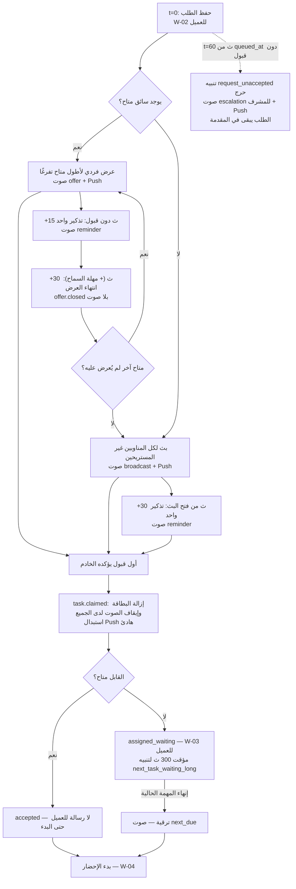

# 14 — مصفوفة الإشعارات والقوالب

الإصدار 1.0 — 27 أكتوبر 2026 — الحالة: جاهزة للتنفيذ
يحدد هذا الملف **من يُبلَّغ بماذا، ومتى، وعبر أي قناة، وبأي نص وصوت** لكل حدث في النظام. هو المرجع النهائي لنصوص رسائل العميل W-01…W-12 (العلامة «مصاف»)، ولنصوص تنبيهات المشرف `alerts` (§8) وإشعارات Push (§6.3) وقواعد الأصوات والاهتزاز (§7) (العلامة «بوينت»). أما نصوص واجهة الموظفين (الأزرار واللافتات والحالات، ومنها ما يرد في §5.1) فمرجعها النهائي `02_Wireframes_Spec.md` §8.

المراجع الملزمة: `00_Glossary_Canon.md` (§7 الأحداث والمهام وغرف WebSocket، §11 الرسائل، §12 الإعدادات، §13 الأصوات، §5.7 أنواع التنبيهات) · `12_WhatsApp_Integration_Spec.md` (آلية إرسال واتساب واستقباله) · `06_schema.sql` (`notifications`، `alerts`، `devices`) · `00_Source_Architecture_v1.2_AR.md` (§5، §7، §14) · `DECISIONS.md` (DEC-10، DEC-16، DEC-23).

---

## 1. القنوات

| القناة | الجمهور | العلامة | ما تضمنه | ما لا تضمنه |
|---|---|---|---|---|
| واتساب (قالب UTILITY أو رد جلسة) | العميل | مصاف | الإرسال من الرقم المركزي الواحد بعد حفظ الحدث، مع إعادة محاولة محدودة وتسجيل الحالة | زمن وصول ثابت؛ ترتيب التسليم (يفرضه الخادم ببوابة الترتيب، الملف 12 §5.6) |
| داخل الصفحة: WebSocket + صوت | السائق والمشرف | بوينت | تحديث فوري لصفحة مفتوحة ومتصلة؛ صوت إن سمح المتصفح بعد «تفعيل واختبار الصوت» | استمرار الاتصال أو الصوت والصفحة في الخلفية أو الجوال مقفل |
| Web Push (اختياري) | السائق والمشرف | بوينت | محاولة إظهار إشعار نظام عند دعم الجهاز وموافقة المستخدم | صوت مخصص، تجاوز الصامت/التركيز، وصول كل إشعار؛ على iPhone/iPad يتطلب الإضافة للشاشة الرئيسية |
| مركز تنبيهات المشرف (`alerts`) | المشرف والإدارة | بوينت | تنبيه دائم في قاعدة البيانات حتى الإقرار/الحل، يظهر في S-02 وS-04 | — |

القاعدة الحاكمة: **مؤقتات القبول والتصعيد تعمل على الخادم** حتى لو أُغلقت كل الصفحات؛ القنوات أعلاه وسائل تبليغ فقط، والقرار والحالة في قاعدة البيانات (المعمارية §7).

---

## 2. قواعد عامة ملزمة

1. **الخادم مصدر الحقيقة:** أي إشعار (WebSocket أو Push) يحمل معرفات ونسخة فقط؛ الواجهة تجلب الحالة الحالية قبل أي فعل، والخادم يرفض الأفعال القديمة مهما بقيت ظاهرة.
2. **لا بيانات حساسة على شاشة القفل (DEC-23):** عنوان Push يحمل «بوينت» ونصه رقم التذكرة فقط. ممنوع: اللوحة، الجوال، اسم العميل، موضع المفتاح أو الموقف، رمز التسليم.
3. **الحجز = صمت:** عند `task.claimed` تختفي البطاقة ويتوقف صوتها فورًا لدى الجميع، ولا يُشغَّل أي صوت.
4. **تذكير واحد فقط لكل جولة عرض:** عرض فردي = صوت عند العرض + تذكير واحد بعد 15 ثانية؛ بث = صوت عند الفتح + تذكير واحد بعد 30 ثانية.
5. **رسالة العميل بعد الحفظ:** لا رسالة للعميل عن حدث لم يُلتزم في قاعدة البيانات، ولا W-04 قبل البدء الفعلي (AC-15).
6. **التكرار محمي بالمفاتيح:** كل إشعار عميل له `notifications.dedupe_key` فريد، وكل تنبيه مشرف له `alerts.dedupe_key` لا يتكرر في الموقع نفسه ما دام التنبيه غير محلول (DEC-46).
7. **رفض الإذن لا يعطل العمل:** إذا رُفض إذن الإشعارات أو حُجب الصوت تعمل كل الوظائف، وتظهر للسائق حالة التنبيه المتاحة بوضوح، وتستمر مراقبة القبول والتصعيد على الخادم (AC-22).
8. **البث محاولة وليس ضمانًا:** وصول البث لكل سائق مؤهل محاولة إرسال، وليس دليلًا على أن كل جوال أصدر صوتًا (المعمارية §7).

---

## 3. المصفوفة الرئيسية

مفاتيح الأعمدة: **العميل** = رسالة واتساب (الملف 12). **السائق** = حدث WebSocket + الصوت (§7). **Push** = إشعار نظام للسائق وفق شرط §6.1. **المشرف** = حدث WebSocket لغرفة `venue:{venueId}:supervisors` و/أو تنبيه `alerts` + الشدة + الصوت.

عمود «العميل» هو المصفوفة التي يطبقها `NotificationPlanner` **داخل معاملة الأمر نفسها** على أحداث النطاق الصادرة فيها (DEC-41)؛ الشروط ومفاتيح التكرار وفحوص لحظة الإرسال في العامل في `12_WhatsApp_Integration_Spec.md` §5.2–§5.5.

خلايا `ticket.updated` تُدمج: رسالة واحدة لكل تذكرة وجمهور في المعاملة، تُبنى قبل الالتزام من الحالة النهائية، و`cause` أول حدث `ticket.*` فيها (DEC-265)؛ وجمهورها المشرفون، والمنشئ أثناء الاستلام أو لأحداث المنشئ، ومكلّف المهمة المفتوحة، وحائزو العهدة قبل الحدث وبعده، وسائق الصف عند الطلب المبكر، وحائز إعادة الصف، والمحصّل (الملخص وحده)، وتحديث الواقعة للمشرفين وحدهم (DEC-266). عمود «Push» يخطّطه مخطِّط Push للموظفين في معاملة الأمر نفسها لكل جهاز قابل للدفع (§6.1)، ويقرر Service Worker الهدوء حين تكون الصفحة ظاهرة (DEC-257).

### 3.1 دورة التذكرة والاسترجاع

| المحفز | العميل | السائق | Push | المشرف | ملاحظات |
|---|---|---|---|---|---|
| `ticket.created` | — | `ticket.updated` لمنشئ المسودة | — | `ticket.updated` (لوحة التشغيل) | — |
| `ticket.intake_submitted` | W-01 إن كانت `channel = 'whatsapp'` بموافقة | `ticket.updated` (حالة إرسال W-01 في D-07) | — | `ticket.updated`؛ وتنبيه `inspection_incomplete` إن نقصت الصور | W-01 مرة لكل `link_version` |
| `ticket.wa_link_changed` | W-01 عند تأكيد ربط QR أو إعادة الإرسال/الربط المباشر اليدوي؛ كل إعادة ترفع `link_version` أولًا فيكون مفتاح W-01 جديدًا (الملف 12 §5.2) | `ticket.updated` لمنشئ التذكرة («هل هذا العميل أمامك؟» أو «تم الربط») | — | `ticket.updated` | — |
| `ticket.customer_phone_changed` | W-01 للرقم الجديد فقط | `ticket.updated` | — | `ticket.updated` | الرقم القديم لا يتلقى شيئًا |
| `ticket.parked` | — | `ticket.updated` | — | `ticket.updated` | إن وُجد طلب معلق يتحول لدورة دون W-02 ثانية (DEC-13) |
| `ticket.retrieval_requested_early` | W-02 | `ticket.updated` + لافتة لسائق الصف «العميل طلب السيارة — أكمل الصف وسيُعرض الطلب تلقائيًا» + صوت `reminder` | — | `ticket.updated` | المعمارية §4هـ |
| `ticket.retrieval_requested` | W-02 (إلا إذا كانت الدورة `requested_early`) | عبر التوزيع (§3.2) | عبر التوزيع | `ticket.updated`؛ وتنبيه `no_drivers_on_duty` إن لم يوجد سائق مؤهل | W-02 بعد الحفظ فعليًا |
| `ticket.assigned` | — | `task.updated` للمكلّف | — | `ticket.updated` | لا رسالة للعميل؛ W-04 عند البدء |
| `ticket.assigned_waiting` | W-03 | `task.updated` للحاجز (بطاقة «المهمة التالية») | — | `ticket.updated`؛ يُجدول `job.next_task_wait_check` | — |
| `ticket.retrieving` | W-04 | `task.updated` | — | `ticket.updated` | فقط عند `start-retrieval` |
| `ticket.ready` | W-05 عبر `handover.code_issued` | `task.updated` | — | `ticket.updated`؛ يُجدول `job.ready_uncollected_check` | — |
| `ticket.delivered` | W-06 | `task.updated` (اكتمال) | — | `ticket.updated` | يُحل `ready_not_collected` آليًا؛ المطابقة اليدوية لا تصدر هذا الحدث |
| `ticket.retrieval_canceled` | W-07 قبل بدء الحركة وبعده (DEC-30) إن أُبلغ العميل بطلب الدورة (W-02) | `task.updated` للمكلّف إن وجد + لافتة «أُلغي طلب الإحضار — تذكرة 125» بلا صوت | — (`closed` «أُلغي طلب تذكرة 125» لصاحب المهمة يصدر مرة واحدة من `task.canceled` المرافق) | `ticket.updated` | بعد بدء الحركة يرافقه `ticket.reparking` بـ`cause = supervisor_cancel` دون W-08 (DEC-42) |
| `ticket.reparking` | W-08 فقط إذا `cause = customer_absent` (الدورة أُغلقت `reparked` عبر `POST /v1/tickets/{ticketId}/repark`)؛ لا شيء إذا `cause = supervisor_cancel` | `task.updated` (مهمة `repark` للحائز) + صوت `next_due` | `next_due` للحائز (هادئ إن كانت صفحته ظاهرة، DEC-257) | `ticket.updated` | بقرار المشرف (DEC-42)؛ إتمام إعادة الصف (`reparking` ← `parked`) لا يرسل شيئًا |
| `ticket.voided` | — | `ticket.updated` (تختفي من القوائم) | — | `ticket.updated`؛ يُحل `draft_abandoned` | لا رسالة إلغاء للعميل |
| `ticket.inspection_exception_approved` | — | `ticket.updated` | — | `ticket.updated`؛ يُحل `inspection_incomplete` | — |
| `ticket.inspection_completed` | — | `ticket.updated` لمنشئ التذكرة | — | `ticket.updated`؛ يُحل `inspection_incomplete` | لا رسالة للعميل |
| `ticket.manually_reconciled` | — | `ticket.updated` | — | `ticket.updated` | لا رسالة للعميل ولا Push؛ المطابقة اليدوية لا تصدر `ticket.parked` أو `ticket.delivered` أو `ticket.voided` |

### 3.2 التوزيع والعروض

| المحفز | العميل | السائق | Push | المشرف | ملاحظات |
|---|---|---|---|---|---|
| `task.offered` (فردي) | — | `task.offered` لغرفة `user:{userId}` للمستلم + صوت `offer` + اهتزاز أندرويد | `offer` | `task.updated` | مدة العرض `dispatch.single_offer_ttl_s` = 30 |
| `offer.reminded` (فردي، `job.offer_remind` عند 15 ث) | — | `offer.reminder` للمستلم + صوت `reminder` | `reminder` فقط إن لم يُرسل `client.offer_seen` | — | تذكير واحد |
| `offer.expired` | — | `offer.closed` (السبب: انتهى) بلا صوت | `closed` (استبدال هادئ بنفس الوسم لما عُرض فقط، DEC-258) | `task.updated` | ينتقل للتالي أو للبث (الملف 10) |
| `task.broadcast_opened` | — | `task.broadcast` لغرفة `user:{userId}` لكل مستلم (المناوبون غير المستريحين) + صوت `broadcast` | `broadcast` | `task.updated` | المشغول بلا مهمة تالية يرى «حجز كمهمة تالية»؛ صاحب المهمة التالية يرى البطاقة معطلة |
| `task.broadcast_extended` | — | `task.broadcast` للمستلم المضاف + صوت `broadcast` | `broadcast` | — | سائق بدأ مناوبته أو أنهى استراحته أثناء البث |
| `offer.reminded` (بث، `job.broadcast_remind` عند 30 ث) | — | `offer.reminder` لكل المستلمين + صوت `reminder` | `reminder` لمن لم يرَ البطاقة | — | تذكير واحد للمهمة المفتوحة فقط |
| `task.claimed` | — | `task.claimed` لغرفة `pool:{poolId}:drivers`: إزالة البطاقة وإيقاف الصوت **بلا صوت**؛ والقابل يتلقى `task.updated` | `closed`: استبدال هادئ «تم قبول الطلب» بنفس الوسم (§6.4)، للأجهزة التي دُفع إليها طلب الجولة وحدها (DEC-258) | `task.updated` | يُحل `request_unaccepted` آليًا |
| `offer.revoked` | — | `offer.closed` (السبب: سُحب) بلا صوت | `closed` (استبدال هادئ لما عُرض فقط، DEC-258) | — | تحويل بث لعرض فردي، نقل، إلغاء |
| `task.promoted` (التالية تصبح حالية) | — | `task.updated` للسائق + صوت `next_due` + لافتة «ابدأ مهمتك التالية — تذكرة 130» | `next_due` | `task.updated`؛ يُحل `next_task_waiting_long` | المعمارية §4ز |
| `task.key_picked_up` | — | `task.updated` | — | `ticket.updated` | — |
| `task.started` | W-04 (عبر `ticket.retrieving` لمهام الإحضار) | `task.updated` | — | `task.updated`؛ يُحل `idle_driver_while_next_waiting` | — |
| `task.completed` | — | `task.updated` | — | `task.updated` | — |
| `task.canceled` | — | `task.updated` للمكلّف + لافتة بلا صوت | `closed` «أُلغي طلب تذكرة 125» لمكلّف مهمة `retrieve` ألغيت بـ`customer_field_cancel` أو `supervisor_cancel` وحدها؛ لا Push لإلغاء المهمة بإلغاء التذكرة أو المطابقة اليدوية أو إعادة الصف لغياب العميل (DEC-264) | `task.updated` | — |
| `task.withdrawn` (سحب آمن قبل الحركة) | — | `task.updated` للسائق السابق + صوت `reminder` + لافتة «سحب المشرف المهمة — تذكرة 125. لا تُحضر السيارة.» | `closed` (استبدال هادئ «سُحبت مهمة تذكرة 125 — لا تُحضر السيارة») يصل أجهزة السائق دائمًا (DEC-258) | `task.updated` | يجب أن ينتبه السائق حتى لا يتحرك |
| `task.reassigned` | — | للمسند إليه مباشرة: `task.updated` + صوت `next_due`؛ وللسابق كما في `task.withdrawn` | `next_due` للجديد (إن صارت مهمته الحالية) و`closed` للسابق | `task.updated` | — |
| `task.escalated` (`job.escalate_unaccepted` عند 60 ث) | — | — | — | تنبيه `request_unaccepted` (حرج) + صوت `escalation` | الطلب لا يسقط من القائمة |

### 3.3 السائق والمناوبة والنقل

| المحفز | السائق | Push | المشرف | ملاحظات |
|---|---|---|---|---|
| `driver.duty_started` | `driver.state_changed` | — | `driver.state_changed`؛ يُحل `no_drivers_on_duty` | — |
| `driver.break_started` / `driver.break_ended` | `driver.state_changed` | — | `driver.state_changed`؛ نهاية الاستراحة قد تضيفه لبث مفتوح (`task.broadcast_extended`) | — |
| `driver.duty_ended` | `driver.state_changed` | — | `driver.state_changed`؛ وتنبيه `no_drivers_on_duty` إن صار عدد المؤهلين صفرًا مع طلب مفتوح | — |
| `driver.availability_changed` | `driver.state_changed` | — | `driver.state_changed`؛ وتنبيه `idle_driver_while_next_waiting` عند تحققه | — |
| `driver.connection_changed` | — | — | `driver.state_changed` («الاتصال غير مؤكد»)؛ وتنبيه `driver_connection_lost_with_custody` إن انقطع وبعهدته عنصر | الاتصال لا يغيّر التوفر |
| `driver.transfer_requested` | `driver.state_changed` يحمل موعد النقل والموقع الجديد (لافتة معلومات) | — | `driver.state_changed` | — |
| `driver.transfer_blocked` | لافتة «النقل معلّق حتى تسليم العهدة» | — | تنبيه `transfer_blocked` (معلومة): صف لكل من الموقعين (DEC-46) يصل مشرفيه، والإدارة | — |
| `driver.transferred` | `session.revoked` (السبب: نقل) ثم دخول جديد بنطاق الموقع الجديد | — | `driver.state_changed` في الموقعين | الإشعارات القديمة لا تسمح بقبول مهمة من الموقع السابق |
| `driver.disabled` | `session.revoked` (السبب: تعطيل) | — | `driver.state_changed` | — |
| `driver.enabled` | — | — | — | — |

### 3.4 العهدة والتسليم والتحصيل

| المحفز | العميل | السائق | المشرف | ملاحظات |
|---|---|---|---|---|
| `custody.changed` | — | `ticket.updated` لصاحب العهدة الجديد والسابق | `ticket.updated` | — |
| `handover.code_issued` | W-05 (ولا يُتخطى أبدًا ما دامت التذكرة `ready`) | `ticket.updated` («أُرسل الرمز للعميل» — دون الرمز) | `ticket.updated` | كل إعادة إرسال = رمز جديد وW-05 جديدة |
| `handover.code_attempt_failed` | — | نتيجة الأمر نفسه في D-11 (المحاولات المتبقية) | `ticket.updated` | — |
| `handover.code_locked` | — | `ticket.updated` + لافتة «تجاوز العميل عدد المحاولات — تواصل مع المشرف» | تنبيه `handover_code_locked` (حرج) + صوت `escalation` + Push | — |
| `handover.completed` | W-06 (عبر `ticket.delivered`) | `task.updated` | `ticket.updated` | — |
| `handover.exception_approved` | W-06 (عبر `ticket.delivered`) | `ticket.updated` | `ticket.updated`؛ يُحل `handover_code_locked` | — |
| `payment.recorded` / `payment.reversed` / `payment.waived` | — | `ticket.updated` | `ticket.updated` (لوحة التسوية) | لا رسائل مالية للعميل في الإصدار الأول |

### 3.5 التنبيهات والوقائع والحفل والوردية

| المحفز | السائق | المشرف | ملاحظات |
|---|---|---|---|
| `alert.raised` | — | `alert.raised` لغرفة المشرفين (+ `org:{orgId}:admins` لأنواع الإدارة) + صوت حسب الشدة (§7) + Push `escalation` للحرج | §8 |
| `alert.acknowledged` / `alert.resolved` | — | `alert.updated` (إيقاف تكرار صوت التصعيد) | — |
| `incident.opened` / `incident.updated` / `incident.resolved` | — | `incident.updated` (`Incident` + `cause`) لغرفة المشرفين ينشره مخطِّط الإشعارات (DEC-272، DEC-238) فتتحدث S-12؛ و`ticket.updated` للمشرفين وحدهم إن كانت مرتبطة بتذكرة (DEC-266) | انظر §14 |
| `event.opened` / `event.closing_started` / `event.closed` | `sync.required` (`reason: event_status_changed`، `scope: events`) لغرفة سائقي مجموعة الحفل (تحديث قائمة الحفلات في D-05) | `sync.required` نفسه لمشرفي الموقع (DEC-267) | — |
| `shift.opened` / `shift.closed` | `sync.required` (`reason: shift_status_changed`، `scope: home`) لغرفة المجموعة، ومعها عند الفتح غرف `user:` للسائقين ذوي التعيين النشط في الموقع، وعند الإغلاق غرف المناوبات المنتهية (DEC-267)؛ إغلاق الوردية ينهي المناوبات بلا عهدة | `sync.required` نفسه لمشرفي الموقع | — |

### 3.6 قناة واتساب

| المحفز | العميل | الموظفون | ملاحظات |
|---|---|---|---|
| `wa.button_pressed` | طلب جديد ← W-02؛ طلب قائم أو تذكرة مغلقة ← W-09؛ زر غير نشط (رمز مبطل أو منتهٍ، `link_version` قديم، تذكرة ملغاة) ← W-09 (غير نشطة) بلا طلب؛ رمز غير معروف أو مرسل مختلف ← W-10 | عبر أحداث التذكرة | خنق W-09: مرة كل 20 ثانية لكل تذكرة |
| `wa.inbound_received` | رمز ربط ← W-11؛ «إيقاف» ← W-12؛ غير ذلك ← W-10 | — | خنق W-10: مرة كل 10 دقائق لكل مرسل |
| `wa.message_status_changed` | — | `ticket.updated` (أُرسلت/وصلت/قُرئت/فشلت في D-07 وS-03)؛ الفشل الدائم ← تنبيه `wa_send_failed` | — |
| `wa.channel_health_changed` | — | `channel.status` لكل غرف الموظفين (شريط في D-15 وS-02؛ ناشره الوحيد مخطِّط الإشعارات، DEC-268)؛ `down` ← تنبيه `wa_channel_down` حرج (صف لكل موقع متأثر، DEC-46) | الحل الآلي عند العودة؛ قاعدة الصحة (`degraded`/`down`) في الملف 12 §5.14 وحده |
| `wa.customer_opted_out` | W-12 | `ticket.updated` للمعنيين («العميل أوقف رسائل واتساب») | — |

### 3.7 المؤقتات (Jobs)

| المهمة المؤجلة | التوقيت الافتراضي | الأثر |
|---|---|---|
| `job.offer_remind` | `dispatch.single_offer_reminder_s` = 15 ث من العرض الفردي | `offer.reminded` |
| `job.offer_expire` | `expires_at` + `dispatch.accept_grace_ms` (30 ث + 1500 ms افتراضيًا، DEC-47؛ العداد في الواجهة 30 ث) | `offer.expired` |
| `job.broadcast_remind` | `dispatch.broadcast_reminder_s` = 30 ث من فتح البث | `offer.reminded` |
| `job.escalate_unaccepted` | `dispatch.unaccepted_escalation_s` = 60 ث من دخول الطابور `queued_at` | `task.escalated` + تنبيه `request_unaccepted` |
| `job.next_task_wait_check` | `dispatch.next_task_wait_alert_s` = 300 ث من الحجز | تنبيه `next_task_waiting_long` |
| `job.ready_uncollected_check` | `ready.uncollected_alert_min` = 10 د من الجاهزية | تنبيه `ready_not_collected` |
| `job.claim_code_expire` | `handover.code_ttl_min` = 30 د من الجاهزية | الرمز منتهٍ + مسح نسخته المشفرة + `ticket.updated` للمكلّف («انتهى الرمز — أعد الإرسال») |
| `job.link_code_expire` | `link.qr_ttl_min` = 10 د | رمز الربط منتهٍ + `ticket.updated` لـD-07 |
| `job.heartbeat_sweep` | كل 15 ث؛ «غير مؤكد» بعد 45 ث و«غير متصل» بعد 120 ث | `driver.connection_changed` |
| `job.transfer_activate` | موعد النقل | `driver.transferred` أو `driver.transfer_blocked` |

كل مؤقت يحمل نسخة الكيان وقت الجدولة، ويُنهى دون أثر إن تغيّر الكيان (القاموس §7.2).

---

## 4. النص النهائي لرسائل العميل (مصاف)

النصوص التالية مطابقة حرفيًا لتعريفات القوالب في `12_WhatsApp_Integration_Spec.md` §8–§9. المتغيرات بين `{{ }}`، والأمثلة بالأرقام اللاتينية.

| المعرف | الاسم | النص | الزر |
|---|---|---|---|
| W-01 | `masaf_ticket_issued_v1` | مصاف — {{1}} — تذكرة {{2}}<br>تم استلام مركبتك: {{3}}.<br>عند رغبتك بالخروج اضغط «طلب السيارة». | «طلب السيارة» |
| W-02 | `masaf_request_received_v1` | تم تسجيل طلب سيارتك رقم {{1}}؛ سنبلغك عند جاهزيتها. | — |
| W-03 | `masaf_request_reserved_v1` | طلبك لسيارتك رقم {{1}} في الانتظار وتم إسناده؛ سنبلغك عند بدء الإحضار. | — |
| W-04 | `masaf_retrieval_started_v1` | جارٍ إحضار سيارتك رقم {{1}} الآن. | — |
| W-05 | `masaf_vehicle_ready_v1` | سيارتك رقم {{1}} جاهزة عند نقطة التسليم.<br>رمز التسليم: {{2}}<br>أعطِ الرمز للسائق عند الاستلام ولا تشاركه مع غيره. | — |
| W-06 | `masaf_vehicle_delivered_v1` | تم تسليم سيارتك رقم {{1}}. شكرًا لاختيارك مصاف. | — |
| W-07 | `masaf_request_canceled_v1` | تم إلغاء طلب إحضار سيارتك رقم {{1}}، وتبقى سيارتك محفوظة لدينا. متى رغبت اضغط «طلب السيارة» في رسالة التذكرة. | — |
| W-08 | `masaf_returned_to_parking_v1` | لم يتم استلام سيارتك رقم {{1}}، لذلك تُعاد الآن إلى الموقف. متى كنت جاهزًا اضغط «طلب السيارة» في رسالة التذكرة. | — |
| W-10 | `reply_free_text_guidance` | مرحبًا بك في مصاف. لطلب سيارتك اضغط زر «طلب السيارة» في رسالة تذكرتك، أو اطلبها مباشرة من سائق الفاليت في الموقع. لإيقاف رسائل مصاف أرسل كلمة: إيقاف | — |
| W-11 (مستلم) | `reply_link_received` | استلمنا رمز الربط. سيتحقق السائق من مركبتك الآن، ثم تصلك رسالة التذكرة. | — |
| W-11 (غير صالح) | `reply_link_received` | رمز الربط غير صالح أو انتهت صلاحيته. اطلب من سائق الفاليت رمزًا جديدًا. | — |
| W-12 | `reply_opted_out` | تم إيقاف رسائل مصاف لهذا الرقم. اطلب سيارتك مباشرة من سائق الفاليت في الموقع. | — |

**W-09 `reply_current_status`** حسب الحالة لحظة الضغط (مثال التذكرة 125):

| الحالة | النص |
|---|---|
| طلب معلق أثناء التسجيل/الصف/إعادة الصف | طلبك لسيارتك رقم 125 مسجل، وسننفذه فور انتهاء صفها. |
| `requested` | طلبك لسيارتك رقم 125 مسجل وننتظر أول سائق متاح، ولا حاجة لإعادة الضغط. |
| `assigned` | طلبك لسيارتك رقم 125 مقبول، وسيبدأ الإحضار قريبًا. |
| `assigned_waiting` | طلبك لسيارتك رقم 125 في الانتظار وتم إسناده؛ سنبلغك عند بدء الإحضار. |
| `retrieving` | جارٍ إحضار سيارتك رقم 125 الآن. |
| `ready` | سيارتك رقم 125 جاهزة عند نقطة التسليم. استخدم رمز التسليم المرسل في رسالة الجاهزية. |
| `delivered` | تم تسليم سيارتك رقم 125. شكرًا لاختيارك مصاف. |
| `voided` أو تذكرة غير نشطة | هذه التذكرة غير نشطة. للمساعدة تواصل مع سائق الفاليت في الموقع. |

قواعد بناء المتغيرات:
- `{{1}}` في W-01 = اسم الموقع العربي `venues.name_ar` (مثال «قاعة ريماس»).
- رقم التذكرة = `tickets.display_number` بأرقام لاتينية بلا فواصل ولا `#`.
- وصف المركبة في W-01 = الشركة + الطراز إن وجد + اللون + « — لوحة » + أرقام اللوحة إن وجدت، بحد 60 حرفًا؛ لا أحرف اللوحة ولا أي بيانات أخرى.
- رمز التسليم = 6 أرقام لاتينية متصلة.
- لا رموز تعبيرية، ولا روابط، ولا اسم «بوينت» في أي رسالة للعميل.

---

## 5. نصوص التنبيهات داخل تطبيق الموظفين (بوينت)

المرجع النهائي لنصوص واجهة الموظفين `02_Wireframes_Spec.md` §8؛ الجدول أدناه يربطها بمحفزاتها وأصواتها، وعند أي اختلاف في النص يُعتمد 02.

### 5.1 السائق

| الموقف | النوع | النص | الصوت |
|---|---|---|---|
| عرض فردي | بطاقة D-09 | العنوان «طلب إحضار — تذكرة 125»، سطر المركبة، «ينتظر منذ 0:42»، عداد «ينتهي العرض خلال 18 ث»، زر «قبول الطلب» | `offer` |
| تذكير العرض | تمييز البطاقة | «تذكير: الطلب ما زال بانتظار قبولك» | `reminder` |
| بث (السائق متاح) | بطاقة D-09 | العنوان «طلب مفتوح للجميع — تذكرة 125»، زر «قبول الطلب» | `broadcast` |
| بث (السائق مشغول بلا مهمة تالية) | بطاقة D-09 | زر «حجز كمهمة تالية» + ملاحظة «لا تستخدم الجوال أثناء القيادة؛ احجز عند التوقف فقط» | `broadcast` |
| بث (لديه مهمة تالية) | بطاقة معطلة | «لديك مهمة تالية محجوزة — لا يمكنك حجز أخرى» | `broadcast` (مرة) |
| قبول من سائق آخر | إزالة البطاقة | إن كانت البطاقة مفتوحة أمامه: إشعار صامت قصير «قبل الطلب سائق آخر» | بلا صوت |
| قبول ناجح (متاح) | انتقال لـD-10 | «تم قبول الطلب — توجّه لخانة المفتاح 12» | — |
| حجز ناجح (مشغول) | بطاقة «المهمة التالية» | «حُجزت لك كمهمة تالية — أكمل مهمتك الحالية أولًا» | — |
| ترقية المهمة التالية | لافتة + D-10 | «ابدأ مهمتك التالية — تذكرة 130» | `next_due` |
| سحب المهمة | لافتة حمراء | «سحب المشرف المهمة — تذكرة 125. لا تُحضر السيارة.» | `reminder` |
| إلغاء طلب الإحضار | لافتة | «أُلغي طلب الإحضار — تذكرة 125» | — |
| طلب مبكر أثناء الصف | لافتة | «العميل طلب السيارة — أكمل الصف وسيُعرض الطلب تلقائيًا» | `reminder` |
| إعادة صف بقرار المشرف | لافتة + D-08 | «أعد سيارة تذكرة 125 إلى الموقف وسجّل الموقف والمفتاح» | `next_due` |
| رسالة ربط QR وصلت | حوار D-07 (النص الملزم في 02 D-07) | «وصلت رسالة الربط من رقم ينتهي بـ 123. هل هو جوال العميل الذي أمامك؟» زرّا «نعم، اربط التذكرة» و«لا، ليس هو» | — |
| فشل إرسال التذكرة | لافتة D-07 | «تعذر إرسال التذكرة على واتساب لهذا الرقم. استخدم رمز QR أو التذكرة الورقية.» | — |
| فشل W-05 | لافتة D-11 | «تعذر إرسال رمز التسليم للعميل. أعد الإرسال أو اطلب استثناء المشرف.» | — |
| انتهاء الرمز | D-11 | «انتهت صلاحية رمز التسليم — أعد الإرسال للعميل» | — |
| قفل الرمز | D-11 | «تجاوز العميل عدد المحاولات — تواصل مع المشرف» | — |
| العميل أوقف الرسائل | لافتة | «العميل أوقف رسائل واتساب — سلّمه شفهيًا أو بالتذكرة الورقية» | — |
| واتساب متعطل | شريط D-15 | «واتساب مصاف متعطل حاليًا: يطلب العملاء سياراتهم منك مباشرة» | — |
| الصوت محجوب | شريط D-15 | «الصوت متوقف في هذا المتصفح — اضغط لإعادة التفعيل» | — |
| الإشعارات مرفوضة أو غير مدعومة | شريط D-14 | «وضع التنبيه: داخل الصفحة فقط — أبقِ الصفحة مفتوحة أثناء الوردية» | — |
| فشل متكرر للإشعارات | شريط D-14 | «الإشعارات لا تصل لجهازك — أعد تفعيلها» | — |
| نقل/تعطيل | شاشة D-15 | «انتهت جلستك بسبب نقلك إلى قاعة ليلتي. سجّل الدخول من جديد.» | — |

### 5.2 المشرف

نصوص تنبيهات `alerts` في §8. أحداث WebSocket للمشرف تحدّث لوحة التشغيل S-02 بلا أصوات إلا للتنبيهات.

---

## 6. Web Push

### 6.1 متى يُرسل

يُرسل Push لجهاز مستلم فقط إذا تحققت **كل** الشروط:
1. `devices.notification_permission = 'granted'` و`push_endpoint` غير فارغ و`revoked_at IS NULL`، وصاحب الجهاز نشط وله جلسة `auth_sessions` حية (غير مبطلة ولا منتهية) مربوطة بالجهاز (`device_id`)، فلا يصل شيء بعد الخروج؛ يُفحص عند التخطيط وعند الإرسال (`skipped` بـ`no_subscription`، DEC-256).
2. تجنب ازدواج الصوت داخل الصفحة مع إشعار النظام يقيّمه **Service Worker** لحظة العرض: إن وُجدت نافذة مركّزة ظاهرة للتطبيق يُعرض الإشعار `silent` (الصفحة تشغّل صوتها)؛ فالخادم لا يملك حضورًا محفوظًا (`client.heartbeat.visible` لا يُخزَّن) ويدفع لكل جهاز قابل للدفع، ويبقى تذكير العرض مشروطًا بـ`offer_recipients.seen_at` (§10، DEC-257).
3. نوع الحدث ضمن القائمة §6.3.

الإرسال عبر `job.push_send` بمفتاح الإشعار `notifications.dedupe_key = 'push:{kind}:{entity_id}:{round_or_n}:{device_id}'` مع `channel = 'push'` و`recipient_device_id`، حيث `{kind}` أحد أنواع §6.3 فقط، والكيان المهمة (وللتصعيد التنبيه)، و`{round_or_n}` رقم الجولة لـ`offer` و`broadcast` و`reminder` ولـ`closed` الناتج عن العرض، و`v{task version}` لـ`closed` و`next_due` الناتجين عن المهمة، و`1` لمهمة إعادة الصف ولتصعيد موقع واحد؛ وأنواع التنبيه متعددة المواقع مفتاحها `push:escalation:{type}:{epoch}:{device_id}` (`epoch` ثانية الرفع) فيصل كل جهاز Push واحد لكل عطل مهما تعددت صفوف المواقع (DEC-262).

- **آخر طلب يفوز:** إشعار واحد لكل (جهاز، وسم) في المعاملة هو الأخير بترتيب الأحداث، والاستبدال الذي أُسقط طلبه في المعاملة نفسها يسقط معه (DEC-259).
- **الاستبدال الهادئ لا يستبدل إلا موجودًا:** `closed` بعد `task.claimed` أو `offer.expired` أو `offer.revoked` لأجهزة لها Push طلب من الجولة نفسها معلّق أو مُرسل فقط، ويُرسل بعد أن يصير الطلب `sent` (انتظار 2 ث ما دام قيد الإرسال حتى دقيقتين)، و`superseded` إن دُفعت للجهاز جولة أحدث؛ و`withdrawn` و`canceled` إعلاميان يصلان دائمًا (DEC-258).
- **التصعيد:** للتنبيهات `critical` وحدها؛ لمشرفي موقع التنبيه النشطين، والإدارة والمالك لأنواع المواقع المتعددة وحدها؛ والتنبيه المُقَر أو المحلول قبل الإرسال ← `skipped` بـ`stale` (DEC-263).

### 6.2 الحمولة (مشفرة وفق Web Push)

```json
{
  "v": 1,
  "kind": "offer",
  "tag": "task:4f0c2a7e-91d3-4b8a-a1f2-0c6e5d9b3a17",
  "title": "بوينت — طلب إحضار",
  "body": "تذكرة 125 — افتح التطبيق للقبول",
  "ticket_no": 125,
  "task_id": "4f0c2a7e-91d3-4b8a-a1f2-0c6e5d9b3a17",
  "offer_id": "9b1e6c2d-3f4a-4e5b-8c7d-2a1b0f9e8d76",
  "url": "/d",
  "renotify": true,
  "silent": false,
  "sent_at": "2026-10-27T19:20:00Z",
  "expires_at": "2026-10-27T19:20:30Z"
}
```

| الترويسة | القيمة |
|---|---|
| `TTL` | `offer`: المتبقي من مدة العرض (≤ 30 ث)؛ `broadcast` و`reminder`: 60؛ `next_due` و`closed`: 300؛ `escalation` (تنبيه المشرف الحرج): 600 |
| `Urgency` | `high` |
| `Topic` | معرف المهمة أو التنبيه بلا شرطات (32 حرفًا) ليستبدل مقدم خدمة Push أي رسالة سابقة لم تُسلَّم لنفس المهمة |

### 6.3 الأنواع والنصوص

| `kind` | العنوان | النص | `renotify` | `silent` |
|---|---|---|---|---|
| `offer` | بوينت — طلب إحضار | تذكرة 125 — افتح التطبيق للقبول | true | false |
| `broadcast` | بوينت — طلب مفتوح | تذكرة 125 — افتح للقبول أو الحجز | true | false |
| `reminder` | بوينت — تذكير | تذكرة 125 ما زالت بانتظار القبول | true | false |
| `next_due` | بوينت — مهمتك التالية | تذكرة 130 — ابدأ عند جاهزيتك | true | false |
| `escalation` (مشرف، حرج فقط) | بوينت — تنبيه عاجل | نص التنبيه المختصر من §8 (رقم التذكرة فقط) | true | false |
| `closed` (استبدال هادئ بنفس الوسم) | بوينت | حسب السبب: «تم قبول الطلب» (حُجز الطلب)؛ «انتهى العرض — افتح التطبيق لمعرفة الجديد» (انتهاء العرض أو سحب الجولة)؛ «سُحبت مهمة تذكرة 125 — لا تُحضر السيارة» (سحب المهمة أو إعادة إسنادها لغيره)؛ «أُلغي طلب تذكرة 125» (إلغاء) | false | true |

لا أنواع غيرها (القاموس §5.7): الأنواع هي معرّفات الأصوات (§7) عدا `test`، إضافة إلى `closed`.

نص `escalation` هو نص §8 المختصر برقم التذكرة وحده (`escalationBody` في `@point/shared`: بلا اسم موقع أو سائق ولا علامة العميل)؛ و`request_unaccepted` يُقرأ «طلب تذكرة 125 دون قبول» لأن العتبة إعداد (DEC-263).

### 6.4 سلوك Service Worker

1. الاشتراك يتم من زر صريح في D-03/D-14 فقط (تفاعل مباشر)، بـ`userVisibleOnly: true` (إلزامي في Chrome) ومفتاح VAPID العام.
2. عند `push`: يُعرض إشعار دائمًا (لا Push صامت) بـ`tag` من الحمولة؛ إشعار جديد بنفس الوسم يستبدل القديم في مركز الإشعارات. إن وُجدت نافذة مركّزة ظاهرة للتطبيق يُعرض `silent: true` لأن الصفحة تشغّل صوتها (الشرط 2 في §6.1، DEC-257).
3. عند الحجز أو الانتهاء أو السحب أو الإلغاء أو إعادة الإسناد يرسل الخادم النوع `closed` بنفس الوسم ونفس `Topic` (بعد الحجز أو الانتهاء أو سحب الجولة: للأجهزة التي دُفع إليها الطلب وحدها، DEC-258)، فيُستبدل إشعار الطلب بإشعار هادئ؛ ويحاول Service Worker أيضًا إغلاق أي إشعار مطابق عبر `getNotifications({ tag })`. خاصية `silent` غير مدعومة في كل المتصفحات، فالاستبدال الهادئ «أفضل جهد» (DEC-23).
4. إن كانت `expires_at` منقضية عند الوصول يُعرض إشعار `closed` هادئ بدل العرض.
5. عند `notificationclick`: تركيز نافذة التطبيق إن وُجدت وإرسال `url` إليها، وإلا فتح `url` (`/d` رئيسية السائق D-04 لكل إشعارات السائق؛ وإشعار `escalation` للمشرف يفتح `/ops/alerts` S-04). التطبيق يجري مزامنة كاملة (`GET /v1/me/home`) قبل عرض أي زر، ولا يثق بمحتوى الإشعار.
6. الإشعار لا يحمل أزرار فعل (`actions`)؛ القبول دائمًا من داخل التطبيق بعد المزامنة.

### 6.5 الأجهزة والقيود

- **iPhone/iPad:** Push متاح لتطبيقات الويب المضافة للشاشة الرئيسية فقط (iOS/iPadOS 16.4 فأحدث، و`display: standalone` في Manifest)، وطلب الإذن يجب أن يكون استجابة لتفاعل مباشر من المستخدم. D-14 يعرض دليل «أضف إلى الشاشة الرئيسية» قبل زر تفعيل الإشعارات. الإذن يُدار لكل تطبيق ويب من إعدادات الإشعارات في النظام.
- **أندرويد/Chrome:** يعمل من المتصفح ومن التطبيق المثبت.
- لا يُوعد بنغمة مخصصة مستمرة ولا بتجاوز الوضع الصامت أو التركيز (المعمارية §7). الصوت المخصص `offer`/`broadcast` يعمل داخل الصفحة المفتوحة فقط.

### 6.6 فشل التسليم

| الاستجابة من خدمة Push | الإجراء |
|---|---|
| 201/200 | نجاح؛ `devices.push_failed_count = 0`، ويُحل `push_failed_repeatedly` للجهاز آليًا، و`offer_recipients.notified_push_at` عند أول نجاح للمستلم (DEC-273) |
| 404 أو 410 | الاشتراك منتهٍ: `failed`، وتفريغ `push_endpoint` و`push_p256dh` و`push_auth` (إن لم يتغير العنوان)، وتحديث D-14 بطلب إعادة التفعيل؛ ويُحسب إخفاقًا متتاليًا |
| 429 أو 5xx أو فشل نقل أو انتهاء المهلة | إعادة محاولة عند +2 ث و+5 ث و+15 ث (مع احترام `Retry-After`)، بحد 4 محاولات لدى المزود، ولا محاولة عند الموعد النهائي أو بعده (`expires_at` للجولة في `offer`، وإلا `created_at + TTL`)؛ ثم `failed` (`ttl_exceeded` حين يفوت الموعد بعد محاولة، و`skipped` بـ`stale` إن فات قبل أولها، DEC-261) |
| فشل متتالٍ `push.max_consecutive_failures` (3) | كل استجابة غير 2xx أو فشل نقل يضيف 1 إلى `devices.push_failed_count`، و2xx أو اشتراك جديد يصفّره؛ عند الحد تنبيه `push_failed_repeatedly` (معلومة) لموقع مناوبة صاحب الجهاز المفتوحة وإلا موقع تعيينه النشط + شريط D-14؛ وغياب إعداد VAPID (`push_not_configured`) لا يُحسب (DEC-260) |

---

## 7. الصوت والاهتزاز داخل الصفحة

| الصوت | الملف | يُشغَّل عند | التكرار |
|---|---|---|---|
| `offer` | `brand/sounds/point-offer.mp3` | `task.offered` للمستلم | مرة |
| `broadcast` | `brand/sounds/point-broadcast.mp3` | `task.broadcast` | مرة لكل مستلم لكل جولة |
| `reminder` | `brand/sounds/point-reminder.mp3` | `offer.reminder`، سحب مهمة، طلب مبكر، تنبيه مشرف بشدة `warning` | مرة |
| `next_due` | `brand/sounds/point-next-due.mp3` | `task.promoted`، إسناد مباشر، إعادة صف | مرة |
| `escalation` | `brand/sounds/point-escalation.mp3` | تنبيه مشرف بشدة `critical` | يتكرر كل 60 ث حتى الإقرار، بحد 3 تكرارات |
| `test` | `brand/sounds/point-test.mp3` | زر «تفعيل واختبار الصوت» | مرة |

القواعد:
1. الأصوات تُفك مسبقًا في `AudioContext` يُفعَّل بضغطة «تفعيل واختبار الصوت» في D-03؛ لا يُفترض أن التشغيل التلقائي مسموح بمجرد الدخول.
2. إن كان `AudioContext` معلقًا أو حُجب الصوت: لا يُعاد المحاولة بصمت؛ يظهر شريط إعادة التفعيل، ويُسجل `devices.audio_test_result = 'blocked'`.
3. `task.claimed` و`offer.closed` يوقفان أي صوت جارٍ للبطاقة فورًا.
4. لا يُشغّل أكثر من صوت في اللحظة نفسها: أولوية `escalation` > `broadcast` > `offer` > `next_due` > `reminder`.
5. اهتزاز أندرويد (`navigator.vibrate`) مع `offer` و`broadcast` و`next_due` فقط عند الدعم؛ لا اهتزاز على iOS.
6. شدة `info` لتنبيهات المشرف بلا صوت.

---

## 8. كتالوج تنبيهات المشرف (`alerts`)

الغرفة الافتراضية `venue:{venueId}:supervisors`؛ أنواع الإدارة تصل أيضًا `org:{orgId}:admins`. النصوص أمثلة بقيم حقيقية الشكل.

| `alerts.type` | الشدة | المحفز | `dedupe_key` | الحل الآلي | الصوت / Push | النص |
|---|---|---|---|---|---|---|
| `no_drivers_on_duty` | critical | طلب إحضار مفتوح في مجموعة توزيع لا يوجد فيها سائق مناوب غير مستريح (لحظة الطلب أو عند انتهاء آخر مناوبة/بدء آخر استراحة) | `no_drivers_on_duty:{dispatch_pool_id}` | بدء مناوبة أو انتهاء استراحة في المجموعة | `escalation` / Push | «لا يوجد سائق متاح في وردية قاعة ريماس وهناك طلب إحضار مفتوح (تذكرة 125)» |
| `request_unaccepted` | critical | `job.escalate_unaccepted`: 60 ث من `queued_at` دون قبول | `request_unaccepted:{task_id}` | قبول المهمة أو إلغاؤها أو إغلاق الدورة | `escalation` / Push | «طلب تذكرة 125 دون قبول منذ دقيقة» |
| `next_task_waiting_long` | warning | مهمة `assigned_waiting` تجاوزت 300 ث | `next_task_waiting_long:{task_id}` | ترقيتها أو بدؤها أو إعادة إسنادها أو إلغاؤها | `reminder` | «مهمة تذكرة 125 محجوزة كتالية لخالد منذ 5 دقائق ولم تبدأ» |
| `idle_driver_while_next_waiting` | warning | سائق صار متاحًا بينما أقدم طلب محجوز كمهمة تالية لم تبدأ، و`dispatch.idle_driver_alert = true`؛ تنبيه واحد للمجموعة لأقدم مهمة محجوزة (`idle_driver_ids`، `reserved_by`، `waiting_since`) وتُحل البقية بـ`no_idle_driver` (DEC-231) | `idle_driver_while_next_waiting:{task_id}` | بدء المهمة أو إعادة إسنادها أو زوال السائق المتاح | `reminder` | «سائق متاح الآن بينما طلب تذكرة 125 محجوز كمهمة تالية — يمكنك إعادة الإسناد بأمان» |
| `ready_not_collected` | warning | التذكرة `ready` لأكثر من 10 د | `ready_not_collected:{cycle_id}` | التسليم أو إعادة الصف | `reminder` | «سيارة تذكرة 125 جاهزة منذ 10 دقائق ولم يستلمها العميل — انتظر أو قرر إعادة الصف» |
| `wa_send_failed` | warning | فشل دائم لإشعار واتساب لعميل (الملف 12 §5.9) | `wa_send_failed:{ticket_id}:{purpose}` | إقرار المشرف وحله، أو إغلاق التذكرة | `reminder` | «تعذر إرسال رسالة W-05 لعميل تذكرة 125 (الرقم ليس على واتساب)» |
| `wa_channel_down` | critical | صحة القناة `down` (القاعدة في الملف 12 §5.14)؛ صف لكل موقع متأثر | `wa_channel_down:{channel_id}` | عودة الصحة إلى `healthy` | `escalation` / Push | «واتساب مصاف متعطل — اطلب من العملاء مراجعة السائق مباشرة» |
| `driver_connection_lost_with_custody` | warning | `job.heartbeat_sweep`: الانتقال إلى `offline` وبعهدة السائق مركبة أو مفتاح أو مهمة نشطة، ويُحدَّث ما بقي كذلك (DEC-219) | `driver_connection_lost_with_custody:{duty_session_id}` | عودة الاتصال `online` أو زوال العهدة والمهمة أو انتهاء المناوبة | `reminder` | «انقطع اتصال خالد وبعهدته مفتاح تذكرة 125» |
| `handover_code_locked` | critical | بلوغ `handover.max_attempts` | `handover_code_locked:{cycle_id}` | تسليم باستثناء المشرف أو إصدار رمز جديد | `escalation` / Push | «تجاوز عميل تذكرة 125 محاولات رمز التسليم — مطلوب حضور المشرف» |
| `inspection_incomplete` | warning | `submit-intake` بصور ناقصة | `inspection_incomplete:{ticket_id}` | اكتمال الصور أو اعتماد الاستثناء | `reminder` | «فحص تذكرة 125 غير مكتمل (صورتان ناقصتان) — اعتمد الاستثناء أو اطلب الإكمال» |
| `draft_abandoned` | warning | مسودة `received` تجاوزت `intake.draft_abandoned_alert_min` (10 د من `tickets.created_at`؛ يكشفها `SystemMonitor` كل دورة لكل موقع بلا نوع مهمة، DEC-174، ويرفعه مرة واحدة دون استبدال تنبيه حي، DEC-254)، أو طلب السائق تجاهل مسودة فيها بيانات | `draft_abandoned:{ticket_id}` | إرسال المسودة أو إلغاؤها (DEC-174) | `reminder` | «مسودة استلام تذكرة 125 لدى خالد متوقفة منذ 15 دقيقة — تحقق من العهدة» |
| `transfer_blocked` | info | `job.transfer_activate` منع النقل بسبب العهدة؛ صف لكل من الموقعين (المصدر والهدف) | `transfer_blocked:{transfer_id}` | إتمام النقل أو إلغاؤه | — | «تعذر نقل خالد إلى قاعة ليلتي: بعهدته مفتاح تذكرة 125» |
| `outbox_lag` | critical | أقدم حدث مستحق في `outbox_events` أقدم من `ops.outbox_lag_alert_s` (30 ث)، أو صار أي صف `dead`؛ صف لكل موقع متأثر. المستحق: `pending` بلغ `available_at` أو `processing` انتهى تأجيره، و`dead` تأخر حتى يُعاد أو يُغلق (DEC-158)؛ يقيّمه `SystemMonitor` في العامل والـAPI معًا كل `MONITOR_INTERVAL_S`، فحد الكشف العتبة + دورة (DEC-157) | `outbox_lag:{venue_id}` | عودة التأخر تحت العتبة لمدة دقيقتين ولا صف بحالة `dead` (بداية النافذة في `details.below_since`، DEC-158) | `escalation` / Push للمشرفين والإدارة | «تأخر معالجة الأحداث — قد تتأخر التنبيهات والرسائل» |
| `push_failed_repeatedly` | info | `push.max_consecutive_failures` (3) إخفاقات Push متتالية لجهاز سائق؛ صف لموقع مناوبته المفتوحة وإلا موقع تعيينه النشط، `user_id` صاحب الجهاز و`details` (`device_id`، `consecutive_failures`، `last_error`) (DEC-260) | `push_failed_repeatedly:{device_id}` | نجاح Push أو اشتراك جديد | — | «الإشعارات لا تصل لجهاز خالد — اطلب منه إعادة تفعيلها» |
| `task_stuck` | warning | `StuckDetector`: مهمة تجاوزت حدها دون تقدم — `retrieve` مقبولة دون بدء أكثر من 10 د أو جارية دون جاهزية أكثر من 20 د، و`park`/`repark` جارية أكثر من 20 د (ثوابت في الكود لا إعدادات، تُراجع بعد التجربة؛ الملف 15 §12، DEC-160) | `task_stuck:{task_id}` | تقدم المهمة أو إغلاقها أو تغيّر مكلّفها (بدء، جاهزية، إتمام، إلغاء، سحب، إعادة إسناد) | `reminder` | «مهمة تذكرة 125 لدى خالد دون تقدم منذ 12 دقيقة — تحقق من السائق» |
| `wa_webhook_silent` | critical | لم يصل أي طلب Webhook منذ 10 د (أو خلال 24 ساعة) وبعد آخر طلب رسالة صادرة قُبلت قبل 10 د فأكثر؛ يفحصه المرسل عند قبول إرسال، مرة في الدقيقة على الأكثر لكل عملية (DEC-146)؛ صف لكل موقع متأثر | `wa_webhook_silent:{venue_id}` | معالجة أي طلب Webhook جديد | `escalation` / Push للمشرفين والإدارة | «توقفت رسائل واتساب الواردة منذ 10 دقائق — قد لا تصلنا طلبات العملاء؛ اطلب منهم مراجعة السائق مباشرة» |

قواعد مشتركة: التنبيه يُنشأ مرة واحدة لكل موقع ومفتاح ما دام غير محلول (`uq_alerts_live_dedupe` على `(venue_id, dedupe_key)`، DEC-46)، وتكرار الشرط يحدّث `details` للتنبيه الحي دون خطأ؛ الأنواع التي تمس أكثر من موقع (`wa_channel_down`، `outbox_lag`، `wa_webhook_silent`، `transfer_blocked`) تُنشئ صفًا لكل موقع متأثر فيه حفل مفتوح أو قيد الإغلاق (`transfer_blocked`: موقعا النقل كلاهما) يصل مشرفيه، والإدارة عبر `org:{orgId}:admins`؛ الإقرار يوقف تكرار الصوت ولا يحل التنبيه؛ الحل الآلي يملأ `resolved_at` ويترك `resolved_by` فارغًا؛ لا تنبيه يعيد إسناد مهمة تلقائيًا (المعمارية §7).

خروج قالب واتساب من `approved` أو تغير فئته لا نوع تنبيه له في هذا الكتالوج: القناة تصير `degraded` (شريط `channel.status`) ويُسجَّل خطأً، حتى يُضاف نوع بقرار (12 §6.9، DEC-140).

---

## 9. الخط الزمني للتصعيد



الأزمنة قيم افتراضية من إعدادات الموقع (القاموس §12) وقابلة للتعديل بعد الاختبار.

---

## 10. قواعد الهدوء والخنق (مجمعة)

| القاعدة | القيمة |
|---|---|
| تذكير العرض الفردي | مرة واحدة عند 15 ث |
| تذكير البث | مرة واحدة عند 30 ث من فتحه |
| تكرار صوت التصعيد للمشرف | كل 60 ث حتى الإقرار، بحد 3 تكرارات (ثابت مقترح) |
| رد W-09 | مرة كل 20 ث لكل تذكرة |
| رد W-10 | مرة كل 10 د لكل مرسل |
| Push التذكير | فقط إن لم يُرسل `client.offer_seen` للبطاقة |
| Push عند وجود صفحة مرئية متصلة | يُرسل، ويعرضه Service Worker هادئًا (`silent`) حين توجد نافذة مركّزة ظاهرة (DEC-257) |
| `task.claimed` / `offer.closed` / `offer.expired` | بلا صوت |
| تنبيهات `info` | بلا صوت ولا Push |
| محتوى شاشة القفل | العلامة «بوينت» ورقم التذكرة فقط |

---

## 11. قواعد اللغة والتنسيق

1. كل النصوص عربية فصحى مبسطة قريبة من الاستخدام السعودي اليومي، بجمل قصيرة.
2. الأرقام لاتينية `0-9` في كل الرسائل والواجهات (DEC-17)، ورقم التذكرة بلا `#` في رسائل العميل وبـ`#125` في واجهة الموظفين.
3. المدد في الواجهة بصيغة «منذ 3 د» و«خلال 18 ث»؛ الأوقات بتوقيت `Asia/Riyadh` بنظام 12 ساعة «9:45 م».
4. لا رموز تعبيرية في رسائل العميل ولا في تنبيهات الموظفين.
5. أسماء الأزرار أفعال قصيرة: «قبول الطلب»، «حجز كمهمة تالية»، «بدء الإحضار»، «جاهزة»، «تسليم».
6. كل نص عميل يُراجع ضد قائمة الممنوعات: «بوينت»، الروابط، العروض الترويجية، طلب بيانات إضافية.

---

## 12. حالات الاختبار

| المعرف | المعيار | الخطوات | النتيجة المتوقعة |
|---|---|---|---|
| TC-NT-01 | AC-14 | كل السائقين مشغولون ثم طلب جديد | بث لكل المناوبين غير المستريحين في المجموعة الصحيحة فقط؛ أول قبول يزيل البطاقة لدى المتصلين بلا صوت؛ الخادم يرفض أي قبول لاحق بـ`TASK_ALREADY_CLAIMED` |
| TC-NT-02 | AC-15 | سائق مشغول يحجز كتالية | W-03 للعميل، لا W-04 حتى `start-retrieval`، صوت `next_due` عند الترقية |
| TC-NT-03 | AC-08 | فتح D-03 دون ضغط «تفعيل واختبار الصوت» ثم عرض | لا صوت ولا خطأ صامت؛ شريط «الصوت متوقف» ظاهر |
| TC-NT-04 | AC-08 | تفعيل الصوت ثم عرض ثم تذكير | صوت `offer` ثم `reminder` مرة واحدة فقط |
| TC-NT-05 | AC-08 | الصفحة في الخلفية/الجوال مقفل مع Push مفعّل (iOS شاشة رئيسية، أندرويد) | إشعار نظام بالعنوان «بوينت — طلب إحضار» ورقم التذكرة فقط؛ لا لوحة ولا جوال |
| TC-NT-06 | AC-08 | قبول من سائق آخر بينما إشعار Push ظاهر | استبدال هادئ بنفس الوسم (أفضل جهد) وفتح التطبيق يعرض الحالة الصحيحة |
| TC-NT-07 | AC-22 | رفض إذن الإشعارات | كل الوظائف تعمل؛ شريط «وضع التنبيه: داخل الصفحة فقط»؛ التصعيد للمشرف عند 60 ث يعمل |
| TC-NT-08 | — | طلب بلا قبول 60 ث | تنبيه `request_unaccepted` واحد (مهما تكررت الفحوص) + صوت تصعيد، يُحل آليًا عند القبول |
| TC-NT-09 | — | لا سائق مناوب وطلب جديد | تنبيه `no_drivers_on_duty` فوري؛ لا إرسال لمواقع أخرى |
| TC-NT-10 | — | حجز تالٍ ثم سائق يصبح متاحًا | تنبيه `idle_driver_while_next_waiting`؛ لا إعادة إسناد صامتة |
| TC-NT-11 | — | اشتراك Push منتهٍ (410) | تفريغ الاشتراك، شريط إعادة التفعيل، وبعد 3 إخفاقات تنبيه `push_failed_repeatedly` |
| TC-NT-12 | AC-18 | دورة كاملة على المحاكي | النصوص المرسلة تطابق §4 حرفيًا؛ زر واحد في W-01 |
| TC-NT-13 | — | فحص آلي لكل حمولات Push وأحداث WebSocket المرسلة للسائق | لا جوال ولا لوحة كاملة ولا رمز تسليم ولا موضع مفتاح في Push؛ ولا رمز تسليم في أي حدث |

---

## 13. المراجع (تاريخ الوصول: 27 أكتوبر 2026)

- WebKit — Web Push for Web Apps on iOS and iPadOS: https://webkit.org/blog/13878/web-push-for-web-apps-on-ios-and-ipados/
- web.dev — Subscribe a user to push notifications (`userVisibleOnly`): https://web.dev/articles/push-notifications-subscribing-a-user
- MDN — `Notification.silent` (توافق محدود): https://developer.mozilla.org/en-US/docs/Web/API/Notification/silent
- MDN — Autoplay guide (مذكور في المعمارية §18): https://developer.mozilla.org/en-US/docs/Web/Media/Guides/Autoplay
- مراجع واتساب: `12_WhatsApp_Integration_Spec.md` §16.

---

## 14. إضافات مقترحة للقاموس

| البند | الاقتراح | السبب |
|---|---|---|
| حمولة `client.heartbeat` | **اعتُمد** في Canon §7.3 و07 §4.4: `visible` و`audio_unlocked` | شرط إرسال Push §6.1 وإظهار حالة الصوت للمشرف |
| حدث WebSocket للوقائع | **اعتُمد:** `incident.updated` لغرفة المشرفين (Canon §7.3، 07 §4.3) | الوقائع غير المرتبطة بتذكرة |
| `intake.draft_abandoned_alert_min = 10` | **اعتُمد** (Canon §12) | محفز `draft_abandoned` |
| `ops.outbox_lag_alert_s = 30` | **اعتُمد** (Canon §12) | محفز `outbox_lag` |
| `alerts.escalation_repeat_s = 60` · `alerts.escalation_max_repeats = 3` | **اعتُمد** (Canon §12) | تكرار صوت التصعيد |
| `push.max_consecutive_failures = 3` | **اعتُمد** (Canon §12) | محفز `push_failed_repeatedly` |
| ثوابت واتساب `wa.*` و`retention.wa_raw_days` | كما في `12_WhatsApp_Integration_Spec.md` §17 | — |
