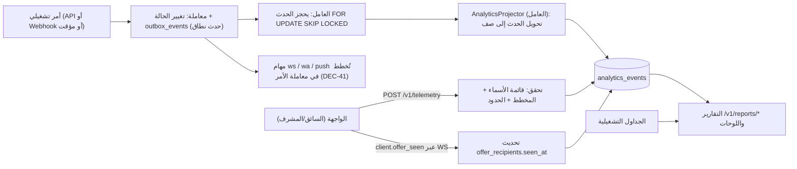

# 15 — خطة تتبّع الأحداث والقياس (Event Tracking Plan)

الإصدار 1.0 — 27 أكتوبر 2026 — الحالة: معتمد للتنفيذ في الإصدار الأول.

المراجع: `00_Source_Architecture_v1.2_AR.md` (§7، §15، §16) · `00_Glossary_Canon.md` (§7 الأحداث، §12 الإعدادات، §14 الشاشات) · `06_schema.sql` (`analytics_events` والجداول التشغيلية) · `DECISIONS.md` (DEC-24، DEC-41، DEC-42، DEC-45، DEC-46، Q-06) · `11_State_Machines_Domain_Events.md` (حمولات الأحداث) · `13_Payments_Settlement_Spec.md` · `14_Notification_Matrix_Templates.md` (تنبيهات المشرف).

---

## 1. الغرض والنطاق

يحدد هذا الملف ما يُقاس، ومن أين يأتي، وكيف يُسمّى ويُخزَّن، وكيف تُحسب مؤشرات الأداء الواردة في المعمارية §15، وما اللوحات وعتبات تنبيهات النظام. لا أدوات تحليل خارجية في الإصدار الأول (DEC-24): كل شيء في PostgreSQL، في جدول `analytics_events` وفي الجداول التشغيلية نفسها.

ثلاث طبقات قياس منفصلة:

| الطبقة | المصدر | الغرض | المخزن |
|---|---|---|---|
| أحداث التحليل من الخادم | أحداث النطاق في Outbox (القاموس §7.1) | قمعات وتسلسل زمني وتاريخ | `analytics_events` (`source = 'server'`) |
| قياسات العميل | `POST /v1/telemetry` ورسالة `client.offer_seen` | حقائق الجهاز والتجربة التي لا يراها الخادم | `analytics_events` (`source = 'client'`) |
| مقاييس النظام | عدادات ومدرجات تشغيلية (Prometheus عبر `/metrics`) | الأداء والصحة والتنبيه الفني | نظام المراقبة، لا قاعدة البيانات |

مؤشرات الأداء التشغيلية (§10) تُحسب من **الجداول التشغيلية** لأنها مصدر الحقيقة؛ `analytics_events` مكمّل للقمعات وقياسات العميل والتسلسل الزمني.

---

## 2. المبادئ

1. **الخادم أولًا:** كل حدث تحليلي من الخادم مشتق آليًا من حدث نطاق التُزم في Outbox. لا يُكتب حدث تحليلي من مسار طلب HTTP مباشرة.
2. **الخصوصية بالتصميم:** لا رقم جوال، لا `wa_id`، لا أي جزء من اللوحة، لا رمز تسليم أو ربط، لا رمز إجراء أو `payload`، لا خانة مفتاح أو موقف، لا نص حر كتبه موظف أو عميل، لا اسم شخص. المعرفات الداخلية `uuid` للموظفين والتذاكر مسموحة؛ معرف العميل `customer_id` غير مسموح.
3. **قياسات العميل للحد الأدنى:** فقط ما لا يستطيع الخادم ملاحظته (الصوت، أذونات الإشعارات، وضع العرض، الاتصال من جهة الجهاز، رؤية البطاقة، المزامنة، الأخطاء الظاهرة).
4. **مصدر الحقيقة واحد:** الحالة التشغيلية (مثل `devices.notification_permission` و`offer_recipients.seen_at`) تُحفظ في جداولها؛ الحدث التحليلي سجل زمني للتغيير وليس بديلًا عنها.
5. **قبول المهمة أهم من إرسال التنبيه** (المعمارية §15): المؤشر الحاكم هو زمن القبول والإحضار، لا عدد الإشعارات المرسلة.
6. **لا وعود زمنية:** القيم المستهدفة أهداف تصميم للاختبار وليست نتائج مقاسة؛ زمن مزود واتساب وPush والشبكة يقاس منفصلًا.

---

## 3. قائمة المحظورات (PII denylist)

مفاتيح لا تظهر أبدًا في `analytics_events.properties` (يرفضها المتحقق في الخادم):

`phone` · `phone_e164` · `wa_id` · `customer_id` · `plate` · `plate_digits` · `plate_letters_ar` · `plate_letters_en` · `plate_raw` · `key_tag` · `key_slot_id` · `key_slot_label` · `parking_spot_id` · `spot_label` · `spot_note` · `code` · `claim_code` · `link_code` · `token` · `action_token` · `payload` · `pos_reference` · `notes` · `reason` · `description` · `full_name` · `name` · `ip` · `user_agent` · `storage_key`

قواعد إضافية:

- لا قيم نصية حرة إطلاقًا: كل خاصية نصية إما من قائمة قيم محددة (enum) أو معرف `uuid` أو رمز خطأ من القاموس §8 أو معرف شاشة من القاموس §14.
- أوقات الحدث أعمدة لا خصائص؛ المدد تُخزن بالثواني `*_s` أو بالمللي ثانية `*_ms` أعدادًا.
- اختبار آلي يفحص عينة من كل نوع حدث بحثًا عن أنماط الجوال السعودي والأرقام السداسية في خصائص غير رقمية (§15). قاعدة الأرقام السداسية تتخطى المفاتيح المسماة `error_code` (رموز Meta مثل `131026`، §7.6)، وقاعدتا الجوال والأحرف العربية تبقيان عليها (DEC-165).

---

## 4. اصطلاح التسمية

- الصيغة `object_action` بزمن ماضٍ وحروف صغيرة وشرطة سفلية.
- **أحداث الخادم:** الاسم = نوع حدث النطاق مع استبدال النقطة بشرطة سفلية. مثال: `ticket.parked` ← `ticket_parked`، `task.broadcast_opened` ← `task_broadcast_opened`. القاعدة آلية ولا استثناءات، فكل حدث في القاموس §7.1 له اسم تحليلي واحد معروف مسبقًا.
- **أحداث العميل:** أسماء خاصة بها في §8 بالصيغة نفسها، ولا تتصادم مع أسماء الخادم.
- مهام `job.*` (القاموس §7.2) **لا** تُسجَّل كأحداث تحليلية؛ تُقاس كمقاييس نظام (§12).

---

## 5. الأعمدة المشتركة

كل صف في `analytics_events`:

| العمود | المعنى | أحداث الخادم | أحداث العميل |
|---|---|---|---|
| `name` | الاسم التحليلي | من §4 | من §8 |
| `source` | `server` أو `client` | `server` | `client` |
| `occurred_at` | وقت وقوع الحدث (UTC) | `occurred_at` في غلاف حدث النطاق | وقت الجهاز بعد فحص الانحراف (§9) |
| `received_at` | وقت الكتابة | `now()` | `now()` |
| `org_id` | المؤسسة | من الغلاف | من الجلسة |
| `venue_id` | الموقع | من الغلاف | من المناوبة المفتوحة أو `null` |
| `event_id` | **الحفل** (ليس معرف الحدث التحليلي) | من الغلاف | من المناوبة/الشاشة إن عُرف |
| `dispatch_pool_id` | مجموعة التوزيع | من الغلاف | من المناوبة المفتوحة |
| `actor_role` | `owner` · `admin` · `supervisor` · `driver` · `customer` · `system` | من فاعل الحدث | دور مستخدم الجلسة |
| `actor_id` | `uuid` المستخدم؛ `null` للعميل والنظام | من الغلاف | مستخدم الجلسة |
| `ticket_id` · `task_id` · `cycle_id` | سياق التشغيل إن وُجد | من الحمولة | إن تعلق الحدث بعرض أو تذكرة |
| `app_version` | إصدار الخادم لأحداث الخادم، وإصدار الواجهة لأحداث العميل | نسخة البناء | من الطلب |
| `properties` | خصائص الحدث (§7، §8) | حسب الجدول | حسب الجدول |

---

## 6. خط المعالجة



- الإسقاط يتم داخل معاملة العامل نفسها التي تعلّم حدث Outbox `done`؛ إن سقط العامل قبل `COMMIT` لا يُكتب شيء ويُعاد الحدث لاحقًا، فلا تكرار ولا فقد (§13).

---

## 7. كتالوج أحداث الخادم

القاعدة: الاسم = نوع حدث النطاق بعد استبدال النقطة. «الأوقات» تُحسب من طوابع الكيان المخزنة لا من وقت الإسقاط. جداول §7 و§8 وقائمة §3 هي المصدر؛ ونسختها في الكود `packages/shared/src/analytics.ts` (يستعملها الخادم والواجهة) يطابقها اختبار وحدة يقرأ هذه الجداول ويفشل عند أي فرق (DEC-147). الأنواع: `enum(a/b)` قائمة قيم، `int` عدد صحيح، `bool` منطقي، `uuid` معرف داخلي.

### 7.1 التذكرة

| الاسم التحليلي | الخصائص | يُستخدم في |
|---|---|---|
| `ticket_created` | `channel` enum(whatsapp/paper)، `pricing_mode` enum(included/per_vehicle) | حجم الاستلام؛ KPI-16 |
| `ticket_intake_submitted` | `channel`، `inspection_status` enum(complete/incomplete/exception_approved)، `photos_count` int، `has_customer_phone` bool، `wa_link_method` enum(direct/qr/none)، `intake_duration_s` int | KPI-14، KPI-16 |
| `ticket_parked` | `parking_duration_s` int، `spot_mode` enum(spot/note)، `key_slot_used` bool، `had_pending_retrieval` bool، `is_repark` bool | KPI-16 |
| `ticket_retrieval_requested` | `request_source` enum(whatsapp/staff)، `cycle_no` int، `requested_early` bool، `queue_depth` int، `available_drivers` int، `ingest_latency_ms` int (للطلب الذي تفتح ضغطة واتساب دورته فقط: من `whatsapp_inbound_events.received_at` حتى كتابة الدورة بساعة المعاملة؛ لا للطلب المبكر المحوَّل عند الصف ولا لطلب الموظف، DEC-367) | KPI-03، KPI-14، سعة التشغيل، هدف حفظ الطلب |
| `ticket_retrieval_requested_early` | `request_source` enum(whatsapp) (الطلب المبكر من زر واتساب فقط، DEC-25)، `status_at_request` enum(received/parking/reparking) | KPI-03 (تصنيف الطلب المبكر) |
| `ticket_assigned` | `wait_s` int (من `requested_at`)، `offer_mode` enum(single/broadcast)، `offer_round_no` int | KPI-01، KPI-13 |
| `ticket_assigned_waiting` | `wait_s` int، `offer_round_no` int | KPI-13 |
| `ticket_retrieving` | `start_after_claim_s` int، `from_next_task` bool | KPI-02 |
| `ticket_ready` | `request_to_ready_s` int، `retrieval_duration_s` int (من البدء) | KPI-03 |
| `ticket_delivered` | `ready_to_delivered_s` int، `request_to_delivered_s` int، `verification_method` enum(code/paper_stub/supervisor_exception) (المطابقة اليدوية لا تصدر هذا الحدث)، `payment_status` enum(not_required/collected/waived)، `cycle_no` int، `ticket_lifetime_s` int | KPI-04، KPI-05، KPI-15 |
| `ticket_reparking` | `cause` enum(customer_absent/supervisor_cancel) (DEC-42)، `ready_wait_s` int، `cycle_no` int | KPI-06 |
| `ticket_retrieval_canceled` | `status_at_cancel` enum(requested/assigned/assigned_waiting/retrieving/ready)، `canceled_by_role` enum(driver/supervisor)، `after_s` int | KPI-07 |
| `ticket_voided` | `voided_from_status` enum(received/parking) (DEC-45)، `had_data` bool | جودة التسجيل |
| `ticket_customer_phone_changed` | `changed_by_role` enum(driver/supervisor/admin) | جودة التسجيل |
| `ticket_wa_link_changed` | `from_status`، `to_status` enum(none/pending_send/pending_confirmation/linked/failed/opted_out)، `method` enum(direct/qr) | KPI-14 |
| `ticket_inspection_exception_approved` | `missing_photos_count` int | جودة الفحص |
| `ticket_inspection_completed` | `photos_count` int، `after_submit_s` int (من إرسال الاستلام حتى اكتمال الصور) | جودة الفحص |
| `ticket_manually_reconciled` | `target_status` enum(parked/delivered/voided)، `from_status` (قيم `tickets.status`)، `had_payment` bool | المطابقة بعد الانقطاع؛ تقرير الحفل |

### 7.2 المهمة والعرض

| الاسم التحليلي | الخصائص | يُستخدم في |
|---|---|---|
| `task_created` | `type` enum(park/retrieve/repark) | الحجم |
| `task_offered` | `round_no` int، `available_drivers` int | KPI-09، KPI-13 |
| `task_broadcast_opened` | `round_no` int، `recipient_count` int، `eligible_accept_count` int، `eligible_reserve_count` int، `view_only_count` int | KPI-13 |
| `task_broadcast_extended` | `added_recipients` int | KPI-13 |
| `task_claimed` | `mode` enum(single/broadcast)، `round_no` int، `result` enum(accepted/assigned_waiting)، `claim_latency_s` int (من `queued_at`)، `offer_latency_s` int (من إنشاء الجولة) | KPI-01، KPI-13 |
| `task_promoted` | `waited_as_next_s` int | KPI-02، KPI-13 |
| `task_key_picked_up` | `after_accept_s` int | KPI-02 |
| `task_started` | `type`، `after_claim_s` int | KPI-02 |
| `task_completed` | `type`، `duration_s` int | KPI-17 |
| `task_canceled` | `type`، `status_at_cancel` enum(queued/offered/broadcast/assigned_waiting/accepted/in_progress) | KPI-07 |
| `task_withdrawn` | `status_at_withdrawal` enum(assigned_waiting/accepted)، `key_was_picked_up` bool | جودة التوزيع |
| `task_reassigned` | `from_status`، `target` enum(queue/driver) | جودة التوزيع |
| `task_escalated` | `after_s` int، `mode_at_escalation` enum(none/single/broadcast)، `on_duty_drivers` int | KPI-13 |
| `offer_reminded` | `mode`، `round_no` int | KPI-09 |
| `offer_expired` | `mode`، `round_no` int، `next_action` enum(next_single/broadcast) | KPI-09 |
| `offer_revoked` | `mode`، `close_reason` enum(claimed_elsewhere/task_canceled/reassigned/recipient_unavailable/converted_to_broadcast/converted_to_single/transfer) | KPI-09 |

### 7.3 السائق والعهدة

| الاسم التحليلي | الخصائص | يُستخدم في |
|---|---|---|
| `driver_duty_started` | `audio_test_result` enum(heard/not_heard/blocked/none)، `notification_permission` enum(default/granted/denied/unsupported)، `display_mode` enum(browser/standalone)، `platform` enum(ios/android/desktop/other) | جاهزية الأجهزة |
| `driver_break_started` | — | KPI-17 |
| `driver_break_ended` | `break_duration_s` int | KPI-17 |
| `driver_duty_ended` | `duty_duration_s` int، `end_reason` enum(self/forced/transfer/disabled/shift_closed)، `tasks_completed` int | KPI-17 |
| `driver_availability_changed` | `from_state`، `to_state` enum(off_duty/on_break/available/intake_parking/retrieving/busy_with_next) | KPI-17، السلسلة الزمنية للتوفر |
| `driver_connection_changed` | `from`، `to` enum(online/uncertain/offline)، `had_custody` bool، `had_active_task` bool | صحة الاتصال |
| `driver_transfer_requested` | `scheduled_in_s` int | الإدارة |
| `driver_transfer_blocked` | `blocker_types` (قائمة enum(vehicle/key/active_task)؛ المهمة التالية لا تمنع النقل، DEC-32) | الإدارة |
| `driver_transferred` | — | الإدارة |
| `driver_disabled` | — | الإدارة |
| `driver_enabled` | — | الإدارة |
| `custody_changed` | `subject` enum(vehicle/key)، `custody_reason` (قيم `custody_events.reason`)، `from_holder_type`، `to_holder_type` | سلسلة العهدة (دون معرفات الحائز) |

### 7.4 التسليم والتحصيل

| الاسم التحليلي | الخصائص | يُستخدم في |
|---|---|---|
| `handover_code_issued` | `resend_no` int | KPI-15 |
| `handover_code_attempt_failed` | `attempt_no` int، `attempts_left` int | KPI-15 |
| `handover_code_locked` | — | KPI-15 |
| `handover_completed` | `verification_method` enum(code/paper_stub/supervisor_exception)، `failed_attempts` int | KPI-15 |
| `handover_exception_approved` | `had_payment` bool | KPI-15 |
| `payment_recorded` | `method` enum(cash/pos)، `amount_halalas` int، `source` enum(separate/handover/exception/reconcile/replacement) | KPI-11 |
| `payment_reversed` | `method`، `amount_halalas` int، `with_replacement` bool، `after_cash_handover` bool | KPI-11 |
| `payment_waived` | `amount_halalas` int | KPI-11 |
| `cash_handover_recorded` | `amount_halalas` int، `expected_halalas` int، `difference_halalas` int، `linked_payments_count` int | KPI-11، تسوية النقد (13 §10) |

### 7.5 التنبيهات والوقائع والحفل والوردية

| الاسم التحليلي | الخصائص | يُستخدم في |
|---|---|---|
| `alert_raised` | `type` (قيم `alerts.type`)، `severity` enum(info/warning/critical) | KPI-18 |
| `alert_acknowledged` | `type`، `ack_after_s` int | KPI-18 |
| `alert_resolved` | `type`، `resolved_by_system` bool، `open_duration_s` int | KPI-18 |
| `incident_opened` | `type` (قيم `incidents.type`)، `severity` enum(low/medium/high)، `auto_created` bool | KPI-12 |
| `incident_updated` | `type`، `status` enum(open/in_review/resolved/closed) | KPI-12 |
| `incident_resolved` | `type`، `open_duration_s` int | KPI-12 |
| `event_opened` | `pricing_mode` | تقرير الحفل |
| `event_closing_started` | `open_tickets` int | KPI-10 |
| `event_closed` | `tickets_total` int، `delivered` int، `voided` int، `reparked_cycles` int، `canceled_cycles` int، `closing_duration_s` int | تقرير الحفل |
| `shift_opened` | — | التشغيل |
| `shift_closed` | `duty_sessions_count` int | التشغيل |

### 7.6 واتساب

| الاسم التحليلي | الخصائص | يُستخدم في |
|---|---|---|
| `wa_inbound_received` | `kind` enum(text/button/interactive/other)، `matched` enum(action_token/link_code/opt_out/none) | صحة الرسائل |
| `wa_button_pressed` | `result` enum(request_created/status_reply/rejected_sender/rejected_stale/ticket_closed) | KPI-14، صحة الرسائل |
| `wa_message_status_changed` | `purpose` (W-01 … W-12)، `status` enum(sent/delivered/read/failed)، `error_code` نص من رموز المزود الرقمية فقط أو `null`، `since_queued_ms` int | KPI-08، صحة الرسائل |
| `wa_channel_health_changed` | `from`، `to` enum(healthy/degraded/down) | صحة النظام |
| `wa_customer_opted_out` | — | KPI-14 |

ملاحظة: تسليم النقد له حدث النطاق `cash.handover_recorded` المعتمد في القاموس §7.1، ومقابله التحليلي `cash_handover_recorded` في §7.4.

---

## 8. كتالوج قياسات العميل

تُرسل دفعات عبر `POST /v1/telemetry` (صلاحية `telemetry.write`). كلها `source = 'client'`.

| الاسم | متى يُرسل | الخصائص | الاستخدام |
|---|---|---|---|
| `app_started` | عند تحميل الواجهة بعد الدخول | `display_mode` enum(browser/standalone)، `platform` enum(ios/android/desktop/other)، `browser_family` enum(safari/chrome/samsung/firefox/edge/other)، `browser_major` int | مصفوفة الأجهزة |
| `audio_test_completed` | بعد «تفعيل واختبار الصوت» في D-03 أو D-14 | `result` enum(heard/not_heard/blocked)، `audio_api` enum(web_audio/html_audio)، `context` enum(duty_start/account) | جاهزية الصوت |
| `audio_blocked_detected` | محاولة تشغيل صوت تنبيه رُفضت من المتصفح | `sound` enum(offer/broadcast/reminder/next_due/escalation/test)، `recovered_by_tap` bool | موثوقية التنبيه |
| `notification_permission_changed` | تغيّر إذن الإشعارات المرصود | `from`، `to` enum(default/granted/denied/unsupported)، `context` enum(duty_start/account/banner) | تبنّي Push |
| `push_subscription_changed` | اشتراك/إلغاء/فشل Web Push | `status` enum(subscribed/unsubscribed/failed)، `error_name` enum(not_allowed/abort/network/invalid_state/unknown) | تبنّي Push |
| `push_notification_clicked` | فتح الواجهة من إشعار (مصدره رسالة `push.click` التي يرسلها Service Worker للنافذة المركّزة بـ`kind` و`age_ms` = الآن − `sent_at` الحمولة؛ إرساله متروك لتذكرة التحليلات، DEC-390) | `kind` enum(offer/broadcast/reminder/next_due/escalation/closed) (أنواع Push في القاموس §5.7)، `age_ms` int | فعالية Push |
| `pwa_installed` | أول تشغيل بوضع `standalone` أو قبول التثبيت | `platform`، `method` enum(install_prompt/ios_manual/detected_standalone) | تبنّي PWA |
| `connection_changed` | تغيّر الاتصال من جهة الجهاز | `from`، `to` enum(online/uncertain/offline)، `cause` enum(ws_disconnect/navigator_offline/heartbeat_timeout/recovered)، `offline_ms` int | صحة الاتصال |
| `sync_completed` | بعد مزامنة كاملة | `sync_reason` enum(startup/reconnect/visibility/sync_required/manual)، `duration_ms` int، `stale_ms` int، `changed` bool | سلامة البيانات المعروضة |
| `offer_card_seen` | ظهور بطاقة عرض أو بث للسائق (يُشتق من `client.offer_seen`؛ انظر §9.4) | `offer_id` uuid، `mode` enum(single/broadcast)، `via` enum(ws/push/sync)، `receive_latency_ms` int، `eligible_as` enum(accept/reserve_next/view_only) | زمن الوصول إلى السائق |
| `offer_card_removed` | اختفاء البطاقة | `offer_id` uuid، `removal_reason` enum(claimed_elsewhere/expired/accepted/revoked)، `visible_ms` int | تجربة البث |
| `ui_error_shown` | عرض خطأ للمستخدم | `error_code` رمز من القاموس §8، `screen` معرف من القاموس §14، `http_status` int، `presentation` enum(toast/inline/dialog/banner) | جودة التجربة |
| `page_hidden_during_duty` | عند عودة الصفحة للظهور بعد اختفائها أثناء المناوبة | `hidden_ms` int، `had_active_task` bool، `had_open_offer` bool | خطر فوات التنبيهات |
| `wake_lock_changed` | طلب/فقد Screen Wake Lock | `supported` bool، `state` enum(acquired/released/failed) | بقاء الشاشة |
| `form_draft_restored` | استعادة مسودة نموذج بعد فشل شبكة أو إعادة تحميل | `screen` enum(D-05/D-06/D-08/D-11)، `age_ms` int | عدم فقد المدخلات |
| `app_update_applied` | تفعيل نسخة واجهة جديدة | `from_version`، `to_version` | تتبع الإصدارات |

لا تُرسل قياسات قبل الدخول (D-01، S-01) لعدم وجود جلسة.

---

## 9. واجهة `POST /v1/telemetry`

### 9.1 الطلب

```json
{
  "app_version": "1.0.3",
  "device_id": "5a0d6c8e-2a51-4a3e-9c1f-6f0a1b2c3d4e",
  "client_session_id": "b7f1e2d3-1c2b-4a59-8e7f-0a9b8c7d6e5f",
  "events": [
    {
      "name": "audio_test_completed",
      "occurred_at": "2026-10-27T17:02:11.120Z",
      "seq": 41,
      "screen": "D-03",
      "task_id": null,
      "properties": { "result": "heard", "audio_api": "web_audio", "context": "duty_start" }
    }
  ]
}
```

النقل: `fetch(…, {keepalive: true})` مع ترويسات CSRF (DEC-29) ولو عند إخفاء الصفحة؛ لا `navigator.sendBeacon` لأنه لا يضبط الترويسات، والواجهة تتحقق من كل حدث بـ`parseTelemetryEvent` قبل إدراجه في الدفعة (DEC-167).

### 9.2 الرد

`202 Accepted` بلا جسم. الأحداث المرفوضة لا تُفشل الدفعة: تُسقط وتُسجَّل في السجل ومقياس الخادم دون إعادتها للواجهة. المسار ليس أمرًا: بلا `Idempotency-Key` ولا صف تدقيق، في معاملته الخاصة (DEC-149). ترد مشكلات الدفعة وحدها (`VALIDATION_FAILED` و`RATE_LIMITED`، §9.3)؛ أما الحدث المرفوض فيُعد في `point_analytics_rejected_total{source="client",reason}` بالأسباب `invalid_event`، `unknown_name`، `denied_property`، `invalid_properties`، `pii_value`، `out_of_window`، `unknown_reference`، `offer_already_seen` (DEC-148).

### 9.3 قواعد التحقق

القوائم والحدود هنا هي كتالوج `packages/shared/src/analytics.ts` نفسه (`parseTelemetryEvent`، `TELEMETRY_LIMITS`)، فيطبقها الخادم والواجهة معًا (DEC-147).

| القاعدة | السلوك |
|---|---|
| الجلسة | مطلوبة؛ وإلا `AUTH_UNAUTHENTICATED` |
| حجم الدفعة | حتى 50 حدثًا و64 كيلوبايت؛ تجاوزه `VALIDATION_FAILED` (الجسم الكبير بالحقل `(body)` والمشكلة `too_large`، DEC-148) |
| معدل الإرسال | حتى 120 حدثًا في الدقيقة لكل جهاز (المفتاح المستخدم + الجهاز)؛ تجاوزه `RATE_LIMITED` مع `retry_after_s` (DEC-148) |
| الاسم | من قائمة §8 فقط؛ غيره يُعدّ مرفوضًا |
| الخصائص | مخطط صارم لكل اسم (zod `.strict()`)؛ مفتاح غير معروف أو من قائمة §3 يرفض الحدث |
| `occurred_at` | بين 24 ساعة قبل وقت الخادم و5 دقائق بعده؛ خارج ذلك يُرفض الحدث |
| `device_id` | يجب أن يخص مستخدم الجلسة (`devices.user_id`) وغير ملغى؛ وإلا `VALIDATION_FAILED` بالحقل `device_id` والمشكلة `not_owned` للدفعة كلها (DEC-148) |
| `seq` و`client_session_id` | يُحفظان في `properties` باسم `client_seq` و`client_session_id` لكشف التكرار والانحراف |
| الإثراء | الخادم يضيف `org_id` و`actor_id` و`actor_role` ومن المناوبة المفتوحة `venue_id` و`dispatch_pool_id` |

### 9.4 `offer_card_seen`

- المسار الأساسي: الواجهة ترسل `client.offer_seen` عبر WebSocket (وقد يحمل `receive_latency_ms`)؛ البوابة تستدعي `RealtimeDeps.offerSeen` (audit-monitoring) فيحدّث الخادم `offer_recipients.seen_at` (إن كان فارغًا) ويكتب صف `offer_card_seen` بمصدر `client` في المعاملة نفسها: `via: ws`، و`mode` و`eligible_as` من العرض، و`receive_latency_ms` من العميل إن أرسله وإلا من إنشاء الجولة حتى الرسالة؛ والإقرار `{ok: true}` (DEC-166).
- عند انقطاع WebSocket: يُرسل الحدث ضمن دفعة `/v1/telemetry`؛ الخادم يكتبه فقط إن كان `seen_at` ما زال فارغًا، ثم يعبّئه. هكذا لا يتكرر الحدث بين المسارين.
- `receive_latency_ms` = وقت الجهاز عند العرض ناقص `created_at` لجولة العرض كما يرسلها الخادم في الحدث؛ يُصحَّح بانحراف الساعة المقاس في آخر مزامنة (`server_time`).

---

## 10. مؤشرات الأداء (KPI) — تعريفات واستعلامات

المعامل `:event_id` معرف الحفل. المدد بالثواني. «p50/p90» عبر `percentile_cont`. **الدورات الملغاة مستبعدة من متوسطات التسليم وتُعرض منفصلة** (المعمارية §15).

افتراضات على طوابع الكيانات (تُضبط في 11): `tasks.queued_at` لحظة دخول المهمة الطابور (أو عودتها إليه)، `tasks.claimed_at` لحظة أول قبول مؤكد، `tasks.accepted_at` لحظة صيرورة المهمة `accepted` (القبول المباشر أو الترقية من `assigned_waiting`)، `claim_codes.attempts` عدد المحاولات الفاشلة.

### KPI-01 زمن قبول السائق

من دخول الطابور إلى أول قبول مؤكد. مهمة أُعيدت للطابور تُقاس من آخر دخول؛ انتظار العميل الكامل في KPI-03.

```sql
SELECT count(*)                                                      AS claimed_tasks,
       percentile_cont(0.5) WITHIN GROUP (ORDER BY s)                AS p50_s,
       percentile_cont(0.9) WITHIN GROUP (ORDER BY s)                AS p90_s,
       round(avg(s)::numeric, 1)                                     AS avg_s,
       round(100.0 * count(*) FILTER (WHERE s <= :escalation_s) / NULLIF(count(*), 0), 1) AS pct_within_escalation
  FROM (SELECT EXTRACT(EPOCH FROM (t.claimed_at - t.queued_at)) AS s
          FROM tasks t
         WHERE t.event_id = :event_id
           AND t.type = 'retrieve'
           AND t.claimed_at IS NOT NULL
           AND t.queued_at IS NOT NULL) x;
```

`:escalation_s` = قيمة `dispatch.unaccepted_escalation_s` للموقع (الافتراضي 60).

### KPI-02 زمن بدء الإحضار

مقياسان: من القبول المؤكد إلى البدء، ومن صيرورة المهمة قابلة للبدء (`accepted`) إلى البدء — والثاني هو العادل للمهام التالية.

```sql
SELECT (t.assigned_waiting_at IS NOT NULL)                                                       AS was_next_task,
       count(*)                                                                                   AS started_tasks,
       percentile_cont(0.5) WITHIN GROUP (ORDER BY EXTRACT(EPOCH FROM (t.started_at - t.claimed_at)))  AS p50_start_after_claim_s,
       percentile_cont(0.5) WITHIN GROUP (ORDER BY EXTRACT(EPOCH FROM (t.started_at - t.accepted_at))) AS p50_start_after_accept_s,
       percentile_cont(0.5) WITHIN GROUP (ORDER BY EXTRACT(EPOCH FROM (t.key_picked_up_at - t.accepted_at)))
         FILTER (WHERE t.key_picked_up_at IS NOT NULL)                                            AS p50_key_pickup_s
  FROM tasks t
 WHERE t.event_id = :event_id
   AND t.type = 'retrieve'
   AND t.started_at IS NOT NULL
 GROUP BY 1;
```

### KPI-03 / KPI-04 / KPI-05 الطلب إلى الجاهزية، الجاهزية إلى التسليم، الطلب إلى التسليم

```sql
WITH c AS (
  SELECT rc.*
    FROM retrieval_cycles rc
    JOIN tickets tk ON tk.id = rc.ticket_id
   WHERE tk.event_id = :event_id
)
SELECT
  -- KPI-03: يشمل الدورات التي بلغت الجاهزية ثم أُعيد صفها لغياب العميل
  count(*) FILTER (WHERE ready_at IS NOT NULL AND outcome IN ('delivered','reparked'))       AS ready_cycles,
  percentile_cont(0.5) WITHIN GROUP (ORDER BY EXTRACT(EPOCH FROM (ready_at - requested_at)))
    FILTER (WHERE ready_at IS NOT NULL AND outcome IN ('delivered','reparked'))              AS p50_request_to_ready_s,
  percentile_cont(0.9) WITHIN GROUP (ORDER BY EXTRACT(EPOCH FROM (ready_at - requested_at)))
    FILTER (WHERE ready_at IS NOT NULL AND outcome IN ('delivered','reparked'))              AS p90_request_to_ready_s,
  -- KPI-04: المسلّمة فقط
  percentile_cont(0.5) WITHIN GROUP (ORDER BY EXTRACT(EPOCH FROM (delivered_at - ready_at)))
    FILTER (WHERE outcome = 'delivered')                                                       AS p50_ready_to_delivered_s,
  -- KPI-05: من طرف إلى طرف، المسلّمة فقط
  percentile_cont(0.5) WITHIN GROUP (ORDER BY EXTRACT(EPOCH FROM (delivered_at - requested_at)))
    FILTER (WHERE outcome = 'delivered')                                                       AS p50_request_to_delivered_s,
  percentile_cont(0.9) WITHIN GROUP (ORDER BY EXTRACT(EPOCH FROM (delivered_at - requested_at)))
    FILTER (WHERE outcome = 'delivered')                                                       AS p90_request_to_delivered_s,
  -- للعرض المنفصل
  count(*) FILTER (WHERE outcome = 'canceled')                                                 AS canceled_cycles,
  count(*) FILTER (WHERE requested_early)                                                      AS early_requests
  FROM c;
```

الطلب المبكر (`requested_early = true`) يحتفظ بوقت الطلب الأصلي (DEC-13)، فيشمل زمن الصف؛ يُعرض مقسومًا حسب `requested_early` في تقرير الحفل.

### KPI-06 دورات إعادة الصف

```sql
SELECT count(*) FILTER (WHERE rc.outcome = 'reparked')                       AS reparked_cycles,
       count(DISTINCT rc.ticket_id) FILTER (WHERE rc.outcome = 'reparked')   AS tickets_with_repark
  FROM retrieval_cycles rc
  JOIN tickets tk ON tk.id = rc.ticket_id
 WHERE tk.event_id = :event_id;
```

### KPI-07 الدورات الملغاة (تُعرض منفصلة)

```sql
SELECT count(*)                                                                                   AS canceled_cycles,
       count(*) FILTER (WHERE rc.assigned_at IS NULL AND rc.assigned_waiting_at IS NULL)          AS canceled_before_claim,
       count(*) FILTER (WHERE rc.assigned_at IS NOT NULL OR rc.assigned_waiting_at IS NOT NULL)   AS canceled_after_claim,
       percentile_cont(0.5) WITHIN GROUP (ORDER BY EXTRACT(EPOCH FROM (rc.canceled_at - rc.requested_at))) AS p50_request_to_cancel_s
  FROM retrieval_cycles rc
  JOIN tickets tk ON tk.id = rc.ticket_id
 WHERE tk.event_id = :event_id
   AND rc.outcome = 'canceled';
```

### KPI-08 الرسائل الفاشلة

يفترض أن الرسائل الصادرة تحمل `event_id` و`purpose` (W-01 … W-12) وفق 12.

```sql
SELECT wm.purpose,
       count(*) FILTER (WHERE wm.status IN ('sent','delivered','read','failed'))  AS attempted,
       count(*) FILTER (WHERE wm.status = 'failed')                               AS failed,
       count(*) FILTER (WHERE wm.status IN ('delivered','read'))                  AS delivered_or_read,
       count(*) FILTER (WHERE wm.status = 'skipped')                              AS skipped,
       round(100.0 * count(*) FILTER (WHERE wm.status = 'failed')
             / NULLIF(count(*) FILTER (WHERE wm.status IN ('sent','delivered','read','failed')), 0), 2) AS failure_rate_pct
  FROM whatsapp_messages wm
 WHERE wm.event_id = :event_id
   AND wm.direction = 'outbound'
 GROUP BY wm.purpose
 ORDER BY wm.purpose;

-- حسب رمز خطأ المزود
SELECT wm.error_code, wm.error_title, count(*) AS failed
  FROM whatsapp_messages wm
 WHERE wm.event_id = :event_id AND wm.direction = 'outbound' AND wm.status = 'failed'
 GROUP BY wm.error_code, wm.error_title
 ORDER BY failed DESC;
```

### KPI-09 العروض المنتهية

```sql
SELECT o.mode,
       count(*)                                         AS closed_rounds,
       count(*) FILTER (WHERE o.status = 'accepted')    AS accepted,
       count(*) FILTER (WHERE o.status = 'expired')     AS expired,
       count(*) FILTER (WHERE o.status = 'revoked')     AS revoked,
       round(100.0 * count(*) FILTER (WHERE o.status = 'expired') / NULLIF(count(*), 0), 1) AS expiry_rate_pct
  FROM task_offers o
  JOIN tasks t ON t.id = o.task_id
 WHERE t.event_id = :event_id
   AND o.status <> 'active'
 GROUP BY o.mode;

-- العروض الفردية المنتهية لكل سائق (للتدريب، لا للعقاب)
SELECT r.user_id, count(*) AS expired_single_offers
  FROM offer_recipients r
  JOIN task_offers o ON o.id = r.offer_id
  JOIN tasks t ON t.id = o.task_id
 WHERE t.event_id = :event_id AND o.mode = 'single' AND o.status = 'expired'
 GROUP BY r.user_id;
```

### KPI-10 التذاكر المفتوحة عند نهاية الحفل

«نهاية الحفل» = بدء الإغلاق `events.closing_started_at` (ويُحسب أيضًا عند `events.ends_at` المخطط إن وُجد). عند `closed_at` يجب أن تكون القيمة صفرًا بحكم موانع الإغلاق.

```sql
SELECT count(*) AS open_at_closing_start
  FROM tickets tk
  JOIN events e ON e.id = tk.event_id
 WHERE tk.event_id = :event_id
   AND e.closing_started_at IS NOT NULL
   AND tk.created_at <= e.closing_started_at
   AND (tk.delivered_at IS NULL OR tk.delivered_at > e.closing_started_at)
   AND (tk.voided_at   IS NULL OR tk.voided_at   > e.closing_started_at);
```

### KPI-11 المبالغ حسب وسيلة التحصيل

```sql
SELECT 'collected_' || p.method AS bucket, count(*) AS count, sum(p.amount_halalas) AS halalas
  FROM payments p
 WHERE p.event_id = :event_id AND p.status = 'recorded'
 GROUP BY p.method
UNION ALL
SELECT 'waived', count(*), coalesce(sum(t.fee_halalas), 0)
  FROM tickets t
 WHERE t.event_id = :event_id AND t.status <> 'voided' AND t.payment_status = 'waived'
UNION ALL
SELECT 'due', count(*), coalesce(sum(t.fee_halalas), 0)
  FROM tickets t
 WHERE t.event_id = :event_id AND t.status <> 'voided' AND t.payment_status = 'due';
```

التفصيل الكامل والتسوية لكل سائق في `13_Payments_Settlement_Spec.md` §11.

### KPI-12 الوقائع

```sql
SELECT i.type, i.severity,
       count(*)                                                  AS opened,
       count(*) FILTER (WHERE i.status IN ('open','in_review'))  AS still_open,
       percentile_cont(0.5) WITHIN GROUP (ORDER BY EXTRACT(EPOCH FROM (i.resolved_at - i.created_at)))
         FILTER (WHERE i.resolved_at IS NOT NULL)                AS p50_time_to_resolve_s
  FROM incidents i
 WHERE i.event_id = :event_id
 GROUP BY i.type, i.severity
 ORDER BY opened DESC;
```

### KPI-13 خليط التوزيع والتصعيد

```sql
WITH rt AS (
  SELECT t.id, t.claimed_at, t.assigned_waiting_at, t.escalated_at,
         (SELECT o.mode FROM task_offers o
           WHERE o.task_id = t.id AND o.status = 'accepted'
           ORDER BY o.closed_at DESC LIMIT 1) AS claim_mode
    FROM tasks t
   WHERE t.event_id = :event_id AND t.type = 'retrieve'
)
SELECT count(*)                                                    AS retrieve_tasks,
       count(*) FILTER (WHERE escalated_at IS NOT NULL)            AS escalated,
       round(100.0 * count(*) FILTER (WHERE escalated_at IS NOT NULL) / NULLIF(count(*), 0), 1) AS escalation_rate_pct,
       count(*) FILTER (WHERE claim_mode = 'single')               AS claimed_single,
       count(*) FILTER (WHERE claim_mode = 'broadcast')            AS claimed_broadcast,
       count(*) FILTER (WHERE assigned_waiting_at IS NOT NULL)     AS reserved_as_next
  FROM rt;
```

### KPI-14 تبنّي واتساب ونجاح الربط

```sql
SELECT count(*)                                                AS tickets,
       count(*) FILTER (WHERE tk.channel = 'whatsapp')         AS whatsapp_channel,
       count(*) FILTER (WHERE tk.wa_link_status = 'linked')    AS linked,
       count(*) FILTER (WHERE tk.wa_link_status = 'failed')    AS link_failed,
       count(*) FILTER (WHERE tk.wa_link_status = 'opted_out') AS opted_out,
       count(*) FILTER (WHERE tk.channel = 'paper')            AS paper
  FROM tickets tk
 WHERE tk.event_id = :event_id AND tk.status <> 'voided';

-- طريقة الموافقة/الربط
SELECT cc.method, count(*) AS consents
  FROM customer_consents cc
  JOIN tickets tk ON tk.id = cc.ticket_id
 WHERE tk.event_id = :event_id
 GROUP BY cc.method;

-- مصدر طلبات الإحضار
SELECT rc.request_source, count(*) AS cycles
  FROM retrieval_cycles rc
  JOIN tickets tk ON tk.id = rc.ticket_id
 WHERE tk.event_id = :event_id
 GROUP BY rc.request_source;
```

### KPI-15 التحقق عند التسليم

```sql
SELECT count(*)                                       AS codes_issued,
       count(*) FILTER (WHERE cc.attempts > 0)        AS codes_with_failed_attempts,
       count(*) FILTER (WHERE cc.locked_at IS NOT NULL) AS codes_locked,
       count(*) FILTER (WHERE cc.resend_no > 0)       AS codes_resent,
       count(*) FILTER (WHERE cc.consumed_at IS NOT NULL) AS codes_consumed
  FROM claim_codes cc
  JOIN tickets tk ON tk.id = cc.ticket_id
 WHERE tk.event_id = :event_id;

-- طريقة التحقق في التسليمات (من التحليلات)
SELECT ae.properties->>'verification_method' AS method, count(*) AS deliveries
  FROM analytics_events ae
 WHERE ae.event_id = :event_id AND ae.name = 'ticket_delivered'
 GROUP BY 1;
```

### KPI-16 مدة التسجيل والصف

```sql
WITH firsts AS (
  SELECT tk.id, tk.created_at, tk.submitted_at,
         (SELECT min(te.occurred_at) FROM ticket_events te
           WHERE te.ticket_id = tk.id AND te.type = 'ticket.parked') AS first_parked_at
    FROM tickets tk
   WHERE tk.event_id = :event_id AND tk.status <> 'voided'
)
SELECT count(*)                                                                                            AS tickets,
       percentile_cont(0.5) WITHIN GROUP (ORDER BY EXTRACT(EPOCH FROM (submitted_at - created_at)))       AS p50_intake_s,
       percentile_cont(0.5) WITHIN GROUP (ORDER BY EXTRACT(EPOCH FROM (first_parked_at - submitted_at)))  AS p50_parking_s
  FROM firsts
 WHERE submitted_at IS NOT NULL AND first_parked_at IS NOT NULL;
```

### KPI-17 استغلال السائقين (تقريبي، لكل وردية)

```sql
WITH duty AS (
  SELECT ds.user_id,
         sum(EXTRACT(EPOCH FROM (coalesce(ds.ended_at, now()) - ds.started_at))) AS duty_s
    FROM duty_sessions ds
   WHERE ds.shift_id = :shift_id
   GROUP BY ds.user_id
), busy AS (
  SELECT t.assignee_id AS user_id,
         sum(EXTRACT(EPOCH FROM (t.completed_at -
             CASE WHEN t.type = 'retrieve' THEN coalesce(t.accepted_at, t.claimed_at) ELSE t.created_at END))) AS busy_s
    FROM tasks t
   WHERE t.status = 'completed'
     AND EXISTS (SELECT 1 FROM duty_sessions ds
                  WHERE ds.user_id = t.assignee_id AND ds.shift_id = :shift_id
                    AND t.completed_at BETWEEN ds.started_at AND coalesce(ds.ended_at, now()))
   GROUP BY t.assignee_id
)
SELECT d.user_id, round(d.duty_s) AS duty_s, round(coalesce(b.busy_s, 0)) AS busy_s,
       round(100.0 * coalesce(b.busy_s, 0) / NULLIF(d.duty_s, 0), 1) AS utilization_pct
  FROM duty d
  LEFT JOIN busy b USING (user_id)
 ORDER BY utilization_pct DESC NULLS LAST;
```

يشمل وقت المناوبة فترات الاستراحة؛ لطرحها تُجمع `break_duration_s` من `driver_break_ended` للمستخدم في الوردية. المؤشر للتخطيط والتدريب، لا لمقارنة السائقين دون سياق (بعد المواقف ونوع الحفل).

### KPI-18 استجابة المشرف للتنبيهات

```sql
SELECT a.type, a.severity,
       count(*)                                                                      AS raised,
       percentile_cont(0.5) WITHIN GROUP (ORDER BY EXTRACT(EPOCH FROM (a.acknowledged_at - a.raised_at)))
         FILTER (WHERE a.acknowledged_at IS NOT NULL)                                AS p50_ack_s,
       count(*) FILTER (WHERE a.status = 'resolved' AND a.resolved_by IS NULL)       AS auto_resolved
  FROM alerts a
 WHERE a.venue_id = :venue_id
   AND a.raised_at BETWEEN :from AND :to
 GROUP BY a.type, a.severity;
```

يُفلتر بالموقع والفترة لأن بعض التنبيهات (مثل `no_drivers_on_duty`) قد لا تحمل `event_id`.

### أهداف الأداء التقنية (من المعمارية §15)

| الهدف | التعريف | مصدر القياس |
|---|---|---|
| حفظ الطلب p95 أقل من ثانيتين | من استلام الـWebhook (`whatsapp_inbound_events.received_at`) حتى التزام دورة الاسترجاع؛ وطلب الموظف من طلب API حتى رده | المرجع `point_retrieval_request_ingest_seconds` يرصده العامل بعد التزام الوارد للضغطة التي فتحت دورة (05 §12.2)، والخاصية `ingest_latency_ms` في `ticket_retrieval_requested` المدى نفسه حتى كتابة الدورة قبل الالتزام؛ وطلب الموظف `point_http_request_duration_seconds` لـ`POST /v1/tickets/{ticketId}/retrievals` (DEC-367) |
| نشر حدث الإسناد p95 أقل من 3 ثوانٍ | من التزام القبول حتى بث `task.claimed` و`task.updated` | مقياس نظام في ناشر WebSocket |

زمن مزود واتساب (`since_queued_ms` في `wa_message_status_changed`) وزمن وصول العرض للجهاز (`receive_latency_ms` في `offer_card_seen`) يُعرضان منفصلين ولا يدخلان في هذين الهدفين.

---

## 11. اللوحات

### 11.1 لوحة التشغيل الحية (S-02)

تتحدث فوريًا عبر WebSocket مع جلب احتياطي كل 15 ثانية. الجمهور: المشرف ضمن نطاقه.

| العنصر | المصدر | ملاحظة |
|---|---|---|
| طابور الطلبات: العدد حسب `queued`/`offered`/`broadcast` وأقدم انتظار | `v_pool_queue` (`now() - priority_at`) | أحمر عند تجاوز `dispatch.unaccepted_escalation_s` |
| السائقون حسب `driver_state` و`connection_state` | `v_driver_state` | النص بجانب اللون |
| المهام التالية المنتظرة وأطولها انتظارًا | `tasks` بحالة `assigned_waiting` | تمييز عند تجاوز `dispatch.next_task_wait_alert_s` |
| التنبيهات المفتوحة حسب الشدة | `alerts` غير `resolved` | — |
| الرسائل الفاشلة آخر 30 دقيقة | `whatsapp_messages` بحالة `failed` | رابط إلى S-03 |
| التذاكر حسب الحالة | `tickets` للحفلات المفتوحة | — |
| الطلب إلى الجاهزية آخر 60 دقيقة (p50) | `retrieval_cycles` | نافذة متحركة |
| التصعيدات آخر ساعة | `tasks.escalated_at` | — |
| العهدة الحالية: مفاتيح ومركبات بيد سائقين | `tickets.key_holder_type` و`vehicle_holder_type` = `driver` | — |
| النقد بعهدة السائقين | 13 §9 | ملخص فقط |

### 11.2 تقرير الحفل (S-11 + التسوية)

| العنصر | المصدر |
|---|---|
| بطاقات: التذاكر، المسلّمة، الدورات، إعادة الصف، الملغاة، المفتوحة عند بدء الإغلاق | KPI-03…07، KPI-10 |
| توزيعات p50/p90 لـKPI-01 وKPI-02 وKPI-03 وKPI-05 مع مدرج تكراري | الاستعلامات أعلاه |
| سلسلة زمنية كل 15 دقيقة: الطلبات مقابل السائقين المتاحين | `retrieval_cycles.requested_at` + `driver_availability_changed` |
| خليط التوزيع والتصعيد | KPI-13 |
| واتساب: قمع الإرسال، الفشل، التبنّي | KPI-08، KPI-14 |
| التحقق عند التسليم | KPI-15 |
| المالي | `GET /v1/events/{eventId}/settlement` |
| الوقائع | KPI-12 |

### 11.3 أداء السائقين (S-06 وS-11)

لكل سائق ضمن الفترة: الاستلامات (`ticket_created` بفاعله)، الصفوف المكتملة، الإحضارات المكتملة، p50 لـKPI-01 وKPI-02 على مهامه، العروض الفردية المنتهية (KPI-09)، القبول في البث، الحجوزات التالية، محاولات الرمز الفاشلة، التسليمات الاستثنائية، ساعات المناوبة والاستغلال (KPI-17)، النقد المحصّل والمسلّم. الجمهور: المشرف والإدارة فقط؛ تظهر مع ملاحظة «تُقرأ بسياق الحفل».

### 11.4 صحة الرسائل (S-11 للإدارة)

| العنصر | المصدر |
|---|---|
| قمع حسب القالب: queued → sent → delivered → read، والفشل والتخطي | `whatsapp_messages` |
| الأخطاء حسب رمز المزود | KPI-08 |
| زمن queued → sent وsent → delivered (p50/p95) | أعمدة الأوقات في `whatsapp_messages` |
| ضغطات زر «طلب السيارة» ونتيجتها | `wa_button_pressed.result` |
| الرسائل الحرة الواردة والردود | `wa_inbound_received` |
| إيقاف الرسائل | `wa_customer_opted_out` |
| خط زمني لصحة القناة | `wa_channel_health_changed` |
| الربط المباشر مقابل QR ونسبة نجاح كل منهما | KPI-14 |

### 11.5 صحة النظام (للإدارة والمشغّل الفني)

| العنصر | المصدر |
|---|---|
| Outbox: العدد حسب الحالة والنوع، عمر أقدم حدث مستحق، أحداث `dead` | `outbox_events` + مقياس |
| الـWebhook: آخر استلام، المعدل، أحداث `pending` وعمرها | `whatsapp_inbound_events` |
| زمن حفظ الطلب p95 وزمن نشر الإسناد p95 | مقاييس النظام |
| اتصالات WebSocket حسب الموقع والنبضات المفقودة | مقاييس + `duty_sessions.connection_state` |
| Web Push: النجاح والفشل، الأجهزة بفشل متكرر | `notification_attempts` + `devices.push_failed_count` |
| أخطاء API حسب الرمز (5xx وأهم 4xx) | مقاييس |
| مدة تمريرة التوزيع وعددها | `dispatch_pools.pass_count` + مقياس |
| النسخ الاحتياطي: آخر نجاح، آخر اختبار استعادة | مراقبة البنية |
| قياسات العميل: الصوت المحجوب، الإذن المرفوض، الصفحة المخفية أثناء المناوبة | `analytics_events` (`source = 'client'`) |

---

## 12. عتبات تنبيهات النظام

القيم أولية قابلة للضبط بعد التجربة. «تنبيه مشرف» = صف في `alerts` بنوع من القاموس §5.7 يُبث لغرفة `venue:{venueId}:supervisors` (التفاصيل والنصوص في 14). «مراقبة» = تنبيه فني خارج التطبيق للمشغّل. شدة تنبيه المشرف وصوته ونصه وشرط حله مرجعها النهائي 14 §8؛ عمودا «تحذير» و«حرج» هنا عتبات للشرط، وما يتجاوز شدة التنبيه المعرّفة في 14 فهو للمراقبة فقط.

| الحالة | الشرط | تحذير | حرج | التوجيه | الإغلاق التلقائي |
|---|---|---|---|---|---|
| ارتفاع عمر Outbox | عمر أقدم حدث `pending` مستحق (`available_at <= now()`)، أو `processing` انتهى تأجيره (DEC-158) | — | أكثر من `ops.outbox_lag_alert_s` (30 ثانية) | `outbox_lag` (حرج، 14 §8) لكل موقع متأثر فيه حفل مفتوح أو قيد الإغلاق + الإدارة + مراقبة | عودة التأخر تحت العتبة لمدة دقيقتين (بدايتها في `details.below_since`) ولا صف `dead` (14 §8) |
| مهام ميتة | ظهور حدث `dead` | — | أي حدث | `outbox_lag` (حرج) كما أعلاه + مراقبة | بعد معالجة الصف يدويًا (`outbox.manage`: إعادة، أو إغلاق `canceled` لمهمة قديمة أو مكررة، DEC-150) وتحقق شرط الإغلاق أعلاه |
| توقف الـWebhooks | مضت 10 دقائق على آخر طلب Webhook ووُجدت بعده رسالة صادرة قُبلت قبل 10 دقائق فأكثر؛ يفحصه المرسل عند قبول إرسال (DEC-146) | — | 10 دقائق | `wa_webhook_silent` (حرج، 14 §8) لكل موقع متأثر + الإدارة + مراقبة؛ صحة القناة وفق الملف 12 §5.14 وحده | وصول طلب جديد |
| نسبة أخطاء الإرسال | `failed` ÷ المحاولات خلال 15 دقيقة (بحد أدنى 20 محاولة) | 5% فأكثر | 20% فأكثر، أو 5 إخفاقات متتالية | مراقبة؛ `wa_send_failed` لكل رسالة فاشلة دائمًا؛ صحة القناة (`degraded`/`down`) وتنبيه `wa_channel_down` وفق قاعدة الملف 12 §5.14 وحدها | للمراقبة: نجاح 3 إرسالات متتالية؛ `wa_channel_down` يُحل بعودة `healthy` (12 §5.14) |
| غياب السائقين المؤهلين | طلب مفتوح في مجموعة لا يوجد فيها سائق `on_duty` (غير مستريح) | — | فورًا | `no_drivers_on_duty` | دخول سائق للمناوبة |
| غياب السائقين قبل الطلبات | حفل ووردية مفتوحان دون أي سائق `on_duty` | 5 دقائق | — | لوحة S-02 + مراقبة | دخول سائق |
| طلب لم يُقبل | من `queued_at` دون قبول | — | `dispatch.unaccepted_escalation_s` (60) | `request_unaccepted` + صوت `escalation` | القبول |
| مهمة تالية تنتظر | منذ `assigned_waiting_at` | `dispatch.next_task_wait_alert_s` (300) | — | `next_task_waiting_long` | البدء أو إعادة الإسناد |
| سائق متاح والأقدم محجوز تالٍ | وجود `available` بينما أقدم طلب `assigned_waiting` | فورًا (إن `dispatch.idle_driver_alert`) | — | `idle_driver_while_next_waiting` | انتهاء الحالة |
| مركبة جاهزة لم تُستلم | منذ `ready_at` | `ready.uncollected_alert_min` (10 دقائق) | — | `ready_not_collected` | التسليم أو إعادة الصف |
| مهام معلقة | `retrieve` مقبولة دون بدء أكثر من 10 دقائق؛ `retrieve` جارية دون جاهزية أكثر من 20 دقيقة؛ `park`/`repark` جارية أكثر من 20 دقيقة (ثوابت لا إعدادات، DEC-160) | عند الحد | ضعف الحد (مراقبة فقط) | `task_stuck` (تحذير، 14 §8) لمشرفي الموقع + مراقبة + تمييز في S-02 | انتقال الحالة |
| مسودة مهجورة | تذكرة `received` أكثر من 10 دقائق | عند الحد | — | `draft_abandoned` | تقديم أو إلغاء |
| فقد الاتصال مع عهدة | `connection_state = offline` (بعد `heartbeat.offline_after_s`) وبيده مركبة أو مفتاح أو مهمة نشطة | عند الحد | — | `driver_connection_lost_with_custody` (تحذير، صوت `reminder`، 14 §8) | عودة الاتصال |
| تجاوز زمن الانتظار الكلي | أقدم طلب مفتوح لم يبلغ الجاهزية (`now() - priority_at`) | 10 دقائق | 20 دقيقة | مراقبة + تمييز في S-02 | الجاهزية |
| قفل رمز التسليم | تجاوز `handover.max_attempts` | — | فورًا | `handover_code_locked` | استثناء المشرف |
| فشل Push متكرر | `devices.push_failed_count >= push.max_consecutive_failures` (3) لجهاز سائق: إخفاقات المزود المتتالية ومنها 404/410، دون `push_not_configured` (DEC-260) | — | — | `push_failed_repeatedly` (معلومة بلا صوت عند الحد، 14 §8) لموقع مناوبته المفتوحة وإلا موقع تعيينه النشط | نجاح إرسال أو اشتراك جديد |
| أداء حفظ الطلب | p95 خلال 15 دقيقة | أكثر من 2 ثانية | أكثر من 5 ثوانٍ | مراقبة | العودة تحت الحد |
| أداء نشر الإسناد | p95 خلال 15 دقيقة | أكثر من 3 ثوانٍ | أكثر من 6 ثوانٍ | مراقبة | العودة تحت الحد |
| فشل النسخ الاحتياطي | آخر نسخ ناجح | أكثر من 26 ساعة | أكثر من 48 ساعة | مراقبة | نسخ ناجح |
| اختبار الاستعادة | آخر اختبار استعادة موثق | أكثر من 90 يومًا | — | مراقبة | اختبار جديد |

مقاييس المراقبة بأسماء 05 §12.2 وحده، ومنها `point_outbox_dead{type}` و`point_tasks_stuck{type}` و`point_dispatch_eligible_drivers{pool}` (DEC-159).

ملاحظة على المخطط (DEC-46): `alerts.venue_id` إلزامي والتفرد الحي على `(venue_id, dedupe_key)`، لذا التنبيهات التي تمس أكثر من موقع (`outbox_lag`، `wa_channel_down`، `wa_webhook_silent`، `transfer_blocked`) تُرفع صفًا لكل موقع متأثر فيه حفل مفتوح أو قيد الإغلاق (`transfer_blocked`: موقعا النقل كلاهما)، وهذا يطابق المعمارية §5 («تنبيه موحد للإدارة وجميع المواقع المتأثرة»)؛ الإدارة تراها مجمعة في S-13 وفي غرفة `org:{orgId}:admins`.

---

## 13. ملاحظات التنفيذ

1. **المُسقِط التحليلي في العامل:** `AnalyticsProjector` يستهلك أحداث النطاق من `outbox_events` في العامل، ولا يكتب `analytics_events` داخل معاملة الأمر أبدًا: عند حجز الحدث يكتب صفه التحليلي ويسم الحدث `done` في **معاملة واحدة** للعامل، فكل حدث نطاق يُسقط مرة واحدة بالضبط. إشعارات العميل ومهام `job.wa_send`/`job.push_send` لا تُنشأ هنا؛ يخططها `NotificationPlanner` داخل معاملة الأمر نفسها (DEC-41). أحداث النطاق بلا `ordering_key`، فالمُسقِط لا يعتمد ترتيبها ويتحقق من `aggregate_version`. رفض مخطط الخصائص (مفتاح غير معروف أو ممنوع) لا يُرجع أي أمر ولا يعيد الحدث: يُسجَّل خطأ ومقياس ويُوسم الحدث `done` دون الصف المرفوض.
2. **سجل الربط:** خريطة في `packages/shared` من نوع حدث النطاق إلى دالة إسقاط، مكتوبة بحيث يفرض TypeScript تغطية كل الأنواع (`satisfies Record<DomainEventType, Projector>`)، مع اختبار يقارنها بقائمة القاموس §7.1.
3. **حساب المدد:** من طوابع الكيان المخزنة (مثل `parked_at - submitted_at`) عند الإسقاط، لا من `now()`. الاستثناء الوحيد `ingest_latency_ms` في `ticket.retrieval_requested`: نهايته كتابة الدورة ولا طابع مخزن لها، فتُحسب في معاملة الأمر بالساعة المحقونة (`tx.clock.now()`) من `whatsapp_inbound_events.received_at` (DEC-367).
4. **`actor_role`:** من دور المستخدم وقت الحدث؛ العميل `customer` والمؤقتات `system`.
5. **الدفعات:** صف تحليلي واحد لكل حدث داخل معاملة الموزّع نفسها التي تعلّم الحدث `done` (مرة واحدة بالضبط)؛ الإسقاط الفاشل يتراجع إلى نقطة حفظ ولا يوقف Outbox أبدًا؛ والإدراج على دفعات فقط إن أظهرت اختبارات الحمل (PNT-097) حاجة إليه (DEC-164).
6. **قياسات العميل:** إدراج مباشر بعد التحقق في مسار `/v1/telemetry` (الحجم صغير)، مع الحدود في §9.3. الواجهة تجمع الأحداث وترسلها كل 30 ثانية أو عند 20 حدثًا أو عند إخفاء الصفحة (`fetch` بـ`keepalive: true` مع ترويسات CSRF، لا `navigator.sendBeacon`، DEC-167)، وتحتفظ بها في الذاكرة عند الانقطاع حتى 200 حدث.
7. **المؤشرات من الجداول التشغيلية:** تقارير `/v1/reports/*` و`/v1/events/{eventId}/settlement` تستخدم استعلامات §10؛ `analytics_events` للقمعات والسلاسل الزمنية وقياسات العميل والمقارنة عبر الحفلات.
8. **التوقيت:** التخزين UTC؛ التجميع اليومي بتاريخ الحفل `events.event_date` أو بـ`(occurred_at AT TIME ZONE 'Asia/Riyadh')::date`.
9. **الوصول:** لا مسار لقراءة `analytics_events` خامًا؛ القراءة عبر التقارير (`report.read`) والتصدير (`export.create`).
10. **الحجم والفهارس:** تقديريًا 25 صفًا لكل مركبة مسلّمة (منها حالات الرسائل)، أي نحو 25 ألف صف لليلة من 1000 مركبة. الفهارس `ix_analytics_name_time` و`ix_analytics_venue_time` كافية في البداية؛ عند تجاوز عشرات الملايين يُقسَّم الجدول شهريًا ويضاف فهرس BRIN على `occurred_at`.
11. **مقاييس النظام:** تُصدَّر عبر `/metrics` (شبكة داخلية فقط)؛ أسماء مقترحة في §16.

---

## 14. الاحتفاظ

- مدة الاحتفاظ بالتحليلات غير مذكورة في Q-06 ولا في إعدادات القاموس §12؛ الافتراض حتى الحسم: 24 شهرًا (مفتاح مقترح في §16).
- الحذف بمهمة `job.retention_purge` على دفعات من 10 آلاف صف بترتيب `id`، خارج أوقات الحفلات.
- لأن التحليلات لا تحمل بيانات شخصية مباشرة، يمكن أن تبقى أطول من الصور والرسائل (`retention.photos_days`، `retention.wa_messages_days`) دون أثر على الخصوصية؛ القرار للمالك ضمن Q-06.
- ملخصات الحفل المغلق (`events.close_summary`) تبقى ما بقيت التذكرة وفق `retention.tickets_months`.

---

## 15. قائمة ضمان جودة التتبع

1. اختبار وحدة يتأكد أن لكل نوع في القاموس §7.1 دالة إسقاط، وأن الاسم الناتج = النوع بعد استبدال النقطة.
2. لكل اسم تحليلي مخطط خصائص صارم؛ اختبار يرفض أي مفتاح من قائمة §3.
3. اختبار خصوصية على عينات حقيقية من بيئة الاختبار: لا قيمة تطابق `^\+?9665[0-9]{8}$` أو `^05[0-9]{8}$`، ولا رمز سداسي في خصائص نصية (عدا `error_code` لرموز المزود، DEC-165)، ولا أحرف عربية في أي خاصية.
4. اختبار «مرة واحدة بالضبط»: قتل العامل بعد الإسقاط وقبل `COMMIT` ثم إعادة التشغيل ⇒ صف تحليلي واحد لكل حدث.
5. اختبار مسار `/v1/telemetry`: الدفعة الكبيرة، الاسم المجهول، الخاصية الممنوعة، الوقت البعيد، جهاز لا يخص المستخدم، تجاوز المعدل.
6. اختبار عدم تكرار `offer_card_seen` بين WebSocket والدفعات.
7. استعلامات §10 على بيانات حفل تجريبي معروفة النتائج (fixtures) وتطابق القيم المتوقعة رقمًا برقم.
8. تطابق: إجماليات KPI-11 = تقرير التسوية في 13؛ عدد `ticket_delivered` + عدد `ticket_manually_reconciled` بـ`target_status = delivered` = التذاكر المسلّمة في الحفل.
9. استبعاد الدورات الملغاة من KPI-04 وKPI-05 وظهورها في KPI-07.
10. التوقيت: حفل يعبر منتصف الليل بتوقيت الرياض يُجمع تحت تاريخ الحفل لا تاريخين.
11. حمل: 100 طلب في الدقيقة لا يؤخر الإسقاط أكثر من 10 ثوانٍ ولا يرفع عمر Outbox فوق عتبة التحذير.
12. كل عتبة في §12 لها اختبار يرفع التنبيه ويغلقه تلقائيًا عند زوال الشرط، ولا يتكرر التنبيه المفتوح في الموقع نفسه (`uq_alerts_live_dedupe` على `(venue_id, dedupe_key)`، DEC-46).
13. اللوحات تعرض النص بجانب اللون، وتعمل على 360 بكسل دون تمرير أفقي.
14. مراجعة يدوية قبل الإطلاق: عينة 50 صفًا من كل مصدر يقرأها شخص ثانٍ بحثًا عن بيانات شخصية.

---

## 16. إضافات مقترحة للقاموس

1. **(اعتُمد في Canon §7.1)** **حدث نطاق لتسليم النقد:** `cash.handover_recorded` ← تحليليًا `cash_handover_recorded` بالخصائص `amount_halalas` و`expected_halalas` و`difference_halalas` و`linked_payments_count` (مطلوب أيضًا في 13 §20).
2. **(اعتُمد في Canon §12)** **مفتاح احتفاظ للتحليلات:** `retention.analytics_months` (24) في إعدادات المؤسسة.
3. **(اعتُمد في Canon §5.7 والمخطط)** **أنواع تنبيهات مشرف إضافية:** `task_stuck` (مهمة مقبولة أو جارية تتجاوز حدها) و`wa_webhook_silent` (توقف الـWebhooks)؛ كلاهما تنبيه داخل التطبيق (الشدة والنص في 14 §8) إضافة إلى المراقبة (§12).
4. **أسماء أحداث التحليل:** أسماء §7 مشتقة آليًا من القاموس §7.1؛ أسماء العميل في §8 تُعتمد كما هي ويُشار إليها من القاموس.
5. **(اعتُمد ضمن الكتالوج الملزم في 05 §12.2)** **أسماء مقاييس النظام** (Prometheus): `point_http_request_duration_seconds` (route, status) · `point_retrieval_request_ingest_seconds` · `point_dispatch_publish_seconds` · `point_dispatch_pass_duration_seconds` · `point_outbox_oldest_pending_seconds` (type) · `point_outbox_events_total` (type, status) · `point_wa_send_total` (outcome, error_code) · `point_wa_webhook_last_received_timestamp_seconds` · `point_ws_connections` (venue) · `point_push_send_total` (outcome) · `point_backup_last_success_timestamp_seconds`.
6. **معرفات KPI-01 … KPI-18** محلية لهذا الملف، تُستخدم في 01 و11 و17 للإشارة.
7. **(مطبّق في 10 و11 والمخطط)** **افتراضات على الطوابع:** كتابة `tasks.accepted_at` عند الترقية من `assigned_waiting`، وتحديث `tasks.queued_at` عند العودة للطابور، و`claim_codes.attempts` = المحاولات الفاشلة فقط، وتعبئة `whatsapp_messages.event_id` و`purpose` للرسائل الصادرة.
